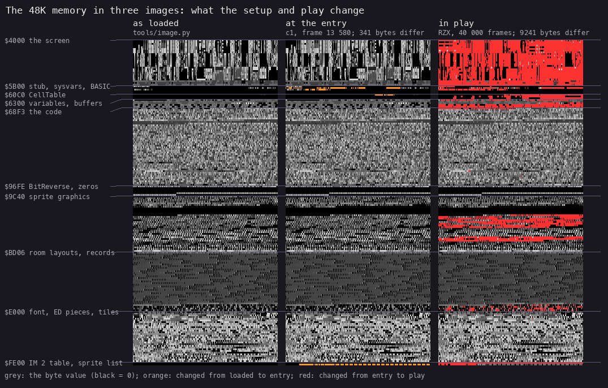
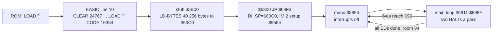
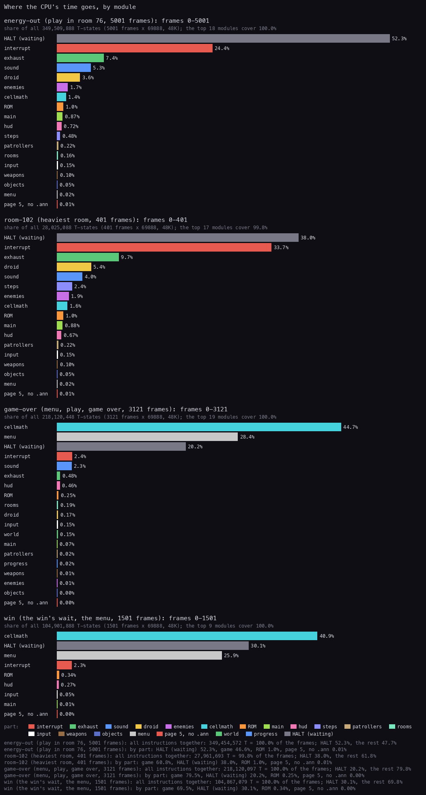
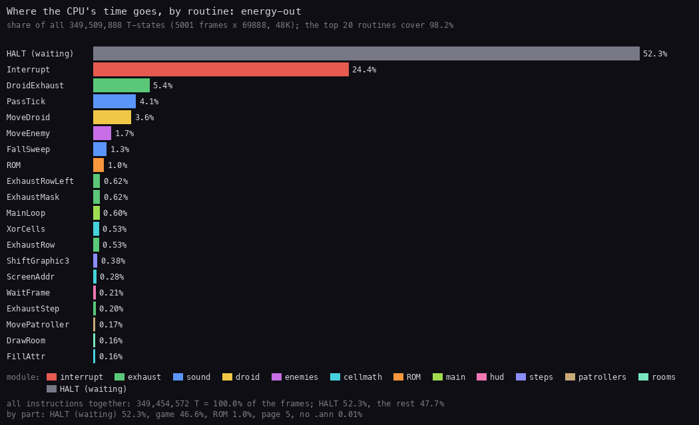
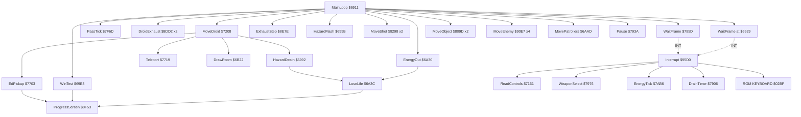

# 2. Architecture

What this covers: the machine budget; the memory map with its heatmap; the three images (as loaded, at the entry, in
play); the stages from the tape to play; the module map of the 25 source modules; a first sprite sheet; where the CPU's time goes; the
frame and the main loop's call graph; and the authors' leftover source in the image.

The recordings it rests on are those of [WALKTHROUGH 6.0](../WALKTHROUGH.md#60-the-recordings): `c1` (power-on, the
tape loaded at signal speed, the menu, play) and the 69 recordings from saved states, merged into
`work/stage1/l1-all.json` (`tools/l1merge.py`, 70 L1 builds, 81 691 frames, 0 diverged). The profiles use
`energy-out`, `game-over`, `win` and `room-102` (made for doc 4: `work/stage1/rzx/at050000.szx`, no key, 401 frames).
L1 counts are totals over whole recordings, so they carry no time in the frame.

## 2.1 The machine budget

| | |
| --- | --- |
| Machine | 48K: the game block fills `$60C0-$FDFF`; nothing pages, no 128K feature |
| Interrupts | IM 2, I = `$FE`, a 257-byte table of `$5B` at `$FE00-$FF00`, so every interrupt jumps to `$5B5B`, `JP $95D0` |
| Frame | 69 888 T; a main-loop pass holds 2 interrupts, 3 when its work overruns ([doc 4.7](04-game-loop.md#47-passes-and-interrupts-a-frame)) |
| CPU | the interrupt handler draws every sprite and takes a quarter to a third of the time in play; the main loop waits in HALT for 38-52 % (2.7) |
| Sound | the beeper only (port `$FE` bit 4), from the main loop with the CPU busy (doc 9) |
| Stack | from `$60C0` down (`$68F4 LD HL,$60C0; $68F7 LD SP,HL`), deepest write seen `$60AC` (2.2) |

**The point**: a 48K game that uses all of the 40 K above the BASIC area, and spends about half of play waiting for
the frame.

## 2.2 The memory map

The 48K's RAM as the game uses it. The counts are L1's, summed over the 69 recordings from saved states
(`work/stage1/rec/*/l1.json`; `c1` is left out of the counts because its tape load and the ROM's RAM test write every
byte four times); "bytes" counts the bytes of the range that were executed, read or written at least once
(`work/stage1/regions.py` over `work/stage1/regions.txt`; the finer runs: `tools/l1map.py work/stage1/l1-all.json
--gap 32`, `work/stage1/l1map.txt`).

| Range | Size | What | Use | Witness |
| --- | ---: | --- | --- | --- |
| `$4000-$5AFF` | 6912 | the screen | 17 414 910 reads, 19 400 712 writes, every byte | the sprites are XORed on by the handler (`$95DB-$963F`), the rooms drawn by `$6B22` |
| `$5B00-$5B1F` | 32 | the loader stub ([doc 3.2](03-build-and-load.md#32-the-basic-line-and-the-stub-at-5b00)) | dead after the load | no access in the recordings |
| `$5B5B-$5B5D` | 3 | `JP $95D0`, the interrupt's landing | 160 320 executions | written at `$95B2-$95B7` |
| `$5C00-$5CBF` | 192 | the system variables | the ROM's KEYBOARD, called from the handler, keeps `$5C04-$5C08` (KSTATE) and `$5C3B` (FLAGS) | the only bytes written here |
| `$5CC0-$60AB` | 1004 | the BASIC program and workspace | dead after the load; never written | 83 bytes read at `$6000-$60A7`, all in `room-tour` (the per-recording L1s): they are CellTable's addresses for the six HUD rows above the play area (rows -6 to -1, columns 0-11 and 28-30), a cell lookup with a row above the play area in the rooms that recording POKEs; the routine that reads them is not traced |
| `$60AC-$60BF` | 20 | the machine stack (grows down from `$60C0`) | the deepest write `$60AC`, in 8 recordings | L1 writes per recording (below) |
| `$60C0-$62FF` | 576 | CellTable: 32 x 18 cells, one for each attribute cell of the play area (screen rows 6-23): bit 0 a wall, bit 1 an enemy, bit 2 an object, bit 3 a patroller, the shot marks, `$FF` a teleporter, an item's kind ([doc 7](07-objects.md)) | 1 322 096 reads, 352 047 writes | zero in the image (but `$60E3`, `$60E8`); changes with the room |
| `$6300-$6302` | 3 | the entry, `JP $68F3` | run once | `c1` probe, frame 13580 |
| `$6303-$63D1` | 207 | the game's variables: x `$6359`, y `$635A`, room `$6363`, lives `$636D`, energy `$636E` (BCD), the energy timer `$6366` (counts interrupts), the random number `$63A4-$63A7`, the controls `$63C2`, SpriteListEnd `$63D0`; the authors' leftover source under DroidVars `$6359-$637F` and RoomVars `$639C-$63D1` (2.9) | 10 328 593 reads, 4 207 839 writes | the code's operands (doc 10) |
| `$63D2-$65AD` | 476 | the scrolling messages, a priority byte each, from "TUJAD FROM ORPHEUS" at `$63D3` (the game-over message at `$654D`) | read only (17 028 reads) | the Dro Soft copy translates `$63D9-$65A2` (README) |
| `$65AE-$6887` | 730 | buffers: the ED flags `$6681-$668A` (the win test), the graphics built at run time (`$65DD`, DroidSave `$668C`, the pre-shifted enemies `$6708-$6858`); the leftover source under them, `$65E5-$6887` (2.9) | 4 573 637 reads, 4 032 452 writes | the sprite lists (2.6); `$69E3` |
| `$6888-$68F2` | 107 | data | read only (51 981 reads) | |
| `$68F3-$96FD` | 11 787 | the code (9744 bytes executed; its 17 modules in 2.5), with tables between: `$8BF5-$8DD1` the menu's texts and graphics, `$9072-$9092` the progress text, `$9484-$9583` | 512 737 248 executions; written only in variables kept there: MenuLogoAt `$8D35-$8D36` (`$88E7 LD ($8D35),HL`, the screen address MenuLogo draws at), PrintAttr `$8D37` (PrintText's colour, `$8AB4`), the percentage's digits `$9085-$9086` and ProgressPercentBcd `$9092` (stage 2) | L1 |
| `$96FE-$9C3F` | 1346 | BitReverse `$9A4C-$9B4B` (each byte with its bits reversed, for TurnRound `$7866`) between two zero fills no code touches (`$96FE-$9A4B`, `$9B4C-$9C3F`; stage 2) | 137 bytes read (180 464 reads) | src/game/game.ann |
| `$9C40-$A74D` | 2830 | the droid's 14 frames `$9C40-$A257` (src/res/sprites/Droid.png), 600 zeros TurnRound mirrors with them (`$A258-$A4AF`), 670 zeros never touched (`$A4B0-$A74D`) | 3 639 097 reads, 180 464 writes (the mirroring) | stage 2 |
| `$A74E-$BD05` | 5560 | the enemy kinds and their explosion (`$A74E-$AEC4`), the materialise frames, weapon 3's probe, the five object kinds, their death, the probe's explosion, the patrollers (`$B902-$BC01`), the menu frame (`$BC02-$BD01`), 4 zeros | 1 890 994 reads; written in `$A74E-$AEC4`, `$B049-$B2EF`, `$B413-$B6B9`, `$B71B-$B83D` (shifted in place by ShiftGraphic3 `$7EBB` / ShiftGraphic4 `$7EFE`) | src/res/sprites/, stage 2 |
| `$BD06-$DB52` | 7757 | RoomLayouts: 128 offset words, the rooms' tile layouts (column, row, tile; `$80` ends), the empty layout `$DB52` | 19 922 reads | src/res/rooms/Rooms.txt |
| `$DB53-$DC52` | 256 | the alien map: 128 words, each an offset from `$DB53` to the room's record | read on every room change | `$6B57-$6B6B` |
| `$DC53-$DFF9` | 935 | the 102 room records (items, teleporter, enemy mask, two objects); 326 bytes written in 103 runs (per-room state) | 24 723 reads, 3155 writes | the offsets of the table |
| `$DFFA-$DFFF` | 6 | the empty record, all zero, shared by the 26 rooms that do not exist | read | [world map](../WALKTHROUGH.md#61-the-screens), the map drawn from the resources below |
| `$E000-$FDFF` | 7680 | 2 pad bytes, the font `$E002-$E1E1` (codes `$20-$5B`), the ED pieces' picture `$E1E2-$E821`, the tile graphics `$E822-$FDFF` (the Sinclairsoft translation changes characters from `$E032` on) | read only | src/res/graphics/, src/res/tiles/ |
| `$FE00-$FF00` | 257 | the IM 2 table, 257 bytes of `$5B` | filled at `$9584` | the vector is read at `$FEFF-$FF00`, 52 910 times each (the bus holds `$FF`) |
| `$FF01-$FF4D` | 77 | the sprite list: 8-byte entries, terminated at `(63D0)` by `$795D` | 664 666 reads, 613 854 writes | `$95DB-$963F` |
| `$FF4E-$FFFF` | 178 | not used | untouched | L1 |

The stack's low mark: the deepest byte written in the recordings is `$60AC` (8 RZX chunks, for example `rzx-065000`),
20 bytes below `$60C0`; the RZX playback's saved state after 40 000 frames (`work/stage1/rzx/at040000.szx`) holds
SP = `$60A8` inside the handler (PC `$9611`), so the stack reaches at least `$60A8`, 24 bytes deep. Below it lie
1000 bytes of the dead BASIC area (`$5CC0-$60A7`) before the system variables.


*The heatmap, all 70 L1 builds with `c1` (`tools/fig_heatmap.py work/stage1/l1-all.json docs/img/heatmap.png`).
How to read: one row a 256-byte page, `$4000` at the top; the colour is log2 of the count; under each grid the screen
pages drawn as the screen. Executed: only `$68F3-$96FD`, plus a dot at `$5B5B` (the `JP` of the interrupt). Read: the
screen, the variables and buffers at `$60C0-$6887`, the sprite graphics `$9C40-$BD05`, the room data and the font
above it. Written: the screen (brightest at the scroller's panel, top right), `$60C0-$6887`, the graphics shifted in
place at `$A74E-$B83D`, and the sprite list at `$FF01`. The point: the game block splits cleanly into code in the
middle, graphics and room data above, and a work area below; above `$BD06` only the room records'
per-room state (`$DC53-$DFF9`) and the sprite list are written.*

## 2.3 Three images: as loaded, at the entry, in play

| Image | What it is | How it was made |
| --- | --- | --- |
| as loaded | the tape's two data blocks where the loader puts them: `$4000-$5B1F` (the picture and the stub) and `$60C0-$FDFF` | `tools/image.py work/mkgame/original.bin` |
| at the entry | the memory of `c1` at the start of frame 13580, the frame in which `$6300` first runs | `re_session.py open` on `c1`'s `session.ttd`, then `build --from-frame 13580 --to-frame 13581 --into work/stage1/entry/f13580`: `start.bin` |
| after the setup | the same at frame 13581 | `.../f13581/start.bin` |
| in play | the RZX playthrough after 40 000 frames (room 54) and the menu-cursor recording's end (room 84) | `tools/szx.py work/stage1/rzx/at040000.szx`, `work/stage1/rec/menu-cursor/end.szx` |

What changes (`work/stage1/imgdiff.py`, runs of differing bytes over `$5B00-$FFFF`):

- **Loaded to entry**: nothing in the game block or the screen. The 341 bytes that differ (7 runs) are the ROM's: the system
  variables (`$5C00-$5D4E`), the BASIC stack under RAMTOP (`$609E-$60BF`) and the ROM's own stack and UDGs from
  power-on (`$FF18-$FFFE`, above the block). Nothing is unpacked or decrypted.
- **Entry to the next frame**: the setup `$68F3` writes `JP $95D0` at `$5B5B`, the vector table `$FE00-$FF00`, the
  controls and SpriteListEnd (`$63C2-$63D1`), and moves the stack to `$60C0`.
- **Loaded to play** (`$60C0-$FDFF`): 3076 bytes in the RZX state, 673 in menu-cursor's end; no code changes;
  the only bytes written in the code range are variables kept there: MenuLogoAt `$8D35-$8D36`, PrintAttr `$8D37`, the
  percentage's digits `$9085-$9086` and ProgressPercentBcd `$9092`. What changes is data:
  the cell table `$60C0-$62FF`; the variables and buffers `$6303-$6886` (over the leftover assembler text of the image,
  [WALKTHROUGH 0](../WALKTHROUGH.md#0-the-medium)); the sprite graphics shifted in place (`$A77F-$AEC3`,
  `$B413-$B6B9`); the room records `$DC5B-$DFF4`; and, above the block, the sprite list at `$FF01`.



*The 48K memory as loaded, at the entry and in play, made with `python3 tools/fig_images.py
docs/img/memory-images.png` from `tools/image.py`, `work/stage1/entry/f13580/start.bin` and
`work/stage1/rzx/at040000.szx`. How to read: one pixel a byte, one row a 256-byte page, `$4000` at the top; grey is
the byte's value, black zero; a byte that differs from the image on its left is orange (loaded to entry: the ROM's
system variables, the BASIC stack, the ROM's stack above the block) or red (entry to play: the screen, the cell table
and variables, the sprite graphics shifted in place, the room records just below `$E000`, the IM 2 table and the
sprite list). The point: the code column (`$68F3-$96FD`) is the same grey in all three: nothing is unpacked and no code
is rewritten.*

**The point**: what the tape loads is what runs; the image needs no unpacking, and the source build has to give
the two blocks' bytes and nothing else.

## 2.4 The stages, from the tape to play



| Stage | Entered | Frame of `c1` | What runs |
| --- | --- | --- | --- |
| 0 | `$5B00` | 2908, T 8352 | the stub: `CALL $0556` for the headerless block ([doc 3.2](03-build-and-load.md#32-the-basic-line-and-the-stub-at-5b00)) |
| 1 | `$6300` | 13580 | the setup `$68F3-$6910` and the menu |
| 2 | `$95D0` (the first interrupt) | 14297 | play: the main loop and the IM 2 handler |

The frames are `probe_frames` exec frames over `work/stage1/c1/session.ttd`: the first frame each address runs in.

**The point**: three stages and no unpacking. The only code that runs before the game's own is the ROM and a
six-instruction stub.

## 2.5 The module map

The source is 25 modules (`src/game/*.asm`, written by `kit/mkgame.py` from `src/game/game.ann`), in address order.
"Entries" counts the labelled entries of `game.ann` in each module; "code" counts those that are routines.

| Module | Range | Bytes | Entries (code) | What |
| --- | --- | ---: | ---: | --- |
| cells | `$60C0-$62FF` | 576 | 1 (0) | CellTable, the room's cells |
| start | `$6300-$63D1` | 210 | 7 (1) | Start `JP $68F3`, the enemies', objects', patrollers' and droid's records, the variables |
| messages | `$63D2-$65AD` | 476 | 1 (0) | the scroller's ten messages with their priorities |
| buffers | `$65AE-$6887` | 730 | 11 (0) | the exhaust, the shot, EdFlags, DroidSave, the enemy buffers |
| droidtables | `$6888-$68F2` | 107 | 9 (0) | the frame tables: the droid, the enemies, their explosion and materialising, the objects' death, weapon 3 |
| main | `$68F3-$6ADB` | 489 | 10 (10) | Setup, Restart, MainLoop, the hazard, WinTest, LoseLife |
| rooms | `$6ADC-$7160` | 1669 | 5 (4) | SaveRoomObjects, DrawRoom, the tile tables |
| input | `$7161-$7207` | 167 | 1 (1) | ReadControls |
| droid | `$7208-$7905` | 1790 | 8 (8) | MoveDroid, the pickups, Teleport, TurnRound |
| hud | `$7906-$7B8E` | 649 | 12 (12) | DrainTimer, ClearPlayArea, Pause, WaitFrame, WeaponSelect, ShowWeapon, NewGame, PlaceDroid, ClearScreen, EnergyTick, PrintBcd, DeathEffect |
| world | `$7B8F-$7C57` | 201 | 4 (4) | RoomRecord, ScrambleRooms |
| cellmath | `$7C58-$7DD9` | 386 | 13 (13) | screen and cell addresses, cell tests, Random |
| steps | `$7DDA-$7F4C` | 371 | 6 (6) | the droid's steps (StepRight, StepDown, StepLeft, StepUp), ShiftGraphic3 and ShiftGraphic4 |
| sound | `$7F4D-$809C` | 336 | 6 (6) | the sweeps, PassTick, BeamDown, BeamUp, TeleportFlash |
| objects | `$809D-$8297` | 507 | 1 (1) | MoveObject |
| weapons | `$8298-$8853` | 1468 | 5 (4) | MoveShot (weapon 3's steering included) and the shot graphics |
| menu | `$8854-$8DD1` | 1406 | 15 (7) | Menu, MenuPoll, the logo, the blits, PrintText, DrawHud, the HUD and menu graphics and texts |
| exhaust | `$8DD2-$8F52` | 385 | 6 (6) | DroidExhaust, ExhaustStep |
| progress | `$8F53-$90C7` | 373 | 4 (3) | ProgressScreen, ProgressText |
| enemies | `$90C8-$93A5` | 734 | 2 (2) | EnemyKind, MoveEnemy |
| patrollers | `$93A6-$9583` | 478 | 4 (3) | MovePatroller, DrawPatroller, StartPositions |
| interrupt | `$9584-$96FD` | 378 | 3 (2) | SetupIM2, ExitToBasic (never run), Interrupt |
| bitreverse | `$96FE-$9C3F` | 1346 | 3 (0) | BitReverse between two zero fills |
| sprites | `$9C40-$BD05` | 8390 | 10 (0) | the droid, enemies, materialise, probe, objects, patrollers, menu frame |
| roomdata | `$BD06-$FDFF` | 16 634 | 8 (0) | RoomLayouts, AlienMap, the room records, the font, the ED pieces, the tiles |

155 entries in all. The code is 17 modules in `$68F3-$96FD`; the data is the eight around it (five below, three above).

```bash
python3 work/docs/tjA/modmap.py      # the table above, from build/game.lst and src/game/game.ann
```

**The point**: code and data are cleanly apart. The work area sits below the code and the read-only graphics and
rooms above it, and the 16 K of room data and tiles is the biggest single part of the game.

## 2.6 The sprites, first look

The handler draws the sprite list: at `$FF01` on, 8 bytes an entry: the graphic (2 bytes), the address of a
collision flag (2), the width in bytes (1), the height in character rows (1), the screen address (2). The list is
rebuilt by the main loop every half pass. The sheet shows every graphic found in the lists of all saved states
(`work/stage1/sprites-found.json`, 28 graphics):


*Drawn by `tools/fig_sprites.py` from the image, `work/stage1/sprites-found.json` and
`work/stage1/rzx/at043000.szx`. How to read: each graphic with its address and size (bytes x character rows). From
the image: the droid (`$9CB8` 3 x 5, `$A000` and `$A050` 2 x 5, `$A0F0` and `$A168` 3 x 5, each flagged at `$635B`)
and the objects at `$B16D-$BAE2` (4 x 3, 97 bytes apart). From RAM, drawn from the RZX state after 43 000 frames:
the shot `$65DD` (1 x 1, flagged at `$635E`), DroidSave `$668C` (2 and 3 x 5) and the enemies' pre-shifted buffers
`$6708-$6858` (3 x 2, 48 bytes apart, flagged at `$6304`, `$630D`, `$6316`, `$631F`). The point: every mover is a
plain XOR block of whole bytes; the enemies are pre-shifted into RAM buffers, the droid is drawn from its frames.*

The full sheets, one for each kind, are the resources (`src/res/sprites/*.png`) and doc 6.

**The point**: one sprite format serves every mover, and the list is the only interface between the main loop and the
renderer.

## 2.7 Where the CPU's time goes



*The CPU's time by module over four recordings, from their L1 counts and the instruction timings
(`kit/fig_budget.py`). How to read: each bar is a module's share of all T-states of the recording; HALT is the time
spent waiting for the interrupt; "page 5, no .ann" is the `JP` at `$5B5B`. Made with `python3 ../../kit/fig_budget.py
work/stage1/rec/energy-out/l1.json docs/img/arch/budget-modules.png --ann src/game/game.ann --by module --title
"Where the CPU's time goes, by module" --label "energy-out (play in room 76, 5001 frames)" --state "room-102 (heaviest
room, 401 frames)=work/docs/tjA/rec/room-102/l1.json" --state "game-over (menu, play, game over, 3121
frames)=work/stage1/rec/game-over/l1.json" --state "win (the win's wait, the menu, 1501
frames)=work/stage1/rec/win/l1.json"`.*

| Recording | HALT | interrupt | exhaust | sound | droid | the rest |
| --- | ---: | ---: | ---: | ---: | ---: | ---: |
| `energy-out` (play, room 76) | 52.31 % | 24.44 % | 7.36 % | 5.32 % | 3.63 % | 6.94 % |
| `room-102` (play, the heaviest room) | 37.97 % | 33.73 % | 9.73 % | 4.0 % | 5.37 % | 9.2 % |

- In play, half the time is HALT and a quarter to a third is the interrupt. The droid's exhaust costs more than the
  droid itself.
- In `game-over` and `win` the menu dominates: cellmath 44.68 % and 40.93 % is Random `$7DC9`, which MenuPoll calls on
  every poll; menu 28.42 % and 25.91 %. The win's HALT (30.14 %) is 495 of WinWait's 512 HALTs (the recording starts inside the wait).



*The top 20 routines of `energy-out` (play in room 76, 5001 frames, a life lost to the energy). How to read: each bar
is a routine's share of all T-states. Made with the same command and `--by routine --top 20`, `energy-out` alone.*

| Routine | Share of `energy-out` |
| --- | ---: |
| Interrupt `$95D0` | 24.44 % |
| DroidExhaust `$8DD2` | 5.36 % |
| PassTick `$7F6D` | 4.06 % |
| MoveDroid `$7208` | 3.63 % |
| MoveEnemy `$90E7` | 1.70 % |
| FallSweep `$7F5D` | 1.26 % |
| the ROM (KEYBOARD) | 1.02 % |

**The point**: the interrupt is the game's biggest routine by far. A faster game would come from a cheaper sprite
XOR and scroller, not from the main loop.

## 2.8 The frame and the main loop's call graph



- **The handler** `$95D0` (IM 2, every interrupt through `$5B5B`): reads the controls, XORs every sprite of the list
  at `$FF01` (setting bit 7 of a record's flag on a collision), steps the message scroller every 5 interrupts, then
  WeaponSelect, EnergyTick, DrainTimer and the ROM's KEYBOARD, and `EI; RETI` (`$96FB`).
- **The main loop** `$6911-$698F` waits twice a pass in WaitFrame and runs with interrupts off between the waits. The
  first half moves the droid, the second the objects, the enemies and the patrollers; then it tests the pause, the
  energy and the win.
- **A pass** holds 2 interrupts when its work fits and 3 when the work crosses an INT; the 1-frame passes that stage 1
  counted are an artefact of numbering frames from T 0 while the INT comes at T 1812
  ([doc 4.7](04-game-loop.md#47-passes-and-interrupts-a-frame)).

Stage 1's counts (`tools/passes.py`, [WALKTHROUGH 1](../WALKTHROUGH.md#1-one-recording-from-power-on)) were taken by
frame number. Recounted by the interrupts inside each pass, the 200 passes from `work/stage1/rzx/at050000.szx`
(room 102) are 183 of 2 interrupts and 17 of 3. The heaviest pass is 197 394 T, where the scroller's step and three
enemy pairs fall in one handler ([doc 4.8](04-game-loop.md#48-the-beam-a-light-pass-and-the-heaviest-pass)).

**The point**: the program is two loops that hand over at a HALT: the main loop computes with interrupts off, the
handler draws and reads. Doc 4 has the timing.

## 2.9 The authors' leftover source

Under the variables and buffers, the image holds 768 bytes of the authors' own assembler source, as their editor stored
it. No code reads these bytes before writing them: NewGame `$7A2F` and PlaceDroid `$7A6D` write the droid's variables,
DrawRoom `$6B22` the room's, and NewGame zeroes `$65E5-$668B`.

| Resource | Address | Bytes | Under | What |
| --- | --- | ---: | --- | --- |
| `src/res/leftover/Source1.txt` | `$6359-$637F` | 39 | DroidVars | `inc de`, `ld hl,(pos)` |
| `Source2.txt` | `$639C-$63D1` | 54 | RoomVars | `ld bc,7`, `scf`, `ccf`, `sbc hl,bc` |
| `Source3.txt` | `$65E5-$6887` | 675 | ExhaustRows to EnemyBuffers | the end of a routine that calls `draw`, then `lookup` and `scram` |

A stored line is `[length][label][length][mnemonic][length][operands]`, then 3 zero bytes.

**A worked example.** The bytes from `$65E9` (`tools/image.py`, `work/mkgame/original.bin`):

```text
$65E9: 00                 label: length 0 (none)
$65EA: 03 73 6C 61        mnemonic: length 3, "sla"
$65EE: 01 65              operands: length 1, "e"
$65F0: 00 00 00           the line's end
$65F3: 00 03 73 6C 61 01 65 00 00 00     the next line: "sla e" again
```

In `Source3.txt` that is a line `TAB sla TAB e`. The whole of Source3 holds two routines the game still has, word for
word:

| Leftover (`Source3.txt`) | The game |
| --- | --- |
| `lookup ld hl,alnmap` / `ld d,0` / `ld e,c` / `sla e` / `add hl,de` / `ld e,(hl)` / `inc hl` / `ld d,(hl)` / `ld hl,alnmap` / `add hl,de` / `ret` | RoomRecord `$7B8F` (`src/game/world.asm`): the same eleven instructions, `alnmap` = AlienMap `$DB53` |
| `scram ld c,123` / `call lookup` / … / `ld a,124` / `cp c` | ScrambleRooms `$7BA0`: rooms 0-123, the items whose kind has bit 6 clear passed one room on |

```bash
python3 tools/res_formats.py check     # the leftover's round trip, with every other resource
```

**The point**: the authors' names survive for two routines and one table (`lookup`, `scram`, `alnmap`), and they
confirm the reading of the room records: the room's record is AlienMap plus AlienMap's word for the room.
