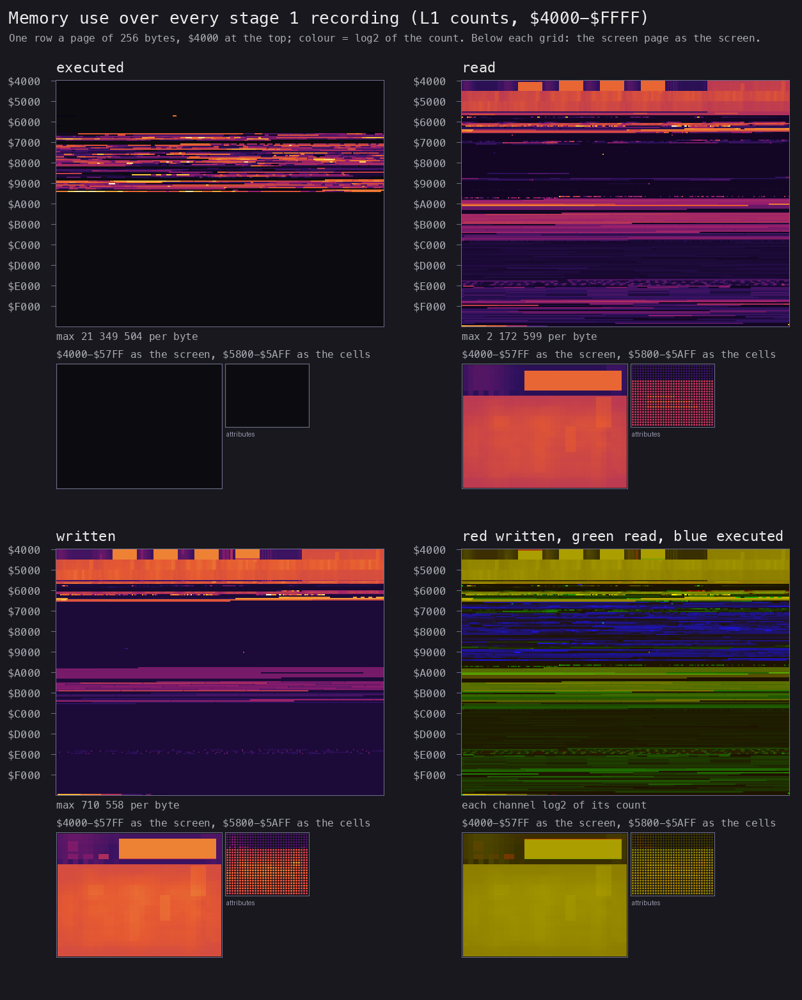
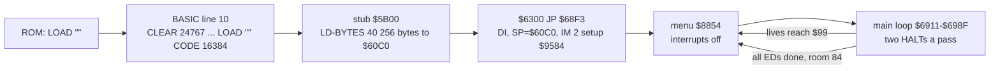
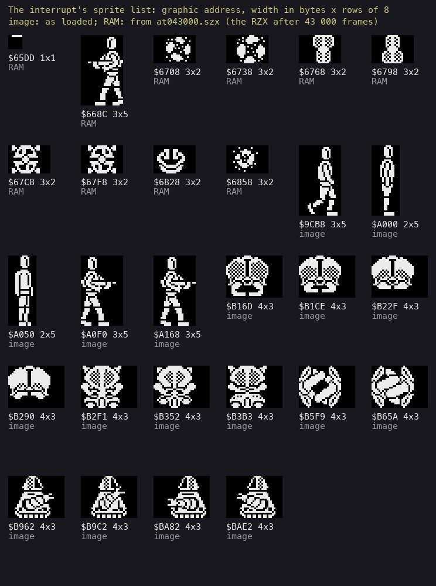

# 2. Architecture

What this covers: the machine budget, the memory map with its heatmap, the three images (as loaded, at the entry, in
play), the stages from the tape to play, the frame and the main loop, and a first sprite sheet. The recordings it
rests on are those of [WALKTHROUGH 6.0](../WALKTHROUGH.md#60-the-recordings): `c1` (power-on, the tape loaded at
signal speed, the menu, play) and the 69 recordings from saved states, merged into `work/stage1/l1-all.json`
(`tools/l1merge.py`, 70 L1 builds, 81 691 frames, 0 diverged).

<!-- Figures this document needs (GUIDE.md 4.2), remove each line when it is in: -->
<!-- - the stages from power-on to play (mermaid) -->

## 2.1 The machine budget

| | |
| --- | --- |
| Machine | 48K: the game block fills `$60C0-$FDFF`; nothing pages, no 128K feature |
| Interrupts | IM 2, I = `$FE`, a 257-byte table of `$5B` at `$FE00-$FF00`, so every interrupt jumps to `$5B5B`, `JP $95D0` |
| Frame | 69 888 T; a main-loop pass takes 2 frames in the median (2.4 below) |
| Sound | the beeper only (port `$FE` bit 4), from the main loop with the CPU busy (doc 9) |
| Stack | from `$60C0` down (`$68F3 LD SP,$60C0`), deepest write seen `$60AC` (2.2) |

## 2.2 The memory map

The 48K's RAM as the game uses it. The counts are L1's, summed over the 69 recordings from saved states
(`work/stage1/rec/*/l1.json`; `c1` is left out of the counts because its tape load and the ROM's RAM test write every
byte four times); "bytes" counts the bytes of the range that were executed, read or written at least once
(`work/stage1/regions.py` over `work/stage1/regions.txt`; the finer runs: `tools/l1map.py work/stage1/l1-all.json
--gap 32`, `work/stage1/l1map.txt`).

| Range | Size | What | Use | Witness |
| --- | ---: | --- | --- | --- |
| `$4000-$5AFF` | 6912 | the screen | 17 414 910 reads, 19 400 712 writes, every byte | the sprites are XORed on by the handler (`$95DB-$963F`), the rooms drawn by `$6B22` |
| `$5B00-$5B1F` | 32 | the loader stub ([doc 3.2](03-build-and-load.md#32-the-basic-line-and-the-stub-at-5b00)) | dead after the load | no access in the recordings |
| `$5B5B-$5B5D` | 3 | `JP $95D0`, the interrupt's landing | 160 320 executions | written at `$95B2-$95B7` |
| `$5C00-$5CBF` | 192 | the system variables | the ROM's KEYBOARD, called from the handler, keeps `$5C04-$5C08` (KSTATE) and `$5C3B` (FLAGS) | the only bytes written here |
| `$5CC0-$60AB` | 1004 | the BASIC program and workspace | dead after the load; never written | 78 bytes read at `$6000-$60AB`, below the cell table at `$60C0` (first guess: lookups above the table's first row) |
| `$60AC-$60BF` | 20 | the machine stack (grows down from `$60C0`) | the deepest write `$60AC`, in 8 recordings | L1 writes per recording (below) |
| `$60C0-$62FF` | 576 | a table of 32 x 18 bytes, `$00` or `$01`, the size of the play area in cells (32 columns, screen rows 6-23); first guess: the room's solid cells | 1 322 096 reads, 352 047 writes | zero in the image (but `$60E3`, `$60E8`); changes with the room |
| `$6300-$6302` | 3 | the entry, `JP $68F3` | run once | `c1` probe, frame 13580 |
| `$6303-$63D2` | 208 | the game's variables: x `$6359`, y `$635A`, room `$6363`, lives `$636D`, energy `$636E` (BCD), the interrupt counter `$6366`, the random number `$63A4-$63A7`, the controls `$63C2`, the sprite-list pointer `$63D0` | 10 328 593 reads, 4 207 839 writes | the code's operands (doc 10) |
| `$63D3-$65AD` | 475 | the scrolling messages, from "TUJAD FROM ORPHEUS" at `$63D6` (the game-over message at `$654D`) | read only (17 028 reads) | the Dro Soft copy translates `$63D9-$65A2` (README) |
| `$65AE-$6887` | 730 | buffers: the ED flags `$6681-$668A` (the win test), the graphics built at run time (`$65DD`, `$668C`, the pre-shifted enemies `$6708-$6858`) | 4 573 637 reads, 4 032 452 writes | the sprite lists (2.8); `$69E3` |
| `$6888-$68F2` | 107 | data | read only (51 981 reads) | |
| `$68F3-$96FD` | 11 787 | the code (9744 bytes executed), with tables between: `$8BF5-$8DD1` the menu's texts and graphics, `$9072-$9092` the progress text, `$9484-$9583` | 512 737 248 executions; written only at `$8D35-$8D37` (`$88E7 LD ($8D35),HL`: a screen address for the menu's printing) and `$9085-$9086`, `$9092`, next to the progress text (stage 2) | L1 |
| `$96FE-$9C3F` | 1346 | data | 137 bytes read | |
| `$9C40-$B6B9` | 6778 | sprite graphics: the player (`$9CB8`, `$A000`, `$A050`, `$A0F0`, `$A168`), the objects (`$B16D` on, 97 bytes apart) | 5 419 064 reads; 625 807 writes over `$9C40-$A09F`, `$A0F0-$A4AF`, `$A74E-$AEC4`, `$B049-$B2EF`, `$B413-$B6B9`: graphics shifted in place | `$B540` reads `FF C0 00 03 ...` in the image, `0F FC 00 00 37 ...` in the RZX state after 40 000 frames: the same rows shifted right by 4 bits |
| `$B6BA-$DB52` | 9369 | room graphics and tables (stage 2) | 130 949 reads; written only at `$B71B-$B83D` (shifted in place) | |
| `$DB53-$DC52` | 256 | the room table: 128 words, each an offset from `$DB53` to the room's record | read on every room change | `$6B57-$6B6B` |
| `$DC53-$DFF9` | 935 | the 102 room records; 326 bytes written in 103 runs (per-room state, stage 2) | 24 723 reads, 3155 writes | the offsets of the table |
| `$DFFA-$E009` | 16 | the empty record, all zero, shared by the 26 rooms that do not exist | read | [world map](../WALKTHROUGH.md#61-the-screens) |
| `$E00A-$FDFF` | 7670 | graphics and the font (the Sinclairsoft translation changes characters from `$E032` on) | read only (527 634 reads) | README |
| `$FE00-$FF00` | 257 | the IM 2 table, 257 bytes of `$5B` | filled at `$9584` | the vector is read at `$FEFF-$FF00`, 52 910 times each (the bus holds `$FF`) |
| `$FF01-$FF4D` | 77 | the sprite list: 8-byte entries, terminated at `(63D0)` by `$795D` | 664 666 reads, 613 854 writes | `$95DB-$963F` |
| `$FF4E-$FFFF` | 178 | not used | untouched | L1 |

The stack's low mark: the deepest byte written in the recordings is `$60AC` (8 RZX chunks, for example `rzx-065000`),
20 bytes below `$60C0`; the RZX playback's saved state after 40 000 frames (`work/stage1/rzx/at040000.szx`) holds
SP = `$60A8` inside the handler (PC `$9611`), so the stack reaches at least `$60A8`, 24 bytes deep. Below it lie
1448 bytes of the dead BASIC area before the system variables.

*The heatmap (`tools/fig_heatmap.py work/stage1/l1-all.json docs/img/heatmap.png`, all 70 builds with `c1`): the
code at `$68F3-$96FD` is the only executed block; the bands read between `$9C40` and `$B6B9` are the sprite
graphics, the faint ones above `$E000` the data there; the written rows are the screen, the variables and buffers at
`$60C0-$6887`, the shifted graphics and the sprite list at `$FF01`.*

## 2.3 Three images: as loaded, at the entry, in play

| Image | What it is | How it was made |
| --- | --- | --- |
| as loaded | the tape's two data blocks where the loader puts them: `$4000-$5B1F` (the picture and the stub) and `$60C0-$FDFF` | `tools/image.py work/mkgame/original.bin` |
| at the entry | the memory of `c1` at the start of frame 13580, the frame in which `$6300` first runs | `re_session.py open` on `c1`'s `session.ttd`, then `build --from-frame 13580 --to-frame 13581 --into work/stage1/entry/f13580`: `start.bin` |
| after the setup | the same at frame 13581 | `.../f13581/start.bin` |
| in play | the RZX playthrough after 40 000 frames (room 102) and the menu-cursor recording's end (room 84) | `tools/szx.py work/stage1/rzx/at040000.szx`, `work/stage1/rec/menu-cursor/end.szx` |

What changes (`work/stage1/imgdiff.py`, runs of differing bytes over `$5B00-$FFFF`):

- **Loaded to entry**: nothing in the game block or the screen. The 398 bytes that differ are the ROM's: the system
  variables (`$5C00-$5D4E`), the BASIC stack under RAMTOP (`$609E-$60BF`) and the ROM's own stack and UDGs from
  power-on (`$FF18-$FFFE`, above the block). Nothing is unpacked or decrypted.
- **Entry to the next frame**: the setup `$68F3` writes `JP $95D0` at `$5B5B`, the vector table `$FE00-$FF00`, the
  controls and the sprite-list pointer (`$63C2-$63D1`), and moves the stack to `$60C0`.
- **Loaded to play** (`$60C0-$FDFF`): 3076 bytes in the RZX state, 673 in menu-cursor's end; no code changes
  except the three text bytes of the menu and the progress screen (`$8D35-$8D37`, `$9092`). What changes is data:
  the cell table `$60C0-$62FF`; the variables and buffers `$6303-$6886` (over the leftover assembler text of the image,
  [WALKTHROUGH 0](../WALKTHROUGH.md#0-the-medium)); the sprite graphics shifted in place (`$A77F-$AEC3`,
  `$B413-$B6B9`); the room records `$DC5B-$DFF4`; and, above the block, the sprite list at `$FF01`.

**The point**: what the tape loads is what runs; the image needs no unpacking, and the source build has to give
the two blocks' bytes and nothing else.

## 2.4 The stages, from the tape to play

| Stage | Entered | Frame of `c1` | What runs |
| --- | --- | --- | --- |
| 0 | `$5B00` | 2908, T 8352 | the stub: `CALL $0556` for the headerless block |
| 1 | `$6300` | 13580 | the setup `$68F3-$6910` and the menu |
| 2 | `$95D0` (the first interrupt) | 14297 | play: the main loop and the IM 2 handler |

## 2.5 The frame and the main loop

- **The handler** `$95D0` (IM 2, every interrupt through `$5B5B`): pushes all, reads the controls (`$7161`, into
  `$63C2`), draws every sprite of the list at `$FF01` with XOR (`$95DB-$963F`, setting bit 7 of each entry's
  collision flag on a hit), scrolls the message panel (`$9640`), calls `$96CB`, `$7976` (weapon select on CAPS SHIFT
  or SPACE), `$7AB6`, `$7906` and the ROM's KEYBOARD (`$02BF`), then `EI; RETI` (`$96FB`).
- **The main loop** `$6911-$698F` waits twice a pass in `$795D` (called at `$6911` and `$6929`): it closes the
  sprite list at `(63D0)`, resets the pointer to `$FF01`, and runs `EI; NOP; HALT` (`$796B-$796D`) then `DI`
  (`$796E`). Between the waits it runs with interrupts off, except where one of the other `EI`s opens them (`$6B2D` in the
  room setup, `$7816` and `$7825`, `$7F5B` and `$7F6B` after the sweeps, and others: WALKTHROUGH 1). The pass calls
  the enemies' routine `$90E7` (the buffers `$6708-$6858`) and tests the pause (`$793A`), the energy (`$6A30`) and the win (`$69E3`).
- **Frames a pass**, measured by `tools/passes.py` (skip_until `$6911` and `$796E`, the beam's frame and T-state):
  200 whole passes from each of five states with no key held: 2 frames in every pass in room 84
  (menu-cursor's end), a mean of 2.01-2.095 frames in rooms 73, 51, 102 and 34 (RZX states after 10 000, 30 000,
  50 000 and 70 000 frames); 3 frames at most. The heaviest pass: 210 142 T (3 frames), RZX state after 50 000
  frames, room 102 ([WALKTHROUGH 1](../WALKTHROUGH.md#1-one-recording-from-power-on)).

## 2.6 The sprites, first look

The handler draws the sprite list: at `$FF01` on, 8 bytes an entry: the graphic (2 bytes), the address of a
collision flag (2), the width in bytes (1), the height in character rows (1), the screen address (2). The list is
rebuilt by the main loop every half pass. The sheet shows every graphic found in the lists of all saved states
(`work/stage1/sprites-found.json`, 28 graphics):

*Drawn by `tools/fig_sprites.py` from the image, `work/stage1/sprites-found.json` and
`work/stage1/rzx/at043000.szx`. From the image: the player (`$9CB8` 3 x 5, `$A000` and `$A050` 2 x 5, `$A0F0` and
`$A168` 3 x 5, each flagged at `$635B`) and the objects at `$B16D-$BAE2` (4 x 3, 97 bytes apart). From RAM, drawn
from the RZX state after 43 000 frames: `$65DD` (1 x 1, flagged at `$635E`), `$668C` (2 and 3 x 5) and the
enemies' pre-shifted buffers `$6708-$6858` (3 x 2, 48 bytes apart, flagged at `$6304`, `$630D`, `$6316`, `$631F`).*
