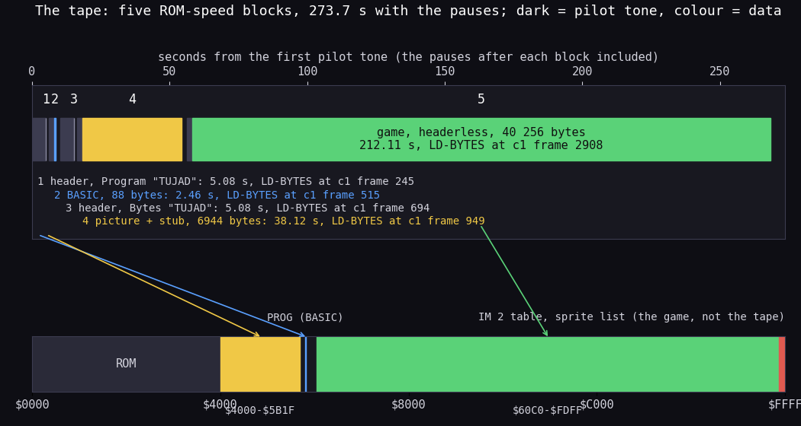
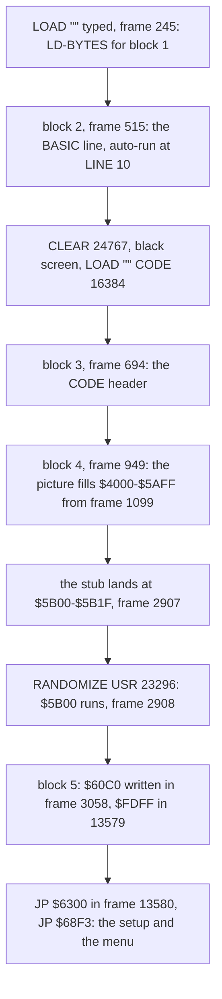
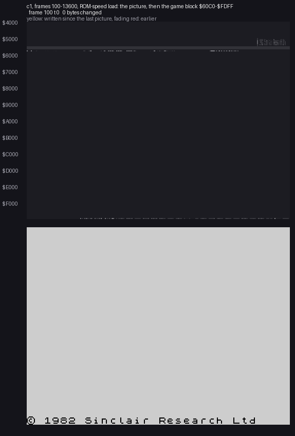
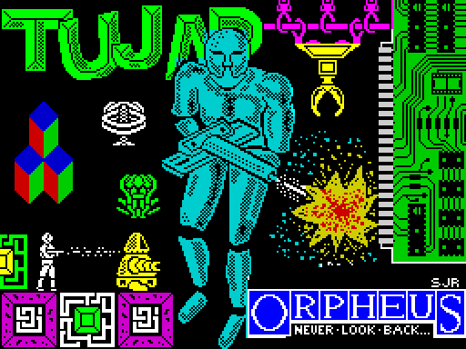
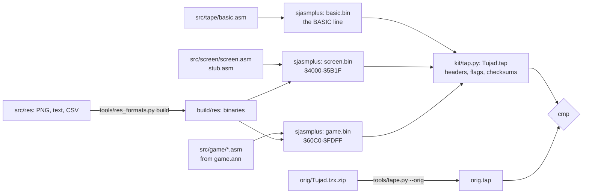

# 3. Build and load

What this covers: the tape block by block and as a picture; the BASIC line; the 32-byte stub at `$5B00` that loads
the game; the load as `c1` saw it, frame by frame, with the loading picture coming in; the check that what loads is
what runs; and the source build that gives the same five blocks back. There is no turbo loader, no packer and no
cipher: the game arrives as plain bytes at ROM speed, so there is no unpack to show.

The recording it rests on is `c1`: the 48K from power-on with zeroed RAM, `LOAD ""` typed, the original TZX played
from the signal at ROM speed (the fast LD-BYTES trap and turbo tape off), 13 700 frames of load, then the menu and
play ([WALKTHROUGH 1](../WALKTHROUGH.md#1-one-recording-from-power-on)). Its frames count from power-on. Frame values
come from `time_travel probe_frames` over `work/stage1/c1/session.ttd`: an `exec` probe gives the first frame an
address runs in, a `write` probe the first frame it is written in.

## 3.1 The tape, block by block

The original release (`orig/Tujad.tzx.zip`, `Tujad.tzx`) holds an archive-info block and five standard-speed blocks
(TZX id `$10`). Every one has the ROM's timings: pilot 2168 T (8063 pulses for a header, 3223 for data), sync 667 /
735 T, zero 855 T, one 1710 T. Each starts with its flag (`$00` a header, `$FF` data) and ends with its XOR checksum.

| Block | Kind | Bytes (+2 on tape) | Loads at | Time on tape | Pause after | LD-BYTES called in `c1` |
| ---: | --- | ---: | --- | ---: | ---: | ---: |
| 0 | archive info: "Tujad", "Orpheus Ltd / Ariolasoft UK Ltd", "Andy Green, Jeff Philips", 1986, "Arcade: Maze", "£8.95", "Original", "TZXed by Thomas Franke" | | | | | |
| 1 | header: Program "TUJAD", length 88, LINE 10 | 17 | | 5.08 s | 988 ms | frame 245 |
| 2 | the BASIC program, one line (3.2) | 88 | PROG | 2.46 s | 1630 ms | 515 |
| 3 | header: Bytes "TUJAD", length 6944, start 32768 (`$8000`) | 17 | | 5.08 s | 987 ms | 694 |
| 4 | the loading screen (6912 bytes) and the 32-byte stub | 6944 | `$4000-$5B1F` (`LOAD "" CODE 16384` overrides the header's 32768) | 38.12 s | 1914 ms | 949 |
| 5 | headerless: the game | 40 256 | `$60C0-$FDFF` (the stub's `LD IX,$60C0; LD DE,$9D40`) | 212.11 s | 5312 ms | 2908 |

- The signal lasts 262.85 s, 13 163 frames of the 48K (69 888 T a frame), the pauses not counted.
- The game block ends at `$FDFF`; `$FE00-$FFFF` is filled by the game itself (the IM 2 vector table and the sprite
  list, [doc 4](04-game-loop.md#44-waitframe-and-the-sprite-list)).



*The five data blocks of `Tujad.tzx` on a time line, and where each lands in the 64 K. How to read: top, seconds from
the first pilot tone, the pauses included; each block is its pilot tone (dark) and its data (its colour); the list
names each block with its length and the `c1` frame at which the ROM's LD-BYTES was called for it. Bottom, the
address space: the ROM, the picture and stub at `$4000-$5B1F` (yellow), the BASIC at PROG (blue), the game at
`$60C0-$FDFF` (green); red at `$FE00` is the IM 2 table, which the game writes and the tape does not. Made with
`python3 tools/fig_tape.py work/media/zxdb-Tujad.tzx/Tujad.tzx docs/img/load/tape.png` (timings from
`tools/tzxblocks.py`, frames from `c1`).*

**A worked example: block 5's length.** Its 40 258 bytes on tape (the flag, the data, the checksum) hold 107 982
ones and 214 082 zeros.

| Part | T |
| --- | ---: |
| pilot: 3223 pulses x 2168 T | 6 987 464 |
| sync: 667 + 735 | 1 402 |
| ones: 107 982 x 2 x 1710 | 369 298 440 |
| zeros: 214 082 x 2 x 855 | 366 080 220 |
| total | 742 367 526 |

That is 212.11 s at 3.5 MHz, or 10 622 frames. In `c1` LD-BYTES is called for it at frame 2908 and the last byte,
`$FDFF`, is written in frame 13579: 10 671 frames. The 49 frames more are spent in the pause before the pilot.

```bash
python3 tools/tzxblocks.py list work/media/zxdb-Tujad.tzx/Tujad.tzx     # the blocks and their timings
python3 tools/image.py work/mkgame/original.bin                         # blocks 4 and 5 where the load puts them
```

**The point**: a plain ROM-speed tape of the usual shape (BASIC, screen, game). The only machine code before the game
is the stub at `$5B00` that loads the headerless block with the ROM's LD-BYTES.

## 3.2 The BASIC line and the stub at `$5B00`

Block 2 is one line (`python3 tools/basic_list.py work/stage1/blocks/basic.bin`):

```basic
10 CLEAR 24767: PAPER 0: INK 0: POKE 23624,0: CLS : LOAD "" CODE 16384: RANDOMIZE USR 23296
```

- `CLEAR 24767` puts RAMTOP at `$60BF`, just below the game block (`$60C0`).
- `PAPER 0: INK 0`, `POKE 23624,0` (BORDCR: a black border and lower screen) and `CLS` keep the screen black while
  the picture loads into it.
- `LOAD "" CODE 16384` loads block 4 to the screen and the printer buffer; `RANDOMIZE USR 23296` calls `$5B00`.

The last 32 bytes of block 4 land in the printer buffer, `$5B00-$5B1F` (`z80dasm -g 0x5B00` of
`work/stage1/blocks/b4.bin` from offset 6912; in the source, `src/screen/stub.asm`):

| Address | Bytes | Instruction | What |
| --- | --- | --- | --- |
| `$5B00` | `37` | `SCF` | carry set: LOAD, not VERIFY |
| `$5B01` | `3E FF` | `LD A,$FF` | the flag of a data block |
| `$5B03` | `DD 21 C0 60` | `LD IX,$60C0` | where the game goes |
| `$5B07` | `11 40 9D` | `LD DE,$9D40` | 40 256 bytes |
| `$5B0A` | `CD 56 05` | `CALL $0556` | the ROM's LD-BYTES |
| `$5B0D` | `C3 00 63` | `JP $6300` | into the game (`$6300`: `JP $68F3`) |
| `$5B10` | `3E FF` | `LD A,$FF` | |
| `$5B12` | `DD 21 C0 60` | `LD IX,$60C0` | |
| `$5B16` | `11 40 9D` | `LD DE,$9D40` | |
| `$5B19` | `CD C2 04` | `CALL $04C2` | the ROM's SA-BYTES: **saves** the same block |
| `$5B1C` | `C9` | `RET` | |
| `$5B1D` | `00 00 00` | | |

The stub as pseudocode:

```text
stub():                          # $5B00, from RANDOMIZE USR 23296
    ok = ld_bytes(flag=$FF, dest=$60C0, length=40256)   # the ROM, $0556
    jump $6300                   # ok is never tested
save():                          # $5B10, never reached
    sa_bytes(flag=$FF, src=$60C0, length=40256)         # the ROM, $04C2
```

- The stub does not test the carry LD-BYTES returns: a tape error runs into the game anyway.
- **The second half is a save routine** for the same block, never reached from the first half (the `JP $6300` before
  it). It is the authors' mastering tool, left in the block (doc 10).
- The game block starts with 576 bytes before the entry (`$60C0-$62FF`, zero but `$01` at `$60E3` and `$02` at
  `$60E8`: the cell table, [doc 2](02-architecture.md#22-the-memory-map)), then `$6300` `JP $68F3`, then the game's
  variables from `$6303`.

**The point**: the whole loader is six instructions. The game needs no protection step and no setup from BASIC beyond
RAMTOP.

## 3.3 The load in `c1`



| Event | Probe | `c1` frame |
| --- | --- | ---: |
| LD-BYTES `$0556` called (blocks 1-5) | exec `$0556` | 245, 515, 694, 949, 2908 |
| the picture's first byte | write `$4000` | 1099 |
| the stub's last byte | write `$5B1F` | 2907 |
| the stub runs | exec `$5B00` | 2908 (T 8352) |
| the game block's first byte | write `$60C0` | 3058 |
| the game block's last byte | write `$FDFF` | 13579 |
| the entry | exec `$6300` | 13580 |
| the first interrupt taken | exec `$95D0` | 14297 |

```bash
python3 work/docs/tjA/probe_rec.py c1 0556 5B00 6300 95D0     # base 36930: the exec frames above
```

The picture loads in the ROM's order: the pixel bytes line by line in the screen's thirds, then the attributes. The
screen was cleared black on black, so the picture stays hidden until its attributes arrive at the end.



*`c1`, frames 100-13600, 91 pictures of 150 frames (10 483 200 T) each, memory taken with `memory_at` at the start
of each picture's frame. How to read: top, the memory `$4000-$FFFF`, one row a 256-byte page, a byte's grey its value,
yellow for a byte written since the last picture, fading through red; bottom, the screen as the Spectrum shows it.
At frame 2350 the picture's pixel bytes are coming in while the screen stays black (the attributes are still 0); the
attributes arrive at the end of block 4 and the picture appears whole; at frame 9100 block 5 has filled the memory up
to about `$BF00`, in address order. Made with the command below.*

```bash
python3 ../../kit/memanim.py --work work/docs/tjA/c1 --from 100:0 --to 13600:0 --step 10483200 \
    --from-address 0x4000 --to-address 0xFFFF --screen \
    --label 'c1, frames 100-13600, ROM-speed load: the picture, then the game block $60C0-$FDFF' \
    --delay 120 --hold 2500 docs/img/load/load-c1.gif
```



*The loading screen: the first 6912 bytes of block 4 (`work/stage1/blocks/b4.bin`), on the screen whole from `c1`
frame 2907 until the setup clears it at the menu (`c1` 13580). It is `src/res/screen/LoadingScreen.png` in the
source.*

**The point**: the load is the ROM's own, three LD-BYTES calls from BASIC and one from the stub. The picture is the
only show, and it is hidden until its attributes land.

## 3.4 What loads is what runs

Three images, compared byte by byte (`work/stage1/imgdiff.py`, runs of differing bytes over `$5B00-$FFFF`;
[doc 2.3](02-architecture.md#23-three-images-as-loaded-at-the-entry-in-play)):

| Compared | Differ | Where |
| --- | ---: | --- |
| as loaded (`tools/image.py`, the tape alone) vs `c1` at the start of frame 13580 (the entry) | 341 bytes in 7 runs | all the ROM's: the system variables (`$5C00-$5D4E`, 176 bytes in 5 runs), the BASIC stack under RAMTOP (`$609E-$60BF`, 34), the ROM's stack and UDGs from power-on (`$FF18-$FFFE`, 231) |
| the same, inside the game block `$60C0-$FDFF` and the screen | 0 bytes | |
| the entry vs frame 13581 | 272 bytes in 5 runs: the setup's writes | `JP $95D0` at `$5B5B`, the table `$FE00-$FF00`, `$63C2-$63D1`, the stack moved to `$60C0` (`$60A4-$60A5`, `$60BE-$60BF`) |

```bash
. work/env.sh
python3 $RS open --work work/stage1/entry --ttd work/stage1/c1/session.ttd --port-base 36900
python3 $RS build --work work/stage1/entry --from-frame 13580 --to-frame 13581 \
    --into work/stage1/entry/f13580
python3 work/stage1/imgdiff.py     # original.bin vs f13580/start.bin vs f13581/start.bin
```

**The point**: nothing is unpacked, decrypted or moved between the tape and the first instruction. The static image
is the program, so the source has to give the tape's bytes and nothing more.

## 3.5 The source build

`tools/build.sh` builds `build/Tujad.tap` from the sources and compares it with the original's five data blocks:



| Block | Source | Made by |
| ---: | --- | --- |
| 1 | the header "TUJAD", LINE 10, length 88 found by walking the line | `kit/tap.py` (`basic:TUJAD:10:basic.bin`) |
| 2 | `src/tape/basic.asm` (written by `kit/mkgame.py` from `src/tape/basic.ann`) | sjasmplus |
| 3 | the header "TUJAD", CODE, 6944 bytes at 32768 | `kit/tap.py` (`code:TUJAD:32768:screen.bin`) |
| 4 | `src/screen/screen.asm`: the picture (`src/res/screen/LoadingScreen.png`) and `stub.asm` | sjasmplus |
| 5 | `src/game/game.asm` and its 25 modules (written from `src/game/game.ann`), with `src/res` | sjasmplus (`data:-:-:game.bin`) |

```bash
tools/build.sh      # build: identical to the original's blocks 1-5 (build/orig.tap)
```

The run for this document (2026-11-10) printed `build: identical to the original's blocks 1-5 (build/orig.tap)`. The
TZX's timings and pauses are not data and are not rebuilt; the archive-info block is not rebuilt either.

**The point**: the five data blocks come back byte for byte from editable sources: the annotated code, the resources
as pictures and text, and the BASIC line.

## 3.6 What is known only from the code

- **The save half of the stub** (`$5B10-$5B1C`) never runs: no `exec` of `$5B10` in `c1`. That it would save the same
  block is read from its operands.
- **A tape error**: no recording loads a bad block. That the game would start anyway follows from the stub not testing
  the carry.
