# 4. Game loop

What this covers: the program's state machine; one pass of the main loop `$6911` with its two waits; how the main
loop hands its sprite list to the interrupt; the IM 2 handler `$95D0` and its share of the frame; where interrupts are
on and where they are off, and what the pause does with them; how many interrupts a pass holds (2 or 3, never 1);
a light pass and the heaviest pass against the beam; and the delays between scenes.

The recordings it rests on ([WALKTHROUGH 6.0](../WALKTHROUGH.md#60-the-recordings); all on the 48K, no POKE unless
named):

| Recording | Used for |
| --- | --- |
| `room-102` | made for this document: `work/stage1/rzx/at050000.szx` (the RZX playthrough after 50 000 frames, room 102), no key, 401 frames. Traced: the light pass (frames 41-43), the heaviest pass (239-242), 48 passes of frames 20-120; the beam figures, `MainLoop.gif`, `Interrupt.gif` |
| `work/stage2/passes2-at050000.json` | 200 passes from the same state: every TOP `$6911`, HALT `$796D` and WAKE `$796E` with its beam position (stage 2) |
| `c1` | the load, the menu, the first interrupt, the pause (frames 15240-15360) |
| `energy-out`, `game-over`, `win` | a life lost, the game over, the win's wait |

```bash
python3 tools/record.py --start work/stage1/rzx/at050000.szx --inputs work/docs/tjA/inputs/room-102.txt \
    --work work/docs/tjA/rec/room-102 --shot 100 --port-base 36930
. work/env.sh                                        # RS = unreal-ng's re_session.py
python3 $RS open --work work/docs/tjA/r102 --ttd work/docs/tjA/rec/room-102/session.ttd \
    --port-base 36930
```

**The time convention.** Times are written `frame:T`: the emulator's frame number and the T-state in that frame.
Frame T 0 is where the emulator starts a frame. In unreal-ng the 48K's interrupt (the INT) comes at frame T 1812
(intstart 1811, taken from 1812 on; `core/src/emulator/config.cpp`). The handler's first instruction runs at
T 1841-1844, after the IM 2 acknowledge and the `JP` at `$5B5B`. A trace gives the T-state at which each instruction
starts. `time_travel memory_at` gives the memory at the start of the named frame.

## 4.1 The shape of the program

Tujad is frame-locked. The main loop waits for the interrupt twice in every pass, and the interrupt does the drawing.

- **A pass** is one run of MainLoop `$6911-$698F`, from `$6911` to the next `$6911`
  ([terms](README.md#terms)). It calls WaitFrame `$795D` twice: at `$6911` and at `$6929`.
- **WaitFrame** ends the sprite list the main loop has built. It then waits in `EI; NOP; HALT` (`$796B-$796D`) and
  turns interrupts off again (`DI` at `$796E`).
- **The interrupt** draws that list with XOR. It also reads the controls, scrolls the message panel and counts the
  energy (4.5).
- **Between the waits the main loop runs with interrupts off.** An INT that falls while it runs is lost, not held.

So the main loop computes and the interrupt draws. One half pass moves the droid; the other moves the objects, the
enemies and the patrollers. Each half's sprites go to the screen at the next INT.

**The point**: the game's speed is counted in passes, and a pass is two interrupts when its work fits. The droid
moves once a pass, so play runs at 25 moves a second at best.

## 4.2 The state machine

The program has no dispatcher. The states are joined by fall-throughs and jumps. Two of them leave through a
`POP BC; JP Restart` that drops the return address of `CALL WinTest` or `CALL EnergyOut`.

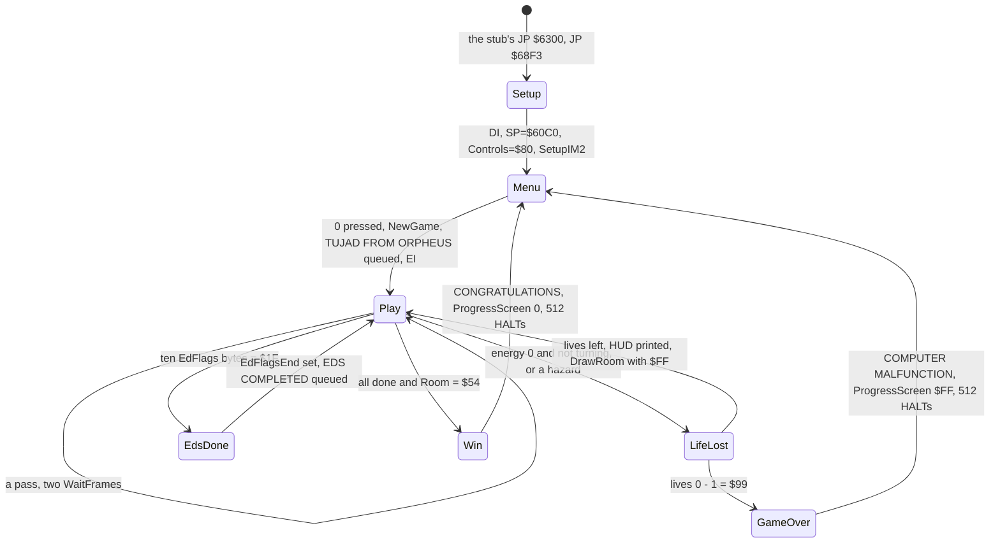

| State | Code | Entered from | Leaves when | Witness |
| --- | --- | --- | --- | --- |
| Setup | Setup `$68F3` | the stub's `JP $6300` | at once | `c1` frame 13580 (`$6300` executed) |
| Menu | Restart `$6900`, Menu `$8854` | Setup, a game over, a win | 0 is pressed | `c1` 13586-14230; MenuPoll `$893B` runs with interrupts off and calls Random `$7DC9` |
| Play | MainLoop `$6911` | Restart's `EI` (`$6910`) | the energy test, a hazard or the win test | `c1`: the first interrupt at 14297 |
| Life lost | EnergyOut `$6A30` → LoseLife `$6A3C`; HazardDeath `$6992` → LoseLife | MainLoop, MoveDroid | at once | `energy-out` frames 1550-1600 (lives 5 to 4, energy back to 99); `rzx-035000` 200-250 (a hazard) |
| Game over | LoseLifeGameOver `$6A83`, GameOverWait `$6AA3` | LoseLife with Lives = `$99` | 512 HALTs | `game-over`: lives `$99` by frame 400, the 0 % screen 450-950, the menu from about 975 |
| EDs done | WinTest `$69E3` | MainLoop | at once, once | the RZX log: EDS COMPLETED queued at RZX frame 71 845, room 28 |
| Win | WinTestRoom `$69F9`, WinWait `$6A26` | WinTest in room `$54` | 512 HALTs | `win`: 495 HALTs at `$6A26`, then `JP Restart`, the menu at its frame 497 |

The Restart code, the hub of the machine (`src/game/main.asm`):

```asm
Restart:                        ; $6900: entered at power-on and after a win or a game over
  DI
  CALL ClearScreen              ; $7A9F
  CALL Menu                     ; $8854: returns when 0 is pressed
  CALL NewGame                  ; $7A2F: lives, energy, rooms scrambled 1-31 times
  LD HL,Messages
  CALL QueueMessage             ; TUJAD FROM ORPHEUS into the scroller
  EI                            ; $6910
MainLoop:                       ; $6911: falls through
```

The exit to Restart, the same in WinTest and in LoseLife (both reached by a `CALL` from MainLoop):

```asm
  LD BC,$0002                   ; B = 0: DJNZ runs 256 times; C = 2: twice
GameOverWait:                   ; $6AA3 (WinWait $6A26 is the same)
  HALT                          ; one interrupt each, the handler running
  DJNZ GameOverWait
  DEC C
  JR NZ,GameOverWait
  POP BC                        ; drop the return into MainLoop
  JP Restart
```

**A worked example: the game over.** The `game-over` recording POKEs Lives = 0 and Energy = 1 at frame 200.

1. The next energy step takes Energy to 0. EnergyOut sees 0 and DroidFlags bit 1 clear (not turning), and falls into
   LoseLife.
2. LoseLife reloads the energy (99, the timers `$FA`) and takes Lives from 0 to `$99` (`DEC A; DAA`).
3. It queues GEN 19 DESTROYED, runs DeathEffect `$7ADF`, saves the room's objects and places the droid.
4. Lives is `$99`, so it jumps to LoseLifeGameOver. That clears the five attributes at `Attributes+133`, zeroes
   EnergyTimer (the energy stops) and ScrollPriority, and queues COMPUTER MALFUNCTION.
5. ProgressScreen with A = `$FF` prints YOU HAVE COMPLETED 0% OF TUJAD (the recording's frames 450-950).
6. 512 HALTs, about 10.24 s, while the handler scrolls the message. Then `POP BC; JP Restart`: the menu, at about
   frame 975.

| | |
| --- | --- |
| 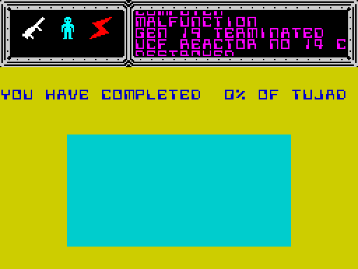 | 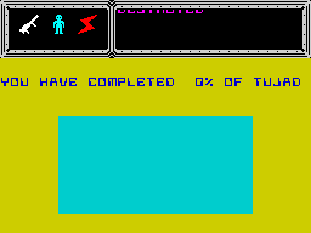 |

*The game over, `game-over` recording (from `work/stage1/menu.szx`; POKE `$636D` = 0 and `$636E` = 1 at frame
200). Left: frame 700, COMPUTER MALFUNCTION scrolling in the panel over the 0 % screen. Right: frame 900, YOU HAVE
COMPLETED 0% OF TUJAD. How to read: the panel at the top right is the scroller; the play area holds ProgressScreen's
picture. Shots by `tools/record.py ... --shot 25` ([WALKTHROUGH 6.0](../WALKTHROUGH.md#60-the-recordings)).*

**The point**: the game's states are three loops: the menu, the main loop, and a 512-HALT wait. Both endings use the
same wait and the same exit.

## 4.3 One pass of the main loop

MainLoop is two halves, each started by a WaitFrame (`src/game/main.asm`):

```asm
MainLoop:                       ; $6911
  CALL WaitFrame                ; $795D: the movers' list goes to the screen
  CALL PassTick                 ; $7F6D: two beeper edges, the droid's hum
  CALL DroidExhaust             ; $8DD2: erase the exhaust
  CALL MoveDroid                ; $7208: keys, walls, exits, pickups, hazards
  CALL ExhaustStep              ; $8E7E
  CALL DroidExhaust             ; draw the exhaust
  CALL HazardFlash              ; $699B: only while an enemy is touched
  CALL MoveShot                 ; $8298
MainLoopSecondHalf:             ; $6929
  CALL WaitFrame                ; the droid's list goes to the screen
  LD HL,Objects
  CALL MoveObject               ; $809D, object 1
  LD HL,Object2
  CALL MoveObject               ; object 2
  LD HL,EnemyBuffers            ; each enemy gets its own pair of 48-byte buffers
  LD (EnemyBufferPtrs+$0002),HL
  LD HL,EnemyBuffer1B
  LD (EnemyBufferPtrs),HL
  LD HL,Enemies
  CALL MoveEnemy                ; $90E7, enemy 1 (enemies 2-4 the same way)
  ...
  CALL MovePatrollers           ; $6AAD: one of the three patrollers a pass
  CALL MoveShot                 ; the shot moves twice a pass
  CALL Pause                    ; $793A: ENTER
  CALL EnergyOut                ; $6A30
  CALL WinTest                  ; $69E3
  JP MainLoop
```

The same pass as pseudocode:

```text
loop:
    wait_frame()                 # the interrupt draws the list built in the second half
    pass_tick(); exhaust(erase); move_droid(); exhaust_step(); exhaust(draw)
    if touching_enemy: hazard_flash()
    move_shot()
    wait_frame()                 # the interrupt draws the droid's list
    for o in objects[0..1]: move_object(o)
    for e in enemies[0..3]: set_buffers(e); move_enemy(e)   # each enemy acts every second call
    move_patrollers()            # one of three
    move_shot()
    pause()                      # loops here while paused, interrupts off
    if energy == 0 and not turning: lose_life()
    win_test()
```

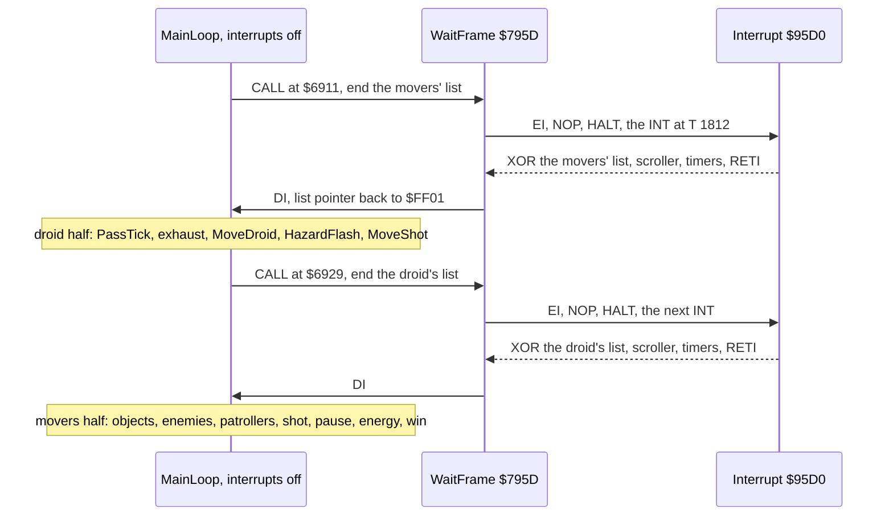

What each half costs, over the 200 passes of `work/stage2/passes2-at050000.json` (room 102, no key):

| Part | Median T | Range T | What decides it |
| --- | ---: | --- | --- |
| handler 1 (at the first wait: the movers' list) | 13 939 | 1 371-55 474 | the enemies and objects on screen, and whether the scroller steps |
| work 1 (the droid half) | 30 226 | 24 732-33 823 | the droid's exhaust and its move; it is steady |
| handler 2 (at the second wait: the droid's list) | 34 204 | 34 204-61 116 | the droid (always) and the scroller step |
| work 2 (the movers half) | 4 739 | 1 377-35 091 | an enemy materialising or shifted (ShiftGraphic3 `$7EBB`) |

The pass at work, from `room-102` frames 41-43:

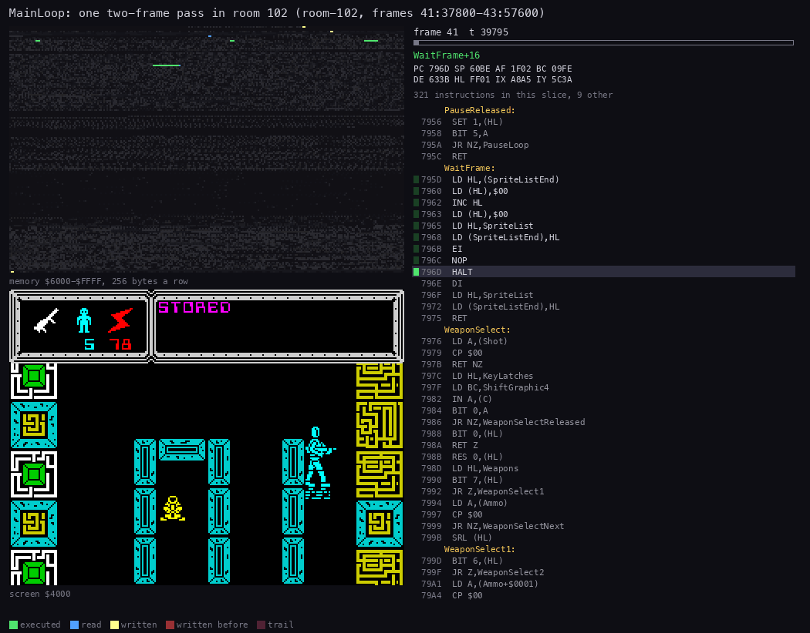

*One pass, `room-102` frames 41:37800-43:57600 (room 102, no key), 80 pictures of 1995 T each. How to read: the
screen on the left; the memory grid `$6000-$FFFF` on the right, a dot for each byte read or written in the slice;
the strip shows whether the PC is inside MainLoop and WaitFrame (`$6911-$698F`, `$795D-$7975`) or elsewhere (the
routines it calls and the interrupt). The long still stretches are the two HALTs. Made with
`python3 ../../kit/routine_anim.py --work work/docs/tjA/r102 --window 41:37800-43:57600 --listing build/game.lst
--out docs/img/routines/MainLoop.gif --view screen --pc 6911-698F,795D-7975 --range 6000-FFFF --pictures 80`.*

**The point**: the droid half is long and steady (about 30 000 T); the movers half is short unless an enemy is being
shifted. Each half's drawing waits for the next interrupt, so the player always sees the last half finished.

## 4.4 WaitFrame and the sprite list

The main loop never draws a sprite. It writes 8-byte records into the sprite list at `$FF01` and moves SpriteListEnd
`$63D0` past each. A record holds the graphic, the collision flag pointer, the width, the rows / 8 and the screen
address ([doc 6](06-rendering.md)). WaitFrame closes the list and hands it over:

```asm
WaitFrame:                      ; $795D
  LD HL,(SpriteListEnd)
  LD (HL),$00                   ; the zero word ends the list
  INC HL
  LD (HL),$00
  LD HL,SpriteList              ; $FF01
  LD (SpriteListEnd),HL         ; the handler walks from here
  EI                            ; $796B
  NOP
  HALT                          ; $796D: the INT; the handler XORs every record
  DI                            ; $796E
  LD HL,SpriteList
  LD (SpriteListEnd),HL         ; a new list starts at $FF01
  RET
```

- SpriteListEnd has two jobs. The main loop appends at it; the handler uses it as its walk pointer and leaves it at
  the zero word.
- The sprites are XORed, so drawing the same record a second time erases it. A mover puts its old frame and its new
  one in the list; the handler does not know which is which.
- The handler sets bit 7 of the flag byte when a sprite's byte meets ink already on the screen
  (InterruptCollide `$9634`). The main loop reads the flags in the next half. That is how the game sees collisions.

**A worked example.** In the light pass of 4.3 the first HALT starts at 41:38041.

1. The list holds only the zero word: nothing moved in the movers half before it.
2. The INT at 42:1812 runs a handler of 1324 T: no sprite, no scroller step, just the controls, the timers and the
   ROM's KEYBOARD.
3. The droid half then queues the droid's erase (its saved frame at DroidSave `$668C`) and its new frame (at `$A0F0`),
   3 bytes x 40 lines each.
4. The second HALT starts at 42:29785. The INT at 43:1812 runs a handler of 34 156 T that XORs those 2 x 120 bytes:
   about 137 T a byte.

**The point**: a sprite stays in the list for exactly one interrupt, and the list changes hands only at a HALT. Apart
from the room drawing and the HUD printing, only the handler touches the screen.

## 4.5 The interrupt `$95D0`

The game runs IM 2 with I = `$FE` and 257 bytes of `$5B` at `$FE00-$FF00` (SetupIM2 `$9584`). So every interrupt
jumps through `$5B5B`, a `JP Interrupt`. The handler, in its parts (`src/game/interrupt.asm`):

```asm
Interrupt:                      ; $95D0
  PUSH AF ... EXX ... PUSH HL   ; both register sets
  CALL ReadControls             ; $7161: keyboard, cursor or Kempston into Controls $63C2
InterruptSprite:                ; $95DB: one list record
  LD HL,(SpriteListEnd)
  LD E,(HL)
  INC HL
  LD D,(HL)                     ; DE = the graphic
  LD A,D
  OR E
  JR Z,InterruptScroll          ; the zero word: the list is done
  ...                           ; flag pointer to BC', width, rows, screen address
InterruptSpriteByte:            ; $960E: the inner loop
  LD A,(DE)
  LD B,(HL)
  XOR B
  LD (HL),A                     ; XOR onto the screen
  AND B
  CP B
  JR Z,InterruptSpriteNext
  LD C,$80                      ; ink under ink: a collision
  ...
InterruptScroll:                ; $9640: every 5 interrupts (15 after a text row)
  LD HL,ScrollDelay
  DEC (HL)
  JP NZ,InterruptTimers
  ...                           ; 31 lines x 19 bytes moved up, a new pixel row of 19 characters
InterruptTimers:                ; $96E7
  CALL WeaponSelect             ; $7976: SPACE
  CALL EnergyTick               ; $7AB6: the energy clock
  CALL DrainTimer               ; $7906: the fast drain's timer
  CALL KEYBOARD                 ; $02BF, the ROM's
  POP HL ... POP AF
  EI
  RETI                          ; $96FB
```

```text
interrupt():
    save both register sets
    read_controls()
    while list[ptr].graphic != 0:
        for each row, each byte: new = screen ^ sprite; if (new & screen) != screen: collided
        if collided: set bit 7 of *flag
    if --scroll_delay == 0:
        scroll_delay = 5, or 15 after a whole text row
        move the panel up one pixel line; draw the next pixel row of 19 characters
    weapon_select(); energy_tick(); drain_timer(); rom_keyboard()
    restore; EI; RETI
```

Its parts in T, from `work/docs/tjA/passparts.py` over the two traced passes of `room-102` (each pass holds two
handlers):

| Part | Light pass (41-43), T | Heaviest pass (239-242), T | Note |
| --- | ---: | ---: | --- |
| entry, ReadControls | 408 | 408 | every interrupt |
| sprites | 32 744 | 52 294 | the droid's list is about 34 000 T alone; each enemy pair adds about 12 600 |
| scroller | 72 | 27 321 | the test only, or a whole step (589 screen writes) |
| WeaponSelect, EnergyTick, DrainTimer, exit | 833 | 965 | |
| ROM KEYBOARD | 1 459 | 1 516 | |

- The bare handler (no sprite, no scroller step) is 1324 T.
- A scroller step alone costs about 26 200 T. It comes every 5 interrupts (every 15 after a row), even when no message
  is shown: then the panel scrolls blank lines.
- With the droid's list (34 156 T) and a scroller step together, a handler reaches 60 939 T, 87 % of a frame.

Over the 200 passes the medians of the two handlers add up to 48 143 T, of a mean pass of 145 716 T: about a third of
the CPU. The profile agrees: the interrupt takes 33.73 % of `room-102` and 24.44 % of `energy-out`
([doc 2.7](02-architecture.md#27-where-the-cpus-time-goes)).

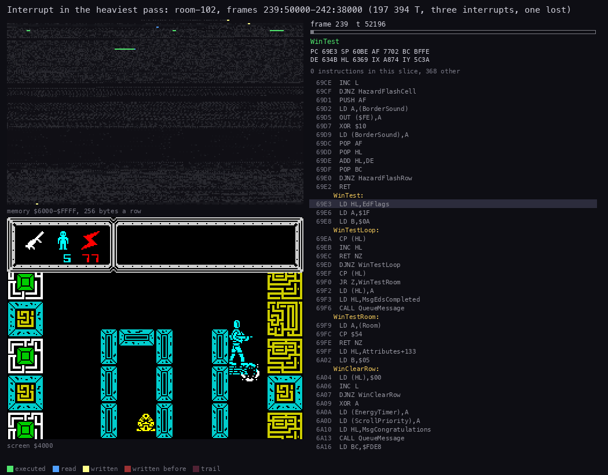

*The heaviest pass, `room-102` frames 239:50000-242:38000, 90 pictures of 2196 T each. How to read: the strip marks
the PC inside the handler and ReadControls (`$95D0-$96FD`, `$7161-$7207`). In frame 240 the handler XORs the
enemies, then scrolls the panel at the top for about 27 000 T; in frame 242 it XORs the droid. Made with
`python3 ../../kit/routine_anim.py --work work/docs/tjA/r102 --window 239:50000-242:38000 --listing build/game.lst
--out docs/img/routines/Interrupt.gif --view screen --pc 95D0-96FD,7161-7207 --range 6000-FFFF --pictures 90`.*

**The point**: the handler is the game's renderer. Its cost swings from 1324 T to over 60 000 T. That swing, not the
main loop, decides whether a pass takes two interrupts or three.

## 4.6 Interrupts on and off

Every `EI` and `HALT` in the code, from the listing (`build/game.lst`), with the L1 counts over the 70 builds
([WALKTHROUGH 1](../WALKTHROUGH.md#1-one-recording-from-power-on)):

| Site | Routine | What | L1 |
| --- | --- | --- | ---: |
| `$6910` | Restart | `EI` before the first pass | 4 |
| `$796B`, `$796D`, `$796E` | WaitFrame | `EI; NOP; HALT; DI`, twice a pass | 37 159 calls |
| `$6B2D` … `$6E0B` | DrawRoom | the room is drawn with interrupts on (`DI` at `$6E0B`); DrawRoom empties the sprite list first | 279 |
| `$7F50` … `$7F5B`, `$7F60` … `$7F6B` | RiseSweep, FallSweep | `DI` during the sweep, `EI` after it | 210, 649 |
| `$777E`, `$777F` … `$77A7` | Teleport | `EI; HALT` (the beam frame drawn), the beam and the flash with interrupts on, `DI` before DrawRoom | 8 |
| `$7816` … `$7819`, `$7825` … `$7835` | TeleportArrive | `EI; NOP; HALT; DI`, then the beam up with interrupts on | 13 |
| `$8F5E` … `$9044` | ProgressScreen | interrupts on for the whole screen and its flash | 36 |
| `$6A22`, `$6A26` | WinTest | `EI`, then 512 HALTs | 1, 990 |
| `$6AA2`, `$6AA3` | LoseLifeGameOver | the same | 1, 512 |
| `$96FB` | Interrupt | `EI; RETI` | 54 825 |

The menu (MenuPoll `$893B`) runs with interrupts off: no handler, no scroller, no energy. It calls Random `$7DC9`
on every poll, so the seed depends on how long the player waits.

### The pause: interrupts off

Pause `$793A` is called once a pass. ENTER pressed after a release toggles Controls bit 5, and the routine loops while
the bit is set:

```asm
Pause:                          ; $793A, called from MainLoop with interrupts off
  LD HL,KeyLatches
  LD BC,$BFFE                   ; the half row ENTER-H
PauseLoop:                      ; $7940
  IN A,(C)
  BIT 0,A                       ; ENTER
  LD A,(Controls)
  JR NZ,PauseReleased
  BIT 1,(HL)                    ; $7949: ENTER held; pressed after a release?
  JR Z,PauseLoop
  RES 1,(HL)
  XOR $20                       ; toggle the pause bit
  LD (Controls),A
  JR PauseLoop
PauseReleased:
  SET 1,(HL)
  BIT 5,A
  JR NZ,PauseLoop               ; paused: keep polling
  RET
```

- MainLoop calls Pause after the second WaitFrame's `DI`, and PauseLoop never enables interrupts. So while the game is
  paused no handler runs. No sprite is drawn, the panel does not scroll, and EnergyTick does not count.
- **Witness**: in `c1`, ENTER is held at frames 15240-15250 (pause) and 15350-15360 (resume): `probe_frames` exec
  `$7949`, the held-key branch. The handler `$95D0` and EnergyTick `$7AB6` do not run in frames 15241-15359.
  `memory_at` at the start of frames 15241, 15300 and 15359 gives EnergyTimer `$6366` = `$64` and Energy `$636E` =
  `$97` each time.
- So the energy does not drain during the pause. Pause's note in `src/game/game.ann` and stage 2's NOTES say it does,
  "known only from the code"; the recording says it does not.

```bash
python3 work/docs/tjA/probe_rec.py c1 7949 95D0 7AB6     # base 36930: the frames each address runs in
```

**The point**: the game runs with interrupts off except where it waits. An INT that falls in the work is lost, the
pause stops the whole game clock, and the menu has no interrupt at all.

## 4.7 Passes and interrupts a frame

A pass holds 2 interrupts when its work fits, and 3 when one INT falls while the main loop runs with interrupts off.
The 200 passes of `work/stage2/passes2-at050000.json` give, counted two ways:

| Count | 1 | 2 | 3 | Mean |
| --- | ---: | ---: | ---: | ---: |
| frames a pass, by frame number (next frame - top frame) | 3 | 177 | 20 | 2.085 |
| INTs inside the pass (the INT instants k x 69 888 + 1812; 2 taken + the lost ones) | 0 | 183 | 17 | 2.085 |

Of the 17 lost INTs, 14 fall in the movers half (an enemy shifted after a heavy handler) and 3 in the droid half.

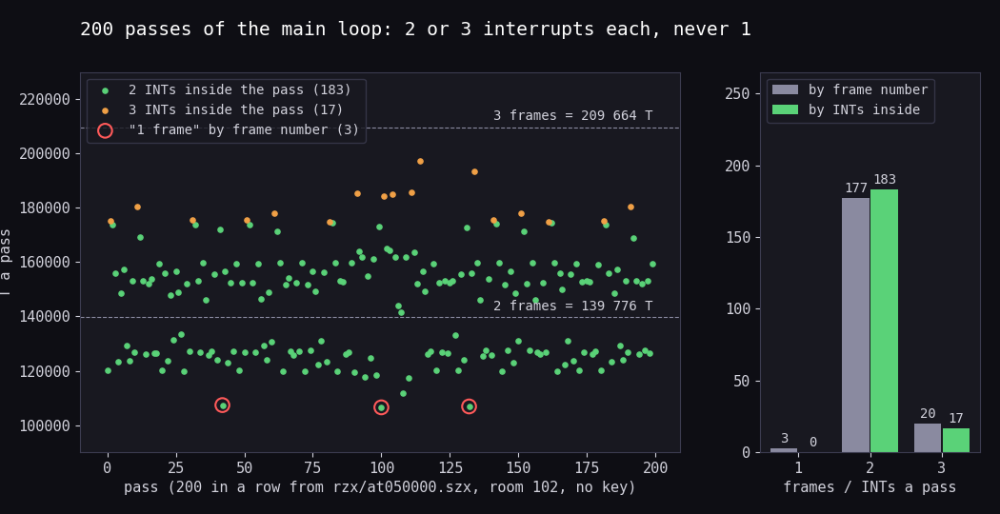

*200 passes in a row from `work/stage1/rzx/at050000.szx` (room 102, no key), `work/stage2/passes2-at050000.json`.
How to read: left, each dot is a pass, its length in T from `$6911` to the next `$6911`; green holds 2 INTs, orange
3; the red rings are the three passes that frame numbers alone call "1 frame". Right: the two counts. The lengths are
not whole frames, because a pass starts where the last half's work ends, not at an INT. Made with
`python3 tools/fig_passes.py work/stage2/passes2-at050000.json docs/img/loop/passes.png`.*

**The 1-frame passes are an artefact of counting from frame T 0.** Stage 2 left them open, assuming the INT at T 13;
it comes at T 1812. A worked example, pass 42 of the 200:

1. The pass before it runs from 86:37884 to 89:389. It holds the INTs at 87:1812 and 88:1812: 2 INTs. By frame
   numbers it is 89 - 86 = 3 frames.
2. Pass 42 starts at 89:389, 1423 T before the INT of frame 89. Its first HALT starts at 89:482 and wakes almost at
   once: the handler of 89:1812 ends at 89:15746.
3. Its second HALT starts at 89:46781 and waits for 90:1812. The next pass starts at 90:37884.
4. So pass 42 is 107 383 T long and holds 2 INTs (89:1812, 90:1812). By frame numbers it is 90 - 89 = 1 frame.

The other two are the same: passes 100 and 132 start at 209:1219 and 277:1070, both before T 1812. Each follows a
"3-frame" pass that holds only 2 INTs. So 3 of the 20 "3-frame" passes are artefacts too, and the true count is 183
passes of 2 INTs and 17 of 3.

```bash
python3 work/docs/tjA/passint.py work/stage2/passes2-at050000.json     # the counts above, the three passes listed
python3 work/docs/tjA/passtrace.py --work work/docs/tjA/r102 --window 20:0-120:0 \
    --json work/docs/tjA/passes-r102-20-120.json                        # the same from a trace
```

The trace of `room-102` frames 20-120 agrees: 48 passes, every one with 2 INTs taken; by frame numbers 43 of 2, 4 of
3 and 1 of 1; 3 INTs lost; a median of 150 546 T and a mean of 144 692 T.

**The point**: a pass is 2 interrupts, or 3 when the work overruns; never 1. The game takes 2 / 2.085 = 0.96
interrupts a frame in room 102, so its energy clock runs about 4 % slow there.

## 4.8 The beam: a light pass and the heaviest pass

The screen writes against the beam, from `kit/beam_timeline.py`. Each panel is one frame: T across, the screen line
down. The diagonal is the beam; a write left of it lands before the beam reaches its line and shows in this frame. The
strip above each panel shows the routine the CPU is in.

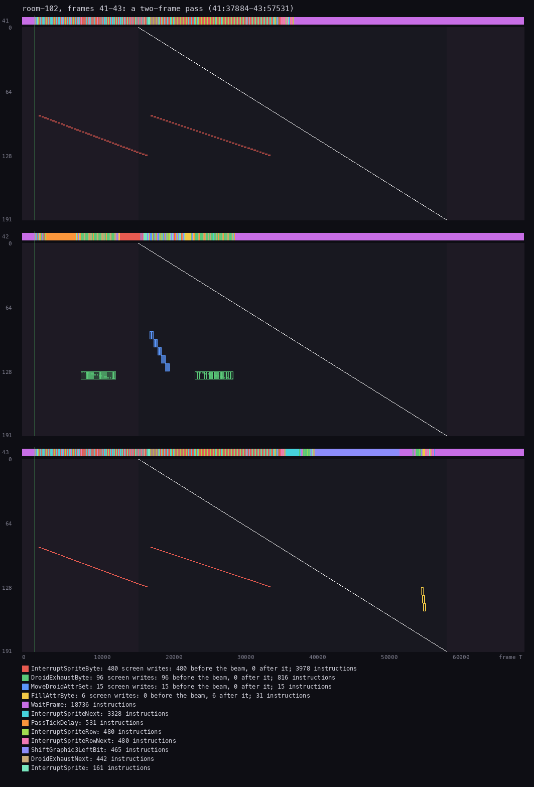

*`room-102` frames 41-43, the pass 41:37884-43:57531 (159 423 T, 2 INTs). Frame 41: the end of the previous pass's
second handler (red: the droid, InterruptSpriteByte), then the first HALT (purple, WaitFrame) to the end of the frame.
Frame 42: a handler of 1324 T, then the droid half: PassTick's delay (orange), the exhaust erased and drawn (green),
the droid's attributes (blue); the second HALT from 42:29785. Frame 43: the droid's list XORed (red), then MoveEnemy
shifting a graphic (ShiftGraphic3LeftBit, lilac) and an attribute fill (FillAttrByte, yellow). Made with
`python3 ../../kit/beam_timeline.py --work work/docs/tjA/r102 --window 41:0-44:0 --listing build/game.lst
--out docs/img/loop/beam-light.png --frames 3 --title "room-102, frames 41-43: a two-frame pass (41:37884-43:57531)"`.*

| Part of the light pass | T | Share |
| --- | ---: | ---: |
| HALT (waiting for the INT) | 75 614 | 47.4 % |
| the handler's sprites | 32 744 | 20.5 % |
| MoveEnemy | 19 905 | 12.5 % |
| DroidExhaust | 11 270 | 7.1 % |
| MoveDroid | 7 503 | 4.7 % |
| PassTick | 4 549 | 2.9 % |
| the rest (ExhaustStep, KEYBOARD, the timers, MovePatrollers, …) | 7 838 | 4.9 % |

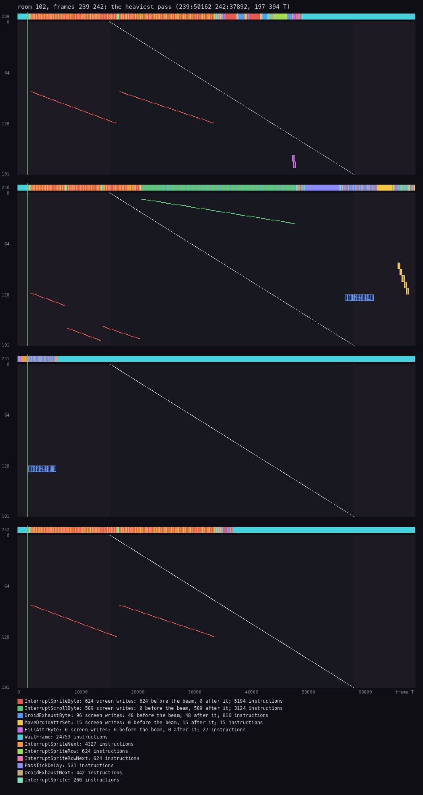

*`room-102` frames 239-242, the pass 239:50162-242:37892 (197 394 T, 3 INTs, one lost), the heaviest of the 200.
Frame 240: the first handler XORs the enemies (red), then steps the scroller (green, the panel at lines 8-39) to about
T 47 000; the droid half follows (PassTick's delay, the exhaust, the droid's attributes) and runs into frame 241. The
INT at 241:1812 falls while it runs with interrupts off and is lost. The second HALT starts at 241:7070 and waits the
rest of the frame (cyan). Frame 242: the droid's list. Made with `python3 ../../kit/beam_timeline.py --work
work/docs/tjA/r102 --window 239:0-243:0 --listing build/game.lst --out docs/img/loop/beam-heaviest.png --frames 4
--title "room-102, frames 239-242: the heaviest pass (239:50162-242:37892, 197 394 T)"`.*

The heaviest pass, step by step (`work/docs/tjA/passes-r102-239.json`, `passparts.py`):

| Frame:T | Event | T |
| --- | --- | ---: |
| 239:50162 | TOP `$6911`, CALL WaitFrame | |
| 239:50317 | HALT | 21 383 waiting |
| 240:1812 | INT; handler 1: three enemy pairs and a scroller step | 48 302 |
| 240:50162 | WAKE; the droid half | 26 703 |
| 241:1812 | INT, lost: the droid half runs with interrupts off | |
| 241:7070 | HALT, from `$6929` | 64 630 waiting |
| 242:1812 | INT; handler 2: the droid's list | 34 166 |
| 242:36026 | WAKE; the movers half | 1 866 |
| 242:37892 | the next TOP | |

| Part of the heaviest pass | T | Share |
| --- | ---: | ---: |
| HALT | 86 053 | 43.6 % |
| the handler's sprites | 52 294 | 26.5 % |
| the handler's scroller | 27 321 | 13.8 % |
| DroidExhaust | 10 908 | 5.5 % |
| PassTick | 6 899 | 3.5 % |
| MoveDroid | 6 143 | 3.1 % |
| the rest | 7 776 | 3.9 % |

```bash
python3 work/docs/tjA/passparts.py --work work/docs/tjA/r102 --window 239:50000-242:38000 \
    --from 239:50162 --to 242:37892
```

- The heaviest pass is heavy because the scroller's step (about 27 000 T) falls in the same handler as three enemy
  pairs. The first handler ends at 240:50162, and the droid half's steady 26 703 T then cross 241:1812.
- The pass waits almost a whole extra frame for 242:1812, so 43.6 % of it is HALT. The work itself is 111 341 T,
  1.6 frames.
- The droid's 2 x 40 lines are always written before the beam reaches them (624 sprite writes before the beam and 0
  after, over the four frames). The handler starts at T 1841 and the droid stands below line 90, so the XOR wins the
  race and the droid never tears.
- The scroller's 589 writes all land after the beam has passed the panel (lines 8-39). So the panel's new line shows,
  whole, one frame later.

**The point**: the heaviest pass is 2.8 frames long by T but holds only 1.6 frames of work; the lost INT makes it
three. The renderer's timing is safe for the droid, which is drawn ahead of the beam every time.

## 4.9 The delays between scenes

| Delay | Code | How it counts | Length | Witness |
| --- | --- | --- | --- | --- |
| WinDelay | `$6A19`, BC = `$FDE8` | `DEC BC; LD A,B; OR C; JR NZ`: 26 T a count, interrupts off | 65 000 x 26 = 1 690 000 T, 0.48 s | known only from the code (the RZX playback ran it; no L1 holds it) |
| the win's wait | WinWait `$6A26` | 512 HALTs (B = 0, so DJNZ runs 256 times; C = 2) | 512 interrupts, 10.24 s | `win`: 495 HALTs, then the menu at its frame 497 |
| the game over's wait | GameOverWait `$6AA3` | the same | 10.24 s | `game-over` frames 450-975; L1 512 |
| the ED flash | ProgressScreen `$8F53` | the new piece flashed 9 times, a `$C350` delay each, interrupts on | about 11.7 million T, 3.3 s | `c1` 14700 (an ED piece taken next to the terminal) |
| the teleport | Teleport `$7719`, TeleportArrive `$780D` | a HALT, BeamDown, TeleportFlash, DrawRoom, BeamDown, a HALT, BeamUp | not timed here | `rzx-002000` frame 807 |

```text
win_test():
    if all ten ed_flags == $1F:
        if ed_flags_end != $1F: ed_flags_end = $1F; queue("EDS COMPLETED RETURN TO TUJAD CONTROL ROOM")
        if room == $54:
            clear 5 attributes; energy_timer = 0; scroll_priority = 0
            queue("CONGRATULATIONS ... WELL DONE")
            busy-wait 65000 counts         # WinDelay, interrupts off
            progress_screen(0)            # the whole picture
            enable interrupts; halt 512 times
            drop the return; restart()
```

| | |
| --- | --- |
| 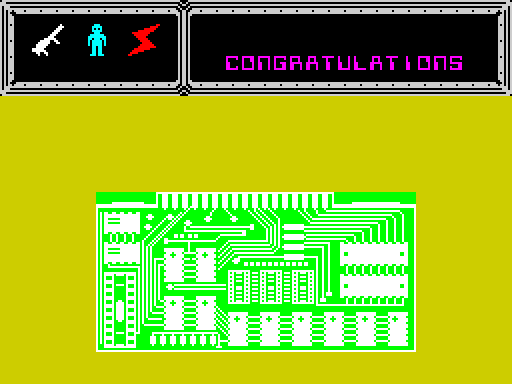 | 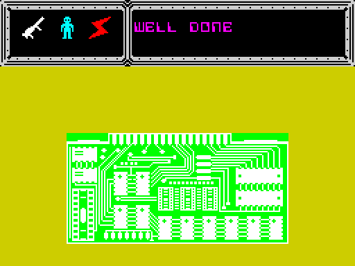 |

*The win's wait, `win` recording (from `work/stage1/rzx/at080000.szx`: every ED complete, room 84, no key). Left:
frame 100, CONGRATULATIONS scrolling in the panel over ProgressScreen's full picture. Right: frame 475, WELL DONE at
the message's end. How to read: the panel keeps scrolling because WinWait halts with interrupts on and the handler
runs. Shots by `tools/record.py ... --shot 25` ([WALKTHROUGH 6.1](../WALKTHROUGH.md#61-the-screens)).*

**The point**: every scene change is a plain wait: a busy loop with interrupts off, or a count of HALTs with the
handler still scrolling the panel. 512 HALTs is 10.24 s on any 48K, because it counts interrupts, not work.

## 4.10 What is known only from the code

- **WinDelay** (`$6A19-$6A25`) ran only in the RZX playback, which no L1 build holds. Its length (0.48 s) comes from
  the instruction timings.
- **The ED flash's length**: `c1` runs ProgressScreen once. The 3.3 s comes from the `$C350` delay and the 9 flashes;
  it was not timed in a trace.
- **An interrupt inside DrawRoom, Teleport or ProgressScreen** draws whatever the sprite list holds. DrawRoom and
  Teleport empty the list before they enable interrupts. No recording catches a handler walking a list being built.
