# 5. Controls

What this covers:

- the three input methods (keyboard, cursor keys, Kempston) and the one routine that reads them in the interrupt;
- the Controls byte;
- the ROM's KEYBOARD routine, which the game calls and never uses;
- the menu;
- the path from a key to the droid's step;
- fire, the key latches and the weapon select;
- the weapon 3 probe, steered while fire is held;
- the shield on "down alone";
- the pause, which stops the interrupt.

The recordings it rests on:

- `c1` (WALKTHROUGH 6.0): the load and a game on the keyboard. Its frames count from power-on.
  - About frames 13 760-14 000: the menu, with 1, 2 and 3 pressed in turn, then 1 and 0.
  - From about 14 600: X held.
  - At about 15 250 and 15 350: ENTER (the pause on, then off).
- `menu-cursor` and `menu-kempston`: 1201 frames each, from `work/stage1/menu.szx`, with
  `tests/inputs/menu-cursor.txt` and `menu-kempston.txt`. They play the cursor method and the Kempston method.
- `room-tour`: from `rec/menu-cursor/end.szx`, on the cursor method with 8 held. POKEs change the room
  (WALKTHROUGH 6.0).
- The 59 RZX pieces `rzx-NNNNNN`: the original player's game, all on the Kempston method.
- `probe-shield`, made for this document from a saved RZX state, with no POKE.
  - Command: `python3 tools/record.py --start work/stage1/rzx/at065000.szx --inputs work/docs/tjB/probe-shield.txt
    --work work/docs/tjB/rec/probe-shield --shot 25 --port-base 36940`. It gives 317 frames.
  - The start state: room 12, weapon 3 selected with 5 rounds, the Kempston method.
  - The script:
    - left from frame 5 to 30 (the droid turns to face left);
    - fire from 40;
    - with fire still held: left from 46, up from 71, right from 96, down from 121;
    - everything released at 136;
    - down alone from 196 to 276.

Frames and times:

- A memory sample "at frame N" is the state at the start of frame N (TTD `memory_at`, T 0). It shows what frame
  N - 1 left.
- An event "at N:t" is an instruction in an access trace that ran in frame N, t T-states into the 69 888 T frame of
  the 48K machine.
- The interrupt handler's first instruction runs at T 1842.
- The access traces are `work/docs/tjB/c1/traces/14600_0-14606_0.uatr` and `14600_0-14604_20000.uatr`
  (`analysis trace`, made by `work/docs/tjB/gettrace.py`).
- Counts of runs are summed over the L1 builds (`l1.json`) of the 69 stage-1 recordings and `c1`
  (`work/docs/tjB/l1c.py`).
- A [pass](README.md#terms) is one turn of the main loop.

## 5.1 Three methods, one reader

The game reads one of three devices, chosen in the menu:

- the keyboard (all letters and digits);
- the cursor keys 5, 6, 7, 8 and 0;
- a Kempston interface on port `$1F`.

One routine, ReadControls `$7161`, reads the chosen device in every interrupt. It leaves the result in one byte,
Controls `$63C2`. All the code that moves the droid reads Controls, never a port.

Some keys are read directly by other routines, in every method:

- SPACE or CAPS SHIFT selects the weapon;
- ENTER pauses;
- the menu keys 1, 2, 3 and 0 choose the method and start the game.

To read a keyboard half row, the program puts its select byte in the port's high byte. A bit of the result is 0
while its key is down. When two bits of the high byte are clear, two half rows are read at once and their bits are
ANDed: a key down in either row clears the bit. Tujad uses that for "up" and "fire" (5.3).

| High byte | Bit 0 | Bit 1 | Bit 2 | Bit 3 | Bit 4 |
| --- | --- | --- | --- | --- | --- |
| `$FE` | CAPS SHIFT | Z | X | C | V |
| `$FD` | A | S | D | F | G |
| `$FB` | Q | W | E | R | T |
| `$F7` | 1 | 2 | 3 | 4 | 5 |
| `$EF` | 0 | 9 | 8 | 7 | 6 |
| `$DF` | P | O | I | U | Y |
| `$BF` | ENTER | L | K | J | H |
| `$7F` | SPACE | SYMBOL SHIFT | M | N | B |

The game has 13 port reads. Their runs over all recordings:

| Address | Routine | Port | What it reads | Runs |
| --- | --- | --- | --- | ---: |
| `$7171` | ReadControls | `$1F` | Kempston: right, left, down, up, fire | 47 334 |
| `$717B` | ReadKeyboard | `$FEFE` | Z C left, X V right | 2138 |
| `$7197` | ReadKeyboardRow7F | `$7FFE` | B M left, N SYMBOL SHIFT right | 2138 |
| `$71B3` | ReadKeyboardAG | `$FDFE` | A-G down | 2138 |
| `$71BF` | ReadKeyboardHL | `$BFFE` | H-L down (ENTER masked off) | 2138 |
| `$71CB` | ReadKeyboardUp | `$DBFE` | Q-T and Y-P up, one read | 2138 |
| `$71D7` | ReadKeyboardFire | `$E7FE` | 1-5 and 6-0 fire, one read | 2138 |
| `$71E4` | ReadCursor | `$F7FE` | 5 left | 5339 |
| `$71EE` | ReadCursorRow | `$EFFE` | 6 down, 7 up, 8 right, 0 fire | 5339 |
| `$7940` | PauseLoop | `$BFFE` | ENTER, once per pass | 105 499 |
| `$7982` | WeaponSelect | `$7EFE` | SPACE or CAPS SHIFT | 47 775 |
| `$8944` | MenuPoll | `$F7FE` | 1, 2, 3: the method | 699 778 |
| `$8961` | MenuPoll0 | `$EFFE` | 0: start | 697 430 |

Which method each recording used:

- keyboard: `c1` (1371 interrupts) and `game-over` (767);
- cursor: `menu-cursor` (1074) and `room-tour` (4265);
- Kempston: every RZX piece. So the original player used a Kempston stick.

The ROM's KEYBOARD routine also reads the keyboard, with its own `IN A,(C)`. The game never looks at what it finds
(5.4).

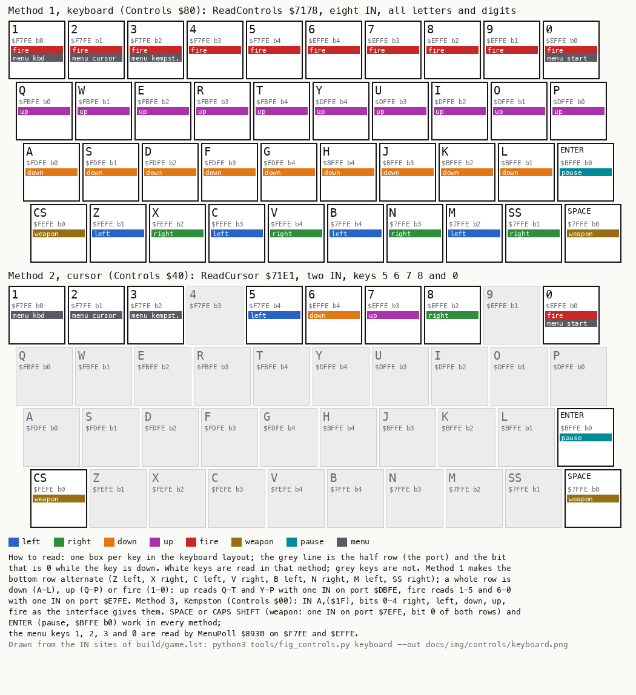

*The keys each method reads. Drawn from the IN sites of `build/game.lst`: `python3 tools/fig_controls.py keyboard
--out docs/img/controls/keyboard.png`. How to read: one box per key, with its half row and bit under the name and a
coloured tag for each use. Grey keys are not read in that method.*

The point: the game reads its device once per interrupt into one byte, so the three methods cost the rest of the
game nothing. On the keyboard almost every key does something: a whole row is up, down or fire, and the bottom row
alternates left and right. A player can rest their hands anywhere on the keyboard.

## 5.2 The Controls byte

Controls `$63C2` has three parts:

- bits 7 and 6: the method;
- bit 5: the pause flag;
- bits 4-0: the five inputs.

The inputs use the Kempston bit order (right, left, down, up, fire). So the Kempston method is a plain `IN` and
`AND $1F`.

| Bit | Meaning | Written by | Read by |
| --- | --- | --- | --- |
| 7 | the keyboard method (`$80`) | MenuPoll `$894A`, Setup `$68F3` | ReadControls `$7168` |
| 6 | the cursor method (`$40`) | MenuPoll `$8952` | ReadControls `$716C` |
| 5 | paused | Pause `$7951` (XOR `$20`) | Pause `$7958` |
| 4 | fire held | ReadControls | MoveDroid `$72F0`, MoveShot3 `$830A` |
| 3 | up held | ReadControls | MoveDroid, MoveShot3 |
| 2 | down held | ReadControls | MoveDroid (`$735F`: down alone is the shield), MoveShot3 |
| 1 | left held | ReadControls | MoveDroid, MoveShot3 |
| 0 | right held | ReadControls | MoveDroid, MoveShot3 |

Both method bits clear means the Kempston method. Setup runs once, at the game's entry, and puts `$80` there, so the
keyboard is the method until the menu changes it. Restart does not reset it: after a game over the menu starts on
the last method chosen.

A second byte, KeyLatches `$6369`, holds four latches. They make a key act once per press (5.7, 5.8).

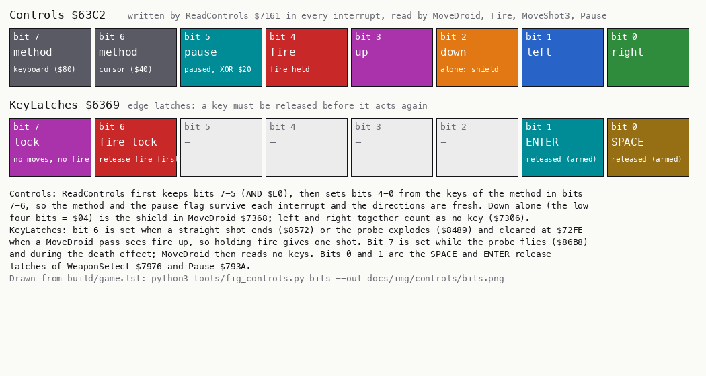

*The two bytes of the input path. Drawn from `build/game.lst`: `python3 tools/fig_controls.py bits --out
docs/img/controls/bits.png`. How to read: one box per bit, coloured by what it controls. Grey bits are unused.*

The point: one byte holds both which device to read and what was read. ReadControls keeps the top three bits and
rebuilds the bottom five. So the menu choice and the pause flag survive every interrupt without a second variable.

## 5.3 ReadControls: three methods in 157 bytes

ReadControls `$7161` is the first call of the interrupt handler: `CALL ReadControls` at `$95D8`, after the seven
pushes. It clears bits 4-0 of Controls, then branches on the method bits.

```text
ReadControls:                                   ; $7161, in the interrupt
    Controls = Controls AND $E0                 ; keep the method and the pause flag
    if Controls bit 7: goto ReadKeyboard
    if Controls bit 6: goto ReadCursor
    Controls |= IN($1F) AND $1F                 ; Kempston: right, left, down, up, fire as the stick gives them
    return

ReadKeyboard:
    a = IN($FEFE)                               ; CS Z X C V
    if Z down: left;  if X down: right;  if C down: left;  if V down: right
    a = IN($7FFE)                               ; SPACE SS M N B
    if SS down: right; if M down: left;  if N down: right; if B down: left
    if IN($FDFE) AND $1F != $1F: down           ; any of A S D F G
    if IN($BFFE) AND $1E != $1E: down           ; any of L K J H (ENTER, bit 0, is masked off: it pauses)
    if IN($DBFE) AND $1F != $1F: up             ; rows $FB and $DF together: Q-T and Y-P
    if IN($E7FE) AND $1F != $1F: fire           ; rows $F7 and $EF together: 1-5 and 6-0
    return

ReadCursor:
    a = IN($F7FE); if 5 down: left
    a = IN($EFFE); if 6 down: down; if 7 down: up; if 8 down: right; if 0 down: fire
```

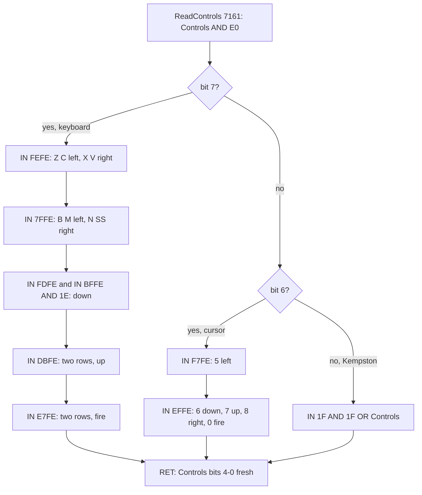

The code, from `build/game.lst`. The Kempston path is 7 instructions. The keyboard path sets one bit per key with
`SET n,(HL)`; HL holds the address of Controls all the way through.

```text
7161  21 C2 63     LD HL,Controls         ; ReadControls
7164  7E           LD A,(HL)
7165  E6 E0        AND $E0
7167  77           LD (HL),A
7168  CB 7F        BIT 7,A
716A  20 0C        JR NZ,ReadKeyboard
716C  CB 77        BIT 6,A
716E  C2 E1 71     JP NZ,ReadCursor
7171  DB 1F        IN A,($1F)
7173  E6 1F        AND $1F
7175  B6           OR (HL)
7176  77           LD (HL),A
7177  C9           RET
7178  01 FE FE     LD BC,$FEFE            ; ReadKeyboard
717B  ED 78        IN A,(C)
717D  CB 4F        BIT 1,A
717F  20 02        JR NZ,ReadKeyboardX
7181  CB CE        SET 1,(HL)
7183  CB 57        BIT 2,A                ; ReadKeyboardX
7185  20 02        JR NZ,ReadKeyboardC
7187  CB C6        SET 0,(HL)
...
71B1  06 FD        LD B,$FD               ; ReadKeyboardAG
71B3  ED 78        IN A,(C)
71B5  E6 1F        AND $1F
71B7  FE 1F        CP $1F
71B9  28 02        JR Z,ReadKeyboardHL
71BB  CB D6        SET 2,(HL)
71BD  06 BF        LD B,$BF               ; ReadKeyboardHL
71BF  ED 78        IN A,(C)
71C1  E6 1E        AND $1E
71C3  FE 1E        CP $1E
71C5  28 02        JR Z,ReadKeyboardUp
71C7  CB D6        SET 2,(HL)
71C9  06 DB        LD B,$DB               ; ReadKeyboardUp
71CB  ED 78        IN A,(C)
71CD  E6 1F        AND $1F
71CF  FE 1F        CP $1F
71D1  28 02        JR Z,ReadKeyboardFire
71D3  CB DE        SET 3,(HL)
71D5  06 E7        LD B,$E7               ; ReadKeyboardFire
71D7  ED 78        IN A,(C)
71D9  E6 1F        AND $1F
71DB  FE 1F        CP $1F
71DD  C8           RET Z
71DE  CB E6        SET 4,(HL)
71E0  C9           RET
71E1  01 FE F7     LD BC,$F7FE            ; ReadCursor
71E4  ED 78        IN A,(C)
71E6  CB 67        BIT 4,A
71E8  20 02        JR NZ,ReadCursorRow
71EA  CB CE        SET 1,(HL)
71EC  06 EF        LD B,$EF               ; ReadCursorRow
71EE  ED 78        IN A,(C)
71F0  CB 67        BIT 4,A
71F2  20 02        JR NZ,ReadCursor7
71F4  CB D6        SET 2,(HL)
```

Worked example 1: X on the keyboard method (`c1`, the interrupt of frame 14600).

1. Controls holds `$80`. AND `$E0` keeps `$80`. Bit 7 is set, so the keyboard path runs.
2. `IN A,(C)` at `$717B`, with BC = `$FEFE`, reads `$FB` at 14600:2001. In binary that is `1111 1011`: bit 2 (X)
   is clear.
3. Bit 1 (Z) is set, so no left. Bit 2 is clear, so `SET 0,(HL)` at `$7187` writes `$81` at 14600:2048.
4. The other six reads find no key.
5. The sample at 14601 shows Controls `$81`.

Worked example 2: P for up. P is bit 0 of half row `$DF`.

1. The read at `$71CB` puts `$DB` (`1101 1011`) on the high byte. A13 and A10 are low, so two rows answer: `$DF`
   (Y-P) and `$FB` (Q-T).
2. P down clears bit 0 of the `$DF` row.
3. After AND `$1F` the result is `$1E`, not `$1F`, so `SET 3,(HL)` marks up.

Any of the ten keys Q-P does the same in one read. Fire on 1-0 works the same way with `$E7` (rows `$F7` and
`$EF`).

Worked example 3: the Kempston stick pushed down-right, with fire. The interface returns `$15` (`0001 0101`: fire,
down, right) on port `$1F`. AND `$1F` keeps `$15`. OR with the method bits (`$00`) gives Controls `$15`.

Witness: the routine that ran in each recording shows its method.

- `$7178` (the keyboard path) ran 1371 times in `c1` and 767 times in `game-over`.
- `$71E1` (cursor) ran 1074 times in `menu-cursor` and 4265 times in `room-tour`.
- `$7171` (Kempston) ran 47 334 times in 66 recordings: every RZX piece, `menu-kempston` and `energy-out`.
- In `menu-cursor`, WALKTHROUGH 6.0 shows Controls `$41` with 8 held: bit 6 is the method, bit 0 is right.

With no key down, the keyboard path costs about 539 T. In the c1 trace the handler enters at T 1842 and the call
returns at T 2381, in every interrupt from 14600 to 14606.

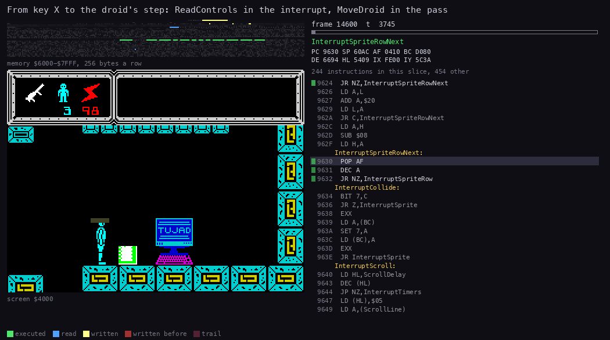

*ReadControls at work: the routine and the bytes it writes, beside the screen. Recording `c1`, window
14600:0-14604:20000, X held. `python3 R/kit/routine_anim.py --work work/docs/tjB/c1 --window 14600:0-14604:20000
--listing build/game.lst --view screen --pc 7161-71FD,7208-75FF,95D0-96FE --range 6000-7FFF --pictures 80 --title
"From key X to the droid's step: ReadControls in the interrupt, MoveDroid in the pass" --out
docs/img/routines/ReadControls.gif`.*

The point: with two clear bits in the port's high byte, one `IN` reads two half rows. ReadControls reads twenty keys
for up and fire with two reads, where testing each half row alone would take four. The price is that it cannot tell
which of the ten keys is down, and it does not need to.

## 5.4 The ROM KEYBOARD call, made and never used

The last call of the interrupt handler, after the timers, is `CALL KEYBOARD` at `$96F0`. It calls the ROM's
keyboard routine at `$02BF`, the same one the ROM's own IM 1 handler calls. The routine scans all eight half rows,
decodes a key and stores the results in the system variables.

```text
96E7  CD 76 79     CALL WeaponSelect      ; InterruptTimers
96EA  CD B6 7A     CALL EnergyTick
96ED  CD 06 79     CALL DrainTimer
96F0  CD BF 02     CALL KEYBOARD
96F3  E1           POP HL
...
96FB  FB           EI
96FC  ED 4D        RETI
```

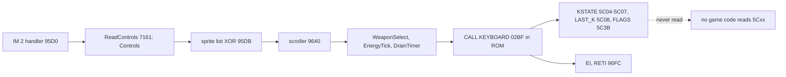

KEYBOARD finds the system variables through IY. The game never loads IY, so IY stays at `$5C3A` all the time. In
the c1 trace, KEYBOARD:

- writes KSTATE `$5C04-$5C07`, LAST_K `$5C08` and FLAGS `$5C3B`;
- pushes its return addresses on the game's stack at `$60A8-$60AB`.

No instruction of the game reads any of these variables. `build/game.lst` has no reference to any `$5Cxx` address.
The menu, the pause and the weapon select all read their keys from the ports.

Its cost per interrupt in the c1 trace, from the call to its return:

| Interrupt | KEYBOARD (T) | Whole handler (T) |
| --- | ---: | ---: |
| 14600 (droid sprites) | 1342 | 26 870 |
| 14601 (empty list) | 1009 | 1946 |
| 14602 (a scroll step) | 1071 | 28 176 |
| 14603 (empty list) | 1009 | 1946 |
| 14604 (droid sprites) | 1064 | 30 803 |

When the interrupt has nothing to draw, KEYBOARD takes half of the handler's time. Over a second (50 interrupts) it
costs about 50 000 T, 1.5 % of the CPU.

Witness: the call runs in every interrupt of every recording (`$96F0`, 54 825 runs in all 70 recordings). Its writes
show in the c1 trace at each interrupt, after the timers.

The point: the call is probably left over from an earlier version that used the ROM's key decoding, perhaps for a
menu or a key-redefine page that is not in this game. Removing it would change nothing on the screen; it only costs
time.

## 5.5 The menu: three methods and a start key

Menu `$8854` draws the menu screen. Its texts are in [doc 08](08-hud-and-text.md). The lines are 1 KEYBOARD,
2 CURSOR JOYSTICK, 3 KEMPSTON JOYSTICK and 0 START GAME.

MenuPoll `$893B` loops until 0 is pressed. It runs with interrupts off: Restart `$6900` starts with DI, and the EI
at `$6910` comes only after Menu, NewGame and QueueMessage. So ReadControls does not run in the menu, and MenuPoll
reads the ports itself.

```text
MenuPoll:                                   ; $893B, interrupts off
    loop:
        Random()                            ; stirred once per loop: the delay before 0 seeds the game
        a = IN($F7FE)
        if 1 down: Controls = $80; light line 1 (FLASH + BRIGHT); continue
        if 2 down: Controls = $40; light line 2; continue
        if 3 down: Controls = $00; light line 3; continue
        if IN($EFFE) bit 0 == 0: return     ; 0 starts
```

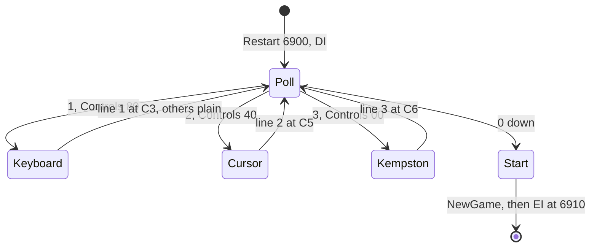

The highlight is three LDIR fills, on attribute rows 12, 14 and 16 (`Attributes+390`, `+454`, `+518`):

- the chosen line gets FLASH and BRIGHT: `$C3` (magenta), `$C5` (cyan) or `$C6` (yellow);
- the other two lines get their plain colours `$43`, `$45`, `$46`.

Nothing else shows the choice. The menu does not show the current method until a key is pressed.

```text
893B  CD C9 7D     CALL Random            ; MenuPoll
893E  21 C2 63     LD HL,Controls
8941  01 FE F7     LD BC,$F7FE
8944  ED 78        IN A,(C)
8946  CB 47        BIT 0,A
8948  20 04        JR NZ,MenuPoll2
894A  36 80        LD (HL),$80
894C  18 1A        JR MenuLightKeyboard
894E  CB 4F        BIT 1,A                ; MenuPoll2
8950  20 04        JR NZ,MenuPoll3
8952  36 40        LD (HL),$40
8954  18 3B        JR MenuLightCursor
8956  CB 57        BIT 2,A                ; MenuPoll3
8958  20 04        JR NZ,MenuPoll0
895A  36 00        LD (HL),$00
895C  18 5D        JR MenuLightKempston
895E  01 FE EF     LD BC,$EFFE            ; MenuPoll0
8961  ED 78        IN A,(C)
8963  CB 47        BIT 0,A
8965  C8           RET Z
8966  18 D3        JR MenuPoll
8968  21 86 59     LD HL,Attributes+390   ; MenuLightKeyboard
896B  11 87 59     LD DE,Attributes+391
896E  01 0B 00     LD BC,$000B
8971  36 C3        LD (HL),$C3
8973  ED B0        LDIR
```

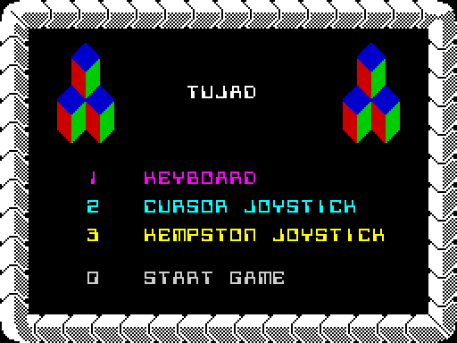

*The menu as the game draws it. Recording `c1`, frame 13 950 (WALKTHROUGH 6.1).*

Worked example: 2 pressed.

1. `IN A,(C)` at `$8944` reads `$FD` on port `$F7FE`: bit 1 is clear.
2. Bit 0 is set, so the test moves on to MenuPoll2.
3. Bit 1 is clear, so Controls = `$40`.
4. MenuLightCursor fills 11 attributes of row 12 with `$43`, 18 of row 14 with `$C5` and 20 of row 16 with `$46`.
5. Back at MenuPoll, Random runs again. As long as 2 is held, every loop writes the same attributes again.

Witness:

- `c1` presses 1, 2 and 3 in turn: MenuLightKeyboard `$8968` ran 396 times, MenuLightCursor `$8991` 392 times and
  MenuLightKempston `$89BB` 387 times.
- `menu-cursor` lights only line 2 (392 runs); `menu-kempston` only line 3 (387 runs).
- The 0 test at `$8965` ran 697 430 times over five recordings. The menu waits longest in `game-over` (381 788) and
  `win` (168 468), where the game returns to it.

The point: the menu is the only place where the method changes. It stirs Random on every loop, so how long the
player waits before pressing 0 decides the game's first random numbers. The Restart comment in `game.ann` speaks of
keys 1-4 and ENTER; the code reads 1, 2, 3 and 0.

## 5.6 From the key to the droid

The input reaches the droid in two steps:

1. In the interrupt, ReadControls writes Controls.
2. In the main loop's first half, MoveDroid `$7208` reads Controls. But it acts only on every second call:
   MoveDelay `$636F` counts 2, 1, 2, 1.

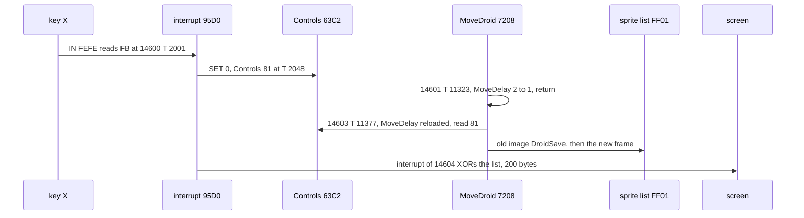

```text
MoveDroid:                                  ; $7208, in the first half of a pass, interrupts off
    if not DroidFlags bit 2 (falling):
        MoveDelay -= 1; if MoveDelay != 0: return
        MoveDelay = 2
    (floor and teleporter tests: doc 10)
    queue the old image: copy 120 bytes to DroidSave $668C, list entry with flag pointer 0
    if DroidFlags bit 1: goto TurnRound     ; a turn in progress
    if KeyLatches bit 7: goto NoKeys        ; the probe flies, or the death effect
    if Controls bit 4: Fire()               ; 5.7
    else: KeyLatches bit 6 = 0              ; fire released: the next press may shoot
    if Controls AND 3 == 3: goto NoKeys     ; left and right together
    keys = Controls AND $0F
    if keys == 0: goto NoKeys
    ControlsLatch $6364 = keys
    if keys == $04 and not falling: shield (5.9)
    else: walk, turn, climb, fall (doc 10)
```

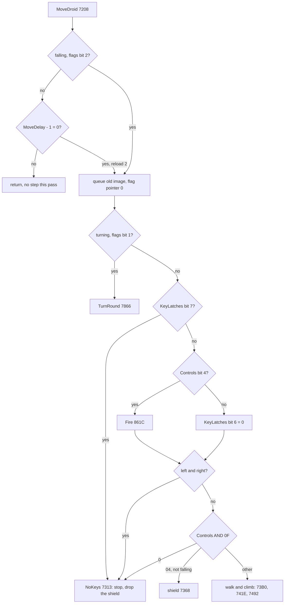

```text
72DE  21 5B 63     LD HL,DroidFlags
72E1  CB 4E        BIT 1,(HL)
72E3  C2 66 78     JP NZ,TurnRound
72E6  3A 69 63     LD A,(KeyLatches)
72E9  CB 7F        BIT 7,A
72EB  20 26        JR NZ,MoveDroidNoKeys
72ED  3A C2 63     LD A,(Controls)
72F0  CB 67        BIT 4,A
72F2  28 07        JR Z,MoveDroidFireUp
72F4  E5           PUSH HL
72F5  CD 1C 86     CALL Fire
72F8  E1           POP HL
72F9  18 08        JR MoveDroidDirections
72FB  3A 69 63     LD A,(KeyLatches)      ; MoveDroidFireUp
72FE  CB B7        RES 6,A
7300  32 69 63     LD (KeyLatches),A
7303  3A C2 63     LD A,(Controls)        ; MoveDroidDirections
7306  E6 03        AND $03
7308  FE 03        CP $03
730A  28 07        JR Z,MoveDroidNoKeys
730C  3A C2 63     LD A,(Controls)
730F  E6 0F        AND $0F
7311  20 45        JR NZ,MoveDroidKeys
```

Worked example: the c1 trace with X held (the figure and table below).

1. The interrupt of 14600 writes Controls `$81` at T 2048.
2. MoveDroid runs at 14601:11323. MoveDelay goes from 2 to 1, and it returns.
3. At 14603:11323, MoveDelay reaches 0. It is reloaded with 2 at T 11377.
4. The droid was standing (flags `$40`), so it starts to walk:
   - MoveDroidMoving `$7392` sets flags bit 3, frame 2 and x 8 at T 15057;
   - MoveDroidWalkRight then makes frame 3 and x 9 at T 15184.
5. The new frame goes into the sprite list. The interrupt of 14604 draws it: 200 bytes XORed, the old image and
   the new one.
6. The next pass that acts, at 14607, makes frame 4 and column 10.

How the walk frames step x is in [doc 10](10-gameplay-logic.md).

| Moment | What happens |
| --- | --- |
| 14600:2001 | `IN A,(C)` at `$717B` reads `$FB` (X down) |
| 14600:2048 | Controls = `$81` |
| 14601:11323 | MoveDroid: MoveDelay 2 to 1, return |
| 14603:11377 | MoveDroid: MoveDelay reloaded, the step runs |
| 14603:15184 | DroidFrame 3, x 9: the walk has begun |
| 14604:1842 | the interrupt XORs the old and new droid images (28 703 T) |
| 14608 (sample) | x = 10: the first column stepped |

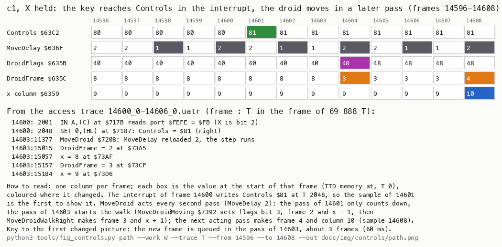

*From the key to the step. Recording `c1`, frames 14 596-14 608 (memory at each frame start) and the access trace
14600:0-14606:0. `python3 tools/fig_controls.py path --work work/docs/tjB/c1 --trace
work/docs/tjB/c1/traces/14600_0-14606_0.uatr --from 14596 --to 14608 --out docs/img/controls/path.png`.*

The point: the keys are read 50 times a second but used only 12.5 to 25 times a second. MoveDroid acts on every
second pass, and a pass takes two or more frames. From key to the first moved pixel takes about three frames
(60 ms). MoveDelay sets the droid's walking speed, not the rate at which the keys are read.

## 5.7 Fire, the key latches and the weapon select

### Fire

MoveDroid calls Fire `$861C` while Controls bit 4 is set. Fire refuses in two cases:

- a shot is in flight (Shot `$635E` bit 6);
- KeyLatches bit 6 is set: fire has not been released since the last shot ended.

Otherwise it starts a shot:

1. Shot = `$60`.
2. The start cell is three columns right of the droid's column. When the droid faces left (flags bit 0) it stays at
   the droid's column, and weapon 3 then moves it two columns left.
3. The start line is 16 lines below the droid's top.
4. It branches on the weapon. Weapons `$6368` bit 7 is the basic gun; bits 6, 5 and 4 are weapons 1, 2 and 3.
5. Each weapon refuses on a wall cell (value 1 in the cell table) and when its ammo is zero.
6. Otherwise it takes one from the BCD ammo and prints it at `$4082`.

```text
Fire:                                       ; $861C, from MoveDroid while fire is held
    if Shot bit 6: return                   ; a shot is in flight
    if KeyLatches bit 6: return             ; fire not released since the last shot ended
    Shot = $60
    if facing right: if x >= $1B: refuse; x += 3
    else:            if x < 2: refuse; Shot bit 0 = 1
    y += 16
    weapon 3 (the probe): if facing left: x -= 2
        ShotPos = (x * 8, y); ShotGraphic = ProbeGraphics $AF85
        if any cell under the probe is a wall: refuse
        if Ammo+2 == 0: refuse
        Ammo+2 -= 1 (BCD); print it at $4082
        KeyLatches bit 7 = 1                ; the droid freezes while the probe flies
```

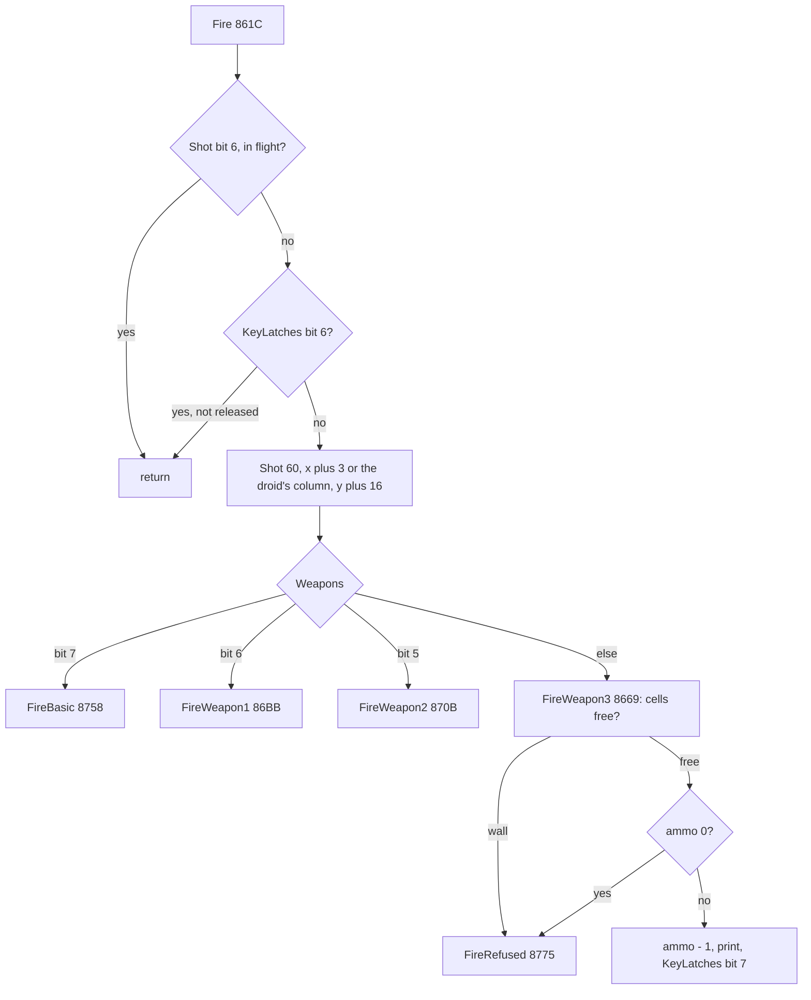

```text
861C  21 5E 63     LD HL,Shot             ; Fire
861F  CB 76        BIT 6,(HL)
8621  C0           RET NZ
8622  21 69 63     LD HL,KeyLatches
8625  CB 76        BIT 6,(HL)
8627  C0           RET NZ
8628  21 5E 63     LD HL,Shot
862B  36 60        LD (HL),$60
862D  ED 4B 59 63  LD BC,(DroidVars)
8631  3A 5B 63     LD A,(DroidFlags)
8634  CB 47        BIT 0,A
8636  20 0B        JR NZ,FireLeft
8638  79           LD A,C
8639  FE 1B        CP $1B
863B  D2 75 87     JP NC,FireRefused
863E  C6 03        ADD A,$03
8640  4F           LD C,A
8641  18 08        JR FireWeapon
8643  79           LD A,C                 ; FireLeft
8644  FE 02        CP $02
8646  DA 75 87     JP C,FireRefused
8649  CB C6        SET 0,(HL)
864B  78           LD A,B                 ; FireWeapon
864C  C6 10        ADD A,$10
864E  47           LD B,A
...
86A1  3A 6C 63     LD A,(Ammo+$0002)
86A4  FE 00        CP $00
86A6  CA 75 87     JP Z,FireRefused
86A9  D6 01        SUB $01
86AB  27           DAA
86AC  32 6C 63     LD (Ammo+$0002),A
86AF  21 82 40     LD HL,Screen+130
86B2  CD 3F 7B     CALL PrintBcd
86B5  21 69 63     LD HL,KeyLatches
86B8  CB FE        SET 7,(HL)
86BA  C9           RET
```

The flights of the other weapons are in [doc 10](10-gameplay-logic.md).

### KeyLatches: one action per press

KeyLatches `$6369` holds four latches:

- bits 0 and 1 record that a key read straight from a port has been released;
- bits 6 and 7 are locks that the shot code sets.

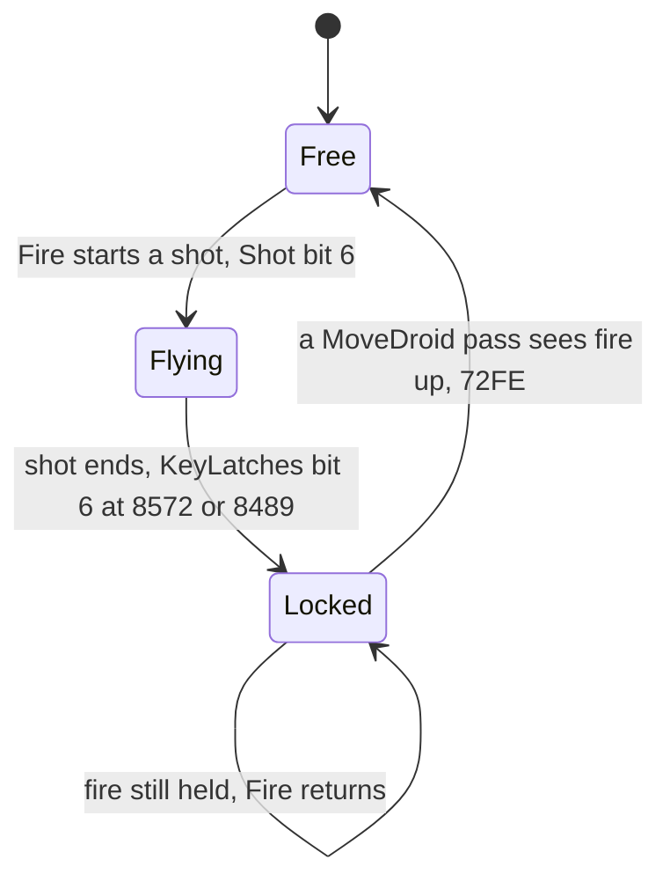

| Bit | Set at | Cleared at | Meaning |
| --- | --- | --- | --- |
| 0 | WeaponSelectReleased `$79BF` | `$798B` | SPACE or CAPS SHIFT released: the next press changes the weapon |
| 1 | PauseReleased `$7956` | `$794D` | ENTER released: the next press toggles the pause |
| 6 | MoveShotStraightEnd `$8572`, `$8489` | MoveDroidFireUp `$72FE` | fire must be released before the next shot |
| 7 | Fire `$86B8` (the probe), the death effect | `$7B3C`, `$8487` | no moves and no fire |

Witness: over the L1 builds, bit 6 was set at `$8572` 11 times and at `$8489` 3 times. The clear at `$72FE` ran
12 902 times, once in every acting pass with fire up. `game.ann` calls bit 6 "fire released". But the code sets it
when a shot ends and clears it when fire is up, so it means "fire must be released first".

### The weapon select

WeaponSelect `$7976` runs in the interrupt (from InterruptTimers `$96E7`), and only while there is no shot
(Shot = 0).

It reads port `$7EFE`. The high byte `$7E` selects the half rows `$FE` and `$7F` together, so bit 0 is CAPS SHIFT or
SPACE. A press while KeyLatches bit 0 is set moves the weapon bit in Weapons one place right, to the next weapon
that has ammo. After the last weapon it goes back to the basic gun. ShowWeapon `$79C2` then redraws the HUD icon
([doc 08](08-hud-and-text.md)).

```text
7976  3A 5E 63     LD A,(Shot)            ; WeaponSelect
7979  FE 00        CP $00
797B  C0           RET NZ
797C  21 69 63     LD HL,KeyLatches
797F  01 FE 7E     LD BC,ShiftGraphic4    ; the value is the port $7EFE
7982  ED 78        IN A,(C)
7984  CB 47        BIT 0,A
7986  20 37        JR NZ,WeaponSelectReleased
7988  CB 46        BIT 0,(HL)
798A  C8           RET Z
798B  CB 86        RES 0,(HL)
798D  21 68 63     LD HL,Weapons
...
79BF  CB C6        SET 0,(HL)             ; WeaponSelectReleased
79C1  C9           RET
```

The source writes the port as `LD BC,ShiftGraphic4`. The routine ShiftGraphic4 happens to sit at `$7EFE`, and the
labelling pass took the number for an address. The bytes are right; the name is wrong. The fix is sent as a source
change.

Witness: the weapon changed (`$798B`) 47 times in 13 recordings, most often in `rzx-070000` (13 times).

The point: holding fire gives one shot, holding SPACE one weapon change, holding ENTER one pause toggle. Each latch
costs one bit. The fire lock lives in the shot code, so a fire key still held after a hit cannot shoot again.

## 5.8 The probe under fire held

Weapon 3 fires a probe that the player steers.

1. Fire sets KeyLatches bit 7. MoveDroid then ignores the keys, so the droid stands still.
2. MoveShot3 `$82AA` runs twice per pass, in each half of the main loop, and reads Controls itself.
3. While fire is held, each held direction moves the probe two pixels per call, if the cells ahead are free.
4. Releasing fire explodes the probe (MoveShot3Explode `$8472`).
5. Touching ink also explodes it (Shot bit 7, MoveShot3Hit `$843E`).

```text
MoveShot3:                                  ; $82AA, twice a pass
    if Shot == 0: return
    queue the probe's old image in the sprite list (flag pointer 0, 3 bytes wide, 2 rows)
    XOR mark $10 into the cells under it            ; erase its cell mark
    if Shot bit 4: exploding; if Shot bit 7: hit
    keys = Controls AND $1F
    if not fire: explode                            ; MoveShot3Explode $8472
    if right and (x AND 7 != 0 or the column ahead is free and x != $F0): x += 2
    if left  and (x AND 7 != 0 or the column behind is free and x != 0):  x -= 2
    if down  ... CellSolidRow below:  y += 2
    if up    ... CellSolidRow above:  y -= 2
    frame = next of 0 1 2 3 2 1; shift it to x AND 7 (ShiftGraphic3); draw; mark $10 into the cells
```

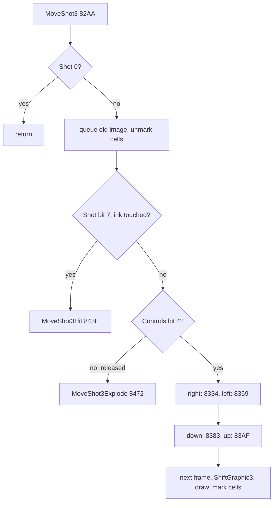

```text
8305  3A C2 63     LD A,(Controls)        ; MoveShot3Steer
8308  E6 1F        AND $1F
830A  CB 67        BIT 4,A
830C  CA 72 84     JP Z,MoveShot3Explode
830F  23           INC HL
8310  CB 47        BIT 0,A
8312  28 23        JR Z,MoveShot3SteerLeft
8314  F5           PUSH AF
8315  7E           LD A,(HL)
8316  E6 07        AND $07
8318  20 1A        JR NZ,MoveShot3SteerRight
831A  3E F0        LD A,$F0
831C  BE           CP (HL)
831D  28 17        JR Z,MoveShot3SteerRightDone
831F  E5           PUSH HL
8320  4E           LD C,(HL)
8321  23           INC HL
8322  46           LD B,(HL)
8323  54           LD D,H
8324  5D           LD E,L
8325  CD 94 7C     CALL CellAddrXY
8328  2C           INC L
8329  2C           INC L
832A  3E 02        LD A,$02
832C  CD 24 7D     CALL CellSolidColumn
832F  FE 01        CP $01
8331  E1           POP HL
8332  28 02        JR Z,MoveShot3SteerRightDone
8334  34           INC (HL)               ; MoveShot3SteerRight
8335  34           INC (HL)
8336  F1           POP AF                 ; MoveShot3SteerRightDone
```

Worked example: `probe-shield` from frame 40. The droid faces left at column 19, line 80.

1. Fire is pressed at 40. The sample of 42 shows Controls `$10` and Shot `$61`.
2. The probe starts at x = (19 - 2) x 8 = 136 and y = 80 + 16 = 96. The sample of 44 shows ShotPos `$88`, `$60`.
3. Ammo goes from `$05` to `$04`, and KeyLatches reads `$83`: bit 7 is the lock, bits 1 and 0 are armed.
4. Left is held with fire from 46. Each call takes 2 from ShotPos `$635F`: x falls from 136 to 98 by frame 72, where
   the cells to the left are wall.
5. Up takes y from 96 to 64 (frames 74-94).
6. Right takes x back to 136 (98-123).
7. Down takes y to 84 (124-137).
8. Everything is released at 136. The sample of 138 shows Shot `$50`, the explosion (ProbeExplosion at `$B870`),
   then `$51` and `$53`. Shot is 0 again and KeyLatches back to `$03` at 144.

During the whole flight the droid stays at column 19.

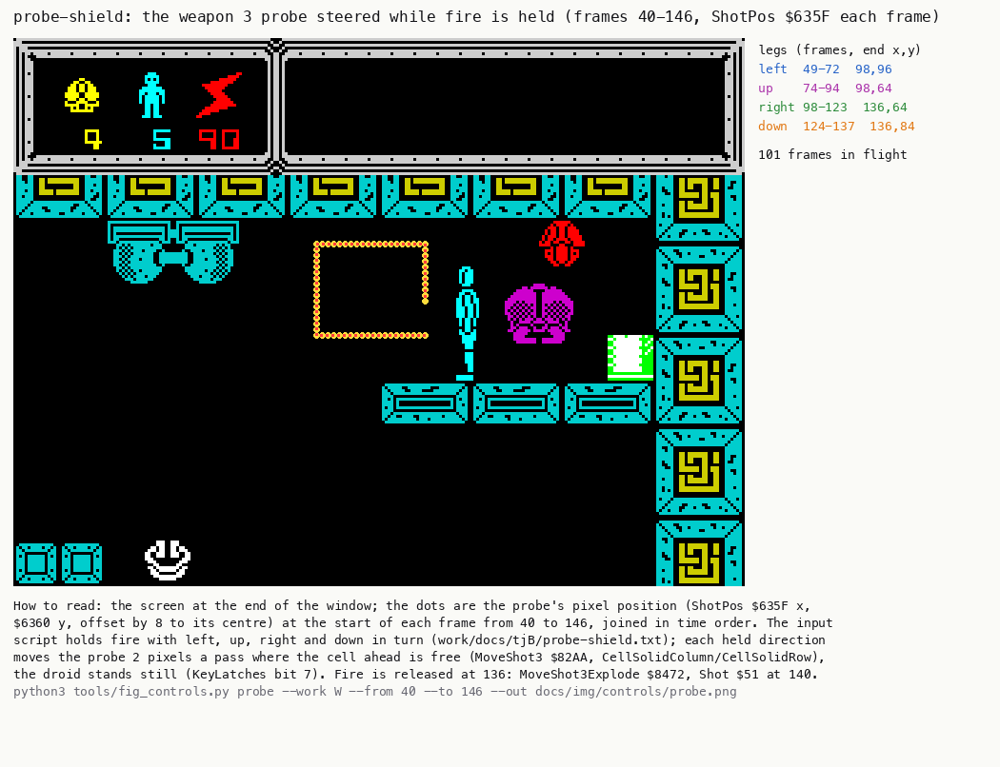

*The probe's positions in `probe-shield`, frames 40-146 (memory at each frame start), over the screen at frame 146.
`python3 tools/fig_controls.py probe --work work/docs/tjB/probe-shield --from 40 --to 146 --out
docs/img/controls/probe.png`.*

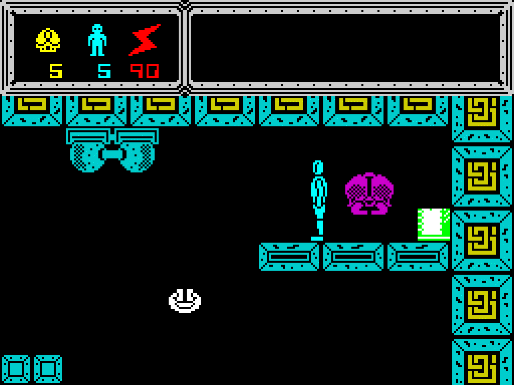

*The probe on the screen. Recording `probe-shield`, frames 40-146, every second frame. `python3 R/kit/screen_anim.py
--work work/docs/tjB/probe-shield --from 40 --to 146 --step 2 --scale 4 --delay 60 --hold 2000
docs/img/play/probe-steer.gif`.*

Witness:

- In the L1 build of `probe-shield`, the steer branch ran 71 times: right 19, left 19, down 10, up 16.
  MoveShot3Explode `$8472` ran once.
- In the RZX game the probe never steered. In `rzx-040000`, `rzx-052000` and `rzx-070000` the player tapped fire
  for weapon 3, and each probe exploded on its first call (`$8472`: fire already released).
- Stage 2 knew the steering only from the code. This recording shows it. It also shows frames 1 and 3 of
  ProbeGraphics (`$AFB7`, `$B019`) on the screen.

The point: the probe is a second "droid" driven by the same Controls byte. The lock bit makes the droid ignore the
keys while MoveShot3 reads them instead. So one input path steers two objects without a mode variable.

## 5.9 The shield: down alone

The shield goes up when two conditions hold:

- the four direction bits are exactly `$04` (down, and nothing else);
- the droid is not falling.

Then MoveDroid does not move the droid. Instead (at `$7368`) it:

- sets DroidFlags bit 4;
- writes 0 into FlagPointer `$637E`;
- sets EnergyReload and EnergyTimer to `$0A`.

```text
shield:                                     ; MoveDroidKeys $7358, with keys == $04 and not falling
    if DroidFlags bit 4: draw the frame, done          ; already up
    DroidFlags bit 4 = 1
    FlagPointer = 0                                    ; the droid's collision flag goes to ROM address 0
    EnergyReload = EnergyTimer = 10                    ; energy drains 25 times faster than with 250
release:                                    ; any other key ($737F) or no key ($7317)
    DroidFlags bit 4 = 0; FlagPointer = DroidFlags; EnergyReload = EnergyTimer = 250
```

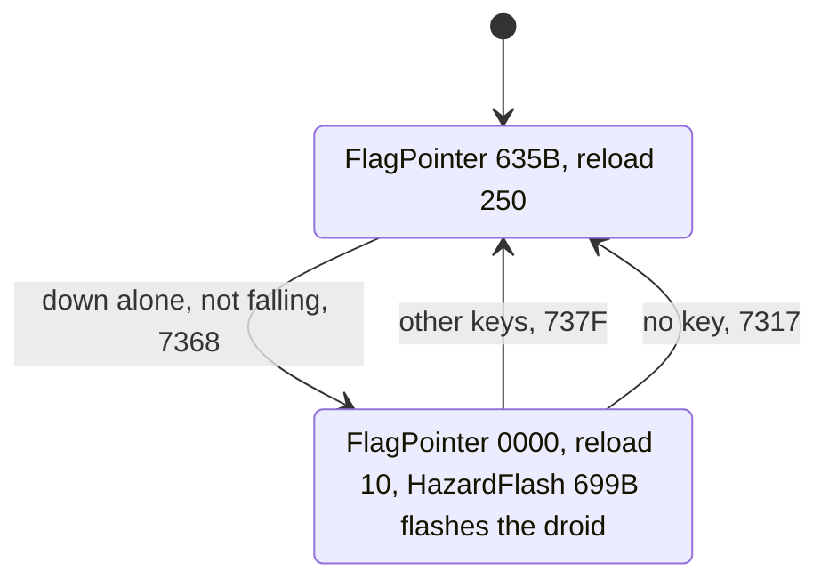

```text
7358  32 64 63     LD (ControlsLatch),A   ; MoveDroidKeys
735B  CB 56        BIT 2,(HL)
735D  20 1C        JR NZ,MoveDroidUpDown
735F  FE 04        CP $04
7361  20 18        JR NZ,MoveDroidUpDown
7363  CB 66        BIT 4,(HL)
7365  C2 2A 75     JP NZ,MoveDroidNewImage
7368  CB E6        SET 4,(HL)
736A  21 00 00     LD HL,$0000
736D  22 7E 63     LD (FlagPointer),HL
7370  3E 0A        LD A,$0A
7372  32 74 63     LD (EnergyReload),A
7375  32 66 63     LD (EnergyTimer),A
7378  C3 2A 75     JP MoveDroidNewImage
737B  CB 66        BIT 4,(HL)             ; MoveDroidUpDown
737D  28 13        JR Z,MoveDroidMoving
737F  CB A6        RES 4,(HL)
7381  21 5B 63     LD HL,DroidFlags
7384  22 7E 63     LD (FlagPointer),HL
7387  3E FA        LD A,$FA
7389  32 66 63     LD (EnergyTimer),A
738C  32 74 63     LD (EnergyReload),A
```

The collision flag is how the droid feels a touch. When the droid's pixels meet other pixels, the interrupt's XOR
draw sets bit 7 of the byte that the entry's flag pointer names ([doc 06](06-rendering.md)). With the pointer at 0,
that write goes to ROM and is lost, so nothing can touch the droid. The cost is energy: one unit per 10 interrupts
instead of one per 250. While bit 4 is set, HazardFlash `$699B` flashes the droid's attributes and clicks.

Worked example: `probe-shield` frames 196-280.

1. At 196 the script holds down alone.
2. The next acting pass takes `$7368`. The sample of 200 shows:
   - Controls low bits `$04`;
   - flags bit 4 set;
   - FlagPointer `$0000`;
   - EnergyReload 10.
3. Energy drops from `$90` to `$89` at 212, then one unit about every 10 interrupts, down to `$83` at 272.
4. Down is released at 276. The sample of 280 shows FlagPointer `$635B` and EnergyReload 250 again.

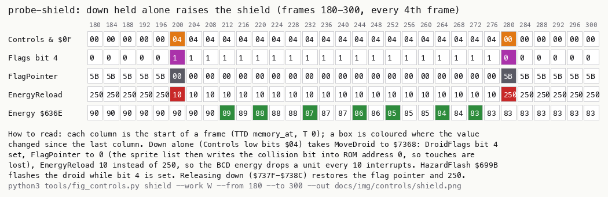

*The shield in `probe-shield`, frames 180-300, every fourth frame (memory at each frame start). `python3
tools/fig_controls.py shield --work work/docs/tjB/probe-shield --from 180 --to 300 --out
docs/img/controls/shield.png`.*

Witness:

- `$7368` ran 14 times in 11 recordings, among them `menu-cursor`, `menu-kempston`, `rzx-007000` (3 times) and
  `rzx-052000` (twice). The original player used the shield.
- `game.ann` and stage 2 describe DroidFlags bit 4 as "an enemy touched". An enemy touch in fact sets TouchTimer
  `$32` and EnergyReload `$0A` at `$75D0-$75DA` and leaves bit 4 alone. This is sent as a source change; the touch
  itself is in [doc 10](10-gameplay-logic.md).

The point: the shield trades energy for immunity, and its whole state is one pointer. Pointing the collision flag
at ROM turns off every touch test without any change to the drawing code.

## 5.10 Pause: the interrupt stops

The main loop's second half calls Pause `$793A` near its end (`$6986`). Pause reads ENTER directly on port `$BFFE`.

- A press while KeyLatches bit 1 is set flips Controls bit 5.
- The routine then loops inside itself while bit 5 is set.
- It returns only when the pause is off and ENTER is up.

```text
Pause:                                      ; $793A, interrupts off
    loop:
        a = IN($BFFE)
        if ENTER up:
            KeyLatches bit 1 = 1            ; armed
            if Controls bit 5 == 0: return  ; not paused: back to the main loop
        else if KeyLatches bit 1:
            KeyLatches bit 1 = 0
            Controls ^= $20                 ; toggle the pause
```

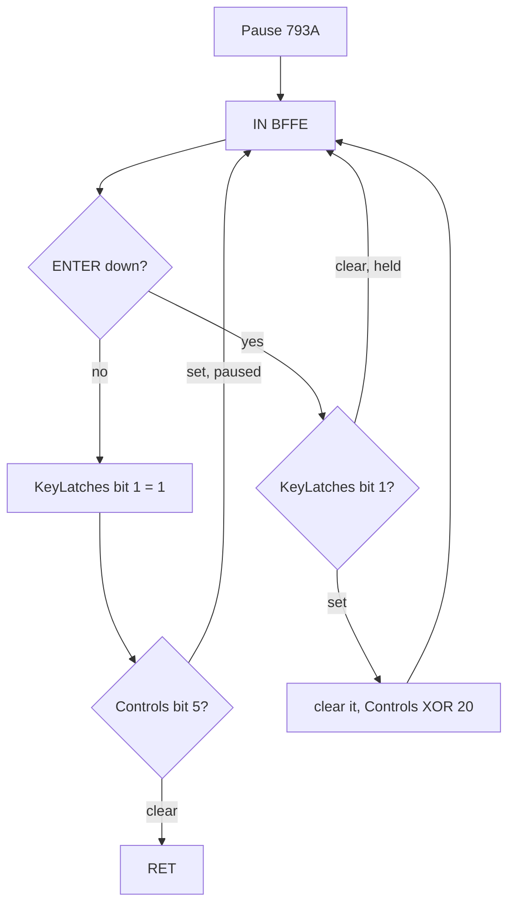

```text
793A  21 69 63     LD HL,KeyLatches       ; Pause
793D  01 FE BF     LD BC,$BFFE
7940  ED 78        IN A,(C)               ; PauseLoop
7942  CB 47        BIT 0,A
7944  3A C2 63     LD A,(Controls)
7947  20 0D        JR NZ,PauseReleased
7949  CB 4E        BIT 1,(HL)
794B  28 F3        JR Z,PauseLoop
794D  CB 8E        RES 1,(HL)
794F  EE 20        XOR $20
7951  32 C2 63     LD (Controls),A
7954  18 EA        JR PauseLoop
7956  CB CE        SET 1,(HL)             ; PauseReleased
7958  CB 6F        BIT 5,A
795A  20 E4        JR NZ,PauseLoop
795C  C9           RET
```

The main loop's work runs with interrupts off. WaitFrame ends its HALT with DI at `$796E`, and nothing in the second
half turns them back on. The exceptions are RiseSweep and FallSweep (`$7F4D`, `$7F5D`): sound effects that end with
EI and run only on some passes. So, in the normal case, PauseLoop spins with interrupts off, and no interrupt comes
while the game is paused:

- no ReadControls;
- no sprite drawing;
- no scroller;
- no energy tick.

That is why Pause reads ENTER from the port: Controls is not updated while it waits.

Worked example: `c1` frame 15 250.

1. The player presses ENTER. The pass reaches `$793A` and finds ENTER down and bit 1 set.
2. `$794D` clears the latch, and Controls becomes `$A0` (`$80` keyboard plus `$20`). The loop spins.
3. ENTER is released: `$7956` sets bit 1 again. Bit 5 is still set, so the loop goes on.
4. At 15 350 the second press clears bit 5. When ENTER comes up, the routine returns and the pass goes on.

Witness:

- `$794D` ran twice in `c1`: the pause on and off.
- The samples from 15 250 to 15 350 show Controls `$A0`, EnergyTimer `$6366` frozen at 100 and ScrollDelay `$63CD`
  frozen at 3. The interrupt counts both of them down, so it did not run for 100 frames.
- tjA's execution probe of `c1` (doc 04) finds no call of the handler `$95D0` in frames 15 241-15 359. Energy `$97`
  and EnergyTimer `$64` are the same at 15 241, 15 300 and 15 359 (values at the frame start).
- This contradicts stage 2 ("energy drains even on pause") and the `game.ann` text for Pause ("interrupts going on,
  the scroller runs"). Both corrections are sent.

The point: the pause costs almost nothing, because the game already works with interrupts off. A loop inside the
pass freezes the whole game, the clock included, and only the pause key is read.

## 5.11 What is known only from the code

- The cursor method's fire on 0 and the keyboard method's down on H-L are read, but no recording uses them: `c1`
  only uses X, and the RZX pieces are Kempston.
- Weapon select with CAPS SHIFT (rather than SPACE) is known only from the port `$7EFE`. No recording presses it.
- The Kempston bits are taken as the interface gives them. AND `$1F` masks off bit 5 and above, so a stick cannot
  set the pause flag.
- Left and right together count as no key (`$7306`). No recording holds both.
- The results of KEYBOARD are unused on every path in the listing. That they were never meant to be read is an
  inference from the absence of any `$5Cxx` reference.
- `$735B` (flags bit 2) refuses the shield while the droid falls. No recording tries it.
- A pause pressed on a pass where RiseSweep or FallSweep ran would spin with interrupts on, so the interrupt would
  keep running. No recording shows that case.
