# 6. Rendering

What this covers: the screen layout and the play area; the room renderer (the wipe, the layout triples, the tiles,
the clip, the cell table taken from the colours); the XOR sprite list `$FF01` and its drawing in the interrupt, with
the collision flag; the enemy buffers and the graphics shifted in place; the bit-reverse table and the turn; the
exhaust; the scroller's pixel move; the sprite sheets; which routine writes which byte of a real frame; and the
flicker, measured against the beam.

The recordings it rests on:

- `c1` (WALKTHROUGH 6.0): the load from power-on, then the menu and play by `tests/inputs/c1.txt`. The parts used
  here:
  - room 92 with two enemies, traced at frames 15006-15011;
  - the room change 92 to 84 (a north exit), traced at 15433:35000-15465:6000;
  - the exhaust at 15468-15483;
  - the scroller's TUJAD FROM ORPHEUS at 14290-14610.
- `room-102` (tjA, doc 04): the heaviest pass of the main loop, frames 239-242. Its beam timeline is reused in 6.11.
- The traces are made with `analysis trace` on my own instance replaying `c1` (`kit/kitlib.py` through
  `--work work/docs/tjB/c1 --window F:T-F:T`). They are kept in `work/docs/tjB/c1/traces/`. The commands are in
  `work/docs/tjB-NOTES.md`.

Frames and times:

- A memory sample "at frame N" is the state at the start of frame N (TTD `memory_at`).
- An event "at N:t" is an instruction of an access trace, t T-states into the emulator's frame N.
- The interrupt comes at T 1812. The beam reads paper line l from T 16 152 + 224 l (48K timing, as
  `kit/beam_timeline.py` uses it).
- Run counts called "L1" are the counts that the routine comments of `src/game` give for all the stage-1
  recordings.

## 6.1 The screen layout and the play area

The game uses the Spectrum screen as it is: no back buffer, no second screen. Everything is drawn straight into
`$4000-$5AFF`.

- **The HUD** takes character rows 0-5 (lines 0-47). DrawHud `$8AE8` draws the frame, the icons and the numbers
  once per game (doc 08). The scroller's window sits in it: columns 12-30, lines 8-39.
- **The play area** is character rows 6-23 (lines 48-191): 32 x 18 cells, 576 attributes from `$58C0`. The room,
  the droid, the enemies, the objects, the shots and the exhaust all live here.
- The room's coordinates are play-area rows. A tile at room row r lands on screen row r + 5, so room row 1 is the
  first full play row. Room row 0 is screen row 5, the HUD's last row, and the renderer clips it (6.3).
- **The cell table** `CellTable $60C0` mirrors the play area, one byte per cell (doc 07, 7.4). It sits at
  `$6000 + 32 x row + column`: the same low byte as the attribute, and a high byte that differs by `$38`. So
  `H XOR $38` steps from a cell to its attribute and back. DroidExhaust uses exactly that (6.7).

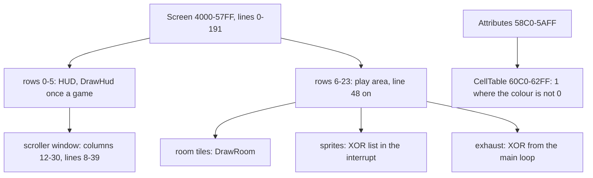

```text
addresses of play cell (column c, screen row r), r = 6..23
    attribute = $5800 + 32 r + c
    cell      = $6000 + 32 r + c          ; the attribute with H XOR $38
    pixels    = $4000 + ((r AND $18) << 8) + ((r AND 7) << 5) + c, then + $100 a line
```

Worked example: the cell at column 4, screen row 18. Its attribute is `$5800 + 576 + 4 = $5A44`. Its cell is
`$6244`, and `$5A XOR $38 = $62`. In `c1` at 15466 that cell is 0 and its attribute `$45`: it is one of the cells
coloured under the droid (6.7).

Witness: the right half of the room figure in 6.3 is the screen of `c1` at 15466: the HUD above line 48, the room
below it.

The point: the room and the HUD share one screen and no buffer. So everything the game draws in play must be undone
by drawing it again: the XOR list (6.4) and the XOR exhaust (6.7) are how.

## 6.2 The room renderer: DrawRoom `$6B22`

DrawRoom builds a room from scratch on each change. It runs with interrupts on and an empty sprite list. So the
handler keeps reading the controls and stepping the scroller while the room appears, and nothing else is drawn. The
order is:

1. empty the sprite list; EI; DrawMode = A;
2. reset the room's actors: the patrollers get bit 7, the four enemies and the two objects are cleared;
3. read the room's AlienMap `$DB53` record: the items, the teleporter, the enemy mask, the objects (doc 07, 7.2);
4. **dim** the play area: every attribute AND `$47`;
5. **wipe** (DrawMode 0) or **clear** (any other DrawMode) the play area's pixels;
6. **draw the layout**: the attributes zeroed, then the tiles (6.3);
7. **build the cell table** from the attributes, then add the items and the teleporter;
8. Shot = 0; DI.

Who calls it, with which mode:

| Caller | A | Why |
| --- | --- | --- |
| the four exits of MoveDroid (`$7418`, `$748C`, `$74D6`, `$7527`) | 0 | walking out of a room: the wipe |
| Teleport `$77A8` | the target room | the beam: a clear (a wipe only for room 0) |
| the ED pickup `$7715` | `$FF` | after the progress screen: a clear |
| LoseLife `$6A7F` | `$FF` | a new life: a clear |
| NewGame `$7A69` | `$FF` | the first room: a clear |

L1 counts 279 rooms drawn: 171 wipes and 110 clears.

### The dim and the wipe

The dim keeps BRIGHT and INK (`$47` = `0100 0111`) and drops PAPER and FLASH. So the old room turns to its inks on
black before it goes. Then the wipe empties the pixels in eight steps:

- each step walks the 72 line pairs of the play area, from `Screen+192` (line 48);
- it shifts each byte of the even line one pixel right (SRL) and each byte of the odd line one pixel left (SLA);
- each byte is shifted alone, with no carry into the next byte, so each 8-pixel group drains to one edge;
- after eight steps every byte is zero: the room combs itself out, right on even lines and left on odd lines.

```text
DrawRoomDim:   for 576 attributes from $58C0: a = a AND $47
DrawRoomScroll:                               ; DrawMode = 0
    repeat 8:
        hl = $40C0                            ; line 48
        repeat 72:                            ; line pairs
            for 32 bytes of the even line: SRL (hl)
            for 32 bytes of the odd line:  SLA (hl)
            hl = the next even line
        delay BC = $64
ClearPlayArea $7917:                          ; DrawMode not 0
    144 lines zeroed
```

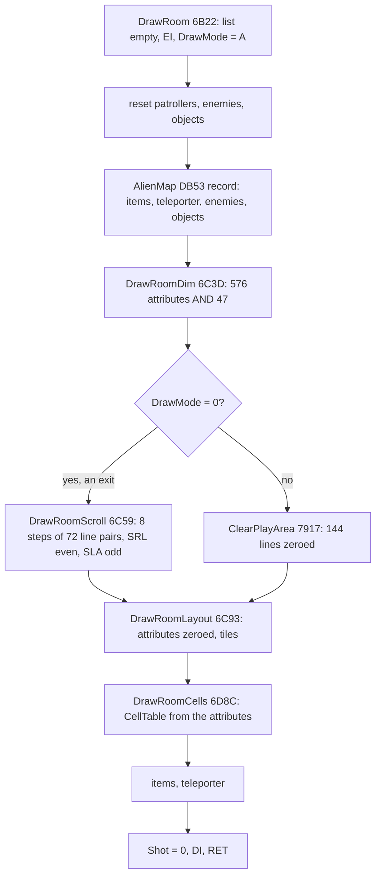

```text
6C3D  01 40 02     LD BC,$0240            ; DrawRoomDim
6C40  11 C0 58     LD DE,Attributes+192
6C43  1A           LD A,(DE)              ; DrawRoomDimLoop
6C44  E6 47        AND $47
6C46  12           LD (DE),A
6C47  13           INC DE
6C48  0B           DEC BC
6C49  78           LD A,B
6C4A  B1           OR C
6C4B  20 F6        JR NZ,DrawRoomDimLoop
6C4D  3A B1 63     LD A,(DrawMode)
6C50  FE 00        CP $00
6C52  28 05        JR Z,DrawRoomScroll
6C54  CD 17 79     CALL ClearPlayArea
6C57  18 3A        JR DrawRoomLayout
6C59  06 08        LD B,$08               ; DrawRoomScroll
6C5B  C5           PUSH BC                ; DrawRoomScrollStep
6C5C  21 C0 40     LD HL,Screen+192
6C5F  06 48        LD B,$48
6C61  C5           PUSH BC                ; DrawRoomScrollLine
6C62  E5           PUSH HL
6C63  06 20        LD B,$20
6C65  CB 3E        SRL (HL)               ; DrawRoomScrollRight
6C67  2C           INC L
6C68  10 FB        DJNZ DrawRoomScrollRight
6C6A  E1           POP HL
6C6B  24           INC H
6C6C  E5           PUSH HL
6C6D  06 20        LD B,$20
6C6F  CB 26        SLA (HL)               ; DrawRoomScrollLeft
6C71  2C           INC L
6C72  10 FB        DJNZ DrawRoomScrollLeft
6C74  E1           POP HL
6C75  24           INC H
6C76  7C           LD A,H
6C77  E6 07        AND $07
6C79  20 0A        JR NZ,DrawRoomScrollNext
6C7B  7D           LD A,L
6C7C  C6 20        ADD A,$20
6C7E  6F           LD L,A
6C7F  38 04        JR C,DrawRoomScrollNext
6C81  7C           LD A,H
6C82  D6 08        SUB $08
6C84  67           LD H,A
6C85  C1           POP BC                 ; DrawRoomScrollNext
6C86  10 D9        DJNZ DrawRoomScrollLine
6C88  01 64 00     LD BC,$0064
6C8B  0B           DEC BC                 ; DrawRoomScrollDelay
6C8C  78           LD A,B
6C8D  B1           OR C
6C8E  20 FB        JR NZ,DrawRoomScrollDelay
6C90  C1           POP BC
6C91  10 C8        DJNZ DrawRoomScrollStep
```

The cost, from the code: a byte takes SRL (HL) 15 T + INC L 4 T + DJNZ 13 T = 32 T. A step is 72 x 64 bytes, about
147 000 T, two frames of CPU. The delay of `$64` rounds adds only 2 600 T.

Worked example: the north exit from room 92 to room 84, `c1` (trace 15433:35000-15465:6000).

| Event | Frame:T |
| --- | --- |
| DrawRoom `$6B22` entered | 15433:35932 |
| DrawRoomDim, the 576 attributes | 15433:37177 on |
| the first wipe step | 15434:5984 |
| the eight wipe steps begin | 15434, 15437, 15440, 15443, 15446, 15449, 15453, 15456 |
| DrawRoomLayout `$6C93` | 15459:23644 |
| the first tile, the last tile | 15459:42172, 15464 |
| DrawRoomCells `$6D8C` | 15464:17623 |
| DI at `$6E0B`, the return | 15465:5754 |

So a step takes three frames: two frames of CPU and the interrupts' share. The whole room change takes about 32
frames, 0.64 s: about 25 frames of wipe and 6 of tiles.

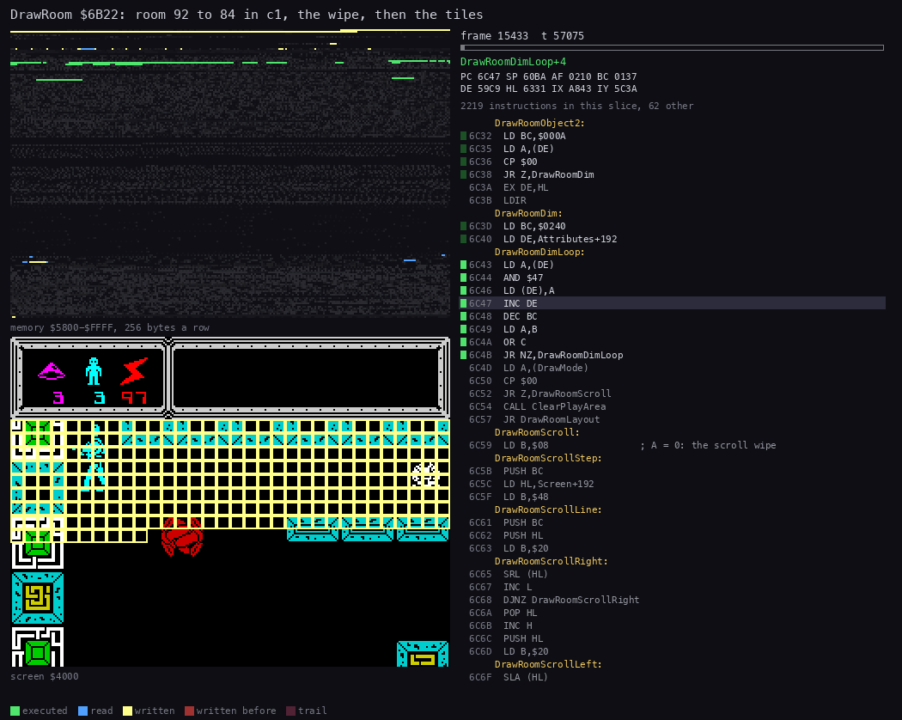

*DrawRoom `$6B22` at work, `c1` 15433:35000-15465:6000: the dim, the eight wipe steps, then the 21 tiles of room 84
one by one. Left the screen, right the code. Made with the command below.*

```text
python3 ../../kit/routine_anim.py --work work/docs/tjB/c1 --window 15433:35000-15465:6000 --listing build/game.lst --view screen --pc 6B22-6EA7 --range 5800-FFFF --pictures 100 --title "DrawRoom \$6B22: room 92 to 84 in c1, the wipe, then the tiles" --out docs/img/routines/DrawRoom.gif
```

Witness:

- The eight steps start three frames apart in the trace (the table above).
- L1 counts 171 wipes and 110 clears: the exits against the other room draws.

The point: the wipe is a cheap transition from one instruction (SRL or SLA) per byte, with no table and no second
screen. The dim before it makes the old room fade to its inks first. The interrupt stays on, so the scroller goes on
while the room changes.

## 6.3 The layout triples, the tiles and the clip

A room is a list of tiles. RoomLayouts `$BD06` starts with 102 words, one per room: the offset of its list from
`$BD06`. The list holds (column, row, tile) triples. A column byte with bit 7 ends it.

A tile has two parts:

- its graphic, from TileGraphics `$6EA8` (one word per tile): the width in bytes, the height in lines, then the rows;
- its colours, from TileAttrs `$6F36` (one word per tile):
  - either a fill: a first byte with bit 7, whose low 7 bits colour every cell of the tile;
  - or one attribute per cell, row by row.

The tables are indexed from 1: the code reads `TileAttrs-2 + 2t` and `TileGraphics-2 + 2t`.

DrawRoomTile finds the tile's screen address from the triple:

- L = ((row RRCA 3) AND `$E0`) OR column;
- H = (row AND `$18`) OR `$40`;
- then L + `$A0`, with the carry into H + 8: that is five character rows down, so room row r is screen row r + 5.

The clip keeps the HUD intact:

- **pixels**: a byte whose H AND `$F8` is `$58` (past the bitmap) is skipped, and neither the source nor L moves. A
  byte with H = `$40` and L AND `$E0` below `$C0` (character rows 0-5) is skipped too: the source moves, L does not.
  The rest of that pixel line is then skipped as well, since L stays in the HUD.
- **attributes**: an address of `$5B00` or more is dropped, and so is one with H = `$58` and L below `$C0` (rows
  0-5). In a fill, a clipped cell ends that attribute row. In the per-cell form the source still moves.

```text
DrawRoomLayout:
    attributes $58C0..$5AFF = 0
    p = RoomLayouts + word[RoomLayouts + 2 x Room]
    loop:                                     ; DrawRoomTile $6CAC
        c = byte[p]; if c bit 7: goto DrawRoomCells
        r = byte[p+1]; t = byte[p+2]; p += 3
        attrs = word[TileAttrs - 2 + 2t]
        g     = word[TileGraphics - 2 + 2t]
        hl = screen address of (c, r) + 5 character rows
        width = g[0]; lines = g[1]; src = g + 2
        for each line:                        ; DrawTileRow
            for each byte:                    ; DrawTileByte
                if (H AND $F8) == $58: next byte (src and L stay)
                if H == $40 and (L AND $E0) < $C0: src += 1; next byte (L stays)
                (hl) = (src); L += 1; src += 1
            hl = the next screen line
        a = attribute address of the tile's top-left cell
        if attrs[0] bit 7: fill width x lines/8 cells with attrs[0] AND $7F, a clipped cell ends its row
        else: one byte a cell, a clipped cell still takes its byte
```

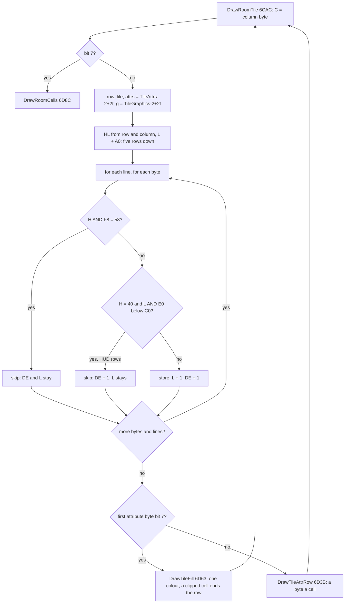

```text
6CAC  4E           LD C,(HL)              ; DrawRoomTile
6CAD  CB 79        BIT 7,C
6CAF  C2 8C 6D     JP NZ,DrawRoomCells
6CB2  23           INC HL
6CB3  46           LD B,(HL)
6CB4  23           INC HL
6CB5  5E           LD E,(HL)
6CB6  23           INC HL
6CB7  E5           PUSH HL
6CB8  16 00        LD D,$00
6CBA  CB 23        SLA E
6CBC  D5           PUSH DE
6CBD  21 34 6F     LD HL,TileAttrs-$0002
6CC0  19           ADD HL,DE
6CC1  5E           LD E,(HL)
6CC2  23           INC HL
6CC3  56           LD D,(HL)
6CC4  ED 53 B6 63  LD (TileAttrPtr),DE
6CC8  D1           POP DE
6CC9  21 A6 6E     LD HL,TileGraphics-$0002
6CCC  19           ADD HL,DE
6CCD  5E           LD E,(HL)
6CCE  23           INC HL
6CCF  56           LD D,(HL)
6CD0  78           LD A,B
6CD1  0F           RRCA
6CD2  0F           RRCA
6CD3  0F           RRCA
6CD4  E6 E0        AND $E0
6CD6  B1           OR C
6CD7  6F           LD L,A
6CD8  78           LD A,B
6CD9  E6 18        AND $18
6CDB  CB F7        SET 6,A
6CDD  67           LD H,A
6CDE  7D           LD A,L
6CDF  C6 A0        ADD A,$A0
6CE1  6F           LD L,A
6CE2  30 04        JR NC,DrawTilePixels
6CE4  7C           LD A,H
6CE5  C6 08        ADD A,$08
6CE7  67           LD H,A
6CE8  E5           PUSH HL                ; DrawTilePixels
6CE9  1A           LD A,(DE)
6CEA  4F           LD C,A
6CEB  13           INC DE
6CEC  1A           LD A,(DE)
6CED  47           LD B,A
6CEE  13           INC DE
6CEF  F5           PUSH AF                ; DrawTileRow
6CF0  E5           PUSH HL
6CF1  79           LD A,C
6CF2  F5           PUSH AF                ; DrawTileByte
6CF3  7C           LD A,H
6CF4  E6 F8        AND $F8
6CF6  FE 58        CP $58
6CF8  28 0F        JR Z,DrawTileByteNext
6CFA  FE 40        CP $40
6CFC  20 07        JR NZ,DrawTileStore
6CFE  7D           LD A,L
6CFF  E6 E0        AND $E0
6D01  FE C0        CP $C0
6D03  38 03        JR C,DrawTileSkip
6D05  1A           LD A,(DE)              ; DrawTileStore
6D06  77           LD (HL),A
6D07  2C           INC L
6D08  13           INC DE                 ; DrawTileSkip
6D09  F1           POP AF                 ; DrawTileByteNext
6D0A  3D           DEC A
6D0B  20 E5        JR NZ,DrawTileByte
```

The attribute half (`$6D22-$6D89`) has the same shape: the cell address from the base address (H RRCA 3 AND 3 OR
`$58`), then DrawTileAttrRow `$6D3B` or DrawTileFill `$6D63`. Both are in `src/game` and in doc 12.

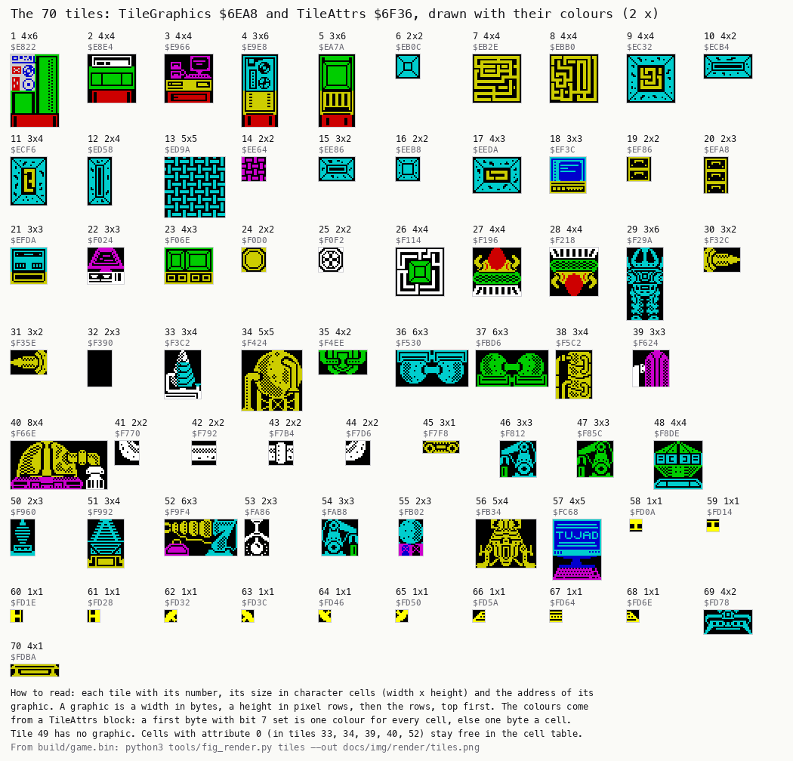

*The tiles of TileGraphics `$6EA8` and TileAttrs `$6F36`, drawn with their colours at 2 x. Each is labelled with its
number, its size (bytes x character rows) and its graphic address. Tile 49 has no graphic. Tiles 33, 34, 39, 40 and
52 have cells of attribute 0, which are not walls (the cell table, below). Tile 32 is all black, and no room uses it.
From build/game.bin: `python3 tools/fig_render.py tiles --out docs/img/render/tiles.png`.*

Worked example: room 84, the room `c1` enters at 15433.

1. `RoomLayouts + 2 x 84 = $BDAE` holds `$151D`. The list is at `$BD06 + $151D = $D223`.
2. The first triple, at `$D223`: `00 01 0F`, tile 15 at column 0, row 1.
3. TileGraphics gives `$EE86`: width 3, height 16 lines. TileAttrs gives `$7020`, whose first byte `$85` has bit 7:
   a fill of colour `$05` (cyan ink on black).
4. The address: row 1 RRCA 3 = `$20`, AND `$E0` OR 0 = `$20`; H = `$40`; L + `$A0` = `$C0`. So `$40C0`, line 48:
   the first play row.
5. The tile writes 3 bytes on each of 16 lines, then fills 3 x 2 cells from `$58C0` with `$05`.
6. The triple at `$D229` (29, 0, 11) is in room row 0. Its first character row starts at `$40BD`, character row 5.
   There `L AND $E0 = $A0` is below `$C0`, so every byte of those 8 lines is skipped. Its next three character rows
   draw. Tile 11 is 3 x 32 lines with one attribute per cell.
7. After 21 triples, `$D262` holds `$80`: the end.

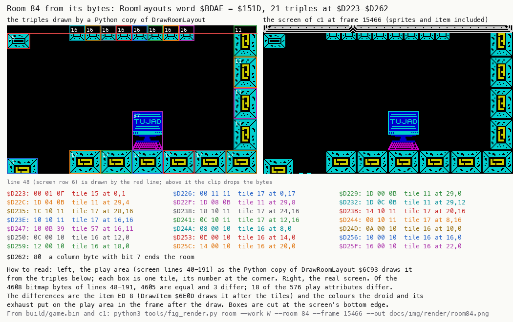

*Room 84 drawn from its triples by a Python copy of DrawRoomLayout with its clip (left), against the screen of `c1`
at frame 15466 (right). The triples are listed under the picture. 4605 of the 4608 bitmap bytes of lines 48-191
agree; the rest are under the sprites. 18 of the 576 attributes differ: the cells coloured `$45` around the droid,
drawn later. Made with `python3 tools/fig_render.py room --work work/docs/tjB/c1 --room 84 --frame 15466 --out
docs/img/render/room84.png`.*

Witness:

- The trace of 15433:35000-15465:6000 has 22 runs of DrawRoomTile `$6CAC`: 21 tiles and the terminator.
- The Python copy matches the real screen on every bitmap byte the sprites do not cover.

Both clips are used by the data. Over the 102 rooms (1944 triples, walked with the same address code in Python),
82 rooms have tiles that reach into the HUD row and 78 have tiles that run past line 191, where the `$58` test cuts
them. Room 84 is one of both.

The point: a room costs three bytes a tile. Room 84 takes 63 bytes plus the end byte for 576 cells. The clip in the
draw loop lets the designers put tiles half into the HUD row or off the bottom without a special case in the data.

### The cell table from the colours

DrawRoomCells `$6D8C` writes 1 into CellTable for every play cell whose attribute is not 0, and 0 elsewhere. The
movers test the cell table for walls, so a wall is whatever the room colours, not what it draws. Then the items and
the teleporter are written over it (doc 07, 7.4).

```text
DrawRoomCells:                                 ; $6D8C
    for n in 0..575: CellTable[n] = 1 if attribute[$58C0 + n] != 0 else 0
    item 1, item 2: ItemCell, DrawItem when the kind has bit 7
    teleporter: $FF $FF in its top cells, TeleportColumn, TeleportRow
```

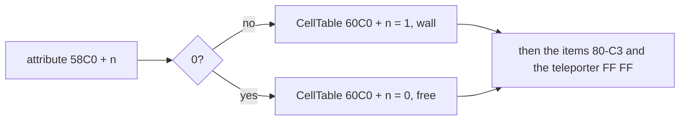

```text
6D8C  21 C0 60     LD HL,CellTable        ; DrawRoomCells
6D8F  11 C0 58     LD DE,Attributes+192
6D92  01 40 02     LD BC,$0240
6D95  1A           LD A,(DE)              ; DrawRoomCellsLoop
6D96  FE 00        CP $00
6D98  28 04        JR Z,DrawRoomCellEmpty
6D9A  36 01        LD (HL),$01
6D9C  18 01        JR DrawRoomCellNext
6D9E  77           LD (HL),A              ; DrawRoomCellEmpty
6D9F  23           INC HL                 ; DrawRoomCellNext
6DA0  13           INC DE
6DA1  0B           DEC BC
6DA2  78           LD A,B
6DA3  B1           OR C
6DA4  20 EF        JR NZ,DrawRoomCellsLoop
```

Worked example: tile 15 above fills its 3 x 2 cells with `$05`. So cells `$60C0-$60C2` and `$60E0-$60E2` become 1.
A tile with an attribute-0 cell (tile 33, for one) leaves a hole the droid can enter, even where pixels are drawn.

Witness: `c1` at 15466, CellTable and the attributes read with `memory_at` (`work/docs/tjB/peek.py`). 558 of the
576 cells are 1 exactly where the attribute is not 0. The other 18 are 0 with attribute `$45`: the exhaust's and
droid's colour, set after DrawRoom.

The point: one pass over 576 bytes gives the collision map. The tile data needs no separate solidity flags.

## 6.4 The sprite list `$FF01` and InterruptSprite `$95DB`

Every moving thing is drawn by XOR, from a list the interrupt drains. The main loop queues entries; WaitFrame
`$795D` closes the list and halts; the next interrupt draws all of them; WaitFrame then empties the list (doc 04,
4.4). An entry is eight bytes:

| Offset | Bytes | What |
| --- | --- | --- |
| +0 | word | the graphic: the first byte of its rows (0 ends the list) |
| +2 | word | the flag pointer: a byte whose bit 7 is set if the image hit ink |
| +4 | byte | the width in bytes |
| +5 | byte | the height in character rows (SLA 3 gives the lines) |
| +6 | word | the screen address of the top-left byte |

For each byte the interrupt reads the source (DE) and the screen (B) and writes A = source XOR B. Then it tests
`A AND B = B`. If the XOR cleared no screen bit, the sprite missed every ink pixel there. If it cleared one, C =
`$80`. At the end of the entry, InterruptCollide sets bit 7 of the byte the flag pointer names (through the shadow
BC).

The flag pointers in use:

- the droid: FlagPointer `$637E`, which holds DroidFlags `$635B` (bit 7 read by MoveDroidTouch `$75B1`, the touch
  test, doc 10). While the shield is up (down held alone, doc 05, 5.9) MoveDroid sets FlagPointer to `$0000`
  (`$736A`), so the droid's hits go to ROM and nothing touches it. Releasing restores DroidFlags (`$7319`, `$7381`);
- the shot of weapon 0: Shot `$635E`, its flag byte (the dash kills by collision only, doc 10);
- an enemy's new image: its record + 1 (`$630D` for enemy 2, `$631F` for enemy 4), read by MoveEnemy at `$91B4`
  (bit 7: MoveEnemyExplode);
- every erase and every object: `$0000`. An erase always "collides", since it XORs the same bits away. So its flag
  goes to ROM, where the write does nothing.

```text
InterruptSprite:                               ; $95DB, inside the IM 2 handler
    loop:
        hl = SpriteListEnd
        de = word[hl]; if de == 0: goto InterruptScroll
        BC' = word[hl+2]                       ; the flag pointer
        width = byte[hl+4]; lines = byte[hl+5] x 8
        screen = word[hl+6]; SpriteListEnd = hl + 8
        c = 0
        for each line:
            for each byte:
                b = (screen); a = (de) XOR b; (screen) = a
                if (a AND b) != b: c = $80     ; the sprite met ink
                de += 1; screen += 1
            screen = the next line down
        if c bit 7: (BC') = (BC') OR $80
```

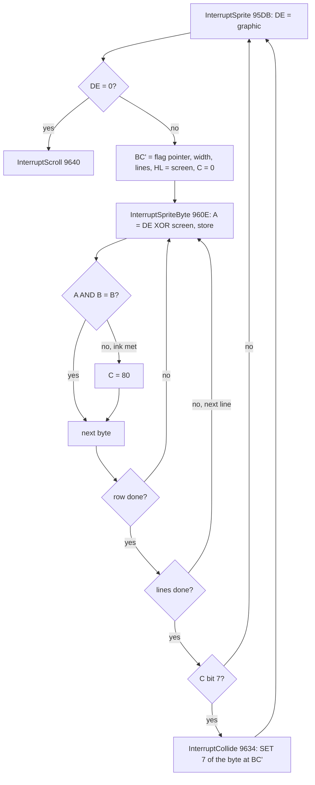

```text
95DB  2A D0 63     LD HL,(SpriteListEnd)  ; InterruptSprite
95DE  5E           LD E,(HL)
95DF  23           INC HL
95E0  56           LD D,(HL)
95E1  7A           LD A,D
95E2  B3           OR E
95E3  28 5B        JR Z,InterruptScroll
95E5  23           INC HL
95E6  E5           PUSH HL
95E7  D9           EXX
95E8  E1           POP HL
95E9  4E           LD C,(HL)
95EA  23           INC HL
95EB  46           LD B,(HL)
95EC  D9           EXX
95ED  23           INC HL
95EE  23           INC HL
95EF  7E           LD A,(HL)
95F0  32 AE 63     LD (MoverScratch),A
95F3  23           INC HL
95F4  4E           LD C,(HL)
95F5  23           INC HL
95F6  D5           PUSH DE
95F7  5E           LD E,(HL)
95F8  23           INC HL
95F9  56           LD D,(HL)
95FA  23           INC HL
95FB  22 D0 63     LD (SpriteListEnd),HL
95FE  EB           EX DE,HL
95FF  D1           POP DE
9600  CB 21        SLA C
9602  CB 21        SLA C
9604  CB 21        SLA C
9606  79           LD A,C
9607  0E 00        LD C,$00
9609  F5           PUSH AF                ; InterruptSpriteRow
960A  E5           PUSH HL
960B  3A AE 63     LD A,(MoverScratch)
960E  F5           PUSH AF                ; InterruptSpriteByte
960F  1A           LD A,(DE)
9610  46           LD B,(HL)
9611  A8           XOR B
9612  77           LD (HL),A
9613  A0           AND B
9614  B8           CP B
9615  28 02        JR Z,InterruptSpriteNext
9617  0E 80        LD C,$80
9619  13           INC DE                 ; InterruptSpriteNext
961A  2C           INC L
961B  F1           POP AF
961C  3D           DEC A
961D  20 EF        JR NZ,InterruptSpriteByte
961F  E1           POP HL
9620  24           INC H
9621  7C           LD A,H
9622  E6 07        AND $07
9624  20 0A        JR NZ,InterruptSpriteRowNext
9626  7D           LD A,L
9627  C6 20        ADD A,$20
9629  6F           LD L,A
962A  38 04        JR C,InterruptSpriteRowNext
962C  7C           LD A,H
962D  D6 08        SUB $08
962F  67           LD H,A
9630  F1           POP AF                 ; InterruptSpriteRowNext
9631  3D           DEC A
9632  20 D5        JR NZ,InterruptSpriteRow
9634  CB 79        BIT 7,C                ; InterruptCollide
9636  28 A3        JR Z,InterruptSprite
9638  D9           EXX
9639  0A           LD A,(BC)
963A  CB FF        SET 7,A
963C  02           LD (BC),A
963D  D9           EXX
963E  18 9B        JR InterruptSprite
```

The cost, from the code: a byte takes 92 T without a hit (PUSH AF to JR NZ), 87 T with one. A 3 x 16 enemy image is
48 bytes, about 4 900 T with the line steps.

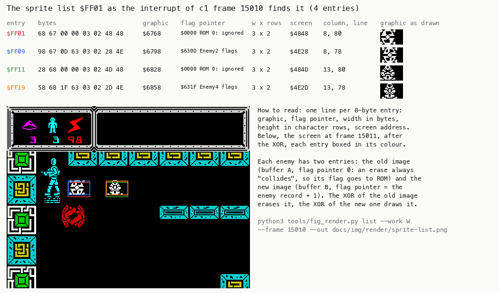

*The sprite list as the interrupt of `c1` frame 15010 finds it (memory at the frame start; WaitFrame closed the list
before its HALT). Each enemy has two entries: the old image from buffer A with flag pointer 0, and the new image
from buffer B with the enemy's flag byte. Below, the screen at frame 15011 with each entry boxed in its colour. Made
with `python3 tools/fig_render.py list --work work/docs/tjB/c1 --frame 15010 --out
docs/img/render/sprite-list.png`.*

Worked example: the entry at `$FF09` of `c1` frame 15010, `98 67 0D 63 03 02 28 4E`.

1. The graphic is `$6798`, enemy 2's buffer B. The flag pointer is `$630D`, enemy 2's record + 1.
2. Width 3, two character rows: 16 lines of 3 bytes.
3. The screen address `$4E28` is column 8, line 78.
4. Take one byte (values for illustration): the screen holds `$18` (a wall's ink) and the sprite `$3C`. A =
   `$3C XOR $18 = $24`; `$24 AND $18 = $00`, not `$18`: C becomes `$80`, and at the end bit 7 of `$630D` is set.
5. Over black paper (B = 0), A AND B = 0 = B: no hit, C stays 0.

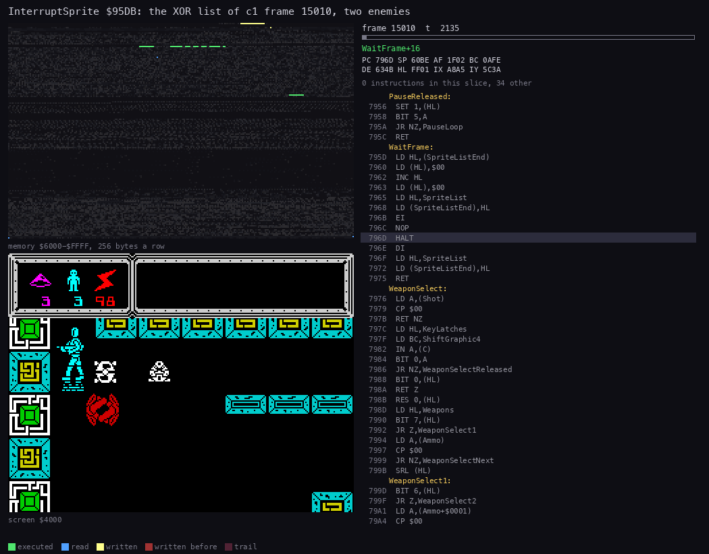

*InterruptSprite `$95DB` drawing the four entries of `c1` frame 15010: the two old images vanish and the two new ones
appear, byte by byte. Made with the command below.*

```text
python3 ../../kit/routine_anim.py --work work/docs/tjB/c1 --window 15010:1800-15010:28600 --listing build/game.lst --view screen --pc 95DB-963F --range 6000-FFFF --pictures 80 --title "InterruptSprite \$95DB: the XOR list of c1 frame 15010, two enemies" --out docs/img/routines/InterruptSprite.gif
```

Witness: the handler's length in the `c1` traces, from the INT to the RETI.

| Frame | Handler | What it drew |
| --- | ---: | --- |
| 15006 | 34 600 T | 2 entries |
| 15007 | 53 278 T | a scroller step plus an object |
| 15008 | none | the INT was lost: the pass ran with DI from 15007:55140 to 15008:11185 |
| 15009 | 34 601 T | the droid's half |
| 15010 | 28 511 T | 4 enemy entries, 192 bytes |

The point: the list does three jobs at once. It times the drawing to the frame (all drawing happens in the
interrupt, after the HALT). It erases by drawing again. And it gives the collision test for free: one AND and one CP
per byte, read back by MoveDroid and MoveEnemy on the next pass.

## 6.5 The enemy buffers and the graphics shifted in place

The enemies move by pixels, but their frames are stored once, at shift 0. Instead of eight pre-shifted copies the
game shifts each frame in place to the wanted offset, and records the offset in the frame's first byte.

- An enemy frame is 49 bytes (`$31`): one shift byte, then 16 rows of 3 bytes (16 pixels of image in 24).
- **ShiftGraphic3 `$7EBB`** takes HL = the frame and A = the offset wanted (x AND 7):
  - if (HL) = A it returns at once;
  - otherwise it stores A and shifts the 48 bytes by A - old: right with SRL, RR, RR per row, or left with SLA, RL,
    RL, repeated for each pixel.
- **ShiftGraphic4 `$7EFE`** does the same for the 4-byte, 24-row object frames (97 bytes each, `$B049-$B901`).

Because the frame itself moves, the list cannot point at it: the next MoveEnemy may shift it again before the
interrupt draws (two enemies of a kind share the frames). So MoveEnemy copies each image into a buffer of its own.
EnemyBuffers `$6708` holds two 48-byte buffers per enemy, and MainLoop points EnemyBufferPtrs `$6704` at the pair
before each MoveEnemy:

| Enemy | Buffer A (old image) | Buffer B (new image) |
| --- | --- | --- |
| 1 | `$6708` | `$6738` |
| 2 | `$6768` | `$6798` |
| 3 | `$67C8` | `$67F8` |
| 4 | `$6828` | `$6858` |

For each enemy, each pass:

1. the old frame is shifted back to the old x AND 7, copied into buffer A and queued with flag pointer 0
   (`$916A-$9196`): the erase;
2. the next frame (+`$31`, or the first after the last) is shifted to the new x AND 7, copied into buffer B and
   queued with the enemy's flag byte (`$9240-$9277`): the draw.

The objects skip the buffers. They queue the frame itself (graphic + 1), with flag pointer 0 (`$81EF-$820A`).

```text
ShiftGraphic3(hl, a):                          ; $7EBB
    if byte[hl] == a: return
    d = a - byte[hl]; byte[hl] = a
    for 16 rows, ix = hl + 1, + 3 a row:
        if d > 0: repeat d: SRL (ix+0); RR (ix+1); RR (ix+2)
        else:     repeat -d: SLA (ix+2); RL (ix+1); RL (ix+0)

MoveEnemy, per enemy:
    ShiftGraphic3(old frame, old x AND 7); LDIR 48 bytes to buffer A
    queue (A, 0, 3, 2, screen(old x, old y))
    frame = next frame
    ShiftGraphic3(frame, x AND 7); LDIR 48 bytes to buffer B
    queue (B, record + 1, 3, 2, screen(x, y))
```

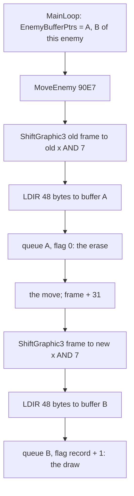

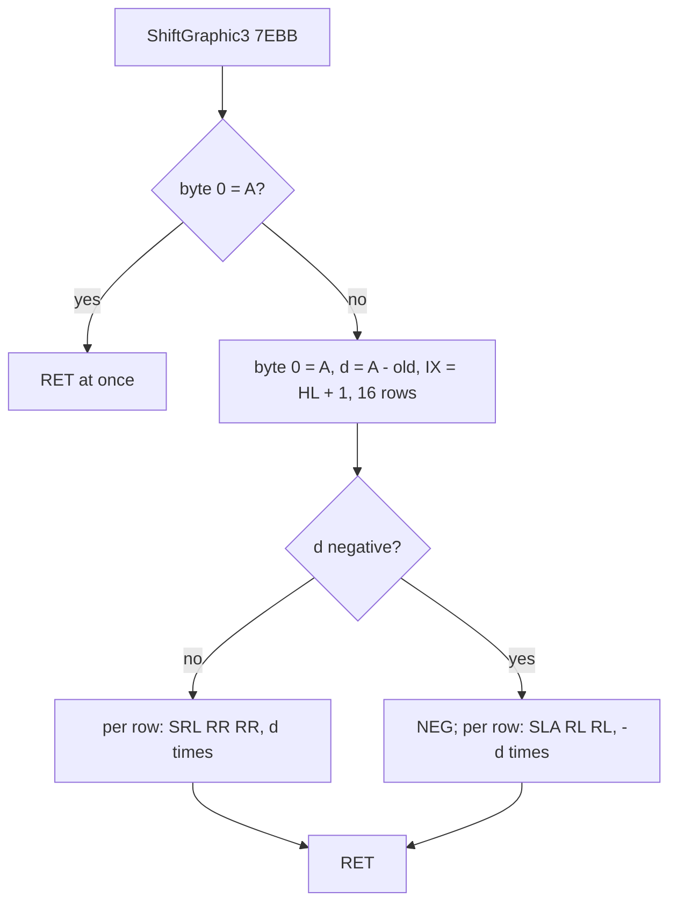

```text
7EBB  BE           CP (HL)                ; ShiftGraphic3
7EBC  C8           RET Z
7EBD  4E           LD C,(HL)
7EBE  77           LD (HL),A
7EBF  91           SUB C
7EC0  E5           PUSH HL
7EC1  DD E1        POP IX
7EC3  DD 23        INC IX
7EC5  0E 10        LD C,$10
7EC7  FA E3 7E     JP M,ShiftGraphic3Left
7ECA  47           LD B,A                 ; ShiftGraphic3RightRow
7ECB  DD CB 00 3E  SRL (IX+$00)           ; ShiftGraphic3Right
7ECF  DD CB 01 1E  RR (IX+$01)
7ED3  DD CB 02 1E  RR (IX+$02)
7ED7  10 F2        DJNZ ShiftGraphic3Right
7ED9  DD 23        INC IX
7EDB  DD 23        INC IX
7EDD  DD 23        INC IX
7EDF  0D           DEC C
7EE0  20 E8        JR NZ,ShiftGraphic3RightRow
7EE2  C9           RET
7EE3  ED 44        NEG                    ; ShiftGraphic3Left
7EE5  47           LD B,A                 ; ShiftGraphic3LeftRow
7EE6  DD CB 02 26  SLA (IX+$02)           ; ShiftGraphic3LeftBit
7EEA  DD CB 01 16  RL (IX+$01)
7EEE  DD CB 00 16  RL (IX+$00)
7EF2  10 F2        DJNZ ShiftGraphic3LeftBit
7EF4  DD 23        INC IX
7EF6  DD 23        INC IX
7EF8  DD 23        INC IX
7EFA  0D           DEC C
7EFB  20 E8        JR NZ,ShiftGraphic3LeftRow
7EFD  C9           RET
```

```text
9240  79           LD A,C                 ; MoveEnemyShift
9241  E6 07        AND $07
9243  C5           PUSH BC
9244  CD BB 7E     CALL ShiftGraphic3
9247  C1           POP BC
9248  EB           EX DE,HL
9249  E1           POP HL
924A  73           LD (HL),E
924B  23           INC HL
924C  72           LD (HL),D
924D  13           INC DE
924E  EB           EX DE,HL
924F  C5           PUSH BC
9250  ED 5B 04 67  LD DE,(EnemyBufferPtrs)
9254  01 30 00     LD BC,$0030
9257  ED B0        LDIR
9259  C1           POP BC
925A  ED 5B 04 67  LD DE,(EnemyBufferPtrs)
925E  2A D0 63     LD HL,(SpriteListEnd)
9261  73           LD (HL),E
9262  23           INC HL
9263  72           LD (HL),D
9264  23           INC HL
9265  D1           POP DE
9266  73           LD (HL),E
9267  23           INC HL
9268  72           LD (HL),D
9269  23           INC HL
926A  36 03        LD (HL),$03
926C  23           INC HL
926D  36 02        LD (HL),$02
926F  23           INC HL
9270  CD 66 7C     CALL ScreenAddrXY
9273  73           LD (HL),E
9274  23           INC HL
9275  72           LD (HL),D
9276  23           INC HL
9277  22 D0 63     LD (SpriteListEnd),HL
```

The cost, from the code: a row with d shifts takes 45 + 82 d T, so a call costs about 720 + 1312 d T. The worst
case, d = 7, is about 9 900 T. The early return costs 16 T. L1 counts 20 289 calls of ShiftGraphic3 and only 2 330
shifts: 89 % of the calls find the frame already at the offset. ShiftGraphic4: 1 765 calls, 299 shifts.

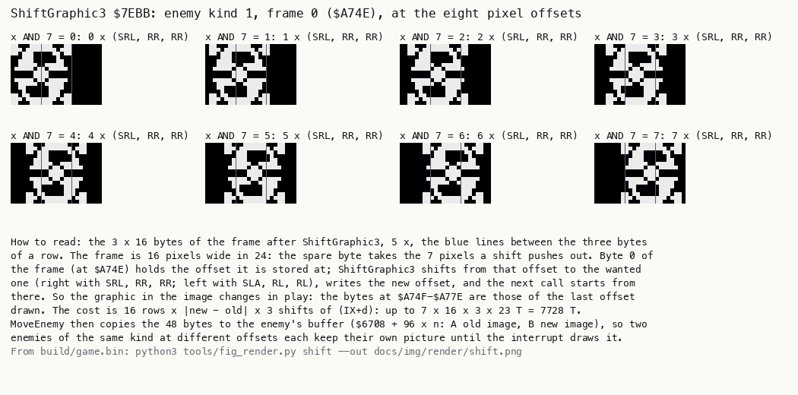

*Enemy kind 1, frame 0 (`$A74E`) at the eight pixel offsets, as ShiftGraphic3 leaves it. The blue lines part the
three bytes of a row. From build/game.bin: `python3 tools/fig_render.py shift --out docs/img/render/shift.png`.*

Worked example: enemies 2 and 4 in `c1` frame 15009 (trace 15009:36700-15009:56000).

1. At 15009:37324 ShiftGraphic3 is called with HL = `$A74E` (kind 1, frame 0) and A = 0: the old frame, back to the
   old x AND 7 = 0. It is copied to `$6768`, enemy 2's buffer A.
2. At 15009:42204 it is called with HL = `$A77F` (`$A74E + $31`, frame 1) and A = 2: the enemy now stands at x AND
   7 = 2. The frame shifts right by 2 minus its byte 0 and is copied to `$6798`, buffer B.
3. Enemy 4 does the same with `$A843` and `$A874`: kind 2 (`$A812`), frames 1 and 2.
4. The list of 15010 (6.4) then holds `$6768` with flag 0 and `$6798` with `$630D`, and the same pair for enemy 4.

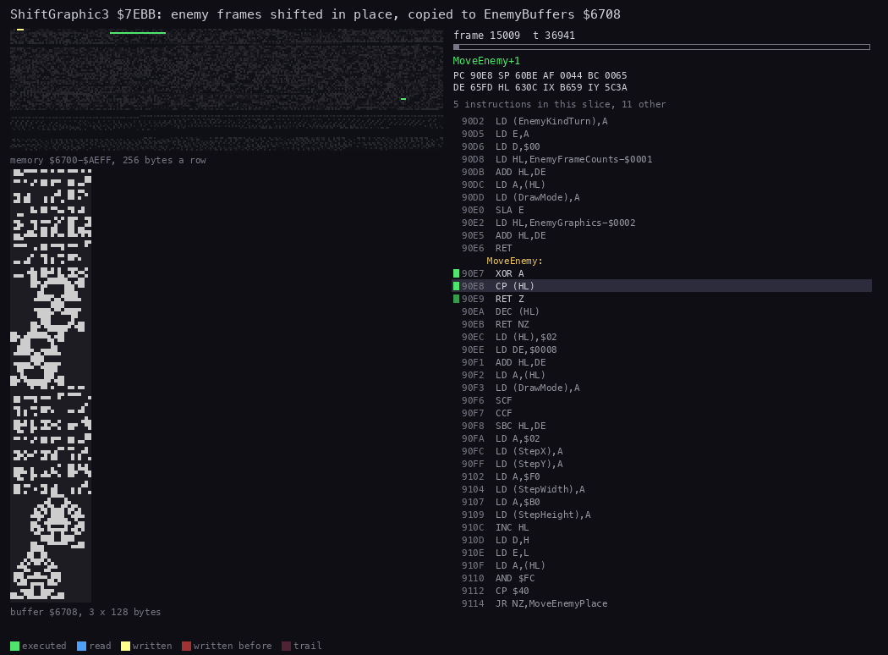

*ShiftGraphic3 `$7EBB` and MoveEnemy's copies at work, `c1` 15009:36700-15009:56000. The view is the buffers from
`$6708` as 3-byte rows: each buffer fills after its frame is shifted. Made with the command below.*

```text
python3 ../../kit/routine_anim.py --work work/docs/tjB/c1 --window 15009:36700-15009:56000 --listing build/game.lst --view buffer:6708:3x128 --pc 7EBB-7EFD,90E7-93FF --range 6700-AEFF --pictures 80 --title "ShiftGraphic3 \$7EBB: enemy frames shifted in place, copied to EnemyBuffers \$6708" --out docs/img/routines/ShiftGraphic3.gif
```

Witness:

- The calls above, in the trace, with their HL and A.
- The list of 15010 in 6.4 points at exactly these buffers.

The point: one copy of each frame instead of eight saves memory: 1911 bytes of enemies instead of about 15 000.
Most calls find the frame already at the right offset, since an enemy moves by a pixel or two. The buffers turn a
mutable graphic back into a stable image for the interrupt.

## 6.6 BitReverse `$9A4C` and the turn

The droid's graphics are stored facing right. When it turns, TurnRound `$7866` steps through TurnSequence `$68B2`
(frames 8, 9, 10, 9, 8, then `$FF`), and on each step it mirrors one more slice of the droid's frames in place:

- **TurnMirror3 `$78A4`** takes 160 rows of 3 bytes: the left byte becomes rev(right), the middle rev(middle), the
  right rev(left);
- **TurnMirror2 `$78DA`** takes 80 rows of 2 bytes, then skips `$50` bytes: the front frame `$A0A0`, which is
  symmetric and needs no mirror;
- rev(n) is BitReverse `$9A4C`, a 256-byte table of each byte with its bits reversed.

The table is not page aligned: `$9A4C + $B4 = $9B00`. So each lookup adds the byte to E and carries into D, and
pays JR NC / INC D. After the whole sequence every frame faces the other way, and the facing bit flips.

```text
TurnMirror3:                                   ; $78A4, HL = TurnGraphic
    repeat 160:
        l = rev(byte[hl]); m = rev(byte[hl+1]); r = rev(byte[hl+2])
        byte[hl] = r; byte[hl+1] = m; byte[hl+2] = l
        hl += 3
    TurnGraphic = hl
rev(n): de = $9A4C; e += n; if carry: d += 1; return byte[de]
```

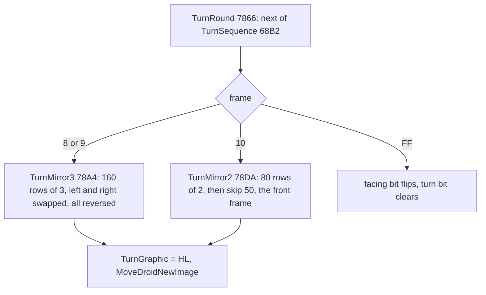

```text
78A4  2A 7A 63     LD HL,(TurnGraphic)    ; TurnMirror3
78A7  06 A0        LD B,$A0
78A9  7E           LD A,(HL)              ; TurnMirror3Row
78AA  11 4C 9A     LD DE,BitReverse
78AD  83           ADD A,E
78AE  5F           LD E,A
78AF  30 01        JR NC,TurnMirror3Left
78B1  14           INC D
78B2  1A           LD A,(DE)              ; TurnMirror3Left
78B3  4F           LD C,A
78B4  23           INC HL
78B5  7E           LD A,(HL)
78B6  11 4C 9A     LD DE,BitReverse
78B9  83           ADD A,E
78BA  5F           LD E,A
78BB  30 01        JR NC,TurnMirror3Middle
78BD  14           INC D
78BE  1A           LD A,(DE)              ; TurnMirror3Middle
78BF  77           LD (HL),A
78C0  23           INC HL
78C1  7E           LD A,(HL)
78C2  11 4C 9A     LD DE,BitReverse
78C5  83           ADD A,E
78C6  5F           LD E,A
78C7  30 01        JR NC,TurnMirror3Right
78C9  14           INC D
78CA  1A           LD A,(DE)              ; TurnMirror3Right
78CB  71           LD (HL),C
78CC  2B           DEC HL
78CD  2B           DEC HL
78CE  77           LD (HL),A
78CF  23           INC HL
78D0  23           INC HL
78D1  23           INC HL
78D2  10 D5        DJNZ TurnMirror3Row
78D4  22 7A 63     LD (TurnGraphic),HL
78D7  C3 2A 75     JP MoveDroidNewImage
```

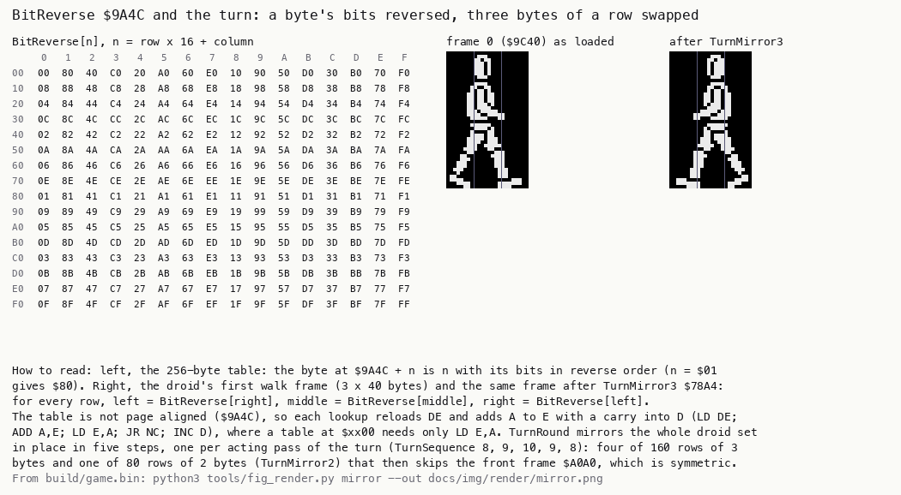

*BitReverse `$9A4C` as a 16 x 16 table, and droid frame 0 (`$9C40`) before and after TurnMirror3. From
build/game.bin: `python3 tools/fig_render.py mirror --out docs/img/render/mirror.png`.*

Worked example: a row holding `$0F $3C $00`. rev(`$0F`) = `$F0` (the table entry at `$9A5B`), rev(`$3C`) = `$3C`,
rev(`$00`) = `$00`. The row becomes `$00 $3C $F0`: the same picture, mirrored. A byte of `$B4` or more crosses into
page `$9B`: rev(`$B4`) is at `$9B00` and holds `$2D`.

Witness: L1 counts 538 TurnRound steps and 90 turns: about six calls a turn, the five steps of TurnSequence and
the `$FF` end.

The point: the droid is drawn at whole columns (its x is a column, 0-`$1D`), so it needs no shift, only a mirror.
Mirroring in place keeps one set of droid frames, and spreading the mirror over the turn's steps hides its cost in
the turn's animation.

## 6.7 The exhaust

Under the droid a flickering exhaust is drawn straight onto the screen, from the main loop, not through the list.

- **ExhaustStep `$8E7E`** (once a pass) rotates four pattern rows into ExhaustRaw `$65FD`: rows 1 and 3 one pixel
  right, rows 2 and 4 one pixel left. A row whose counter runs out takes a new random pattern (ExhaustPick `$8EAC`:
  Random AND `$1C`, a life of 8-39 steps).
- **ExhaustMask `$8F1B`** copies the four rows into the odd rows of ExhaustRows `$65E5` (8 rows of 3 bytes), the
  edge bytes masked by the droid's frame (ExhaustMasks `$65D6`; the front frame has its own mask). The even rows stay
  0.
- **DroidExhaust `$8DD2`** XORs the 8 rows under the droid: from five character rows below its top, one column on
  when it faces left and walks. It skips a cell holding a wall (1) or an item (bit 7), and sets each cell it draws
  in to `$45` (bright cyan). It steps from the cell to the attribute with `H XOR $38` (6.1). It clips at the bottom
  of the screen.
- MainLoop calls DroidExhaust before MoveDroid (the erase) and after ExhaustStep (the draw). So the same bytes are
  XORed twice a pass, with the old and the new pattern.

```text
DroidExhaust:                                  ; $8DD2
    hl = screen address of the droid + 5 character rows (+1 column if facing left and walking)
    if H >= $58: return                        ; below the screen
    cell = (H RRCA 3 AND 3 OR $60), L          ; CellTable
    lines = 8, fewer at the screen's last row
    for each line, de = ExhaustRows:
        for each of the droid's width bytes:
            if cell != 1 and cell bit 7 == 0:
                (hl) = (hl) XOR (de)
                attribute(cell) = $45          ; H XOR $38
            de, hl, cell += 1
        next line; at a character boundary, cell += 32
```

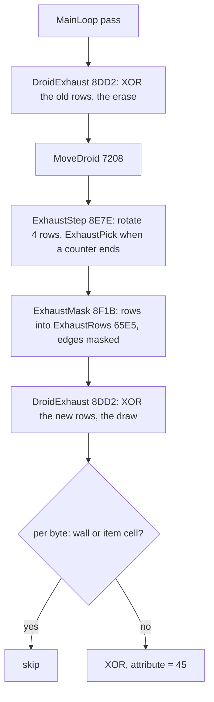

```text
8E2A  11 E5 65     LD DE,ExhaustRows      ; DroidExhaustStart
8E2D  C5           PUSH BC                ; DroidExhaustRow
8E2E  E5           PUSH HL
8E2F  D5           PUSH DE
8E30  ED 4B AE 63  LD BC,(MoverScratch)
8E34  3A B1 63     LD A,(DrawMode)
8E37  F5           PUSH AF                ; DroidExhaustByte
8E38  0A           LD A,(BC)
8E39  FE 01        CP $01
8E3B  28 12        JR Z,DroidExhaustNext
8E3D  CB 7F        BIT 7,A
8E3F  20 0E        JR NZ,DroidExhaustNext
8E41  1A           LD A,(DE)
8E42  AE           XOR (HL)
8E43  77           LD (HL),A
8E44  78           LD A,B
8E45  EE 38        XOR $38
8E47  47           LD B,A
8E48  3E 45        LD A,$45
8E4A  02           LD (BC),A
8E4B  78           LD A,B
8E4C  EE 38        XOR $38
8E4E  47           LD B,A
8E4F  13           INC DE                 ; DroidExhaustNext
8E50  2C           INC L
8E51  0C           INC C
8E52  F1           POP AF
8E53  3D           DEC A
8E54  20 E1        JR NZ,DroidExhaustByte
```

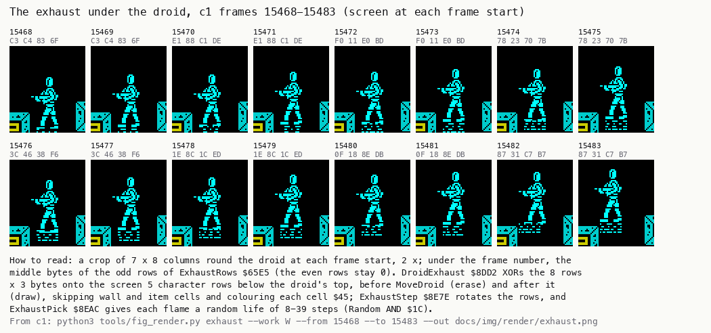

*The exhaust under the droid in room 84, `c1` frames 15468-15483 (screen at each frame start), with the middle bytes
of the odd ExhaustRows under each picture. The pattern changes every second frame: once a pass. Made with `python3
tools/fig_render.py exhaust --work work/docs/tjB/c1 --from 15468 --to 15483 --out docs/img/render/exhaust.png`.*

Worked example: from 15468 to 15470 (one pass) the middle bytes go from `C3 C4 83 6F` to `E1 88 C1 DE`.

- Row 1: `$C3` = `1100 0011` rotated right, with the bit from its left neighbour coming in, gives `1110 0001` =
  `$E1`.
- Row 2: `$C4` = `1100 0100` rotated left gives `1000 1000` = `$88`; its top bit goes on into the left neighbour.
- Rows 3 and 4 do the same: `$83` to `$C1` (right) and `$6F` to `$DE` (left).

Witness:

- In `c1` the ExhaustRows bytes change from 14808 on, a pass at a time. They stay frozen during the pause
  (15244-15348), when no pass reaches ExhaustStep.
- The writers map of 6.10 shows DroidExhaustByte writing 30 bytes with 192 writes in five frames: two XORs per byte
  per pass.

The point: the exhaust is the only picture drawn from the main loop. It is erased and redrawn in the same pass, so it
can flicker against the beam (6.11), and here the flicker is the effect. The cell-to-attribute XOR saves a second
address computation for the colour.

## 6.8 The scroller's pixel move

InterruptScroll `$9640` runs in every interrupt after the sprite list. Its timing and its message queue are in doc
08, 8.8. This section covers its pixels and its place in the frame.

- ScrollDelay `$63CD` counts down. At 0 it is reset to 5, ScrollLine `$63CC` steps (0-7), and the delay becomes 15
  when ScrollLine returns to 0. So one text row takes 7 x 5 + 15 = 50 interrupts.
- The step copies 31 lines of 19 bytes up one line: from `$412C` (line 9) to `$402C` (line 8), down to line 39.
- If ScrollText `$63C7` is not 0 it draws row ScrollLine of 19 characters into the bottom line: the byte at
  `Font-$101 + 8 x code + ScrollLine`.
- With ScrollText 0 the window still scrolls: the last line is copied up and the text rises out.

```text
InterruptScroll:                               ; $9640
    ScrollDelay -= 1; if not 0: goto InterruptTimers
    ScrollDelay = 5; ScrollLine = (ScrollLine + 1) AND 7
    if ScrollLine == 0: ScrollDelay = 15
    for line = 8 .. 38: line[12..30] = (line + 1)[12..30]      ; 31 x 19 bytes
    if ScrollText != 0:
        for 19 characters: line 39 byte = font[code x 8 + ScrollLine]
    at ScrollLine 0: the next row, or the next message, or ScrollText = 0 (doc 08)
```

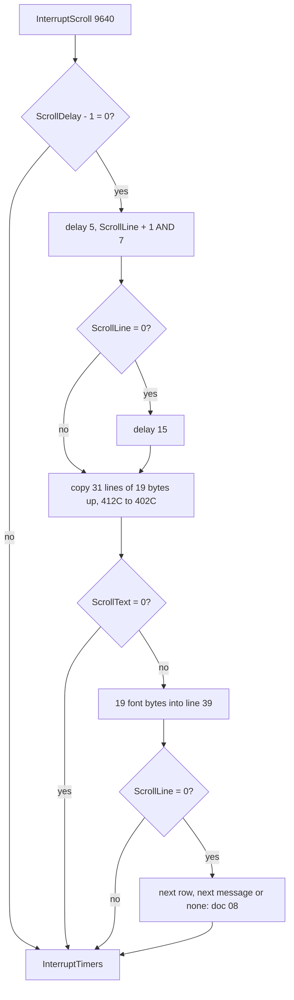

```text
9658  21 2C 40     LD HL,Screen+44        ; InterruptScrollStep
965B  11 2C 41     LD DE,Screen+300
965E  06 1F        LD B,$1F
9660  C5           PUSH BC                ; InterruptScrollLine
9661  E5           PUSH HL
9662  D5           PUSH DE
9663  06 13        LD B,$13
9665  1A           LD A,(DE)              ; InterruptScrollByte
9666  77           LD (HL),A
9667  2C           INC L
9668  1C           INC E
9669  10 FA        DJNZ InterruptScrollByte
966B  D1           POP DE
966C  14           INC D
966D  7A           LD A,D
966E  E6 07        AND $07
9670  20 08        JR NZ,InterruptScrollLineNext
9672  7B           LD A,E
9673  C6 20        ADD A,$20
9675  5F           LD E,A
9676  7A           LD A,D
9677  D6 08        SUB $08
9679  57           LD D,A
967A  E1           POP HL                 ; InterruptScrollLineNext
967B  24           INC H
967C  7C           LD A,H
967D  E6 07        AND $07
967F  20 08        JR NZ,InterruptScrollLineDone
9681  7D           LD A,L
9682  C6 20        ADD A,$20
9684  6F           LD L,A
9685  7C           LD A,H
9686  D6 08        SUB $08
9688  67           LD H,A
9689  C1           POP BC                 ; InterruptScrollLineDone
968A  10 D4        DJNZ InterruptScrollLine
```

The cost, from the code: a byte is 33 T (LD, LD, INC, INC, DJNZ), so the copy of 589 bytes takes about 21 000 T
with the line steps. It runs on one interrupt in five (one in fifteen at a row boundary).

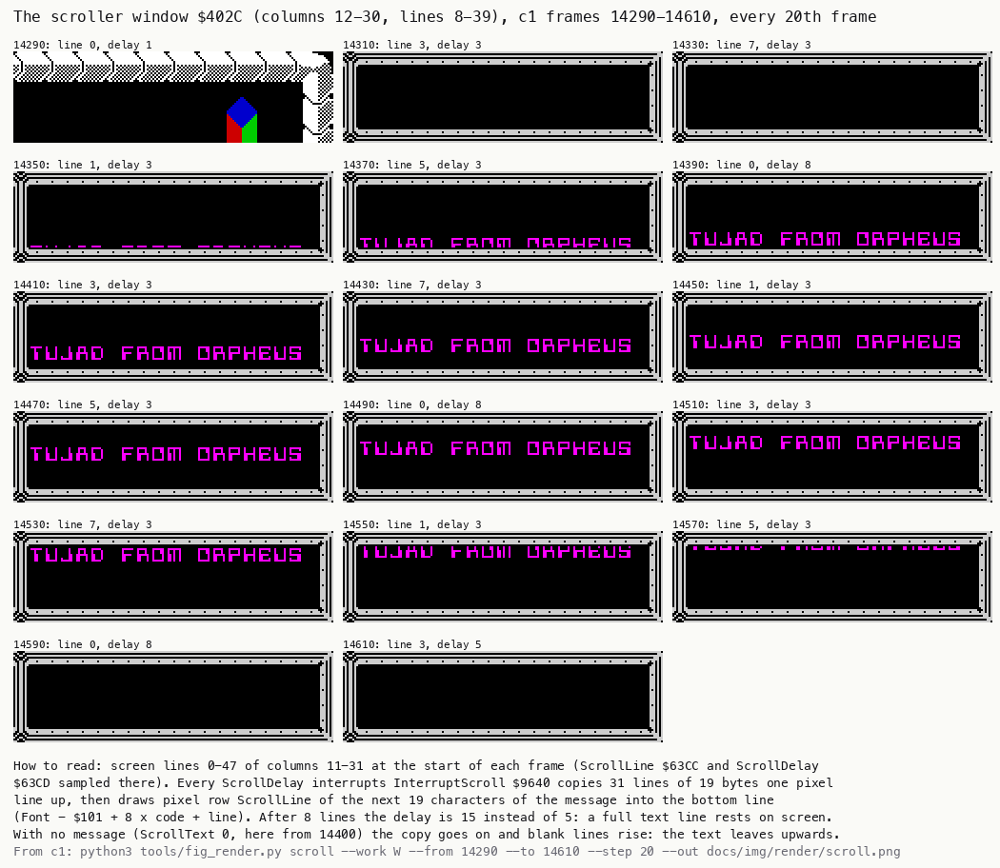

*The scroller's window `$402C` (columns 12-30, lines 8-39) in `c1` every 20th frame from 14290 to 14610, with
ScrollLine and ScrollDelay at each frame start. TUJAD FROM ORPHEUS rises from about 14350 and leaves the top at about
14570. Made with `python3 tools/fig_render.py scroll --work work/docs/tjB/c1 --from 14290 --to 14610 --step 20 --out
docs/img/render/scroll.png`.*

Worked example: from 14400 on ScrollText is 0 in the samples, yet the text keeps rising. Each step copies the window
up and leaves line 39 as it was, so the blank line under the last row climbs with it and wipes the window from below.

Witness: in the `c1` trace of frame 15007 InterruptScrollByte writes 589 bytes (31 x 19), all after the beam has
passed line 39 (6.11).

The point: the scroller is a plain copy of a small window, cheap enough for the interrupt. It ends a message without
any code to clear the window: the blank bottom line does it.

## 6.9 The sprite sheets

The sheets in `src/res/sprites` are the game's moving graphics, as the list draws them. `src/res/sprites/README.md`
gives each one's address and readers.

| Sheet | Address | Frames | Drawn by | Shift |
| --- | --- | --- | --- | --- |
| Droid | `$9C40-$A257` | 14 frames of 40 rows, 2 or 3 bytes | MoveDroid | mirrored by the turn (6.6) |
| Enemies | `$A74E-$AEC4` | 9 kinds of 3 or 4 frames, the explosion; 49 bytes each | MoveEnemy | ShiftGraphic3 (6.5) |
| Materialise | `$AEC5-$AF84` | 4 frames of 3 x 16 | MoveEnemy | never |
| Probe | `$AF85-$B048` | 4 frames, 49 bytes each | Fire, MoveShot | ShiftGraphic3 (`$83E5`, `$84A3`) |
| Objects | `$B049-$B901` | 5 kinds, the deaths, the probe's explosion; 97 bytes each | MoveObject | ShiftGraphic4 |
| Patrollers | `$B902-$BC01` | 2 x 4 frames of 4 x 24 | MovePatrollers | never |
| ShotGraphics | `$8814-$8853` | the bolts of weapons 1 and 2, 2 x 8 | Fire, MoveShot | never |
| HudIcons | `$8C55-$8D34` | 7 icons of 16 x 16 | Blit16 (doc 08) | never |

A mover finds its frame by kind and step. MoveEnemy, for one, reads the kind's first frame from EnemyGraphics
`$68C1` and adds `$31` per frame. At the last frame it goes back to the first by subtracting `$31` times the count
(MoveEnemyFirstFrame `$9235`).

```text
next enemy frame:
    if frame is the kind's last: frame -= $31 x (count - 1)      ; MoveEnemyFirstFrame
    else: frame += $31                                          ; MoveEnemyNextFrame $923C
    ShiftGraphic3(frame, x AND 7)
```

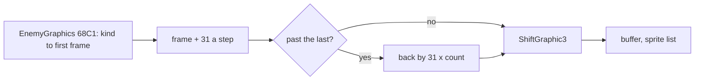

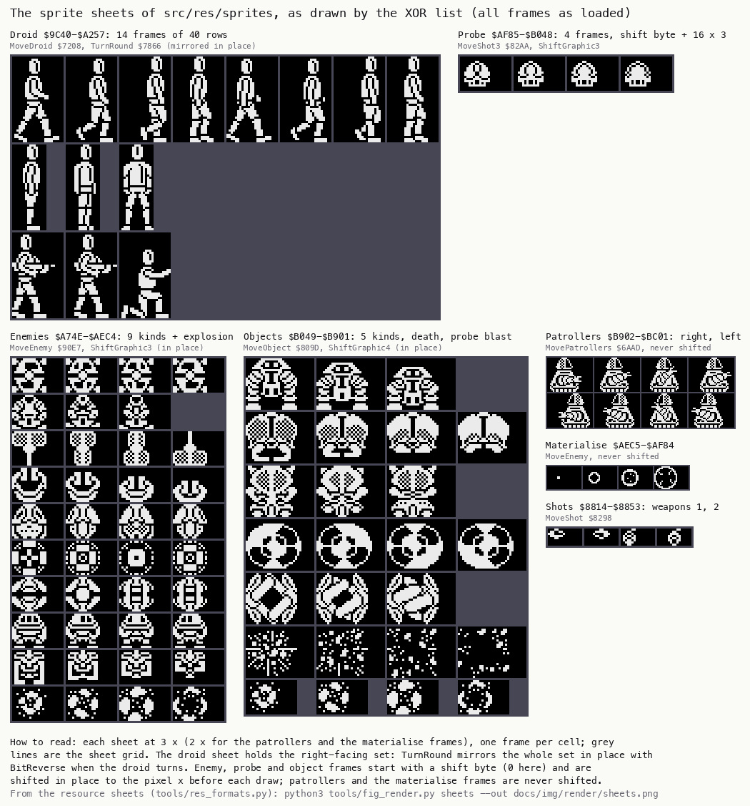

*The sprite sheets of `src/res/sprites`, as the XOR list draws them, every frame at its loaded shift (0). From
build/game.bin and src/res: `python3 tools/fig_render.py sheets --out docs/img/render/sheets.png`.*

Worked example: kind 1's frames start at `$A74E`; kind 2's at `$A812`, four frames later (`$A74E + 4 x $31`). Enemy
4 in `c1` 15009 steps from `$A843` (kind 2, frame 1) to `$A874` (frame 2), as 6.5 traced.

Witness: the EnemyGraphics words `4E A7 12 A8 ...` at `$68C1` in build/game.lst; the addresses in the 15009 trace.

The point: the graphics are packed as fixed-size frames, so a frame is found by addition. Only the movers that move
by pixels carry a shift byte; the droid and the patrollers move by whole columns and need none.

## 6.10 Code against the screen

Which routine wrote each byte of the screen over five frames of room 92 (`c1` 15006:0-15011:0), from the access
trace. Five routines write the screen in play:

| Routine | Bytes last written | Writes | Reads from |
| --- | ---: | ---: | --- |
| InterruptSpriteByte `$9612` | 324 | 864 | the droid's frames `$A0F0-$A167`, DroidSave `$668C-$6703`, buffers `$6768` and `$6828` |
| InterruptScrollByte `$9666` | 589 | 589 | the screen itself (the window one line down) |
| DroidExhaustByte `$8E43`, `$8E4A` | 30 | 192 | ExhaustRows `$65E5-$65FC`, the CellTable cells |
| MoveDroidAttrSet `$7596` | 16 | 36 | computed colours |
| FillAttrByte `$7D7D` | 30 | 30 | computed colours |

```text
writers map (kit/writers_map.py), per screen byte:
    writer[byte] = the routine of the last instruction that wrote it in the window
    sources[routine] = the data it read since its previous write
```

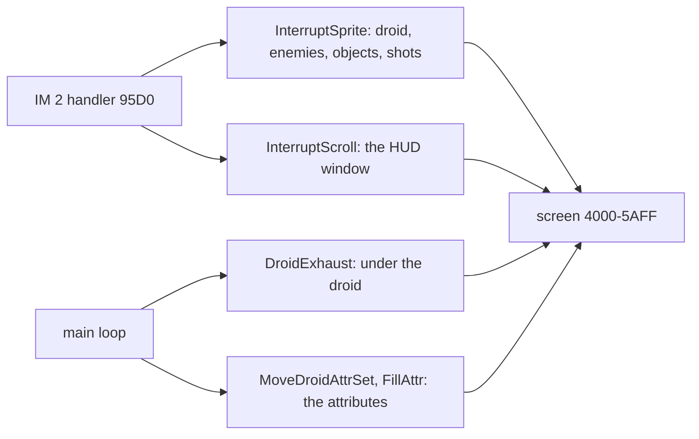

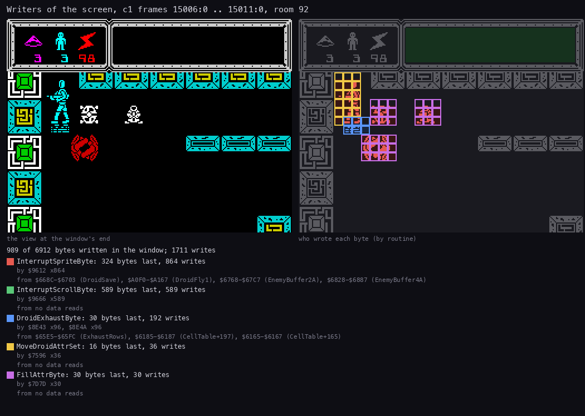

*Which routine wrote each screen byte, `c1` 15006:0-15011:0 in room 92: the screen at the end (left) and the
writers (right), with the sources each writer read. Made with `python3 ../../kit/writers_map.py --work
work/docs/tjB/c1 --window 15006:0-15011:0 --listing build/game.lst --sources --title "Writers of the screen, c1
frames 15006:0 .. 15011:0, room 92" --out docs/img/render/writers-room92.png`, then cropped from 1060 to 1050 px (the
right margin).*

Worked example: the two enemies at columns 8 and 13, lines 78-93. Their bytes are red, InterruptSpriteByte, and
the sources are enemy 2's buffers `$6768-$67C7` and enemy 4's `$6828-$6887`: both buffer A (the erase) and buffer
B (the draw) of each. The droid's bytes are red too, read from its frame `$A0F0-$A167` and from DroidSave. The 589
green bytes are the scroller window, which stepped once in these frames. The yellow and lilac cells are attributes:
the droid's colours and the enemies' fills.

Witness: the counts in the table are the tool's output for the trace.

The point: the room's tiles are not written at all in play. Everything that changes on screen is XOR (sprites and
exhaust), a window copy (the scroller) or an attribute; the room stays as DrawRoom left it.

## 6.11 Flicker, measured

Two questions decide whether a picture tears or flickers: when in the frame each routine writes, and whether an
erase and its redraw can straddle the beam.

- **The XOR sprites** are drawn by the interrupt, from T 1842 on (the handler at the INT + 30). The erase and the draw
  of each mover are adjacent entries of one list, drawn in one go.
- **The scroller** runs after the sprite list in the same handler.
- **The exhaust and the attributes** are written by the main loop, after the HALT, at any T.

```text
for each screen write in the trace:
    line = the screen line of the address
    beam(line) = 16 152 + 224 x line          ; the T the beam reads it
    before = T < beam(line)                   ; shown in this frame
```

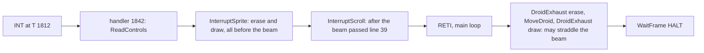

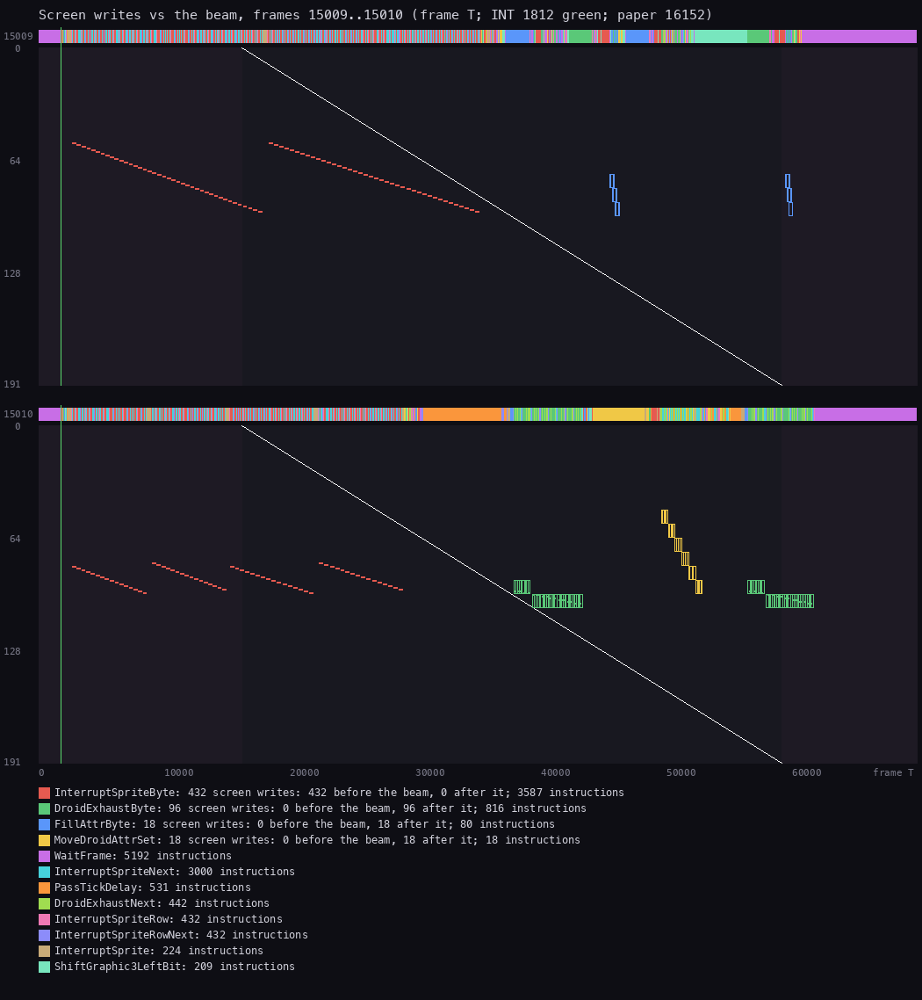

*Screen writes against the beam, `c1` frames 15009-15010 (frame T across, screen line down; the diagonal is the
beam). Made with `python3 ../../kit/beam_timeline.py --work work/docs/tjB/c1 --window 15009:0-15011:0 --listing
build/game.lst --frames 2 --out docs/img/render/beam-enemies.png`, then cropped from 1064 to 1050 px (the right
margin).*

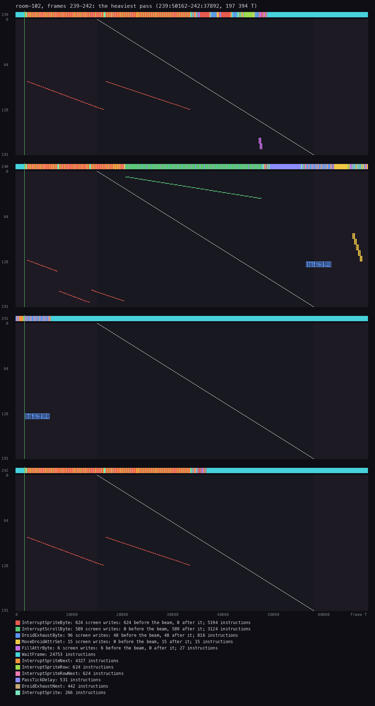

*tjA's beam timeline of the heaviest pass, `room-102` frames 239-242 (doc 04, 4.8), reused here for its counts.*

Worked example: the counts per routine, before and after the beam.

| Pass | Routine | Writes | Before the beam | After |
| --- | --- | ---: | ---: | ---: |
| `c1` 15009-15010 | InterruptSpriteByte | 432 | 432 | 0 |
| | DroidExhaustByte | 96 | 0 | 96 |
| | FillAttrByte | 18 | 0 | 18 |
| | MoveDroidAttrSet | 18 | 0 | 18 |
| `c1` 14604 | InterruptSpriteByte | 200 | 200 | 0 |
| `c1` 15007 | InterruptScrollByte | 589 | 0 | 589 |
| | InterruptSpriteByte | 192 | 192 | 0 |
| | DroidExhaustByte | 48 | 0 | 48 |
| `room-102` 239-242 | InterruptSpriteByte | 624 | 624 | 0 |
| | InterruptScrollByte | 589 | 0 | 589 |
| | DroidExhaustByte | 96 | 48 | 48 |
| | MoveDroidAttrSet | 15 | 0 | 15 |
| | FillAttrByte | 6 | 6 | 0 |

What follows:

- **The sprites never tear and never flicker.** Every XOR write, even in the heaviest pass, lands before the beam
  reaches the play area (line 48 is read at T 26 904). The erase and the draw of a mover are both done before the
  frame shows, so no frame shows a mover missing.
- **The scroller never tears.** Its 589 writes all come after the beam passed the window, so the whole step shows in
  the next frame at once.
- **The exhaust can flicker.** Its erase and draw run from the main loop. In the heaviest pass 48 writes are before
  the beam and 48 after: for that frame the beam shows the erased half. With the exhaust this is the intended look.
- **Lost interrupts lower the rate, not the picture.** The list is drawn only in a HALT's interrupt. When a pass runs
  through an INT with DI (`c1` 15008, the INT of 241 in `room-102`), that frame draws nothing and the movers step
  less often; the picture stays whole.

Witness: the counts above are the legends of the beam timelines (`work/docs/tjB/beam-14604.png` and
`beam-15007.png` for the two extra `c1` frames, made with the same command).

The point: the game draws all its sprites in the interrupt, ahead of the beam, and keeps the main loop's drawing to
the exhaust and the colours. That is why Tujad's sprites are steady without a back buffer.

## 6.12 What is known only from the code

- **DrawMode for a teleport.** Teleport `$77A8` passes the target room in A, so the room is cleared, and it would be
  wiped only for room 0. Which rooms the teleporters lead to is in doc 07.
- **Why the enemies need buffers.** The code shifts the shared frame in place and copies it before queuing it; the
  case of two enemies of one kind at different offsets in one pass is the reason by the code, not caught in a trace.
- **ShiftGraphic3 left shifts.** The traces of 15009 show right shifts. The left branch (`$7EE3`) runs when an enemy
  moves left; its count is in the L1 total, not split out.
- **TurnMirror2.** The front frame skip of `$50` bytes is from the code; the mirror figure shows TurnMirror3 only.
- **The cost estimates** in 6.2, 6.4, 6.5 and 6.8 are counted from the instruction timings, not measured per call.
