# 7. Objects

What this covers: every thing in Tujad that has a record, and the memory it lives in. The world's 128 rooms each have
an alien record in `AlienMap $DB53`. A record holds two items, a teleporter, an enemy mask and up to two objects. The
room in play copies its record into a work space at `$6303-$6352`. The work space holds four enemies, two objects and
three patrollers that belong to no single room. The droid has five bytes at `$6359`. The cell table `$60C0` holds what
stands on each character cell of the play area. This document gives each record byte by byte. It gives the state
machine of each mover, the spawn, the step routines, the start positions and the collisions with their order. How the
droid moves, fights, gains and loses energy and lives, and how the game is won, is [doc 10](10-gameplay-logic.md).

The recordings it rests on (WALKTHROUGH 6.0):

- `rzx-010000`: the RZX game from RZX frame 10 000, 2 028 frames through rooms 73, 74, 66, 67, 59, 58 and 57. It holds
  an enemy that materialises next to the droid, two enemies that spawn and fly, an object that walks, the kill of that
  object with weapon 2 and an ED piece. It was opened on an own instance after `source work/env.sh`, as WALKTHROUGH 6.0
  gives it, with the work folder `work/docs/tjC/z10` and port base 36950. `work/docs/tjC/sample.py` (TTD `memory_at`)
  took these samples:
  - `$6300-$63FF` at every frame 0-2 027 (`work/docs/tjC/z10-vars.jsonl`);
  - the screen and the cell table at frames 1300, 1450, 1458 and 1940 (`z10-scr.jsonl`, `z10-cells.jsonl`);
  - the alien map `$DB53-$DFFF` at frames 0, 1940 and 1950 (`z10-alien.jsonl`).
- `rzx-001000` (frames 0-206): the droid leaves room 83 with two live objects in frame 104. Opened the same way into
  `work/docs/tjC/r1`; `$6300-$63FF` sampled at frames 90-110 (`r1-vars.jsonl`), the alien map at frames 104 and 105
  (`r1-alien.jsonl`).
- `rzx-035000` (frames 0-773): the only life lost in the RZX game, in frame 250. Opened into `work/docs/tjC/r35`,
  sampled at frames 225-275 (`r35-vars.jsonl`).
- `rzx-007000` (frames 0-1 252): the shield and a teleport (doc 10). Opened into `work/docs/tjC/r7`.
- The RZX log `work/stage1/rzx/frames.bin`: `$6300-$63FF` after each of the 81 000 RZX frames, and the states
  `work/stage1/rzx/atNNNNNN.szx` every 1 000 frames (`tools/rzx_keys.py log`). They cover the whole game, including
  the parts no aligned recording holds.
- The L1 counts of the stage 1 builds, quoted from the `.ann` descriptions ("L1 n").

A sample of frame N is the memory at the start of frame N. A trace, and so a routine animation, shows an instruction in
the frame where it ran. "Enemy 1 has state `$44` in frame 1147" therefore means the sample of frame 1147; the act that
wrote it ran in frame 1146. The frame number in the name of a `rzx-NNNNNN` recording plus the frame inside it gives the
RZX frame: `rzx-010000` frame 1450 is RZX frame 11 450.

Two clocks drive the movers. A pass is one turn of `MainLoop $6911` and takes about two frames ([Terms](README.md#terms),
[doc 04](04-game-loop.md)). An enemy and an object act on every second call, so about every fourth frame.
A patroller turns once in three passes and moves a column every four turns. The droid acts every second pass, and every
pass while it falls.

## 7.1 The records and their flow

The movers never share a pool of slots. Each kind has fixed records at fixed addresses, and one room's worth of them
is live at a time. The alien map is the store and the work space is the room in play. The cell table is the floor plan.
The sprite list `$FF01` ([doc 06](06-rendering.md)) is what the interrupt draws.

| Address | Bytes | Records | Kept where | Written by |
| --- | --- | --- | --- | --- |
| `AlienMap $DB53` | 128 words + 102 records | one per room | the whole game | InitRooms, ScrambleRooms, SaveRoomObjects, the pickup |
| `Enemies $6303` | 4 x 9 | four enemies | the room only | DrawRoom, MoveEnemy |
| `Objects $6327`, `Object2 $6331` | 2 x 10 | two objects | copied back to the room's record | DrawRoom, MoveObject, SaveRoomObjects |
| `Patrollers $633B`, `$6343`, `$634B` | 3 x 8 | three patrollers | their own records, in every room | MovePatroller |
| `DroidVars $6359` | 5 | the droid | the whole game | PlaceDroid, MoveDroid, Teleport |
| `RoomVars $639C` | 6 | the room's items and teleporter | the room only | DrawRoom |
| `CellTable $60C0` | 18 x 32 | one byte per play cell | the room only | DrawRoom, the movers, the shots |

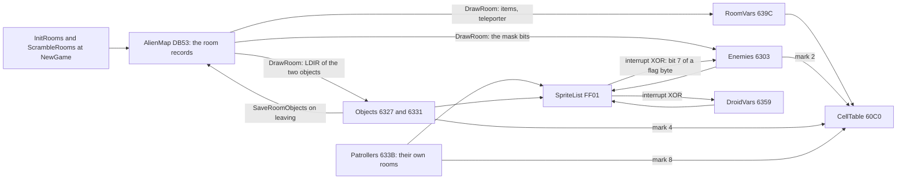

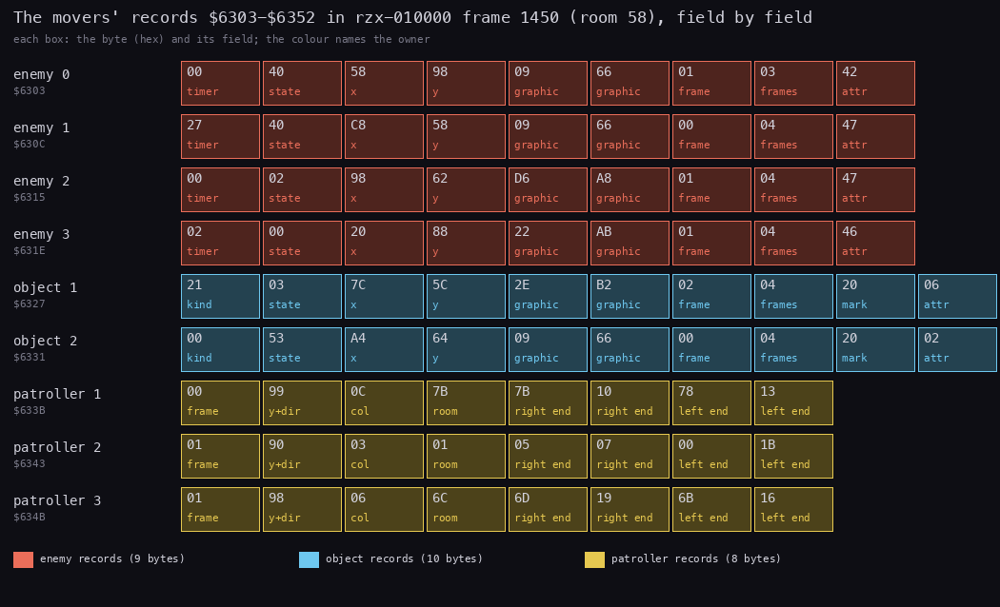

How to read the figure:

- The work space `$6303-$635D` at the start of `rzx-010000` frame 1450 (room 58), one box per byte, coloured by its
  record: the enemies, the objects, the patrollers and the droid.
- Each box shows the byte in hex and the field's name. Enemies 0 and 2 are empty (timer 0). Enemy 1 waits to spawn
  again after its explosion, enemy 3 flies. Object 1 walks up (state `$03`).
- Command: `python3 tools/fig_objects.py block --samples work/docs/tjC/z10-vars.jsonl --frame 1450 --out docs/img/objects/workspace.png`.

**The point**: a room in play is 92 bytes of fixed records. Nothing is allocated. Only the two object records survive
the room.

## 7.2 The alien map `$DB53` byte by byte

`AlienMap $DB53` starts with 128 words, one per room: the offset of the room's record from `$DB53`. The records follow,
each of variable length. `RoomRecord $7B8F` turns a room number into the record's address (L1 4 746 calls). The 26
empty rooms all point at `$DFFA`, five zero bytes.

| Field | Bytes | Values |
| --- | --- | --- |
| item 1 | 2, or 1 | position, kind; or a single 0: no item |
| item 2 | 2, or 1 | the same |
| teleporter | 2, or 1 | position, target room; or 0 |
| enemy mask | 1 | bit k: enemy slot k is used in this room (k = 0-3) |
| object 1 | 10, or 1 | the object record of 7.8; or 0 |
| object 2 | 10, or 1 | the same |

A position byte holds the row in its low nibble and half the column in its high nibble. `ItemCell $6E88` turns it into
a cell: `CellTable + 32 x (byte AND $0F) + 2 x (byte >> 4)`. Items therefore stand on even columns. The teleporter's
position uses the base `CellTable + 64`, two rows lower. An item kind is one byte:

| Kind | Item | Taken |
| --- | --- | --- |
| `$80` | GEN 19, a life | `$00` |
| `$81` | an energy source, energy 99 | `$01` |
| `$82-$B3` | ED piece 1-50 (the piece is the kind minus `$81`) | `$02-$33` |
| `$C1-$C3` | weapon 1-3, one unit of ammunition | `$41-$43` |

Bit 7 of the kind is the "present" flag. A pickup clears it (`MoveDroidPickupFound`: `RES 7,(HL)` on the record).
DrawRoom skips an item without it. `InitRooms $7BCC` sets it again on every item at a new game.

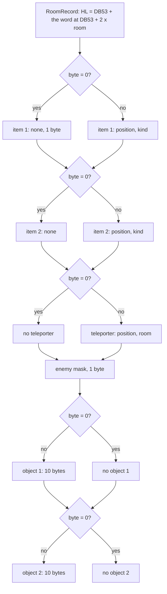

The walk, as DrawRoom and SaveRoomObjects do it:

```text
p = AlienMap + word(AlienMap + 2 * room)
item1 = (p[0], p[1]) if p[0] else None;  p += 2 if p[0] else 1
item2 = (p[0], p[1]) if p[0] else None;  p += 2 if p[0] else 1
tele  = (p[0], p[1]) if p[0] else None;  p += 2 if p[0] else 1
mask  = p[0];                            p += 1
obj1  = p[0:10] if p[0] else None;       p += 10 if p[0] else 1
obj2  = p[0:10] if p[0] else None
```

```asm
SaveRoomObjects:
  LD A,(Room)
  SLA A
  LD HL,AlienMap
  LD D,$00
  LD E,A
  ADD HL,DE
  LD E,(HL)                  ; the record's offset
  INC HL
  LD D,(HL)
  LD HL,AlienMap
  ADD HL,DE                  ; HL = the record
  XOR A
  CP (HL)                    ; item 1 present?
  JR Z,SaveObjectsItem2
  INC HL                     ; two bytes, else one
SaveObjectsItem2:
  INC HL
  CP (HL)                    ; item 2
  JR Z,SaveObjectsTeleport
  INC HL
SaveObjectsTeleport:
  INC HL
  CP (HL)                    ; the teleporter
  JR Z,SaveObjectsMask
  INC HL
SaveObjectsMask:
  INC HL
  INC HL                     ; past the mask: object 1
```

Worked example: the record of room 58 at `$DDF1` in the image is `38 B1 00 00 0A 21 41 7C 40 00 00 00 00 00 06 00`.

- Item 1 is at position `$38` (row 8, column 6) with the kind `$B1` (ED piece 48).
- `00` is item 2: none. The next `00`: no teleporter.
- The mask `$0A` uses enemy slots 1 and 3.
- Object 1 is `21 41 7C 40 00 00 00 00 00 06`: kind bit 5, timer 1, state `$41` (down, just entered), x `$7C`, y `$40`,
  the attribute 6. The graphic, frames and mark are 0 in the image; InitRooms fills them.
- The last `00` is object 2: none. 16 bytes in all.

Witness: in the RZX game the same record reads `38 AA 00 00 0A 21 41 7C 40 6C B1 00 04 20 06 00` at RZX frame 11 000.
The kind is now `$AA` (ED piece 41): NewGame dealt the items anew ([doc 10.9](10-gameplay-logic.md#109-newgame-and-the-deal)).
InitRooms has filled in the object's graphic `$B16C`, frames 4 and kill mark `$20`. At RZX frame 12 000 the record
reads `38 2A 00 00 0A 22 53 7C 58 09 66 ...`. The kind `$2A` is piece 41 taken (RZX frame 11 697). The object has state
`$53` (bit 4, dead) and the blank graphic `$6609` after the kill of 7.8.

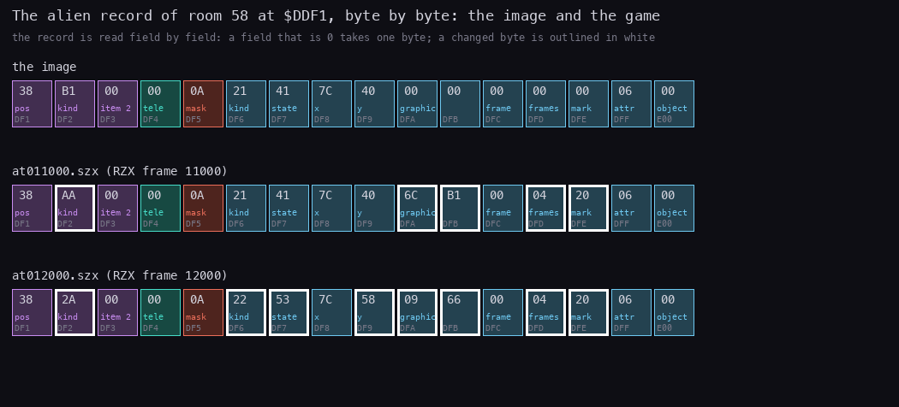

How to read the figure:

- One row of boxes per memory: the image (`build/game.bin`), then the RZX states `at011000.szx` and `at012000.szx`.
- Each box is one byte of the record with its field name and address; a field that is 0 takes one byte. A byte that
  differs from the image is outlined.
- Command: `python3 tools/fig_objects.py record --room 58 --image build/game.bin --state 'at011000.szx (RZX frame 11000)=work/stage1/rzx/at011000.szx' --state 'at012000.szx (RZX frame 12000)=work/stage1/rzx/at012000.szx' --out docs/img/objects/alien-record.png`.

The whole map, drawn from `src/res/rooms/Rooms.txt` (the editable form of the layouts and the alien records):

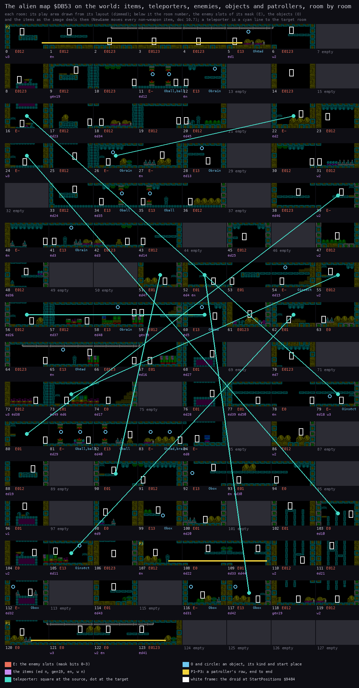

How to read the figure:

- 128 rooms, 8 across and 16 down (room + 1 east, + 8 south), each room's play area drawn from its layout and dimmed.
- Under each room: its number, the enemy slots of its mask, its objects with their kind, and its items as the image
  holds them.
- In the room: a circle at each object's start place, a white frame where the droid starts (7.10), a square at a
  teleporter with a line to the target room, a bar along each patroller's row.
- From the resources only: `python3 tools/fig_objects.py world --out docs/img/objects/world-objects.png`.

Counts over the 102 rooms in use:

| What | Count |
| --- | --- |
| enemy masks | none 15, `$01` 11, `$03` 17, `$07` 30, `$0F` 15, `$0A` 14 |
| objects | 25: kind bit 7 7, bit 5 6, none 5, bit 4 4, bit 6 3 |
| items | 80: 51 ED pieces, 16 weapons, 10 energy sources, 3 GEN 19 |
| teleporters | 18 |

The 51 ED items hold 50 pieces: the kind `$84` (piece 3) stands in rooms 41 and 42 (doc 10.9).

**The point**: the room record is the only memory of a room. An item's bit 7 and an object's ten bytes are all the game
remembers about a room the droid has left. The enemies are rebuilt from the mask each time.

## 7.3 The per-room saved state: DrawRoom and SaveRoomObjects

Entering a room, `DrawRoom $6B22` clears the live records and reads the alien record:

- the sprite list is emptied and the three patrollers get bit 7 (not drawn);
- byte 0 of each enemy and each object is set to 0 (empty);
- the items and the teleporter go to `RoomVars $639C`;
- for each set bit k of the mask, enemy k gets timer 1 (k = 0, 2) or 2 (k = 1, 3), state `$40` (waiting to spawn) and
  the graphic `BlankGraphic $6609`;
- the two object records are copied into `$6327` and `$6331`;
- then the room is wiped and drawn, and the cell table built (7.4, doc 06).

Leaving, `SaveRoomObjects $6ADC` walks the record the same way. It copies each object that the record has back over
its ten bytes, with bit 6 of its state set ("just entered"). It runs before every exit and teleport, on a life lost and
on an ED pickup (L1 276). The enemies are never saved: a room's enemies always start again from the mask.

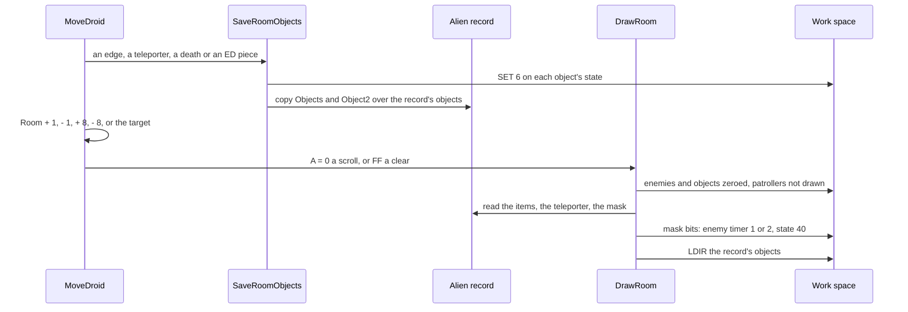

The copy back, the end of `SaveRoomObjects`:

```asm
SaveObjectsMask:
  INC HL
  INC HL                     ; HL = object 1 in the record
  CP (HL)                    ; A = 0: no object 1?
  JR Z,SaveObjectsNoObject1
  EX DE,HL                   ; DE = the record's object 1
  LD HL,Object1Flags         ; $6328, the live state
  SET 6,(HL)                 ; just entered: drawn only on its first act
  DEC HL
  LD BC,$000A
  LDIR                       ; ten bytes back into the record
  EX DE,HL
  JR SaveObjectsObject2
SaveObjectsNoObject1:
  INC HL
SaveObjectsObject2:
  CP (HL)
  RET Z
  EX DE,HL
  LD HL,Object2Flags
  SET 6,(HL)
  DEC HL
  LD BC,$000A
  LDIR
  RET
```

The set bit 6 matters on the way back in. MoveObject draws a just-entered object without erasing it first (7.8),
because the screen under it is new.

The save copies an object only when the record has one. A room's two slots are therefore fixed by the record: an object
can never appear in a room that had none.

Worked example: in `rzx-001000` frame 104 the droid at x 1 walks out of room 83 to the west.

- Room 83's record at `$DECD` reads `00 00 00 00` (no items, no teleporter, no enemies), then two objects.
- At RZX frame 1 000 (the state `at001000.szx`) they read `11 41 38 60 49 B0 00 03 40 04` and
  `22 41 A8 60 6C B1 00 04 20 03`.
- In the sample of frame 104 the live objects are `11 01 38 4C 0B B1 02 03 40 04` and `22 01 A8 6C 8F B2 03 04 20 03`:
  both walk down (direction 1), at y 76 and y 108.
- After the save the record holds `11 41 38 4C 0B B1 02 03 40 04` and `22 41 A8 6C 8F B2 03 04 20 03`. Only the state
  changed, `$01` to `$41`. The state `at011000.szx`, ten thousand frames later, still holds the same bytes.
- In the sample of frame 105 room 82 is live. Its mask `$0A` has enemies 1 and 3 waiting (timer 2, state `$40`). Its
  object 1 `81 41 34 60 ...` came from its record.

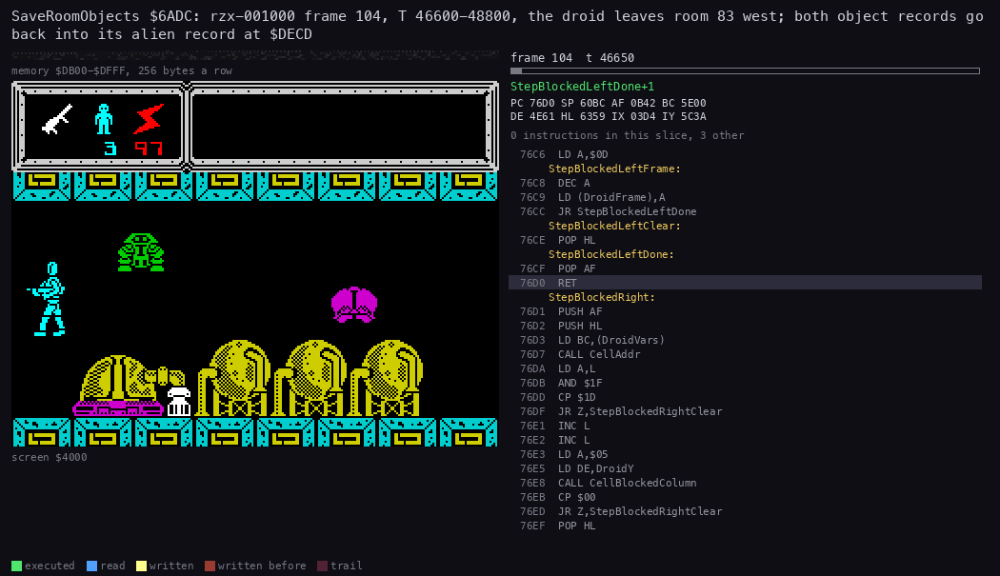

The animation is a trace of `rzx-001000` frame 104 from T 46 600 to T 48 800, in 44 pictures of 50 T. SaveRoomObjects
runs at T 46 750-47 675, then DrawRoom starts. The top panel is the memory `$DB00-$DFFF`, the alien map; the bytes that
change in row `$DE00` are room 83's two object records being written. Under it is the screen, on the right the
listing. Command:
`python3 ../../kit/routine_anim.py --work work/docs/tjC/r1 --window 104:46600-104:48800 --listing build/game.lst --view screen --range DB00-DFFF --pc 6ADC-6B21 --pictures 44 --delay 150 --title 'SaveRoomObjects $6ADC: rzx-001000 frame 104, T 46600-48800, the droid leaves room 83 west; both object records go back into its alien record at $DECD' --out docs/img/routines/SaveRoomObjects.gif`.

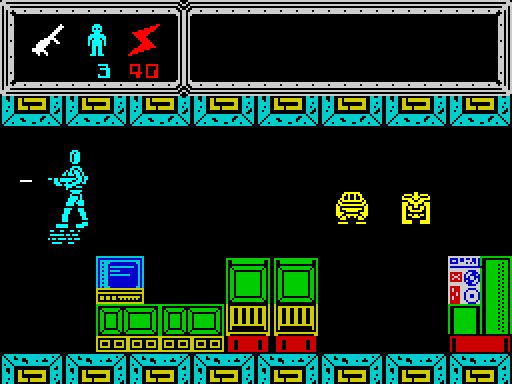

The screen at every frame of `rzx-010000` frames 1938-1952. The droid leaves room 58 and its dead object is saved with
it. DrawRoom runs with A = 0 and wipes the old room by scrolling it out; room 57 is drawn. Command:
`python3 ../../kit/screen_anim.py --work work/docs/tjC/z10 --from 1938 --to 1952 --step 1 --scale 2 --delay 120 --hold 1500 docs/img/play/room-change.gif`.

**The point**: an object is the only mover with a memory. Kill it, freeze it or leave it half way across, and it is
there again when the droid comes back. The enemies forget everything; they always appear anew.

## 7.4 The cell table `$60C0`

`CellTable $60C0` is the play area as one byte per character cell. Cell (column, row) is at
`$6000 + 32 x row + column`, for the screen rows 6-23 (`$60C0-$62FF`). Its address is the attribute address with the high byte ANDed with
3 and ORed with `$60`, so code steps from a cell to its attribute with one OR `$58` (MoveEnemy, MoveObject). Rows 0-5
(`$6000-$60BF`) lie under the BASIC program and are never play cells.

| Value | Meaning | Written by |
| --- | --- | --- |
| `$00` | empty | DrawRoom |
| `$01` | a wall (the room's attribute there is not 0) | DrawRoom `$6D8C` |
| `$80-$C3` | an item, its kind on its 2 x 2 cells | DrawItem `$6E0D` |
| `$FF $FF` | the two top cells of a teleporter | DrawRoom `$6DE3` |
| XOR 2 | an enemy covers the cell | MoveEnemy through XorCells `$7D87` |
| XOR 4 | an object covers the cell | MoveObject |
| XOR 8 | a patroller covers the cell | DrawPatroller `$942D` |
| OR `$41`, `$21`, `$11` | a shot of weapon 1, 2 or 3 crossed an object there | the shot routines through OrCells `$7DAE` |

A mover XORs its mark in when it draws and XORs it out when it erases. Two movers on the same cell leave both bits. A
mover covers 2 x 2 cells (an enemy) or 3 x 3 (an object), one more column when x is not a multiple of 8 and one more row
when y is not. The droid has no mark. It reads the cells instead: the touch test ORs the cells under it into
`TouchBits $63C3` (7.11).

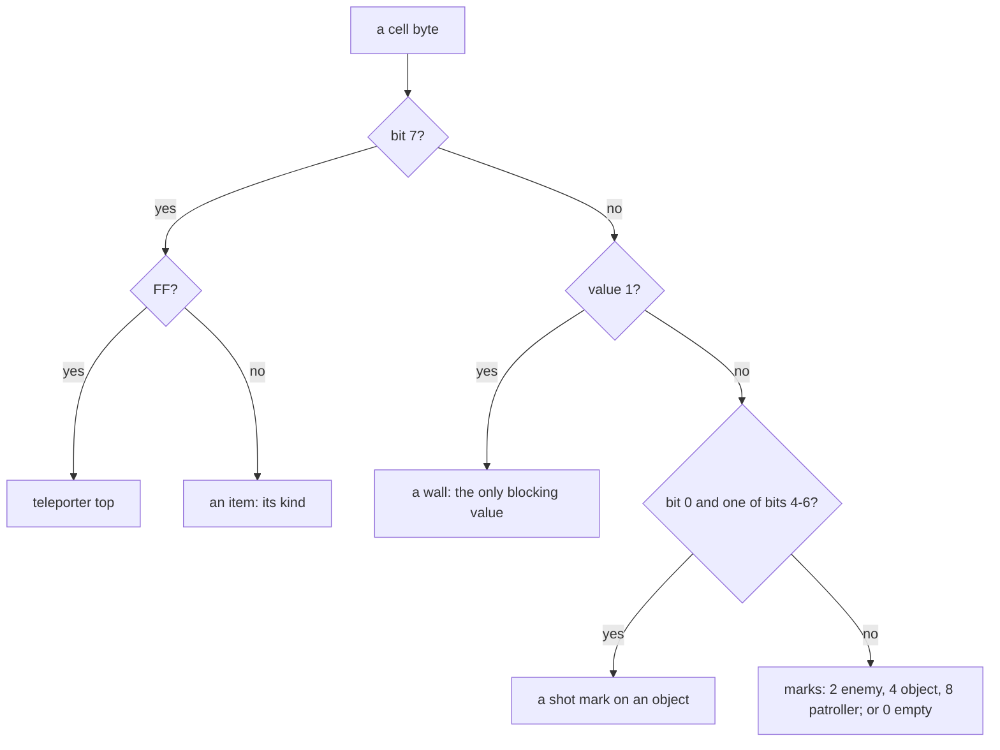

Worked example: in `rzx-010000` frame 1450 (room 58):

- the item cells at rows 14-15, columns 6-7 hold `$AA` four times: ED piece 41 at position `$38`;
- object 1 at x 124, y 92 covers columns 15-19 and rows 11-14 with `$04`. x 124 is not a multiple of 8, and neither is
  y 92, so it takes one more column and one more row than its 3 x 3 size;
- the walls are `$01`; every other cell is 0.

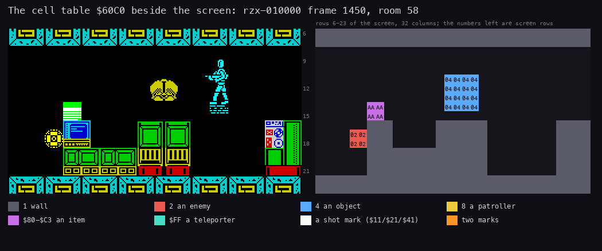

How to read the figure:

- Left: the screen at the start of `rzx-010000` frame 1450. Right: the cell table `$60C0-$62FF` of the same moment,
  one box per cell, coloured by its value, with the hex value where it is not 0 or 1.
- Command: `python3 tools/fig_objects.py cells --samples work/docs/tjC/z10-vars.jsonl --cells work/docs/tjC/z10-cells.jsonl --screens work/docs/tjC/z10-scr.jsonl --frame 1450 --out docs/img/objects/cells.png`.

**The point**: one table serves as the walls, the item map and the collision map. A wall is the value 1 and nothing
else, so a cell with a mark in it is never a wall: the movers fly through each other.

## 7.5 The step routines and FoundItem

The enemies and the objects move with the same four routines: `StepRight`, `StepDown`, `StepLeft` and `StepUp`
(`steps.asm`). HL points at the record's x, and y follows it. The caller sets the mover's size in `StepX` / `StepY`
(2 cells for an enemy, 3 for an object) and its limits in `StepWidth` / `StepHeight` (`$F0` / `$B0` for an enemy,
`$E8` / `$A8` for an object). A step is 2 pixels.

Between cell edges a step just adds 2. At a cell edge (x AND 7 = 0) the routine tests the next column with
`CellBlockedColumn` (or the next row with `CellBlockedRow`). It returns Z, "turn", when that column holds a wall or the
step reaches the limit. An item cell (bit 7, a teleporter included) is no wall. `CellBlockedColumn` writes its address
to `FoundItem $63AA` and goes on. Back in StepRight a set FoundItem returns NZ without moving.

```text
StepRight(rec):
    if rec.x & 7:  rec.x += 2; return Z if rec.x == limit      # between cells
    a = CellBlockedColumn(the next column, size cells)          # an item cell goes to FoundItem
    if a == 1:  FoundItem = 0; return Z                         # a wall: turn
    if FoundItem:  return NZ                                    # an item: stay, do not turn
    rec.x += 2; return Z if rec.x == limit
```

```asm
StepRight:
  LD A,$07
  AND (HL)
  JR NZ,StepRightMove        ; between cells: just step
  ...                        ; HL = the cell right of the mover
StepRightTest:
  CALL CellBlockedColumn     ; A = 1 a wall; an item cell goes to FoundItem
  CP $00
  JR Z,StepRightDone
  LD HL,$0000
  LD (FoundItem),HL          ; a wall: forget the item
StepRightDone:
  POP DE
  POP HL
  CP $01
  RET Z                      ; Z: turn
  LD BC,(FoundItem)
  LD A,B
  OR C
  RET NZ                     ; an item ahead: NZ, but no step
StepRightMove:
  LD A,(StepWidth)
  INC (HL)
  INC (HL)
  CP (HL)                    ; Z at the limit
  RET
```

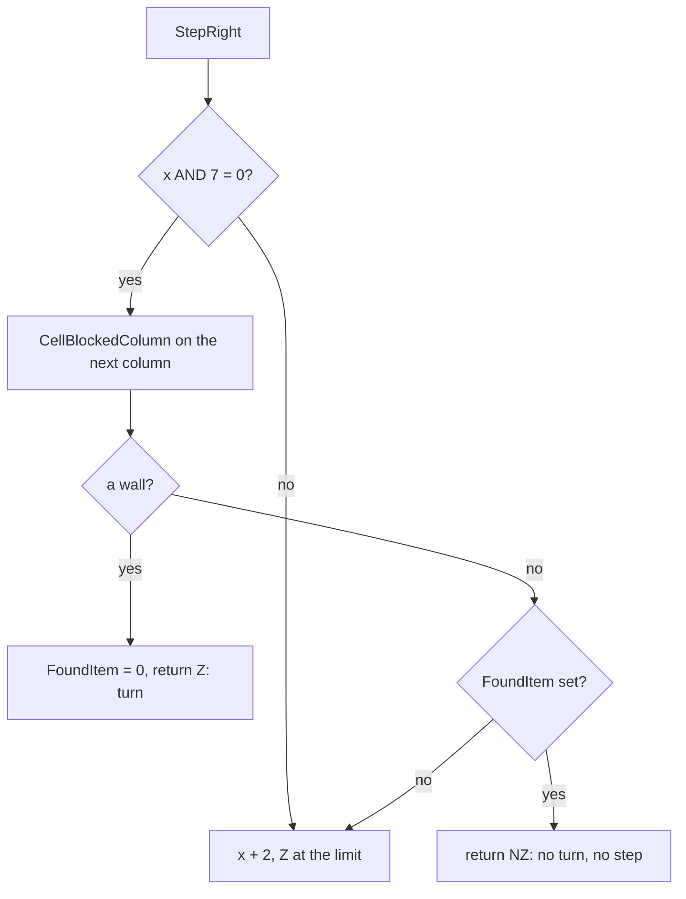

MoveEnemy clears FoundItem once per act, then calls a horizontal and a vertical step. So an item found by the
horizontal step still blocks the vertical step of the same act. An enemy whose x and y both sit on cell edges, with an
item ahead in its column, stops on both axes. Nothing in its record changes, so it stops for good, until a shot or the
droid destroys it. MoveObject never clears FoundItem at all; it inherits whatever the droid's or the enemies' steps
left (7.13).

Witness, from the RZX log: three enemies stood still in flight (state 0-3) while the game ran on, each at an x and a y
that are multiples of 8, next to an item:

| RZX frames | Room | Enemy | x, y | How it ended |
| --- | --- | --- | --- | --- |
| 25 101-25 406 | 68 | 0 | 96, 120 | shot: state `$83` at 25 407 |
| 36 147-36 283 | 109 | 1 | 192, 88 | shot: state `$80` at 36 284 |
| 50 378-50 474 | 118 | 0 | 80, 160 | shot: state `$86` at 50 474 |

In room 68 the enemy froze in its first flying act: it materialised beside the item (state `$50` at RZX frame
25 100). The other enemies of each room moved on through the same frames. The log's other still runs, of 187-192 frames, are
the progress screen after an ED piece; those of 383-385 frames are teleports, when no mover runs at all.

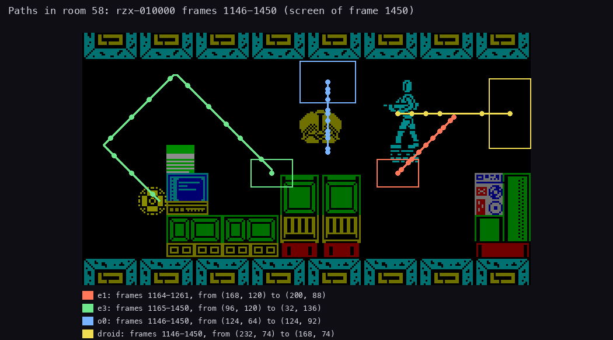

How to read the figure:

- The play area at the start of `rzx-010000` frame 1450, dimmed. Each mover's place in every sample of frames
  1146-1450 is joined into a line; the box is the mover at its first sample.
- Enemy 3 flies diagonally and flips one half of its direction at each wall. Enemy 1 flies up and right from
  (168, 120) until it is hit at (200, 88) in frame 1239. Object 1 walks up and down at x 124 between y 64 and y 104.
  The droid walks left.
- Command: `python3 tools/fig_objects.py path --samples work/docs/tjC/z10-vars.jsonl --screens work/docs/tjC/z10-scr.jsonl --frame 1450 --from 1146 --to 1450 --movers e1,e3,o0,droid --title 'Paths in room 58: rzx-010000 frames 1146-1450 (screen of frame 1450)' --out docs/img/objects/paths.png`.

**The point**: the movers test walls only at cell edges and treat an item as "wait". That makes the step cheap. It also
makes an item a trap for an enemy that meets it square on.

## 7.6 The enemies: record and state machine

`Enemies $6303` holds four records of 9 bytes; record k is at `$6303 + 9k`.

| Byte | Field | Values |
| --- | --- | --- |
| +0 | timer | 0 empty; else calls to the next act (2 after each act; Random OR `$29` after an explosion) |
| +1 | state | `$00-$03` flying; `$40` waiting to spawn; `$44-$53` materialising; `$80-$83` hit; `$84-$93` exploding |
| +2 | x | pixels, up to `$F0` |
| +3 | y | pixels, up to `$B0` |
| +4, +5 | graphic | the frame's graphic (49 bytes a frame), shifted in place |
| +6 | frame | 0 to frames - 1 |
| +7 | frames | the kind's frame count |
| +8 | attribute | `$42`, `$43`, `$46` or `$47` (Random AND 7 OR `$42`: bit 1 always set), chosen at the spawn |

The flying directions are the low two bits: 0 right and down, 1 left and down, 2 left and up, 3 right and up. A blocked
horizontal step swaps right and left, a blocked vertical step swaps down and up:

| State | Horizontal blocked | Vertical blocked |
| --- | --- | --- |
| 0 right, down | 1 | 3 |
| 1 left, down | 0 | 2 |
| 2 left, up | 3 | 1 |
| 3 right, up | 2 | 0 |

The vertical result is written from the old state. In a corner, where both steps are blocked, only the vertical half
flips; the horizontal half flips at the next act.

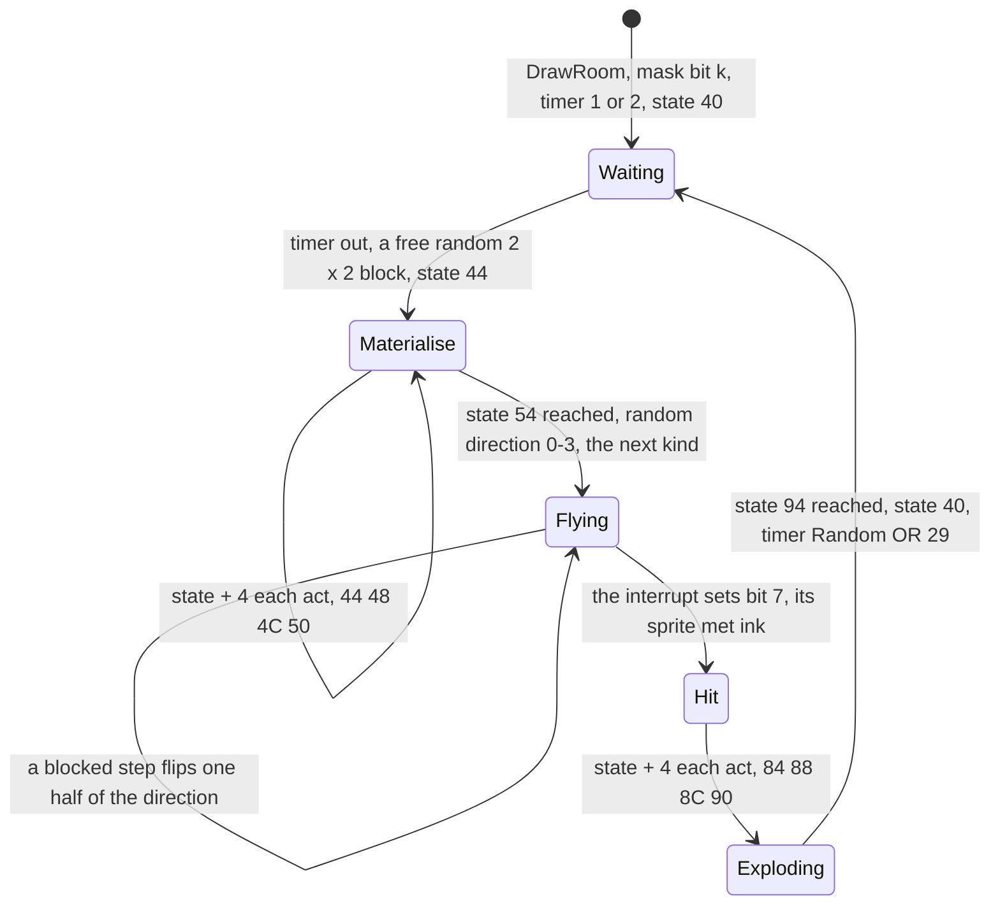

One act, as `MoveEnemy $90E7` does it:

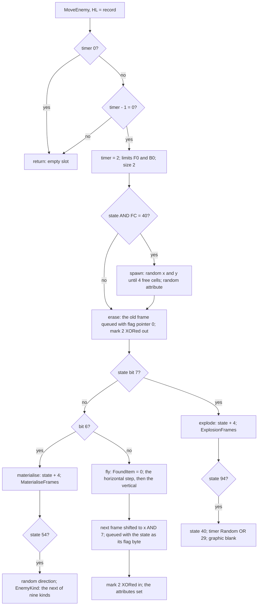

The key line of the draw is the flag pointer. Each sprite list entry carries the address of a byte. When the entry's
XOR meets ink, the interrupt sets bit 7 of that byte (doc 06). MoveEnemy gives the record's own state byte:

```asm
  LD DE,(EnemyBufferPtrs)    ; the shifted frame, copied to the enemy's buffer
  LD HL,(SpriteListEnd)
  LD (HL),E                  ; the entry: the graphic
  INC HL
  LD (HL),D
  INC HL
  POP DE                     ; DE = the record's state byte
  LD (HL),E                  ; the flag pointer: the state itself
  INC HL
  LD (HL),D
  INC HL
  LD (HL),$03                ; 3 bytes wide
  INC HL
  LD (HL),$02                ; 2 character rows
```

So a hit needs no test in MoveEnemy: the next act finds bit 7 set and starts the explosion. The erase entry has flag
pointer 0. The explosion and materialise frames copy the erase entry's pointer, so an enemy cannot be hit while it
appears or explodes. The explosion frame comes from `state AND $FC`, so the direction bits left in the state after the
hit do not matter.

Worked example, `rzx-010000` room 58, enemy 1 (the sample frames where its state changed):

| Frame | Timer | State | x, y | What happened |
| --- | --- | --- | --- | --- |
| 1140 | 2 | `$40` | 112, 80 | waiting; the old place of its last life |
| 1147 | 2 | `$44` | 168, 120 | spawned: x `$A8`, y `$78`; first materialise frame |
| 1151, 1155, 1160 | 2 | `$48`, `$4C`, `$50` | 168, 120 | materialising |
| 1164 | 2 | `$03` | 168, 120 | state `$54`: direction 3, right and up |
| 1240 | 2 | `$83` | 200, 88 | its sprite met ink: bit 7 |
| 1244-1257 | 2 | `$87`, `$8B`, `$8F`, `$93` | 200, 88 | exploding |
| 1262 | `$7F` | `$40` | 200, 88 | waiting 127 calls |

Enemy 3 spawned in the same act at (96, 120) and took direction 3 too (frame 1165). In frame 1169 its state is 2: the
step right was blocked at x 96. It flipped down at a wall above it (state 1 in frame 1297, at y 64) and right at the left edge
(state 0 in frame 1380, at x 0). Enemy 1 spawned again in frame 1535 at (208, 112): x `$D0`, the clamp column of 7.7.

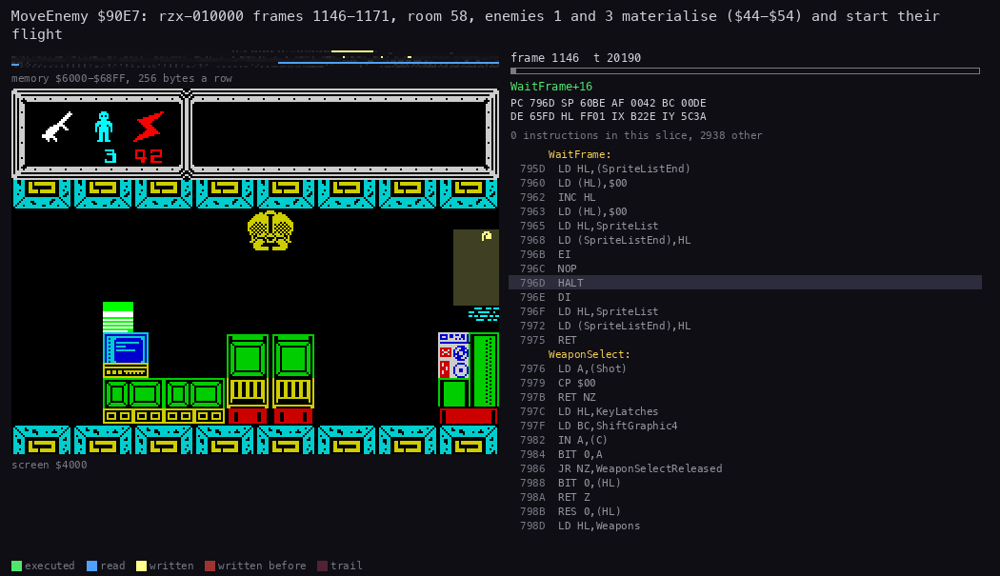

The animation is a trace of `rzx-010000` frames 1146-1171, in 90 pictures. The top panel is the memory `$6000-$68FF`:
the cell table, the work space and the enemies' shift buffers `$6708-$6858`. Under it is the screen, on the right the
listing. It follows MoveEnemy `$90E7-$93A5` with XorCells, OrCells and the step routines. Command:
`python3 ../../kit/routine_anim.py --work work/docs/tjC/z10 --window 1146:0-1172:0 --listing build/game.lst --view screen --range 6000-68FF --pc 90E7-93A5,7D87-7DD9,7DDA-7EBA,7EBB-7F4C --pictures 90 --title 'MoveEnemy $90E7: rzx-010000 frames 1146-1171, room 58, enemies 1 and 3 materialise ($44-$54) and start their flight' --out docs/img/routines/MoveEnemy.gif`.

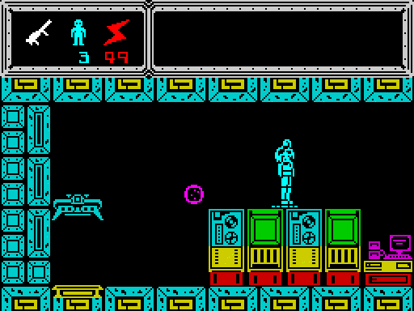

The screen at every frame of `rzx-010000` frames 104-124, room 73:

- enemy 0 materialises at (168, 88) beside the droid, states `$4C` and `$50` in frames 99-108;
- it starts its flight in frame 109 (state `$00`) over the droid;
- the sample of frame 110 has TouchBits 2, TouchTimer `$32` and EnergyReload `$0A`: the droid's touch test saw mark 2
  and started the fast drain (doc 10.4);
- the enemy's own flag byte got bit 7 too (state `$80` in frame 115). It explodes from frame 119.

Command:
`python3 ../../kit/screen_anim.py --work work/docs/tjC/z10 --from 104 --to 124 --step 1 --scale 2 --delay 100 --hold 1500 docs/img/play/enemy-touch.gif`.

**The point**: an enemy is a state byte that the interrupt can write. Touching anything inked destroys it. An enemy
that reaches the droid is therefore spent: it costs the droid energy, never a life.

## 7.7 The spawn: a lattice of 52 places

The spawn takes one random number for x and one for y, and tries again until the 2 x 2 cells there are all 0:

```asm
MoveEnemySpawn:
  CALL Random
  OR $20                     ; bit 5 always set
  AND $F8                    ; a multiple of 8
  CP $D0
  JR C,MoveEnemySpawnY
  LD A,$D0                   ; $E0-$F8 become $D0
MoveEnemySpawnY:
  LD C,A
  CALL Random
  OR $50
  AND $78                    ; y: $50, $58, $70 or $78
  LD B,A
  CALL CellAddrXY
  XOR A
  CP (HL)                    ; the four cells must be 0
  JR NZ,MoveEnemySpawn
  INC L
  CP (HL)
  JR NZ,MoveEnemySpawn
  ADD HL,DE
  CP (HL)
  JR NZ,MoveEnemySpawn
  INC L
  CP (HL)
  JR NZ,MoveEnemySpawn
  ...
  CALL Random
  AND $07
  OR $42                     ; bright, black paper, ink 2, 3, 6 or 7 (OR sets bit 1)
```

`OR $20` then `AND $F8` keeps bit 5 set and clears bits 0-2. x is therefore one of `$20-$38`, `$60-$78`, `$A0-$B8`
(four values each) or `$D0`, which also takes every value from `$E0` to `$F8`. `OR $50` then `AND $78` leaves y one of
`$50`, `$58`, `$70` and `$78`. That makes 13 x 4 = 52 places, and the column at `$D0` gets four times the chance of any
other column.

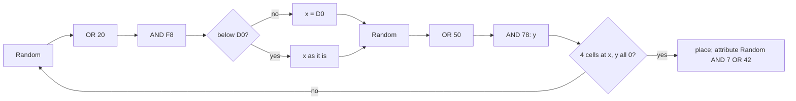

Worked example: enemy 1's spawn in `rzx-010000` frame 1146 put it at (168, 120). That is x `$A8`, from a Random value
of `$88-$8F` or `$A8-$AF`, and y `$78`. Enemy 3 at (96, 120) is x `$60`, y `$78`. Enemy 1's next spawn, in frame 1534,
is (208, 112): x `$D0`, y `$70`.

Witness: the RZX log holds 599 spawns, a state `$40` followed by `$44`. Every one is on the lattice. The column at `$D0`
holds 154 of them, against 30-45 for each other column. The rows hold 161, 171, 108 and 159.

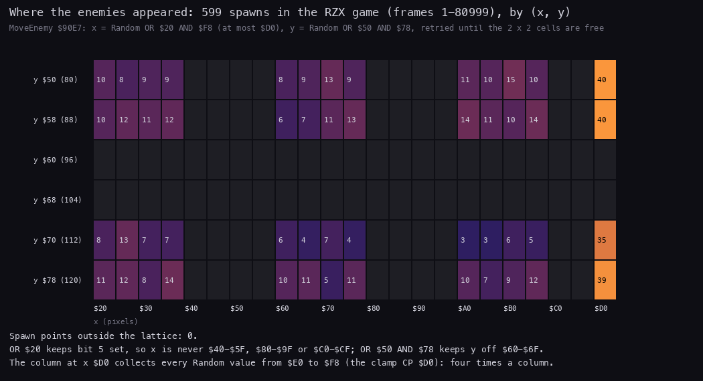

How to read the figure:

- One box per x (8-pixel steps, `$20-$D0`) and y (`$50-$78`), with the count of spawns at that place in the RZX game
  (RZX frames 1-80 999), coloured by count.
- The empty columns and rows are the values the OR and the AND never give.
- Command: `python3 tools/fig_objects.py spawns --log work/stage1/rzx/frames.bin --out docs/img/objects/spawns.png`.

**The point**: the enemies only ever appear in a band of rows from y 80 to y 127, and never in three bands of columns.
A player who stands outside them never has an enemy materialise on top of him. The lattice comes from cheap bit masks,
not from a design.

## 7.8 The objects: record and state machine

An object is the room's resident: a slow sprite of 4 bytes by 3 character rows that walks a straight line and turns
back at a wall. `Objects $6327` and `Object2 $6331` hold the two records of 10 bytes, the same layout as in the alien
record.

| Byte | Field | Values |
| --- | --- | --- |
| +0 | kind and timer | bits 4-7 the kind (ObjectKind), bits 0-1 a 2-call timer; 0: no object |
| +1 | state | bits 0-1 the direction (0 right, 1 down, 2 left, 3 up); bit 4 dead; bit 5 stopped; bit 6 just entered; bit 7 dying |
| +2 | x | pixels, up to `$E8` |
| +3 | y | pixels, up to `$A8` |
| +4, +5 | graphic | the frame's graphic (97 bytes a frame; byte 0 the shift) |
| +6 | frame | 0 to frames - 1 |
| +7 | frames | 3 or 4 |
| +8 | kill mark | the weapon mark that kills it: `$40` weapon 1, `$20` weapon 2, `$10` weapon 3 |
| +9 | attribute | the colour |

`ObjectKind $7C28` gives each kind its graphic, frames and kill mark. InitRooms fills them in from the kind bits:

| Kind bit | Graphic | Frames | Killed by | Objects in the map |
| --- | --- | --- | --- | --- |
| 4 | `$B049` | 3 | weapon 1 (`$40`) | 4 |
| 5 | `$B16C` | 4 | weapon 2 (`$20`) | 6 |
| 6 | `$B2F0` | 3 | weapon 3 (`$10`) | 3 |
| 7 | `$B413` | 4 | weapon 2 (`$20`) | 7 |
| none | `$B597` | 3 | weapon 3 (`$10`) | 5 |

The timer counts down in bits 0-1 and is set back to 2 (`SET 1`) when it reaches 0, so an object acts on every second
call. The two objects of a room start with different timers (`$11` and `$22` in room 83), so they act on alternate
passes. Weapon 0, the dash, cannot kill an object: the dash marks no cell, and an object's own sprite has flag pointer
0.

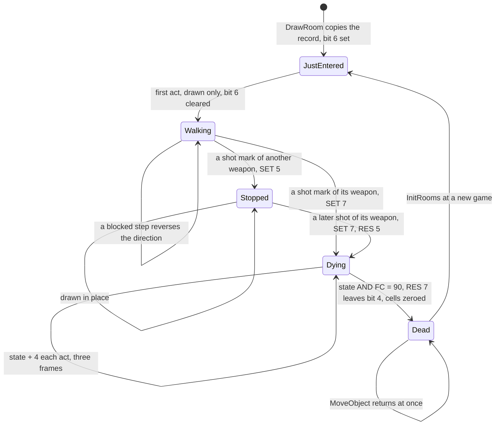

One act, as `MoveObject $809D` does it:

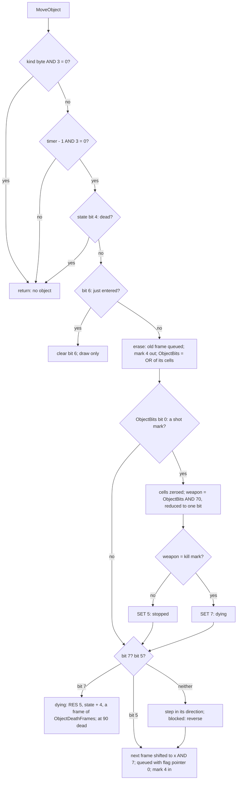

The hit test reads the weapon from the cells, not from the shot:

```asm
  LD A,(ObjectBits)          ; the OR of the cells under the object
  BIT 0,A
  JR Z,MoveObjectMove        ; no shot mark
  PUSH HL
  LD HL,(ObjectScratch)
  LD BC,(ObjectScratch+$0002)
  XOR A
  CALL XorCells              ; the cells zeroed
  POP HL
  LD A,(ObjectBits)
  AND $70                    ; the weapon bits: $40, $20, $10
  JP PO,MoveObjectHitWeapon  ; odd parity: one bit (or all three)
  AND $60                    ; two bits: keep the higher pair
MoveObjectHitWeapon:
  CP $00
  JR NZ,MoveObjectHitTest
  LD A,$10
MoveObjectHitTest:
  LD DE,$0007
  ADD HL,DE
  LD B,(HL)                  ; the kill mark (+8)
  SCF
  CCF
  SBC HL,DE
  CP B
  JR Z,MoveObjectKilled
  SET 5,(HL)                 ; another weapon: stopped
  JR MoveObjectMove
MoveObjectKilled:
  SET 7,(HL)                 ; its weapon: dying
```

The reverse at a wall keeps bits 2-7 of the state and sets the direction from the old one: a blocked step right gives
2 (left), down gives 3 (up), left gives 0 (right), up gives 1 (down). The code adds 2, 3, 0 and 1 to `state AND $FC`.

The death:

- `MoveObjectDying` clears bit 5, adds 4 and picks the frame `ObjectDeathFrames + (state AND $0C) / 2`.
- The states `$x4`, `$x8` and `$xC` take the words at offsets 2, 4 and 6. The first word, the frame `ObjectDeath`
  (`$B6BA`), is never read: the state that would take it, `$x0`, ends the death first.
- At `state AND $FC = $90` it clears bit 7. Bit 4 stays set, the cells are zeroed and the graphic becomes BlankGraphic.
  A killed object stays dead in its record until the next game's InitRooms.

Worked example, `rzx-010000` room 58, object 1 (kind bit 5, kill mark `$20`). The droid holds weapon 2 (`Weapons $20`).

| Frame | +0 | State | x, y | What happened |
| --- | --- | --- | --- | --- |
| 1418 | `$22` | `$01` | 124, 104 | walking down, at the floor |
| 1421 | `$22` | `$03` | 124, 104 | the step down was blocked: reversed to up |
| 1454 | `$21` | `$03` | 124, 90 | the droid fired: Shot `$41`, weapon 2's ammunition 5 to 4 |
| 1460 | `$22` | `$87` | 124, 88 | the mark `$21` found: its weapon; SET 7 and the first death frame |
| 1466, 1472 | | `$8B`, `$8F` | 124, 88 | the second and third death frames |
| 1475 | `$22` | `$13` | 124, 88 | dead: bit 4, direction 3 kept, BlankGraphic |
| 1890 | `$22` | `$53` | 124, 88 | the ED pickup saved it: bit 6 added |

At RZX frame 12 000 the record in the alien map still reads state `$53` (7.2).

Witness of the stopped state, from the RZX log: three objects were first hit by the wrong weapon and stopped, then
killed by the right one.

| RZX frame | Room | Stopped by | State | Killed at | By |
| --- | --- | --- | --- | --- | --- |
| 61 073 | 5 | weapon 2 | `$21` | 61 230 (`$85`) | weapon 1 |
| 64 974 | 12 | weapon 3 | `$21` | 65 115 (`$85`) | weapon 2 |
| 71 331 | 28 | weapon 3 | `$23` | 71 465 (`$87`) | weapon 2 |

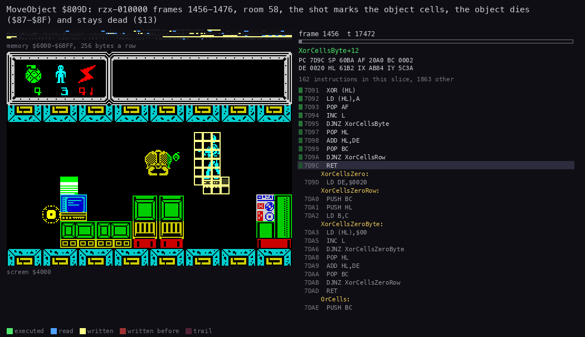

The animation is a trace of `rzx-010000` frames 1456-1476, in 84 pictures. The top panel is the memory `$6000-$68FF`:
the cell table with the bolt's `$21` marks, and the work space. Under it is the screen, on the right the listing of
MoveObject `$809D-$8297` with its helpers. Command:
`python3 ../../kit/routine_anim.py --work work/docs/tjC/z10 --window 1456:0-1477:0 --listing build/game.lst --view screen --range 6000-68FF --pc 809D-8297,7D87-7DD9,7DDA-7EBA,7EBB-7F4C --pictures 84 --title 'MoveObject $809D: rzx-010000 frames 1456-1476, room 58, the shot marks the object cells, the object dies ($87-$8F) and stays dead ($13)' --out docs/img/routines/MoveObject.gif`.

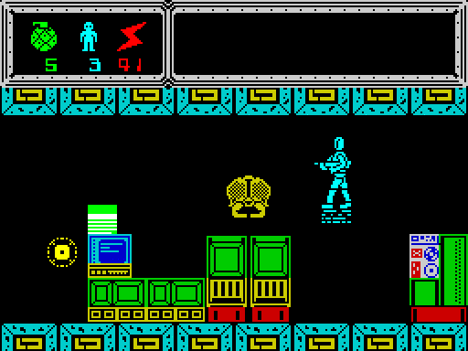

The screen at every frame of `rzx-010000` frames 1440-1480. The droid stands at the left of room 58 and fires weapon 2
at the object walking up. The bolt flies right and stops in the object; the object dissolves in three frames. Command:
`python3 ../../kit/screen_anim.py --work work/docs/tjC/z10 --from 1440 --to 1480 --step 1 --scale 2 --delay 80 --hold 1500 docs/img/play/fight.gif`.

**The point**: the right weapon kills an object, the wrong one freezes it in place. The weapon is read back from bits
the shot left in the cell table, so the shot and the object never meet as sprites.

## 7.9 The patrollers

Three patrollers walk fixed rows of the world through several rooms, whether the droid is there or not. Each has an
8-byte record in the work space. The image holds their start state, and nothing resets them, not even a new game.

| Byte | Field | Values |
| --- | --- | --- |
| +0 | frame | bit 7 not drawn (DrawRoom sets it on every room change); bits 0-1 the frame 0-3 |
| +1 | y and direction | the pixel row; bit 0 set: walking left |
| +2 | column | 0-`$1C` |
| +3 | room | the room it is in |
| +4, +5 | right end | room, column where it turns left |
| +6, +7 | left end | room, column where it turns right |

| Patroller | y | Left end | Right end | Columns |
| --- | --- | --- | --- | --- |
| P1 `$633B` | `$98` | room 120 (`$78`), column `$13` | room 123 (`$7B`), column `$10` | 87 |
| P2 `$6343` | `$90` | room 0, column `$1B` | room 5, column 7 | 131 |
| P3 `$634B` | `$98` | room 107 (`$6B`), column `$16` | room 109 (`$6D`), column `$19` | 61 |

`MovePatrollers $6AAD` moves one patroller per pass, in turn (`PatrollerTurn $6373` 0-2). `MovePatroller $93A6`:

- erases the patroller if it is drawn and in the droid's room;
- clears bit 7 and steps it (`PatrollerStep $93E0`);
- draws it again if it is in the droid's room (`DrawPatroller $942D`: 4 x 3 cells, mark 8, attribute `$42`).

PatrollerStep counts the frame 0-3; at 4 it moves a column. Past column `$1C` it enters the next room at column 0; below
column 0 it enters the previous room at column `$1C`. At its end it flips bit 0 of y and steps back.

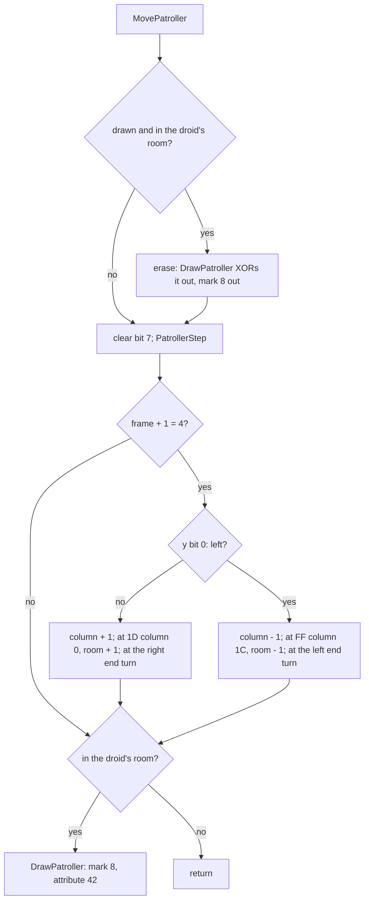

Worked example, the timing: one turn in three passes and a column every four turns make 12 passes, about 24 frames, a
column. P2 walks from room 0 column `$1B` to room 5 column 7: 2 + 4 x 29 + 8 = 126 steps, about 3 000 frames or one
minute each way.

Witness: L1 counts 18 583 turns, 4 630 steps, 102 + 72 room changes and 28 + 28 turns at the ends
(`PatrollerStep`'s description), and 495 erases against 507 draws: a patroller is drawn only in the droid's room. In
the RZX game a patroller shared the droid's room in 5 378 RZX frames. It never touched the droid. At the last RZX frame
the three records read P1 room 123 column `$0F`, P2 room 4 column 2, P3 room 108 column `$1C`.

The patrollers' rows are the bars on the world figure of 7.2. A patroller's mark 8 kills the droid at a touch (7.11,
doc 10.6).

**The point**: the patrollers are the only movers that live outside the room in play. They move on while the droid is
elsewhere, so the player cannot know where one is until he enters its room.

## 7.10 The droid's record and the start positions

`DroidVars $6359` holds five bytes:

| Address | Field | Values |
| --- | --- | --- |
| `$6359` | x | the column 0-`$1D` |
| `$635A` DroidY | y | the pixel row `$30-$98`, in steps of 2 |
| `$635B` DroidFlags | flags | bit 0 facing left; 1 turning; 2 falling; 3 moving; 4 the shield (doc 10.3); 6 the step frame; 7 the sprite met ink |
| `$635C` DroidFrame | frame | 0-13 (DroidFrames `$6888`): walk, front 8, turn, fall, beam |
| `$635D` DroidWidth | width | the frame's width in bytes, 2 or 3 |

The image's bytes from `$6359` are leftover text of the authors' source. PlaceDroid and NewGame write every byte before
play. `PlaceDroid $7A6D` takes x and y from `StartPositions $9484`, two bytes per room. It sets frame 8, width 2,
DroidFlags `$40` (`$41` when the droid graphic in memory faces left) and Shot 0.

```text
PlaceDroid():
    DroidFlags = 0x40 if DroidGraphics[4] == 0x70 else 0x41
    x, y = StartPositions[2 * Room], StartPositions[2 * Room + 1]
    DroidFrame, DroidWidth, Shot = 8, 2, 0
```

```asm
PlaceDroid:
  LD A,(DroidGraphics+$0004)
  CP $70                     ; the graphic as it faces right
  LD A,$40
  JR Z,PlaceDroidFacing
  LD A,$41
PlaceDroidFacing:
  LD (DroidFlags),A
  LD HL,StartPositions
  LD A,(Room)
  SLA A
  LD D,$00
  LD E,A
  ADD HL,DE
  LD A,(HL)
  LD (DroidVars),A           ; x
  INC HL
  LD A,(HL)
  LD (DroidY),A              ; y
  LD A,$08
  LD (DroidFrame),A
  LD A,$02
  LD (DroidWidth),A
  XOR A
  LD (Shot),A
  RET
```

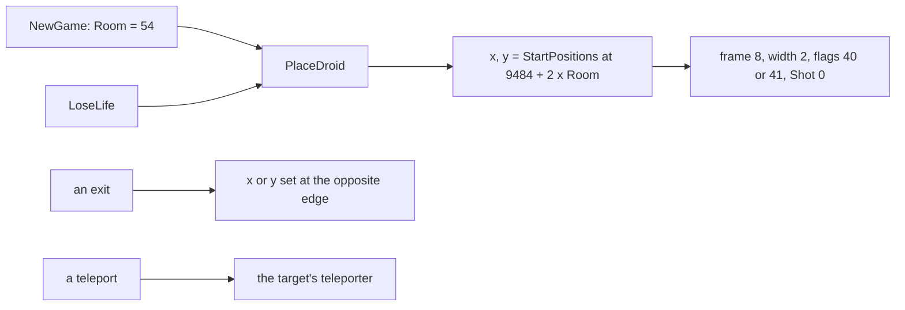

PlaceDroid runs only at a new game and after a life lost. An exit keeps the droid's other coordinate and puts it at the
opposite edge; a teleport puts it on the target's teleporter (doc 10.2). A start position therefore matters only for
room 84 and for a room the droid dies in.

Worked example, `rzx-035000`:

- the droid walks south from room 109 into room 117 in frame 214 and stands at x 4, y 50 (the exit's y `$32`);
- the 33-frame wipe ends, and object 1 of room 117 (kind none, at x 32, y 72) takes its draw-only act; its state is
  `$00` in the sample of frame 248;
- in frame 250 DroidFlags reads `$C4`: bit 7, the sprite met ink;
- in frame 251 TouchBits is `$04` (mark 4, an object), Lives 5 to 4 and Energy 99: HazardDeath and LoseLife ran;
- after the death effect the droid stands at x 21, y 136. `StartPositions + 2 x 117` holds `$15 $88`.

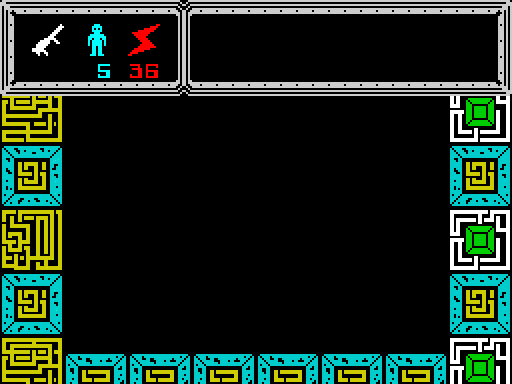

The screen at every second frame of `rzx-035000` frames 244-330. The droid has come in from the north onto the object.
The death effect dissolves it; then it reappears at the room's start position, with energy 99 and one life fewer.
Command:
`python3 ../../kit/screen_anim.py --work work/docs/tjC/r35 --from 244 --to 330 --step 2 --scale 2 --delay 100 --hold 1500 docs/img/play/death-hazard.gif`.

The white frames on the world figure of 7.2 mark every room's start position.

**The point**: a start position is a place of safety, not of entry. The droid enters a room where the exit puts it,
next to whatever stands there. It returns to the start position only after it has died.

## 7.11 Collisions and their order

Tujad has two collision systems, and each mover uses one or both:

- **The ink test** of the interrupt (doc 06). Each sprite list entry has a flag pointer. When the entry's XOR draw finds
  ink under any of its bytes, the interrupt sets bit 7 of the byte the pointer names. The droid's pointer is
  `FlagPointer $637E`: DroidFlags normally, 0 under the shield. An enemy's pointer is its state byte, and a dash's or a
  bolt's is `Shot`. An object, a patroller, an erase entry, an explosion and a materialise frame have pointer 0: they
  are never flagged.
- **The marks** in the cell table (7.4). Each mover XORs its mark into the cells it covers. A shot of weapons 1-3 ORs
  its mark with bit 0 into an object's cells. The droid's touch test and the object's hit test read the marks.

| Who meets whom | Found by | Effect | Where |
| --- | --- | --- | --- |
| an enemy and any ink: the droid, a shot, an object, a patroller | the enemy's flag byte | the enemy explodes | MoveEnemy's next act |
| the droid and an enemy | the droid's flag, then mark 2 | fast drain: reload `$0A`, TouchTimer 50 | MoveDroidTouch |
| the droid and an object or a patroller | the droid's flag, then mark 4 or 8 | HazardDeath, unless turning | MoveDroidHazard |
| a dash or a bolt and ink | Shot bit 7 | the shot ends | the shot routines |
| a bolt or the probe and an object | the object's cells | mark `$41`, `$21` or `$11` ORed in | the shot routines |
| an object and a shot mark | ObjectBits bit 0 | dies (its weapon) or stops | MoveObject |
| the droid and an item | FoundItem from the droid's step tests | the pickup | MoveDroidPickup |

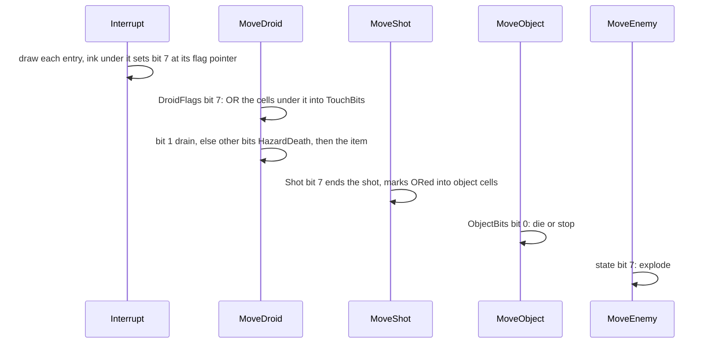

The order inside a pass is that of MainLoop ([doc 04](04-game-loop.md)): MoveDroid with its touch test,
the first MoveShot, a WaitFrame, the two objects, the four enemies, the patrollers, the second MoveShot. A bolt that
marks an object's cells in the first MoveShot is found by MoveObject in the same pass. A flag that the interrupt sets
is read at the next act of its owner.

```asm
MoveDroidTouch:
  LD A,(DroidFlags)          ; the touch test
  BIT 7,A
  JR Z,MoveDroidPickup       ; the sprite met no ink
  RES 7,A
  LD (DroidFlags),A
  LD A,H
  AND $03
  OR $60
  LD H,A                     ; the attribute address made a cell address
  LD DE,TouchBits
  XOR A
  LD (DE),A
  CALL OrCells               ; TouchBits = OR of the cells under the droid
  LD A,(DE)
  BIT 1,A
  JR Z,MoveDroidHazard
  LD A,$0A                   ; an enemy: the fast drain
  LD (EnergyReload),A
  LD (EnergyTimer),A
  LD A,$32
  LD (TouchTimer),A
  JR MoveDroidPickup
MoveDroidHazard:
  AND $FD                    ; any other mark: an object, a patroller, a shot
  JP NZ,HazardDeath
```

The enemy test comes first. When an enemy and an object overlap the droid at once, mark 2 wins: the drain starts and
HazardDeath is not called.

Worked example: in `rzx-010000` enemy 0 flies over the droid from frame 109. The sample of frame 110 shows TouchBits 2,
TouchTimer 50 and EnergyReload 10. Enemy 0's state has bit 7 in frame 115, and the explosion starts at frame 119. In
`rzx-035000` frame 250 the droid's flags read `$C4` over object 1's mark 4; the next sample has Lives 4.

Two gaps follow from the design:

- The touch test runs only when the droid's own sprite met ink. Under the shield FlagPointer is 0, the interrupt never
  sets DroidFlags bit 7, and the droid touches nothing (doc 10.3).
- The droid's sprite also meets the ink of a materialising enemy, whose cells carry no mark yet. In `rzx-010000` frames
  99-108 DroidFlags has bit 7 again and again while TouchBits stays 0: nothing happens.

**The point**: the sprites decide that something touched, the cells decide what. One XOR test in the interrupt costs
nothing extra, and the marks turn its yes or no into an enemy, an object or a patroller.

## 7.12 Random numbers

`Random $7DC9` keeps four bytes at `RandomSeed $63A4` and adds each old byte to the next, with the carry, starting from
`$29`:

```text
Random():                      # carry = whatever the caller left in the flag
    c = 0x29
    for i in 0..3:
        old = seed[i]
        seed[i] = (c + seed[i] + carry) & 0xFF;  carry = the overflow
        c = old
    return seed[3]
```

```asm
Random:
  EXX
  LD B,$04
  LD C,$29
  LD HL,RandomSeed
RandomLoop:
  LD A,C
  LD C,(HL)                  ; the old byte, added to the next one
  ADC A,(HL)
  LD (HL),A
  INC HL
  DJNZ RandomLoop
  EXX
  RET                        ; A = seed[3]
```

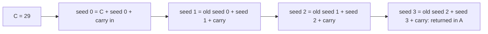

The first ADC adds the carry flag as the caller left it, so the same seed can give two results.

Its callers among the movers:

- the spawn: x, y and the attribute, again for every retry;
- the materialised enemy's direction;
- the wait after an explosion (`OR $29`).

NewGame takes one value for the count of ScrambleRooms calls (doc 10.9). The exhaust flicker uses it too (doc 06).

Worked example: enemy 1's explosion in `rzx-010000` ended in frame 1261; the sample of frame 1262 has the timer `$7F`.
`$7F` is a Random value ORed with `$29`. `$29` sets bits 0, 3 and 5, and `$7F` has them. MoveEnemy runs once a pass and
counts the timer down by one. The next spawn ran in frame 1534 (state `$44` in the sample of frame 1535): 127 passes in
272 frames, 2.14 frames a pass. A pass holds two interrupts, three when the work ran with interrupts off and one was
lost ([doc 04](04-game-loop.md)).

Witness: every one of the 599 spawns of 7.7 is on the lattice that the two masks predict. The RZX drift
([doc 10.12](10-gameplay-logic.md#1012-random-the-energy-timer-and-the-rzx-drift)) shows how sensitive the game is to
this one generator: one call more or less changes every later spawn.

**The point**: one 4-byte additive generator feeds everything random. Its outputs are shaped with OR and AND masks.
The masks, not the generator, decide where enemies can appear and how long they wait.

## 7.13 Known only from the code

What no recording shows, and why it is still stated:

- **An enemy against an object or a patroller.** By the ink test the enemy explodes. No sample was searched for it.
- **The first death frame `$B6BA`.** It cannot be reached (7.8).
- **Two weapons' marks under one object.** The `JP PO` / `AND $60` reduction of 7.8 picks one weapon; three marks give
  `$70`, which matches no kill mark and stops the object. No recording has two shots in one object at once.
- **An object's FoundItem.** MoveObject never clears FoundItem. An object meeting an item square on would stall the
  same way an enemy does (7.5), and an object could inherit a stale FoundItem from the enemies' last act. No recording
  was searched for an object stalled this way.
- **A teleporter as an item to the movers.** `$FF` has bit 7, so an enemy flying into a teleporter's top cells stalls as
  at an item. The droid's pickup ignores `$FF`.
- **The corner flip.** The vertical half wins when both steps are blocked (7.6); the samples of `rzx-010000` show only
  single flips.
