# 8. HUD and text

What this covers:

- the screen's layout and the HUD panel: its frame, colours, icons and fields (8.1);
- the font and the three printers: Print8, Blit16 and PrintText (8.2, 8.3);
- the HUD numbers: PrintBcd and who calls it (8.4), DrawHud (8.5), the weapon field (8.6);
- the messages: their data and priorities (8.7), the scroller that shows them and the queue that picks them (8.8);
- the menu texts (8.9), the progress screen (8.10), the win and the game over (8.11);
- the data sheet of every text (8.12) and what no recording reached (8.13).

The names are those of `src/game/game.ann` ([Terms](README.md#terms)). The recordings it rests on, all on the 48K,
each opened from its stage-1 TTD session (`work/stage1/rec/NAME/session.ttd`) on the writer's own instance (port base
36960, muted):

- `menu-cursor`: frames 0-1201 from `menu.szx`. A game started at frame 110 (DrawHud at 122), TUJAD FROM ORPHEUS
  (132-209), the ED piece 37 at frame 227 and its progress screen (227-424), the shield (530-568).
- `rzx-030000` (`r30`): frames 0-672. An energy step at frame 64, a teleport with TRANSPORTING (118-208).
- `energy-out`: frames 540-1700. The energy run down to 0, WARNING ENERGY LOW (643), a life lost (1570).
- `game-over`: frames 150-1100. Lives poked to 0 at frame 200 (the HUD still shows 3), the last life lost at 369,
  COMPUTER MALFUNCTION, YOU HAVE COMPLETED 0% OF TUJAD, the menu again at 954.
- `win`: frames 0-600 from `at080000.szx` (every ED piece taken, in room 84). CONGRATULATIONS from frame 16.
- `rzx-028000`, `rzx-036000`, `rzx-059000`: ENERGY SOURCE ABSORBED (317), GEN 19 COLLECTED (123), WEAPON LOCATED AND
  STORED (27).

Every printer call and every message event of a window was taken from access traces, 100 frames at a time
(`tools/sound_events.py`, which also records the scroller's steps and QueueMessage). The figures are drawn by
`tools/fig_text.py` from `build/game.bin`, the screenshots and those events.

A frame is 69 888 T, one interrupt a frame, 20 ms. A moment is "frame F T t". A trace puts an instruction in the
frame in which it ran. A screen picture of frame F (from `screen_anim.py`) is the screen at the frame's start.

```bash
. work/env.sh
sh work/docs/tjD/run_traces.sh menu-cursor=0-1201 energy-out=540-1700 game-over=150-1100 win=0-600 \
    rzx-028000=0-474 rzx-036000=0-869 rzx-059000=0-43
python3 ../../kit/rs.py open --work work/docs/tjD/r30 --ttd work/stage1/rec/rzx-030000/session.ttd --model 48K --port-base 36960
python3 tools/sound_events.py --work work/docs/tjD/r30 --frames 0-672 --chunk 100 --out work/docs/tjD/r30-events.json
python3 tools/fig_text.py all         # every figure of this document
```

## 8.1 The screen and the HUD panel

The screen has two parts. Rows 0-5 hold the HUD panel; rows 6-23 are the play area, which DrawRoom fills and
ClearPlayArea `$7917` (from `$40C0`) clears. A divider at column 11 cuts the panel in two:

- **the left half** (columns 1-10) holds three 16 x 16 icons and two-digit fields under them: the weapon and its
  ammunition, GEN 19 and the lives, the energy symbol and the energy;
- **the right half** (columns 12-30) is the message window, 19 characters by 4 rows, where the scroller moves the
  messages up a pixel line at a time (8.8).

| Field | Pixels | Attributes | Written by | Value |
| --- | --- | --- | --- | --- |
| the frame | HudGraphics `$8BFD`, rows 0 and 5, columns 0 and 31 | 7 | DrawHud `$8AE8` | - |
| the divider | HudDivider `$8C45`, column 11 | 7 | DrawHud | - |
| weapon icon | `$4422`, columns 2-3, 16 lines | `$47`, `$43`, `$44`, `$46` by weapon | ShowWeapon `$79C2` | Weapons `$6368` |
| ammunition | `$4082`, columns 2-3 of row 4 | the weapon's colour | ShowWeapon (PrintBcd) | Ammo `$636A-$636C` |
| GEN 19 icon | `$4425`, columns 5-6 | `$45` | DrawHud | - |
| lives | `$4085`, columns 5-6 of row 4 | `$45` | PrintBcd | Lives `$636D` |
| energy icon | `$4428`, columns 8-9 | `$42` | DrawHud | - |
| energy | `$4088`, columns 8-9 of row 4 | `$42` | PrintBcd | Energy `$636E` |
| messages | `$402C`, 19 bytes x 32 lines | `$43` | InterruptScroll `$9640` | ScrollText `$63C7` |

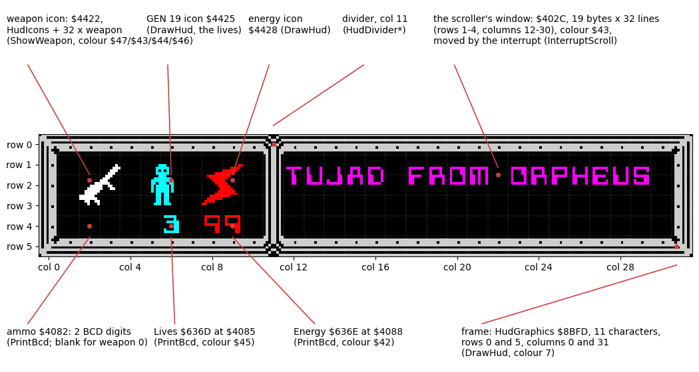

How to read the figure:

- **The panel** is rows 0-5 of the start-room screenshot (`c1` frame 14 450), drawn 4 times larger, with the rows and
  columns marked.
- **Each label** names a field, its screen address and the routine that writes it; the red dot marks the field's
  first cell.
- **The point**: the panel is a fixed frame with five live fields. Three of them are numbers printed by one routine,
  PrintBcd; the message window is the only part that moves.

```bash
python3 tools/fig_text.py hud         # docs/img/text/hud.png
```

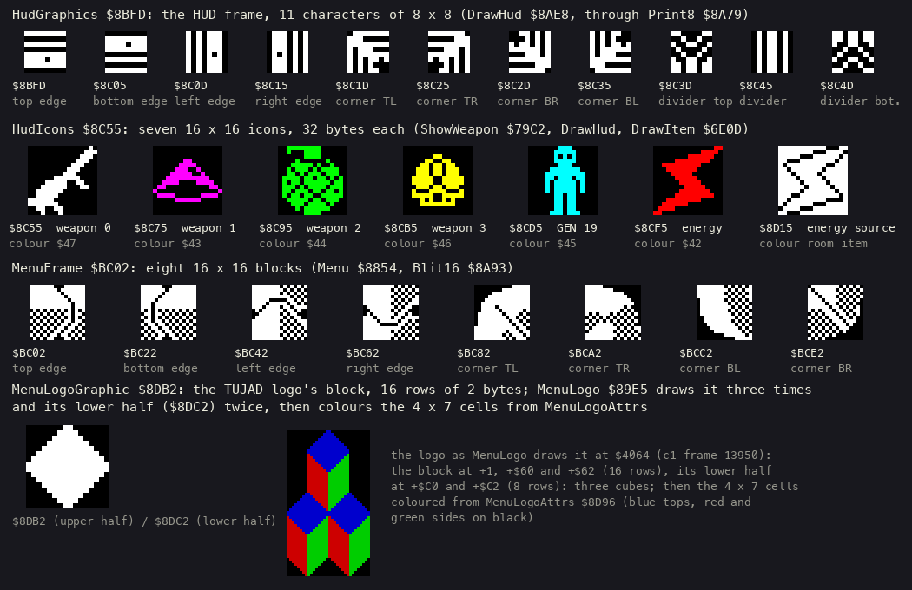

How to read the figure:

- **Row 1**: HudGraphics `$8BFD`, the 11 characters of the frame and the divider, with their addresses.
- **Row 2**: HudIcons `$8C55`, seven 16 x 16 icons in the colours the game gives them. The last one, the energy
  source, is a room item (DrawItem `$6E0D`), not a HUD icon.
- **Row 3**: MenuFrame `$BC02`, the menu's 16 x 16 frame blocks (8.9).
- **Row 4**: MenuLogoGraphic `$8DB2`, the block the menu logo is built from, and the logo as MenuLogo draws it.
- **The point**: all the panel's art is 11 characters and 6 icons, 280 bytes.

```bash
python3 tools/fig_text.py hudgfx      # docs/img/text/hud-graphics.png
```

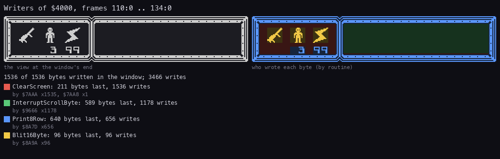

*Code against the screen. Each byte of rows 0-5 is coloured by the routine that wrote it last, over `menu-cursor`
frames 110-133: the new game, DrawHud, the first scroller steps. Command, from the case folder after `. work/env.sh`:
`python3 ../../kit/writers_map.py --work work/docs/tjD/menu-cursor --listing build/game.lst --window 110:0-134:0 --out
docs/img/text/hud-writers.png --view buffer:4000:32x48:screen`.*

How to read the figure: blue is Print8 (the frame, the divider and the digits, 640 bytes), yellow is Blit16 (the
three icons, 96 bytes), green is the scroller (589 bytes of the message window), red is ClearScreen (the blank
cells no one else wrote). The point: every pixel of the panel comes from Print8 or Blit16. The only other writer is
the scroller.

## 8.2 The font

Font `$E002-$E1E1` holds 60 characters, codes `$20-$5B`, 8 bytes each, top row first (src/res/graphics/Font.png).
It covers the space, punctuation, the digits, `@` and the capitals, and `[` as a solid bottom bar. There are no lower
case letters.

- **PrintText and PrintBcd** find a character at Font - `$100` + 8 x code: code `$20` is at `$E002`.
- **The scroller** reads Font - `$101` + 8 x code + ScrollLine, ScrollLine 1-7 then 0. For lines 1-7 that is row
  ScrollLine - 1 of the character. For line 0 it is the byte before the character: row 7 of the previous code.
- **Row 7** of every glyph is 0 except `,`, `;` and `[`. So the scroller's eighth line, which reads row 7 of the code
  before, is blank for every character the messages use. FontPad `$E000-$E001` is 0, so a space reads 0 too.
- **The ROM font** is used once: a leading 0 of PrintBcd prints the ROM's space at `$3D00`.

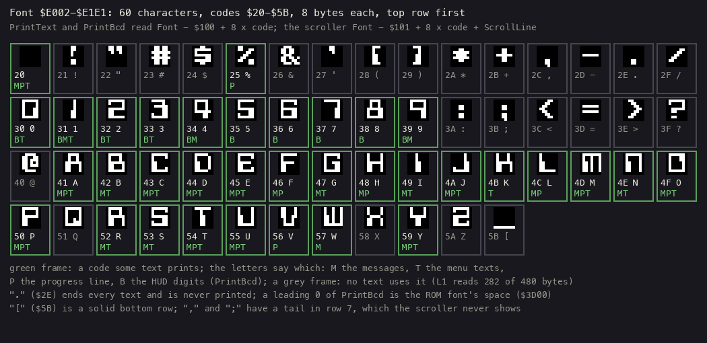

How to read the figure:

- **Each cell** is one character, drawn 4 times larger, with its code and the character under it.
- **The frame** is green when some text prints the character; the letters below say which: M a message, T a menu text,
  P the progress line, B the HUD digits. A grey frame means no text uses it.
- **The point**: 35 of the 60 characters are ever printed. The rest (`!`, `#`, `&`, `X`, `Z`, ...) are part of a full
  font that the game does not need.

```bash
python3 tools/fig_text.py font        # docs/img/text/font.png
```

Worked example: the letter T (`$54`) for PrintText is at `$DF02` + 8 x `$54` = `$DF02` + `$2A0` = `$E1A2`. The
scroller, on ScrollLine 3, reads `$DF01` + `$2A0` + 3 = `$E1A4`: row 2 of T.

Witness: L1 reads 282 of the font's 480 bytes; the characters no text uses are never read.

The point: one font serves both printers. The scroller's odd offset (`$101` and a line counted 1..7, 0) makes it draw
row 7 last, from the previous code, which only works because row 7 is blank.

## 8.3 Print8, Blit16 and PrintText

Three small routines draw everything that is not a sprite or a room tile:

- **Print8 `$8A79`** copies 8 bytes from DE to 8 pixel lines at HL, stepping H with the screen's line, row and third
  rules. It does not touch the attributes.
- **Blit16 `$8A93`** copies a 16 x 16 block (32 bytes, two bytes a line) the same way: the icons, the menu frame, the
  ED pieces.
- **PrintText `$8AB4`** prints a text at HL to the screen at DE in the colour A. It takes one character after another,
  draws it with Print8, sets that cell's attribute to A (PrintAttr `$8D37`), and stops before the first `.`. It
  never wraps: each text is one line.

```text
PrintText(HL text, DE screen, A colour):
    PrintAttr = A
    repeat:
        Print8(Font - $100 + 8 x (HL), DE)
        attribute of the cell at DE = PrintAttr
        HL += 1; E += 1
    until (HL) == '.'
```

```text
8AB4  32 37 8D      LD (PrintAttr),A     ; PrintText
8AB7  E5            PUSH HL              ; PrintTextLoop
8AB8  D5            PUSH DE
8AB9  01 02 DF      LD BC,Font-$0100
8ABC  7E            LD A,(HL)
8ABD  6F            LD L,A
8ABE  26 00         LD H,$00
8AC0  CB 25         SLA L                ; HL = code x 8
8AC2  CB 14         RL H
8AC4  CB 25         SLA L
8AC6  CB 14         RL H
8AC8  CB 25         SLA L
8ACA  CB 14         RL H
8ACC  09            ADD HL,BC
8ACD  EB            EX DE,HL
8ACE  CD 79 8A      CALL Print8
8AD1  7C            LD A,H               ; the cell's attribute address
8AD2  0F            RRCA
8AD3  0F            RRCA
8AD4  0F            RRCA
8AD5  E6 03         AND $03
8AD7  F6 58         OR $58
8AD9  67            LD H,A
8ADA  3A 37 8D      LD A,(PrintAttr)
8ADD  77            LD (HL),A
8ADE  D1            POP DE
8ADF  E1            POP HL
8AE0  23            INC HL
8AE1  1C            INC E
8AE2  7E            LD A,(HL)
8AE3  FE 2E         CP $2E               ; '.' ends the text
8AE5  C8            RET Z
8AE6  18 CF         JR PrintTextLoop
```

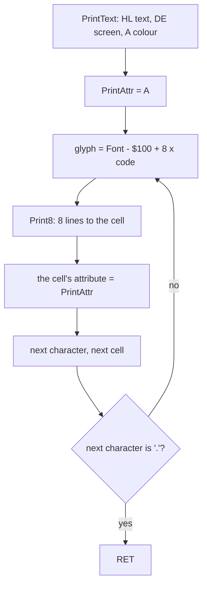

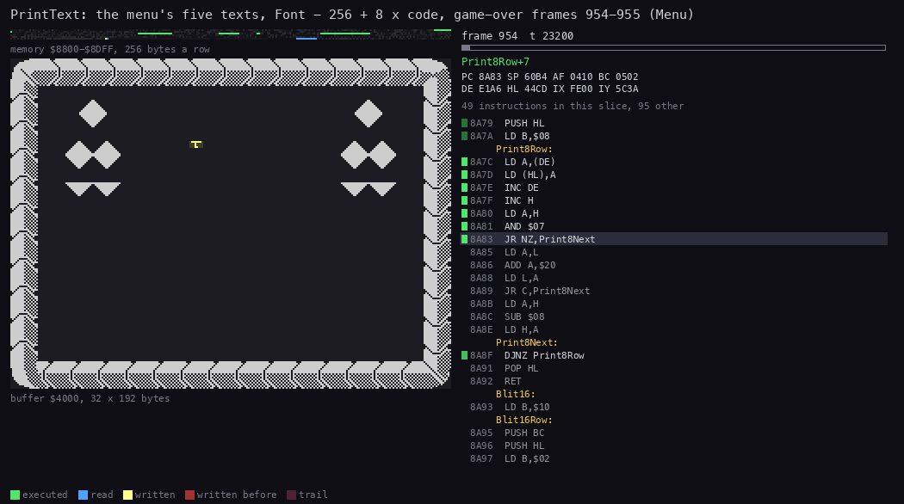

*The routine animation of PrintText and Print8 (`$8AB4-$8AE7`, `$8A79-$8A92`) in `game-over` from 954:22000 to
955:12000, after the game over's Restart. It has 50 pictures, one each 1200 T. The view is the whole screen. Command,
from the case folder after `. work/env.sh`: `python3 ../../kit/routine_anim.py --work work/docs/tjD/game-over --listing
build/game.lst --window 954:22000-955:12000 --out docs/img/routines/PrintText.gif --pc 8AB4-8AE7,8A79-8A92 --view
buffer:4000:32x192:screen --range 8800-8DFF --step 1200 --delay 130`.*

How to read the animation: the menu frame and logos are already drawn. PrintText writes TUJAD, then 1 KEYBOARD, 2
CURSOR JOYSTICK, 3 KEMPSTON JOYSTICK and 0 START GAME, a character at a time. The memory map shows each read of the
text (`$8D38-$8D84`) and of the font. Each character is 8 written screen bytes, then one attribute.

Worked example: TUJAD at `$40CD` in `$47`. T (`$54`) comes from `$E1A2`; its 8 bytes go to `$40CD`, `$41CD`, ...,
`$47CD` (the 8 lines of a cell). Its attribute is `$58CD`: Print8 gives HL back as `$40CD`, and H = `$40` rotated right
three times, AND 3, OR `$58` is `$58`. The `.` after D stops the loop: 5 characters, 45 writes.

Witness: L1 counts 21 PrintText texts and 302 characters, and 1758 Print8 calls (PrintBcd, PrintText, DrawHud,
ShowWeapon).

The point: the game prints text in only two places, the menu and the game-over percentage. Everything else on the HUD
is digits (PrintBcd) and every message goes through the scroller.

## 8.4 PrintBcd and the HUD numbers

The three numbers on the HUD (the ammunition, the lives, the energy) are BCD bytes. PrintBcd `$7B3F` prints one as two
digits at HL:

- the high digit becomes the ROM font's space `$3D00` when it is 0, or the game's font character `$30` + digit;
- a click of 50 speaker edges plays before the first digit ([09](09-sound.md#94-the-digit-click));
- Print8 prints the high digit, L moves one cell right, Print8 prints the low digit (never blanked).

PrintBcd writes no attribute: each field keeps the colour DrawHud or ShowWeapon gave it.

```text
PrintBcd(A, HL):
    hi = A >> 4
    glyph = hi == 0 ? $3D00 : Font - $100 + 8 x ($30 + hi)
    click (50 edges)
    Print8(glyph, HL); L += 1
    Print8(Font - $100 + 8 x ($30 + (A AND $0F)), HL)
```

```text
7B3F  F5            PUSH AF              ; PrintBcd
7B40  E6 F0         AND $F0
7B42  CB 3F         SRL A
7B44  CB 3F         SRL A
7B46  CB 3F         SRL A
7B48  CB 3F         SRL A                ; the high digit
7B4A  11 00 3D      LD DE,$3D00          ; the ROM's space
7B4D  FE 00         CP $00
7B4F  28 14         JR Z,PrintBcdClick
7B51  C6 30         ADD A,$30
...                                      ; DE = Font - $100 + 8 x A
7B65  AF            XOR A                ; PrintBcdClick
7B66  06 32         LD B,$32
7B68  D3 FE         OUT ($FE),A          ; PrintBcdClickLoop
7B6A  EE 10         XOR $10
7B6C  D3 FE         OUT ($FE),A
7B6E  10 F8         DJNZ PrintBcdClickLoop
7B70  CD 79 8A      CALL Print8
7B73  2C            INC L
7B74  F1            POP AF
7B75  E6 0F         AND $0F              ; the low digit
7B77  C6 30         ADD A,$30
...
7B8B  CD 79 8A      CALL Print8
7B8E  C9            RET
```

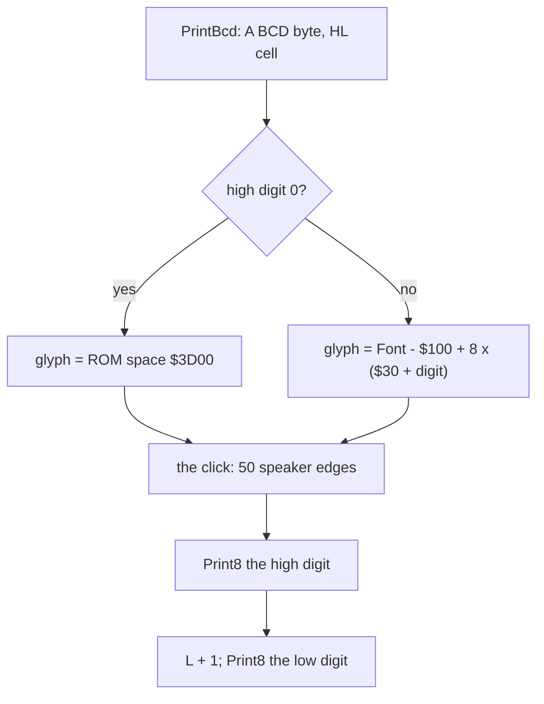

Who calls it, and when a field changes:

| Caller | Field | When |
| --- | --- | --- |
| EnergyTickStep `$7AD2` | energy at `$4088` | every EnergyTimer step: 250 interrupts (5 s), or 10 under the shield and for 50 interrupts after an enemy touch |
| MoveDroidPickupEnergy `$7687` | energy | an energy source: Energy = 99 |
| LoseLife `$6A3C` (`$6A72`, `$6A7A`) | lives, energy | a life lost: Lives - 1, Energy 99 |
| MoveDroidPickupGen `$7671` | lives | GEN 19 taken: Lives + 1 |
| ShowWeaponAmmo `$7A27` | ammunition at `$4082` | the weapon changed or taken |
| FireWeapon1Ammo `$86EC`, FireWeapon2Ammo `$873A`, FireWeapon3Cell `$8693` | ammunition | a shot fired |
| DrawHud (`$8BE8`, `$8BF1`) | lives, energy | a new game |

EnergyTick `$7AB6` runs in every interrupt. It counts EnergyTimer `$6366` down; at 0 it reloads it from EnergyReload
`$6374` (`$FA`, or `$0A` under the shield and for TouchTimer, 50 interrupts, after an enemy touch; each touching pass
sets EnergyTimer back to 10, so the first step comes 10 interrupts after the last touch), takes 1 from Energy (BCD)
and prints it. When the energy before the step is 11 it first queues WARNING ENERGY LOW. EnergyTimer = 0 stops it.

```text
7AB6  AF            XOR A                ; EnergyTick
7AB7  21 66 63      LD HL,EnergyTimer
7ABA  BE            CP (HL)
7ABB  C8            RET Z                ; stopped
7ABC  35            DEC (HL)
7ABD  C0            RET NZ
7ABE  3A 74 63      LD A,(EnergyReload)
7AC1  77            LD (HL),A
7AC2  3A 6E 63      LD A,(Energy)
7AC5  FE 11         CP $11
7AC7  20 09         JR NZ,EnergyTickStep
7AC9  21 22 64      LD HL,MsgEnergyLow
7ACC  CD CD 6A      CALL QueueMessage
7ACF  3A 6E 63      LD A,(Energy)
7AD2  D6 01         SUB $01              ; EnergyTickStep
7AD4  27            DAA
7AD5  32 6E 63      LD (Energy),A
7AD8  21 88 40      LD HL,Screen+136
7ADB  CD 3F 7B      CALL PrintBcd
7ADE  C9            RET
```

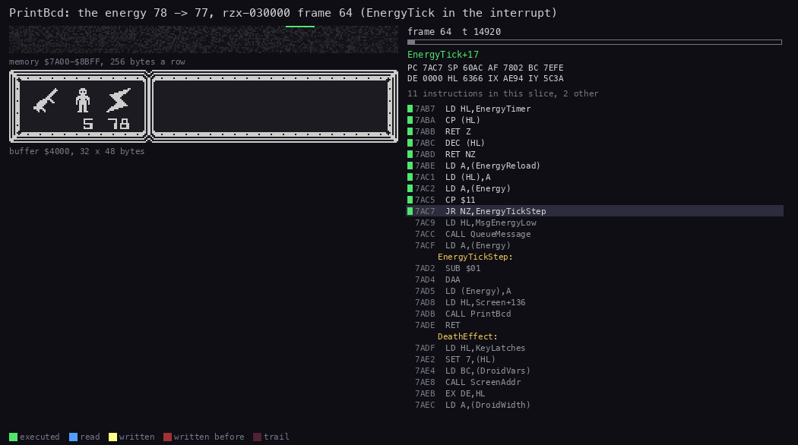

*The routine animation of EnergyTick, PrintBcd and Print8 (`$7AB6-$7B8E`, `$8A79-$8A92`) in `rzx-030000` from
64:14800 to 64:20800. It has 50 pictures, one each 120 T. The view is the HUD's rows 0-5. Command, from the case folder
after `. work/env.sh`: `python3 ../../kit/routine_anim.py --work work/docs/tjD/r30 --listing build/game.lst --window
64:14800-64:20800 --out docs/img/routines/PrintBcd.gif --pc 7AB6-7B8E,8A79-8A92 --view buffer:4000:32x48:screen
--range 7A00-8BFF --step 120 --delay 120`.*

How to read the animation: the interrupt's EnergyTick finds EnergyTimer at 0 and steps the energy. PrintBcd picks the
high digit's glyph. Then the highlight holds on the click loop `$7B68-$7B6E` for about 2100 T (18 pictures), the
speaker's 50 edges. Then Print8 writes the two digits at `$4088` and `$4089`, 8 bytes each; the yellow marks are the
new pixels in the energy field.

Worked example: `energy-out` frame 643. Energy is `$11` when EnergyTimer runs out, so EnergyTick queues WARNING ENERGY
LOW, then SUB 1 gives `$10`, DAA keeps `$10`. PrintBcd prints 1 (`$E08A`) and 0 (`$E082`) at `$4088`. At the next
step, `$10` - 1 = `$0F`, which DAA turns into `$09`: the high digit 0 prints as the ROM's space, so the field shows
" 9".

Witness: in the eight recordings PrintBcd was called by EnergyTickStep 38 times, DrawHud twice, LoseLife twice, and once
each by ShowWeaponAmmo, MoveDroidPickupGen and MoveDroidPickupEnergy. The steps came every 10 frames
under the shield (`menu-cursor` 540, 550, 560, 570) and after an enemy touch (`energy-out` 603, 613, 623, 633, 643).

The point: the HUD is not redrawn each frame. Each field is printed only when its value changes, by the routine that
changed it.

## 8.5 DrawHud

DrawHud `$8AE8` builds the whole panel once, at a new game (NewGame `$7A2F`). It never runs again: a room change does
not touch rows 0-5.

1. The four corners, then the top and bottom edges (30 characters each), the left and right edges (4 each), all with
   Print8 from HudGraphics.
2. The divider at column 11: its top, 4 middle characters, its bottom.
3. The attributes: rows 1-4 all `$43` (bright magenta on black), then HudAttrs `$8BF5` copied to columns 2-9 of rows
   1-4 (`$47 $47 0 $45 $45 0 $42 $42`), then 7 on rows 0 and 5 and on columns 0, 11 and 31.
4. The three icons with Blit16: weapon 0 at `$4422`, GEN 19 at `$4425`, the energy at `$4428`.
5. Lives at `$4085` and Energy at `$4088` with PrintBcd.

```text
DrawHud:
    corners, edges and the divider: Print8 from HudGraphics $8BFD .. $8C4D
    attributes of rows 1-4 = $43; columns 2-9 of rows 1-4 = HudAttrs
    rows 0 and 5, columns 0, 11, 31 = 7
    Blit16 the icons of weapon 0, GEN 19, the energy
    PrintBcd(Lives, $4085); PrintBcd(Energy, $4088)
```

```text
8B65  21 20 58      LD HL,Attributes+32  ; rows 1-4: $43
8B68  11 21 58      LD DE,Attributes+33
8B6B  01 7F 00      LD BC,$007F
8B6E  36 43         LD (HL),$43
8B70  ED B0         LDIR
8B72  11 22 58      LD DE,Attributes+34  ; HudAttrs at column 2, four rows
8B75  06 04         LD B,$04
8B77  C5            PUSH BC              ; DrawHudAttrRow
8B78  D5            PUSH DE
8B79  21 F5 8B      LD HL,HudAttrs
8B7C  01 08 00      LD BC,$0008
8B7F  ED B0         LDIR
...
8BC7  21 22 44      LD HL,Screen+1058    ; the icons
8BCA  11 55 8C      LD DE,HudIcons
8BCD  CD 93 8A      CALL Blit16
8BD0  21 25 44      LD HL,Screen+1061
8BD3  11 D5 8C      LD DE,IconGen19
8BD6  CD 93 8A      CALL Blit16
8BD9  21 28 44      LD HL,Screen+1064
8BDC  11 F5 8C      LD DE,IconEnergy
8BDF  CD 93 8A      CALL Blit16
8BE2  21 85 40      LD HL,Screen+133     ; lives
8BE5  3A 6D 63      LD A,(Lives)
8BE8  CD 3F 7B      CALL PrintBcd
8BEB  21 88 40      LD HL,Screen+136     ; energy
8BEE  3A 6E 63      LD A,(Energy)
8BF1  CD 3F 7B      CALL PrintBcd
8BF4  C9            RET
```

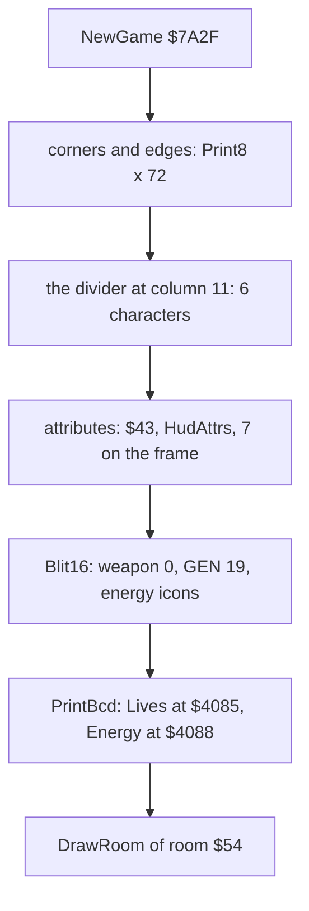

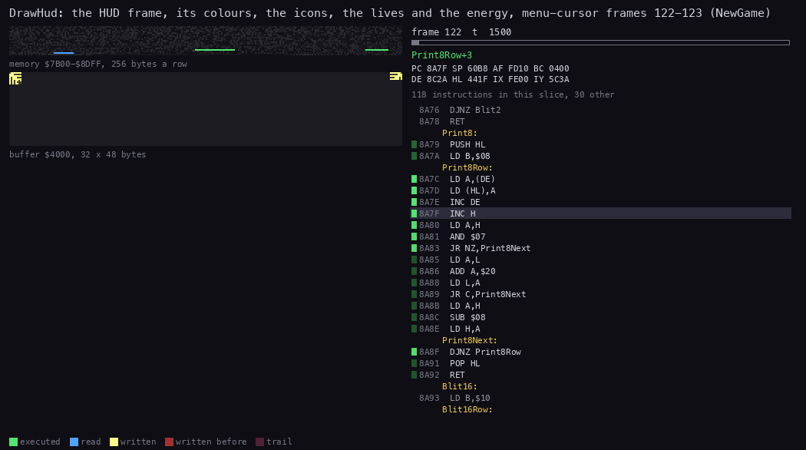

*The routine animation of DrawHud with Print8, Blit16 and PrintBcd (`$8AE8-$8BF4`, `$8A79-$8AB3`, `$7B3F-$7B8E`) in
`menu-cursor` from 122:0 to 123:4500. It has 50 pictures, one each 1500 T. The view is the HUD's rows 0-5. Command, from
the case folder after `. work/env.sh`: `python3 ../../kit/routine_anim.py --work work/docs/tjD/menu-cursor --listing
build/game.lst --window 122:0-123:4500 --out docs/img/routines/DrawHud.gif --pc 8AE8-8BF4,8A79-8AB3,7B3F-7B8E --view
buffer:4000:32x48:screen --range 7B00-8DFF --step 1500 --delay 130`.*

How to read the animation: the panel appears in the order of the code: the corners, the top edge left to right, the
bottom edge, the sides (the orange marks of the last writes), the divider. Then the colours change at once (two
`LDIR`s), the three icons drop in, and the digits 3 and 99 come last.

Worked example: the attributes of row 4 after DrawHud, columns 0-11: 7, `$43`, `$47`, `$47`, 0, `$45`, `$45`, 0,
`$42`, `$42`, `$43`, 7. So the lives digits at columns 5-6 are bright cyan, the energy at 8-9 bright red, the
ammunition at 2-3 bright white (weapon 0), and columns 4 and 7 are black on black: gaps between the fields.

Witness: L1 counts 4 DrawHud calls, one per new game. In `menu-cursor` it entered at frame 122 T 615; its two
PrintBcd calls came at 122 T 66 264 and T 69 740, the second finishing in frame 123. The code-against-screen map (8.1)
shows its 640 Print8 bytes and 96 Blit16 bytes.

The point: the panel is drawn once and then only patched.

## 8.6 The weapon field: WeaponSelect and ShowWeapon

Weapons `$6368` holds one bit for the weapon in hand: bit 7 weapon 0 (the basic gun), bit 6 weapon 1, bit 5 weapon 2,
bit 4 weapon 3. Ammo `$636A-$636C` holds the ammunition of weapons 1-3 (BCD); weapon 0 has none.

- **WeaponSelect `$7976`** runs in every interrupt while no shot is in flight. When SPACE or CAPS SHIFT (port `$7EFE`, bit 0) is
  pressed after a release, it shifts Weapons right to the next weapon with ammunition; past weapon 3, or when none has any, it goes back to
  weapon 0 (`$80`). Then it calls ShowWeapon.
- **ShowWeapon `$79C2`** colours the 2 x 4 cells at `$5822` with the weapon's colour (`$47`, `$43`, `$44`, `$46`),
  blits its icon (HudIcons + 32 x weapon) at `$4422`, and prints its ammunition at `$4082` with PrintBcd. For weapon 0
  it prints two BlankGraphic characters instead.

```text
ShowWeapon:
    (C colour, DE icon, HL ammo) = by the bit set in Weapons:
        bit 7: $47, HudIcons, none;  bit 6: $43, +32, Ammo
        bit 5: $44, +64, Ammo + 1;   bit 4: $46, +96, Ammo + 2
    attributes of columns 2-3, rows 1-4 = C
    Blit16(DE, $4422)
    if HL == 0: two blank characters at $4082, $4083
    else: PrintBcd((HL), $4082)
```

```text
79F5  E5            PUSH HL              ; ShowWeaponIcon
79F6  21 22 44      LD HL,Screen+1058
79F9  E5            PUSH HL
...                                      ; HL = the attribute of $4422
7A03  06 04         LD B,$04
7A05  71            LD (HL),C            ; ShowWeaponColour
7A06  2C            INC L
7A07  71            LD (HL),C
7A08  7D            LD A,L
7A09  C6 1F         ADD A,$1F
7A0B  6F            LD L,A
7A0C  10 F7         DJNZ ShowWeaponColour
7A0E  E1            POP HL
7A0F  CD 93 8A      CALL Blit16
7A12  E1            POP HL
7A13  7C            LD A,H
7A14  B5            OR L
7A15  20 10         JR NZ,ShowWeaponAmmo
7A17  11 09 66      LD DE,BlankGraphic   ; weapon 0: no number
7A1A  21 82 40      LD HL,Screen+130
7A1D  CD 79 8A      CALL Print8
7A20  21 83 40      LD HL,Screen+131
7A23  CD 79 8A      CALL Print8
7A26  C9            RET
7A27  7E            LD A,(HL)            ; ShowWeaponAmmo
7A28  21 82 40      LD HL,Screen+130
7A2B  CD 3F 7B      CALL PrintBcd
7A2E  C9            RET
```

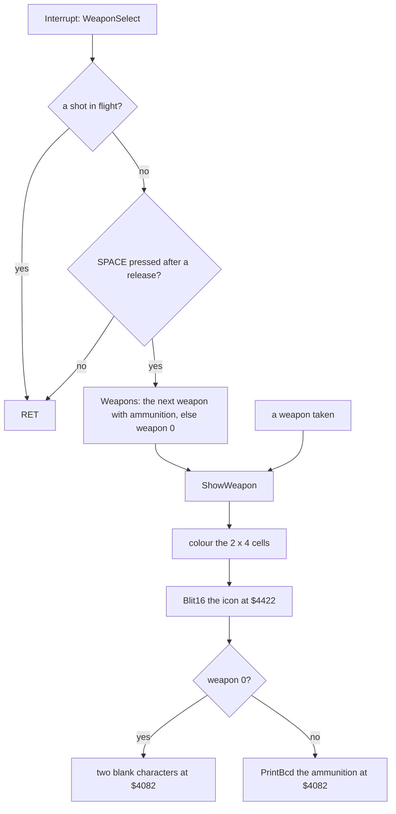

Worked example: `menu-cursor` frame 840 T 27 038. SPACE is pressed, WeaponSelect moves Weapons from `$80` to `$40`
(weapon 1, which has ammunition) and calls ShowWeapon. ShowWeapon takes C = `$43`, DE = IconWeapon1 `$8C75` and HL =
Ammo `$636A`. It colours `$5822`, `$5823`, `$5842`, ..., `$5883` magenta, blits the icon at `$4422`, and at T 30 604
calls PrintBcd with A = 3 and HL = `$4082`: the field shows " 3" in magenta. At the new game (frame 122) DrawHud had
blitted the white gun of weapon 0 and left the field blank.

Witness: L1 counts 54 824 WeaponSelect calls, 47 changes, and 58 ShowWeapon calls.

The point: the weapon field is the only one that changes colour. The colour tells the weapon at a glance; the number
is its ammunition.

## 8.7 The messages and their priorities

The ten messages lie at `$63D2-$65AD` (src/res/text/Messages.txt). Each is a priority byte, then rows of exactly 19
characters (the window's width), with a `.` after the last row. The scroller shows one row every 50 interrupts.

| Message | Address | Priority | Rows | Queued by | Seen |
| --- | --- | ---: | ---: | --- | --- |
| TUJAD FROM ORPHEUS | `$63D2` | 1 | 1 | Restart `$690A` | `menu-cursor` 132 |
| EDS COMPLETED / RETURN TO TUJAD / CONTROL ROOM | `$63E7` | 10 | 3 | WinTest `$69F3` | the RZX log, frame 71 845 |
| WARNING ENERGY LOW | `$6422` | 5 | 1 | EnergyTick `$7AC9` | `energy-out` 643 |
| ENERGY SOURCE / ABSORBED | `$6437` | 2 | 2 | MoveDroidPickupEnergy `$7687` | `rzx-028000` 317 |
| TRANSPORTING | `$645F` | 10 | 1 | Teleport `$778B` | `rzx-030000` 118 |
| WEAPON LOCATED AND / STORED | `$6474` | 8 | 2 | MoveDroidPickupStored `$766A` | `rzx-059000` 27 |
| GEN 19 COLLECTED | `$649C` | 8 | 1 | MoveDroidPickupGen `$7671` | `rzx-036000` 123 |
| GEN 19 DESTROYED | `$64B1` | 8 | 1 | LoseLife `$6A51` | `energy-out` 1570 |
| CONGRATULATIONS ... WELL DONE | `$64C6` | 20 | 7 | WinTestRoom `$6A10` | `win` 16 |
| COMPUTER MALFUNCTION ... DESTROYED | `$654D` | 20 | 5 | LoseLifeGameOver `$6A94` | `game-over` 434 |

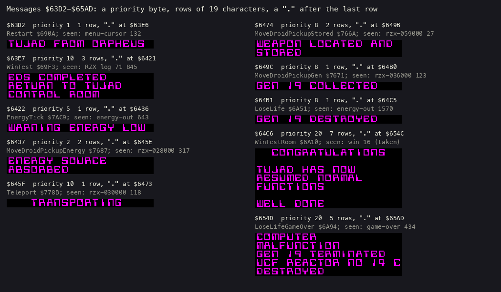

How to read the figure:

- **Each block** is one message: its address, priority, rows and the address of its `.`; under that, the code that
  queues it and the recording and frame where it was seen.
- **The magenta text** is the message drawn with the game's font, 19 characters a row, as the window shows it.
- **The point**: the priorities sort the messages into three ranks. 20 ends the game (win or loss), 8-10 reports an
  event the player caused, 1-5 is background.

```bash
python3 tools/fig_text.py messages    # docs/img/text/messages.png
```

The point: the message window is the game's only narrator. The rows are padded with spaces to 19 characters, so
TRANSPORTING and CONGRATULATIONS are centred by the text itself, not by the code.

## 8.8 The scroller and the queue

Two pieces of code share the window:

- **QueueMessage `$6ACD`** takes a message only if its priority is above ScrollPriority `$63CB`. It then sets
  ScrollPriority to that priority and ScrollNext `$63C9` to the first row. It does not touch the window.
- **InterruptScroll `$9640`**, part of every interrupt, counts ScrollDelay `$63CD` down. At 0 it makes one step:
  ScrollLine `$63CC` + 1 (0-7), the window's 31 lower lines copied up one, and the new bottom line drawn from the text
  (19 font bytes). The delay is 5 interrupts, 15 after the step that makes ScrollLine 0. So 8 lines, one text row, take
  7 x 5 + 15 = 50 interrupts, 1 s.

At the step with ScrollLine 0 the scroller decides what comes next:

- the text goes on if the next byte is not `.`: ScrollText moves to the next row;
- at the `.` or with no text, a waiting message (ScrollPriority not 0) is taken: ScrollText = ScrollNext,
  ScrollPriority = 0;
- with none waiting, ScrollText = 0. The window keeps scrolling, and line 31, no longer rewritten, is copied up: the
  blank line under the last row wipes the window.

So a message waits for the end of the current one, then for a row boundary (up to 50 interrupts). While it waits, a
message of higher priority replaces it. Once taken, ScrollPriority is 0 again, so any message can queue behind it.

```text
QueueMessage(HL):
    if (HL) > ScrollPriority: ScrollPriority = (HL); ScrollNext = HL + 1

InterruptScroll, each interrupt:
    ScrollDelay -= 1; if not 0: return
    ScrollLine = (ScrollLine + 1) AND 7; ScrollDelay = ScrollLine == 0 ? 15 : 5
    copy lines 1-31 of the window to lines 0-30
    if ScrollText != 0:
        line 31 = for 19 characters: (Font - $101 + 8 x code + ScrollLine)
        if ScrollLine != 0: return
        ScrollText += 19
        if (ScrollText) != '.': return
    if ScrollPriority != 0 and ScrollLine == 0:
        ScrollText = ScrollNext; ScrollPriority = 0
    elif ScrollPriority == 0:
        ScrollText = 0
```

```text
6ACD  46            LD B,(HL)            ; QueueMessage
6ACE  3A CB 63      LD A,(ScrollPriority)
6AD1  B8            CP B
6AD2  D0            RET NC               ; not above the one waiting
6AD3  78            LD A,B
6AD4  32 CB 63      LD (ScrollPriority),A
6AD7  23            INC HL
6AD8  22 C9 63      LD (ScrollNext),HL
6ADB  C9            RET
```

```text
9640  21 CD 63      LD HL,ScrollDelay    ; InterruptScroll
9643  35            DEC (HL)
9644  C2 E7 96      JP NZ,InterruptTimers
9647  36 05         LD (HL),$05
9649  3A CC 63      LD A,(ScrollLine)
964C  3C            INC A
964D  E6 07         AND $07
964F  32 CC 63      LD (ScrollLine),A
9652  FE 00         CP $00
9654  20 02         JR NZ,InterruptScrollStep
9656  36 0F         LD (HL),$0F          ; 15 after line 0
9658  21 2C 40      LD HL,Screen+44      ; InterruptScrollStep: the window $402C
965B  11 2C 41      LD DE,Screen+300     ; one line below
965E  06 1F         LD B,$1F             ; 31 lines of 19 bytes
...
968C  22 CE 63      LD (ScrollScreen),HL ; line 31
968F  2A C7 63      LD HL,(ScrollText)
9692  7C            LD A,H
9693  B5            OR L
9694  28 35         JR Z,InterruptScrollEnd
9696  3A CC 63      LD A,(ScrollLine)
9699  11 01 DF      LD DE,Font-$0101
969C  83            ADD A,E
969D  5F            LD E,A
969E  06 13         LD B,$13             ; 19 characters
96A0  7E            LD A,(HL)            ; InterruptScrollChar
...
96B2  19            ADD HL,DE
96B3  7E            LD A,(HL)            ; the glyph's line
96B4  2A CE 63      LD HL,(ScrollScreen)
96B7  77            LD (HL),A
...
96BD  10 E1         DJNZ InterruptScrollChar
96BF  3A CC 63      LD A,(ScrollLine)
96C2  FE 00         CP $00
96C4  20 21         JR NZ,InterruptTimers
96C6  7E            LD A,(HL)
96C7  FE 2E         CP $2E
96C9  20 19         JR NZ,InterruptScrollSet ; the next row
96CB  3A CB 63      LD A,(ScrollPriority) ; InterruptScrollEnd
96CE  FE 00         CP $00
96D0  28 0F         JR Z,InterruptScrollNone
96D2  3A CC 63      LD A,(ScrollLine)
96D5  FE 00         CP $00
96D7  20 0E         JR NZ,InterruptTimers
96D9  32 CB 63      LD (ScrollPriority),A ; taken: priority 0
96DC  2A C9 63      LD HL,(ScrollNext)
96DF  18 03         JR InterruptScrollSet
96E1  21 00 00      LD HL,$0000          ; InterruptScrollNone
96E4  22 C7 63      LD (ScrollText),HL   ; InterruptScrollSet
```

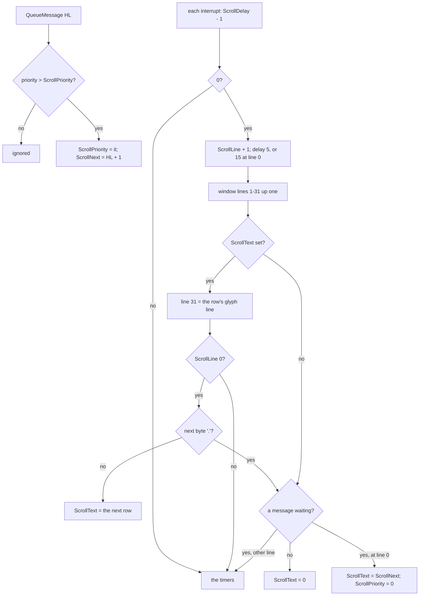

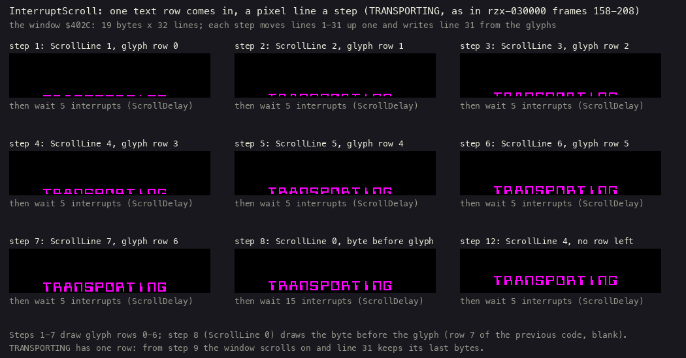

How to read the figure:

- **Each panel** is the 19 x 32 window after one step of the scroller, simulated from the code and the font for
  TRANSPORTING (as in `r30` frames 158-208), with ScrollLine and the glyph row that step drew.
- **Under each panel** is the wait before the next step: 5 interrupts, 15 after step 8.
- **The point**: a row arrives a line at a time from the bottom, glyph row 0 first. The eighth line is the blank row 7
  of the previous code, and the long wait after it lets the player read the row.

```bash
python3 tools/fig_text.py scroller    # docs/img/text/scroller.png
```

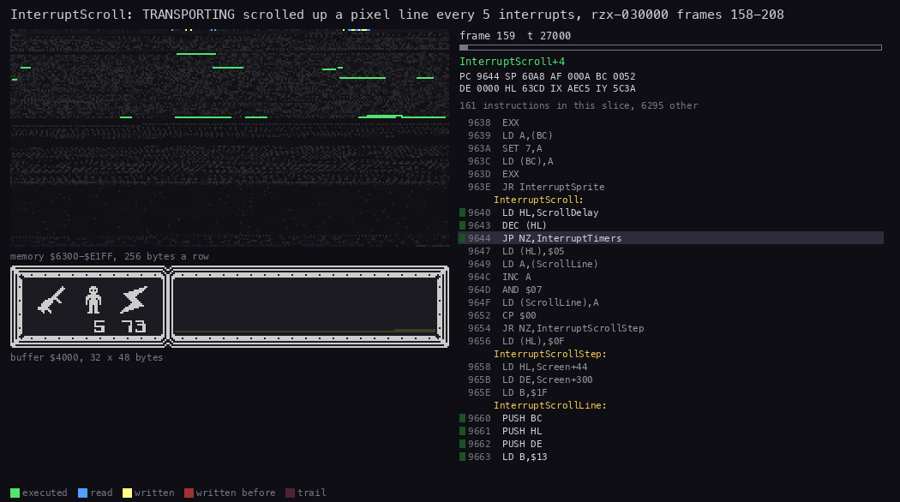

*The routine animation of InterruptScroll (`$9640-$96E6`) in `rzx-030000` from 158:27000 to 209:0. It has 51
pictures, one a frame (69 888 T). The view is the HUD's rows 0-5. Command, from the case folder after `. work/env.sh`:
`python3 ../../kit/routine_anim.py --work work/docs/tjD/r30 --listing build/game.lst --window 158:27000-209:0 --out
docs/img/routines/InterruptScroll.gif --pc 9640-96E6 --view buffer:4000:32x48:screen --range 6300-E1FF --step 69888
--delay 160`.*

How to read the animation: each picture is one frame of the interrupt. In most the scroller only counts ScrollDelay
down (`$9640-$9644`). Every fifth frame, and once after a 15-frame pause, the whole window moves up a line: the memory
map lights the window's reads and writes and the font's 19 reads. TRANSPORTING rises from the bottom, one pixel line
a step, over the 50 frames.

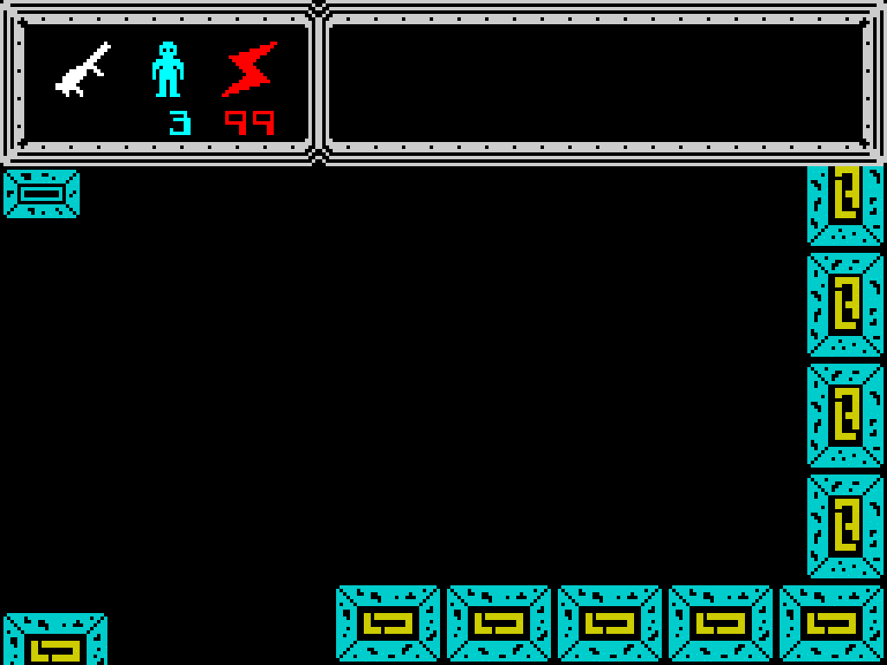

*The screen of `menu-cursor` from frame 130 to 230, one picture each 2 frames, each the screen at its frame's start.
Command: `python3 ../../kit/screen_anim.py --work work/docs/tjD/menu-cursor --from 130 --to 230 --step 2 --scale 4
--delay 100 docs/img/play/message-tujad.gif`.*

How to read the animation: Restart queues TUJAD FROM ORPHEUS at frame 132. The window is empty until frame 159, the
next row boundary, when the scroller takes it. The text rises for 50 frames and stands at the bottom row at 209;
then, with no text left, the window goes on scrolling it up and out.

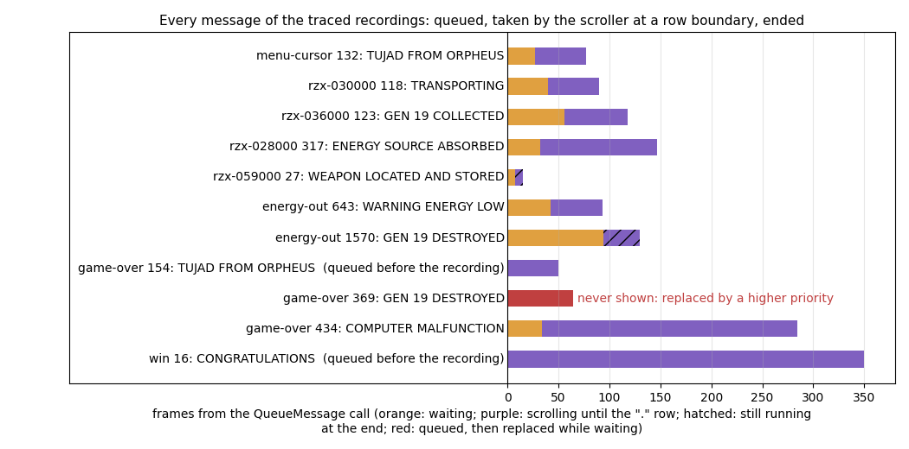

How to read the figure:

- **Each bar** is one message of one recording, labelled with the recording, the frame of its QueueMessage and the
  message.
- **Orange** is the wait from QueueMessage to the step that took it; **purple** is the scroll until its `.` row has
  come in; hatched means still running at the end of the window.
- **Red** is a message queued and then replaced while it waited.
- **The point**: a message waits 8 to 56 interrupts (94 frames when the death stops them), a row takes 50 frames, and the game over's GEN 19 DESTROYED never
  appears: COMPUTER MALFUNCTION (priority 20) replaced it.

```bash
python3 tools/fig_text.py timing      # docs/img/text/message-timing.png
```

Worked example: `game-over`. LoseLife queues GEN 19 DESTROYED (priority 8) at frame 369, while TUJAD FROM ORPHEUS
(taken earlier, ScrollPriority 0) is still in the window. DeathEffect then runs 64 frames with no interrupt, so the
scroller stands still. At frame 434 LoseLifeGameOver sets ScrollPriority to 0 and queues COMPUTER MALFUNCTION (20):
ScrollNext now points at it. At frame 468, a row boundary, the scroller takes MALFUNCTION; its 5 rows end at frame
718, 250 frames later. GEN 19 DESTROYED was never shown.

Witness, from the traced events (queued, taken, ended):

| Recording | Message | Queued | Taken | Ended |
| --- | --- | ---: | ---: | ---: |
| `menu-cursor` | TUJAD FROM ORPHEUS | 132 | 159 | 209 |
| `r30` | TRANSPORTING | 118 | 158 | 208 |
| `rzx-036000` | GEN 19 COLLECTED | 123 | 179 | 240 |
| `rzx-028000` | ENERGY SOURCE ABSORBED | 317 | 349 | 464 |
| `rzx-059000` | WEAPON LOCATED AND STORED | 27 | 35 | after 43 |
| `energy-out` | WARNING ENERGY LOW | 643 | 684 | 735 |
| `energy-out` | GEN 19 DESTROYED | 1570 | 1664 | after 1700 |
| `game-over` | GEN 19 DESTROYED | 369 | never | - |
| `game-over` | COMPUTER MALFUNCTION | 434 | 468 | 718 |
| `win` | CONGRATULATIONS | before 0 | 16 | 366 |

ENERGY SOURCE ABSORBED took 115 frames for two rows, not 100: 15 interrupts were lost in that stretch, and the
scroller counts interrupts, not frames. GEN 19 DESTROYED in `energy-out` waited 94 frames, 64 of them
the death with no interrupt. Which passes lose an interrupt, and why, is in
[4.6](04-game-loop.md#46-interrupts-on-and-off) and [4.7](04-game-loop.md#47-passes-and-interrupts-a-frame); the
seam the copy can leave on screen is in [6.11](06-rendering.md#611-flicker-measured).

The point: the queue holds one message. A higher priority can replace a waiting message, but nothing interrupts one
already scrolling.

## 8.9 The menu texts

Menu `$8854` draws the menu once, then polls the keys. It draws:

- the frame of 16 x 16 MenuFrame blocks round the screen (Blit16);
- the logo twice, at `$4064` and `$4078` (MenuLogo `$89E5`: the block MenuLogoGraphic three times and its lower half
  twice, then 4 x 7 cells from MenuLogoAttrs `$8D96`);
- the five texts of MenuTexts `$8D38` with PrintText:

| Text | Address | Screen | Row, column | Colour | Lit |
| --- | --- | --- | --- | --- | --- |
| TUJAD | `$8D38` | `$40CD` | 6, 13 | `$47` | - |
| 1   KEYBOARD | `$8D3E` | `$4886` | 12, 6 | `$43` | `$C3` |
| 2   CURSOR JOYSTICK | `$8D4B` | `$48C6` | 14, 6 | `$45` | `$C5` |
| 3   KEMPSTON JOYSTICK | `$8D5F` | `$5006` | 16, 6 | `$46` | `$C6` |
| 0   START GAME | `$8D75` | `$5066` | 19, 6 | 7 | - |

MenuPoll `$893B` stirs Random once a loop and reads the keys: 1, 2 or 3 set Controls `$63C2` to `$80`, `$40` or 0 and
light their line. Lighting writes the line's attributes: the chosen one with FLASH and BRIGHT (`$C3`, `$C5` or
`$C6`), the other two back to their plain colours. 0 returns, and Restart starts the game.

```text
Menu:
    the frame (Blit16 x 32), the logo at $4064 and $4078
    PrintText each of the five texts
    light the line of the current Controls
    repeat:
        Random()
        1: Controls = $80, light line 1;  2: $40, line 2;  3: 0, line 3
    until 0 pressed
```

```text
88F6  21 38 8D      LD HL,MenuTexts
88F9  11 CD 40      LD DE,Screen+205     ; $40CD
88FC  3E 47         LD A,$47
88FE  CD B4 8A      CALL PrintText
8901  21 3E 8D      LD HL,MenuTextKeyboard
8904  11 86 48      LD DE,Screen+2182    ; $4886
8907  3E 43         LD A,$43
8909  CD B4 8A      CALL PrintText
...
8968  21 86 59      LD HL,Attributes+390 ; MenuLightKeyboard: line 1 lit
896B  11 87 59      LD DE,Attributes+391
896E  01 0B 00      LD BC,$000B
8971  36 C3         LD (HL),$C3
8973  ED B0         LDIR
8975  21 C6 59      LD HL,Attributes+454 ; line 2 plain
...
897E  36 45         LD (HL),$45
```

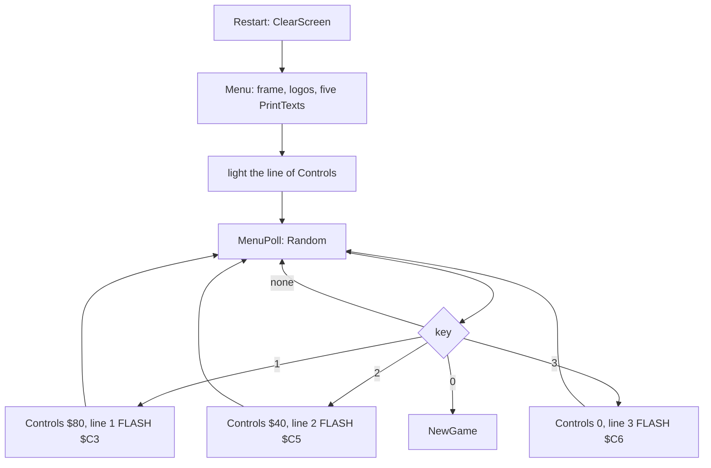

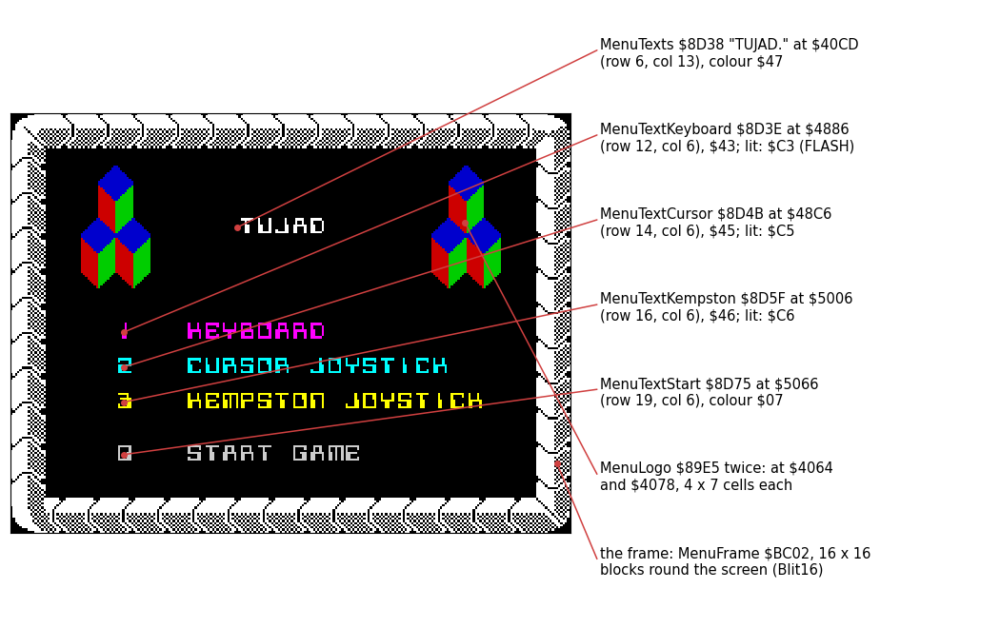

How to read the figure:

- **The screen** is the menu screenshot (`c1` frame 13 950).
- **Each label** names a text or a drawn part, its data address, its screen address, its row and column and its
  colour; the red line ends on the part.
- **The point**: the menu is five PrintText lines in a frame of Blit16 blocks; the choice is shown only by
  attributes.

```bash
python3 tools/fig_text.py menu        # docs/img/text/menu.png
```

Worked example: pressing 2 in `menu-cursor`. MenuPoll reads `$F7FE` with bit 1 low, sets Controls = `$40` and jumps to
MenuLightCursor. It writes 12 cells of `$43` from `$5986` (line 1 back to plain), 19 cells of `$C5` from `$59C6` (line
2 flashing) and 21 cells of `$46` from `$5A06`: BC + 1 each (`LD (HL)` writes the first cell, `LDIR` copies it BC =
`$0B` / `$12` / `$14` times), the length of each line. The pixels are not touched.

The point: MenuTexts ends with a sixth line, `© 1986 ORPHEUS LTD` at `$8D85`, which no code prints. Its `©` is the
ROM font's `$7F`, a code the game's font does not have.

## 8.10 The progress screen

ProgressScreen `$8F53` shows the ED circuit: 50 pieces in 10 columns by 5 rows. It runs in three cases:

- **a piece taken** (EdPickup `$7703`, A = the piece number 1-50): it sets the piece's bit, draws the picture and
  flashes the new piece;
- **the win** (A = 0): the picture, no flash;
- **the game over** (A = `$FF`): the picture and YOU HAVE COMPLETED nn% OF TUJAD.

The steps:

1. The sprite list is emptied, interrupts enabled, EnergyTimer set to 0 (the energy stops), the percentage set to 0.
2. A piece n sets bit (n - 1) mod 5 of EdFlags `$6681` + (n - 1) / 5.
3. The play area is cleared and coloured `$31` (blue on yellow).
4. For each of the 5 rows (bit 0 to 4) and 10 columns (EdFlags bytes 0 to 9): a piece taken is blitted from EdPieces
   `$E1E2` (tile = row x 10 + column) and coloured `$67` (white on green, bright), and the percentage gains 2 (BCD); a
   piece missing gets only the colour `$28` (black on cyan), no pixels. The picture starts at `$4886` (row 12, column
   6), 2 cells a tile.
5. For a new piece: its 2 x 2 cells alternate `$67` and `$64` (green on green: invisible) 9 times, each with a delay of
   50 000 x 26 T. The writes are `$67`, `$64`, ... `$67`; the cells already hold `$67` from ProgressCell, so the
   first write is a repeat: the screen shows 8 changes, the tile plain green 4 times, ending with its picture.
6. EnergyTimer is reloaded from EnergyReload (the energy runs again), Shot cleared. For the game over, the percentage is
   printed.

```text
ProgressScreen(A):
    SpriteList empty; EI; EnergyTimer = 0; Percent = 0
    if A is a piece n: EdFlags[(n - 1) / 5] |= 1 << ((n - 1) mod 5)
    ClearPlayArea; play-area attributes = $31
    for row 0..4, column 0..9:
        if EdFlags[column] bit row: Blit16(EdPieces + 32 x (row x 10 + column)); colour $67; Percent += 2
        else: colour $28
    if A is a piece: 9 times: the piece's cells $67 / $64; wait 1 300 000 T
    EnergyTimer = EnergyReload; Shot = 0
    if A == $FF: ProgressPercent
    DI
```

```text
8F8A  CD 17 79      CALL ClearPlayArea   ; ProgressDraw
8F8D  21 C0 58      LD HL,Attributes+192
8F90  11 C1 58      LD DE,Attributes+193
8F93  01 3F 02      LD BC,$023F
8F96  36 31         LD (HL),$31
8F98  ED B0         LDIR
8F9A  21 86 48      LD HL,Screen+2182    ; the picture at $4886
8F9D  22 B2 63      LD (RoomRecordPtr),HL
8FA0  11 E2 E1      LD DE,EdPieces
8FA3  01 01 05      LD BC,$0501          ; 5 rows, bit mask 1
8FA6  C5            PUSH BC              ; ProgressRow
8FA7  21 81 66      LD HL,EdFlags
8FAA  06 0A         LD B,$0A             ; 10 columns
8FAC  7E            LD A,(HL)            ; ProgressPiece
8FAD  A1            AND C
8FAE  23            INC HL
...
8FB2  0E 67         LD C,$67
8FB4  20 07         JR NZ,ProgressPieceTaken
8FB6  0E 28         LD C,$28             ; missing: colour only
8FB8  CD 93 90      CALL ProgressCell
8FBB  18 12         JR ProgressPieceNext
8FBD  3A 92 90      LD A,(ProgressPercentBcd) ; ProgressPieceTaken
8FC0  C6 02         ADD A,$02
8FC2  27            DAA
8FC3  32 92 90      LD (ProgressPercentBcd),A
8FC6  2A B2 63      LD HL,(RoomRecordPtr)
8FC9  CD 93 8A      CALL Blit16
8FCC  CD 93 90      CALL ProgressCell
...
9013  C5            PUSH BC              ; ProgressFlash, 9 times
9014  06 02         LD B,$02
9016  E5            PUSH HL
9017  3A B2 63      LD A,(RoomRecordPtr)
901A  77            LD (HL),A            ; ProgressFlashCell
901B  2C            INC L
901C  77            LD (HL),A
901D  19            ADD HL,DE
901E  10 FA         DJNZ ProgressFlashCell
9020  E1            POP HL
9021  EE 03         XOR $03              ; $67 and $64 in turn
9023  32 B2 63      LD (RoomRecordPtr),A
9026  01 50 C3      LD BC,$C350          ; 50 000
9029  0B            DEC BC               ; ProgressDelay
902A  78            LD A,B
902B  B1            OR C
902C  20 FB         JR NZ,ProgressDelay
902E  C1            POP BC
902F  10 E2         DJNZ ProgressFlash
```

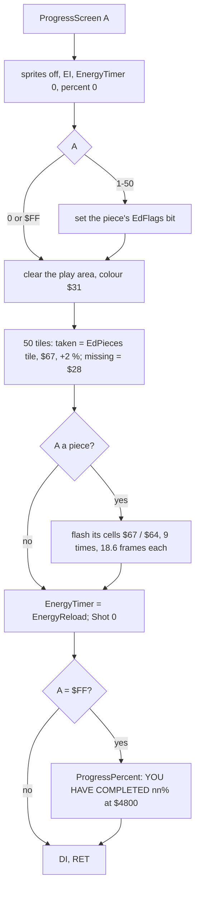

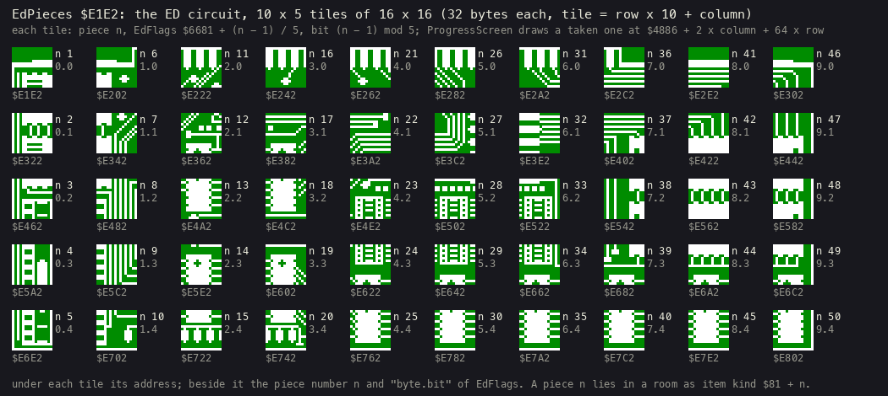

How to read the figure:

- **Each tile** is one EdPieces entry, 3 times larger, white on green, at its place in the picture; under it its
  address.
- **Beside it** the piece number n and "byte.bit" of its EdFlags bit. n runs down the columns: n = column x 5 + row + 1.
- **The point**: the picture is a circuit board cut into 50 squares. The pieces are numbered down the columns, so
  piece 37 is in column 7, row 1.

```bash
python3 tools/fig_text.py progress    # docs/img/text/progress.png
```

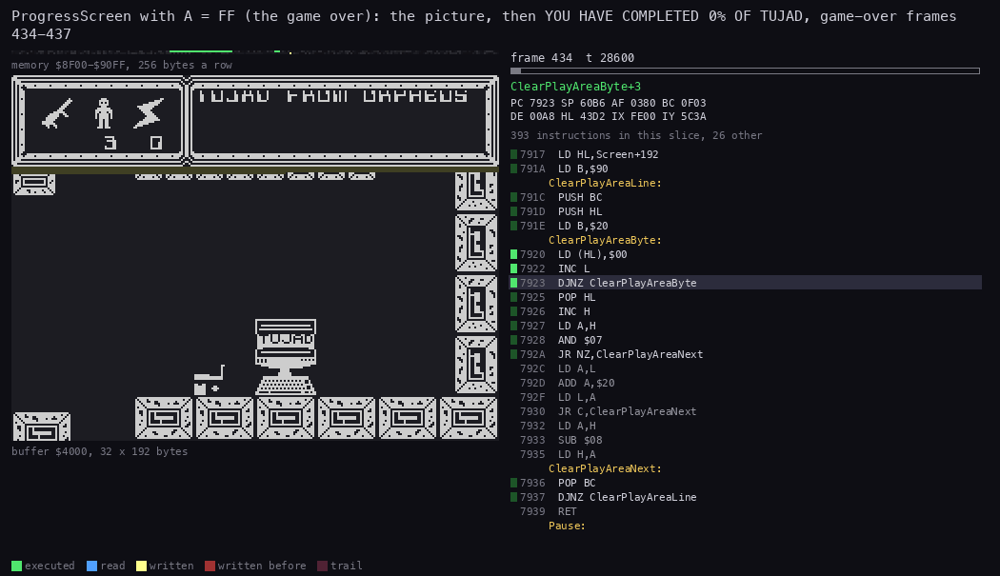

*The routine animation of ProgressScreen with Blit16, ClearPlayArea and PrintText (`$8F53-$90B9`, `$8A93-$8AB3`,
`$7917-$793B`, `$8AB4-$8AE7`, `$8A79-$8A92`) in `game-over` from 434:23000 to 438:5000. It has 47 pictures, one each
5600 T. The view is the whole screen. Command, from the case folder after `. work/env.sh`: `python3
../../kit/routine_anim.py --work work/docs/tjD/game-over --listing build/game.lst --window 434:23000-438:5000 --out
docs/img/routines/ProgressScreen.gif --pc 8F53-90B9,8A93-8AB3,7917-793B,8AB4-8AE7,8A79-8A92 --view
buffer:4000:32x192:screen --range 8F00-90FF --step 5600 --delay 120`.*

How to read the animation: ClearPlayArea wipes rows 6-23 a pixel line at a time (each line of the 18 rows), then
the `LDIR` paints them yellow. The 50 tiles follow, all cyan: in this recording no piece was taken. Last, PrintText
writes YOU HAVE COMPLETED 0% OF TUJAD across row 8.

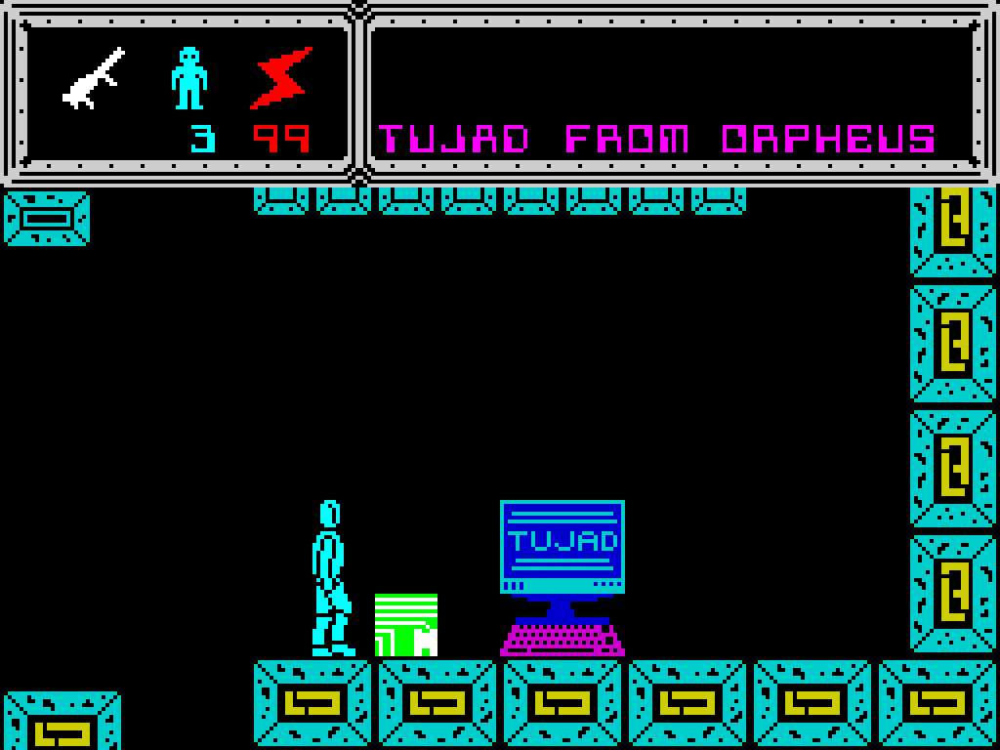

*The screen of `menu-cursor` from frame 224 to 420, one picture each 4 frames, each the screen at its frame's start.
Command: `python3 ../../kit/screen_anim.py --work work/docs/tjD/menu-cursor --from 224 --to 420 --step 4 --scale 4
--delay 120 docs/img/play/progress-flash.gif`.*

How to read the animation: the droid takes piece 37 at frame 225 (the pickup tone), and the picture appears with its
one taken tile at column 7, row 1. That tile goes plain green and back 4 times (9 colour writes, the first a repeat: 8
changes, about 20 frames apart); then the room comes back at frame 424. The message window keeps scrolling: the interrupt runs throughout.

Worked example: piece 37 (item kind `$A6`). EdPickup clears bit 7 and subtracts 1: A = `$25` = 37. ProgressByte steps
HL while A is 6 or more, taking 5 each time: 7 times, so HL = EdFlags + 7 and A = 2. ProgressBit turns C = `$80` left
twice: C = 2, bit 1. EdFlags + 7 gets bit 1: column 7, row 1, the tile 1 x 10 + 7 = 17 at `$E1E2` + 17 x 32 = `$E402`.
The percentage counts 2 for it. The flash delay is 50 000 x 26 T = 1 300 000 T, 18.6 frames; the measured blinks in
`menu-cursor` come about 20.4 frames apart, the interrupts (enabled) adding their time.

Witness: L1 counts 36 ProgressScreen calls (35 pieces, 1 game over) and 1800 ProgressCell calls. In `menu-cursor` the
main loop stopped from frame 225 to 424 (PassTick, 9.3 of [09](09-sound.md)).

The point: the progress screen is the game's map of its goal, and the percentage is counted from the picture as it
is drawn, not kept anywhere.

## 8.11 The win and the game over

The game ends in two ways, both through the scroller and the progress screen.

**The win.** WinTest `$69E3` checks that the ten EdFlags bytes are all `$1F` (all 50 pieces). The first time, it sets
an eleventh byte to `$1F` and queues EDS COMPLETED. Then WinTestRoom `$69F9`, once the droid is in room `$54` (the
control room):

1. clears the attributes `$5885-$5889` to 0, which hides the lives and energy digits (row 4, columns 5-9);
2. stops the energy (EnergyTimer 0), sets ScrollPriority to 0 and queues CONGRATULATIONS (20);
3. waits `$FDE8` x 26 T (24 frames) in WinDelay with interrupts still off (the main loop's DI at `$796E`), so the
   scroller does not move yet and the picture is still the room;
4. calls ProgressScreen with A = 0: the full picture;
5. enables interrupts and HALTs 512 times (10.2 s) while the 7 rows scroll;
6. drops its return address and jumps to Restart: the menu.

**The game over.** LoseLife finds Lives `$99` after the decrement and goes to LoseLifeGameOver `$6A83`. It does the
same with COMPUTER MALFUNCTION and ProgressScreen A = `$FF`, which ends with ProgressPercent printing YOU HAVE
COMPLETED nn% OF TUJAD at `$4800` in `$31`, then 512 HALTs and Restart.

ProgressScreen reloads EnergyTimer at its end, so the energy runs again under the hidden digits: in `game-over` it goes
from 99 to 98 at frame 687 and to 97 at 937; in `win` from 19 to 17 during the wait.

```text
WinTestRoom (LoseLifeGameOver is the same with MALFUNCTION and A = $FF, no WinDelay):
    if Room != $54: return
    attributes $5885-$5889 = 0
    EnergyTimer = 0; ScrollPriority = 0
    QueueMessage(CONGRATULATIONS)
    wait $FDE8 x 26 T
    ProgressScreen(0)
    EI; 512 x HALT
    discard the return address; JP Restart
```

```text
69F9  3A 63 63      LD A,(Room)          ; WinTestRoom
69FC  FE 54         CP $54
69FE  C0            RET NZ
69FF  21 85 58      LD HL,Attributes+133 ; row 4, columns 5-9
6A02  06 05         LD B,$05
6A04  36 00         LD (HL),$00          ; WinClearRow
6A06  2C            INC L
6A07  10 FB         DJNZ WinClearRow
6A09  AF            XOR A
6A0A  32 66 63      LD (EnergyTimer),A
6A0D  32 CB 63      LD (ScrollPriority),A
6A10  21 C6 64      LD HL,MsgCongratulations
6A13  CD CD 6A      CALL QueueMessage
6A16  01 E8 FD      LD BC,$FDE8
6A19  0B            DEC BC               ; WinDelay
6A1A  78            LD A,B
6A1B  B1            OR C
6A1C  20 FB         JR NZ,WinDelay
6A1E  AF            XOR A
6A1F  CD 53 8F      CALL ProgressScreen
6A22  FB            EI
6A23  01 02 00      LD BC,$0002          ; 2 x 256 HALTs
6A26  76            HALT                 ; WinWait
6A27  10 FD         DJNZ WinWait
6A29  0D            DEC C
6A2A  20 FA         JR NZ,WinWait
6A2C  C1            POP BC
6A2D  C3 00 69      JP Restart
```

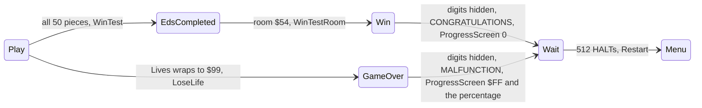

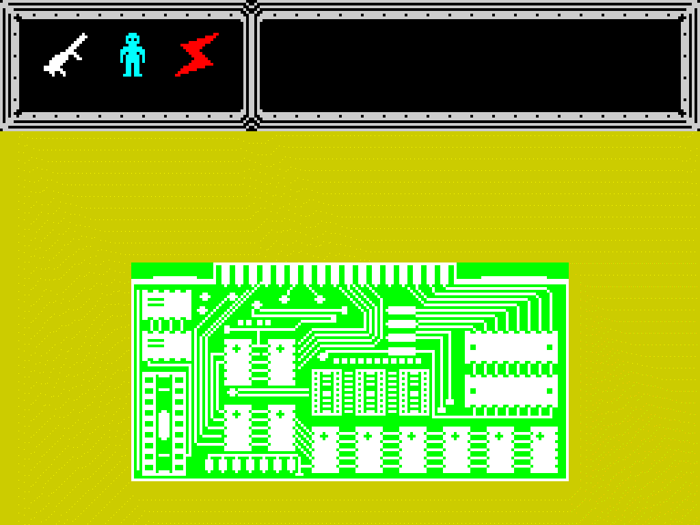

*The screen of `win` from frame 0 to 500, one picture each 10 frames, each the screen at its frame's start. Command:
`python3 ../../kit/screen_anim.py --work work/docs/tjD/win --from 0 --to 500 --step 10 --scale 4 --delay 140
docs/img/play/win-congratulations.gif`.*

How to read the animation: the full circuit is on the screen, every tile white on green. The digits under the GEN 19
and energy icons are gone. CONGRATULATIONS, a blank row, TUJAD HAS NOW / RESUMED NORMAL / FUNCTIONS, a blank row and
WELL DONE rise through the window, one row a second, from frame 16 to 366.

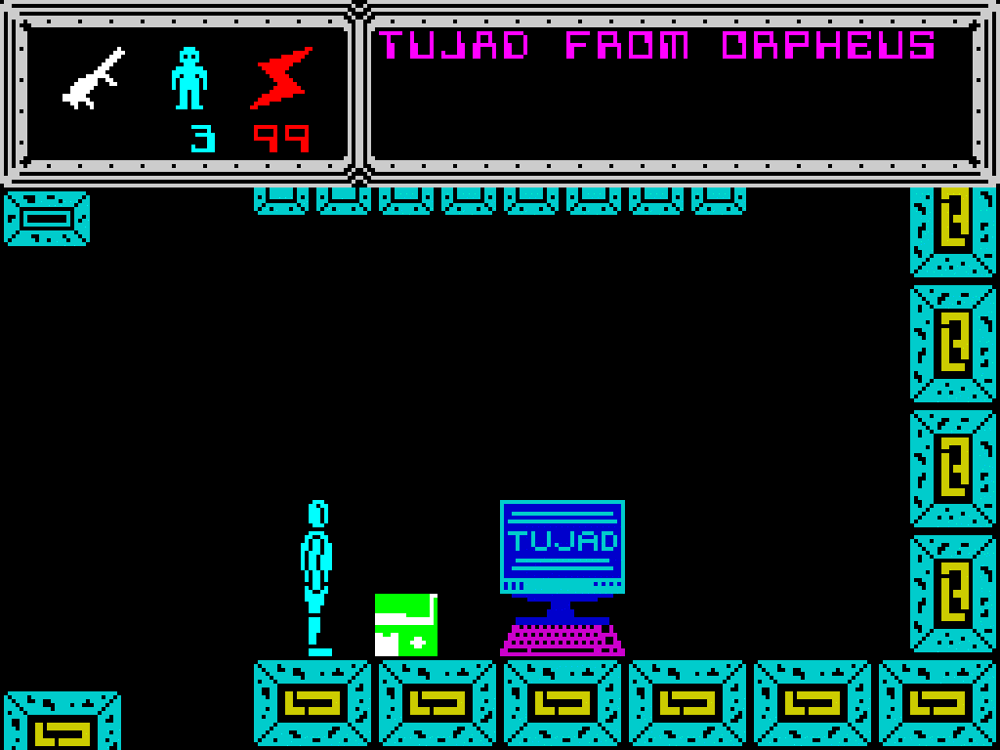

*The screen of `game-over` from frame 360 to 960, one picture each 12 frames, each the screen at its frame's start.
Command: `python3 ../../kit/screen_anim.py --work work/docs/tjD/game-over --from 360 --to 960 --step 12 --scale 4
--delay 140 docs/img/play/game-over.gif`.*

How to read the animation: the droid shakes apart (the death, frames 369-433). The progress screen comes up empty
with YOU HAVE COMPLETED 0% OF TUJAD on row 8. COMPUTER MALFUNCTION / GEN 19 TERMINATED / UCF REACTOR NO 14 C /
DESTROYED scrolls from frame 468. The menu returns at frame 954.

Worked example: the game over's timing. LoseLifeGameOver enters at frame 434; ProgressScreen runs to about frame 438
(the animation of 8.10). The 512 HALTs then take 512 frames: 438 + 512 = 950, and Restart's ClearScreen and Menu
print the menu at 954 (the PrintText animation of 8.3). The win's WinDelay of 65 000 x 26 = 1 690 000 T is 24 frames.

Witness: in `game-over` the attributes `$5885-$5889` are 0 from frame 434 (game-over-message.png in
[WALKTHROUGH](../WALKTHROUGH.md) shows the panel without digits); EnergyTickStep still ran at frames 687 and 937.

The point: both endings are a message of priority 20 over the progress picture, then ten seconds of waiting. The game
hides the numbers that no longer matter but forgets to stop the energy.

## 8.12 The data sheet of the texts

| Text | Address | Bytes | Printer | Where | Colour |
| --- | --- | ---: | --- | --- | --- |
| Messages (10) | `$63D2-$65AD` | 476 | InterruptScroll | the window `$402C`, rows 1-4, columns 12-30 | `$43` (DrawHud) |
| MenuTexts (5 + 1 unused) | `$8D38-$8D95` | 94 | PrintText | rows 6, 12, 14, 16, 19 | `$47`, `$43`, `$45`, `$46`, 7 |
| ProgressText | `$9072-$9091` | 32 | PrintText (ProgressPercent `$9046`) | `$4800`, row 8, columns 0-31 | `$31` |
| ProgressPercentBcd | `$9092` | 1 | its digits at ProgressText + 19, + 20 | - | - |
| HUD numbers | Ammo `$636A-$636C`, Lives `$636D`, Energy `$636E` | 5 | PrintBcd | `$4082`, `$4085`, `$4088` | the field's |
| Font | `$E002-$E1E1` | 480 | Print8, the scroller | - | - |
| HudGraphics | `$8BFD-$8C54` | 88 | Print8 (DrawHud) | rows 0-5 | 7 |
| HudIcons | `$8C55-$8D34` | 224 | Blit16 (DrawHud, ShowWeapon, DrawItem) | `$4422`, `$4425`, `$4428` | HudAttrs, the weapon's |
| HudAttrs | `$8BF5-$8BFC` | 8 | DrawHud (`LDIR`) | columns 2-9 of rows 1-4 | - |
| EdPieces | `$E1E2-$E821` | 1600 | Blit16 (ProgressScreen) | from `$4886` | `$67` / `$28` |

Variables: ScrollText `$63C7`, ScrollNext `$63C9`, ScrollPriority `$63CB`, ScrollLine `$63CC`, ScrollDelay `$63CD`,
ScrollScreen `$63CE`, PrintAttr `$8D37`, EnergyTimer `$6366`, EnergyReload `$6374`, EdFlags `$6681` (10 bytes and the
EDS COMPLETED latch).

## 8.13 Not reached and known only from the code

- **Not reached in the traced recordings**: EDS COMPLETED (priority 10). The RZX log queues it at frame 71 845 (doc
  10); none of the traced windows holds it.
- **Known only from the code**:
  - the copyright line `$8D85` is never printed;
  - the ammunition field changes when a weapon fires (FireWeapon1Ammo `$86EC`, FireWeapon2Ammo `$873A`, FireWeapon3Cell
    `$8693`): no traced window fired a weapon with ammunition;
  - a message of priority 10 or 8 queued while another of 20 waits is dropped; no recording shows it;
  - with all 50 pieces taken, ProgressPercentBcd (2 a piece, `ADD A,$02` / `DAA` at `$8FC0`) wraps to `$00`, so a
    game over after the last piece and before room 84 prints YOU HAVE COMPLETED 0%; no recording shows it;
  - the win's WinDelay (24 frames) and its ProgressScreen with A = 0 come from the code and the RZX log only: the
    `win` recording starts inside WinWait (`$6A26`).
- **Corrected in the sources at the integration** (once listed in `work/docs/tjD-src-changes.md`): the `.ann` of
  PrintBcd (one click per number), the comment of WinTestRoom and LoseLifeGameOver (the 5 attributes cleared hide the
  lives and energy digits), HazardFlash (`OR $40` is BRIGHT, not FLASH), and Restart (1-3 and 0).
