# 9. Sound

What this covers:

- the engine: the 48K beeper, eleven `OUT ($FE)` sites, ten of them live, no AY, no tune (9.1);
- how a toggle loop is timed, and why the same loop is slower in the display (9.2);
- each loop decoded: the pass tick (9.3), the digit click (9.4), the shield's buzz (9.5), the pickup tone (9.6), the two
  sweeps (9.7), the death (9.8) and the teleport (9.9);
- what the sounds cost and which interrupts the game loses while they play (9.10);
- the data sheet (9.11), the rendered sounds (9.12) and what no recording reached (9.13).

The names are those of `src/game/game.ann` ([Terms](README.md#terms)). The recordings it rests on, all on the 48K,
each opened from its stage-1 TTD session (`work/stage1/rec/NAME/session.ttd`) on the writer's own instance (port base
36960, muted):

- `rzx-030000` (`r30` below): frames 0-672. The droid steps on a teleporter at frame 117; the whole teleport runs to
  frame 616.
- `energy-out`: frames 540-1700. An enemy drains the energy to 0; the death of frame 1570.
- `menu-cursor`: frames 0-1201. The menu, a game start at frame 110, an ED piece at frame 227 (the progress screen),
  play, the shield held at frames 530-568.
- `rzx-036000`: frames 0-869. GEN 19 taken at frame 120; the shield at frames 271-273.
- `rzx-059000`: frames 0-43. A weapon taken at frame 25.

Every sound event of a window was taken from access traces, 100 frames at a time (`tools/sound_events.py`): each `OUT`
to port `$FE` with its value, T-state and PC, each entry of a sound routine with its registers and caller, each
interrupt entry. The figures and the audio files are drawn from those events by `tools/fig_sound.py`. No sound was
played aloud while writing this.

A frame is 69 888 T at 3.5 MHz, one interrupt a frame, 20 ms. A moment is "frame F T t", t counted from the frame's
interrupt. A trace puts an instruction in the frame in which it ran.

```bash
. work/env.sh
python3 ../../kit/rs.py open --work work/docs/tjD/r30 --ttd work/stage1/rec/rzx-030000/session.ttd --model 48K --port-base 36960
python3 tools/sound_events.py --work work/docs/tjD/r30 --frames 0-672 --chunk 100 --out work/docs/tjD/r30-events.json
python3 ../../kit/rs.py stop --work work/docs/tjD/r30
sh work/docs/tjD/run_traces.sh energy-out=540-1700 menu-cursor=0-1201 rzx-036000=0-869 rzx-059000=0-43
python3 tools/fig_sound.py table      # every site measured (the numbers below)
```

## 9.1 The engine

- **The beeper only.** Every sound is bit 4 of port `$FE` toggled by a loop of the game's own. No `OUT` goes to the AY
  ports `$FFFD`/`$BFFD`. The ROM's BEEPER is never called. Nothing reads the EAR bit.
- **No tune.** The game has no music: not on the menu, not on the progress screen, not at the win.
- **The border stays black.** Every write is `$00` or `$10`: bits 0-2 are always 0. Menu `$8854` sets the border to 0
  once, at `$88E2`.
- **BorderSound `$6375`** holds the next value to write for four of the loops (PassTick, HazardFlash, BeamDown,
  BeamUp). PassTick sets it to 0 at every pass. The other loops start from A = 0.
- **The interrupt makes no sound.** The IM 2 handler `$95D0` scrolls, draws sprites and counts timers. It calls the
  ROM's KEYBOARD, which writes no port.

| Site | Routine | Edges a call | Called by | When |
| --- | --- | ---: | --- | --- |
| `$7F79` | PassTick `$7F6D` | 2 | MainLoop `$6914` | every main-loop pass |
| `$7B68`, `$7B6C` | PrintBcd `$7B3F` | 50 | the HUD printers | each two-digit number printed |
| `$69D5` | HazardFlash `$699B` | 5 | MainLoop `$6923` | each pass while the shield is on (DroidFlags bit 4) |
| `$785A` | PickupTone `$7856` | 256 | PickupErase `$7837` | an item taken |
| `$7F51` | RiseSweep `$7F4D` | 220 | TeleportFlash `$8051` | the teleport, 18 calls |
| `$7F61` | FallSweep `$7F5D` | 256 | TeleportFlash, DeathEffect `$7ADF` | the teleport (18), a death (8) |
| `$7FD0` | BeamDown `$7F9C` | 30 a line | Teleport `$7719` | the beam into the teleporter |
| `$801A` | BeamUp `$8005` | 30 a line | Teleport | the beam out of it, in the new room |
| `$88E2` | Menu `$8854` | 0 | the menu | the border set to black |

ExitToBasic `$95C1` holds an eleventh `OUT ($FE)` (at `$95CD`) (`LD A,7; OUT ($FE),A`: a white border), but no code
reaches it ([02](02-architecture.md)).

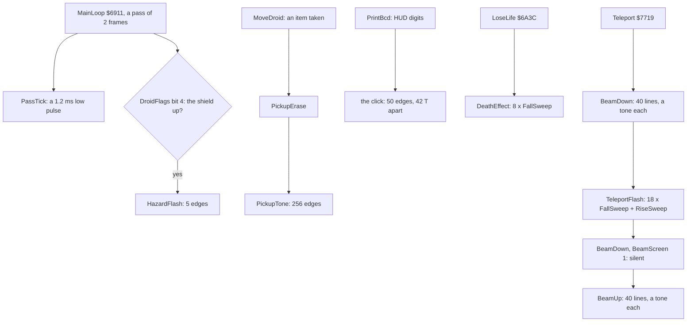

The point: one sound device, eight small loops. Each loop is a sound of its own; only FallSweep serves two meanings,
the death and the teleport.

## 9.2 The toggle loop and its timing

Every loop is the same pattern: `OUT ($FE),A`, `XOR $10`, a `DJNZ` delay, back. Its half period is the sum of the
opcodes between two `OUT`s. The loops differ only in the delay and in what wraps it.

Two things stretch the model:

- **Contended memory.** All the sound routines but BeamUp lie in `$4000-$7FFF`. While the ULA fetches the screen
  (T 14 336 to 57 343 of a frame), each fetch from that range waits. A loop that runs in the display is slower by
  about a third. The same loop in the border keeps the model's time to the T-state. BeamUp at `$8005` runs from
  uncontended memory and keeps its pitch.
- **The interrupt.** The main loop runs with interrupts off between its two HALTs (WaitFrame's `DI` at `$796E`), and
  the click of an energy step runs inside the interrupt handler. So PassTick, HazardFlash, PickupTone and the clicks
  are never interrupted; an INT that falls while they play is lost. The two sweeps disable interrupts themselves. Only
  the beams run with interrupts on (Teleport's `EI` at `$777E` and `$7825`): an interrupt that lands in a beam's delay
  lengthens it by the handler's time.

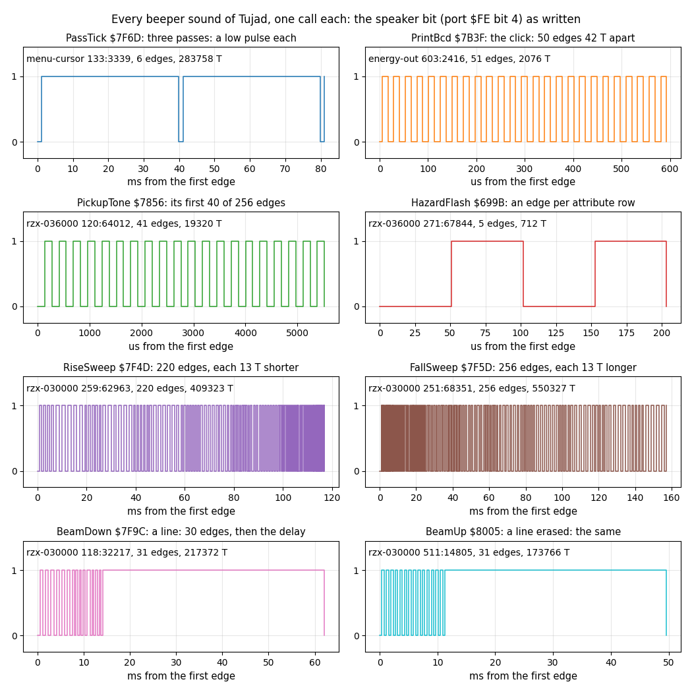

How to read the figure:

- **Each panel** is one call of one routine, as bit 4 of each `OUT ($FE)` held to the next write. The first line inside
  gives the recording, the frame and T-state of the first edge, the edge count and the span.
- **The x axis** is milliseconds or microseconds from the first edge.
- **PassTick** shows three passes: one low pulse each, two frames apart.
- **The point**: the eight sounds are one square wave with eight delay patterns. The sweeps change the delay each
  half period; the beam alternates a short tone with a long silence.

```bash
python3 tools/fig_sound.py shapes     # docs/img/sound/shapes.png
```

Witness: every site in the five recordings, from `tools/fig_sound.py table`. The gaps are between consecutive writes of
one call; the span is first write to last write.

| Site | Routine | Recording | Calls | Writes a call | Gap min | Gap median | Gap max | Span a call (T) |
| --- | --- | --- | ---: | ---: | ---: | ---: | ---: | --- |
| `$7F79` | PassTick | `menu-cursor` | 435 | 2 | 4206 | 4206 | 6406 | 4206-6406 |
| `$7B68` | PrintBcd | `energy-out` | 17 | 100 | 18 | 24 | 56 | 2076-3092 |
| `$785A` | PickupTone | `rzx-036000` | 2 | 256 | 483 | 483 | 760 | 152 341-152 347 |
| `$785A` | PickupTone | `rzx-059000` | 1 | 256 | 483 | 711 | 760 | 158 799 |
| `$69D5` | HazardFlash | `menu-cursor` | 20 | 5 | 247 | 261 | 288 | 1027-1072 |
| `$69D5` | HazardFlash | `rzx-036000` | 2 | 5 | 178 | 178 | 178 | 712 |
| `$7F51` | RiseSweep | `r30` | 18 | 220 | 59 | 1801 | 4425 | 407 239-411 434 |
| `$7F61` | FallSweep | `r30` | 18 | 256 | 46 | 2066 | 5126 | 545 722-550 327 |
| `$7F61` | FallSweep | `energy-out` | 8 | 256 | 46 | 1985 | 5125 | 545 734-550 331 |
| `$7FD0` | BeamDown | `r30` | 1 | 1200 | 1354 | 2043 | 198 660 | 9 142 320 |
| `$801A` | BeamUp | `r30` | 1 | 1200 | 1354 | 1354 | 161 856 | 7 271 275 |

PassTick's low half shows the contention plainly. It was 4206 T in the 365 passes where it fell in the border, and
6348 to 6406 T in the 70 where it fell in the display. BeamUp's median is its model, 1354 T. BeamDown's, 2043 T, is the
same loop in contended memory.

The point: the pitch of a Tujad sound depends on where in the frame it plays. Only BeamUp, by its address, is steady.

## 9.3 PassTick: the tick of every pass

MainLoop calls PassTick `$7F6D` right after its first WaitFrame. PassTick writes the speaker twice: 0, then `$10` 4206
T later. The speaker stays high until the next pass. So each pass makes one low pulse of 1.2 ms. A pass is two frames
([04](04-game-loop.md)), so the tick comes 25 times a second: the game's steady background buzz.

The code computes its delay from H with two subtractions and an addition, as if H carried a pitch from call to call.
But `LD H,$00` at the entry resets it. So every call computes the same two delays: `$FD` after the first write and 8
after the second.

```text
PassTick:
    BC = 2; BorderSound = 0; H = 0
    repeat BC times:
        OUT ($FE), BorderSound; BorderSound ^= $10
        HL = H x 256 - 2 x H + $FE          ; H = 0: $00FE; H = $FD: $FC04
        A = L - H; if no borrow: A -= 1      ; $FD, then 8
        H = A
        wait A x 16 T
```

```text
7F6D  01 02 00      LD BC,$0002          ; PassTick: two writes
7F70  AF            XOR A
7F71  32 75 63      LD (BorderSound),A
7F74  26 00         LD H,$00
7F76  3A 75 63      LD A,(BorderSound)   ; PassTickLoop
7F79  D3 FE         OUT ($FE),A
7F7B  EE 10         XOR $10
7F7D  32 75 63      LD (BorderSound),A
7F80  2E 00         LD L,$00
7F82  55            LD D,L
7F83  5C            LD E,H
7F84  A7            AND A
7F85  ED 52         SBC HL,DE
7F87  ED 52         SBC HL,DE
7F89  11 FE 00      LD DE,$00FE
7F8C  19            ADD HL,DE
7F8D  7D            LD A,L
7F8E  94            SUB H
7F8F  38 01         JR C,PassTickDelaySet
7F91  3D            DEC A
7F92  67            LD H,A               ; PassTickDelaySet
7F93  3D            DEC A                ; PassTickDelay
7F94  20 FD         JR NZ,PassTickDelay
7F96  0B            DEC BC
7F97  78            LD A,B
7F98  B1            OR C
7F99  20 DB         JR NZ,PassTickLoop
7F9B  C9            RET
```

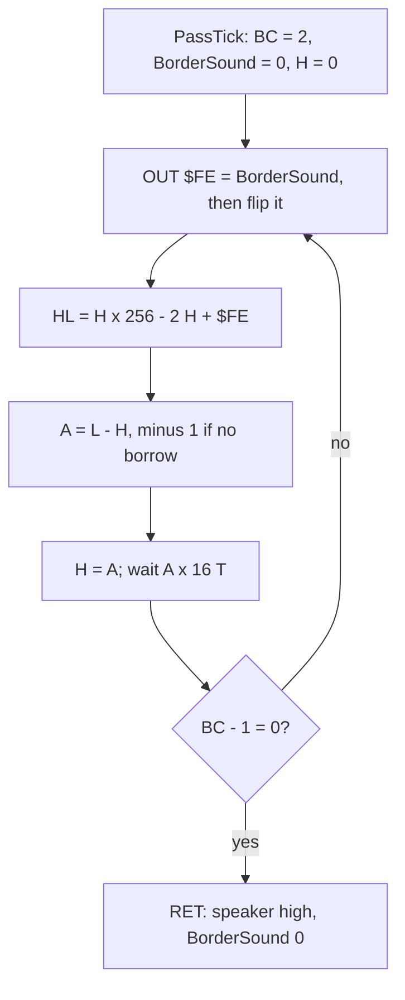

Worked example: the first write of a call is 0, and BorderSound becomes `$10`. With H = 0, HL = `$00FE`, and A = `$FE`
- 0 = `$FE` with no borrow, so A = `$FD`. From the first `OUT` to the second the opcodes add up to 113 T before the
delay, 253 x 16 - 5 = 4043 T of delay, and 50 T after it (`DEC BC` to the next `OUT`): 4206 T, the measured gap. The
second write puts `$10`. With H = `$FD`, HL = `$FD00` - `$01FA` + `$FE` = `$FC04`, and A = 4 - `$FC` with a borrow = 8:
a delay of 123 T, then `RET`. In `menu-cursor` frame 133 T 3339 the tick's low pulse is followed by two more, two frames
apart (the PassTick panel above).

Witness: PassTick ran once a pass in `menu-cursor`. Of the 434 intervals between its calls, 432 were 2 frames and one
was 3 (frames 606-609). The last one was 199 frames (225-424): the progress screen after the ED piece of frame 227,
which holds the main loop. The listing shows a constant delay, as the `.ann` now says (an earlier text spoke of "a pitch
from a running sum"; corrected, 9.13).

The point: the tick is the sound of the main loop itself. A slow pass (3 frames) is heard as a late tick.

## 9.4 The digit click

PrintBcd `$7B3F` prints a BCD byte as two digits. Before the first digit it runs a click: 50 passes of `OUT`, `XOR $10`,
`OUT`, `DJNZ`. The two `OUT`s of a pass write different values. The second `OUT` of a pass and the first of the next
write the same one. So the speaker moves once a pass, 42 T apart: 18 T from the first `OUT` to the second, 24 T back.
That is 50 edges of a 41.7 kHz square wave, 2100 T, 0.6 ms: a click, too high to be a tone.

The second digit has no click: one click per number, as the `.ann` now says ("after one click").

```text
PrintBcd(A byte, HL screen):
    high digit: 0 -> the ROM font's space $3D00, else Font - $100 + 8 x ($30 + digit)
    A = 0
    repeat 50 times:
        OUT ($FE), A; A ^= $10; OUT ($FE), A
    Print8(high digit); L += 1
    Print8(Font - $100 + 8 x ($30 + low digit))
```

```text
7B65  AF            XOR A                ; PrintBcdClick
7B66  06 32         LD B,$32             ; 50 passes
7B68  D3 FE         OUT ($FE),A          ; PrintBcdClickLoop
7B6A  EE 10         XOR $10
7B6C  D3 FE         OUT ($FE),A
7B6E  10 F8         DJNZ PrintBcdClickLoop
7B70  CD 79 8A      CALL Print8
```

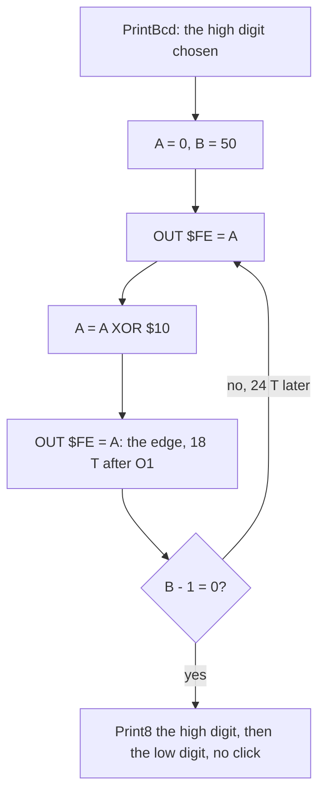

The click is heard every time a HUD number changes: an energy step, a life lost, an item's count, an ammunition count.
The energy steps make it regular. EnergyTick prints the energy every 250 interrupts (5 s) in play
([10](10-gameplay-logic.md)). EnergyReload is `$0A` under the shield (`$7368`) and for TouchTimer (50 interrupts) after
an enemy touch (`$75D0-$75DA`). Each touching pass sets EnergyTimer back to 10, so the click comes 10 interrupts after
the last touch, then every 10: in `energy-out` at frames 603, 613, 623, 633 and 643. The buzz of 9.5 is the shield's
(HazardFlash); a touch has none.

Worked example: `energy-out` frame 603 T 2416, EnergyTick prints the energy. The 100 writes go 18, 24, 18, 24, ... T
apart. The first edge to the 50th is 2076 T (49 x 42 + 18). The PrintBcd animation in
[08](08-hud-and-text.md#84-printbcd-and-the-hud-numbers) shows the loop's 50 passes as the highlight held on
`$7B68-$7B6E` before the digits appear.

Witness: the 17 PrintBcd calls of `energy-out` frames 540-1700 all wrote 100 times. Those that ran in the border
(EnergyTick at about T 2500 of its frame) spanned exactly 2076 T. The 4 that started in the display spanned 2595 to 3092
T, with gaps of up to 56 T: the code at `$7B68` is in contended memory. Callers traced in the eight recordings, by
routine: EnergyTickStep `$7AD2` (its call at `$7ADB`, 38 calls), DrawHud (2), ShowWeaponAmmo `$7A27`, LoseLife (2),
MoveDroidPickupGen `$7671` and MoveDroidPickupEnergy `$7687`.

The point: every HUD number announces itself with a click, but the click is one per number, before the first digit.

## 9.5 HazardFlash: the shield's buzz

While DroidFlags bit 4 is set (the shield: down held alone, the energy draining fast; [doc
5.9](05-controls.md#59-the-shield-down-alone)), MainLoop's HazardFlash `$699B` repaints the droid's 5 attribute rows
with DeathColour (2 to 7, cycling) plus BRIGHT. After each row it toggles the speaker. So each pass gives 5 edges, about
178 T apart: a 9.8 kHz burst of 0.2 ms, once a pass. With PassTick's pulse, a shielded droid sounds as a rough buzz at
25 Hz.

```text
HazardFlash:
    if DroidFlags bit 4 == 0: return
    DeathColour += 1; if DeathColour == 8: DeathColour = 2
    A = DeathColour OR $40                           ; bright
    for each of 5 attribute rows at the droid:
        DroidWidth cells = A
        OUT ($FE), BorderSound; BorderSound ^= $10
```

```text
69C8  06 05         LD B,$05             ; five attribute rows
69CA  C5            PUSH BC              ; HazardFlashRow
69CB  E5            PUSH HL
69CC  41            LD B,C               ; C = DroidWidth
69CD  77            LD (HL),A            ; HazardFlashCell
69CE  2C            INC L
69CF  10 FC         DJNZ HazardFlashCell
69D1  F5            PUSH AF
69D2  3A 75 63      LD A,(BorderSound)
69D5  D3 FE         OUT ($FE),A
69D7  EE 10         XOR $10
69D9  32 75 63      LD (BorderSound),A
69DC  F1            POP AF
69DD  E1            POP HL
69DE  19            ADD HL,DE            ; the next attribute row
69DF  C1            POP BC
69E0  10 E8         DJNZ HazardFlashRow
69E2  C9            RET
```

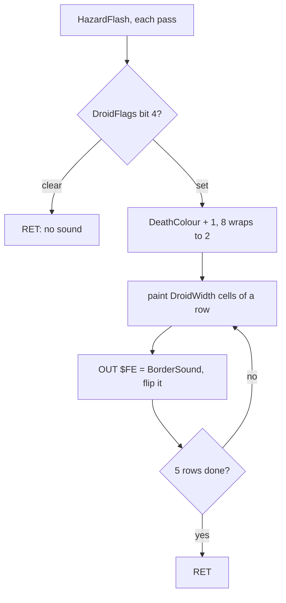

Worked example: `rzx-036000` frame 271 T 67 844, a two-cell droid, in the border. From one `OUT` to the next: the
speaker part's tail (`XOR`, `LD (BorderSound),A`, 20 T), the row's end (`POP AF` to `DJNZ`, 54 T), the next row's
start (`PUSH`, `PUSH`, `LD B,C`, 26 T), two cells (2 x 24 - 5 = 43 T) and `PUSH AF`, `LD A,(BorderSound)`, `OUT` (35
T): 178 T, the measured gap. In `menu-cursor` frames 530-568 the same calls fell in the display, with gaps of 247 to
288 T.

The point: the shield has its own sound, made by the loop that flashes the droid's colours (HazardFlash runs only under
the shield). Sound and colour change on
the same row.

## 9.6 PickupTone

When the droid takes an item (energy, a weapon, GEN 19 or an ED piece), MoveDroid calls PickupErase `$7837`. It first
calls PickupTone `$7856`, then wipes the item's 16 pixel rows. PickupTone toggles the speaker 256 times with a
`$21`-pass delay: 128 cycles of a 3.6 kHz tone, 35 ms in the border, about 44 ms as it falls in the frame.

```text
PickupTone:
    A = 0
    repeat 256 times:
        OUT ($FE), A; A ^= $10
        wait 33 DJNZ passes
```

```text
7856  AF            XOR A                ; PickupTone
7857  06 00         LD B,$00             ; 256 edges
7859  C5            PUSH BC              ; PickupToneLoop
785A  D3 FE         OUT ($FE),A
785C  EE 10         XOR $10
785E  06 21         LD B,$21
7860  10 FE         DJNZ PickupToneDelay ; PickupToneDelay
7862  C1            POP BC
7863  10 F4         DJNZ PickupToneLoop
7865  C9            RET
```

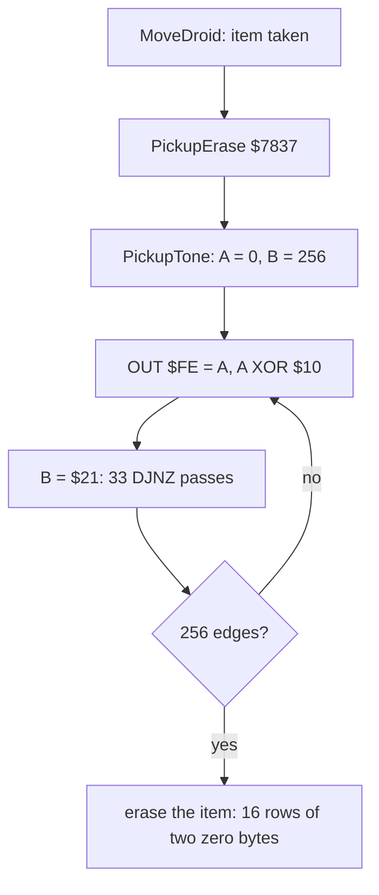

Worked example: one half period is `OUT` 11, `XOR` 7, `LD B` 7, 33 `DJNZ` passes (32 x 13 + 8 = 424), `POP BC` 10,
`DJNZ` 13, `PUSH BC` 11: 483 T, 3623 Hz. The GEN 19 pickup of `rzx-036000` starts at frame 120 T 64 012. Its 256 edges
span 152 341 T, 2.2 frames. That is 24 % more than 255 x 483 = 123 165 T: the part of the tone that fell in the
display (up to 760 T a half period, 2.3 kHz). The weapon pickup of `rzx-059000` (frame 25) spans 158 799 T.

The point: every pickup has the same tone. The message ([08](08-hud-and-text.md)) tells which item it was, not the
sound.

## 9.7 The two sweeps

RiseSweep `$7F4D` and FallSweep `$7F5D` are the same loop run two ways. Each disables interrupts, toggles the speaker
with a delay E, changes E by one, and enables interrupts at the end.

- **RiseSweep**: E from `$DC` (220) down to 1. The half period shrinks from 2893 T to 46 T: the pitch rises from 605 Hz
  to 38 kHz. 220 edges.
- **FallSweep**: E from 0 (a `DJNZ` of 256 passes) up to 255. The first half period is 3361 T, then 46, 59, 72, ...
  up to 3348 T: a click, then a pitch falling from 38 kHz to 523 Hz. 256 edges.

The half period is `OUT` 11, `XOR` 7, `LD B,E` 4, the `DJNZ` 13 E - 5, `DEC E` or `INC E` 4, `JR NZ` 12: 33 + 13 E T.

```text
RiseSweep:                        FallSweep:
    E = 220; A = 0; DI                E = 0; A = 0; DI
    repeat:                           repeat:
        OUT ($FE), A; A ^= $10            OUT ($FE), A; A ^= $10
        wait E x DJNZ                     wait E x DJNZ (E = 0: 256)
        E -= 1                            E += 1
    until E == 0                      until E == 0 (after 255)
    EI                                EI
```

```text
7F4D  1E DC         LD E,$DC             ; RiseSweep
7F4F  AF            XOR A
7F50  F3            DI
7F51  D3 FE         OUT ($FE),A          ; RiseSweepLoop
7F53  EE 10         XOR $10
7F55  43            LD B,E
7F56  10 FE         DJNZ RiseSweepDelay  ; RiseSweepDelay
7F58  1D            DEC E
7F59  20 F6         JR NZ,RiseSweepLoop
7F5B  FB            EI
7F5C  C9            RET
7F5D  1E 00         LD E,$00             ; FallSweep
7F5F  AF            XOR A
7F60  F3            DI
7F61  D3 FE         OUT ($FE),A          ; FallSweepLoop
7F63  EE 10         XOR $10
7F65  43            LD B,E
7F66  10 FE         DJNZ FallSweepDelay  ; FallSweepDelay
7F68  1C            INC E
7F69  20 F6         JR NZ,FallSweepLoop
7F6B  FB            EI
7F6C  C9            RET
```

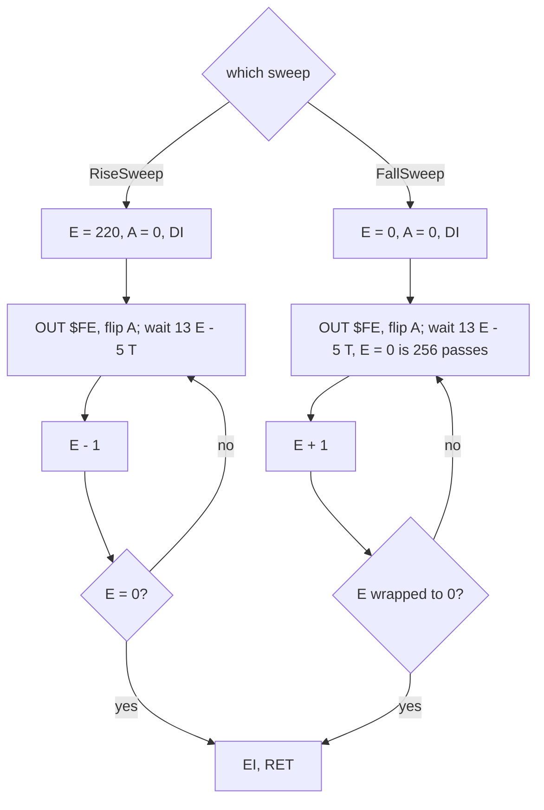

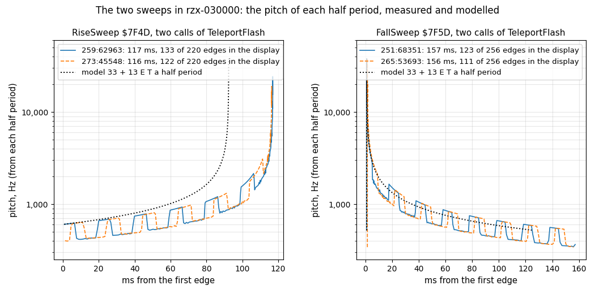

How to read the figure:

- **Each panel** is one sweep: two calls from TeleportFlash in `r30` (solid and dashed) and the model 33 + 13 E
  (dotted). The y axis is the pitch of each half period, 3 500 000 / (2 x the gap), on a log scale.
- **The legend** gives each call's frame and T-state, its length and how many of its edges fell in the display.
- **The steps** in the measured lines are the frames. Each time the sweep enters the display, the contended fetches
  drop the pitch by about a third; in the border it climbs back to the model.
- **The point**: the sweeps are smooth glides in the code, but in the machine they are glides cut into 20 ms steps.
  They also last longer than the model: the rise 117 ms against 92, the fall 157 ms against 125.

```bash
python3 tools/fig_sound.py sweeps     # docs/img/sound/sweeps.png
```

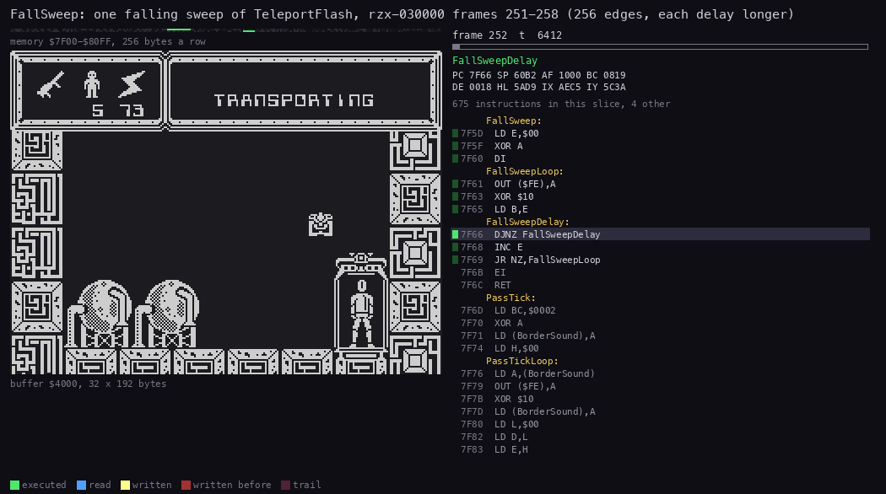

*The routine animation of FallSweep (`$7F5D-$7F6C`) in `rzx-030000` from 251:68300 to 258:30000. It has 57 pictures,
one each 8000 T. The view is the whole screen. Command, from the case folder after `. work/env.sh`: `python3
../../kit/routine_anim.py --work work/docs/tjD/r30 --listing build/game.lst --window 251:68300-258:30000 --out
docs/img/routines/FallSweep.gif --pc 7F5D-7F6C --view buffer:4000:32x192:screen --range 7F00-80FF --step 8000 --delay
150`.*

How to read the animation: TeleportFlash has just painted the play area blue and the teleporter's cells in colour 7.
The highlight sits on the five lines of the loop, mostly on the `DJNZ`. E in the register panel climbs by one a pass,
more slowly at the end, as each pass takes longer. Nothing is drawn. The screen does not change for 7.8 frames, and no
interrupt comes, so the sprites and the scroller are frozen.

Worked example: the model of a whole FallSweep is the sum of 33 + 13 E for E = 256, 1, 2, ..., 255. That is 256 x 33 +
13 x (256 + 32 640) = 436 096 T, less the 5 T of the last `JR` not taken: 436 091 T, 6.2 frames. RiseSweep's model,
counted the same way, is 220 x 33 + 13 x 24 310 - 5 = 323 285 T. Both models run to the `EI`, all half periods included.
The traced lengths run from the entry to the last edge, so they leave out the last half period (3 348 T for FallSweep,
46 T for RiseSweep): little against the contention. The traced FallSweeps take 545 722 to 550 331 T, 7.8 frames, 25 %
more than the model; the RiseSweeps 407 239 to 411 434 T, 5.9 frames. The first FallSweep of `r30` starts at frame 251 T
68 351. Its first gap is 3361 T and its second 46 T, as the model says.

Witness: all 18 RiseSweeps and 26 FallSweeps traced (18 in `r30`, 8 in `energy-out`) wrote 220 and 256 times. No
interrupt was entered inside any of them.

The point: RiseSweep is only heard in the teleport. FallSweep `$7F5D` is the sound of both the death and the teleport.

## 9.8 DeathEffect

LoseLife `$6A3C` queues GEN 19 DESTROYED and calls DeathEffect `$7ADF`. It shakes the droid apart in 8 steps. Each step
shifts the droid's 40 pixel lines by one pixel, the even lines right and the odd lines left (20 pairs), then calls
FallSweep. So a death is 8 falling sweeps, one every 8.05 frames, about 1.3 s with no interrupt.

```text
DeathEffect:
    KeyLatches bit 7 = 1                     ; no fire
    repeat 8 times:
        for 20 pairs of the droid's lines:
            SRL each of DroidWidth + 1 bytes of the even line
            SLA each of DroidWidth + 1 bytes of the odd line
        FallSweep()
    DroidGraphic = BlankGraphic; KeyLatches bit 7 = 0
```

```text
7AF1  06 08         LD B,$08             ; eight steps
7AF3  C5            PUSH BC              ; DeathEffectStep
7AF4  E5            PUSH HL
7AF5  06 14         LD B,$14             ; 20 pairs of lines, a right and a left shift a pass
...
7B29  10 CC         DJNZ DeathEffectLine
7B2B  CD 5D 7F      CALL FallSweep
7B2E  E1            POP HL
7B2F  C1            POP BC
7B30  10 C1         DJNZ DeathEffectStep
```

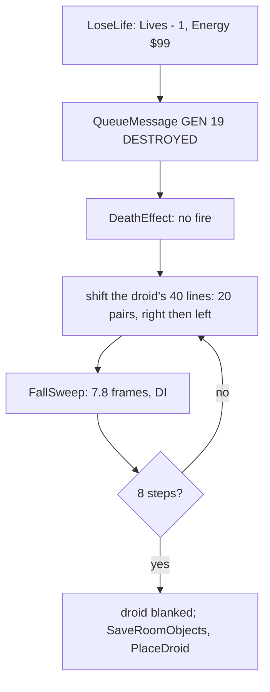

Worked example: `energy-out` frame 1570 T 7624, DeathEffect enters. Its FallSweeps start at frames 1570, 1578, 1586,
1594, 1602, 1610, 1618 and 1626, each about 3450 T later in its frame than the one before: 562 464 to 562 632 T apart,
8.05 frames (562 500 T: the sweep, about 548 000 T, plus about 14 000 T of line shifts in contended screen memory; the
code alone gives about 8 000 T for a droid three cells wide). 8 x 8.05 = 64 frames. The death ends at frame 1634. The
message GEN 19 DESTROYED, queued at 1570, waits for the scroller, which only runs in the interrupt: it is taken at frame
1664.

Witness: from frame 1570 to 1634 no interrupt was entered (0 of 64). The energy timer, the scroller and the sprites
stood still.

The point: the death is heard as eight falling notes while the screen freezes. The loss of the interrupt makes the
freeze real: nothing else on screen moves.

## 9.9 The teleport

The teleport is the longest sound of the game, about 10 s. Teleport `$7719` runs it in four stages:

1. **BeamDown** `$7F9C` with BeamScreen `$63C5` = 5000: the beam fills the teleporter top down, 40 pixel lines. Each
   line plays a tone of 30 edges, then waits BeamScreen x 26 T.
2. **TeleportFlash** `$8051`: the play area turns blue, and the teleporter's cells take colours 7 down to 2, six steps,
   three times. Each of the 18 steps plays FallSweep and RiseSweep.
3. **BeamDown** with BeamScreen = 1 in the new room, after DrawRoom: the beam drawn at once. `BeamScreen - 1 = 0` skips
   the tone, so it is silent.
4. **BeamUp** `$8005` with BeamScreen = 5000: the beam erased bottom up, with the same tone a line. BeamUp has no
   BeamScreen test: it always sounds.

```text
BeamDown (BeamUp is the same, bottom up, writing 0 instead of the beam's bytes, with no attributes and no BeamScreen
test: it always sounds):
    the attributes of columns +0 and +3 of the teleporter's 5 rows (10 cells) = $42
    repeat 40 lines:
        if BeamScreen != 1:
            repeat 30: OUT ($FE), A; A ^= $10; wait $64 DJNZ passes    ; 1354 T a half period
        the line's two bytes = $A0 and $05 (the beam's edges)
        wait BeamScreen x 26 T
        next pixel line down
```

```text
7FBE  06 28         LD B,$28             ; forty lines
7FC0  C5            PUSH BC              ; BeamDownLine
7FC1  ED 5B C5 63   LD DE,(BeamScreen)
7FC5  1B            DEC DE
7FC6  7A            LD A,D
7FC7  B3            OR E
7FC8  28 14         JR Z,BeamDownDraw    ; BeamScreen 1: no tone
7FCA  06 1E         LD B,$1E             ; thirty edges
7FCC  3A 75 63      LD A,(BorderSound)
7FCF  C5            PUSH BC              ; BeamDownTone
7FD0  D3 FE         OUT ($FE),A
7FD2  EE 10         XOR $10
7FD4  06 64         LD B,$64
7FD6  10 FE         DJNZ BeamDownToneDelay
7FD8  C1            POP BC
7FD9  10 F4         DJNZ BeamDownTone
7FDB  32 75 63      LD (BorderSound),A
7FDE  36 A0         LD (HL),$A0          ; BeamDownDraw
7FE0  2C            INC L
7FE1  2C            INC L
7FE2  2C            INC L
7FE3  36 05         LD (HL),$05
7FE5  2D            DEC L
7FE6  2D            DEC L
7FE7  2D            DEC L
7FE8  24            INC H
7FE9  ED 5B C5 63   LD DE,(BeamScreen)
7FED  1B            DEC DE               ; BeamDownDelay
7FEE  7A            LD A,D
7FEF  B3            OR E
7FF0  20 FB         JR NZ,BeamDownDelay
```

```text
8073  06 03         LD B,$03             ; TeleportFlash: three pulses
8075  C5            PUSH BC              ; TeleportFlashPulse
8076  3E 08         LD A,$08
8078  06 06         LD B,$06             ; six colour steps
807A  C5            PUSH BC              ; TeleportFlashStep
807B  3D            DEC A                ; colour 7 down to 2
...
808D  F5            PUSH AF
808E  CD 5D 7F      CALL FallSweep
8091  CD 4D 7F      CALL RiseSweep
8094  F1            POP AF
```

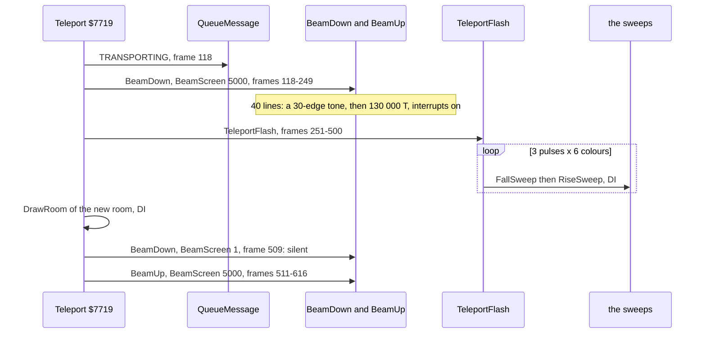

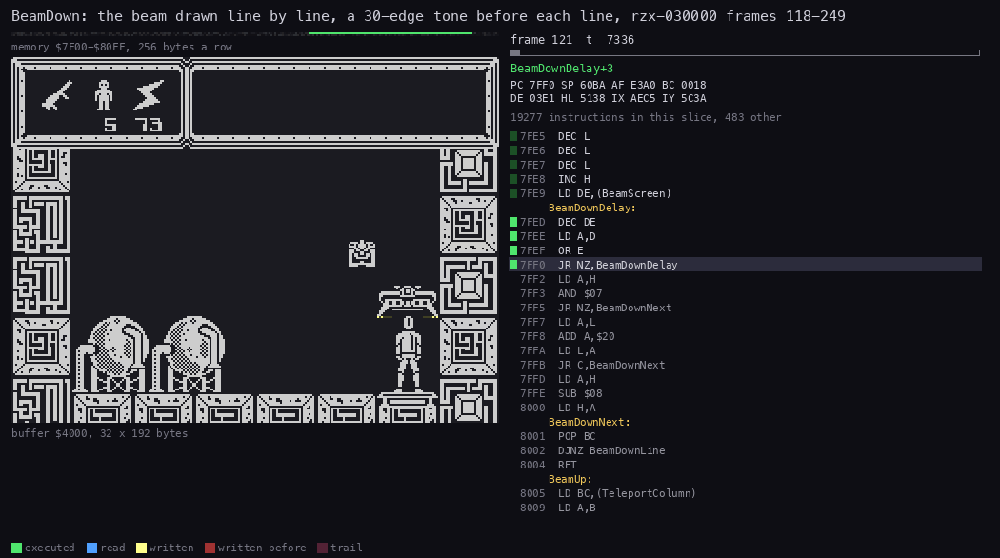

*The routine animation of BeamDown (`$7F9C-$8004`) in `rzx-030000` from 118:32000 to 250:0. It has 50 pictures, one
each 185 000 T (2.6 frames, about one beam line). The view is the whole screen. Command, from the case folder after `.
work/env.sh`: `python3 ../../kit/routine_anim.py --work work/docs/tjD/r30 --listing build/game.lst --window
118:32000-250:0 --out docs/img/routines/BeamDown.gif --pc 7F9C-8004 --view buffer:4000:32x192:screen --range 7F00-80FF
--step 185000 --delay 150`.*

How to read the animation: the beam's two edge bytes grow down the teleporter, one pixel line a picture. Most pictures
catch the highlight in the delay loop `$7FED-$7FF0` (130 000 T a line). A few catch it in the tone `$7FCF-$7FD9`
(40 620 T a line in the border). The scroller window at the top right carries TRANSPORTING: the interrupt still runs.

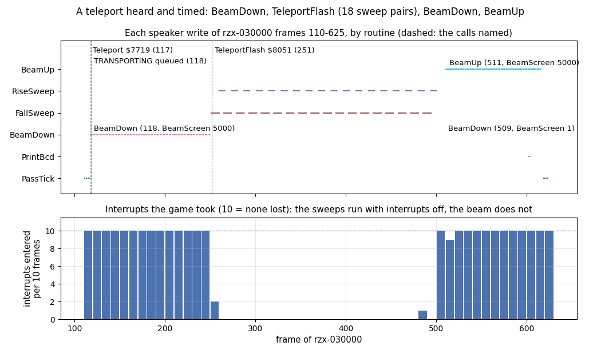

How to read the figure:

- **Top**: each speaker write of `r30` frames 110-625, one row per routine. Dashed lines mark the Teleport call, the
  TRANSPORTING message and TeleportFlash. Each beam call is labelled with its frame and BeamScreen.
- **Bottom**: the interrupts the game entered, per 10 frames. 10 means none lost.
- **The point**: the teleport is three sounds in a row. The beams are a slow pulse of short tones while the game still
  takes its interrupts. The flash between them is 18 pairs of sweeps with the interrupt off: five seconds in which the
  scroller, the sprites and the energy timer stop.

```bash
python3 tools/fig_sound.py teleport   # docs/img/sound/teleport.png
```

Worked example: one beam line. The tone is 30 half periods of `OUT` 11, `XOR` 7, `LD B` 7, 100 `DJNZ` passes (1295),
`POP BC` 10, `DJNZ` 13, `PUSH BC` 11: 1354 T, 1292 Hz, 40 620 T a line. The delay is 5000 passes of `DEC DE`, `LD A,D`,
`OR E`, `JR NZ`, 26 T each: 130 000 T. With the line's own code a line takes about 170 800 T; 40 lines take 6.83 million
T, 97.8 frames. BeamUp runs from uncontended memory and measured 7 271 275 T, 104 frames; the 6 % more are its 106
interrupts. BeamDown measured 9 142 320 T, 130.8 frames, because its tone and its delay both run from `$7Fxx` (half
periods of 2043 T in the display). In `r30` Teleport enters at frame 117 T 11 595, BeamDown at 118 T 32 217,
TeleportFlash at 251 T 49 723, the second BeamDown at 509 T 63 655 and BeamUp at 511 T 14 805. BeamUp's last edge is in
frame 615.

Witness: interrupts entered in `r30` (counted inclusively): frames 118-249, 132 of 132; 251-500, 3 of 250 (251 comes
before TeleportFlash starts at T 49 723 and 500 after its last edge in frame 499; the one inside, 486, falls in the
`EI` (`$7F6B`) to `DI` (`$7F50`) gap between two sweeps); 509-616, 107 of 108.

The point: BeamScreen sets both the beam's speed and its sound. The same routine, called with 1, draws the beam in one
go without a note.

## 9.10 What the sounds cost

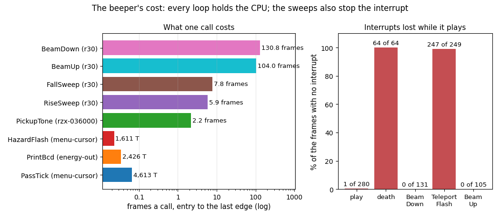

How to read the figure:

- **Left**: the time one call takes, entry to its last edge, in frames on a log scale (under a frame the label gives
  T-states). Each bar is the mean over the calls of the recording named.
- **Right**: in five stretches, the share of frames whose interrupt never came.
- **The point**: the game does nothing else while a sound plays. The small ones (PassTick, the click, the shield's buzz)
  cost under a tenth of a frame each. The pickup costs 2.2 frames, a sweep 6-8 frames with the interrupt off, a beam
  100-130 frames with the interrupt still on.

```bash
python3 tools/fig_sound.py cost       # docs/img/sound/cost.png
```

| Sound | Cost a call | Interrupts | What stops |
| --- | --- | --- | --- |
| PassTick | 4206-6406 T, 3-5 % of a 2-frame pass | off (the main loop) | nothing |
| the click | 2100-3100 T a number | off (the main loop, or inside the interrupt) | nothing |
| HazardFlash | 1100-1630 T a pass | off (the main loop) | nothing |
| PickupTone | 2.2 frames | off (the main loop) | everything for 2 frames: about 2 interrupts lost |
| a sweep | 5.9 or 7.8 frames | off (DI) | everything: sprites, scroller, timers |
| DeathEffect | 64 frames | off | everything |
| TeleportFlash | 249 frames | off | everything |
| a beam | 104-131 frames | on | the main loop; the interrupt still scrolls |

Witness: in `menu-cursor` frames 540-820, a stretch of play, 1 interrupt of 280 was lost (the 3-frame pass of 606-609).

The point: a sound played with interrupts off costs the game its interrupts: the pickup about 2, the death 64, the
teleport flash 247. That is why the energy does not drop during a death or a teleport flash: EnergyTick runs in the
interrupt ([10](10-gameplay-logic.md)). The beams, the longest sounds, are the ones that keep it.

## 9.11 The data sheet

Pitches from the opcode model, in the border. Brackets give the half period measured in the display, or the length
measured.

| Routine | Address | Edges | Half period, T | Pitch | Length a call | Own DI | Callers |
| --- | --- | ---: | --- | --- | --- | --- | --- |
| PassTick | `$7F6D` | 2 | 4206 (6348-6406) | a 1.2 ms pulse, 25 a second | 4206 T + 123 | no | MainLoop `$6914` |
| PrintBcd click | `$7B65` | 50 | 42 a step (up to 56) | 41.7 kHz, 0.6 ms | 2100 T (3092) | no | DrawHud, EnergyTickStep, LoseLife, ShowWeaponAmmo, the pickups, the three weapons' fire |
| HazardFlash | `$699B` | 5 | 178 (247-288) | a 9.8 kHz burst | 1096 T (1633) | no | MainLoop `$6923` |
| PickupTone | `$7856` | 256 | 483 (711-760) | 3623 Hz (2.3 kHz) | 123 165 T (152 341) | no | PickupErase `$7837` |
| RiseSweep | `$7F4D` | 220 | 33 + 13 E, E = 220 .. 1 | 605 Hz to 38 kHz | 323 285 T (407 239) | yes | TeleportFlash `$8091` |
| FallSweep | `$7F5D` | 256 | 33 + 13 E, E = 256, 1 .. 255 | a click, then 38 kHz to 523 Hz | 436 091 T (545 722) | yes | TeleportFlash `$808E`, DeathEffect `$7B2B` |
| BeamDown | `$7F9C` | 30 a line, 40 lines | 1354 (2043), then BeamScreen x 26 | 1292 Hz (856 Hz) in 11.6 ms bursts | 97.8 frames (130.8) | no | Teleport `$7798`, `$77B2` |
| BeamUp | `$8005` | 30 a line, 40 lines | 1354 | 1292 Hz in 11.6 ms bursts | 97.8 frames (104.0) | no | Teleport `$782D` |
| TeleportFlash | `$8051` | 18 x (256 + 220) | the sweeps | 18 sweep pairs | 249 frames | yes | Teleport `$779B` |
| DeathEffect | `$7ADF` | 8 x 256 | FallSweep | 8 falling notes | 64 frames | yes | LoseLife `$6A57` |

Variables: BorderSound `$6375` (the speaker value for PassTick, HazardFlash and the beams), BeamScreen `$63C5` (the
beam's delay and tone switch: 5000 or 1), DeathColour `$6370` (HazardFlash's colour, 2-7).

## 9.12 The sounds rendered

The audio files in `docs/audio` are rendered from the traced speaker writes, edge by edge. The speaker bit is held
between writes at 44.1 kHz, 16-bit mono, through a soft high-pass (a real speaker passes no DC), with 30 ms of silence
after. No emulator audio was recorded and none was played.

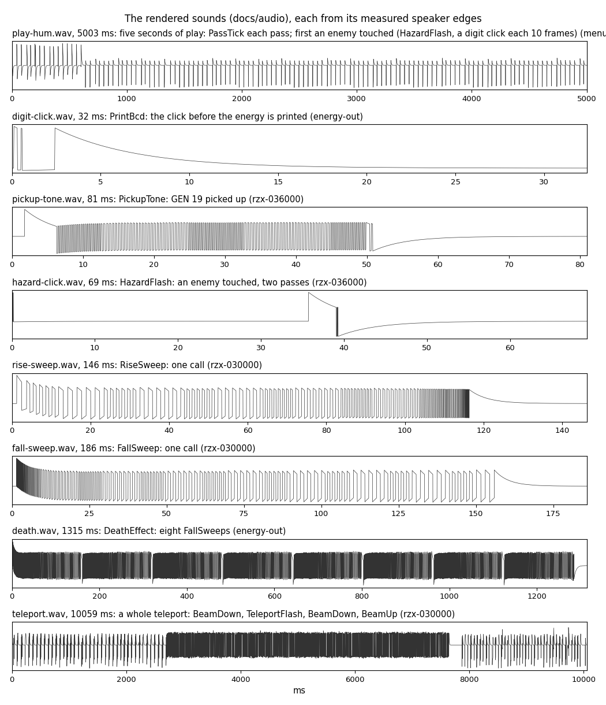

How to read the figure:

- **Each panel** is one WAV file as written (after the high-pass); its title gives the name, the length and what it
  holds.
- **The x axis** is milliseconds from the first edge.
- **The point**: the hum of play is a row of single ticks. The click and the shield's buzz are near-silent bursts. The
  pickup is the one steady tone. The death and the teleport are long trains of sweeps.

```bash
python3 tools/fig_sound.py wav        # docs/audio/*.wav
python3 tools/fig_sound.py waves      # docs/img/sound/waves.png
```

| File | Recording, frames | What |
| --- | --- | --- |
| [play-hum.wav](audio/play-hum.wav) | `menu-cursor` 540-790 | 5 s of play: PassTick each pass; first the shield (HazardFlash, and a click every 10 frames: EnergyReload 10) |
| [digit-click.wav](audio/digit-click.wav) | `energy-out` 603 | one PrintBcd click, the energy printed |
| [pickup-tone.wav](audio/pickup-tone.wav) | `rzx-036000` 120-124 | GEN 19 taken: PickupTone |
| [hazard-click.wav](audio/hazard-click.wav) | `rzx-036000` 271 | HazardFlash, two passes |
| [rise-sweep.wav](audio/rise-sweep.wav) | `r30` 273 | one RiseSweep |
| [fall-sweep.wav](audio/fall-sweep.wav) | `r30` 265 | one FallSweep |
| [death.wav](audio/death.wav) | `energy-out` 1570-1640 | DeathEffect: eight FallSweeps |
| [teleport.wav](audio/teleport.wav) | `r30` 117-620 | a whole teleport: BeamDown, TeleportFlash, BeamDown, BeamUp |

## 9.13 Not reached and known only from the code

- **Every sound reached.** Every `OUT ($FE)` site but ExitToBasic's ran in the traced recordings.
- **Known only from the code**:
  - ExitToBasic `$95C1` writes 7 to port `$FE` (a white border); no code reaches it.
  - PassTick's arithmetic would give another delay if H were not reset; the reset makes it a constant. Whether an
    earlier version kept H from pass to pass (a hum that changes pitch) cannot be known from this build.
  - The ammunition clicks when a weapon fires (FireWeapon1Ammo `$86EC`, FireWeapon2Ammo `$873A`, FireWeapon3Cell
    `$8693`) were not in the traced windows. The loop is the same.
- **Corrected at the integration** (once listed in `work/docs/tjD-src-changes.md`): the `.ann` of PrintBcd (one click
  per number) and of PassTick (a constant), and the WALKTHROUGH's sound table (the rising and the falling sweep).
