# 10. Gameplay logic

What this covers: the rules of Tujad as the code enforces them. The droid flies and walks through 102 rooms, leaves a
room at its edges or through a teleporter, and fights with four weapons. Its energy is a BCD counter that an interrupt
clock counts down, faster while an enemy touches it or while its shield is up. It dies on an object or a patroller, or
when the energy runs out. It collects 50 ED pieces dealt round the world at each new game, and wins by bringing them
back to room 84. The records behind all this are in [doc 07](07-objects.md); the controls are in
[doc 05](05-controls.md); the HUD, the messages and the progress screen are in [doc 08](08-hud-and-text.md).

The recordings it rests on (WALKTHROUGH 6.0):

- The RZX log `work/stage1/rzx/frames.bin`: `$6300-$63FF` after each of the 81 000 RZX frames of the complete game, and
  the states `work/stage1/rzx/atNNNNNN.szx` every 1 000 frames (`tools/rzx_keys.py log`). It is the only source that
  covers the whole game: the deal, every room change, the life lost, the ED count and the win.
- `rzx-010000`, opened on an own instance into `work/docs/tjC/z10` (port base 36950) after `source work/env.sh`:
  an enemy touches the droid in frame 110, a fight in frames 1440-1480, an ED piece in frame 1697. `$6300-$63FF` was
  sampled at every frame (`work/docs/tjC/z10-vars.jsonl`, `z10-touch.jsonl`) with `work/docs/tjC/sample.py`.
- `rzx-007000`, opened into `work/docs/tjC/r7`: the shield in frames 259-275 and the teleport from room 105 to room 62
  in frames 725-1 120 (`r7-vars.jsonl`, `r7-tel*.jsonl`).
- `rzx-035000`, opened into `work/docs/tjC/r35`: the only life lost of the RZX game, in frame 250 (`r35-vars.jsonl`).
- `c1`, the load and the first minutes of play on unreal-ng's own frames: the pause in frames 15 241-15 359.
- The L1 counts of the stage 1 builds, quoted from the `.ann` descriptions ("L1 n").

A sample of frame N is the memory at the start of frame N. A trace, and so a routine animation, shows an instruction in
the frame where it ran. A pass is one turn of `MainLoop $6911`: two interrupts, three when its work ran with interrupts
off and one was lost ([doc 04](04-game-loop.md)). The RZX frame of `rzx-NNNNNN` frame F is NNNNNN + F.

## 10.1 The droid's movement

`MoveDroid $7208` runs once a pass. It acts only every second pass, through `MoveDelay $636F`, unless the droid is in
the air (DroidFlags bit 2): then it acts every pass. The `.ann` description has it the other way round.

```asm
MoveDroid:
  LD A,(DroidFlags)
  BIT 2,A                    ; in the air?
  JR NZ,MoveDroidCell        ; then every pass
  LD HL,MoveDelay
  DEC (HL)
  RET NZ                     ; on the floor: every second pass
  LD (HL),$02
MoveDroidCell:
  LD HL,$0000
  LD (FoundItem),HL
```

One act:

1. The teleporter test: the droid's cell and the next hold `$FF $FF` and `TeleportLatch $6376` is 0 (10.2).
2. The floor test: the cells five rows below its top (`$A0` on, `$C0` when y AND 7 = 7). With no wall under it the
   droid is in the air: bit 2 set, frame 11. With a wall under it, it stands: bit 2 clear, frame 2.
3. The old image goes to the sprite list with flag pointer 0.
4. Unless the droid is turning round (bit 1: TurnRound), fire calls `Fire $861C` (10.5).
5. The directions: left and right walk or fly a column; up and down move two pixel rows. A direction against the
   facing starts the turn-round instead (5 frames: 8, 9, 10, 9, 8).
6. The exits (10.2).
7. The new image with FlagPointer, the attributes `$45` under it.
8. The touch test and the item test (10.6, 10.8).

There is no gravity. The droid hovers: in the air it stays at its height until UP or DOWN moves it, and its frames are
11 and 12 (the flying droid) instead of the walk 0-7.

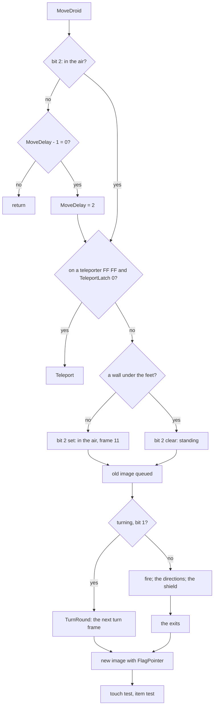

Worked example, `rzx-010000` frames 106-143, room 73 to 74. The droid hovers at x 21, y 86 (DroidFlags `$4C`: bits 2
and 3, in the air and moving). From frame 109 the controls read `$09`, right and up:

| Frame | x | y | Frame | Note |
| --- | --- | --- | --- | --- |
| 110 | 22 | 84 | 11 | one column right, two rows up |
| 115 | 23 | 80 | 11 | |
| 120 | 24 | 76 | 11 | |
| 125 | 25 | 72 | 11 | RIGHT alone from frame 126 |
| 139 | 28 | 72 | 11 | |
| 143 | 0 | 72 | 11 | x reached `$1D`: room 74, x 0 |

y moves 2 pixels in each act. x moves a column in every second act. The flying frame alternates 11 and 12.

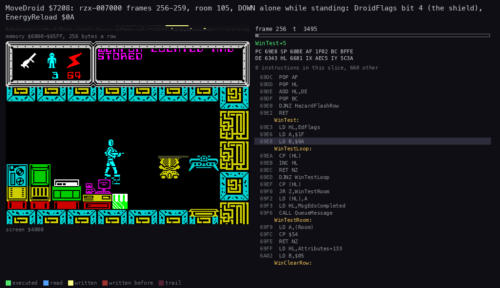

The animation is a trace of `rzx-007000` frames 256-259, in 80 pictures. The top panel is the memory `$6000-$65FF`,
the cell table and the work space; under it the screen, on the right the listing of MoveDroid `$7208-$7702` with
TurnRound and XorCells. The droid lands on the floor at y 104 and, with DOWN still held, raises the shield (10.3).
Command:
`python3 ../../kit/routine_anim.py --work work/docs/tjC/r7 --window 256:0-260:0 --listing build/game.lst --view screen --range 6000-65FF --pc 7208-7702,7CAA-7D86,7D87-7DD9 --pictures 80 --title 'MoveDroid $7208: rzx-007000 frames 256-259, room 105, DOWN alone while standing: DroidFlags bit 4 (the shield), EnergyReload $0A' --out docs/img/routines/MoveDroid.gif`.

**The point**: the droid is a hovercraft that walks when it touches a floor. In the air it acts twice as often, so
flying is the fast way through a room.

## 10.2 The exits and the teleporters

The world is 8 rooms across and 16 down. Room n + 1 is east of room n and room n + 8 south of it. The four exits test
the droid's place after its step:

| Edge | Test | New room | New place |
| --- | --- | --- | --- |
| east | x = `$1D` | Room + 1 | x = 0 |
| west | x = 0 | Room - 1 | x = `$1D` |
| south | y = `$98` | Room + 8 | y = `$32` |
| north | y = `$30` | Room - 8 | y = `$96` |

```asm
MoveDroidEastExit:
  LD A,$1D                   ; x = $1D: Room + 1
  LD HL,DroidVars
  CP (HL)
  JR NZ,MoveDroidLeftTest
  LD (HL),$00                ; x = 0 in the new room
  CALL SaveRoomObjects       ; the objects back into the old room's record
  LD A,(Room)
  INC A
  LD (Room),A
  XOR A
  CALL DrawRoom              ; A = 0: the scroll wipe
```

The other coordinate is kept. Nothing checks that the new room has a floor or a space there. The rooms are designed so
that the openings line up.

A teleporter is a 2 x 2 item drawn at its position, with `$FF $FF` in its top cells. `Teleport $7719`:

- replaces the droid's image with the beam frame and queues TRANSPORTING;
- plays BeamDown and TeleportFlash, with interrupts off for long stretches;
- SaveRoomObjects; Room = TeleportRoom; DrawRoom with A = `$FF`;
- puts the droid at TeleportColumn + 1, TeleportRow of the target's teleporter, plays BeamUp;
- sets TeleportLatch to `$FF`. The latch stays set while the droid stands on the `$FF` cells, so it does not teleport
  straight back. Stepping off clears it.

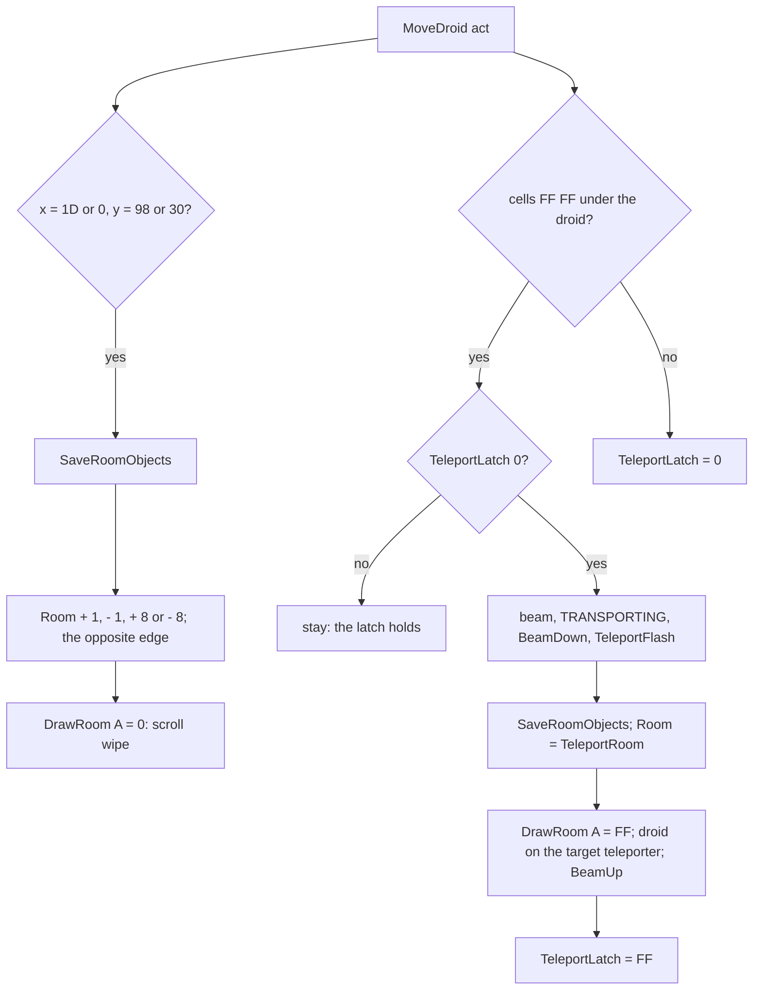

Worked example, `rzx-007000` frames 720-1 136: the droid steps onto room 105's teleporter, whose target is room 62.

- The beam starts at about frame 725.
- Interrupts keep running until about frame 865, while TRANSPORTING scrolls in.
- Frames 865-1 106 run with interrupts off: no interrupt is serviced, the energy clock stands still.
- Room becomes 62 at about frame 1 106; the droid stands at (5, 128) from about frame 1 120.

The whole teleport takes about 400 frames, 8 seconds. The RZX log holds 18 teleports, each a still run of 383-385
frames in the work space.

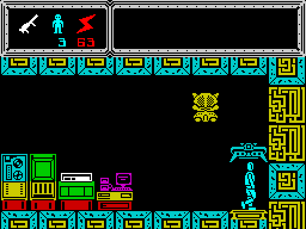

The screen at every eighth frame of `rzx-007000` frames 720-1 136: the beam, the flashing room, the new room drawn and
the droid beamed in. Command:
`python3 ../../kit/screen_anim.py --work work/docs/tjC/r7 --from 720 --to 1136 --step 8 --scale 2 --delay 120 --hold 1500 docs/img/play/teleport.gif`.

The whole game's route:

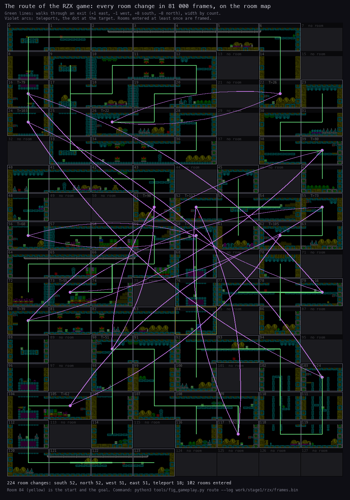

How to read the figure:

- The room map `docs/img/play/world-map-rooms.png`, dimmed, 8 rooms across and 16 down.
- A line joins two rooms the droid walked between; its width grows with the count. An arc is a teleport, with a dot at
  the target. A room the droid entered at least once is framed.
- 224 room changes: south 52, north 52, west 51, east 51, teleports 18; 102 rooms entered, every room in use.
- Command: `python3 tools/fig_gameplay.py route --log work/stage1/rzx/frames.bin --out docs/img/gameplay/route.png`.

**The point**: a room change is a few bytes of arithmetic on Room and one coordinate. The map's shape lives only in the
room layouts. A teleport is the slow way round: 8 seconds with the clock stopped.

## 10.3 The shield

DOWN held alone while the droid stands on a floor raises a shield. MoveDroid then does not move the droid. At
`MoveDroidKeys` it:

- sets DroidFlags bit 4;
- writes 0 into `FlagPointer $637E`, so the interrupt's ink test sets bit 7 of the ROM byte 0 instead of DroidFlags;
- sets EnergyReload and EnergyTimer to `$0A`: the energy drops one every 10 interrupts instead of every 250.

Any other key, or no key, takes it down: bit 4 cleared, FlagPointer back to DroidFlags, both timers `$FA`. While it is
up, `HazardFlash $699B` flashes the droid's attributes through the colours and clicks the beeper each pass.

```asm
MoveDroidKeys:
  LD (ControlsLatch),A
  BIT 2,(HL)                 ; in the air: DOWN moves the droid
  JR NZ,MoveDroidUpDown
  CP $04                     ; DOWN and nothing else?
  JR NZ,MoveDroidUpDown
  BIT 4,(HL)
  JP NZ,MoveDroidNewImage    ; already up
  SET 4,(HL)
  LD HL,$0000
  LD (FlagPointer),HL        ; the droid's ink test goes nowhere
  LD A,$0A
  LD (EnergyReload),A        ; the energy drains 25 times faster
  LD (EnergyTimer),A
  JP MoveDroidNewImage
```

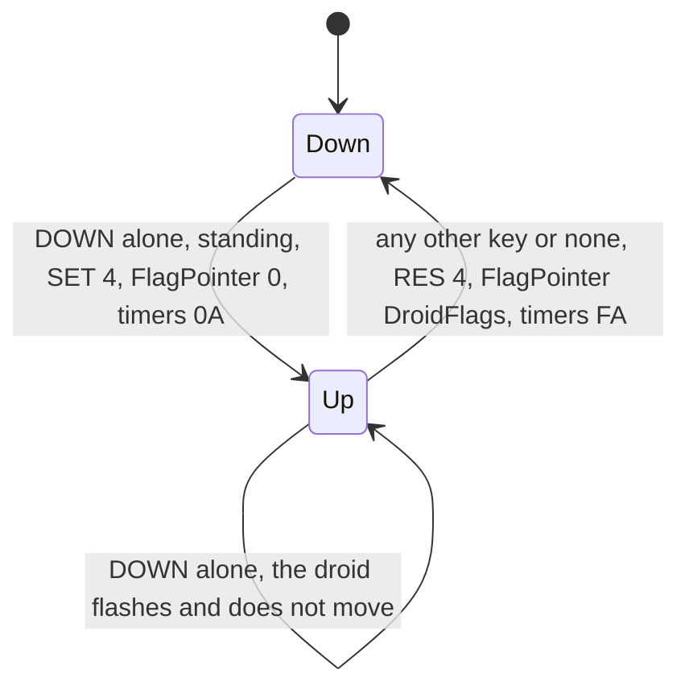

With FlagPointer 0, DroidFlags bit 7 is never set, so the touch test never runs (doc 07.11). The shield makes the droid
immune to enemies, objects and patrollers. It pays in energy: one point every 10 interrupts, 5 points a second at
50 Hz, instead of one every 5 seconds.

Worked example, `rzx-007000` frames 250-278, room 105:

| Frame | y | DroidFlags | FlagPointer | Reload | Timer | Energy |
| --- | --- | --- | --- | --- | --- | --- |
| 250 | 96 | `$4C` (in the air) | `$635B` | `$FA` | `$2B` | 64 |
| 257 | 104 | `$4C` | `$635B` | `$FA` | `$24` | 64 |
| 259 | 104 | `$18` (standing, shield) | 0 | `$0A` | `$0A` | 64 |
| 270 | 104 | `$18` | 0 | `$0A` | `$0A` | 63 |
| 276 | 104 | `$08` | `$635B` | `$FA` | `$FA` | 63 |

DOWN alone brought the droid down to the floor at y 104; the next act raised the shield. RIGHT and DOWN in frame 276
took it down.

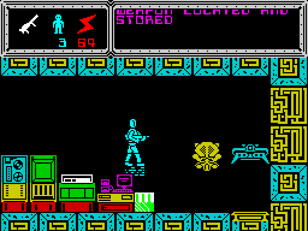

The screen at every frame of `rzx-007000` frames 252-282: the droid lands, flashes through the colours while the
shield is up, and walks on. Command:
`python3 ../../kit/screen_anim.py --work work/docs/tjC/r7 --from 252 --to 282 --step 1 --scale 2 --delay 100 --hold 1500 docs/img/play/shield.gif`.

The `.ann` names bit 4 "touching an enemy" and HazardFlash "while touching an enemy". The code above sets bit 4 only
for DOWN alone; the enemy touch sets TouchTimer and the reload, never bit 4 (10.4). The fix is sent to the lead.

**The point**: the shield trades energy for safety. It is the only defence against an object or a patroller, and it
costs in 2 seconds about as much energy as a minute without it.

## 10.4 Energy and its clock

Energy is a BCD byte, `Energy $636E`, 99 at the start and after each life. The interrupt counts it down through
`EnergyTick $7AB6`:

```asm
EnergyTick:
  XOR A
  LD HL,EnergyTimer          ; $6366
  CP (HL)
  RET Z                      ; 0: the clock is stopped
  DEC (HL)
  RET NZ
  LD A,(EnergyReload)        ; $FA normally, $0A fast
  LD (HL),A
  LD A,(Energy)
  CP $11
  JR NZ,EnergyTickStep
  LD HL,MsgEnergyLow         ; WARNING ENERGY LOW at 11
  CALL QueueMessage
  LD A,(Energy)
EnergyTickStep:
  SUB $01
  DAA                        ; BCD
  LD (Energy),A
  LD HL,Screen+136
  CALL PrintBcd
  RET
```

`EnergyTimer $6366` counts interrupts to the next step; it is not a frame counter. `EnergyReload $6374` refills it:

| Reload | Set by | One step every | 99 to 0 |
| --- | --- | --- | --- |
| `$FA` (250) | NewGame, LoseLife, DrainTimer, the shield down | 250 interrupts, 5 s | 8 minutes |
| `$0A` (10) | an enemy touch, the shield up | 10 interrupts, 0.2 s | 20 s |
| 0 (stopped) | ProgressScreen, the win, the game over | never | |

An enemy touch sets the reload and the timer to `$0A` and `TouchTimer $6377` to 50. `DrainTimer $7906`, also in the
interrupt, counts TouchTimer down and puts the reload back to `$FA` at 0. A touch therefore costs 5 energy points (50
interrupts at 10 a step), and one more touch restarts the 50.

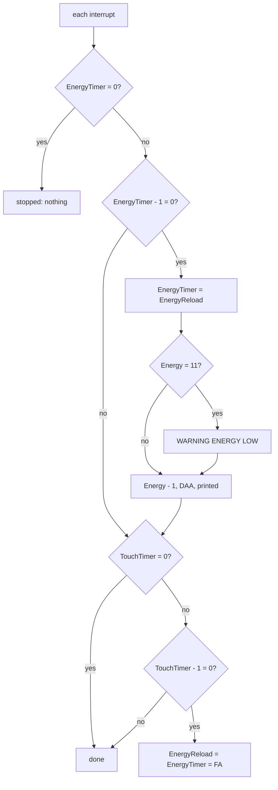

Three things stop the clock:

- **The progress screen.** ProgressScreen sets EnergyTimer to 0 for its whole length and restarts it at the end. In
  `rzx-010000` the timer is 0 from frame 1702 to frame 1886 (the ED piece of 10.8).
- **Interrupts off.** The teleport (10.2), the sound sweeps and the death effect run with interrupts off for long
  stretches; no interrupt means no EnergyTick.
- **Pause.** `Pause $793A` is called after WaitFrame's DI and its loop never enables interrupts (10.13).

The `.ann` (line 492), stage 2 (3.2 and 4) and the brief say the energy drains on pause. It does not; the fix is sent to
the lead.

Worked example, `rzx-010000` frames 106-171 (room 73): enemy 0 starts flying over the droid in frame 109. In the sample
of frame 110 TouchTimer is 50 (`$32`), EnergyReload and EnergyTimer 10. The droid's touch test runs again while the
enemy overlaps it, so TouchTimer is set back to 50 until frame 118. From then on it counts down, 1 per interrupt. Energy
falls 49, 48, 47, 46, 45, 44, one every 10 interrupts. TouchTimer reaches 0 in frame 170 and the reload is `$FA` again
in the sample of frame 171.

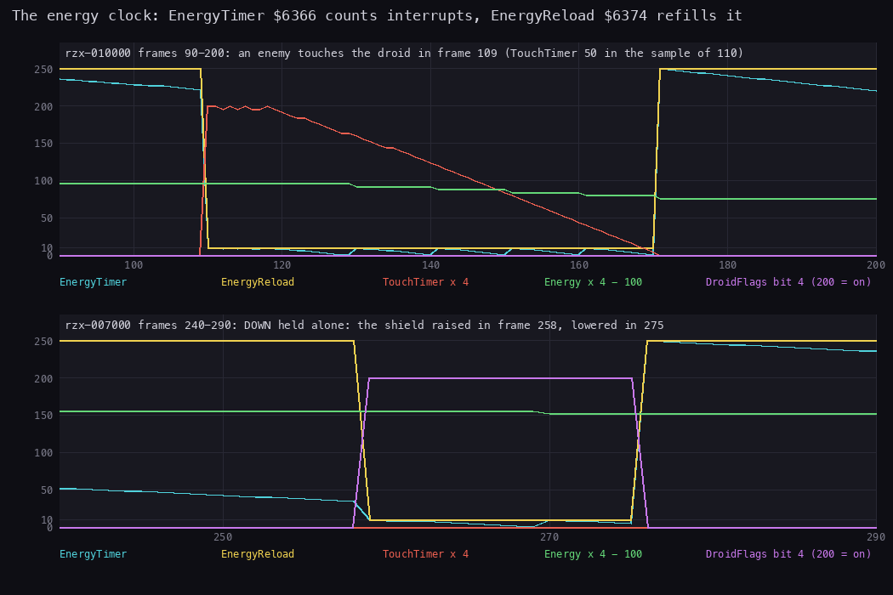

How to read the figure:

- Two panels, each over the frames of a recording: EnergyTimer, EnergyReload, TouchTimer x 4, Energy x 4 - 100 and
  DroidFlags bit 4 (200 = on).
- Top, `rzx-010000` frames 90-200: the touch in frame 110. The reload drops to 10, the timer saws between 10 and 0,
  TouchTimer falls from 50 to 0 and the energy steps down five times; then the reload is 250 again.
- Bottom, `rzx-007000` frames 240-290: the shield, bit 4 on in frames 259-275. The reload is 10 while it is up.
- Command: `python3 tools/fig_gameplay.py energy --touch work/docs/tjC/z10-touch.jsonl --shield work/docs/tjC/r7-vars.jsonl --out docs/img/gameplay/energy.png`.

**The point**: the energy is a clock, not a hit counter. Every danger short of death costs time, at 25 times the normal
rate.

## 10.5 Weapons and ammunition

`Weapons $6368` holds the weapon in use as one bit: bit 7 weapon 0, bits 6, 5 and 4 weapons 1-3. `Ammo $636A` holds
three BCD counters for weapons 1-3, 3 each at the start. Weapon 0 is unlimited. The weapon select and the fire key are
in [doc 05](05-controls.md#57-fire-the-key-latches-and-the-weapon-select).

| Weapon | Shot | Speed | Mark in the cells | Ends at | Kills |
| --- | --- | --- | --- | --- | --- |
| 0 | the dash, `$47` | 8 px a pass | none | ink (Shot bit 7), a wall, an item, the edge | enemies, by the ink test |
| 1 | a bolt, `$43` | 4 px a pass | `$40` with bit 0 | a wall, an item, an object, the edge | enemies; objects of kind bit 4 |
| 2 | a bolt, `$44` | 4 px a pass | `$20` with bit 0 | the same | enemies; objects of kind bits 5 and 7 |
| 3 | the probe, `$46` | steered | `$10` with bit 0 | released fire: explodes over 4 passes | enemies; objects of kind bit 6 and of no kind bit |

`Fire $861C` refuses a new shot while one is new, while fire has not been released, on a wall cell, and for weapons 1-3
when their ammunition is 0. A shot fired costs one unit (BCD), printed on the HUD. Weapon 3's probe flies while fire is
held and is steered by the directions; released, it explodes and marks an object under it with `$11` (doc 05.8).

Any shot kills an enemy: its sprite meets the enemy's ink, and the enemy's own state byte takes bit 7 (doc 07.6). Only
the right weapon's mark kills an object; another weapon's mark stops it in place until the right one comes
(doc 07.8). Patrollers cannot be killed: their sprite has flag pointer 0 and no shot mark is read for them.

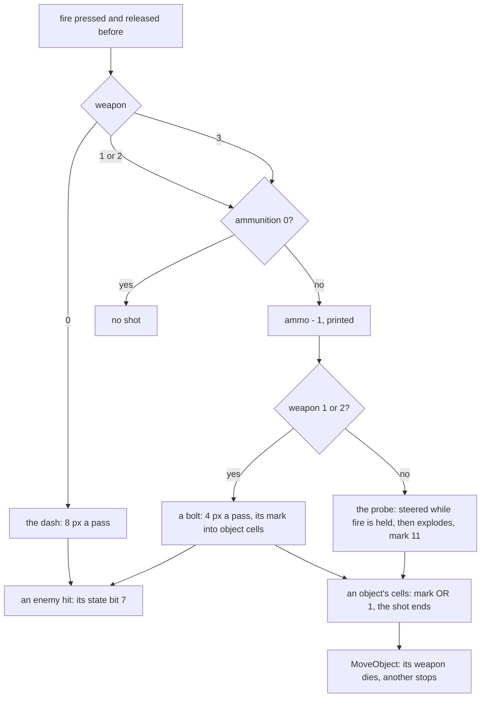

Worked example: the fight of `rzx-010000` (doc 07.8). The droid holds weapon 2 with ammunition 4, 5, 3. In frame 1453
it fires: Shot `$41`, weapon 2's counter 5 to 4. The bolt flies right and stops in object 1's cells with the mark `$21`.
In the sample of frame 1460 the object's state is `$87`: kind bit 5, kill mark `$20`, dying.

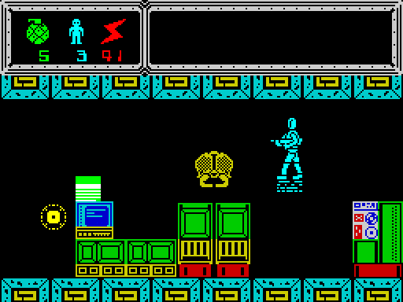

The screen at every frame of `rzx-010000` frames 1440-1480. Command:
`python3 ../../kit/screen_anim.py --work work/docs/tjC/z10 --from 1440 --to 1480 --step 1 --scale 2 --delay 80 --hold 1500 docs/img/play/fight.gif`.

The map holds 16 weapon items, one unit each: 16 more shots for 25 objects. Of the 25 objects, 4 need weapon 1, 13
weapon 2 and 8 weapon 3. Weapon 2 is the one to save.

**The point**: the free dash clears enemies; the counted weapons are keys to the objects. A wasted shot of the wrong
weapon is worse than none, because it freezes the object where it stands.

## 10.6 Every way to die

A life ends in one of two ways:

- **HazardDeath** (`$6992`): the touch test found a mark other than an enemy's under the droid. That is an object (4), a
  patroller (8) or a shot mark left in an object's cells (`$10-$40`).
- **EnergyOut** (`$6A30`): MainLoop finds Energy 0 at the end of a pass.

Both return at once when DroidFlags bit 1 is set, while the droid turns round. EnergyOut falls through into LoseLife.

```asm
HazardDeath:
  LD A,(DroidFlags)
  BIT 1,A
  RET NZ                     ; turning round: immune
  JP LoseLife

EnergyOut:
  LD A,(Energy)
  CP $00
  RET NZ
  LD A,(DroidFlags)
  BIT 1,A
  RET NZ                     ; turning round: not yet
LoseLife:
  LD A,$FA
  LD (EnergyReload),A
  LD (EnergyTimer),A
  LD A,$99
  LD (Energy),A
  LD A,(Lives)
  DEC A
  DAA
  LD (Lives),A
  LD HL,MsgGenDestroyed      ; GEN 19 DESTROYED
  CALL QueueMessage
  CALL DeathEffect
  CALL SaveRoomObjects
  CALL PlaceDroid            ; the room's start position
  LD HL,DroidFlags
  RES 4,(HL)                 ; the shield down
  LD (FlagPointer),HL
  LD A,(Lives)
  CP $99                     ; 0 - 1 in BCD
  JR Z,LoseLifeGameOver
```

An enemy is never deadly. Its touch costs 5 energy (10.4), and the touch test looks for the enemy's mark first: when an
enemy and an object overlap the droid at once, the drain wins and the droid lives.

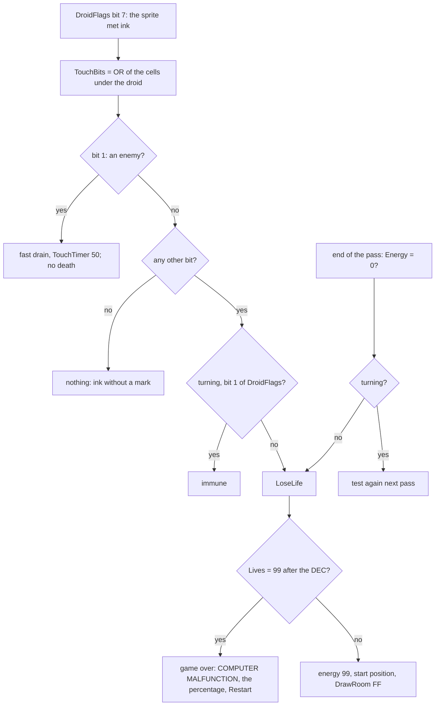

Worked example, `rzx-035000` frames 214-320, the only life lost in the RZX game:

| Frame | What the samples show |
| --- | --- |
| 214 | the droid walks south out of room 109 into room 117 at x 4, y 50; the scroll wipe starts |
| 247 | the wipe ends; object 1 (kind none, x 32, y 72) still has state `$40`, just entered |
| 248 | the object's draw-only act: state `$00`, its image over the droid |
| 250 | DroidFlags `$C4`: bit 7, the sprite met ink; Energy 36, Lives 5 |
| 251 | TouchBits `$04`, an object; Lives 4, Energy 99: HazardDeath and LoseLife |
| about 310 | DeathEffect ends; the droid stands at StartPositions[117] = (21, 136) |

The droid walked in from the north onto the object's place. During the 33-frame wipe nothing moves; the object
appears on top of the droid and kills it at its first chance. No input could have saved this life, short of the shield
raised before the exit.

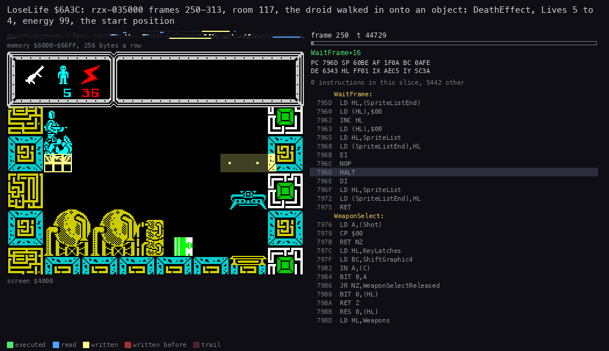

The animation is a trace of `rzx-035000` frames 250-313, in 100 pictures, memory `$6000-$66FF`, with the listing of
LoseLife, DeathEffect, SaveRoomObjects and PlaceDroid. Command:
`python3 ../../kit/routine_anim.py --work work/docs/tjC/r35 --window 250:0-314:0 --listing build/game.lst --view screen --range 6000-66FF --pc 6A3C-6AAC,7ADF-7B3E,6ADC-6B21,7A6D-7A9E --pictures 100 --title 'LoseLife $6A3C: rzx-035000 frames 250-313, room 117, the droid walked in onto an object: DeathEffect, Lives 5 to 4, energy 99, the start position' --out docs/img/routines/LoseLife.gif`.

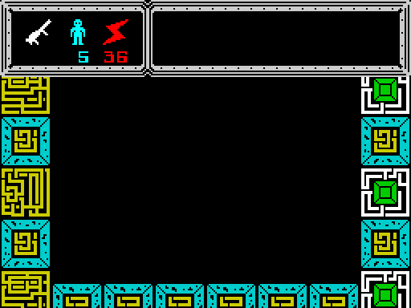

The screen at every second frame of `rzx-035000` frames 244-330. Command:
`python3 ../../kit/screen_anim.py --work work/docs/tjC/r35 --from 244 --to 330 --step 2 --scale 2 --delay 100 --hold 1500 docs/img/play/death-hazard.gif`.

The energy-out death and the game over are in the recordings `energy-out` and `game-over` (WALKTHROUGH 6.0) and their
screenshots in doc 01. L1 counts 55 lives lost in the stage 1 builds; EnergyOut found energy 0 twice (the
`energy-out` recording), and HazardDeath was reached 53 times.

**The point**: only the room's residents kill. The enemies, which the player sees most, only drain. And a droid that
is turning round is untouchable for those few frames.

## 10.7 Lives and the game over

`Lives $636D` is BCD, 3 at the start. A life lost takes one off; GEN 19 adds one. The game over comes when the DEC
gives `$99`: the droid played on with 0 lives, so a game has four droids before any GEN 19.

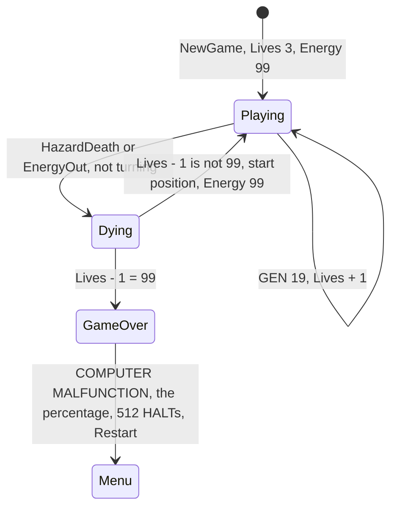

LoseLifeGameOver clears the HUD row, stops the energy clock, queues COMPUTER MALFUNCTION and calls ProgressScreen with
A = `$FF`: the picture of the pieces taken and YOU HAVE COMPLETED nn % OF TUJAD. Then 512 HALTs and Restart.

Worked example: in the RZX game Lives went 3, 4 (GEN 19 at RZX frame 13 399), 5 (26 982), 4 (the death at 35 249),
5 (36 123). The game ended with 5 lives.

**The point**: the lives counter has a hidden fourth life at 0. GEN 19 is worth taking: there are only three.

## 10.8 Pickups and the ED pieces

The droid's own step tests (`CellBlockedColumn`, `CellBlockedRow`) store an item cell they meet in `FoundItem $63AA`;
MoveDroid clears it at the start of each act. After the touch test MoveDroidPickup takes the item:

1. FoundItem is 0, or the cell holds `$FF` (a teleporter): nothing.
2. The kind is found in the room's alien record (item 1 if its kind matches, else item 2) and its bit 7 cleared.
3. The 2 x 2 cells are zeroed and `PickupErase` clears the item from the screen.
4. By kind:

| Kind | Effect | Message |
| --- | --- | --- |
| `$80` GEN 19 | Lives + 1 (BCD) | GEN 19 COLLECTED |
| `$81` energy | Energy 99; EnergyTimer = EnergyReload | ENERGY ABSORBED |
| `$C1-$C3` weapon | that weapon's Ammo + 1 (BCD); ShowWeapon | WEAPON STORED |
| `$82-$B3` ED piece | EdPickup | the progress screen |

`EdPickup $7703` turns the kind into the piece number (`RES 7`, `DEC A`: `$82` is piece 1) and calls ProgressScreen.
ProgressScreen sets the piece's bit in `EdFlags $6681`: byte (n - 1) / 5, bit (n - 1) mod 5. It shows the 10 x 5
picture with the new piece flashing; each piece is 2 % of it. Then SaveRoomObjects and DrawRoom with A = `$FF`.

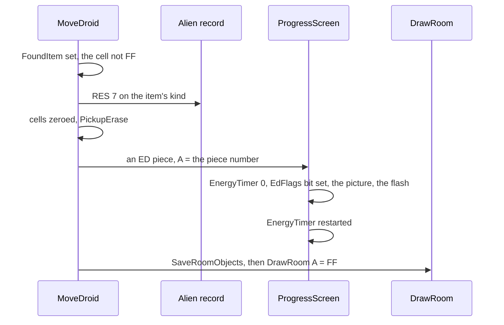

Worked example, `rzx-010000` frames 1690-1890, room 58: the droid flies onto the item at position `$38`, kind `$AA`
(ED piece 41). EnergyTimer counts `$CD`, `$C8`, `$C4` in frames 1690-1700 and is 0 from frame 1702: ProgressScreen has
started. It stays 0 to frame 1886, 185 frames. In the sample of frame 1888 the room is drawn again, the room's item 1
reads `$2A` (taken) and EnergyTimer `$F9`.

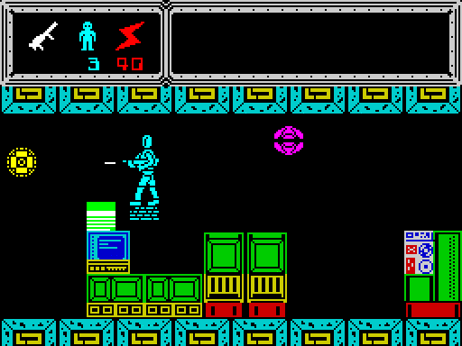

The screen at every frame of `rzx-010000` frames 1680-1712: the droid reaches the piece, and the progress screen
replaces the room. Command:
`python3 ../../kit/screen_anim.py --work work/docs/tjC/z10 --from 1680 --to 1712 --step 1 --scale 2 --delay 100 --hold 1500 docs/img/play/ed-pickup.gif`.

The progress screen itself is in [doc 08](08-hud-and-text.md).

**The point**: an ED piece is worth 2 % and costs no energy while its picture shows. A pickup is the one place where
the game remembers the player's progress in the world: one bit in a room record, one bit in EdFlags.

## 10.9 NewGame and the deal

`NewGame $7A2F`:

1. ClearScreen; `InitRooms $7BCC`: every item present again (bit 7), every object reset (state AND 3 OR `$40`, the
   graphic, frames and kill mark from ObjectKind, frame 0).
2. B = Random OR 1 AND `$1F`: 1-31. `ScrambleRooms $7BA0` is called B times.
3. The exhaust rows, BlankGraphic and EdFlags zeroed.
4. Room = `$54` (84); PlaceDroid; the 28 start values `InitialVars $6380` copied to `$6364-$637F`: energy timer `$FA`,
   weapon 0, ammunition 3 3 3, lives 3, energy 99.
5. DrawHud; DrawRoom with A = `$FF`.

ScrambleRooms moves every non-weapon item one step along the list of item slots, in room order:

```asm
ScrambleRooms:
  LD C,$7B
  CALL RoomRecord
  INC HL
  LD B,(HL)                  ; B = the kind of room 123's item 1
  LD C,$00
ScrambleRoomsLoop:
  CALL RoomRecord
  XOR A
  CP (HL)                    ; item 1 present?
  JR Z,ScrambleRoomsItem2
  INC HL
  BIT 6,(HL)                 ; a weapon ($C1-$C3)?
  JR NZ,ScrambleRoomsItem2
  LD A,(HL)
  LD (HL),B                  ; swap the kind with B
  LD B,A
ScrambleRoomsItem2:
  ...                        ; the same for item 2
ScrambleRoomsNext:
  INC C
  LD A,$7C
  CP C
  JR NZ,ScrambleRoomsLoop
  RET
```

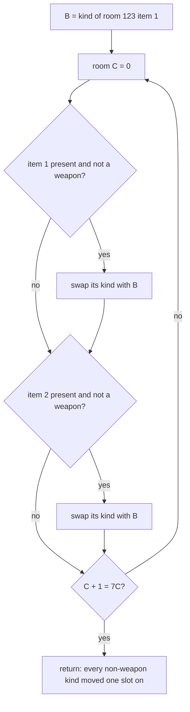

Room 123 has only item 1, and it is the last non-weapon slot of the list. So each call is an exact rotation of the 64
non-weapon kinds by one slot: each slot takes the kind of the slot before it, and the first takes the last. B calls
rotate them by B slots. The places stay; the kinds move. The 16 weapons never move.

The deal of the RZX game was 27 slots: the image's list rotated by 27 matches every slot at RZX frame 1 000.

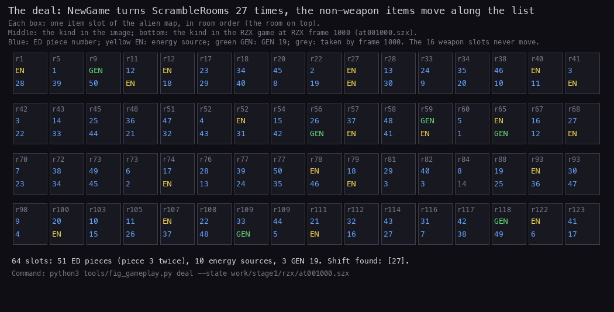

How to read the figure:

- One box per non-weapon item slot of the alien map, 64 in room order, 16 a row; the room on top.
- Middle: the kind in the image. Bottom: the kind in the RZX game at RZX frame 1 000 (`at001000.szx`). Blue numbers
  are ED pieces, EN an energy source, GEN a GEN 19; grey is a piece already taken by frame 1 000.
- The bottom row of each box is the middle row 27 boxes earlier.
- Command: `python3 tools/fig_gameplay.py deal --state work/stage1/rzx/at001000.szx --out docs/img/gameplay/deal.png`.

The list holds 51 ED items for 50 pieces: the kind `$84`, piece 3, is in two slots, rooms 41 and 42. Whatever the deal,
two slots hold the same piece. The second one taken sets a bit that is already set: one ED item is a spare.

Worked example: the image has piece 48 (`$B1`) in room 58. With the shift 27 the slot of room 58 takes the kind of the
slot 27 places back, piece 41 (`$AA`), which is what the RZX game's room 58 holds (doc 07.2).

**The point**: the deal is cheap and weak. It does not shuffle; it rotates one fixed list by 1-31 places. Only 31 worlds
exist, and the pieces always come in the same order round the rooms.

## 10.10 The goal and the win

`WinTest $69E3` runs at the end of every pass:

```asm
WinTest:
  LD HL,EdFlags
  LD A,$1F
  LD B,$0A
WinTestLoop:
  CP (HL)                    ; all five bits of each byte
  RET NZ
  INC HL
  DJNZ WinTestLoop
  CP (HL)                    ; EdFlagsEnd: already said?
  JR Z,WinTestRoom
  LD (HL),A
  LD HL,MsgEdsCompleted      ; EDS COMPLETED, once
  CALL QueueMessage
WinTestRoom:
  LD A,(Room)
  CP $54                     ; the control room, where the game began
  RET NZ
```

In room 84 it clears the HUD row, stops the energy clock, queues CONGRATULATIONS, waits (`WinDelay`), calls
ProgressScreen with A = 0 (the whole picture), waits 512 HALTs (about 10 seconds) and jumps to Restart.

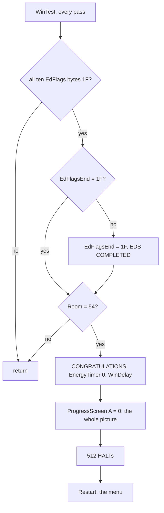

So the goal is all 50 pieces, then room 84. The README's Profile says "the win when ten ED flags are set": the ten
flags are ten bytes of five bits, 50 pieces, and the win needs room 84 as well. The fix is sent to the lead.

Worked example, the RZX game:

- the last ED piece: EDS COMPLETED queued at RZX frame 71 845, in room 28;
- the droid enters room 84 at RZX frame 79 916, and WinTestRoom runs at 79 947;
- the game ends with the win at RZX frame 80 680.

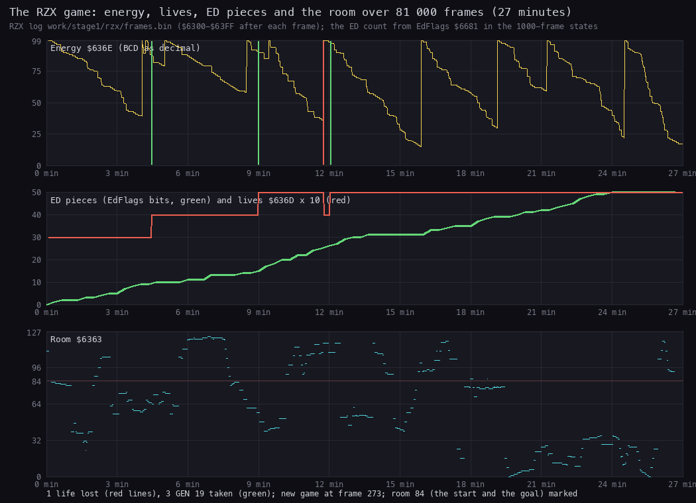

How to read the figure:

- Three panels over the RZX frames, in minutes.
- Top: Energy, BCD read as decimal. The saw is the slow drain; the jumps to 99 are energy sources and the life lost.
  Green lines are GEN 19, the red line the life lost.
- Middle: ED pieces (the bits of EdFlags, from the 1 000-frame states) and Lives x 10.
- Bottom: Room; the line at 84 is the start and the goal.
- Command: `python3 tools/fig_gameplay.py course --log work/stage1/rzx/frames.bin --states work/stage1/rzx --out docs/img/gameplay/course.png`.

The new game starts at RZX frame 273. The player went south first, crossed the map three times and came back to room 84
for the end. 50 pieces took about 24 minutes.

**The point**: Tujad is a fetch quest with a home base. Collecting is not enough; the player must also find the way
back to room 84 alive.

## 10.11 The opponents: enemies and patrollers

The enemies and patrollers are described record by record in doc 07. As opponents they behave like this:

- **Enemies** materialise at random places of a 52-place lattice in the middle rows (doc 07.7), fly diagonally at
  2 pixels an act, flip at walls, and wait at items. Each room has 0-4 of them by its mask. A destroyed enemy comes back
  after 41-255 calls, at a new place. There is no aiming: an enemy never follows the droid.
- **Patrollers** walk three fixed rows through 3-6 rooms each (doc 07.9), whether the droid is there or not. They kill
  at a touch and cannot be shot.
- **Objects** walk a straight line and reverse at walls. They kill at a touch, and only their weapon kills them.

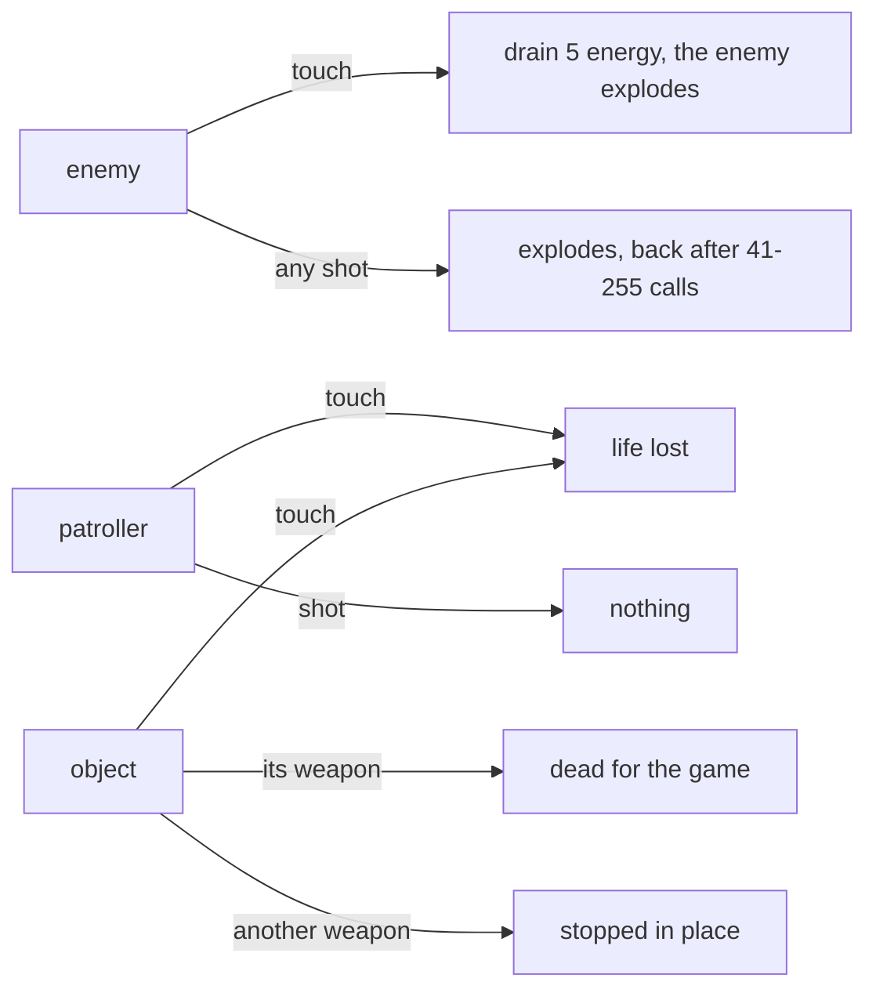

Worked example: room 58 in `rzx-010000` has the mask `$0A` and one object. Enemies 1 and 3 materialise in frame 1146,
enemy 1 is destroyed in frame 1240 and back in frame 1534, 294 frames later. The object walks between y 64 and y 104
until weapon 2 kills it in frame 1459.

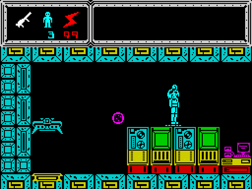

The screen at every frame of `rzx-010000` frames 104-124: enemy 0 materialises next to the droid, flies into it and
explodes; the droid loses 5 energy over the next second. Command:
`python3 ../../kit/screen_anim.py --work work/docs/tjC/z10 --from 104 --to 124 --step 1 --scale 2 --delay 100 --hold 1500 docs/img/play/enemy-touch.gif`.

**The point**: the danger is ordered by how little it moves. The restless enemies only drain; the slow objects and the
patrollers on their rails kill.

## 10.12 Random, the energy timer and the RZX drift

`Random $7DC9` is a 4-byte additive chain at `RandomSeed $63A4` (doc 07.12). Its callers: the menu's poll loop, NewGame
(the deal), the exhaust flicker, the enemy spawn and the wait after an explosion. The game reads no `R` register and no
floating bus; its only inputs are the controls. From a state and its inputs it is deterministic.

`EnergyTimer $6366` counts interrupts, not frames. Interrupts are lost whenever the game runs with them off: the sound
sweeps, the death effect, the teleport, the pause. So the game itself serves fewer interrupts than frames. Per frame the
timer stepped on average:

| Source | Frames counted | Interrupts served a frame |
| --- | --- | --- |
| `c1`, unreal-ng's own frames | play with the timer running | about 0.87 |
| `rzx-010000` | frames 0-2 027, timer running | about 0.92 |
| the RZX log, RZX frames 1 000-81 000 | 69 699 | 0.87 (0 in 16 515, 1 in 45 484, 2 in 7 561) |

The RZX frames hold 0, 1 or 2 interrupts each: an RZX frame is a count of instructions in the recording emulator, not
one 50 Hz frame. A replay of the RZX keys on unreal-ng's own frames therefore has to guess each key's frame
(`tools/rzx_align.py`). A key read one interrupt early or late moves the droid one act early or late. One act more or
less calls Random a different number of times, and every later spawn differs.

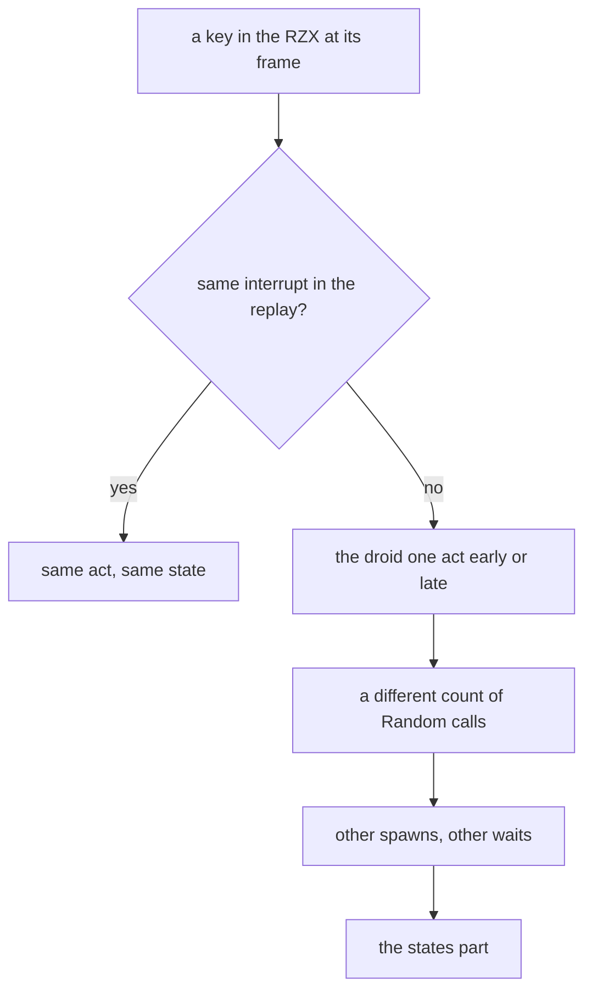

Witness (`work/stage1/rzx-align.out`, 59 chunks replayed from their states): 33 parted first in RandomSeed `$63A4-$63A7`,
20 with the droid one step off (`$6359`, `$635A`, `$635C`), and 6 in other variables. unreal-ng's INT falls at T 1 812
of its 48K frame, not at the start; passes that begin before it look like one-frame passes when counted by frame number
(doc 04.7).

**The point**: the drift is the game's sensitivity to timing, met by RZX frames that are not unreal-ng's frames. It is
not a fault of the game, and it has not been shown to be a fault of the emulator.

## 10.13 Pause

`Pause $793A` runs at the end of each pass, after WaitFrame's DI. While ENTER is held it toggles Controls bit 5; it
loops until the bit is clear and ENTER released:

```asm
Pause:
  LD HL,KeyLatches
  LD BC,$BFFE                ; the row with ENTER
PauseLoop:
  IN A,(C)
  BIT 0,A
  LD A,(Controls)
  JR NZ,PauseReleased
  BIT 1,(HL)                 ; ENTER was released before?
  JR Z,PauseLoop
  RES 1,(HL)
  XOR $20                    ; paused on, or off
  LD (Controls),A
  JR PauseLoop
PauseReleased:
  SET 1,(HL)
  BIT 5,A
  JR NZ,PauseLoop            ; still paused
  RET
```

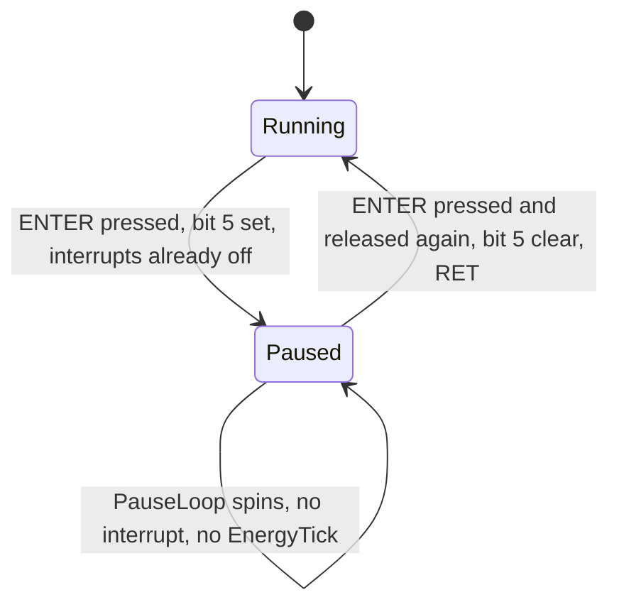

Nothing in the loop enables interrupts, so the handler `$95D0` does not run, and neither EnergyTick nor DrainTimer.
The energy is frozen.

Witness, `c1` frames 15 241-15 359 (measured by tjA, doc 04.6 and [doc 05.10](05-controls.md#510-pause-the-interrupt-stops)):
no execution of `$95D0` or `EnergyTick $7AB6`; EnergyTimer `$64` and Energy `$97` at frames 15 241, 15 300 and 15 359.

**The point**: pause really stops the game, the energy clock included, contrary to the `.ann`, stage 2 and the brief.

## 10.14 Notable features

- **The spawn lattice.** Two masks give 52 places, and one column catches four times its share (doc 07.7).
- **Four enemy colours, not six.** `Random AND 7 OR $42` always sets bit 1, so the inks are 2, 3, 6 and 7: red, magenta,
  yellow and white, never green or cyan (doc 07.6).
- **The state byte as the collision flag.** An enemy hands the interrupt the address of its own state; the interrupt's
  XOR test writes bit 7 into it, and the explosion follows with no test in MoveEnemy (doc 07.6).
- **Flag pointer 0 means immune.** Objects, patrollers, explosions, materialising enemies and the shielded droid all
  point their collision flag at ROM address 0, where the write is lost (doc 07.11, 10.3).
- **The wrong weapon freezes an object.** It stays stopped and deadly until the right weapon comes (doc 07.8).
- **The first death frame is unreachable.** `ObjectDeathFrames` has four words; the state arithmetic reads only the
  last three (doc 07.8).
- **Items freeze enemies.** An enemy square on a cell edge beside an item stops on both axes; three RZX witnesses
  (doc 07.5).
- **XOR collisions.** Marks are XORed into the cell table, so movers on the same cell keep both bits (doc 07.4).
- **Patrollers live off-screen.** They move through rooms the droid is not in (doc 07.9).
- **Turning makes the droid immune.** HazardDeath and EnergyOut both return while DroidFlags bit 1 is set (10.6).
- **The enemy test hides the hazard.** An enemy's mark under the droid wins over an object's mark (10.6).
- **The shield costs 25 times the energy** and turns the touch test off (10.3).
- **A wipe with interrupts on.** DrawRoom's 33-frame scroll wipe runs with interrupts on, so the energy keeps counting
  while the room changes; the objects of the new room appear on top of the droid with no warning (10.6).
- **The 400-frame teleport** with interrupts off for 240 frames (10.2).
- **The duplicate ED piece 3** in rooms 41 and 42: 51 ED items for 50 pieces (10.9).
- **The deal is a rotation** by 1-31 slots: 31 possible worlds (10.9).
- **A hidden life at 0**: the game over comes at Lives `$99` (10.7).
- **Leftover source text** fills the work space at `$6359` in the image; every byte is written before it is read
  (doc 02).

## 10.15 Known only from the code

- **Energy 0 while turning.** EnergyOut waits while bit 1 is set. Under the fast drain (one step every 10 interrupts)
  a turn of five frames takes about 12 passes, long enough for EnergyTick to step 0 to `$99` (SUB 1, DAA). The droid would then keep the
  life with energy 99. No recording turns at energy 0.
- **99 lives plus GEN 19** gives `$00` (ADD 1, DAA). Only three GEN 19 exist, so the counter never gets near.
- **The probe's steering.** No RZX chunk steers weapon 3; the recording `probe-shield`, made for doc 05, does (doc 05.8).
- **The patroller touch.** The droid shared a room with a patroller in 5 378 RZX frames and never touched one.
- **The game over's percentage.** The `game-over` recording shows the screen; the RZX game never lost its last life.
- **The spare ED piece.** No recording took both copies of piece 3 in one game; the code sets the same bit twice.
