# Video Pool: walkthrough

How the reverse was done, step by step, and which unreal-ng call answered each question. Terms:
[docs/README.md](docs/README.md). Recipes: `../recipes/`.

Every recording is named with its load (ROM speed or the fast LD-BYTES trap) beside every frame number.

## 0. The medium

The release: ZXDB 5566, Video Pool by Oxford Computer Publishing, 1985, written by James Hutchby (the menu says
"ocp 1984"). `orig/` holds three tapes and the instructions; which one is the game was asked first.

```bash
. work/env.sh
md5 orig/*; shasum orig/*
unzip -o orig/VideoPool.tzx.zip -d work/media/tzx; unzip -o orig/VideoPool.tap.zip -d work/media/tap
unzip -o "orig/VideoPool(PaxmanPromotions).tzx.zip" -d work/media/paxman
python3 tools/tzxblocks.py list "work/media/tzx/Video Pool.tzx"            # archive info + 4 ROM blocks + 1 turbo
python3 tools/tzxblocks.py list "work/media/paxman/Video Pool (Paxman).tzx"
python3 ../../kit/tapblocks.py list work/media/tap/VIDPOOL.TAP             # 4 ROM blocks, 149.1 s
for i in 2 4 5; do python3 tools/tzxblocks.py "work/media/tzx/Video Pool.tzx" $i work/stage1/blocks/orig$i.bin
  python3 tools/tzxblocks.py "work/media/paxman/Video Pool (Paxman).tzx" $i work/stage1/blocks/pax$i.bin
  cmp work/stage1/blocks/orig$i.bin work/stage1/blocks/pax$i.bin; done      # no output: identical
python3 tools/basic_list.py work/stage1/blocks/basic.bin                   # CLEAR 32767, LOAD "" CODE, USR 61440
python3 tools/image.py work/mkgame/original.bin                            # asserts the loader's sum $2E3F
python3 ../../kit/sig_scan.py work/mkgame/original.bin --base 0 --all --out work/stage1/sig-game.json
```

- **The game is the original TZX.** Its archive info says "Original". The BASIC loads a 256-byte loader at `$F000`
  and runs it; the loader reads the 25 000-byte turbo block (zero 660 T, one 1320 T) to `$8000-$E1A7`, sums it to
  `$2E3F` (the word at `$F03C`) and jumps to `$8000`. Doc 3, 3.1.
- **The Paxman re-release is the same game.** Its BASIC, loader and turbo block are the original's byte for byte;
  only the pauses and the first block (a text block, "Created with Ramsoft MakeTZX") differ.
- **The TAP is a conversion, not the original.** Its 25 000 bytes at `$8000` differ from the turbo block in 207
  bytes, 25 runs, every one where the original has zeros or a table the game builds (ball records `$8A89-$8AE9`,
  `$869E-$86C0`, `$CFC0-$CFFF`), plus the key names at `$B668`. It was saved from a game that had run; its sum is
  not `$2E3F`, so the original loader would reset on it.
- The signature scan finds no known module: two one-anchor candidates at `$8240` (the key-name table, the
  Spectrum's keyboard rows as text) and `$EFB4`, each over a hundred bytes different.
- The image's text (a strings scan): the menu (`$B488-$B5B1`: one or two players, small or large pockets, keyboard,
  Interface 2, Kempston or cursor joystick, begin, game variations, edit table, reconfigure keys, "ocp 1984,
  written by j.hutchby"), the variations page (`$B751`), the key prompts (`$B40B`), the HUD words (`frame`,
  `shots:`, `last shot:` near `$96D8-$974E`), GAME OVER and PLAYER 1 / 2 (`$9894`), the fouls ("FOUL SHOT!",
  "WRONG ORDER!", "WRONG POCKET!" at `$9D01-$9D1F`), the hall of fame ("congratulations! ... the o.c.p. hall of
  fame", `$AD53-$AE7D`) with the default names `james`, `francis`, `bill` (`$AC0A-$AC98`), the editor (`- editor -`,
  `reset` at `$C552`) and "presents" (`$B93A`).

## 1. One recording from power-on

Asked: what runs from power-on to play, and is there anything between the loader and the game?

Used: `re_session.py capture --record-load` on the 48K (`c1`: the ROM blocks through the fast LD-BYTES trap, the
turbo block at signal speed through the loader at `$F000`; then the input script `tests/inputs/c1-load-and-shots.txt`
from frame 5760: a key on the "presents" page, B, five shots), then `re_session.py stages`.

```bash
. work/env.sh
python3 $RS capture --work work/stage1/c1 --media "work/media/tzx/Video Pool.tzx" --model 48K --record-load \
    --load-frames 12000 --inputs tests/inputs/c1-load-and-shots.txt --ranges 4000-FFFF --port-base 34200 --binary $BIN
python3 $RS stages --work work/stage1/c1
python3 $RS build --work work/stage1/c1 --from-frame 5556 --from-tinframe 25555 --into work/game
python3 tools/moment_snapshot.py --work work/stage1/c1 --at 5556:25555 --out work/snaps/entry.z80
```

| Stage | Entered at | Frame, T (`c1`) | Written by | Entered from | What it is |
| --- | --- | --- | --- | --- | --- |
| 0 | `$F000` | 250, 15 109 | `$0802` (the ROM's LD-BYTES, trapped) | `$34BB` (`USR`, BASIC line 30) | the loader: ERR_SP target cleared, the turbo load called |
| 1 | `$F057` | 250, 16 612 | `$0802` | `$05EE` (the ROM's LD-EDGE returning) | the loader's pilot search |
| 2 | `$F0CE` | 300, 21 356 | `$0802` | `$0604` | the loader's edge routine; the turbo block loads to frame 5529 |
| 3 | `$F015` | 5529, 63 143 | `$0802` | `$0555` (SA/LD-RET, pushed by the loader) | the 16-bit sum and `JP $8000` |
| 4 | `$8000` | 5556, 25 555 | `$F096` (the loader's store) | `$F039` | the game's entry |
| 5 | `$B91C` | 5560, 2710 | `$F096` | `$0052` (the ROM's interrupt `RET`) | the presents page's wait (`HALT` at `$B91B`) |
| 6 | `$FCFC` | 6061, 1833 | `$802A` (the game) | `$B239` | the IM 2 jump, built after a key on "presents" |

Produced:

- One load, two loaders: the ROM's for blocks 1-4 and the game's own turbo copy for block 5. Stages 1-3 are pieces
  of the same 256-byte loader entered back from the ROM's routines it borrows; stages 4 and 5 are the game.
- The game starts with `LD SP,$D000`, resets the ball records (`$9D2C`), shows the OCP logo and "presents"
  (`$B8C5`, frames 5560-6000: the logo is drawn line by line), and waits for a key (with no key it runs an attract
  sequence; stage-1 recording `m1`, 6.0). The key at frame 6060 makes `$8013` set IM 2 (I = `$FE`, the table
  `$FE00-$FEFF` + `$FF00` filled with `$FC`, `$FCFC` = `EI`, `JP $80F0`) and print the menu (frame 6100).
- `c1` reached the menu, a one-player game, weak shots that touched no ball ("FOUL SHOT!", a life lost each), GAME OVER
  after the third, and the menu again.

### 1.1 Interrupts and timing

Asked: what drives the game in time, and what does one physics step and one ball redraw cost?

Used: `tools/irq_sites.py` over the L1 builds (every executed `DI`, `EI`, `HALT`, `IM`, `LD I,A`), then
`tools/task_costs.py` over access traces of `w1` (`analysis trace`): the interrupt entries `$FCFC`..`$8105`, each
task the scheduler calls (`$9170 CALL $9187` to `$9173`), and the inclusive cost of chosen routines.

```bash
python3 tools/irq_sites.py work/game/l1.json work/runs/w1/l1.json
python3 tools/task_costs.py --work work/runs/w1 --window 1070:0-1100:0 --routines 8701,9548,87EF,8A02 --per-irq
python3 tools/task_costs.py --work work/runs/w1 --window 4330:0-4400:0 --routines 8701,9548 --per-irq
```

Produced:

- **IM 2, one vector.** `IM 2` only at `$8018` (twice in `w1`: the start and the restart after GAME OVER), `I` =
  `$FE`; the table `$FE00-$FF00` is all `$FC`, so the vector is `$FCFC` = `EI; JP $80F0`. The handler `$80F0`
  starts with `DI` and ends with `EI` at `$8104`: interrupts never nest. Before the first key the game runs in IM 1
  on the ROM's handler (the presents page `HALT`s at `$B91B`).
- **No main loop to sync.** The foreground loop `$8069` only plays sounds and tests BREAK; all of play runs as
  interrupt tasks (doc 2, 2.4), so the game's clock is the interrupt itself. A screen that waits does it with `HALT`:
  the presents page `$B91B`, the menu `$B29C` (750 in `c1`, 1600 in `w1`), the hall of fame `$AEB3` (1231, `w1`
  only), and waits inside play (`$847D`, `$9865`, `$9B09`, `$9FD2`) that stage 2 names.
- **The interrupt can be a bare `EI; RET`.** `$FCFC` ran 15 385 times in `w1`, the handler `$80F0` 9536 times: the
  difference are the interrupts taken while `$80DE` had patched `$FCFD` to `RET` (the racking, the foul jingle).
- **One interrupt in play** (`w1` frames 1070-1100 and 4330-4400, `--per-irq`):

| Phase | Interrupt length, T | Tasks |
| --- | ---: | --- |
| aiming (the cursor, the power bar) | 15 100-22 600 | `$934D` power bar 8300-13 200, `$8106` input 3300, `$8546` cursor 119, `$85EB` 49, `$8506` 110 |
| the shot's release | 483 600 (6.9 frames) | `$8506` calls `$8A02`: 454 950 T in the ROM's calculator, interrupts off |
| one ball moving | 19 930 | `$86C1` physics 9970, `$827E` redraw 6650 |
| four balls moving | 45 400-50 700 | physics 22 000-28 000, redraw 17 200-22 800 |
| six balls moving | 58 400-73 800 | physics about 27 100, redraw about 33 300 (12 sprite draws) |

- **Per step** (inclusive, the same windows):

| Step | T | Witness |
| --- | ---: | --- |
| one ball's physics step `$8701` (move, collisions, friction) | 2716 alone, 3356 mean with 6 balls, up to 14 242 with contacts | 237 calls, `w1` 4330-4400 |
| of it, the ball-against-ball test `$87EF` | 1439 alone, 1930 mean, up to 11 636 | 76 calls, `w1` 1090-1130 |
| of it, the cushion and pocket test `$8B4E` | 325 mean, up to 1262 | 76 calls |
| the friction lookup `$90F5` | 487-641 | when the ball's turn comes (`$8B4C`) |
| one sprite draw `$9548` (XOR, 3 bytes x 16 lines) | 2470-2497 | 232 calls |
| one ball redraw (erase + draw, `$9548` twice) | about 4950 | |
| the rest of the physics task `$86C1` with one ball | 9970 - 2716 = 7250 | `w1` 1070-1100 |

- **Six balls overrun the frame.** With six balls moving an interrupt takes 62 000 T on average and up to 73 768 T,
  more than the 69 888 T of a frame: in `w1` 4330-4400 the interrupts of frames 33, 40, 42 and 44 of the window are
  lost, so the balls slow down on screen while many move. Sixty entries in 70 frames.
- **For doc 14 (UKNC port), per interrupt in T of the 3.5 MHz Z80:** physics 7250 + 3400 per moving ball; drawing
  5500 per moving ball (two XOR draws plus the list); collision tests within physics about 1450-1930 per moving
  ball, more on contact; the power bar 8300-13 200 while aiming; the shot's set-up 455 000 once (the ROM's
  floating point: the port needs its own); the sound runs outside the interrupt in the foreground loop
  (`OUT ($FE)`, `$8088` / `$808F`) and the ROM's BEEPER `$03B5`, in the time the interrupt leaves.

## 2. Static pass over the medium

## 3. The stages and the packers

## 4. The medium from source

## 5. Tool gaps found and fixed in unreal-ng

| Gap | Fix | unreal-ng commit |
| --- | --- | --- |

## 6. The game

### 6.0 The recordings

Asked: which recordings reach every part of the game, with real keys only?

Used: `tools/shot_bot.py`, a bot that plays from the entry snapshot `work/snaps/entry.z80` (`c1` at frame 5556,
T 25 555) on its own unreal-ng instance (`tools/lab.py`: offscreen, muted, fresh 48K, port base 34200). A plan in
`tests/plans/` lists the steps (keys, waits, shots by goal). For each shot it saves the state, tries candidate shots
on it and keeps the first whose outcome meets the goal (a pot, a foul, the cue ball potted, a shot that pots
nothing, a wrong pot), reading the ball records `$8A88`, the cursor `$86BA`, the power `$86BF` and the lives
`$9F4E`. For a pot it aims first: the cue ball runs at the cursor (the instructions, and the shots logged), so the
candidates are the cursor positions whose line from the cue ball passes nearest a ghost point (two radii behind an
object ball on a pocket's line), reached by holding M or SS and then one-frame taps (the cursor's speed `$86BC`
starts at 1 on each press and grows every 10 calls to 6, `$85AD`). Then it replays the chosen keys from the snapshot
with the TTD recording on, so the recording holds only key events, and checks the ball records at the end against
the searched line. The keys are kept as the input script `tests/inputs/NAME.txt` (mm_session format, frames from
the snapshot).

```bash
. work/env.sh
python3 tools/shot_bot.py --plan tests/plans/w1.txt --work work/runs/w1     # the same for each plan
python3 $RS build --work work/runs/w1                                         # L1 of the recording
```

Found: six recordings; every play recording ends with "replay matches the searched line" (the bot's log
`work/stage1/lab/NAME.out`) and its input script is in `tests/inputs/`. The exploration labs `x2`-`x6`
(`tests/plans/x*.txt`, `work/lab/`) found the keys and the bot's method; they are labs, not recordings.

| Recording | Frames | Input | Reaches |
| --- | ---: | --- | --- |
| `c1` | (section 1) | `tests/inputs/c1-load-and-shots.txt` | power-on, the load (ROM blocks, turbo block), "presents", the menu, a game of fouls |
| `w1` | 16 378 | `tests/inputs/w1.txt` | one player, standard game, large pockets: frames 1-3 cleared (18 pots, score 002700), four misses to GAME OVER, the name "vp" entered, the hall of fame, the menu, the attract sequence after the menu's timeout |
| `f1` | 6108 | `tests/inputs/f1.txt` | the fouls: the cue ball potted (a life, the cue ball re-spotted), the shots running out ("FOUL SHOT!", a life), a double pot, GAME OVER with a score below the hall of fame, the menu |
| `p2` | 4549 | `tests/inputs/p2.txt` | two players: player 1 pots four, a miss costs a life, "PLAYER 2 FRAME 1", the racking, player 2 scores 240, BREAK to the menu |
| `v1` | 4227 | `tests/inputs/v1.txt` | the variations page; variation 1 (numeric order): a wrong-order pot costs a life, a pot of ball 1; BREAK; variation 2 (own pockets, 8 shots): a wrong-pocket pot, the score "1x5x3x10=150", a double pot |
| `m1` | 8368 | `tests/inputs/m1.txt` | the attract sequence (logo, the signature written, "press any key"), every menu option but `i` / `j`: cursor joystick, the variations page, redefine keys (Q / W / P) and back, the editor (entered, cursor moves, fire, BREAK), small pockets and a shot on them, BREAK to the menu |
| `j1` | 3850 | `tests/inputs/j1.txt` | stage 2: menu J (Kempston), the stick left and fire, a shot; BREAK; menu I (Interface 2), keys 6 and 0, the same shot; BREAK (no `ready` step: its probe holds SPACE, not fire with a joystick) |
| `e1` | 1368 | `tests/inputs/e1.txt` | stage 2: the editor (menu E at 620): the cursor right onto ball 1, fire picks it, left 20 frames, fire puts it down at x 170, the cursor up onto "play", fire, the shot with SPACE (keyboard again) |

Every shot, foul, pot and message plays its sound through the foreground loop `$8069` or BEEPER (section 1), so
each play recording holds the game's sounds; none was played aloud.

Not reached:

- **The editor's work**: not reached in stage 1. In `m1` the cursor did move, but the plan held 5, 6, 7 and 8 for
  30 frames each (left, down, up, right), so it came back to its start and the screenshots at 6420-6830 are the
  same; no ball lay within 5 pixels of it and the "play" / "reset" boxes were never hit. Stage 2's `e1` picks a ball
  (EditorPickBall `$C258` entered at 702), moves it (`$C3EB` 20 times, frames 720-739), drops it (`$C3CC`), hits "play"
  (`$C41D` at 840) and plays the shot (the aim task `$C4D6` from 845, the editor's roll task `$C46E` frames 915-1054).
  "reset" (`$C532`) is still known only from the code.
- **Interface 2 and Kempston play**: not chosen in stage 1; stage 2's `j1` plays a shot with each
  (ReadKempston `$81A0` 1087 runs, frames 622-2185; ReadInterface2 `$8151` 836 runs, frames 2503-3540).

### 6.1 The screens

Each screen at its frame, from the recordings of 6.0 (scale 2, the bot's `screen` step or
`kit/screen_shot.py --work work/runs/NAME`).

The attract sequence and the menu (`m1`):

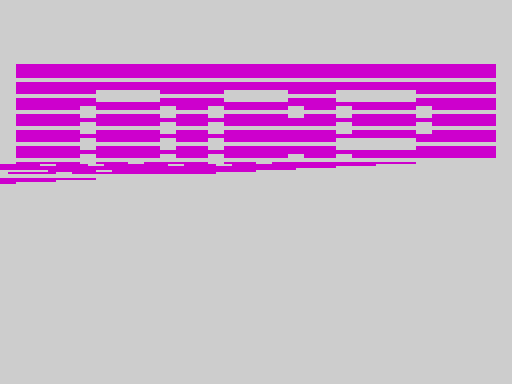
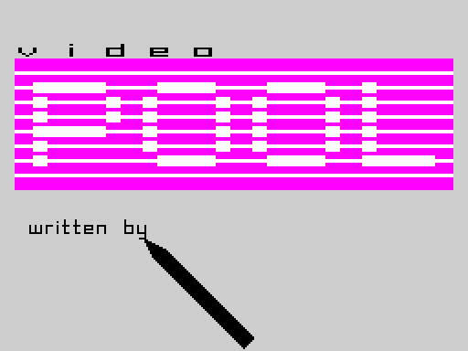
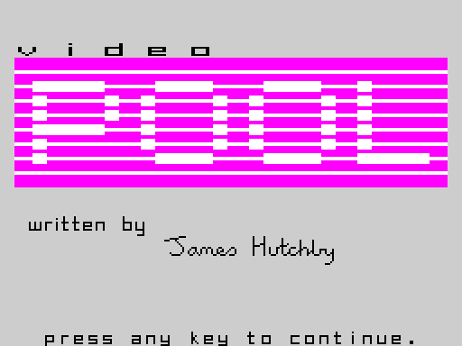

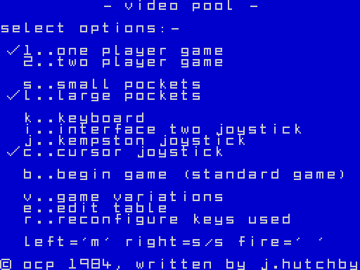
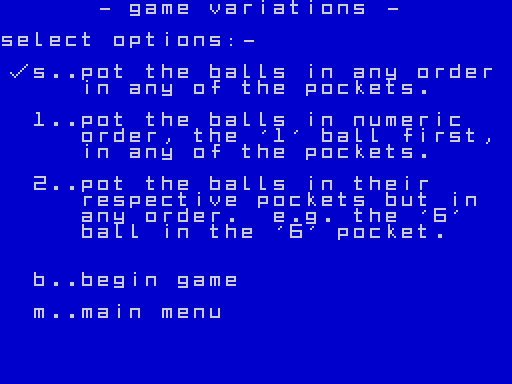
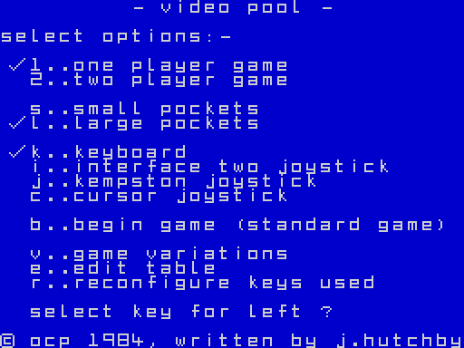
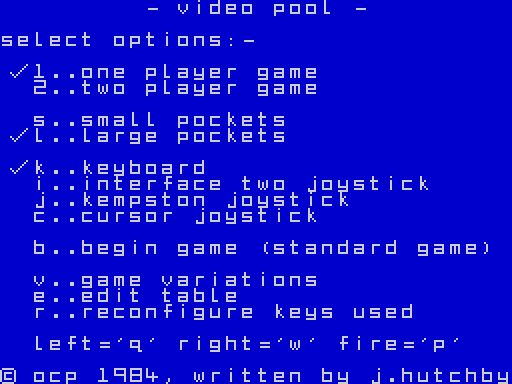

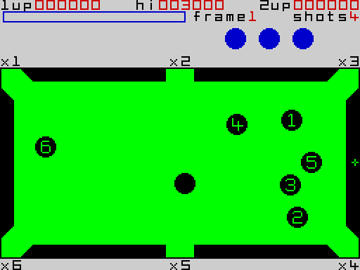


A one-player game to the hall of fame (`w1`):

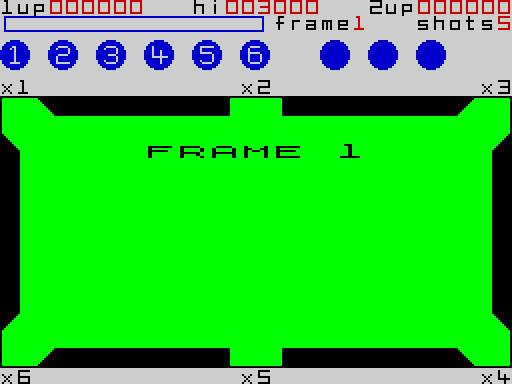
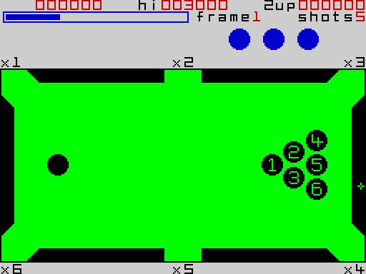
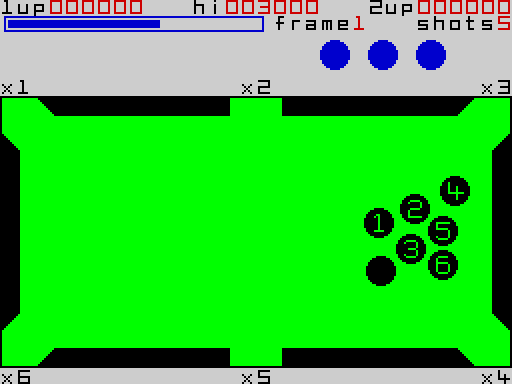
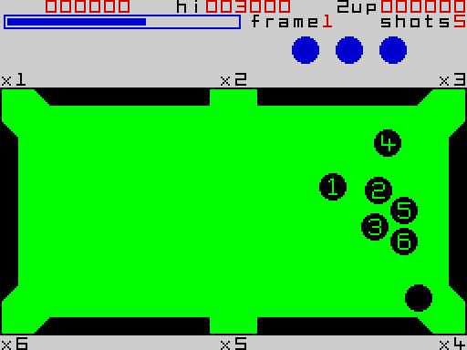
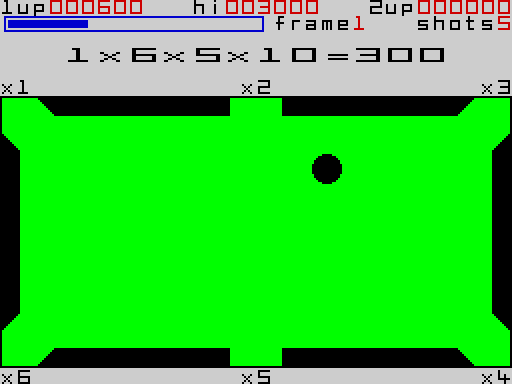
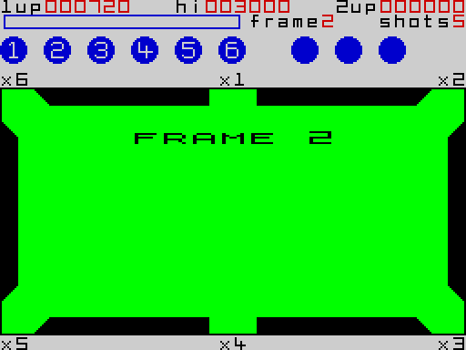
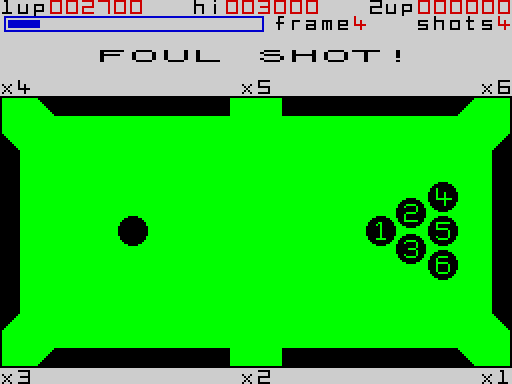
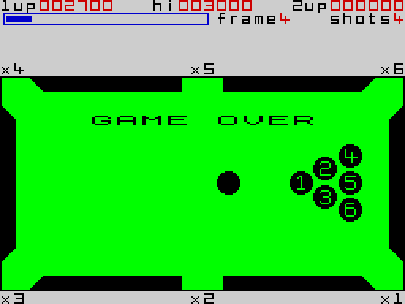
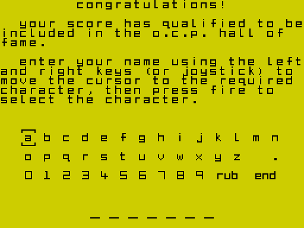
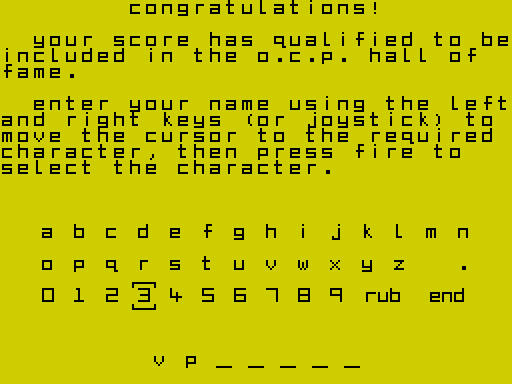
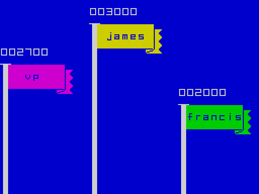

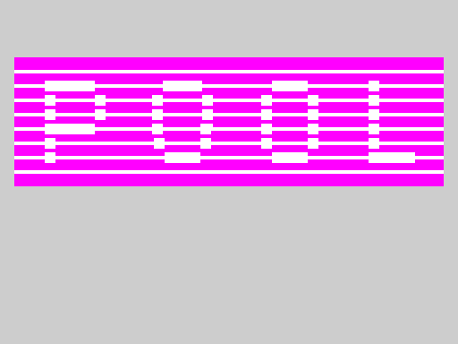

The fouls (`f1`):

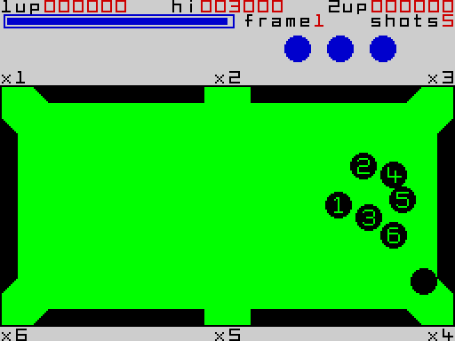
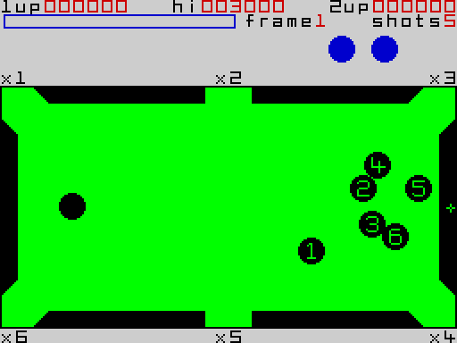
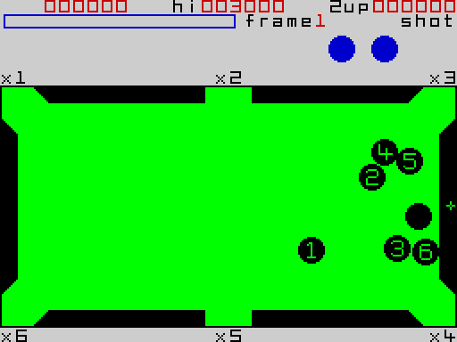
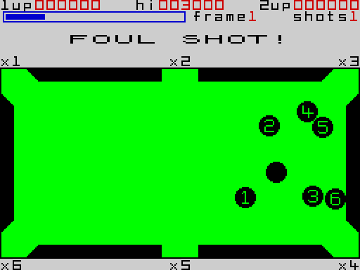
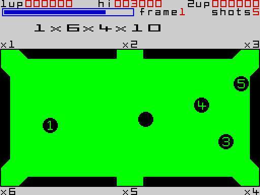
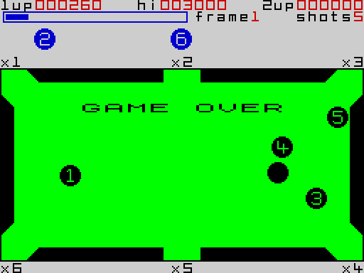


Two players (`p2`):

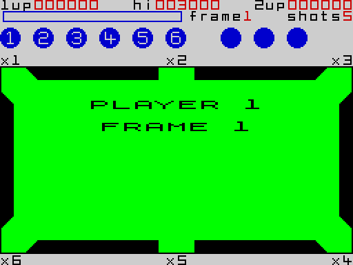
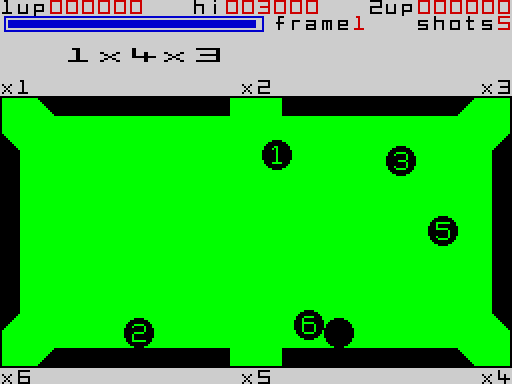
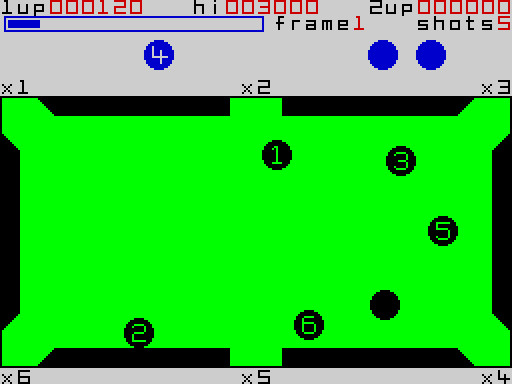
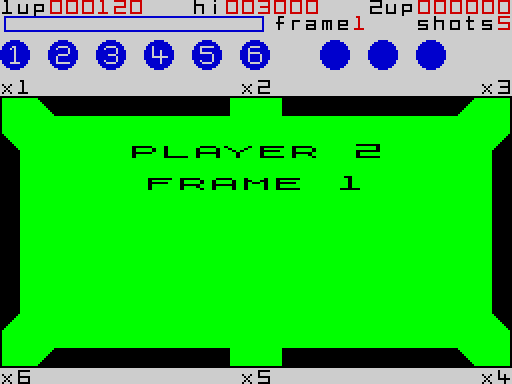
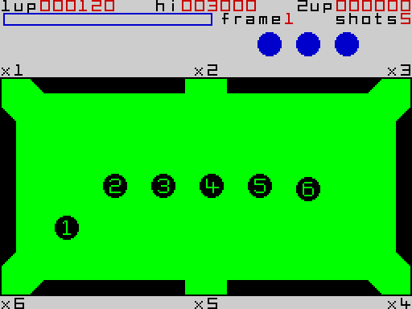
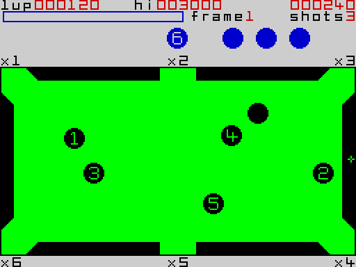
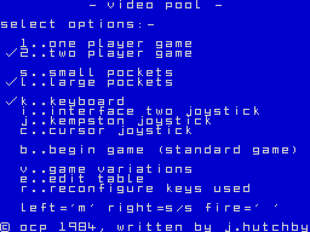

The table editor (`e1`, stage 2):


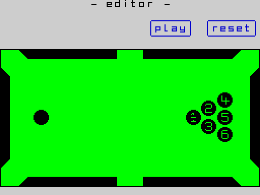


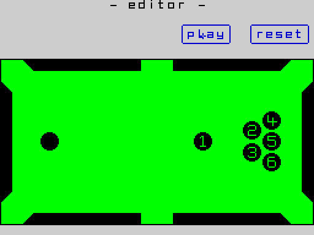
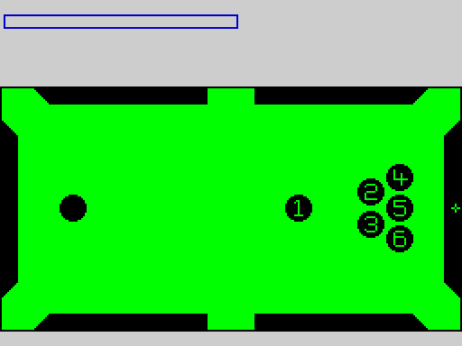
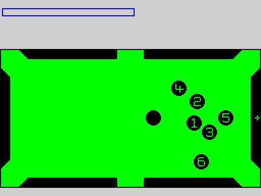

The joysticks (`j1`, stage 2):

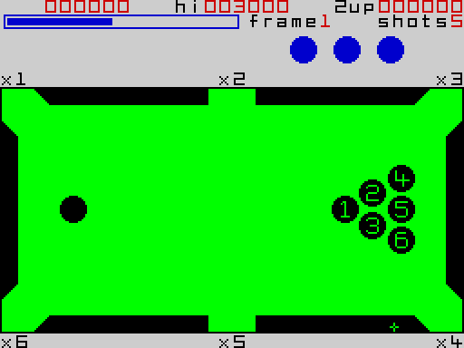


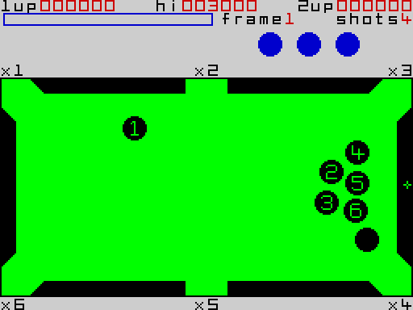

The variations (`v1`):


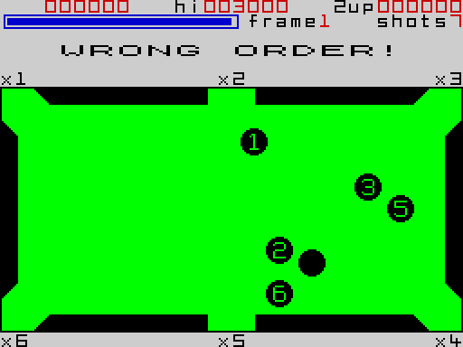
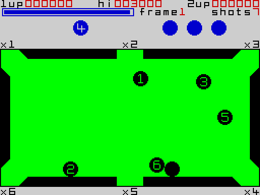
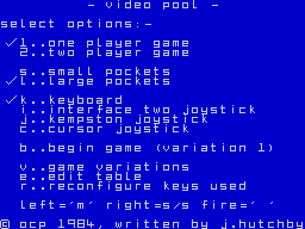

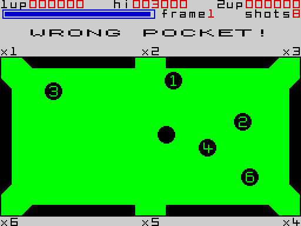
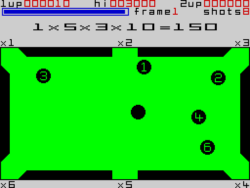

## 7. Review
