# 1. Game design

What this covers:

- the game in a few lines, and who wrote it (1.1);
- every screen and mode, from the attract sequence to the hall of fame, and how they lead into each other (1.2);
- the play screen and its HUD (1.3);
- the controls as a player uses them, and the hidden keys (1.4);
- the table, the balls and the rack (1.5);
- a shot as the player meets it: aim, power, roll, outcome (1.6);
- the key moments of a game, each with its screenshot and frame (1.7);
- the rules: shots, lives, fouls, frames, the score, with a worked tally (1.8);
- the three rule variations (1.9);
- two players (1.10);
- the table editor (1.11);
- GAME OVER and the hall of fame (1.12);
- the difficulty (1.13);
- what no recording reached (1.14).

It describes the game as a player meets it. Every rule names its routine; the rules as code are in
[doc 10](10-gameplay-logic.md), the balls and the rack scripts in [doc 7](07-objects.md), the keys and ports in
[doc 5](05-controls.md), the interrupt and its tasks in [doc 4](04-game-loop.md). The names are those of
`src/game/game.ann` ([Terms](README.md#terms)).

The recordings it rests on, all on the 48K, each with an input script (WALKTHROUGH 6.0 has the table):

- `c1`: power-on, the ROM blocks through the fast LD-BYTES trap, the turbo block at signal speed, then a game of
  fouls (`work/stage1/c1`);
- `w1`, `f1`, `p2`, `v1`, `m1`, `j1`, `e1`: from `work/snaps/entry.z80` (`c1` at the game's entry, frame 5556,
  T 25 555), keys found by `tools/shot_bot.py`: a won game to the hall of fame (`w1`), the fouls (`f1`), two players
  (`p2`), the variations (`v1`), the attract sequence and every menu option (`m1`), the joysticks (`j1`), the editor
  (`e1`).

A frame is 1/50 s of the machine. The game has no main loop: its work runs as tasks of the interrupt, so "a tick"
below is one interrupt ([doc 4](04-game-loop.md)). Every screenshot is the Spectrum screen at the start of the named
frame, taken with `kit/screen_shot.py` (WALKTHROUGH 6.1).

## 1.1 The game

- Video Pool is a pool simulation for the 48K by James Hutchby, published by Oxford Computer Publishing (OCP). ZXDB
  5566 dates the release 1985; the menu's last line says "© ocp 1984, written by j.hutchby" (MenuCopyright `$B5AC`).
- One table seen from above, six pockets, a cue ball and six numbered object balls. The player pots the six balls to
  clear a frame; the next frame racks them again with fewer shots allowed per ball.
- The player never touches a cue. A cross-wire cursor runs round the cushions; holding fire grows a power bar;
  releasing fire sends the cue ball **towards** the cursor at that power (AimPower `$8506`, AimShot `$8A02`).
- The game ends when the lives run out: three life balls on the screen and one more in hand (1.8). A good score
  enters "the o.c.p. hall of fame", three flags on poles (1.12).
- One or two players, each with his own set of balls. There is no computer opponent: the only code that gives the
  cue ball a velocity is AimShot `$8A02` from the cursor and the power, and the editor's ball push `$C3EB`-`$C3FD`
  (known from the code; every recording's shots were played by keys).
- The tape's instructions (`orig/VideoPool.txt`) sell "flicker-free movement of the balls and true playing angles";
  the balls are XOR sprites ([doc 6](06-rendering.md)) and the angles come from the ROM's floating-point calculator
  ([doc 10](10-gameplay-logic.md)).
- The instructions say "pot the five numbered balls", but the rack holds six (StartPositions `$9D5D`) and the frame
  goes on until the sixth is down (ShotEnd `$8357`; `w1` frames 1-3).

## 1.2 The screens

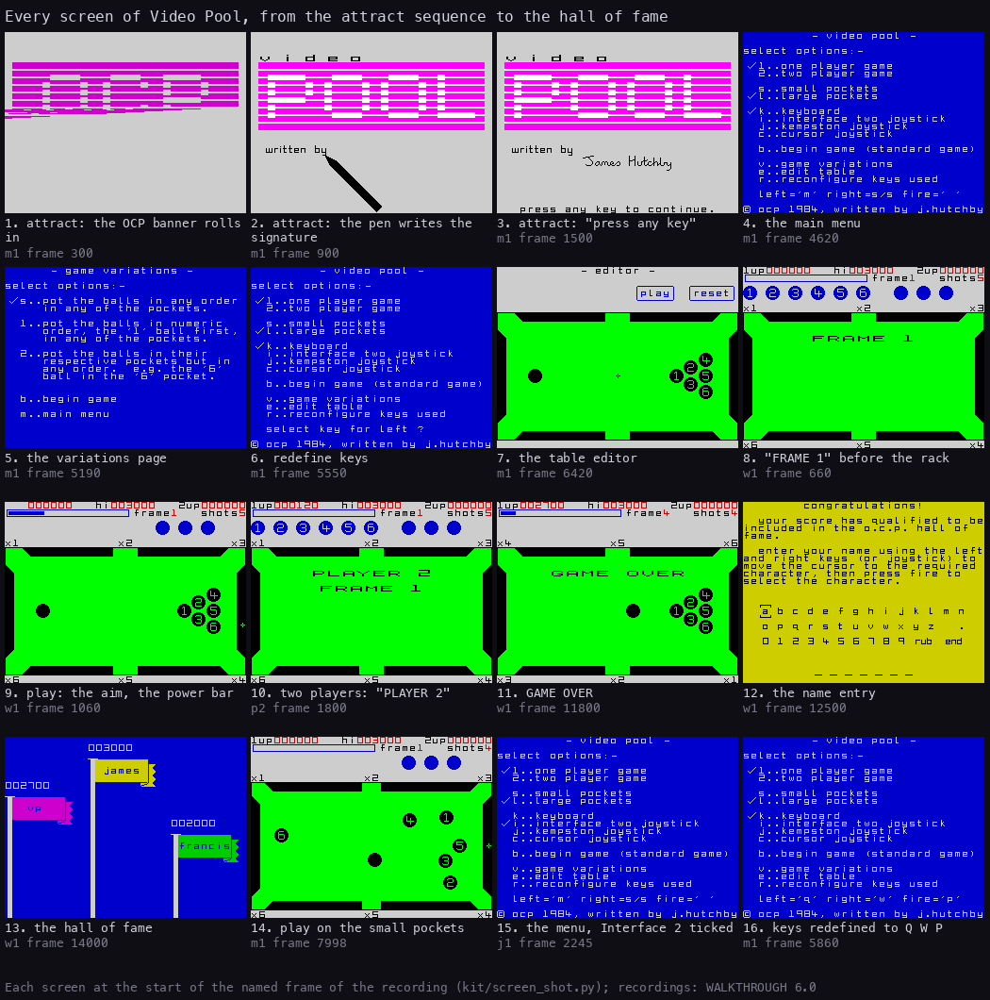

How to read the figure:

- **Sixteen screens**, each the Spectrum screen at the start of the frame named under it.
- **1-3** are the attract sequence (`m1`): the OCP banner rolling in (frame 300), the pen writing "James Hutchby"
  (900), "press any key to continue." (1500).
- **4-6 and 15-16** are the menu pages (`m1`, `j1`): the main menu with its ticks, the variations page, the key
  redefinition, the menu after choosing Interface 2 and after redefining the keys to Q, W, P.
- **7** is the table editor (`m1` 6420).
- **8-10 and 14** are play: "FRAME 1" over the table before the rack (`w1` 660), the aim with the power bar (`w1`
  1060), "PLAYER 2 FRAME 1" in a two-player game (`p2` 1800), a game on the small pockets (`m1` 7998).
- **11-13** are the end: GAME OVER (`w1` 11 800), the name entry (`w1` 12 500), the hall of fame (`w1` 14 000).
- **The point**: there are only three kinds of screen. The text pages (attract, menu, variations, name entry) are
  printed once by one print routine, PrintText `$9E65`; the table pages (play, editor) are the same table with
  different HUD rows; the hall of fame is drawn by its own code, flags and poles.

```bash
python3 tools/fig_design.py screens     # the sheet from docs/img/play/*.png
```

The screens and their routines:

| Screen | Routine | When it comes | How it ends | Witness |
| --- | --- | --- | --- | --- |
| the presents page and attract sequence | PresentsPage `$B8C5` | the game's entry; 1500 frames (30 s) idle on a menu page | any key | `m1` frames 0-4129, `w1` 16 160 |
| the main menu | MainMenu `$B22E` | a key on the attract sequence, BREAK, the end of a game | B (or fire on a joystick) begins; V, E, R go to their pages | every recording |
| the variations page | VariationsPage `$B67E` | V | B begins, M back to the menu | `v1` 622, `m1` 5102 |
| redefine keys | RedefineKeys `$B3D2` | R | three keys pressed: back to the menu | `m1` 5462-5860 |
| the table editor | EditorStart `$C042` | E | BREAK to the menu; "play" plays the edited table | `m1` 6262, `e1` 620 |
| "FRAME n" and the rack | Rack `$9F69` | a new game, a cleared frame, the second player's first turn | the six balls in their triangle | `w1` 630-10 196 |
| play | StartAim `$8425`, the tasks | after the rack | the last life lost, or BREAK | `w1` 877-11 615 |
| GAME OVER | GameOver `$97A2` | the last life lost | 250 frames or a key | `w1` 11 768, `f1` 4445 |
| the name entry | NameEntryPage `$ACEF` | GAME OVER with a score that beats a flag | "end" picked | `w1` 12 018-13 368 |
| the hall of fame | ShowHallOfFame `$A8FD` | after the name entry | 500 frames or a key | `w1` 13 368-14 232 |

The flow between them:

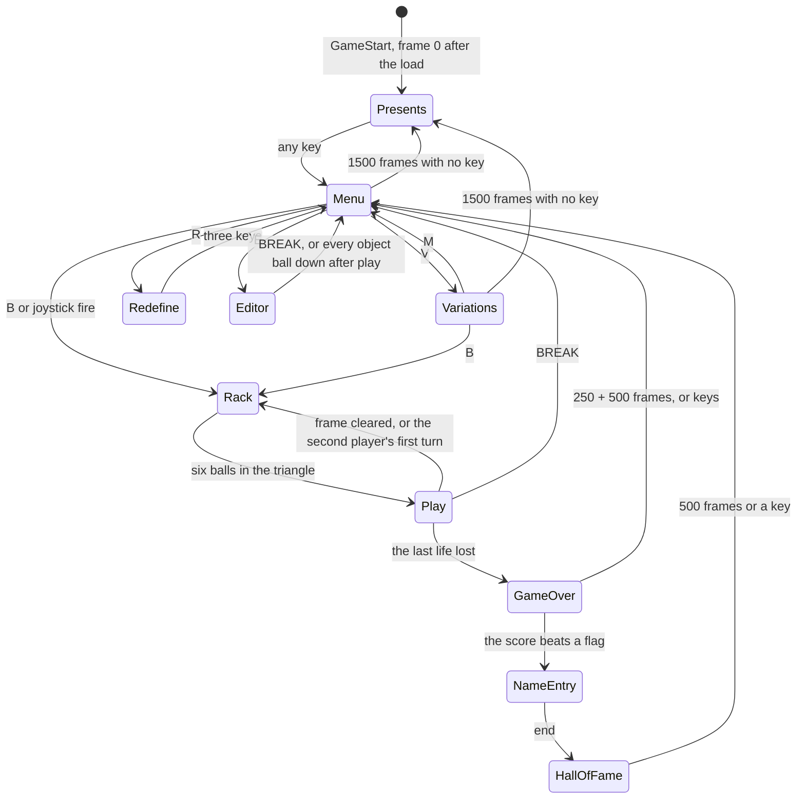

The attract sequence is the game's own advertisement. PresentsPage `$B8C5` rolls in the magenta OCP banner row by row
(BannerRollIn `$B96C`, 417 frames), prints "presents" for 75 frames, turns the letters O C P into P O O L
(LogoFlip `$BB13`), slides "video" in above (VideoSlideIn `$BC9E`), lets a drawn pen write "written by" and James
Hutchby's signature from a pen script (SignatureWrite `$BD0C`, SignatureScript `$DA80`), and waits 500 frames on
"press any key to continue.". Then it starts again. `m1` watched two whole loops (frames 0-4129). Every wait is one
HALT and a key test (PresentsFrame `$B91B`), so a key ends the sequence at once, at any depth ([doc 6](06-rendering.md)
draws the banner and the pen).

The point: the game has no demo game. The attract sequence is pure presentation, and the menu falls back into it after
30 s.

## 1.3 The play screen

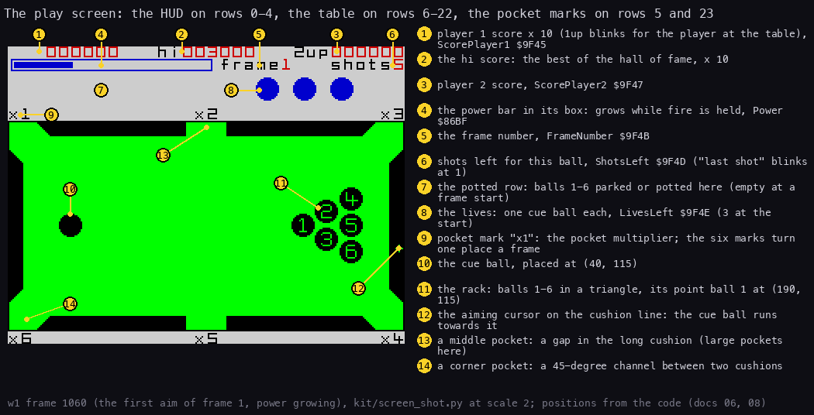

How to read the figure:

- **The HUD, rows 0-1** (1-6): the two scores and the hi score, each shown as six digits (the stored word times
  ten, PrintHudNumber `$9DC3`); the power bar in its box; the frame number; the shots left.
- **The potted row, rows 2-4** (7-8): the object balls potted in this frame on the left, at x 0, 24, ... 120
  (RedrawBall `$8297`), and one cue ball per life on the right, at x 160, 184, 208 (DrawLives `$9AD9`). The same
  rows show the messages ("FOUL SHOT!") and the score tally ("1x6x5x10=300"), which wipe the row; it is redrawn
  after them (DrawPottedRow `$9AB5`).
- **The pocket marks, rows 5 and 23** (9): "x1" to "x6" at the six pockets, clockwise from the top left. They are
  each pocket's score multiplier, and they turn one place at every new frame (NextFrame `$9BB8`).
- **The table, rows 6-22** (10-14): green felt (attribute `$60`), black cushions with six gaps for the pockets, the
  balls, and the aiming cursor on the cushion line.
- **The point**: everything the player needs is on one screen. The power is the only thing shown as a bar; the
  rest are numbers and balls.

```bash
python3 tools/fig_design.py playscreen    # w1 frame 1060, positions from the code
```

## 1.4 The controls

The default keys are the three at the bottom right of the keyboard (the menu's last line, KeysLine `$B65F`):

| Key | Does | Routine |
| --- | --- | --- |
| M | moves the cursor "left" round the cushions | ReadKeyboard `$8123`, AimCursorMove `$8546` |
| SYMBOL SHIFT | moves the cursor "right" | the same |
| SPACE | fire: held, the power grows; released, the shot | AimPower `$8506` |
| CAPS SHIFT + SPACE | BREAK: the game is abandoned, back to the menu | ReadBreak `$8216`, BreakRestart `$80B0` |

- **Left and right take the shortest way.** On the top half of the table "right" runs the cursor clockwise, on the
  bottom half anticlockwise (AimCursorMove `$8546`). The instructions warn about it ("this may seem confusing at
  first").
- **The cursor accelerates.** Held, its speed grows by one every 10 ticks, up to 6 positions a tick (AimCursorAccel
  `$85AD`); a new direction starts again at 1.
- **The joysticks** (menu I, J, C) give four directions. Interface 2 reads both sockets (keys 6-0 and 1-5), Kempston
  port `$1F`, the cursor joystick keys 5-8 with any other key as fire. `j1` played the same shot with Kempston
  (frame 1075) and with Interface 2 (frame 2640) ([doc 5](05-controls.md)).
- **Reconfigure** (menu R) asks for the left, right and fire keys; any key is taken, even CAPS SHIFT or SYMBOL SHIFT
  alone. `m1` set Q, W, P at frames 5462-5860 and put M, SYMBOL SHIFT, SPACE back.
- **The editor** uses the cursor keys when the keyboard is chosen: 5, 6, 7, 8 and any other key as fire
  (EditorStart `$C042`).

Hidden keys:

- **Infinite lives.** On the menu, hold CAPS SHIFT, SPACE, 1 and 0 together: WaitNoKey `$B38E` flips InfiniteLives
  `$B8C4`, and LoseLife `$9754` then skips the loss of a life (no jingle, no life ball erased). Holding them again
  flips it back. Nothing on the screen shows the toggle. Known only from the code: no recording held the four keys
  (TestCheatKeys `$B3B8` was asked 176 times in `m1`, the flip `$B3A1` never ran).
- **BREAK is also a menu key in the editor**: fire with BREAK held leaves it (EditorExit `$C414`, `m1` frame 6830).

The point: the whole game is played with three keys. Left and right relative to the half of the table, not to the
screen, is the one thing a new player must learn.

## 1.5 The table, the balls and the rack

- **The table** is the whole screen width: the frame x 0-255, y 48-183 (DrawTable `$9243`). Six cushions, nine
  pixels deep; the gaps between them are the pockets. The corner pockets are 45-degree channels, the middle pockets
  straight gaps in the long cushions ([doc 10](10-gameplay-logic.md) has the geometry).
- **Two pocket sizes** (menu S, L; Pockets `$B8BC`): large is the default. Small pockets shorten nothing but the
  gaps: every cushion is 4 pixels longer at its pocket ends. `m1` played a shot on the small pockets (frame 7998,
  screen 14 of 1.2).
- **The balls** are discs 15 pixels across, drawn from 56 pre-shifted sprites ([doc 6](06-rendering.md)): the cue
  ball plain black, balls 1-6 black with their number cut out in green.
- **The rack**: the cue ball at (40, 115), balls 1-6 in a triangle with its point, ball 1, at (190, 115), towards the
  cue ball (StartPositions `$9D5D`):

| Ball | cue | 1 | 2 | 3 | 4 | 5 | 6 |
| --- | ---: | ---: | ---: | ---: | ---: | ---: | ---: |
| x | 40 | 190 | 205 | 205 | 221 | 221 | 221 |
| y | 115 | 115 | 106 | 124 | 98 | 115 | 132 |

- **The balls roll into the rack.** Before each frame the six object balls do not appear in place. Each waits its
  own number of frames, comes out of a pocket and rolls 2 pixels a frame along its own rack script to its place
  (RackBalls `$9F6F`, RackStep `$A05E`; `p2` frame 1950, screen 2 of 1.7).
- **Six sets of scripts.** The set changes every two frames: frames 1-2 set 0, 3-4 set 1, ... 11-12 set 5, then set
  0 again (RackSets `$A0C4`). Every script ends on the same triangle, so the sets change the show, not the table.

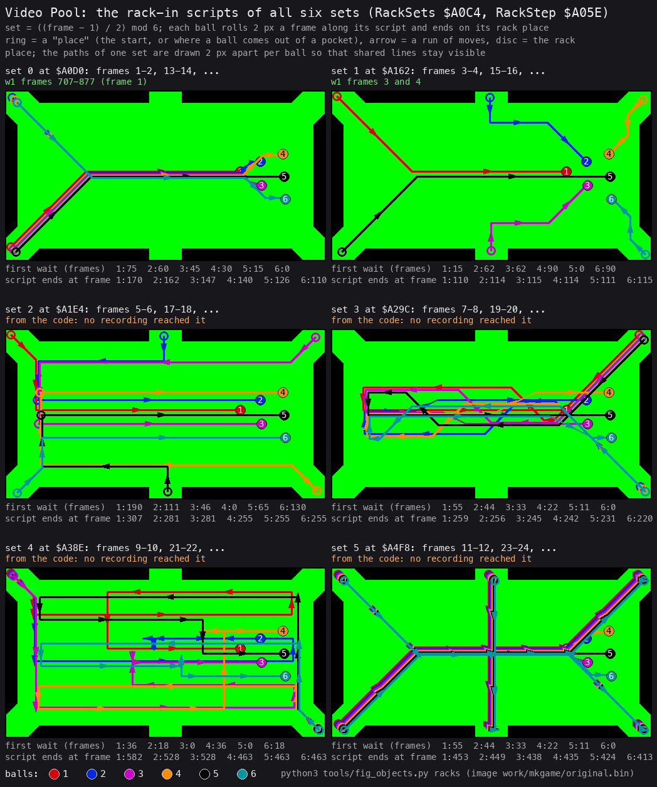

How to read the figure (vpC's, for [doc 7](07-objects.md)):

- **One panel a set**, with the frames that use it. Sets 0 and 1 were seen in `w1`; sets 2-5 are drawn from the code.
- **A ring** is where a ball comes out of a pocket; **an arrow** is a run of moves; **a disc** is the ball's place in
  the rack.
- **Under each panel**: each ball's first wait in frames, and the frame its script ends.
- **The point**: the rack is a show of 115-582 frames (the last ball of the set) that ends in the same triangle. Set 0 takes 170 frames, 3.4 s,
  before the first aim of a game.

```bash
python3 tools/fig_objects.py racks     # vpC's tool, from work/mkgame/original.bin
```

The scripts and their interpreter are in [doc 7](07-objects.md).

The point: every frame starts from the same position. What changes from frame to frame is the shots allowed and the
pocket multipliers, not the layout.

## 1.6 A shot

A shot as the player meets it:

1. **The aim.** The cursor starts on the right cushion at (252, 115), or a pixel above or below it at random
   (AimCursorReset `$85C8`). The player runs it round the cushion line to the point the cue ball should roll at.
   There is no aim line: the cursor is the only aid ([doc 6](06-rendering.md), DrawCursor `$9371`).
2. **The power.** Holding fire grows the power bar by 2 pixels a tick. At 134 (`$86`) it falls back to 0 and grows
   again (AimPower `$8506`), so a player who holds too long gets a weak shot.
3. **The release.** The cue ball gets a speed of power / 16 pixels a tick towards the cursor: at most 7.9 pixels a
   tick (AimShot `$8A02`). The game freezes for 0.14 s while the ROM's calculator works out the direction (6.9 frames,
   `w1` frame 1079; [doc 4](04-game-loop.md)).
4. **The roll.** The balls slow down by friction, bounce off the cushions and each other, and drop into pockets. Each
   contact clicks, each cushion knocks, each pot plays a low tone (SoundLoop `$8069`).
5. **The outcome**, once every ball is still (ShotEnd `$8357`):

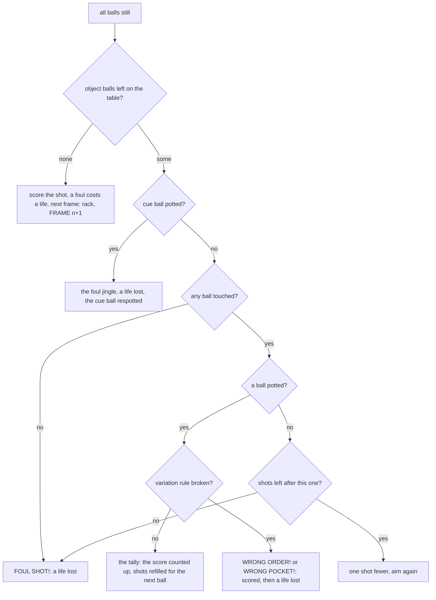

The point: the shot count is per ball. Potting any ball refills it (ScoreTally `$98FF` sets ShotsLeft from
ShotsForFrame `$9BE6`); missing with the last shot is a foul like hitting nothing.

## 1.7 The key moments

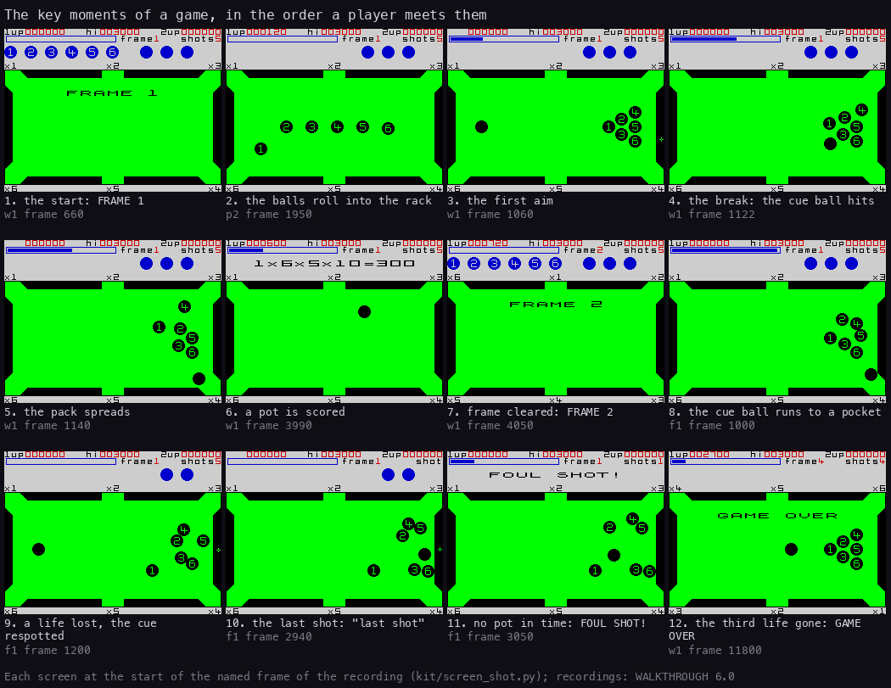

How to read the figure, moment by moment (the routines that make each one):

| # | Moment | Recording, frame | What happens | Routine |
| ---: | --- | --- | --- | --- |
| 1 | the start | `w1` 660 | "FRAME 1" for 75 frames over the empty table; balls 1-6 wait in the potted row | ShowFrameBanner `$9B36` |
| 2 | the rack | `p2` 1950 | the balls roll in one step a frame (170 steps in `c1`) | RackBalls `$9F6F` |
| 3 | the first aim | `w1` 1060 | the cursor moved, the power bar growing | AimPower `$8506` |
| 4 | the break | `w1` 1122 | the cue ball reaches ball 1 | BallContacts `$87EF` |
| 5 | the pack spreads | `w1` 1140 | six balls moving at once | PhysicsTask `$86C1` |
| 6 | a pot scored | `w1` 3990 | "1x6x5x10=300" in the message rows, counted into the score | ScoreTally `$98FF` |
| 7 | a cleared frame | `w1` 4050 | "FRAME 2", the pocket marks turned one place, 5 shots | NextFrame `$9BB8` (frame 4023) |
| 8 | the cue ball heads for a pocket | `f1` 1000 | | PocketOrCushion `$8B4E` |
| 9 | a life lost | `f1` 1200 | the foul jingle, one life ball gone, the cue ball back at (40, 115) | LoseLife `$9754`, RespotCueBall `$93FF` |
| 10 | the last shot | `f1` 2940 | "last" and "shot" blink in place of "shots", a beep every half second | ShotsBlinkTask `$970E`, LastShotBeepTask `$9CA7` |
| 11 | no pot in time | `f1` 3050 | "FOUL SHOT!", a life lost | MessagesTask `$9CB7` |
| 12 | the end | `w1` 11 800 | GAME OVER in double-width letters over the table | GameOver `$97A2` (frame 11 768) |

- The first pot of `w1` is counted from frame 1329 (AddScoreStep `$99C1`); frames 2, 3 and 4 start at 4023, 7140
  and 10 196 (NextFrame `$9BB8`, `python3 tools/l1sum.py --builds runs/w1 9BB8`).
- **The point**: a game is a loop of the same three moments, aim, roll, outcome, punctuated by the rack between
  frames. Nothing new appears after frame 1 but the shot count.

```bash
python3 tools/fig_design.py moments
```

## 1.8 The rules

### Shots, lives and fouls

- **Shots** are per ball. The count (top right) is set at the start of a frame and after every pot: 5 for frames 1-2,
  4 for 3-5, 3 for 6-9, 2 from frame 10 on (ShotsPerFrame `$9C06`, ShotsForFrame `$9BE6`); a variation adds 2
  (variation 1) or 3 (variation 2). Each shot that touches a ball but pots none costs one.
- **Lives**: three life balls are shown at the start (LivesLeft `$9F4E` = 3, NewGameScreen `$95DA`). A loss takes
  one away. The game ends only when a loss finds none left (LoseLife `$9754`: LivesLeft - 1, GAME OVER when it goes
  negative), so a player has four losses: `c1`, `w1` and `f1` each lost four lives before GAME OVER (LoseLife:
  game 4, `w1` 4, `f1` 4 runs).
- **No life is ever won back.** The only writers of LivesLeft are the new game, LoseLife, the turn swap and the
  editor (`grep -n LivesLeft src/game/*.asm`).
- **A life is lost** for:

| Fault | Message | Who decides | Witness |
| --- | --- | --- | --- |
| the cue ball hits no ball | FOUL SHOT! | ShotEnd `$8357` (BallHitFlag `$89BB` = 0) | `c1`, every shot |
| the last shot pots nothing | FOUL SHOT! | ShotEnd, ShotsLeft at 0 | `f1` 3050 |
| the cue ball is potted | none, the jingle only | ShotEnd, the cue ball off the table | `f1` 1000-1200 |
| variation 1: a ball potted out of order | WRONG ORDER! | PocketOrderTest `$8C4B` | `v1` 1250 |
| variation 2: a ball in a pocket that is not its own | WRONG POCKET! | PocketOrCushion `$8C37` | `v1` 3100 |

- A loss plays the foul jingle (FoulJingle `$9780`: two low notes of about 52 Hz and 41 Hz, 1.1 s) and erases the
  leftmost life ball. After a potted cue ball the cue ball comes back at (40, 115), or to its right until no ball is
  within 16 pixels (RespotCueBall `$93FF`).
- **A wrongly potted ball still scores.** In `v1` ball 4 went in out of order: the tally counted 1x4x3x10 = 120 into
  the score (AddScoreStep from frame 1419) before LoseLife ran (frame 1471); the ball stays potted. The score
  routine runs before the foul code in ShotEnd (`$83F7`, then `$9754`).

### Frames

- A frame is cleared when no object ball is left on the table (ShotEnd `$8357`). The frame number goes up by one (up
  to 99), the pocket marks turn one place, the balls roll into the rack again, and the shots are refilled for the new
  frame (NextFrame `$9BB8`, Rack `$9F69`).
- A foul on the shot that clears the frame still costs a life (ShotEnd: the score, then LoseLife, then NextFrame).

### The score

The score of one potted ball is

> frame number x ball number x the pocket's multiplier x 10

shown term by term in the message rows (TallyTermTotal `$9A1A`). The multiplier is the "xN" mark beside the pocket
the ball fell into; the marks turn at every frame. Two balls in one shot are two terms added ("+", TallyTermPlus
`$9A01`).

Worked example, `v1` frame 3250 (variation 2, frame 1; the pot was a WRONG POCKET, scored all the same):

| Step | Value | Where |
| --- | --- | --- |
| the frame | 1 | FrameNumber `$9F4B` |
| the ball | 5 | PotBall `$9B2F` |
| the pocket | 3, the top right (+12 of ball 5's record) | PocketMark `$8C06` |
| the multiplier | PocketTurn 0 + pocket 3 = 3, the mark "x3" | PotMultiplier `$9B2E` |
| the term | 1 x 5 x 3 = 15 | AddTerm `$9A67` |
| shown | "1x5x3x10=150" | TallyTermTotal `$9A1A`, screen 7 of the figure in 1.9 |
| counted | ShotScore 15 in steps of 15 / 64 + 1 = 1, one a frame with a rising beep | ScoreTally `$98FF`, AddScoreStep `$99C1` |

- The score is stored divided by ten (ScorePlayer1 `$9F45`, a word); the HUD prints it with a "0" after it.
- The best single ball in frame 1 is ball 6 in the "x6" pocket: 1 x 6 x 6 x 10 = 360. In frame 10 the same ball
  scores 3600.
- The tally counts the shot's points into the score one step a frame for up to 45 frames, each step a short beep
  that rises in pitch (TallyPitch `$9B34`, from 1200 down by 10).

The point: the frame number multiplies everything. A player who survives to the later frames scores ten times more
per ball, with two shots per ball instead of five.

## 1.9 The three rule variations

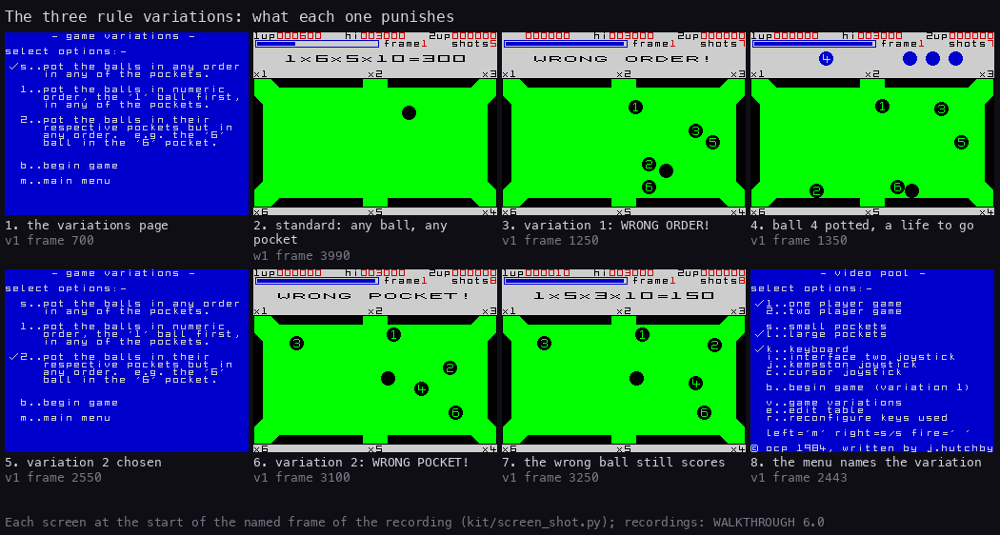

How to read the figure:

- **1, 5**: the variations page (VariationsPage `$B67E`, `v1` frames 700 and 2550): S, 1 or 2 ticks a variation; B
  begins at once, M goes back to the menu.
- **2**: the standard game: any ball, any pocket (`w1` 3990).
- **3-4**: variation 1, numeric order: ball 4 potted while balls 1-3 were on the table gives "WRONG ORDER!"
  (`v1` 1250). Ball 4 stays in the potted row (`v1` 1350); its tally comes next and the life goes after it (1.8).
- **6-7**: variation 2, own pockets: ball 5 dropped into the pocket marked "x3" gives "WRONG POCKET!" (`v1` 3100).
  The same ball is then scored with that mark, 1x5x3x10 = 150 (`v1` 3250), and a life is lost after the tally. The
  pocket's number is its mark, PocketTurn + pocket, the same sum for the rule and for the score (the rule's code in
  [doc 10](10-gameplay-logic.md)).
- **8**: the menu shows the variation chosen: "b..begin game (variation 1)" (`v1` 2443).
- **The point**: the variations change one test at the moment a ball drops, and add shots to pay for it. Everything
  else (score, lives, frames) is the same game.

| Variation | Rule | Extra shots | Foul code | Code | Witness |
| --- | --- | ---: | ---: | --- | --- |
| standard (`Variation` `$B8C3` = 0) | any ball in any pocket | 0 | | | `w1` |
| 1, numeric order | a ball potted while a lower-numbered ball is on the table is a foul | 2 | 2 | PocketOrderTest `$8C4B` | `v1` 1250 (2 runs) |
| 2, own pockets | a ball potted where (pocket + PocketTurn) wrapped to 1-6 is not its number is a foul | 3 | 3 | `$8C37` in PocketOrCushion | `v1` 3100 (2 runs) |

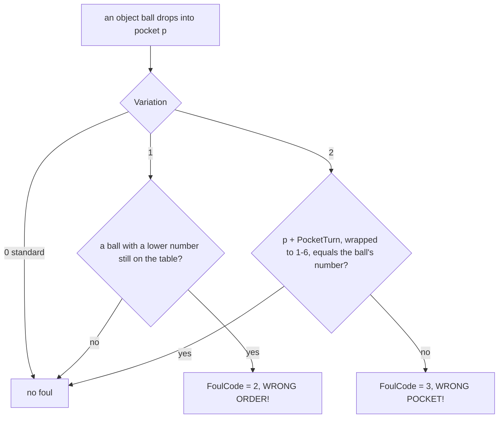

The test runs only for an object ball, only when no foul is set yet in this shot and only while the cue ball is on
the table (`$8C1D` in PocketOrCushion `$8B4E`).

```bash
python3 tools/fig_design.py variations
```

## 1.10 Two players

- Menu 2 chooses two players; each has his own set of seven balls, his own frame, lives and pocket turn. The
  scores stay by player (PlayerVars `$9F43`).
- **The turn passes only when a life is lost** (TurnSwap `$9C15`): the 98 bytes of the two ball sets are exchanged
  (BallRecords `$8A88` with OtherPlayerBalls `$8AEA`), the HUD shows the new player's frame, shots and pocket marks,
  and "PLAYER 2" is printed over the table (PlayerBanner `$9C7B`). The player at the table has his "1up" or "2up"
  blinking (UpBlinkTask `$96E6`).
- The second player's first turn racks his set (NextTurn `$97CD`, `p2` frame 1780: "PLAYER 2 FRAME 1", then the
  rack).
- `p2`: player 1 pots four balls, misses and loses a life at frame 1738, player 2 plays frame 1 and scores 240
  (screens of 1.2 and WALKTHROUGH 6.1); BREAK at 4239.
- A player whose lives are gone sits out; the game ends when both are out (GameOver `$97A2`). Known only from the
  code: `p2` ended by BREAK, so the turn that resumes a racked set (NextTurnResume `$9801`) and the two-player hall
  of fame never ran.

The point: two players do not alternate shots, they alternate lives. A strong player can clear frames for a long
time while the other waits.

## 1.11 The table editor

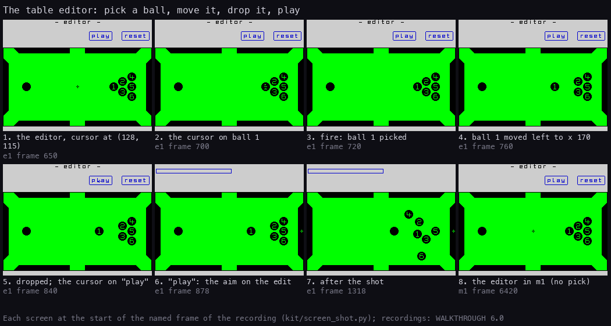

How to read the figure:

- **1**: menu E opens the editor: the table, "- editor -", two boxed buttons "play" and "reset", the balls where the
  last game left them (or racked when none is on the table), and a cross cursor at (128, 115) (EditorStart `$C042`,
  `e1` frame 650).
- **2-4**: fire with the cursor within 4 pixels of a ball picks it up (the cursor vanishes, `e1` 700-720); the keys
  then push the ball, through the real physics step, so it bounces off cushions and drops into pockets
  (EditorBallLeft `$C3EB` 20 times, frames 720-739: ball 1 from x 190 to 170).
- **5**: fire drops it; the cursor comes back at the ball and is moved up onto "play" (`e1` 840).
- **6-7**: "play" clears the editor's texts and starts the aim on the edited table, with the game's own power, cursor
  and ball tasks but no score and no lives (EditorPlay `$C41D`, `e1` 878; the shot at 908, the balls still at 1054).
- **8**: `m1` entered the editor too, but its cursor came back to where it started and touched no ball.
- **The point**: the editor is the game's practice mode. It moves balls with the physics itself, so a ball can be
  pushed into a pocket to take it off the table, as the instructions say.

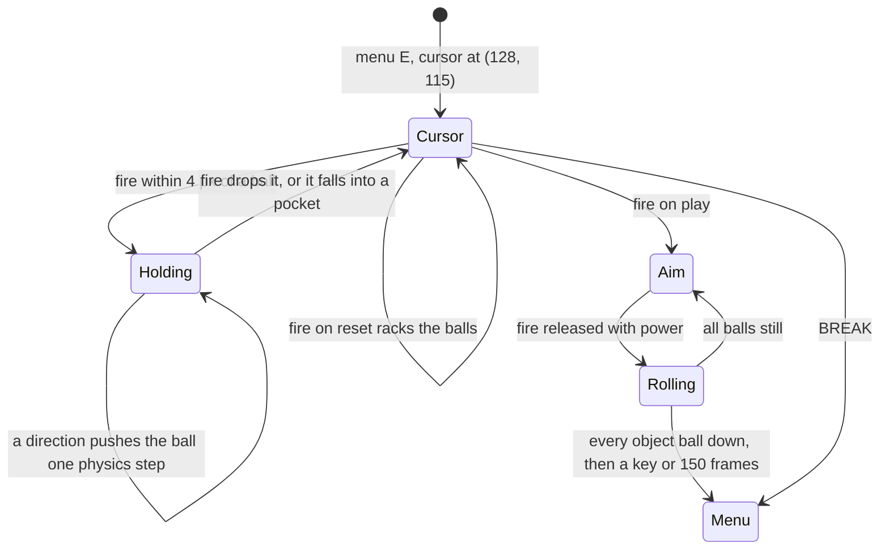

- A ball off the table is picked from the potted row and comes back near the middle of the table, moved sideways
  until no ball is within 16 pixels (EditorFire `$C20B`). Known only from the code, with "reset", the pushes right,
  up and down, and the return to the menu when all balls are down: `e1` hit "play", not "reset".

```bash
python3 tools/fig_design.py editor
```

## 1.12 GAME OVER and the hall of fame

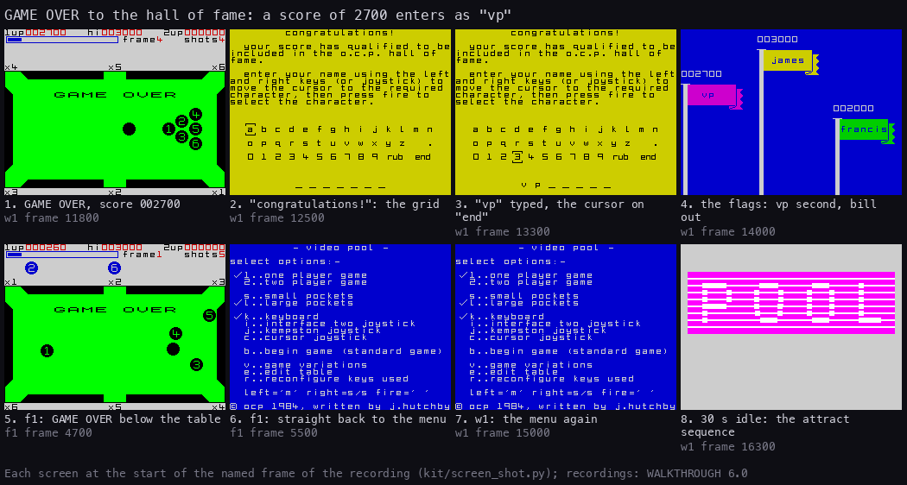

How to read the figure:

- **1**: GAME OVER over the table, the score 002700 (`w1` 11 800).
- **2-3**: the score beats a flag: "congratulations!", the instructions, a grid of 42 cells (a-z, space, ".", 0-9,
  "rub", "end") and seven "_" for the name. Left, right or the stick move a box round the grid; fire picks a cell
  (NameEntry `$AE92`). `w1` typed "vp" and "end" (frames 12 025-13 368).
- **4**: the hall of fame: three flags on poles, the best in the middle on the tallest pole. Flags that lose their
  place slide down off the screen, the new name is inserted, and the flags slide back up with the new names
  (ShowAndSlideDown `$A86D`, InsertEntry `$A817`, SlideFlagsUp `$A8C7`). "vp" with 2700 took the second place: james
  stays first, francis moves to third, bill drops out (`w1` frame 13 553).
- **5-6**: `f1` ended with a score below every flag: GAME OVER, then straight back to the menu (GameOverHallOfFame
  `$A702` returned at once, frame 4695).
- **7-8**: back at the menu (`w1` 15 000); 30 s later the attract sequence (`w1` 16 300).
- **The point**: the hall of fame keeps three scores, and a score must beat a flag strictly to enter (CountBeaten
  `$A7EB`). It lives in memory only: it is lost when the machine is switched off (no save routine in the code).

The table in the image (HofTable `$AC08`, three slots of 71 bytes):

| Place | Pole | Name | Score shown | After `w1` |
| --- | --- | --- | ---: | --- |
| 1 | middle, yellow flag | james | 3000 | james 3000 |
| 2 | left, magenta | francis | 2000 | vp 2700 |
| 3 | right, green | bill | 1000 | francis 2000 |

The hi score in the HUD starts at 3000, the top flag (HiScore `$9F49`), and becomes the larger of it and the scores
after each game (GameOverEnd `$9825`).

```bash
python3 tools/fig_design.py halloffame
```

## 1.13 The difficulty

What gets harder, frame by frame, all from the code (ShotsForFrame `$9BE6`, NextFrame `$9BB8`):

| Frames | Shots per ball (standard / var. 1 / var. 2) | Ball 6 in "x6" scores | Rack set |
| --- | --- | ---: | ---: |
| 1-2 | 5 / 7 / 8 | 360, 720 | 0 |
| 3-4 | 4 / 6 / 7 | 1080, 1440 | 1 |
| 5 | 4 / 6 / 7 | 1800 | 2 |
| 6 | 3 / 5 / 6 | 2160 | 2 |
| 7-8 | 3 / 5 / 6 | 2520, 2880 | 3 |
| 9 | 3 / 5 / 6 | 3240 | 4 |
| 10 | 2 / 4 / 5 | 3600 | 4 |
| 11-12 | 2 / 4 / 5 | 3960, 4320 | 5 |
| 13-99 | 2 / 4 / 5 | 360 x frame | 0, 1, ... again |

- The table and the rack never change; neither do the friction and the ball speed. The only pressure is the shot
  count. A miss costs a shot, and the misses add up only per ball.
- The frame number caps at 99 (NextFrame `$9BB8`).
- `w1` reached frame 4 (frames 1-3 cleared, 18 pots, score 2700). Frames 5-12 and their rack sets 2-5 are known
  only from the code ([doc 7](07-objects.md)).

The point: the game rewards accuracy more each frame. With two shots per ball from frame 10, a player must pot almost
every shot.

## 1.14 What no recording reached

Every item is known only from the code, at the address named:

- the infinite-lives toggle (`$B3A1`, 1.4);
- a two-player game over with the other player still alive, the resumed turn and the two-player hall of fame
  (`$97CA`, NextTurnResume `$9801`, `$A745`; 1.10);
- frames 5 onward and rack sets 2-5 (ShotsPerFrame `$9C06` bytes 5-9 at `$9C0A`-`$9C0E`, the scripts at `$A1E4`-`$A701`; 1.13);
- the editor's "reset", its ball pushes right, up and down, the pick of a ball from the potted row and its return to
  the menu (`$C532`, `$C3F2`-`$C3FD`, `$C288`, `$C488`; 1.11);
- the attract sequence's later loops with the hall of fame between them (`$B906`, 1.2): `w1` ended 218 frames into
  its second attract sequence.

The recordings checked: `c1` (from the entry), `w1`, `f1`, `p2`, `v1`, `m1`, `j1`, `e1` (`tools/l1sum.py`).
