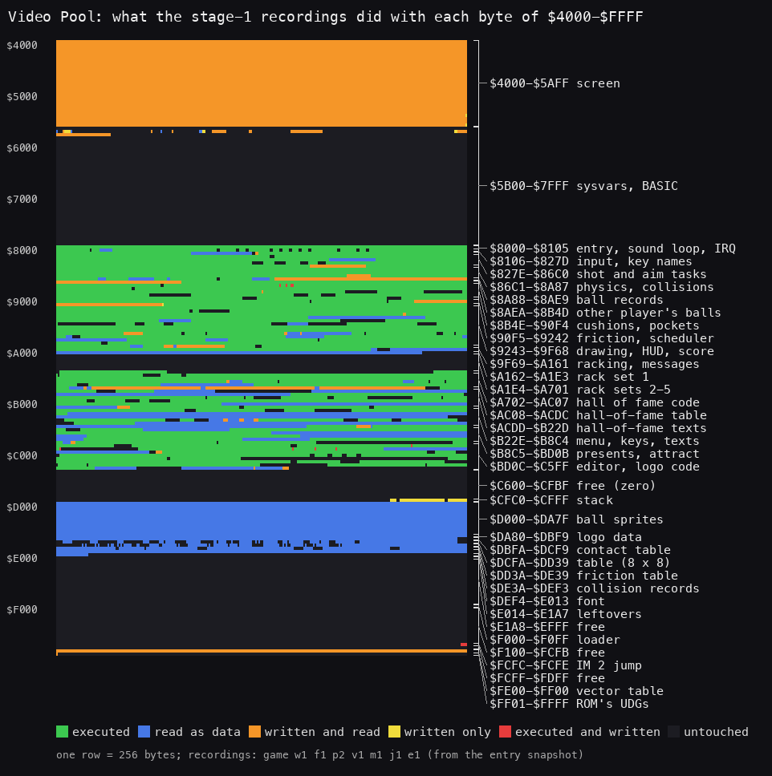
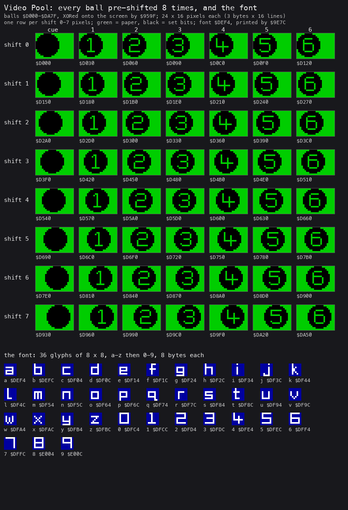
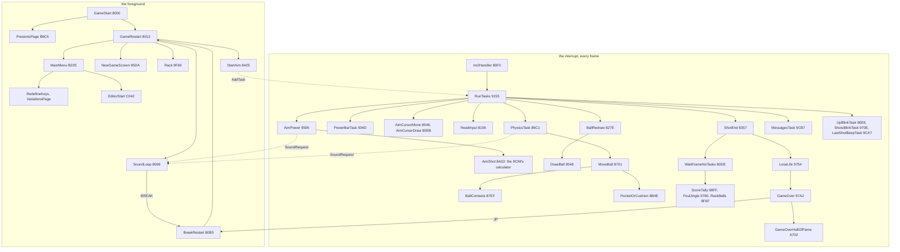
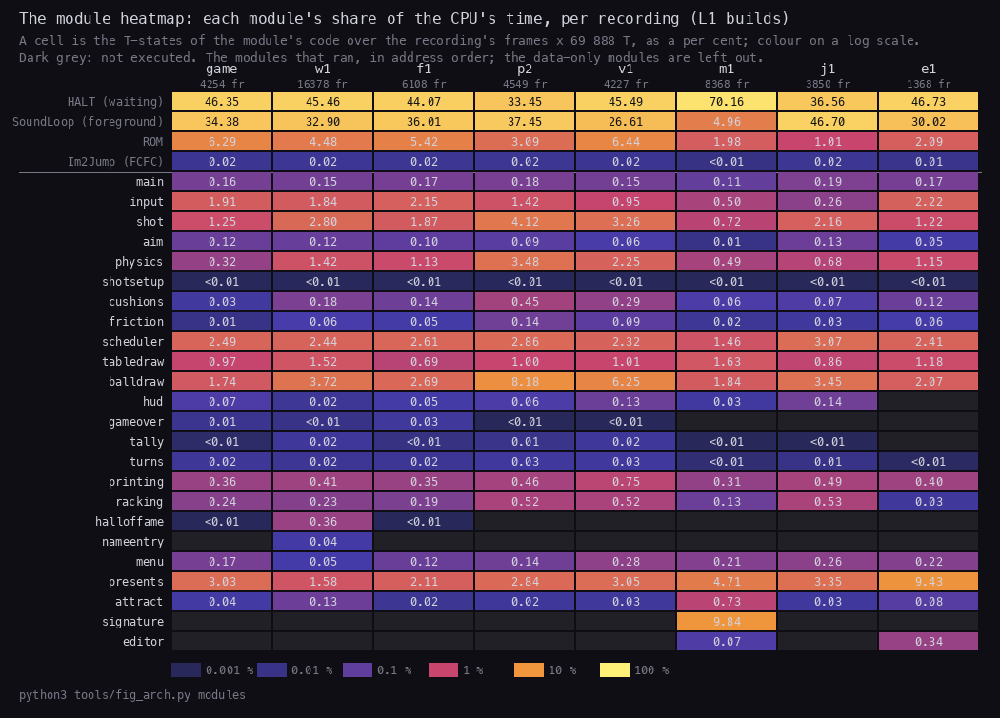
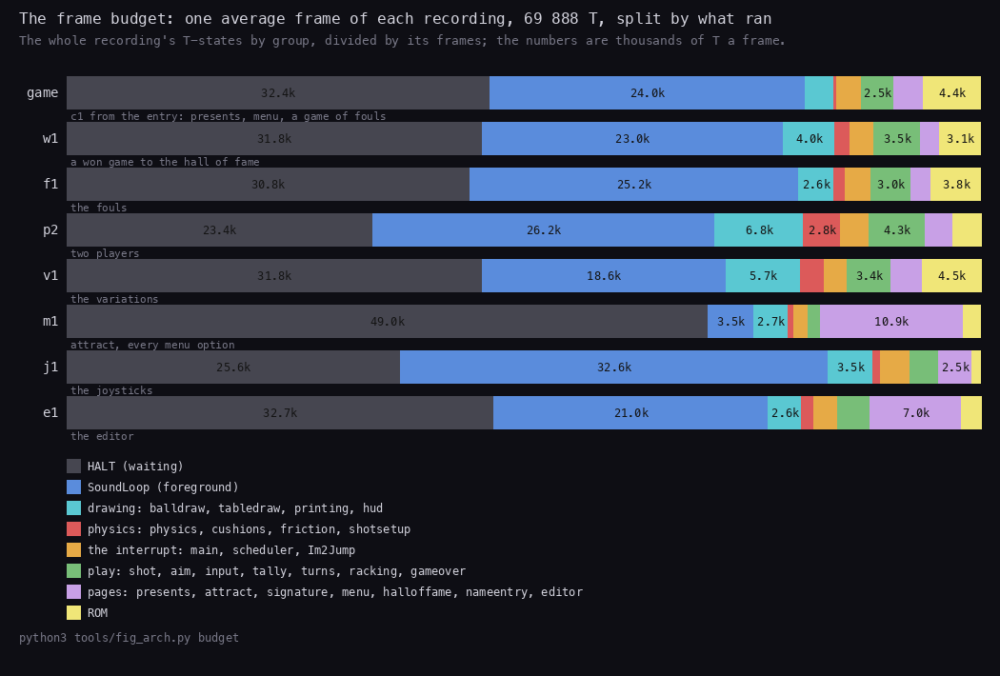

# 2. Architecture

What this covers:

- the machine budget: the 48K, the beeper, the interrupt, the stack (2.1);
- the memory map, as a table and a figure (2.2);
- the three images, as loaded, at the entry and in play, and what changes between them (2.3);
- the interrupt's task scheduler and the foreground loop (2.4);
- the call graph: what runs in the interrupt and what outside it (2.5);
- where the time goes: the module heatmap and the frame budget (2.6).

The recordings it rests on ([Terms](README.md#terms)), all on the 48K, each with an input script (WALKTHROUGH 6.0
has the table):

- `c1`: power-on, the ROM blocks through the fast LD-BYTES trap, the turbo block at signal speed through the game's
  own loader, then a game of fouls (`work/stage1/c1`, input `tests/inputs/c1-load-and-shots.txt` from frame 5760);
- the play recordings (`work/runs/NAME`), each from `work/snaps/entry.z80`, a snapshot of `c1` at the game's entry
  (frame 5556, T 25 555), with the keys found by `tools/shot_bot.py`.

## 2.1 The machine budget

- **The 48K, the beeper.** The only `OUT` instructions are to port `$FE` (`$8088`, `$808F`, `$80AC` in the sound
  loop; `$95E9`, `$A915`, `$AD07`, `$B246`, `$B97B`, `$C060` elsewhere). BEEPER `$03B5` (twelve calls and one jump)
  plays the short notes. A byte search of the image (`tools/image.py`); WALKTHROUGH 1.
- **The keys, two ways.** The game reads the keyboard itself with `IN A,(C)` on port `$FE`: the defined keys
  (KeyRead, from ReadKeyboard `$8123`), BREAK (ReadBreak `$8216`, at `$8219` and `$8222`), Interface 2's two rows
  (ReadInterface2, `$8151`), the menu's hidden key test (TestCheatKeys `$B3B8`, at `$B3BB`), and `$8250`. Kempston
  is `IN A,($1F)` at `$81A0` (ReadKempston). The menus and the name entry also use the ROM's KEY-SCAN `$028E` and
  K-TEST `$031E` (nine calls each), to take any key. Stage 1 said there was no `IN` from port `$FE`; that was wrong
  (doc 5 has the reads).
- **IM 2 from the first key on.** The entry `$8000` runs the "presents" page in IM 1 with interrupts on (the ROM's
  handler), then `$8013` does `DI`, `I` = `$FE`, `IM 2`, fills `$FE00-$FF00` with `$FC` and writes `EI`, `JP $80F0`
  at `$FCFC` (`c1` stage 6, frame 6061). Every vector read lands on `$FCFC` whatever the bus holds. The handler
  `$80F0` saves all registers and runs the task scheduler `$9155` (2.4). There is no `IM 1` in the code: once set,
  IM 2 stays.
- **The ROM's calculator for the aim.** `$8A02` loads `IY` = `$5C3A`, sets `I` to the ROM's `$3F`, and works out the
  shot's direction with `RST $28` from the cursor `$86BA` and the cue ball's position `$8A89` / `$8A8B`; it puts
  `I` = `$FE` back and ends in the friction lookup `$90F5`.
- **The stack is the game's own.** `LD SP,$D000` at the entry `$8000` and at the restart `$80B3`; the stack lives
  just below the ball sprites `$D000`, in bytes that are zero in the image (2.3).
- **The game never returns to BASIC.** BREAK (CAPS SHIFT + SPACE, bit 5 of `$827C`) goes to `$80B0`, which reloads
  SP and restarts at `$8013` (the menu); the loader zeroes the ERR_SP target before the load, so a tape error
  resets the machine (doc 3, 3.1).

## 2.2 The memory map



*The memory map from the union of the L1 builds of `c1`'s game part (`work/game/l1.json`) and the play recordings
`w1`, `f1`, `p2`, `v1`, `m1`, `j1`, `e1` (WALKTHROUGH 6.0; the builds `read_builds` of `case.json` names). One row
is 256 bytes; green executed, blue read as data, orange written and read, yellow written only, red executed and
written, dark untouched.*

How to read it: the code is one block `$8000-$C5FF` (green with blue tables and text inside), the data one block
`$D000-$E013` (blue), and the rest of RAM above `$C600` is empty but for the stack under `$D000`, the loader at
`$F000` and the IM 2 table at `$FCFC` / `$FE00`. The screen is the only display memory; there is no back buffer.

```bash
python3 tools/fig_memmap.py --out docs/img/arch/memmap.png work/game/l1.json work/runs/{w1,f1,p2,v1,m1,j1,e1}/l1.json
python3 tools/regcounts.py work/game/l1.json work/runs/{w1,f1,p2,v1,m1,j1,e1}/l1.json     # the counts below
```

The regions (`tools/memmap-regions.txt`, the figure's brackets; the routine and data names of stage 2 are in
[doc 11](11-data-reference.md) and [doc 12](12-routine-reference.md)). X executed, R read only, W written, -
untouched, in bytes:

| Range | Bytes | X | R | W | - | What | Witness |
| --- | ---: | ---: | ---: | ---: | ---: | --- | --- |
| `$4000-$5AFF` | 6912 | 0 | 0 | 6912 | 0 | the screen | every draw routine writes here |
| `$5B00-$7FFF` | 9472 | 0 | 5 | 82 | 9385 | system variables, the BASIC loader | KEY-SCAN's variables, FRAMES (2.3) |
| `$8000-$8105` | 262 | 262 | 0 | 0 | 0 | the entry, the foreground sound loop, the IRQ handler | `$8000`, `$8069`, `$80F0` |
| `$8106-$827D` | 376 | 303 | 46 | 2 | 25 | the input dispatcher, the key table | `$8106`, `$822E`, `$8254` |
| `$827E-$86C0` | 1091 | 1000 | 29 | 35 | 27 | the shot and aim tasks, the draw list | `$827E`, `$8357`, `$8506`, `$8546`, `$85EB`, `$869E` |
| `$86C1-$8A87` | 967 | 916 | 34 | 15 | 2 | the physics, ball against ball | `$86C1`, `$8701`, `$87EF`, the aim `$8A02` |
| `$8A88-$8AE9` | 98 | 0 | 0 | 98 | 0 | the ball records, 7 x 14 bytes | `$8A88` (2.3) |
| `$8AEA-$8B4D` | 100 | 0 | 0 | 100 | 0 | the other player's seven ball records OtherPlayerBalls `$8AEA-$8B4B` (98 bytes), then FrictionTurn `$8B4C` and EventCount `$8B4D` | `p2` frame 1738 swaps the 98 bytes; the physics (doc 10) |
| `$8B4E-$90F4` | 1447 | 1332 | 0 | 5 | 110 | the cushions and pockets, from PocketOrCushion `$8B4E` | `$8B4E` |
| `$90F5-$9242` | 334 | 232 | 0 | 100 | 2 | the friction lookup, the scheduler and its slots | `$90F5`, `$9155`, `$91DF` |
| `$9243-$9F68` | 3366 | 2907 | 244 | 53 | 162 | drawing, the power bar, the HUD, the score, the print routine | `$934D`, `$9548`, `$9E7C` |
| `$9F69-$A161` | 505 | 343 | 150 | 0 | 12 | the racking, its set table RackSets `$A0C4` and set 0's scripts `$A0D0` | `$9F69` |
| `$A162-$A1E3` | 130 | 0 | 130 | 0 | 0 | the rack scripts of set 1 (frames 3-4), RackSet1 | read by `w1` only, frames 3 and 4 |
| `$A1E4-$A701` | 1310 | 0 | 0 | 0 | 1310 | the rack scripts of sets 2-5 (frames 5-12), never read by a recording | doc 7; `w1` reached frame 4 |
| `$A702-$AC07` | 1286 | 1020 | 73 | 2 | 191 | the hall of fame and name entry | `w1` frames 12 500-14 000 |
| `$AC08-$ACDC` | 213 | 0 | 18 | 195 | 0 | the hall-of-fame table | rewritten by `w1`'s entry "vp" |
| `$ACDD-$B22D` | 1361 | 710 | 472 | 17 | 162 | the hall-of-fame texts, with code between them | |
| `$B22E-$B8C4` | 1687 | 675 | 879 | 18 | 115 | the menu, its texts, the key names, the timeout | `$B668`, `$B6A2`, `$B8BD-$B8C1` |
| `$B8C5-$BD0B` | 1095 | 720 | 363 | 3 | 9 | the "presents" page, the attract sequence | `$BD0B`, `$BD14` |
| `$BD0C-$C5FF` | 2292 | 1556 | 198 | 14 | 524 | the signature's pen, the editor; `$C591-$C5FF` a stale copy of `$C34C-$C3BA` | the editor loop `$C116`, its task list `$C518` |
| `$C600-$CFBF` | 2496 | 0 | 0 | 0 | 2496 | free, zero | (2.3) |
| `$CFC0-$CFFF` | 64 | 0 | 0 | 44 | 20 | the stack, low mark `$CFC4` | `LD SP,$D000` |
| `$D000-$DA7F` | 2688 | 0 | 2688 | 0 | 0 | the ball sprites, 56 x 48 bytes | XORed by `$959F` |
| `$DA80-$DBF9` | 378 | 0 | 378 | 0 | 0 | the pen script of "written by" and the signature, SignatureScript | read by `$BD14` |
| `$DBFA-$DCF9` | 256 | 0 | 160 | 0 | 96 | the contact table, 16 x 16 by \|dx\|, \|dy\| | the physics |
| `$DCFA-$DD39` | 64 | 0 | 16 | 0 | 48 | an 8 x 8 table | `$8D1C`, `$8D41` |
| `$DD3A-$DE39` | 256 | 0 | 215 | 0 | 41 | the friction table | `$90F5` |
| `$DE3A-$DEF3` | 186 | 0 | 162 | 0 | 24 | the collision records, 6 bytes each | from `$886F` |
| `$DEF4-$E013` | 288 | 0 | 288 | 0 | 0 | the font, 36 glyphs a-z, 0-9 | `$9E7C` |
| `$E014-$E1A7` | 404 | 0 | 0 | 0 | 404 | leftover development code, never run | calls into `$50xx` |
| `$E1A8-$EFFF` | 3672 | 0 | 0 | 0 | 3672 | free | |
| `$F000-$F0FF` | 256 | 0 | 0 | 0 | 256 | the turbo loader (untouched here: the builds start after the load) | doc 3 |
| `$F100-$FCFB` | 3068 | 0 | 0 | 0 | 3068 | free | |
| `$FCFC-$FCFE` | 3 | 0 | 0 | 3 | 0 | `EI`, `JP $80F0` (`$FCFD` patched to `RET` by `$80DE`) | 2.4 |
| `$FCFF-$FDFF` | 257 | 0 | 0 | 1 | 256 | free | |
| `$FE00-$FF00` | 257 | 0 | 0 | 257 | 0 | the IM 2 vector table, all `$FC` | `$8013` |
| `$FF01-$FFFF` | 255 | 0 | 0 | 0 | 255 | the ROM's UDGs, unused | |

Notes:

- **About 9.5 KB is free** (`$C600-$CFBF`, `$E1A8-$EFFF`, `$F100-$FCFB`, `$FCFF-$FDFF`), and the 1.3 KB of rack
  scripts at `$A1E4` is only read from frame 5 on, which no recording reached.
- **The editor** keeps 524 bytes untouched: `m1` only entered it and moved its cursor; `e1` picks a ball, moves it
  left, drops it, hits "play" and plays the shot, so what is left is "reset" (EditorReset `$C532-$C54D`), placing
  an off-table ball (EditorPlaceBall `$C288` and its overlap loop, `$C273-$C2F3`), the ball moved right, up or down
  (`$C3F2-$C400`), the end of an edited shot with every object ball down (`$C47F-$C4A8`), the stale copy
  `$C591-$C5FF` and the pen's never-run band and shaft paths (`$BDA2-$BDF6`, `$BF03-$BF32`); WALKTHROUGH 6.0.
- **The sprites.** The first sprite sheet, the 56 pre-shifted ball sprites (one row per shift 0-7, cue ball and
  balls 1-6) and the font, drawn from the image by `tools/fig_sprites.py`:



*Balls: 24 x 16 pixels (3 bytes x 16 lines, 48 bytes), index = shift x 7 + ball, XORed onto the screen by `$959F`
(called from the sprite draw `$9548`). Font: 8 x 8, printed by `$9E7C`. The aiming cursor (`$85EB`, `$9371` in the
editor) and the table (cushions, pockets, the power box) are drawn by code, one XOR line at a time (XorLine `$93B3`),
not from data.*

## 2.3 The three images

Three images of the 48K, `$4000-$FFFF`:

- **as loaded**: `tools/image.py` builds it from the tape: the turbo block (25 000 bytes) at `$8000-$E1A7` and the
  loader at `$F000-$F0FF`, zeros elsewhere (`work/mkgame/original.bin`);
- **at the entry**: `work/snaps/entry.z80`, `c1` at the game's first instruction `$8000` (frame 5556, T 25 555),
  written by `tools/moment_snapshot.py`;
- **in play**: `work/images/w1-1060.z80`, `w1` frame 1060 (T 30 000), frame 1 of a game, the power bar growing for
  the first shot.

```bash
python3 tools/szxmem.py diff work/mkgame/original.bin work/snaps/entry.z80 --from 8000 --to E1A7   # 0 bytes
python3 tools/szxmem.py diff work/snaps/entry.z80 work/images/w1-1060.z80 --from 5B00 --min-gap 16
python3 work/stage1/stacklow.py work/runs/w1 16370     # the stack's low mark, memory_at
```

What changes:

- **loaded to entry: nothing** in `$8000-$E1A7` and `$F000-$F0FF`: the loader stores the block as it comes and the
  sum `$2E3F` checks it (doc 3, 3.1). The BASIC, the system variables and the ROM's UDGs at `$FF58` are the ROM's.
- **entry to play: 444 bytes outside the screen, all state.** No code changes and no table is built but the
  interrupt's:

| Range | Bytes changed | What |
| --- | ---: | --- |
| `$FE00-$FF00` | 257 | the IM 2 vector table, all `$FC` (`$8013`) |
| `$FCFC-$FCFF` | 4 | `EI`, `JP $80F0` |
| `$869E-$86C0` | 33 | the ball draw list DrawList: 7 entries of 4 bytes (ball, y, record address), then the cursor `$86BA` and the power `$86BF` |
| `$8A88-$8AE9` | 37 | the ball records (7 x 14 bytes; positions from `$9D5D`, set by `$9D2C`) |
| `$8B03-$8B49` | 11 | the other player's ball records: ParkBalls `$967B` put his balls 1-6 in the potted row, x 0, 24, ... 120 (the words `$1400` ... `$1478`) |
| `$91DF-$91FE` | 22 | the task slots (the aim list `$84AA` installed) |
| `$9F4B-$9F66` | 17 | the frame of each player (`$9F4B` / `$9F4C` = 1), the shots left `$9F4D` = 5, the lives (`$9F4E` / `$9F4F` = 3), then six pointers into `$A0EC-$A161` |
| `$9B8E-$9B98` | 2 | the "FRAME n" message: its position byte and the digit |
| `$B8C1` | 2 | the menu's timeout, 1500 at the menu (`$B6A2`) and counted down: at zero the attract sequence runs (`w1` frame 16 300) |
| `$9B30`, `$95D8`, `$BD09-$BD0B` | 7 | `$9B30` = 1 (`$8050`), the sprite's screen address `$95D8`, a saved stack pointer `$CFFE` and the presents-done flag `$BD0B` = `$FF` (`$800E`) |
| `$B668-$B67D` | 8 | the key names of the menu's last line ("left='m' right=s/s fire=' '"), filled at the menu |
| `$CFDC-$CFFF` | 35 | the stack |
| `$5C04-$5C79` | 8 | the ROM's keyboard variables and FRAMES (KEY-SCAN is called, the ROM's IM 1 handler ran until frame 6061) |

- **The stack** starts at `$D000` and its lowest non-zero byte at the end of `w1` (16 370 frames: three frames won,
  GAME OVER, the hall of fame, the attract sequence) is `$CFC4`, 60 bytes down. `$C600-$CFBF` is zero in the image
  and stays untouched in every recording, 2496 free bytes above the stack's floor.

## 2.4 The task scheduler and the foreground loop

The game has no main loop in the usual sense. The work of play runs in the interrupt as **tasks**; the code outside
the interrupt plays the sound and watches for BREAK.

- **The scheduler** `$9155`, called by the handler `$80F0` on each interrupt, walks 25 slots of 4 bytes at `$91DF`:
  the routine's address (a slot with a zero high byte is free), the reload period and the countdown. Each pass
  decrements the countdown; when it goes below zero the routine is called (`$9170 CALL $9187`, `JP (HL)`) and the
  countdown reloaded. A period of 0 runs the task on every interrupt.
- **The task calls**: AddTask `$9188` (HL the routine, C the period), RemoveTask `$91AD` (by address), ClearTasks
  `$91CF`. A task list is a run of (period, address) triples ending in `$FF`, installed by `$80B9` and removed by
  `$80CC`.
- **The two lists of play**, every task with period 0:

| List | Tasks | When |
| --- | --- | --- |
| `$84AA` | `$8506` the power (2 a frame while fire is held, wrapping from `$86` to 0), `$934D` the power bar, `$8546` the cursor move, `$85EB` the cursor draw, `$8106` the input dispatcher (by `$B8BD`: keyboard, Interface 2, Kempston, cursor) | the aim |
| `$84BA` | `$827E` the ball redraw (the list at `$869E`), `$86C1` the physics, `$8357` the end of the shot (and of the frame when no object ball is left), `$9CB7` the messages | the balls moving |

- The editor's list `$C518` reuses both: `$C4D6`, `$934D`, `$8546`, `$85EB`, `$8106`, `$827E`, `$86C1`, `$C46E`.
- **The foreground loop** `$8069-$809B` waits for bit 5 of `$827C` (BREAK: `$80B0` reloads SP and restarts at
  `$8013`) or a sound request in `$827D`, and plays the request as speaker toggles through `OUT ($FE)` (`$17` /
  `$07`, `$8088`, `$808F`), dropping it when a new one arrives.
- **Wait one frame** `$80DE`: it writes `RET` at `$FCFD` (the interrupt is then `EI; RET`: the tasks stop), calls
  the routine in HL, `HALT`s, and puts the `JP` back. The racking `$9F69`, the tally `$98F9`, the messages `$8451` and
  the foul jingle `$9780` run this way, all from inside the end-of-shot task ([doc 4](04-game-loop.md), 4.9).

The scheduler's slots, the per-interrupt costs and the lost interrupts are in [doc 4](04-game-loop.md).

## 2.5 The call graph: the interrupt and the loop



The split, from the module heatmap of 2.6 (`w1`, 16 378 frames):

| Where | Share of all the time | What |
| --- | ---: | --- |
| HALT, waiting for an interrupt | 45.5 % | the presents page, the menu, the rack, the tally, the banners, the hall of fame |
| SoundLoop, the foreground of play | 32.9 % | waiting for a sound request, playing it |
| the interrupt's tasks and their callees | 15.0 % | drawing 5.7 %, play 5.0 % (the shot 2.8 %, input 1.8 %), the handler and scheduler 2.6 %, physics 1.7 % |
| the pages, in the foreground | 2.2 % | presents, attract, menu, hall of fame, name entry |
| the ROM | 4.5 % | the calculator in AimShot, BEEPER, KEY-SCAN |

- Everything of play is in the interrupt. Outside it there are only the pages (presents, menu, editor) and SoundLoop.
- The ROM's 4.5 % is mostly the 21 shot set-ups: 21 x 437 000 T = 9.2 million T, 0.8 % of the recording; the rest is
  BEEPER (the tally and the jingles) and KEY-SCAN on the pages.

The point: the game is idle most of the time. Half the frames wait on HALT and a third spin in SoundLoop; the work is
short bursts in the interrupt, with long ones only when six balls roll (doc 4).

## 2.6 Where the time goes



How to read the figure:

- **One column a recording**, its L1 build from `work/game` (`c1` from the entry) and `work/runs/NAME`, with its frames.
- **One row a module** of `src/game` that ran in some build, in address order. The four rows on top are the HALT
  instructions (the CPU waiting), SoundLoop `$8069-$80AF` (taken out of main), the ROM, and the jump at `$FCFC`.
- **A cell** is the module's T-states over the recording's frames x 69 888 T, as a per cent, coloured on a log scale.
  Dark grey: not executed.
- **The point**: every recording spends three quarters of its time waiting, on HALT or in SoundLoop. The work is
  spread thin: balldraw (up to 8.2 % in `p2`), physics (3.5 %), shot and the scheduler (2-4 %). The signature's pen
  (`m1` 9.8 %) and the presents page are the costliest single parts outside play.

```bash
python3 tools/fig_arch.py modules
```

Each recording's column tells what it did:

- `m1` is 70 % HALT: the attract sequence and the menus wait a frame at a time. It is the only build with the
  signature (9.8 %) and the editor's entry.
- `p2` has the most drawing and physics (balldraw 8.2 %, physics 3.5 %): two players, so two breaks of a full rack.
- `w1` is the only build with the name entry, and the one with the most hall of fame (0.36 %).
- `e1` has 9.4 % in presents: it waits on the presents page before the editor.
- Modules that never ran in any build hold only data: balls, rackscripts, workspace, sprites, penscript,
  physicstables, font, and devleftover, the never-run code at `$E014`.



How to read the figure:

- **One bar a recording**, the whole width is one frame, 69 888 T.
- **Each segment** is a group of modules, its T-states over the recording divided by its frames; the number is
  thousands of T a frame.
- **The point**: an average frame holds about 3-7k T of drawing and 1-3k T of physics. The average hides the peaks:
  a six-ball tick takes 62k T, a shot set-up 455k T (doc 4, 4.6 and 4.7).

```bash
python3 tools/fig_arch.py budget
```

Worked example, `w1`'s average frame:

| Group | T a frame | Share |
| --- | ---: | ---: |
| HALT | 31 800 | 45.5 % |
| SoundLoop | 23 000 | 32.9 % |
| drawing (balldraw, tabledraw, printing, hud) | 4 000 | 5.7 % |
| play (shot, aim, input, tally, turns, racking, gameover) | 3 500 | 5.0 % |
| the ROM | 3 100 | 4.5 % |
| the interrupt (main, scheduler, Im2Jump) | 1 800 | 2.6 % |
| physics (physics, cushions, friction, shotsetup) | 1 200 | 1.7 % |
| the pages (presents, attract, menu, hall of fame, name entry) | 1 500 | 2.1 % |
| sum | about 69 900 | 100 % |

`kit/fig_budget.py work/runs/w1/l1.json OUT --by module` gives the same sums per module (main 33.06 % there is
SoundLoop plus main here).

