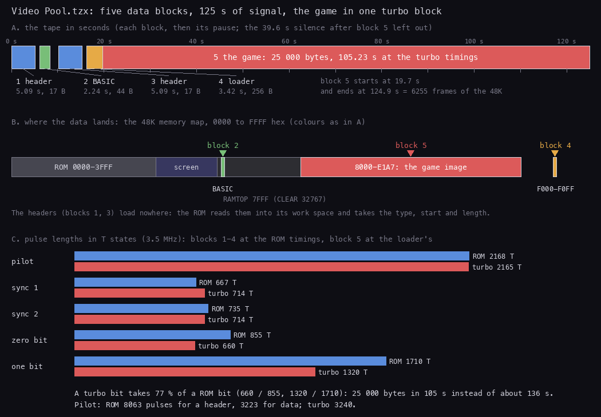
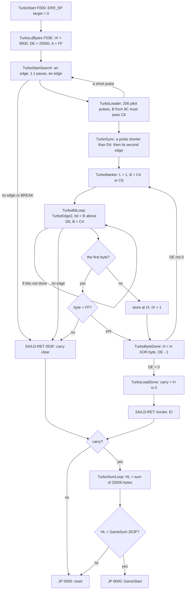
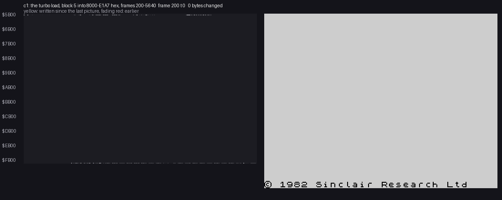
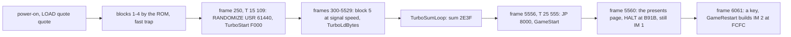
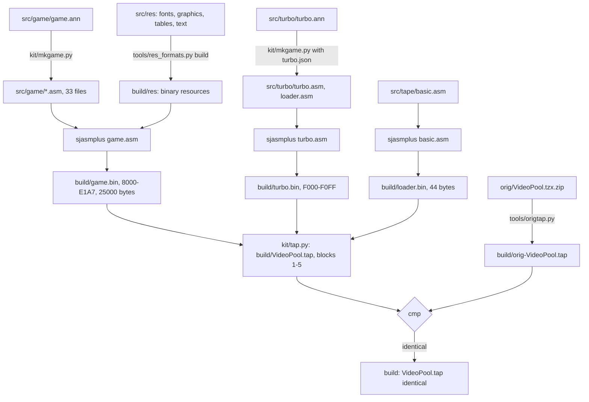

# 3. Build and load

What this covers:

- the tape block by block, as a picture (3.1);
- the BASIC loader (3.2);
- the turbo loader at `$F000`: its flowchart, the three constants it changes in the ROM's LD-BYTES, why they fit
  the turbo pulses (3.3);
- the 16-bit sum that guards the game, with its worked example (3.4);
- the load as `c1` saw it, stage by stage, and its animation (3.5);
- the TAP conversion, for comparison (3.6);
- the source build that rebuilds the tape byte for byte (3.7).

The recording it rests on: `c1`, from power-on with `Video Pool.tzx` on the 48K. The ROM blocks go through the fast
LD-BYTES trap, the turbo block at signal speed through the loader at `$F000` (WALKTHROUGH 1). The names are those of
`src/turbo/turbo.ann` and `src/game/game.ann` ([Terms](README.md#terms)).

## 3.1 The tape, block by block



How to read the figure:

- **A** is the tape in seconds. Each coloured bar is a block's signal; the gaps are the pauses after it. The 39.6 s
  of silence after block 5 is left out.
- **B** is the 48K memory map. Each block's data lands where its bar of the same colour sits: the BASIC at
  `$5CCB`, the loader at `$F000-$F0FF`, the game at `$8000-$E1A7`.
- **C** compares the pulse lengths, in T states of the 3.5 MHz clock. Blue is the ROM's timing (blocks 1-4), red is
  the turbo block's (block 5).
- **The point**: four short ROM blocks take 20 s; the game is one long turbo block of 105 s. Its bits are 77 % of the
  ROM's length, so the load is about 30 s shorter than at ROM speed.

```bash
python3 tools/fig_tape.py     # parses tools/tzxblocks.py list "work/media/tzx/Video Pool.tzx"
```

The original release (`orig/VideoPool.tzx.zip`, `Video Pool.tzx`) holds an archive-info block and five data blocks:
four standard ROM blocks and one turbo block (TZX block id `$11`). The game itself is the turbo block. The Paxman
re-release holds the same five data blocks byte for byte (other pauses, a text block in place of the archive info).

| Block | Kind | Data (+2 on tape) | Loads at | Time on tape | Pause after |
| ---: | --- | ---: | --- | ---: | ---: |
| 0 | archive info: "Video Pool", Oxford Computer Publishing, James Hutchby, 1985, "Original", "TZXed by Andrew Barker For Tony Barnett" | | | | |
| 1 | header: Program "VIDEO POOL", LINE 10 | 17 | | 5.09 s | 986 ms |
| 2 | the BASIC loader | 44 | the BASIC area | 2.24 s | 1849 ms |
| 3 | header: Bytes "VIDEO POOL", start 61440, length 256 | 17 | | 5.09 s | 990 ms |
| 4 | the turbo loader | 256 | `$F000-$F0FF` | 3.42 s | 2 ms |
| 5 | turbo, no header: the game | 25 000 | `$8000-$E1A7` | 105.23 s | 39 620 ms |

- Blocks 1-4 have the ROM's timings: pilot 2168 T, zero 855 T, one 1710 T.
- Block 5 has the loader's timings: 3240 pilot pulses of 2165 T, two sync pulses of 714 T, zero 660 T, one 1320 T.
- Block 5's first byte is the flag `$FF` and its last is an XOR checksum, `$E6`, as in a ROM block.
- The signal lasts 121.07 s, which is 6063 frames of the 48K (69 888 T a frame, 50.08 frames a second).
- With the pauses between the blocks, and without the 39.6 s of silence at the end, the tape lasts 124.9 s (6255
  frames). The instructions say "about 2 minutes".

## 3.2 The BASIC loader

Block 2 holds 44 bytes of BASIC:

```basic
10 CLEAR 32767
20 LOAD "" CODE
30 RANDOMIZE USR 61440
```

- The header's LINE 10 starts the program as soon as it is loaded.
- Line 10 puts RAMTOP at `$7FFF`, one below the game.
- Line 20 loads the next file, block 4, at the address in its header, `$F000`.
- Line 30 runs it. The loader never returns.

`src/tape/basic.asm` writes these bytes by hand, with the ROM's tokens and its hidden five-byte numbers; it
assembles to block 2 byte for byte (3.7).

## 3.3 The turbo loader

The loader is block 4, 256 bytes at `$F000` (`src/turbo/loader.asm`). Its first 215 bytes are code; the rest is a
leftover of the author's system that nothing reads (TurboLeftover `$F0D7`, holding "*TES*RESU*").

It works in four steps:

1. TurboStart `$F000` writes 0 into the two bytes that ERR_SP points at. A BASIC error would return there, so any
   error now jumps to 0 and resets the machine.
2. TurboLdBytes `$F03E` loads 25 000 bytes at `$8000` with the flag `$FF`. A load error jumps to 0.
3. TurboSumLoop adds the 25 000 bytes into a 16-bit sum and compares it with GameSum `$F03C`, `$2E3F`. A mismatch
   jumps to 0.
4. It jumps to the game, GameStart `$8000`.

Pseudocode:

```text
TurboStart:
    word at (ERR_SP) = 0                     ; an error report now resets
    if not TurboLdBytes(IX=$8000, DE=25000, flag=$FF, load): reset
    sum = 0
    for each of the 25000 bytes at $8000: sum = (sum + byte) mod 65536
    if sum != GameSum ($2E3F): reset
    jump $8000

TurboLdBytes:                                ; the ROM's LD-BYTES, three constants changed
    DI, border 15, return through the ROM's SA/LD-RET ($053F)
    wait for an edge, about 1 s of DJNZ, another edge
    count 256 pilot pulses; any too short: start again
    wait for the short sync pulse
    for the flag byte, then each byte:
        B = $C6 for the first bit, $C4 for the marker and the rest
        8 times: two edges (TurboEdge2), bit = (B passed $D5), B = $C4
        flag byte: must equal $FF; later bytes: stored at IX, IX + 1
        H = H XOR byte                       ; the checksum
    carry = (H == 0)
```

The flowchart:



### The three constants

The loader is the ROM's LD-BYTES `$0556-$05E2` copied instruction for instruction. Only three values differ:

| Where | ROM | Turbo | Meaning |
| --- | --- | --- | --- |
| before the marker and each later bit (`LD B,...`) | `$B0` | `$C4` | where the edge counter starts |
| before the first bit of each byte | `$B2` | `$C6` | the same, two passes later for the byte's own overhead |
| the bit test (`LD A,...` then `CP B`) | `$CB` | `$D5` | a one if the counter passed this |

The bit loop with the changed constants (`src/turbo/loader.asm`):

```asm
TurboCount:
  DEC DE                  ; DE - 1, timing constant $C6 for the first bit
  EX AF,AF'
  LD B,$C6                ; ROM: LD B,$B2
TurboMarker:
  LD L,$01                ; L = 1: the marker bit, shifted out after 8 bits
TurboBitLoop:
  CALL TurboEdge2         ; two edges; the ROM's edge loop counts B up
  RET NC
  LD A,$D5                ; ROM: LD A,$CB
  CP B                    ; carry when B > $D5: a one
  RL L
  LD B,$C4                ; ROM: LD B,$B0
  JP NC,TurboBitLoop
```

The edge loop is not copied. TurboEdge1 `$F0CF` keeps the ROM's delay (22 passes of `DEC A`) and then jumps into
the ROM at `$05EC`. There the ROM's LD-SAMPLE adds one to B every 59 T until the EAR bit changes. So the loader
needs the ROM, and a bit is measured in passes of 59 T.

Worked example: why `$D5` fits the turbo bits.

| Step | ROM block | Turbo block |
| --- | ---: | ---: |
| a zero bit, two pulses | 2 x 855 = 1710 T | 2 x 660 = 1320 T |
| a one bit, two pulses | 2 x 1710 = 3420 T | 2 x 1320 = 2640 T |
| the midpoint between them | 2565 T | 1980 T |
| counter passes from start to the test | `$CB` - `$B0` = 27 | `$D5` - `$C4` = 17 |
| difference of the midpoints | | 2565 - 1980 = 585 T |
| difference of the thresholds | | (27 - 17) x 59 = 590 T |

The fixed part of the loop (the delays, the CALLs) is the same in both, so only the counted passes move the
threshold. Ten passes fewer move it 590 T earlier, and the midpoint between a zero and a one moved 585 T. The
threshold stays in the middle of the shorter bits.

Known from the code and the tape, not measured on the signal: the per-bit counts were not traced (the load ran at
signal speed, 200 016 passes of TurboBitLoop in `c1`, `python3 tools/l1sum.py --builds stage1/c1 F0B2`).

The point: the turbo loader is the ROM's loader with a faster clock in three bytes. It needs no new code, and it
still uses the ROM's edge sampler.

## 3.4 The sum

After the load, TurboSumLoop adds every byte to HL and compares HL with GameSum `$F03C`:

```asm
  LD IX,GameEntry
  LD DE,$61A8             ; 25000
  LD HL,$0000
TurboSumLoop:
  LD B,$00
  LD C,(IX+$00)
  ADD HL,BC               ; HL += the byte
  INC IX
  DEC DE
  LD A,D
  OR E
  JR NZ,TurboSumLoop
  LD BC,(GameSum)         ; $2E3F
  OR A
  SBC HL,BC
  JP NZ,$0000             ; a wrong sum: reset
  JP GameEntry
```

Worked example, the first five bytes and the end (`build/game.bin`):

| Address | Byte | HL after |
| --- | ---: | ---: |
| `$8000` | `$31` | `$0031` |
| `$8001` | `$00` | `$0031` |
| `$8002` | `$D0` | `$0101` |
| `$8003` | `$CD` | `$01CE` |
| `$8004` | `$2C` | `$01FA` |
| ... all 25 000 | | `$212E3F` in full, `$2E3F` in 16 bits |

- `$31 $00 $D0` is `LD SP,$D000`, GameStart's first instruction; `$CD $2C` starts `CALL $9D2C`.
- The sum `$2E3F` equals GameSum, so the loader jumps to `$8000`.
- The XOR checksum of the tape block is a separate check, inside TurboLdBytes: the flag `$FF` XOR the 25 000 bytes
  is `$E6`, and the block's last byte is `$E6`, so H ends at 0.
- `tools/image.py` asserts the same sum on the tape's bytes.

The point: two checks guard the game. The XOR catches a bad bit; the sum adds a second check over the bytes as
stored. Both reset the machine when they fail. Nothing is encrypted or packed: the game's bytes on the tape are the
image at `$8000`.

## 3.5 The load as `c1` saw it



How to read the animation:

- **Left**: the memory from `$5B00` to `$FFFF`, one pixel a byte, 256 bytes a row. A row label every `$1000`.
- **Yellow** bytes were written since the last picture, **fading red** earlier ones; grey bytes hold their value.
- **Right**: the Spectrum screen. It shows "Bytes: VIDEO POOL", the ROM's message for block 3, all through the turbo
  load, because the turbo block has no header.
- A picture every 60 frames (4 193 280 T), 92 pictures from frame 200 to frame 5640 of `c1`.
- **The point**: the game fills `$8000` upwards in one sweep, about five bytes a frame, and nothing else in memory
  changes. The loader at `$F000` stays as it is.

```bash
python3 ../../kit/memanim.py --work work/docs/vpA/c1 --from 200 --to 5640 --step 4193280 --from-address 5B00 \
    --screen --label "c1: the turbo load, block 5 into 8000-E1A7 hex, frames 200-5640" --delay 90 \
    docs/img/routines/TurboLdBytes.gif
```

`work/docs/vpA/c1` is `work/stage1/c1` opened again (its `session.ttd`); the command reads the recording, it does not
run the emulator.

The stages of the load (`python3 $RS stages --work work/stage1/c1`, WALKTHROUGH 1):



| Stage | PC | Frame, T | What happens |
| ---: | --- | --- | --- |
| 1 | `$F000` | 250, 15 109 | the loader is entered (one entry) |
| 2 | `$F03E` | 250 | TurboLdBytes: the pilot search |
| 3 | | 300-5529 | the turbo block: 25 001 bytes, the last at T 63 143 of frame 5529 |
| 4 | `$8000` | 5556, 25 555 | the game is entered; `work/snaps/entry.z80` is taken here |
| 5 | `$B91C` | 5560, 2710 | the presents page waits on its HALT, with the ROM's IM 1 handler |
| 6 | `$FCFC` | 6061, 1833 | the first IM 2 interrupt, after a key on the presents page ([doc 4](04-game-loop.md)) |

Between frame 5529 and 5556 the loader runs the ROM's SA/LD-RET and the sum. One pass of TurboSumLoop is 73 T (7 + 19
+ 11 + 10 + 6 + 4 + 4 + 12), so 25 000 passes take 1 825 000 T, 26.1 frames. The recording shows 1 849 388 T, 26.5 frames, from the
last byte to `$8000`: the sum is nearly all of the gap.

## 3.6 The conversion, for comparison

`VIDPOOL.TAP` in `orig/VideoPool.tap.zip` is not the original:

- It holds a 162-byte BASIC ("Modify by JANSOFT 1985", `CLEAR 32767`, `LOAD "" CODE`, `RANDOMIZE USR 32768`).
- The 25 000 bytes are a standard block at `$8000`: 149.1 s at ROM speed, 7467 frames.
- Against the original turbo block 207 bytes differ, in 25 runs. Every one is a byte the original holds as zero, or
  a table the game fills at run time (`$869E-$86C0`, `$8A89-$8AE9`, `$9F4B-$9F66`, `$CFC0-$CFFF` and smaller ones).
- The key names at `$B668` read `'z' right='x' fire=' '` where the original has blanks.
- So the TAP's code was saved from a game that had run.

Commands (WALKTHROUGH 0): `python3 tools/tzxblocks.py list "work/media/tzx/Video Pool.tzx"`,
`python3 ../../kit/tapblocks.py list work/media/tap/VIDPOOL.TAP`.

## 3.7 The build

`tools/build.sh` rebuilds the tape's five data blocks from the sources and compares them with the original's, byte
for byte:



The inputs:

| Input | Becomes | Tool |
| --- | --- | --- |
| `src/game/game.ann` | `src/game/*.asm` (the game, 33 files) | `kit/mkgame.py` |
| `src/res/fonts`, `graphics`, `tables`, `text` | `build/res/*.bin`, the `INCBIN` resources (86 of them) | `tools/res_formats.py build` |
| `src/game/game.asm` | `build/game.bin`, `build/game.lst` | sjasmplus |
| `src/turbo/turbo.ann`, `turbo.json` | `src/turbo/turbo.asm`, `loader.asm` | `kit/mkgame.py --part` |
| `src/turbo/turbo.asm` | `build/turbo.bin`, `build/turbo.lst` | sjasmplus |
| `src/tape/basic.asm` (hand-written) | `build/loader.bin` | sjasmplus |
| the three binaries | `build/VideoPool.tap` | `kit/tap.py` |
| `orig/VideoPool.tzx.zip` | `build/orig-VideoPool.tap` | `tools/origtap.py` |

```bash
source work/env.sh
sh tools/build.sh
# build: VideoPool.tap identical to the data blocks 1-5 of orig/VideoPool.tzx.zip's Video Pool.tzx
```

- The build took 2.7 s on 2026-11-09 and printed the line above.
- The TAP has ROM timings for all five blocks. The TZX's turbo pulses and pauses are not rebuilt. The rebuilt TAP is
  for the comparison of the data, not for loading: the turbo loader would not read block 5 at ROM timings.
- One build at a time: a second one waits for `build/.lock`.

The point: every byte of the tape comes from the sources. The annotations are the single source of the game's
assembly, and the build proves them against the original.
