# 4. Game loop

What this covers:

- the shape of the program: no main loop, an interrupt that runs tasks, a foreground that only plays sound (4.1);
- the program state machine (4.2);
- the IM 2 vector and the handler (4.3);
- the scheduler and its 25 slots, with a worked countdown (4.4);
- one aiming interrupt, against the beam, and its animation (4.5);
- one ball and six balls: the interrupt length, and the interrupts that are lost (4.6);
- the shot set-up: AimShot's 455 000 T, an interrupt of 484 000 T (4.7);
- the heaviest traced pass, against the beam, and its animation (4.8);
- the long sequences with the tasks stopped, and the video-frame waits (4.9);
- the foreground and its time budget (4.10);
- the delays, in video frames, ticks and seconds (4.11).

The recordings it rests on:

- `w1` (from `work/snaps/entry.z80`, keys `tests/inputs/w1.txt`): a won game to the hall of fame.
- Two access traces of `w1`: frames 1070-1099 (aiming, the release at 1079, one ball rolling) and frames 4330-4399
  (aiming, the release at 4335, the break of a fresh rack, six balls rolling). They are
  `work/runs/w1/traces/1070_0-1100_0.uatr` and `4330_0-4400_0.uatr`.
- `c1` (from power-on) for the start of the game and the first IM 2 interrupt.

The per-interrupt costs come from `tools/task_costs.py --per-irq` on those traces (WALKTHROUGH 6.3). A video frame of
the 48K is 69 888 T. The names are those of `src/game/game.ann`. The words video frame, interrupt, tick, pass and
frame (the game's rack) are those of the [Terms](README.md#terms); a recording position (`w1` 1079) is a video frame.

## 4.1 The shape of the program

Video Pool has no main loop. After the menu, GameRestart `$8013` installs a list of tasks and falls into SoundLoop
`$8069`. From then on:

- **The interrupt does all the game's work.** Every video frame, the IM 2 handler Im2Handler `$80F0` calls the scheduler
  RunTasks `$9155`, and RunTasks calls the tasks in its 25 slots whose countdown has run out.
- **The foreground only makes sound.** SoundLoop waits for a request in SoundRequest `$827D`, set by a task, and plays
  it on the beeper with the interrupt still on. It also watches BREAK in InputState `$827C`.
- **The phases of play are task lists.** The aim installs AimTasks `$84AA` (five tasks); the release swaps them for
  MovingTasks `$84BA` (four tasks); the end of the shot removes them.

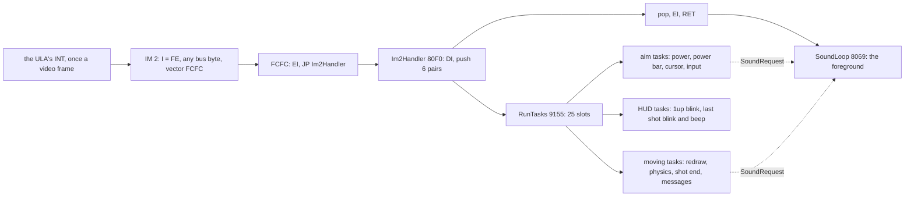

The point: the game is an interrupt-driven program. The time the interrupt takes is the time the game takes; what is
left of the video frame goes to the sound.

## 4.2 The program state machine

The states are not a variable. They are which code is running, and where: the foreground, a task list in the
interrupt, or a long sequence inside a task with the scheduler cut off (4.9).

```mermaid
stateDiagram-v2
    [*] --> Presents: GameStart 8000, still IM 1
    Presents --> Menu: a key; the first time GameRestart 8013 builds IM 2
    Menu --> Presents: 1500 video frames with no key
    Menu --> Editor: E
    Editor --> Menu: BREAK, BreakRestart
    Menu --> Rack: B, NewGameScreen, Rack 9F69 with the tasks stopped
    Rack --> Aim: StartAim 8425, AimTasks and three HUD tasks
    Aim --> Rolling: fire released, AimPower 8506 swaps in MovingTasks, AimShot 8A02
    Rolling --> ShotEnd: every ball still, or no object ball left
    ShotEnd --> Aim: StartAim
    ShotEnd --> Rack: frame cleared, or the second player's first turn
    ShotEnd --> GameOver: a life lost with none left
    GameOver --> Aim: two players, the other still alive: PLAYER n, 125 video frames, NextTurn 97CD (known only from the code)
    GameOver --> Menu: 250 video frames, hall of fame, 500 video frames, then BreakRestart
    Aim --> Menu: BREAK, SoundLoop to BreakRestart 80B0
    Rolling --> Menu: BREAK
```

| State | Where it runs | What runs | Foreground | Witness (`w1`) |
| --- | --- | --- | --- | --- |
| Presents | foreground: IM 1 the first time (from GameStart, back into GameRestart); IM 2 with no task after a menu timeout (called by MainMenu or VariationsPage, back to that page, the hall of fame between loops) | PresentsPage `$B8C5`, a HALT a video frame in PresentsFrame `$B91B` | the page itself | 0-500, 15 741-16 377 |
| Menu | foreground, IM 2 with no task | MainMenu `$B22E`, a HALT a video frame | the menu | 500-626, 14 233-15 741 |
| Rack | inside GameRestart or ShotEnd, tasks stopped | RackBalls `$9F6F`, one step a video frame | | 630-877 |
| Aim | interrupt, 8 tasks | AimTasks + UpBlinkTask, ShotsBlinkTask, LastShotBeepTask | SoundLoop | 877-1079 |
| Rolling | interrupt, 6 tasks | MovingTasks + the two blink tasks | SoundLoop, the clicks | from 1079 |
| ShotEnd | inside the task ShotEnd `$8357`, tasks stopped | messages, the tally, the foul jingle, the next frame | stopped | after each shot |
| GameOver | inside ShotEnd, tasks stopped | GameOver `$97A2`, the hall of fame | stopped | 11 768-14 232 |

- **BREAK** is seen in play only by SoundLoop, so it works in Aim and Rolling, not in the long sequences; the
  editor tests it in its own loop (InputState bit 5 at `$C133`, `$C31E`, `$C407`, EditorExit `$C414`). BreakRestart
  `$80B0` clears the tasks, sets SP to `$D000` and jumps to GameRestart. It never returns from the interrupt: the
  stack reset drops it.
- **GAME OVER leaves the same way.** GameOverEnd `$9825` ends in `JP BreakRestart` while it is still inside the ShotEnd
  task, so a game always ends by a stack reset.

The point: the program never unwinds an interrupt at the end of a game. It throws the stack away and starts again at
GameRestart, which rebuilds the IM 2 table too.

## 4.3 The IM 2 vector and the handler

GameRestart `$8013` sets up the interrupt every time it runs (`c1` frame 6061 is the first IM 2 entry):

```asm
GameRestart:
  DI
  LD A,$FE
  LD I,A
  IM 2
  LD HL,Im2Table          ; $FE00
  LD DE,Im2Table+$0001
  LD BC,$0100
  LD (HL),$FC
  LDIR                    ; $FE00-$FF00: 257 bytes of $FC
  LD HL,Im2Jump           ; $FCFC
  LD (HL),$FB             ; EI
  INC HL
  LD (HL),$C3             ; JP
  INC HL
  LD DE,Im2Handler
  LD (HL),E
  INC HL
  LD (HL),D
  EI
```

- In IM 2 the CPU reads a vector at (I x 256 + the byte on the data bus). The bus byte is not defined on a Spectrum,
  so the table holds `$FC` in all 257 bytes. Any bus byte gives the vector `$FCFC`.
- At `$FCFC` the game writes `EI; JP Im2Handler`. The byte at `$FCFD` is the switch of 4.9: WaitFrameNoTasks `$80DE`
  writes `RET` there, so an interrupt becomes `EI; RET`.

The handler:

```asm
Im2Handler:
  DI
  PUSH AF
  PUSH BC
  PUSH DE
  PUSH HL
  PUSH IX
  PUSH IY
  CALL RunTasks
  POP IY                  ; back from the tasks
  POP IX
  POP HL
  POP DE
  POP BC
  POP AF
  EI
  RET
```

- The `EI` at `$FCFC` protects only the `JP` after it (the Z80 takes no interrupt for one instruction after `EI`).
  By the time the `JP` ends, T 1848 of the video frame (4.6), the ULA's INT pulse (about 32 T from T 1812) is over,
  so no second interrupt is taken before the `DI` at `$80F0`.
- The tasks run with interrupts off. A task that calls the ROM's BEEPER must close them again: BEEPER ends with `EI`,
  and LastShotBeepTask `$9CA7` follows it with `DI`.
- No `RETI`: nothing on the bus needs it.

`w1` took 15 385 interrupts at `$FCFC` in frames 501-16 377 (15 877 frames), and 9 536 of them ran Im2Handler. The
other 5 849 were plain `EI; RET` while the tasks were stopped (`python3 tools/l1sum.py --builds runs/w1 FCFC 80F0`).

## 4.4 The scheduler and its 25 slots

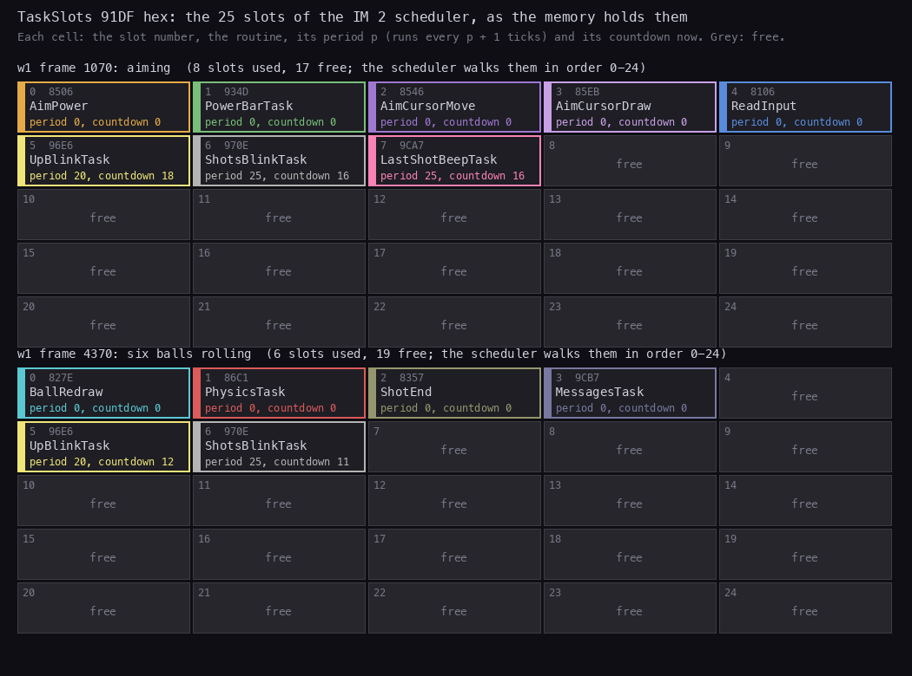

How to read the figure:

- **Each cell is a slot** of TaskSlots `$91DF`, 4 bytes: the routine (a word), the period, the countdown. A slot
  whose routine has a high byte of 0 is free (grey).
- **The top grid** is the memory at the start of frame 1070, while aiming: AimTasks in slots 0-4, the three HUD
  tasks of StartAim in slots 5-7.
- **The bottom grid** is frame 4370, six balls rolling: MovingTasks in slots 0-3, where AimTasks were, and the two
  blink tasks still in 5 and 6.
- **The colour** of a slot is its task's colour in the interrupt bars of 4.6.
- **The point**: the game never uses more than 8 of the 25 slots. The order of the slots is the order of the work in
  a tick, so the redraw (slot 0) runs first, right after the interrupt, ahead of the beam (4.8).

```bash
python3 tools/fig_loop.py slots --trace work/runs/w1/traces/1070_0-1100_0.uatr --at 1070 --label aiming \
    --trace work/runs/w1/traces/4330_0-4400_0.uatr --at 4370 --label "six balls rolling"
```

RunTasks `$9155`:

```asm
RunTasks:
  LD IX,TaskSlots
  LD B,$19                ; 25 slots
RunTasksLoop:
  LD A,(IX+$01)           ; the routine's high byte: 0 is a free slot
  OR A
  JR Z,RunTasksNext
  DEC (IX+$03)            ; the countdown
  JP P,RunTasksNext       ; not below 0 yet
  LD L,(IX+$00)
  LD H,(IX+$01)
  PUSH IX
  PUSH BC
  CALL CallTask           ; JP (HL)
  POP BC                  ; reload the countdown
  POP IX
  LD A,(IX+$02)
  LD (IX+$03),A
RunTasksNext:
  INC IX                  ; 4 bytes a slot
  INC IX
  INC IX
  INC IX
  DJNZ RunTasksLoop
  RET
```

Pseudocode:

```text
every tick:
    for slot in 0..24:
        if slot.routine is free: continue
        slot.countdown -= 1
        if slot.countdown >= 0: continue
        call slot.routine
        slot.countdown = slot.period          ; a period p runs every p + 1 ticks
```

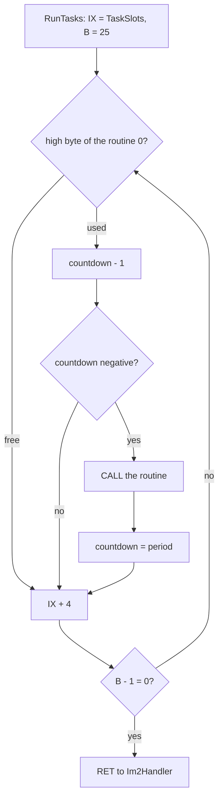

The routines that change the slots:

| Routine | Does | Calls in `w1` |
| --- | --- | ---: |
| AddTask `$9188` | routine HL, period C into the first free slot, countdown 0: it runs at the scheduler's next visit of its slot, in the same tick when the slot comes later than the caller's (the release, below), otherwise at the next tick | 252 |
| RemoveTask `$91AD` | frees the first slot holding routine HL | 252 |
| ClearTasks `$91CF` | zeros all 100 bytes, with DI | at each BREAK |
| InstallTasks `$80B9` | AddTask for each (period, routine) of a list, `$FF` ends | |
| RemoveTasks `$80CC` | RemoveTask for each routine of a list | |

The task lists:

| List | Tasks, all period 0 | Installed by | Removed by |
| --- | --- | --- | --- |
| AimTasks `$84AA` | AimPower `$8506`, PowerBarTask `$934D`, AimCursorMove `$8546`, AimCursorDraw `$85EB`, ReadInput `$8106` | StartAim `$8425` | AimPower, at the release |
| MovingTasks `$84BA` | BallRedraw `$827E`, PhysicsTask `$86C1`, ShotEnd `$8357`, MessagesTask `$9CB7` | AimPower, at the release | StopShotTasks `$8483` |
| the HUD tasks | UpBlinkTask `$96E6` period 20, ShotsBlinkTask `$970E` period 25, LastShotBeepTask `$9CA7` period 25 | StartAim | StopShotTasks (the two blinks), AimPower (the beep) |

**The release swaps the lists in the middle of a tick.** AimPower runs in slot 0. It removes AimTasks, which frees
slots 0-4, and installs MovingTasks into the first free slots, 0-3. RunTasks then goes on from slot 1 and finds
PhysicsTask, ShotEnd and MessagesTask there with countdown 0, so they run in the same tick. BallRedraw, in slot 0, waits
for the next one. The trace shows it: at frame 1079 the tick runs `$86C1`, `$8357` and `$9CB7` but not `$827E`
(`work/docs/vpA/costs-1070.txt`).

Worked example: UpBlinkTask, period 20, countdown 18 at the start of frame 1070.

| Interrupts | Video frames | Countdown after | Runs? |
| --- | --- | --- | --- |
| 9 aiming ticks | 1070-1078 | 18 - 9 = 9 | no |
| the release tick | 1079 | 8 | no |
| (6 interrupts lost, 4.7) | 1080-1085 | 8 | |
| 8 rolling ticks | 1086-1093 | 0 | no |
| the next tick | 1094 | -1, so it runs and reloads 20 | yes: "1up" blinks |

The trace's per-interrupt table has `$96E6` at 2699 T in the tick of frame 1094 and in no other between. The blink
counts ticks, not video frames: the six lost interrupts make it late by six video frames.

The point: a task's period is in ticks. When interrupts are lost, every periodic task slows down with the game.

## 4.5 One aiming tick

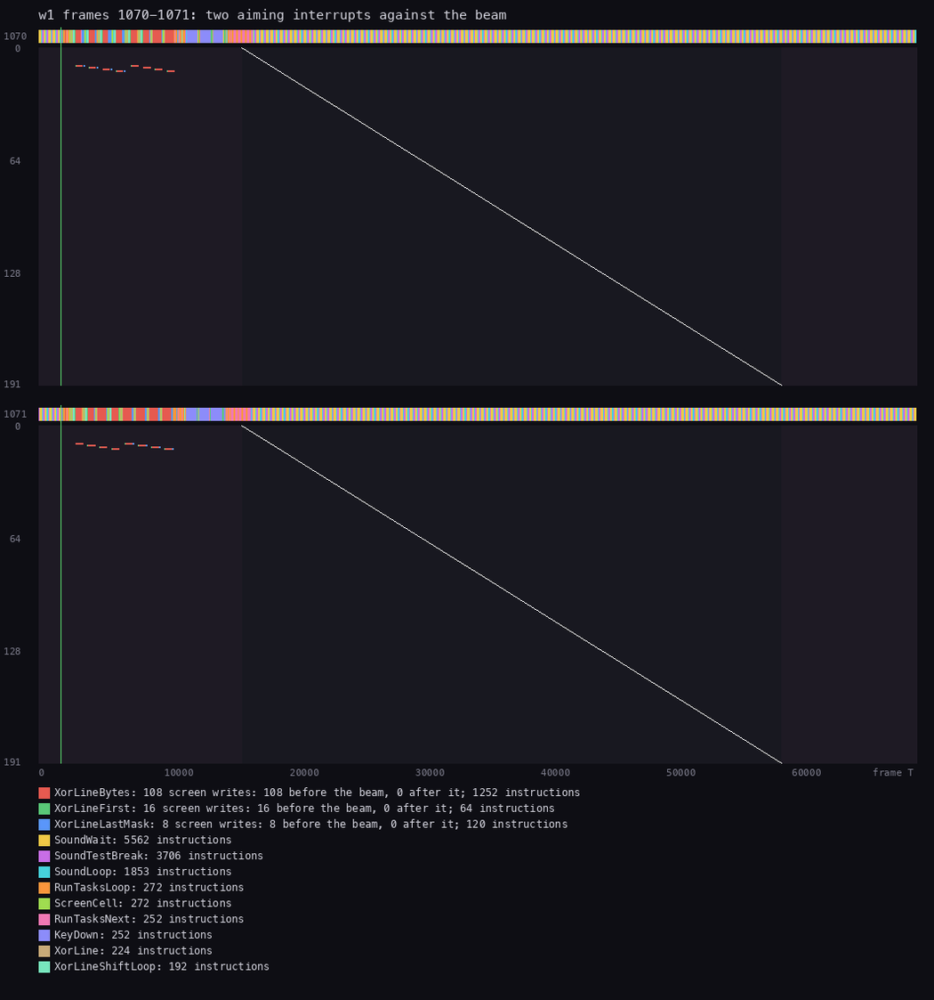

How to read the figure:

- **One panel a video frame**, 1070 and 1071 of `w1`. Across: the T-state in the video frame (0 is its start). Down:
  the 192 lines of the screen.
- **The thin vertical line** near T 1812 is the INT. **The diagonal** is the beam, from line 0 at T 16 152 to line 191.
- **Each dot** is a write into the screen, in its routine's colour. Here they are the power bar's XOR runs, near line 10,
  by XorLineBytes and its neighbours (132 writes in two video frames, all before the beam).
- **The strip above** each panel shows the routine the CPU is in. The coloured part to T 17 000 is the interrupt; the
  rest of the video frame is SoundLoop waiting for a request.
- **The point**: an aiming tick is 15-16.6k T, a quarter of the video frame. Its screen writes (the power bar near
  line 10) are done long before the beam reaches them, all before T 10 000; the tick itself ends about T 17 000,
  just after the beam starts line 0 (T 16 152).

```bash
python3 ../../kit/beam_timeline.py --trace work/runs/w1/traces/1070_0-1100_0.uatr --listing build/game.lst \
    --frames 2 --out docs/img/loop/beam-aim.png --title "w1 frames 1070-1071: two aiming interrupts against the beam"
```

(Drawn at 1064 pixels and scaled to 1050.)

The work of one aiming tick, `w1` frame 1070:

| Slot | Task | T | What it does |
| ---: | --- | ---: | --- |
| 0 | AimPower `$8506` | 110 | fire held: power + 2 |
| 1 | PowerBarTask `$934D` | 8380 | erase the last tick's bar, draw this tick's (XOR lines) |
| 2 | AimCursorMove `$8546` | 119 | the direction and speed from InputState |
| 3 | AimCursorDraw `$85EB` | 49 | move the cursor by its speed |
| 4 | ReadInput `$8106` | 3318 | read the chosen control into InputState |
| 5-7 | the HUD tasks | 0 | countdowns only |
| | the interrupt, entry to `RET` | 15 237 | |

Over the nine aiming ticks of the window the interrupt takes 15 125-16 643 T, and PowerBarTask 8268-9780 T: the bar
is longer as the power grows.

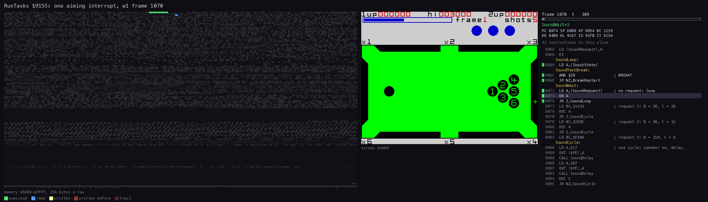

How to read the animation:

- **Left**: the memory from `$8000` to `$FFFF`, 256 bytes a row: green executed, blue read, yellow written, fading red.
  The slots at `$91DF` and the IM 2 table at `$FE00` are near the middle and the bottom.
- **Middle**: the screen. The power bar's XOR runs flash at the top.
- **Right**: the listing round the instruction last run, the registers and the T in the video frame.
- 60 pictures of 309 T, from T 0 to T 18 500 of frame 1070: the handler, RunTasks walking the 25 slots, the five
  aim tasks, the return.
- **The point**: one tick touches little memory. The slots, the cursor and power variables, the XOR line code and a
  few screen rows are all.

```bash
python3 work/docs/vpA/slice_trace.py work/runs/w1/traces/1070_0-1100_0.uatr 1070 1070:18500 work/docs/vpA/w1-1070-irq.uatr
python3 ../../kit/routine_anim.py --trace work/docs/vpA/w1-1070-irq.uatr --listing build/game.lst --view screen \
    --range 8000-FFFF --pictures 60 --title "RunTasks \$9155: one aiming interrupt, w1 frame 1070" \
    --out docs/img/routines/RunTasks.gif
```

`work/docs/vpA/slice_trace.py` cuts a part of a trace into a new trace file: it replays the start memory up to the
cut and keeps the instructions inside it.

## 4.6 One ball and six balls: the lost interrupts

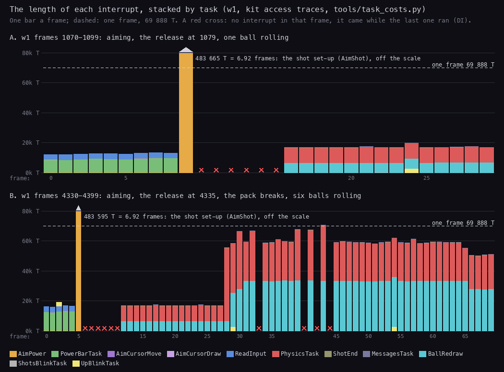

How to read the figure:

- **One bar a video frame**, stacked by task in the colours of the legend; the bar's height is the interrupt's length.
- **The dashed line** is one video frame, 69 888 T. **A red cross** is a video frame with no interrupt at all.
- **Panel A**, frames 1070-1099: nine aiming ticks of about 16k T, the release at window frame 9 (1079, off the scale,
  4.7), six video frames with no interrupt, then one ball rolling at about 20k T a tick.
- **Panel B**, frames 4330-4399: five aiming ticks, the release at window frame 5 (4335), six lost frames, the cue ball
  rolling alone at 20k T, then from window frame 28 (4358) the pack breaks. With six balls moving a tick takes
  53-74k T.
- **The point**: with six balls rolling a tick takes nearly the whole video frame. When it takes more, the next interrupt is
  lost and the game runs slower than real time. With all seven balls moving it happens again and again: nine
  interrupts lost (video frames 1155-1171, every second one) while all seven balls move in the `w1` break: each such
  pass is longer than a video frame (bounds 69 880-76 032 T from `work/docs/vpD/w1-sound.json`; not traced).

```bash
python3 tools/fig_loop.py irqs --trace work/runs/w1/traces/1070_0-1100_0.uatr \
    --name "A. w1 frames 1070-1099: aiming, the release at 1079, one ball rolling" \
    --trace work/runs/w1/traces/4330_0-4400_0.uatr \
    --name "B. w1 frames 4330-4399: aiming, the release at 4335, the pack breaks, six balls rolling"
```

The costs per tick (`tools/task_costs.py --per-irq`, saved in `work/docs/vpA/costs-1070.txt` and `costs-4330.txt`):

| Tick | Interrupt T | BallRedraw `$827E` | PhysicsTask `$86C1` | MoveBall calls | Share of the video frame |
| --- | ---: | ---: | ---: | ---: | ---: |
| aiming (1070) | 15 237 | | | | 22 % |
| one ball rolling (1086) | 19 932 | 6649 | 9969 | 1 | 29 % |
| six balls rolling, typical (4375) | 62 248 | 33 442 | 25 492 | 6 | 89 % |
| six balls, the heaviest traced (4373) | 73 768 | 33 429 | 37 025 | 6 | 106 % |

Inside PhysicsTask the cost is MoveBall `$8701` (one call per moving ball, 3356 T on average, 14 242 at most) and
BallContacts `$87EF` (1884 T on average, 12 895 at most). Inside BallRedraw it is DrawBall `$9548`, 2497 T a sprite,
twice per moving ball (erase and draw).

Worked example: why the interrupt of window frame 33 (4363) is lost. The moments are the trace's instructions at
`$FCFC`, `$80F0` and the handler's `RET` at `$8105`.

| Step | Frame, T |
| --- | --- |
| the INT of frame 4362 rises | 4362, T 1812; it is held about 32 T, to T 1844 |
| the CPU takes it: `EI; JP` at `$FCFC` | 4362, T 1834 |
| Im2Handler is entered | 4362, T 1848 |
| the interrupt, counted from `$FCFC` (T 1834), takes 69 906 T; the handler's `RET` | 4363, T 1852 |
| the INT of frame 4363 | 4363, T 1812 to about 1844: interrupts were off all that time |
| the next interrupt taken | 4364, T 1837 |

The frame before shows the other side. The tick of frame 4360 returned at frame 4361, T 1568, before that frame's
INT, and the INT of 4361 was taken at T 1833. So a tick must return before about T 1844 of the next video frame: the
CPU takes the interrupt at `$FCFC` 22 T after the INT, which leaves 69 888 - 22 + 32 = about 69 898 T, counted
from `$FCFC` as the interrupt lengths are. Window frames 32, 39, 41 and 43
took 69 906, 70 801, 70 478 and 73 768 T; frames 33, 40, 42 and 44 have no interrupt. Window frame 30 took 69 621 T,
and frame 31 has its interrupt.

The consequences:

- Physics, redraw and every periodic task run once per tick. The window has 60 ticks in 70 video frames
  (`interrupt entries 60`): six video frames lost to the shot set-up, four to six-ball ticks; from the break on, 38
  ticks in 42 video frames. The balls slow down on the screen when the pack breaks.
- `w1` as a whole: 15 877 video frames from 501 to 16 377, 15 385 interrupts taken; 492 video frames had none. Each
  run of them, matched against the BEEPER calls of `work/docs/vpD/w1-sound.json` (`irq`, `beeper`):

| Cause | Video frames lost | Runs |
| --- | ---: | --- |
| the 21 shot set-ups (4.7) | 137 | 10 lose six (1080-1085, 4336-4341, ...), 11 lose seven (1721-1727, 2859-2865, ...) |
| the foul jingle's two BEEPER notes (`$9791`, `$979F`) | 216 | 4 jingles x (25 + 29), from 10 557 |
| the name entry's BEEPER clicks (`$AF12`, `$AF35`) | 111 | 54 runs of 2 or 3, 12 932-13 368 |
| passes longer than a video frame | 14 | nine in 1155-1171 (all seven balls), four in 4363-4374 (six balls), one at 1751 |
| the tally's first beep (`$99EF`, S >= 10) | 12 | 1330, 2522, ..., 10 145 |
| the menu's click (`$B2CD`) | 2 | 621-622 |
| sum | 492 | |

  A run of seven is a set-up interrupt that is still running at the seventh INT: entered at about T 1834, the 483 665 T
  of 1079 end at T 66 171 of the sixth video frame after, and only a set-up of about 489 200 T or more (some 5 500 T
  longer) reaches past T 1844 of the seventh. The calculator's time depends on dx, dy and the power; the eleven longer
  set-ups were not traced, so their exact length is open.

## 4.7 The shot set-up: AimShot's 455 000 T in an interrupt of 484 000 T

When fire is released, AimPower `$8506` calls AimShot `$8A02` inside the tick. AimShot works out the cue ball's
velocity with the ROM's floating-point calculator:

```text
AimShot:                                   ; IY = 5C3A, I = 3F for the ROM, SET-MIN
    dx = cursor x - cue x
    dy = cursor y - cue y
    r  = SQR (dx*dx + dy*dy)               ; RST 28 literals at 8A2D
    vy = ScaleByPower (dy / r)             ; 16 x power x dy / r, as 8.8 in BC (FP-TO-BC)
    vx = ScaleByPower (dx / r)
    cue ball moving; I = FE again; FrictionSteps
```

Measured at the releases of `w1` 1079 and 4335 (`tools/task_costs.py --routines 8A02 --per-irq` and
`work/review/fixA/aimshot_parts.py` on the two traces; `work/docs/vpA/aimshot_split.py` for the calculator part).
Four nested measures, each with its own name:

| Measure | What it spans | `w1` 1079 | `w1` 4335 |
| --- | --- | ---: | ---: |
| AimShot's calculator part | `$8A02` to AimStoreVx `$8A47`: dx, dy, r, dy / r, vy, dx / r | 437 092 | 436 849 |
| AimShot | `$8A02` to its return into AimPower (`$8532`): the above, vx's ScaleByPower and FP-TO-BC (17 371 T), FrictionSteps `$90F5` (487 T) | 454 950 | 454 880 |
| the AimPower task | AimShot and the task lists swapped | 470 382 | 470 312 |
| the shot set-up's interrupt | `$FCFC` to `RET` | 483 665 = 6.92 video frames | 483 595 = 6.92 video frames |

Of AimShot at 1079, 453 853 T (99.8 %) is in the ROM, and the ROM's SQR alone, from `$384A` to the read of the next
literal `$8A35`, is 387 321 T: 85 % of AimShot (89 % of the calculator part).

- SQR in the 48K ROM is the power `x ^ 0.5`, which the ROM works out as `exp (0.5 x ln x)`. In all of AimShot (1079) the
  calculator entered ln and exp once each, its series generator twice (one Chebyshev series for each), and ran 29
  multiplications, 2 divisions and 59 additions (28 and 58 of them in the calculator part); the series are where the
  multiplications go.
- The whole set-up holds the interrupt for 6.92 video frames. Six interrupts are lost (1080-1085); the next tick is
  at 1086. At the release of 4335 the same: 483 595 T, the next tick at 4342. Of `w1`'s 21 set-ups, 10 lose six
  interrupts and 11 lose seven (4.6, the table of the lost interrupts).
- On the screen the cursor and the power bar freeze for 0.14 s, and then the cue ball starts.

The point: the game's slowest moment is one square root. A table or an integer root would have taken a few hundred
T; the author used the ROM, which is accurate and short to write.

## 4.8 The heaviest traced pass

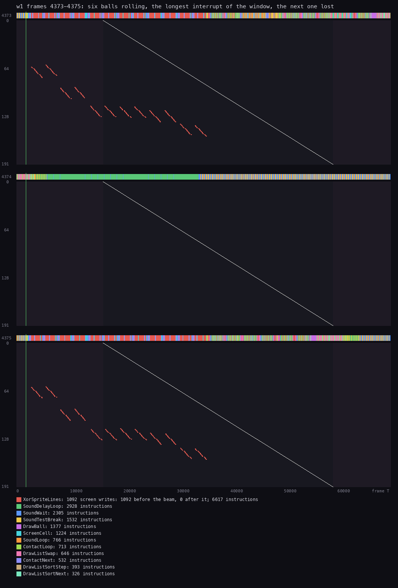

How to read the figure:

- **Three panels**, video frames 4373, 4374 and 4375.
- **The dots** are the writes of XorSpriteLines, the balls' XOR sprites: each short slanted run is one ball erased or
  drawn, 15 lines. 1092 writes in the two ticks, all before the beam.
- **Frame 4373**: the tick starts at the INT and runs the whole video frame (73 768 T, the heaviest of the two traced
  windows; the seven-ball passes of 1154-1170 were longer, 4.6, but no trace covers them): the strip is in the game's
  code to the right edge.
- **Frame 4374** has no tick. Its strip starts with the end of the last tick, then SoundDelayLoop (green): the
  foreground plays a click.
- **Frame 4375**: the next tick. The balls are drawn in the same order, from the top of the table down.
- **The point**: the redraw stays ahead of the beam because it runs first in the tick (slot 0) and draws the balls in
  screen order (the draw list is sorted by y). That is the "flicker-free movement" of the instructions. The cost is
  paid later in the tick: the physics comes after the drawing, and that is what runs over the video frame.

```bash
python3 work/docs/vpA/slice_trace.py work/runs/w1/traces/4330_0-4400_0.uatr 4373 4376 work/docs/vpA/w1-4373.uatr
python3 ../../kit/beam_timeline.py --trace work/docs/vpA/w1-4373.uatr --listing build/game.lst --frames 3 \
    --out docs/img/loop/beam-six.png \
    --title "w1 frames 4373-4375: six balls rolling, the longest interrupt of the window, the next one lost"
```

(Drawn at 1064 pixels and scaled to 1050.)

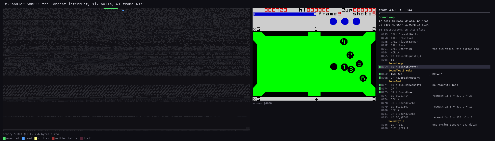

How to read the animation:

- The same three panels as RunTasks.gif: the memory `$8000-$FFFF`, the screen, the code.
- 90 pictures of 844 T: the six balls redrawn top to bottom first (the screen flashes), then the physics. MoveBall
  and BallContacts read the ball records at `$8A88` and the physics tables again and again.
- **The point**: the drawing is nearly half of the pass (BallRedraw 33 429 T of 73 768) and the physics the rest
  (PhysicsTask 37 025 T). Six balls cost six MoveBall calls and six BallContacts calls per tick.

```bash
python3 work/docs/vpA/slice_trace.py work/runs/w1/traces/4330_0-4400_0.uatr 4373 4374:6000 work/docs/vpA/w1-4373-irq.uatr
python3 ../../kit/routine_anim.py --trace work/docs/vpA/w1-4373-irq.uatr --listing build/game.lst --view screen \
    --range 8000-FFFF --pictures 90 --title "Im2Handler \$80F0: the longest interrupt, six balls, w1 frame 4373" \
    --out docs/img/routines/Im2Handler.gif
```

## 4.9 The long sequences: the tasks stopped

Everything between two shots runs inside the ShotEnd task, so inside an interrupt: the message, the tally, the foul
jingle, the next frame, the rack, GAME OVER and the hall of fame. Each of them waits for video frames with HALT. That works
because of WaitFrameNoTasks `$80DE`:

```asm
WaitFrameNoTasks:
  LD A,$C9
  LD (Im2Jump+1),A        ; $FCFD = RET: an interrupt is now EI; RET
  EI
  CALL WaitFrameCall      ; JP (HL): the sequence, which may HALT
  HALT                    ; one more interrupt, then the JP back
  DI
  LD A,$C3
  LD (Im2Jump+1),A        ; $FCFD = JP: the scheduler runs again
  RET
```

Pseudocode:

```text
WaitFrameNoTasks(HL = the sequence):          ; called inside a task, interrupts off
    byte at $FCFD = RET                        ; an interrupt is now EI; RET: not a tick
    EI
    call HL                                    ; the sequence: prints, beeps, HALT n times
    HALT                                       ; one more interrupt (EI; RET)
    DI
    byte at $FCFD = JP                         ; the next interrupt runs RunTasks again
    return to the task
```

Worked example: `w1`'s first tally, one ball potted with ShotScore S = 15 (canon of the tally, doc 8).

| Step | `w1` video frame | Why |
| --- | --- | --- |
| ShotEnd's tick calls ScoreShot `$98F9`, which jumps into WaitFrameNoTasks with HL = ScoreTally | 1254 | the tick of 1254 (`python3 tools/l1sum.py --builds runs/w1 98FF`) |
| the first ball's TallyPause and the term's three factors and pause | 1254 + 15 + 60 = 1329 | 75 `HALT`s, each ended by an `EI; RET` interrupt |
| the count-up: the first beep runs past the next INT, then 45 `HALT`s in all | 1329 + 45 + 1 = 1375 | the interrupt of 1330 lost (doc 9, 9.4) |
| DrawPottedRow, TallyEndWait `$99BD`'s 5 `HALT`s | 1380 | ScoreTally returns: 125 `HALT`s + 1 lost = 126 video frames |
| WaitFrameNoTasks's own `HALT`, then `DI` and `JP` back at `$FCFD` | 1381 | the scheduler runs again from the next interrupt |

During those 127 video frames no task runs: the blinks, the cursor and the physics are all frozen, and SoundLoop is
frozen too (4.10).

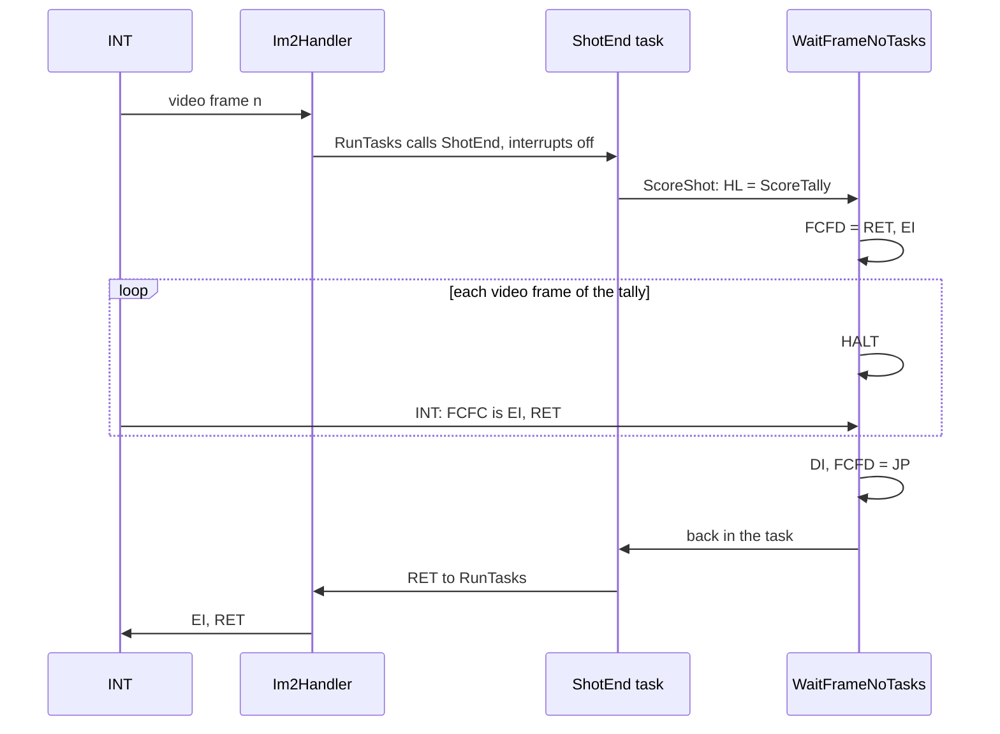

- While a sequence runs, the interrupts are only `EI; RET`: they end the HALTs and nothing else. No task runs, and
  SoundLoop does not run either, because the CPU is still inside the interrupt that called ShotEnd.
- The sequences through it: WaitMessages `$8451`, ScoreShot `$98F9`, FoulJingle `$9780`, TurnSwapStart `$9C0F`, Rack
  `$9F69`, the GAME OVER wait (GameOverEnd `$9825`, `$9851`). `w1`: 58 calls. Rack is the one that also runs outside
  a task: the first rack of a game is called by GameRestart `$805E` in the foreground.
- WaitFramesBStopped `$9886` (B video frames with the tasks stopped): GameOver `$97CA`, 125 video frames before the
  other player's turn, and NextTurnResume `$9803`, 100 video frames before a resumed turn. Known only from the code:
  no recording reached either (`p2` ended by BREAK).
- A nested HALT only works with interrupts on; WaitFrameNoTasks turns them on before the sequence and off after it.

The point: the game has a second, slower clock. During play the interrupt is a scheduler; between shots it is a plain
video-frame clock for code that waits.

The places that wait with HALT: 32 HALT instructions, in PresentsFrame, the menu's key loops, RackStepBall, the tally,
the banners, the foul jingle, GAME OVER, the hall of fame, the name entry and the editor
(`grep -h '^ *HALT' src/game/*.asm | wc -l`).

## 4.10 The foreground and its time

SoundLoop `$8069` is the whole foreground of play (`w1`: 6 290 430 passes, frames 877-11 615):

```asm
SoundLoop:
  LD A,(InputState)
SoundTestBreak:
  AND $20                 ; BREAK?
  JP NZ,BreakRestart
SoundWait:
  LD A,(SoundRequest)     ; no request: loop
  OR A
  JR Z,SoundLoop
  LD BC,$1414             ; request 1: B = 20, C = 20
  DEC A
  JR Z,SoundCycle
  LD BC,$1E0C             ; request 2: B = 30, C = 12
  DEC A
  JR Z,SoundCycle
  LD BC,$FA06             ; request 3: B = 250, C = 6
SoundCycle:
  LD A,$17                ; speaker on, border 7
  OUT ($FE),A
  CALL SoundDelay
  LD A,$07                ; speaker off
  OUT ($FE),A
  CALL SoundDelay
  DEC C
  JR NZ,SoundCycle
  XOR A
  LD (SoundRequest),A
  JR SoundLoop
```

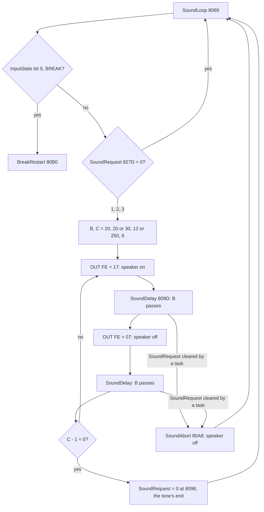

SoundDelay `$809D` reads SoundRequest on every pass: a task that writes 0 (StopShotTasks, ShotReset) ends the tone at
once through SoundAbort; a new non-zero request written meanwhile changes nothing until the tone's end clears it
(doc 9 has the request's rules). A pass of SoundDelay's loop is 37 T (`LD A,(nn)` 13, `OR A` 4, `JR Z` 7, `DJNZ` 13). The interrupt stays on, so each
half period also holds the time of any tick that comes in it.

Worked example: a cushion knock (request 2, B = 30, C = 12).

| Step | Value |
| --- | --- |
| the delay loops of the tone | 12 cycles x 2 halves x 30 passes x 37 T = 26 640 T |
| the foreground left with one ball rolling (a 20k T tick) | 69 888 - 19 932 = 49 956 T a video frame |
| the knock lasts | about 0.5 video frame |
| the foreground left with six balls (a 62k T tick) | 69 888 - 62 248 = 7 640 T a video frame |
| the knock lasts | 26 640 / 7 640 = about 3.5 video frames |

The tone's pitch also drops: every half period that holds a tick is longer by the tick. With six balls almost every
half period does. So the clicks of a break sound lower and slower than those of a single ball. Known from the code and
the costs; the sound itself was not measured (doc 9).

## 4.11 The delays

Seconds at 50.08 video frames a second (69 888 T at 3.5 MHz). "Video frames" are HALTs (or interrupts) counted by
the code; "ticks" are scheduler runs, which lost interrupts stretch (4.4).

| Wait | Count | Seconds | Where | Witness |
| --- | ---: | ---: | --- | --- |
| menu idle, then the attract sequence | 1500 video frames | 30.0 | MenuTimeout `$B8C1`, reset at every key (MenuKeys `$B293`) | `w1`: the menu drawn at 14 233-14 240, the attract sequence called at 15 741 (`$B2C0`) |
| the OCP banner rolling in | 417 video frames | 8.3 | BannerRollIn `$B96C` | `w1` 15 744-16 160 |
| "presents" | 75 video frames | 1.5 | PresentsPage `$B8D2` | `m1`, `w1` |
| after "video" slides in | 50 video frames | 1.0 | PresentsPage `$B8E5` | `m1` 3 runs, `w1` 1 |
| after the signature | 25 video frames | 0.5 | PresentsPage `$B8EF` | `m1` 2 runs |
| "press any key to continue." | 500 video frames | 10.0 | PresentsLongWait `$B90F` | `m1` |
| "FRAME n" | 75 video frames | 1.5 | ShowFrameBanner `$9B36` | `w1` 630 |
| the rack | one ball step a video frame; set 0 170 steps | 3.4 | RackStepBall, RackBalls `$9F6F` | `w1` 630-877 |
| a foul message held | 75 steps, one a tick while rolling, one a video frame after | 1.5 | MessagesTask `$9CB7` (MessageStep 3-`$4D`) | `w1` 4 messages |
| before each printed factor and term of the tally | 15 video frames each | 0.3 | TallyPause `$9B07` | `w1` 89 calls from 1254 |
| the tally's count-up | at least 45 video frames; n when the steps are more (up to 127, known only from the code); + 1 lost interrupt when S >= 10 | 0.9 and more | ScoreTally `$98FF` | `w1` 17 count-ups, the first from 1329 |
| after the count-up | 5 video frames | 0.1 | ScoreTally `$99BB` (TallyEndWait `$99BD`) | `w1` 17 runs |
| the foul jingle | 10 video frames, a note (DE 26, 27 cycles at about 52 Hz), 5 video frames, a note (DE 23, 24 cycles at about 41 Hz) | 1.4 in all, the notes 1.1 | FoulJingle `$9780`, its notes in FoulJingleNotes `$9786`, `$9794` | `p2` 1668, `f1` 4 runs |
| the turn change (two players) | 40 video frames | 0.8 | TurnSwap `$9C15` | `p2` 1738 |
| GAME OVER, or a key | 250 video frames | 5.0 | GameOverWait `$9857` | `w1` 11 768, `f1` 4445 |
| after the hall of fame (or none entered), or a key | 500 video frames | 10.0 | GameOverWaitAfter `$9860` | `w1` 13 732-14 232, `f1` 4695-5196 |
| the other player's turn after GAME OVER | 125 video frames | 2.5 | GameOver `$97CA`, WaitFramesBStopped `$9886` | known only from the code |
| a resumed turn | 100 video frames | 2.0 | NextTurnResume `$9803`, WaitFramesBStopped | known only from the code |
| the end of an edited shot, every object ball down | 150 video frames, or a key | 3.0 | EditorShotEndWait `$C488` (B = 150 at `$C486`) | known only from the code |
| the cursor's acceleration | +1 every 10 ticks | 0.2 | AimCursorAccel `$85AD` | `w1` 4311 runs |
| 1up blink | every 21 ticks | 0.4 | UpBlinkTask `$96E6` | `w1` 377 runs, 878-11 615 |
| "last shot" blink and beep | every 26 ticks | 0.5 | ShotsBlinkTask, LastShotBeepTask | `f1` 2940 |

The banners and the tally count video frames; the blinks and the cursor count ticks.

The point: the waits are short and fixed. The only long ones are the attract sequence, which a key ends, and the
shot set-up, which nothing can shorten.
