# 5. Controls

What this covers: the four input devices and their readers, the one input byte they all fill, the menu keys, the
key redefinition, BREAK and the hidden infinite-lives toggle, how the input becomes the aiming cursor round the table
and the power of the shot, and the name entry.

The recordings it rests on:

- `w1`: a one-player game on the keyboard, through GAME OVER to the name entry and the hall of fame. It was replayed
  for this document from `work/snaps/entry.z80` with `tests/inputs/w1.txt` and TTD on, 13 800 frames
  (`work/docs/vpB/replay.py`). Its screens match `docs/img/play` pixel for pixel at frames 1060, 3990, 12 500 and
  13 300.
- `m1`: the menu tour: Kempston at frames 4922-4980, the redefinition to Q, W, P at 5462-5860, the cursor joystick
  in the editor at 6272-6830.
- `j1`: Kempston at frames 622-2185, Interface 2 at 2503-3540.
- `e1`: the editor on the cursor keys, frames 632-844, and its game from 840.

The counts of runs are from the L1 builds of each recording (`tools/l1sum.py`). Frames are the recording's frames
from the snapshot.

## 5.1 One input byte, four readers

Every reader of the game turns its device into one byte, InputState `$827C`. The rest of the game reads only that
byte. The byte has six bits:

| Bit | Mask | Meaning |
| ---: | --- | --- |
| 0 | `$01` | right |
| 1 | `$02` | left |
| 2 | `$04` | up |
| 3 | `$08` | down |
| 4 | `$10` | fire |
| 5 | `$20` | BREAK (CAPS SHIFT and SPACE) |

ReadInput `$8106` picks the reader by Control `$B8BD`, the menu's choice. It pushes ReadBreak `$8216` as the return
address first. So every reader returns into ReadBreak, which adds bit 5 and stores the byte.

| Control | Menu key | Reader | Port |
| ---: | --- | --- | --- |
| 0 | K | ReadKeyboard `$8123` | the half rows of the three chosen keys |
| 1 | I | ReadInterface2 `$8151` | `$EFFE` and `$F7FE` |
| 2 | J | ReadKempston `$81A0` | `$1F` |
| 3 | C | ReadCursorKeys `$81C4` | `$F7FE`, `$EFFE`, then the ROM's KEY_SCAN |

Pseudocode:

```text
ReadInput:
    push ReadBreak                      ; the reader's RET lands there
    jump InputHandlers[Control]         ; A = the reader's bits

ReadBreak:
    if (IN $FEFE bit 0 == 0) and (IN $7FFE bit 0 == 0):   ; CAPS SHIFT and SPACE
        A |= $20
    InputState = A
```

The asm:

```text
8106  21 16 82     LD HL,ReadBreak
8109  E5           PUSH HL
810A  3A BD B8     LD A,(Control)
810D  87           ADD A,A
810E  21 1B 81     LD HL,InputHandlers
8111  85           ADD A,L
8112  6F           LD L,A
8113  30 01        JR NC,InputHandlerGot
8115  24           INC H
8116  7E           LD A,(HL)           ; InputHandlerGot: HL = InputHandlers[choice]
8117  23           INC HL
8118  66           LD H,(HL)
8119  6F           LD L,A
811A  E9           JP (HL)
811B  23 81        DEFW ReadKeyboard   ; 0
811D  51 81        DEFW ReadInterface2 ; 1
811F  A0 81        DEFW ReadKempston   ; 2
8121  C4 81        DEFW ReadCursorKeys ; 3

8216  01 FE FE     LD BC,$FEFE         ; ReadBreak
8219  ED 48        IN C,(C)
821B  CB 41        BIT 0,C             ; CAPS SHIFT
821D  20 0B        JR NZ,StoreInput
821F  01 FE 7F     LD BC,$7FFE
8222  ED 48        IN C,(C)
8224  CB 41        BIT 0,C             ; SPACE
8226  20 02        JR NZ,StoreInput
8228  F6 20        OR $20
822A  32 7C 82     LD (InputState),A   ; StoreInput
822D  C9           RET
```

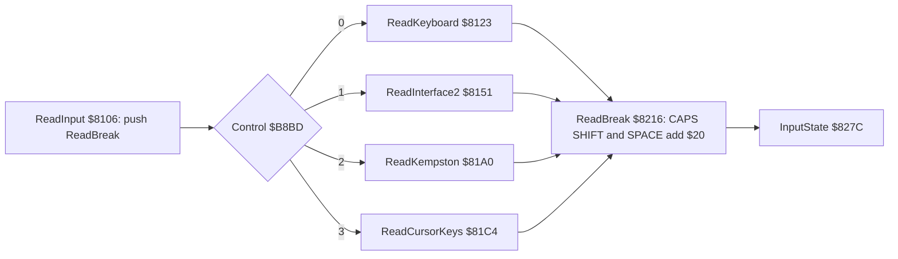

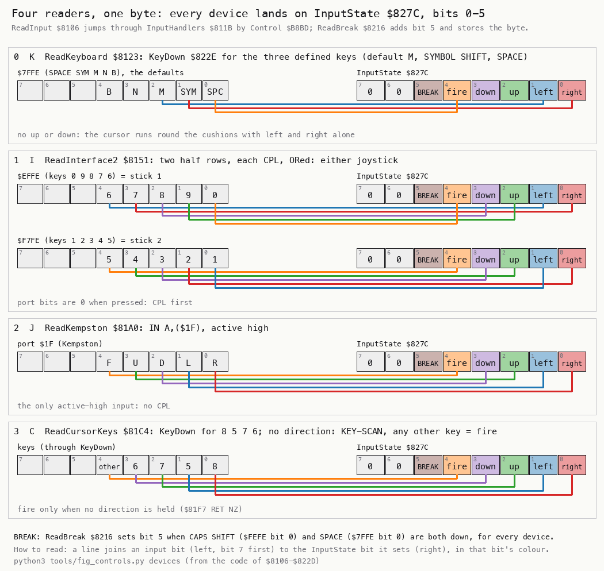

How to read the figure:

- **One band per device**, from the top: the keyboard, Interface 2, Kempston, the cursor joystick.
- **The boxes on the left** are the bits of the port the reader reads, with the key or the direction in each box.
- **The coloured lines** run from a port bit to the InputState bit it sets. The colour is the meaning: right, left,
  up, down, fire.
- **The BREAK box** is ReadBreak's own read, the same for all four devices.
- **The point**: four devices, four bit layouts, one byte out. Up and down are swapped between Kempston's port and
  InputState, and Interface 2 reads two joysticks at once.

```bash
python3 tools/fig_controls.py devices --out docs/img/controls/devices.png   # from the code of $8106-$822D
```

Worked example: in `w1` the player presses M, the default left key, at frame 880. In that frame's tick
ReadKeyboard returns `$02`, ReadBreak finds CAPS SHIFT up and stores `$02`. The sample of `$827C` at frame 881 is
`02` (a sample is the memory at the start of its frame, TTD `memory_at`: it shows what the tick of the frame before
did).

Witness: ReadInput runs in every recording: `game` 1725 times, `w1` 6407, `f1` 2793, `p2` 1375, `v1` 850, `m1` 927,
`j1` 1923, `e1` 641. BREAK's `OR $20` at `$8228` ran in `p2` once, `v1` once, `m1` twice, `j1` twice.

The point: the game has one input byte and every consumer reads it. A new device would need a new reader and a new
entry in InputHandlers, nothing else.

## 5.2 The readers, port by port

### The keyboard and KeyDown

ReadKeyboard `$8123` tests three keys: LeftKey `$B8BE`, RightKey `$B8BF`, FireKey `$B8C0`. The defaults are M
(`$4D`), SYMBOL SHIFT (`$18`) and SPACE (`$20`). The keyboard gives no up and no down. Each key is held as a
character code, the one the ROM's K_TEST returns. KeyDown `$822E` turns the character into a port and a bit.

KeyDown looks the character up in KeyTable `$8254` with CPIR. The table is 40 bytes: the 8 half rows of 5 keys,
from `$FEFE` to `$7FFE`, each row in bit order, bit 0 first. After CPIR, C holds 39 minus the index of the match.
Each 5 in C rotates the port's high byte one row on, from `$7F`. The rest picks the bit: `$10` shifted right
(C mod 5) times.

```text
KeyDown(A):                       ; Z = the key is down
    p = index of A in KeyTable    ; CPIR over 40 bytes; not found: NZ
    c = 39 - p
    b = $7F
    while c >= 5: c -= 5; b = (b >> 1) | $80     ; SCF; RR B
    d = $10 >> c
    return (IN (b << 8 | $FE)) AND d
```

```text
822E  21 54 82     LD HL,KeyTable
8231  01 28 00     LD BC,$0028
8234  ED B1        CPIR
8236  C0           RET NZ
8237  79           LD A,C
8238  06 7F        LD B,$7F
823A  D6 05        SUB $05             ; KeyRowLoop: five keys a half row
823C  38 05        JR C,KeyBit
823E  37           SCF
823F  CB 18        RR B
8241  18 F7        JR KeyRowLoop
8243  0E FE        LD C,$FE            ; KeyBit
8245  C6 06        ADD A,$06
8247  16 10        LD D,$10
8249  3D           DEC A               ; KeyBitLoop
824A  28 04        JR Z,KeyRead
824C  CB 2A        SRA D
824E  18 F9        JR KeyBitLoop
8250  ED 78        IN A,(C)            ; KeyRead
8252  A2           AND D
8253  C9           RET

8123  1E 00        LD E,$00            ; ReadKeyboard
8125  21 BE B8     LD HL,LeftKey
8128  7E           LD A,(HL)
8129  CD 2E 82     CALL KeyDown
812C  20 04        JR NZ,KeyboardRight
812E  7B           LD A,E
812F  F6 02        OR $02              ; left
8131  5F           LD E,A
...                                    ; RightKey: OR $01, FireKey: OR $10
814F  7B           LD A,E              ; KeyboardDone
8150  C9           RET
```

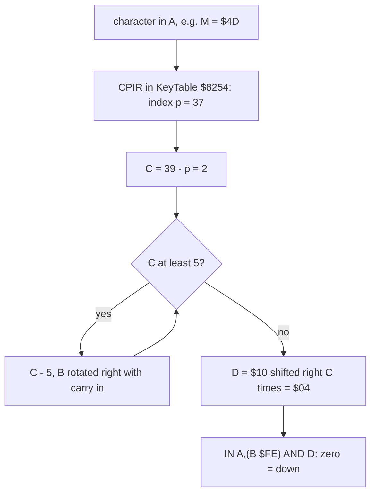

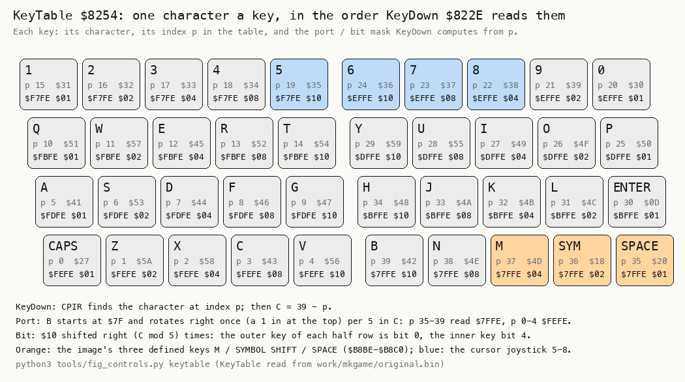

How to read the figure:

- **Eight rows**, one per half row, in the order of KeyTable: `$FEFE` at the top, `$7FFE` at the bottom.
- **Each key** shows its index p in KeyTable, the character, and the mask KeyDown builds for it.
- **The three highlighted keys** are the defaults: M left, SYMBOL SHIFT right, SPACE fire.
- **The point**: the table is the keyboard. Any key the ROM can name can be a control, because KeyDown finds its
  port and bit by position, without a second table.

```bash
python3 tools/fig_controls.py keytable --out docs/img/controls/keytable.png   # KeyTable from work/mkgame/original.bin
```

Worked example: M is `$4D`. CPIR finds it at index 37 and leaves C = 2. C is under 5, so B stays `$7F` and the port is
`$7FFE`. D is `$10` shifted twice, `$04`: bit 2 of the row SPACE, SYMBOL SHIFT, M, N, B. In `w1` M is held from frame
880 to 1033, and `$827C` reads `02` throughout.

Witness: ReadKeyboard ran 6407 times in `w1`, 317 in `m1`, 378 in `e1` (after the editor's cursor-key part, in its
play, frames 845-1367). KeyDown ran 19 221 times in `w1`, three calls a pass.

### Interface 2

ReadInterface2 `$8151` reads both Sinclair joysticks of the Interface 2. They are keys to the Spectrum: joystick 1 is
the half row 6-0 (`$EFFE`), joystick 2 is 1-5 (`$F7FE`). Each read is inverted with CPL, so a set bit is a pressed
key. The two results are ORed, so either stick drives the cursor.

| Port | Bit | Key | InputState |
| --- | ---: | --- | --- |
| `$EFFE` | 0 | 0 | fire `$10` |
| `$EFFE` | 1 | 9 | up `$04` |
| `$EFFE` | 2 | 8 | down `$08` |
| `$EFFE` | 3 | 7 | right `$01` |
| `$EFFE` | 4 | 6 | left `$02` |
| `$F7FE` | 0 | 1 | left `$02` |
| `$F7FE` | 1 | 2 | right `$01` |
| `$F7FE` | 2 | 3 | down `$08` |
| `$F7FE` | 3 | 4 | up `$04` |
| `$F7FE` | 4 | 5 | fire `$10` |

```text
8151  01 FE EF     LD BC,$EFFE
8154  ED 78        IN A,(C)
8156  2F           CPL
8157  4F           LD C,A              ; a bit set = pressed
8158  3E 00        LD A,$00
815A  CB 41        BIT 0,C             ; 0: fire
815C  28 02        JR Z,If2Right
815E  F6 10        OR $10
8160  CB 59        BIT 3,C             ; If2Right: 7
...
8178  F5           PUSH AF             ; If2Stick2: the 1-5 half row
8179  01 FE F7     LD BC,$F7FE
817C  ED 78        IN A,(C)
817E  2F           CPL
817F  4F           LD C,A
8180  F1           POP AF              ; the first half row's bits back in A
8181  CB 61        BIT 4,C             ; 5: fire
...
819F  C9           RET                 ; If2Done
```

Worked example: in `j1` key 6 is held from frame 2565. `$EFFE` reads bit 4 low. CPL makes it high. BIT 4 is set, so A
gets `$02`, left. Key 0 from frame 2610 adds `$10`, fire, and the shot leaves at frame 2640.

Witness: ReadInterface2 ran 836 times in `j1`, frames 2503-3540.

### Kempston

ReadKempston `$81A0` reads port `$1F`. The interface is active high: a set bit is a pressed direction. The game maps
port bit 2 to down and bit 3 to up, the other way round from InputState.

| `$1F` bit | Direction | InputState |
| ---: | --- | --- |
| 0 | right | `$01` |
| 1 | left | `$02` |
| 2 | down | `$08` |
| 3 | up | `$04` |
| 4 | fire | `$10` |

```text
81A0  DB 1F        IN A,($1F)
81A2  4F           LD C,A
81A3  3E 00        LD A,$00
81A5  CB 61        BIT 4,C             ; fire
81A7  28 02        JR Z,KempstonRight
81A9  F6 10        OR $10
...
81B7  CB 51        BIT 2,C             ; KempstonDown: port bit 2
81B9  28 02        JR Z,KempstonUp
81BB  F6 08        OR $08              ; InputState bit 3
81BD  CB 59        BIT 3,C             ; KempstonUp: port bit 3
81BF  28 02        JR Z,KempstonDone
81C1  F6 04        OR $04              ; InputState bit 2
81C3  C9           RET                 ; KempstonDone
```

Worked example: in `j1` the stick is pushed left for 40 frames from frame 1000. Port `$1F` reads `$02`, and A becomes
`$02`. Fire at frame 1045 reads `$10`, and the shot leaves at 1075.

Witness: ReadKempston ran 1087 times in `j1` (frames 622-2185) and 51 in `m1` (4922-4980).

### The cursor joystick

ReadCursorKeys `$81C4` tests the four cursor keys through KeyDown: 8 right, 5 left, 6 down, 7 up. With no direction
down it asks the ROM: KEY_SCAN `$028E` and K_TEST `$031E`. Any other key is fire, `$10`. No key, or a cursor key the
ROM reports, is 0 (CursorNoKey `$8213`).

```text
ReadCursorKeys:
    e = 0
    if KeyDown('8'): e |= $01
    if KeyDown('5'): e |= $02
    if KeyDown('6'): e |= $08
    if KeyDown('7'): e |= $04
    if e: return e
    k = K_TEST(KEY_SCAN())
    if k in ($FF, '8', '5', '6', '7'): return 0
    return $10                          ; any other key: fire
```

```text
81C4  1E 00        LD E,$00
81C6  3E 38        LD A,$38            ; "8": right
81C8  CD 2E 82     CALL KeyDown
...
81F2  7B           LD A,E              ; CursorKeyDirs: a direction is down: done
81F3  FE 00        CP $00
81F5  C0           RET NZ
81F6  CD 8E 02     CALL KEY_SCAN
81F9  CD 1E 03     CALL K_TEST
81FC  FE FF        CP $FF
81FE  28 13        JR Z,CursorNoKey
...
8210  3E 10        LD A,$10            ; another key: fire
8212  C9           RET
8213  3E 00        LD A,$00            ; CursorNoKey
8215  C9           RET
```

Worked example: 7 is `$37`. CPIR finds it at index 23 and leaves C = 16. Three rotations take B from `$7F` to `$EF`.
D is `$10` shifted once, `$08`: bit 3 of `$EFFE`. With 7 down, E becomes `$04`, up.

Witness: ReadCursorKeys ran 559 times in `m1` (frames 6272-6830) and 263 in `e1` (632-844); CursorNoKey 328 and 103
times.

The point: the four readers differ in port and polarity, and only the cursor reader needs the ROM. Fire on the
cursor joystick is "any other key", so a player can fire with the whole keyboard.

## 5.3 BREAK and the hidden toggle

**BREAK.** Bit 5 of InputState is set by ReadBreak when CAPS SHIFT and SPACE are both down. The foreground loop,
SoundLoop `$8069`, tests it on every pass. It jumps to BreakRestart `$80B0`: ClearTasks, the stack reset, and
GameRestart, which leads to the menu.

```text
SoundLoop:                       ; the foreground, between interrupts
    if InputState & $20: goto BreakRestart
    ...                          ; play the beeper request, if any
BreakRestart:
    ClearTasks(); SP = StackTop; goto GameRestart
```

```text
8069  3A 7C 82     LD A,(InputState)   ; SoundLoop
806C  E6 20        AND $20             ; SoundTestBreak: BREAK?
806E  C2 B0 80     JP NZ,BreakRestart
8071  3A 7D 82     LD A,(SoundRequest) ; SoundWait
...
80B0  CD CF 91     CALL ClearTasks     ; BreakRestart
80B3  31 00 D0     LD SP,StackTop
80B6  C3 13 80     JP GameRestart
```

InputState is written only by ReadInput. While the balls roll, ReadInput is not in the task list (MovingTasks
`$84BA`). So during play BREAK acts only while the player aims. A BREAK pressed during a shot is seen if it is still
held at the next aim. This is known from the code; no recording presses BREAK during a shot.

The editor has its own exit on bit 5: EditorExit `$C414` puts the saved control back and jumps to `$80B0` (`m1`
once, frame 6830).

**The infinite-lives toggle.** WaitNoKey `$B38E` runs before every menu wait and after every key. It waits until no
key is down. While any key is down it asks TestCheatKeys `$B3B8`. That reads four half rows and ORs them: bit 0 is
then low only when CAPS SHIFT, SPACE, 1 and 0 are all down. Then InfiniteLives `$B8C4` is complemented, and the code
waits for every key to go up. LoseLife `$9754` jumps straight to NextTurn when InfiniteLives is not 0, so a lost
cue ball costs no life.

```text
WaitNoKey:
    loop:
        HALT
        if no key: return
        if not (CAPS SHIFT and SPACE and '1' and '0'): continue
        InfiniteLives = NOT InfiniteLives
        wait until no key; return
```

```text
B38E  76           HALT                ; WaitNoKey
B38F  CD 8E 02     CALL KEY_SCAN
B392  20 08        JR NZ,WaitNoKeyHeld
B394  CD 1E 03     CALL K_TEST
B397  38 03        JR C,WaitNoKeyHeld
B399  FE FF        CP $FF
B39B  C8           RET Z
B39C  CD B8 B3     CALL TestCheatKeys  ; WaitNoKeyHeld
B39F  20 ED        JR NZ,WaitNoKey
B3A1  3A C4 B8     LD A,(InfiniteLives)
B3A4  2F           CPL
B3A5  32 C4 B8     LD (InfiniteLives),A
B3A8  76           HALT                ; WaitNoKeyRelease
...
B3B8  01 FE FE     LD BC,$FEFE         ; TestCheatKeys: CAPS SHIFT
B3BB  ED 78        IN A,(C)
B3BD  01 FE 7F     LD BC,$7FFE         ; SPACE
B3C0  ED 48        IN C,(C)
B3C2  B1           OR C
B3C3  01 FE F7     LD BC,$F7FE         ; 1
B3C6  ED 48        IN C,(C)
B3C8  B1           OR C
B3C9  01 FE EF     LD BC,$EFFE         ; 0
B3CC  ED 48        IN C,(C)
B3CE  B1           OR C
B3CF  CB 47        BIT 0,A             ; Z = all four down
B3D1  C9           RET
```

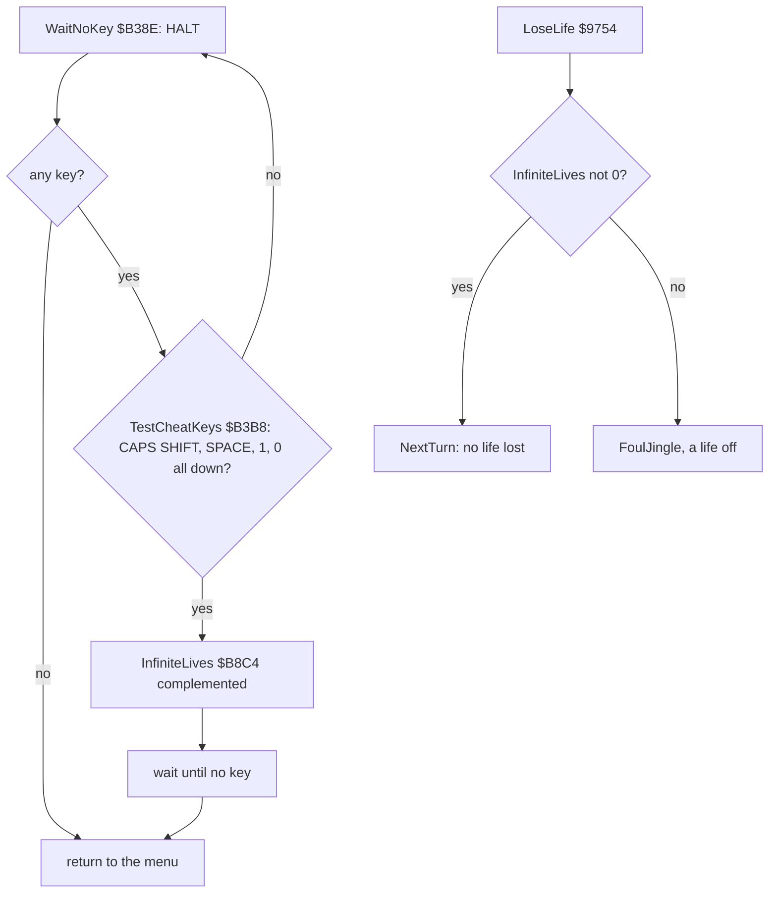

The four keys include BREAK (CAPS SHIFT and SPACE). In the menu that does no harm: whatever the control, StartAim's
AimCursorReset `$85C8` clears InputState before SoundLoop first reads it, so SoundLoop never sees a menu BREAK.

Worked example: `m1` sits in the menu with keys going down and up. WaitNoKey ran 202 times and TestCheatKeys 176 times.
TestCheatKeys never found the four keys, so `$B3A1` ran in no original recording. The `f1c` experiment (doc 10.10, `f1`
with the four keys held at frame 500) shows it: InfiniteLives `$B8C4` goes from 0 to `$FF` at frame 510
(`work/docs/vpC/f1c-flag.jsonl`). No figure: the toggle draws nothing.

The point: the only hidden key is a four-key chord in the menu, and it lasts until it is pressed again. The game has
no pause key: no code waits on a key during play.

## 5.4 The menu keys and the key redefinition

MainMenu `$B22E` prints the menu and ticks the three settings with XorTick `$B89C`. MenuKeys `$B293` sets
MenuTimeout `$B8C1` to 1500 frames and calls WaitNoKey. MenuKeyLoop `$B29C` then waits one frame a pass:

- With Kempston chosen, it calls ReadInput each frame. Kempston fire begins the game.
- It asks KEY_SCAN and K_TEST. No key counts MenuTimeout down. At 0 the attract sequence runs (PresentsPage
  `$B8C5`), then the menu again.
- A key clicks: BEEPER with HL `$03E8`, DE `$14`.

| Key | Action | Variable or routine |
| --- | --- | --- |
| 1, 2 | players | Players `$B8BB` |
| S, L | small or large pockets | Pockets `$B8BC` |
| K, I, J, C | keyboard, Interface 2, Kempston, cursor | Control `$B8BD` |
| B | begin | |
| V | the variations page | VariationsPage `$B67E` |
| E | the table editor | EditorStart `$C042` |
| R | redefine the keys | RedefineKeys `$B3D2` |
| any other | with a joystick chosen: fire begins | ReadInput, bit 4 |

Choosing J probes for a Kempston. Control is set to 2 and ReadInput is called. If InputState is not 0, that is if
any of the port's bits 0-4 is set (ReadKempston keeps only those) or BREAK is held, the game takes it for no
interface, and Control goes back. An unconnected port usually reads `$FF`; a port reading `$E0` would pass as a
Kempston.

```text
MenuKeyLoop:
    HALT
    if Control == 2 and ReadInput() & fire: begin
    k = K_TEST(KEY_SCAN())
    if no key: if --MenuTimeout == 0: attract; continue
    click
    switch k:
        '1','2': move the tick, Players = k - '0'
        'S','L': move the tick, Pockets
        'K','I','J','C': if 'J' and ReadInput() != 0: keep Control
                         else move the tick, Control
        'B': begin; 'V': variations; 'E': editor; 'R': redefine
        other: if Control != 0 and ReadInput() & fire: begin
    goto MenuKeys
```

```text
B29C  76           HALT                ; MenuKeyLoop
B29D  3A BD B8     LD A,(Control)
B2A0  FE 02        CP $02
B2A2  20 09        JR NZ,MenuReadKey
B2A4  CD 06 81     CALL ReadInput      ; Kempston: fire begins
B2A7  3A 7C 82     LD A,(InputState)
B2AA  E6 10        AND $10
B2AC  C0           RET NZ
B2AD  CD 8E 02     CALL KEY_SCAN       ; MenuReadKey
B2B0  CD 1E 03     CALL K_TEST
B2B3  38 11        JR C,MenuKey
B2B5  2A C1 B8     LD HL,(MenuTimeout)
B2B8  2B           DEC HL
...
B334  3A BD B8     LD A,(Control)      ; MenuControl
B337  4F           LD C,A
B338  B8           CP B
B339  CA 93 B2     JP Z,MenuKeys
B33C  78           LD A,B
B33D  FE 02        CP $02
B33F  20 16        JR NZ,MenuControlSet
B341  32 BD B8     LD (Control),A      ; try Kempston
B344  C5           PUSH BC
B345  CD 06 81     CALL ReadInput
B348  3A 7C 82     LD A,(InputState)
B34B  FE 00        CP $00
B34D  C1           POP BC
B34E  28 07        JR Z,MenuControlSet
B350  79           LD A,C              ; something read: no Kempston
B351  32 BD B8     LD (Control),A
B354  C3 93 B2     JP MenuKeys
```

**The redefinition.** R runs RedefineKeys `$B3D2`. It prints three prompts in turn, for left, right and fire
(PromptLeft `$B407`, PromptRight `$B426`, PromptFire `$B445`). RedefinePrompt `$B3F3` waits for no key, then for any
key, and returns the K_TEST character. The three characters go into LeftKey, RightKey and FireKey. ShowKeys `$B605`
then prints the menu's keys line. KeyName `$B626` names each key in three characters:

| Character | Name |
| --- | --- |
| `$0D` ENTER | `ent` |
| `$18` SYMBOL SHIFT | `s/s` |
| `$27` CAPS SHIFT | `c/s` |
| `A`-`Z` | the lower-case letter in quotes, such as `'q'` (`SUB $E0` adds `$20`) |
| any other | the character in quotes, `' '` for SPACE |

```text
B3F3  CD 65 9E     CALL PrintText      ; RedefinePrompt
B3F6  CD 8E B3     CALL WaitNoKey
B3F9  76           HALT                ; RedefineWaitKey
B3FA  CD 8E 02     CALL KEY_SCAN
B3FD  20 FA        JR NZ,RedefineWaitKey
B3FF  CD 1E 03     CALL K_TEST
B402  FE FF        CP $FF
B404  28 F3        JR Z,RedefineWaitKey
B406  C9           RET
...
B626  FE 0D        CP $0D              ; KeyName
B628  28 1A        JR Z,KeyNameEnter
B62A  FE 18        CP $18
B62C  28 1F        JR Z,KeyNameSymbol
B62E  FE 27        CP $27
B630  28 24        JR Z,KeyNameCaps
B632  FE 41        CP $41
B634  38 06        JR C,KeyNameQuoted
B636  FE 5B        CP $5B
B638  30 02        JR NC,KeyNameQuoted
B63A  D6 E0        SUB $E0             ; to lower case
B63C  36 27        LD (HL),$27         ; KeyNameQuoted
B63E  23           INC HL
B63F  77           LD (HL),A
B640  23           INC HL
B641  36 27        LD (HL),$27
B643  C9           RET
```

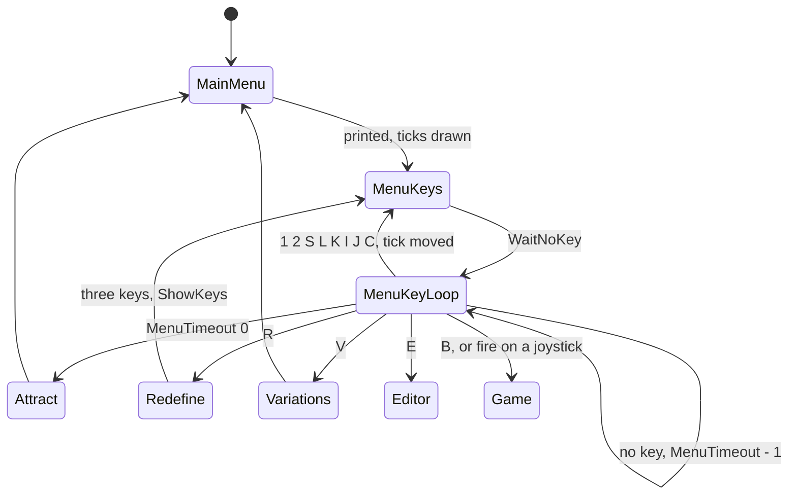

The menu screens, with the redefinition and the menu after it, are drawn in doc 01 (figure of section 1.2, screens
4-6 and 15-16).

Worked example: in `m1` R is pressed at frame 5462. The prompts take Q, W and P. K_TEST returns `$51`, `$57`, `$50`.
KeyName turns `$51` into `'q'`. The menu at frame 5860 shows the keys line with `'q'`, `'w'` and `'p'` (doc 01, screen
16). KeyDown finds Q at index 10: C = 29, five rotations, port `$FBFE`, mask `$01`.

Witness: in `m1`, MenuKeys ran 16 times, MenuControl 4 times (twice in `j1`), RedefineKeys twice, RedefinePrompt and
ShowKeys 6 times each (frames 5462-6090). The names "ent" and "c/s" are not executed in any recording.

The point: the menu is a loop on the ROM's keyboard scan, and a joystick player can start from it with fire. The
Kempston probe is a real detection: without the interface the port does not read 0.

## 5.5 From the input to the cursor: the cushion coordinate

During the aim the scheduler runs AimTasks `$84AA` once an interrupt: AimPower `$8506`, PowerBarTask `$934D`,
AimCursorMove `$8546`, AimCursorDraw `$85EB`, ReadInput `$8106`. All have period 0. ReadInput is last, so the cursor
moves on the input read one interrupt earlier.

The cursor is not free. It sits on the cushions and moves along them. Its place is CursorX `$86BA` (3 to 252) and
CursorY `$86BB` (51 to 180), always on one of the four cushion lines. AimCursorDraw turns the place into one number,
the perimeter coordinate p, 0 at the top left and growing clockwise:

| Cushion | Place | p |
| --- | --- | --- |
| top | y = 51 | x - 3, 0-249 |
| right | x = 252 | 249 + (y - 51), 249-378 |
| bottom | y = 180 | 378 + (252 - x), 378-627 |
| left | x = 3 | 627 + (180 - y), 627-755 (756 is the corner, p 0) |

The speed CursorSpeed `$86BC` is added to p, modulo 756 (`$2F4`). Then p is turned back into a place.

**The direction.** AimCursorMove maps each key to +1 or -1 along p. The map depends on where the cursor is, so the
key points the way the player expects on screen:

| Key | +1 (clockwise) when | -1 when |
| --- | --- | --- |
| right | y < 114, on the upper half | y >= 114 |
| left | y >= 114 | y < 114 |
| up | x < 128, on the left half | x >= 128 |
| down | x >= 128 | x < 128 |

**The acceleration.** The speed restarts only when the direction changes. When the input byte changes,
AimCursorMove maps it to +1 or -1; if the cursor stands, or the new direction is against the speed's sign, the speed
starts at +1 or -1 and the countdown CursorAccel `$86BD` at 10. A new input in the same direction keeps the speed and
goes on counting. While the same input is held, the countdown runs. At 0 it is reset to
10, and the speed grows by one, up to 6 pixels a frame. An input of 0, or fire alone, stops the cursor (speed 0).
CursorLastInput `$86BE` holds the input seen last.

```text
AimCursorMove:                      ; once an interrupt
    if InputState == CursorLastInput: goto accelerate
    CursorLastInput = InputState
    dir = the first of right, left, up, down that is held, mapped by the cushion table to +1 or -1
    if none: CursorSpeed = 0; return
    if CursorSpeed == 0 or sign(CursorSpeed) != dir:
        CursorSpeed = dir; CursorAccel = 10; return
accelerate:
    if CursorSpeed == 0: return
    if --CursorAccel: return
    CursorAccel = 10
    if |CursorSpeed| < 6: CursorSpeed += sign(CursorSpeed)

AimCursorDraw:
    if CursorSpeed == 0: return
    DrawCursor()                    ; XOR off
    p = perimeter(CursorX, CursorY)
    p = (p + CursorSpeed) mod 756
    CursorX, CursorY = place(p)
    DrawCursor()                    ; XOR on (its address pushed as the return)
```

```text
8546  ED 5B BA 86  LD DE,(CursorX)     ; AimCursorMove: E = x, D = y
854A  21 BC 86     LD HL,CursorSpeed
854D  3A BE 86     LD A,(CursorLastInput)
8550  47           LD B,A
8551  3A 7C 82     LD A,(InputState)
8554  B8           CP B
8555  28 56        JR Z,AimCursorAccel
8557  32 BE 86     LD (CursorLastInput),A
855A  E6 01        AND $01             ; right
855C  28 07        JR Z,CursorMoveLeft
855E  7A           LD A,D
855F  FE 72        CP $72              ; y < 114: forward
8561  38 2F        JR C,CursorForward
8563  18 38        JR CursorBack
...
858F  36 00        LD (HL),$00         ; CursorMoveStop: nothing held
8591  C9           RET
8592  7E           LD A,(HL)           ; CursorForward: +1, or accelerate
8593  B7           OR A
8594  3E 01        LD A,$01
8596  28 10        JR Z,CursorNewDirection
8598  FA A8 85     JP M,CursorNewDirection
859B  18 10        JR AimCursorAccel
...
85A8  77           LD (HL),A           ; CursorNewDirection: speed +-1
85A9  23           INC HL
85AA  36 0A        LD (HL),$0A         ; countdown 10
85AC  C9           RET
85AD  7E           LD A,(HL)           ; AimCursorAccel
85AE  B7           OR A
85AF  C8           RET Z
85B0  23           INC HL
85B1  35           DEC (HL)
85B2  C0           RET NZ
85B3  36 0A        LD (HL),$0A
85B5  2B           DEC HL
85B6  7E           LD A,(HL)
85B7  B7           OR A
85B8  F2 BD 85     JP P,CursorAccelLimit
85BB  ED 44        NEG
85BD  FE 06        CP $06              ; CursorAccelLimit: 6 at most
85BF  C8           RET Z
85C0  CB 7E        BIT 7,(HL)
85C2  20 02        JR NZ,CursorAccelDown
85C4  34           INC (HL)
85C5  C9           RET
85C6  35           DEC (HL)            ; CursorAccelDown
85C7  C9           RET

85EB  3A BC 86     LD A,(CursorSpeed)  ; AimCursorDraw
85EE  B7           OR A
85EF  C8           RET Z
85F0  CD 71 93     CALL DrawCursor     ; off
85F3  21 71 93     LD HL,DrawCursor
85F6  E5           PUSH HL             ; on, at the RET
85F7  DD 21 BA 86  LD IX,CursorX
85FB  DD 7E 01     LD A,(IX+$01)
85FE  FE 33        CP $33              ; on the top cushion?
...
863B  3A BC 86     LD A,(CursorSpeed)  ; CursorAddSpeed: + the speed, modulo 756
863E  5F           LD E,A
863F  16 00        LD D,$00
8641  B7           OR A
8642  F2 46 86     JP P,CursorSpeedSigned
8645  15           DEC D
8646  19           ADD HL,DE           ; CursorSpeedSigned
8647  11 F4 02     LD DE,$02F4
864A  CB 7C        BIT 7,H
864C  28 03        JR Z,CursorWrapHigh
864E  19           ADD HL,DE           ; below 0: + 756
...
8657  11 73 02     LD DE,$0273         ; CursorToLeft: p >= 627?
865A  AF           XOR A
865B  ED 52        SBC HL,DE
865D  38 0B        JR C,CursorToBottom
865F  3E B4        LD A,$B4
8661  95           SUB L               ; y = 180 - (p - 627)
8662  DD 77 01     LD (IX+$01),A
8665  DD 36 00 03  LD (IX+$00),$03     ; x = 3
8669  C9           RET
```

AimCursorReset `$85C8` starts each aim at (252, 115) on the right cushion, or at y 114 or 116 by bits 6 and 0 of R.
DrawCursor `$9371` draws a cross by XOR: four arms of 2 pixels round a clear centre. There is no aim line.

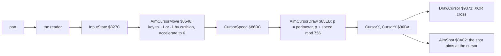

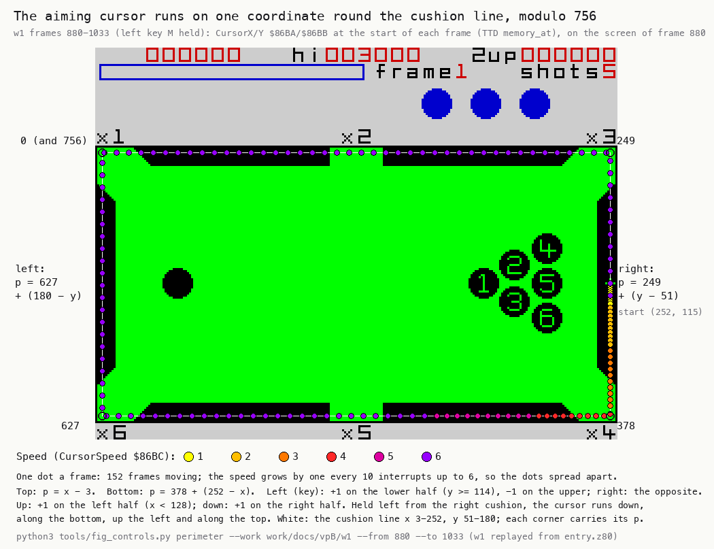

How to read the figure:

- **The table** is the screen of `w1` frame 880, three times enlarged.
- **Each dot** is the cursor's place at the start of one video frame (its sample) from 880 to 1033. The colour is the speed, 1 to 6.
- **The corner labels** are the p values: 0 at the top left, 249 top right, 378 bottom right, 627 bottom left.
- **The dots spread** as the speed grows. Near the start they touch; on the bottom cushion they are 6 pixels apart.
- **The point**: holding one key drives the cursor round all four cushions, the key's meaning changing at each
  half. The cursor never leaves the cushion lines.

```bash
python3 tools/fig_controls.py perimeter --work work/docs/vpB/w1 --from 880 --to 1033 --out docs/img/controls/perimeter.png
```

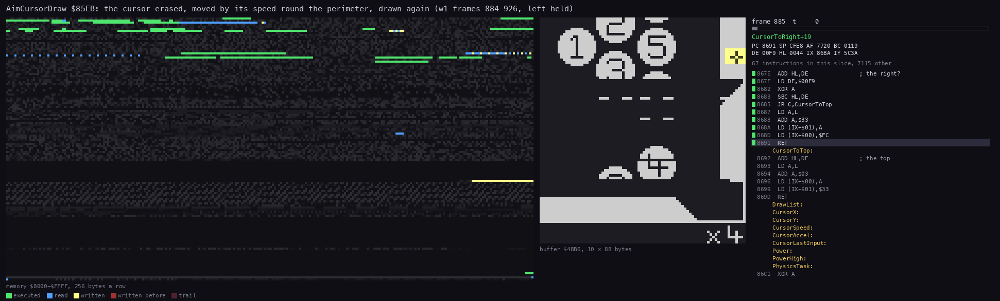

*The routine animation of AimCursorMove and AimCursorDraw (`$8546-$869D`) in `w1` frames 884-926, one picture a
frame. The view is the screen column at `$48B6`, 10 x 88 pixels, round the right cushion. Command:
`python3 ../../kit/routine_anim.py --work work/docs/vpB/w1 --window 884:0-926:0 --listing build/game.lst --out
docs/img/routines/AimCursorDraw.gif --pc 8546-869D --view buffer:48B6:10x88:screen --range 8000-FFFF --step 69888
--delay 160`.*

How to read the animation: the highlighted lines are the instructions run in that frame. The cross moves down the
right cushion, and its steps grow from 1 to 2 pixels from frame 892. The branches taken in AimCursorDraw are the
right cushion's (`CursorOnRight` and `CursorToRight`).

Worked example, from the `w1` samples (`work/docs/vpB/w1-aim.json`, `$827C` and `$86BA-$86C0`; each sample is the
memory at the start of its frame, after the tick of the frame before):

| Frame | InputState | x | y | speed | countdown | What |
| ---: | --- | ---: | ---: | ---: | ---: | --- |
| 880 | `00` | 252 | 115 | 0 | 0 | the aim starts |
| 881 | `02` | 252 | 115 | 0 | 0 | M, pressed at 880, read last in that frame's tick |
| 882 | `02` | 252 | 116 | 1 | 10 | the tick of 881 starts the move: left with y >= 114 is +1 |
| 890 | `02` | 252 | 124 | 1 | 2 | 1 pixel a frame, down the right cushion |
| 900 | `02` | 252 | 143 | 2 | 2 | the speed has grown once |
| 935 | `02` | 143 | 180 | 6 | 7 | the bottom cushion at 6 pixels a frame |
| 936 | `02` | 137 | 180 | 6 | 6 | one more step |
| 1033 | `02` | 252 | 121 | 6 | 9 | the lap is done |
| 1034 | `00` | 252 | 127 | 6 | 8 | M up, read in the tick of 1033, which still moved on the old input |
| 1040 | `00` | 252 | 130 | 1 | 10 | after short taps |

At frame 935 the cursor is at (143, 180). p is 378 + (252 - 143) = 487. The speed is +6, so p becomes 493. The place
is back on the bottom cushion at x = 252 - (493 - 378) = 137. The sample at 936 is x 137.

Witness: AimCursorMove ran 4404 times in `w1`, AimCursorDraw 4424, AimCursorReset 21 (one per aim).

The point: the player aims by choosing a point on the cushions, and the game keeps that point on a closed loop of
756 pixels. The acceleration lets one key cover the loop in about three seconds and still allows a 1-pixel step.

## 5.6 The power and the release

AimPower `$8506` runs every interrupt with the others. While fire is held, Power `$86BF` grows by 2. At `$86` (134)
it wraps to 0, so a player who holds too long starts again from nothing. When fire is up and Power is not 0, the shot
leaves (AimShoot `$851B`):

1. DrawCursor erases the cross.
2. AimTasks and LastShotBeepTask are removed.
3. ShotReset `$84C7` clears the shot's state.
4. AimShot `$8A02` turns the cursor and Power into the cue ball's velocity, Power / 16 pixels a tick.
5. MovingTasks `$84BA` are installed: the balls roll.

PowerBarTask `$934D` draws the bar with DrawPowerBar `$935C`: four XOR lines at y 10-13 from x 4, Power pixels long
(126 at most). It XORs the old length off and the new one on. DrawPowerBox `$9395` draws its frame, x 2-131, y 8-15.

```text
AimPower:                           ; once an interrupt
    if InputState & fire:
        Power += 2
        if Power >= $86: Power = 0
        return
    if Power == 0: return
    DrawCursor()                    ; erase
    RemoveTasks(AimTasks); RemoveTask(LastShotBeepTask)
    ShotReset(); AimShot()          ; the velocity from the cursor and Power
    InstallTasks(MovingTasks)
```

```text
8506  3A 7C 82     LD A,(InputState)   ; AimPower
8509  E6 10        AND $10
850B  3A BF 86     LD A,(Power)
850E  28 0B        JR Z,AimShoot
8510  C6 02        ADD A,$02
8512  FE 86        CP $86
8514  38 01        JR C,AimPowerStore
8516  AF           XOR A
8517  32 BF 86     LD (Power),A        ; AimPowerStore
851A  C9           RET
851B  B7           OR A                ; AimShoot: fire released, shoot if there is power
851C  C8           RET Z
851D  CD 71 93     CALL DrawCursor
8520  11 AA 84     LD DE,AimTasks
8523  CD CC 80     CALL RemoveTasks
8526  21 A7 9C     LD HL,LastShotBeepTask
8529  CD AD 91     CALL RemoveTask
852C  CD C7 84     CALL ShotReset
852F  CD 02 8A     CALL AimShot
8532  11 BA 84     LD DE,MovingTasks   ; the balls move
8535  CD B9 80     CALL InstallTasks
8538  C9           RET

935C  11 04 0A     LD DE,$0A04         ; DrawPowerBar: x 4, y 10; B = the length
935F  0E 04        LD C,$04            ; four lines
9361  78           LD A,B
9362  FE 80        CP $80
9364  38 02        JR C,PowerBarLength
9366  3E 7E        LD A,$7E            ; 126 at most
9368  47           LD B,A              ; PowerBarLength
9369  CD B3 93     CALL XorLine        ; PowerBarLine
936C  14           INC D
936D  0D           DEC C
936E  20 F9        JR NZ,PowerBarLine
9370  C9           RET
```

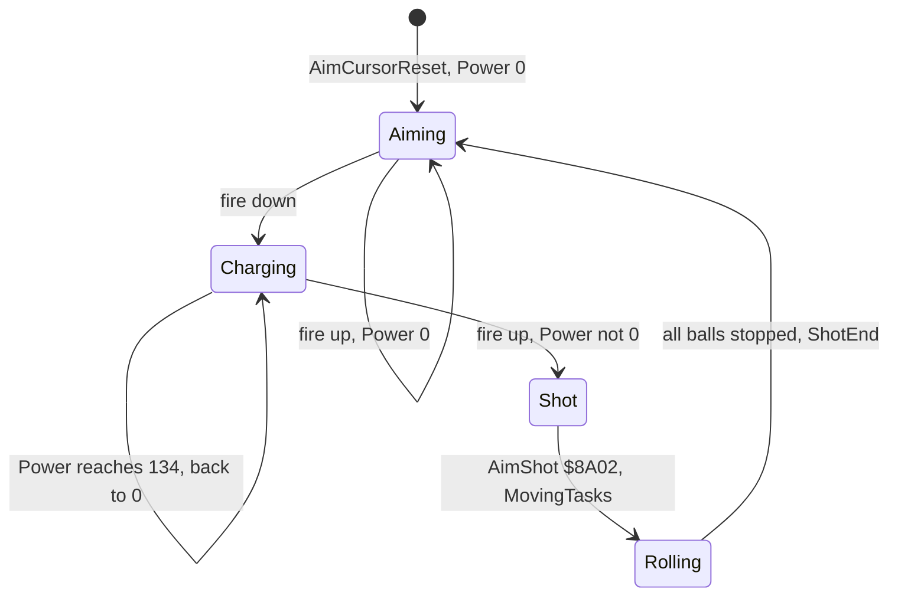

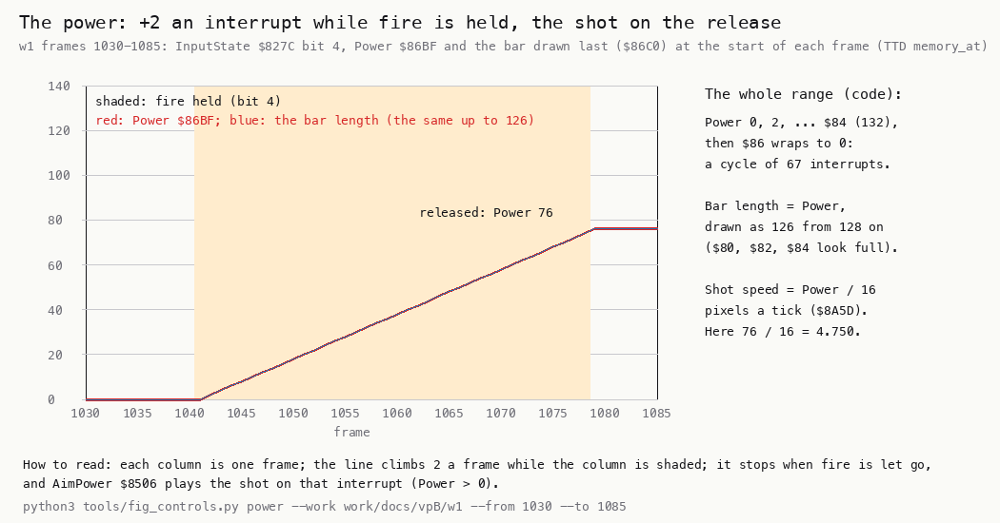

How to read the figure:

- **The upper chart** is Power `$86BF` at the start of each frame (after the tick of the frame before). It climbs
  by 2 a frame from the sample of 1042.
- **The lower strip** is fire, bit 4 of InputState, in the samples 1041 to 1078: ReadInput read it in the ticks of
  1040-1077 (SPACE is held from 1040 to 1077 in the input script).
- **The release** at 1079 is marked: Power 76, the shot speed 76 / 16 = 4.75 pixels a tick. AimShot runs in the
  tick of 1079.
- **The panel on the right** gives the rules: + 2 a frame, wrap at 134, shoot on release.
- **The point**: the power is a held time, 2 units a frame. The player sees it as the bar and must let go within
  67 frames, 1.34 seconds, or the bar empties.

```bash
python3 tools/fig_controls.py power --work work/docs/vpB/w1 --from 1030 --to 1085 --out docs/img/controls/power.png
```

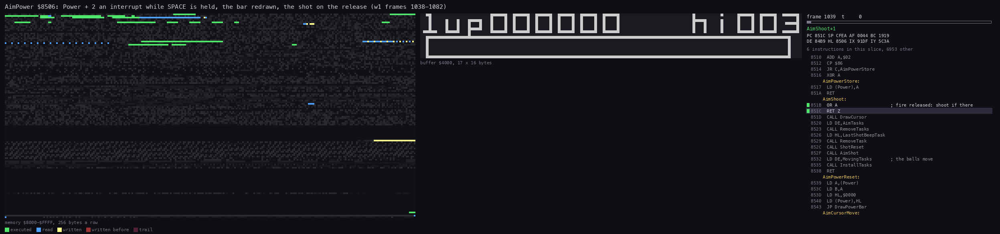

*The routine animation of AimPower (`$8506-$8545`) in `w1` frames 1038-1082, one picture a frame. The view is the
screen at `$4000`, 17 x 16 cells, round the power box. Command: `python3 ../../kit/routine_anim.py --work
work/docs/vpB/w1 --window 1038:0-1082:0 --listing build/game.lst --out docs/img/routines/AimPower.gif --pc
8506-8545 --view buffer:4000:17x16:screen --range 8000-FFFF --step 69888 --delay 160`.*

How to read the animation: while fire is held only the lines of the growing branch light up, and the bar grows 2
pixels a frame. In the frame of the release the AimShoot branch runs, the cursor goes, and the bar stays at 76.

Worked example: SPACE goes down at frame 1040 and up at 1078. ReadInput is the last task, so it reads fire in the
ticks of 1040-1077, and AimPower counts each read one tick later, in 1041-1078: 38 ticks of fire, 2 each. The
samples (each the memory at the start of its frame) show fire from 1041 to 1078 and Power `$4C`, 76, at 1079, with
InputState `$00` (ReadInput read fire up in the tick of 1078). In the tick of 1079 AimPower sees fire up and runs
AimShoot. AimShot holds that interrupt for 6.92 video frames, so the interrupts of 1080-1085 are lost and the next
tick is 1086 (doc 4, 4.7). The cue ball leaves at 4.75 pixels a tick.

Witness: AimPower ran 4425 times in `w1`, its AimShoot branch 3459 times (each pass with fire up, most with Power 0).

The point: the shot is two choices, a point on the cushion and a time held. Both live in seven bytes at `$86BA`, and
both are read only once an interrupt.

## 5.7 The name entry

After GAME OVER, a score for the hall of fame opens the name entry (NameEntryPage `$ACEF`, NameEntry `$AE92`). It is
a grid of 42 cells, CharacterGrid `$B167`, three rows of 14:

| Row D | Cells E = 0-13 |
| ---: | --- |
| 0 | a b c d e f g h i j k l m n |
| 1 | o p q r s t u v w x y z space . |
| 2 | 0 1 2 3 4 5 6 7 8 9, then rub (`$0C $0C`) and end (`$0D $0D`) |

The player moves a box over the grid with the four directions and picks with fire. Right and down step forward;
left and up step back. The steps wrap from the last cell to the first. NameCursorForward `$AFFE` and
NameCursorBack `$B023` move the box. XorCursorBox `$B047` draws it at x 16 E + 20, y 16 D + 112, 12 pixels wide (28
for rub and end).

The loop, NameEntryLoop `$AEB3`, waits one frame, calls ReadInput and acts:

- No input: RepeatDelay `$B226` back to `$70`.
- A direction: the repeat counter decides whether to step (below).
- Fire: a lower click, PickCell `$AF4E`, then a wait until all is up.

PickCell finds the character at 14 D + E. A character is stored in NameBuffer `$B227` (7 characters, `_` when
empty), and the name cursor moves on. At the seventh place a new character overwrites the last. Rub steps back and
puts `_`. End turns every `_` into a space and centres the name. DrawCharAt `$B118` draws each character 4 pixels to
the right of its cell.

**The repeat.** RepeatDelay counts down once a frame while a direction is held. A step comes when its low nibble
wraps to `$F`. The next value is the old high nibble less one, copied into both nibbles, at least `$11`. From `$70`
the first step comes at once (`$6F`), then after 7, 6, 5, 4, 3 and 2 frames, then every 2 frames. Each step clicks
(BEEPER `$03E8`, `$14`); a pick clicks lower (`$04B0`, `$16`).

```text
NameEntryLoop:
    HALT; ReadInput()
    if InputState == 0: RepeatDelay = $70; continue
    if a direction:
        RepeatDelay -= 1
        if RepeatDelay & $0F != $0F: continue
        h = max(RepeatDelay & $F0, $10)
        RepeatDelay = h + (h >> 4)          ; $60 -> $66
        click
        if right or down: NameCursorForward() else NameCursorBack()
    elif fire:
        low click; PickCell(14*D + E)
        wait until InputState == 0
```

```text
AEB3  76           HALT                ; NameEntryLoop
AEB4  E5           PUSH HL
AEB5  D5           PUSH DE
AEB6  CD 06 81     CALL ReadInput
AEB9  D1           POP DE
AEBA  E1           POP HL
AEBB  01 B3 AE     LD BC,NameEntryLoop
AEBE  C5           PUSH BC             ; each branch returns to the loop
AEBF  3A 7C 82     LD A,(InputState)
AEC2  FE 00        CP $00
AEC4  20 06        JR NZ,NameEntryDirection
AEC6  3E 70        LD A,$70            ; no input: the repeat at rest
AEC8  32 26 B2     LD (RepeatDelay),A
AECB  C9           RET
...
AEE8  4F           LD C,A              ; NameEntryRepeat
AEE9  3A 26 B2     LD A,(RepeatDelay)
AEEC  3D           DEC A
AEED  32 26 B2     LD (RepeatDelay),A
AEF0  E6 0F        AND $0F
AEF2  FE 0F        CP $0F              ; a step only when the low nibble wraps
AEF4  C0           RET NZ
AEF5  3A 26 B2     LD A,(RepeatDelay)
AEF8  E6 F0        AND $F0
AEFA  FE 10        CP $10
AEFC  30 02        JR NC,NameEntryStep
AEFE  3E 10        LD A,$10
AF00  47           LD B,A              ; NameEntryStep: $60 -> $66
AF01  0F           RRCA
AF02  0F           RRCA
AF03  0F           RRCA
AF04  0F           RRCA
AF05  80           ADD A,B
AF06  32 26 B2     LD (RepeatDelay),A
...
AF18  79           LD A,C
AF19  FE 01        CP $01              ; right
AF1B  CA FE AF     JP Z,NameCursorForward
AF1E  FE 08        CP $08              ; down
AF20  CA FE AF     JP Z,NameCursorForward
AF23  C3 23 B0     JP NameCursorBack
AF26  3A 7C 82     LD A,(InputState)   ; NameEntryFire
AF29  E6 10        AND $10
AF2B  C8           RET Z
...
AF3B  CD 4E AF     CALL PickCell
...
AF4E  7A           LD A,D              ; PickCell: 14 D + E
AF4F  87           ADD A,A
AF50  47           LD B,A
AF51  87           ADD A,A
AF52  87           ADD A,A
AF53  87           ADD A,A
AF54  90           SUB B
AF55  83           ADD A,E
AF56  01 67 B1     LD BC,CharacterGrid
...
AF5E  0A           LD A,(BC)           ; PickCellByte
AF5F  FE 0C        CP $0C              ; rub
AF61  28 18        JR Z,PickRub
AF63  FE 0D        CP $0D              ; end
AF65  28 25        JR Z,PickEnd
```

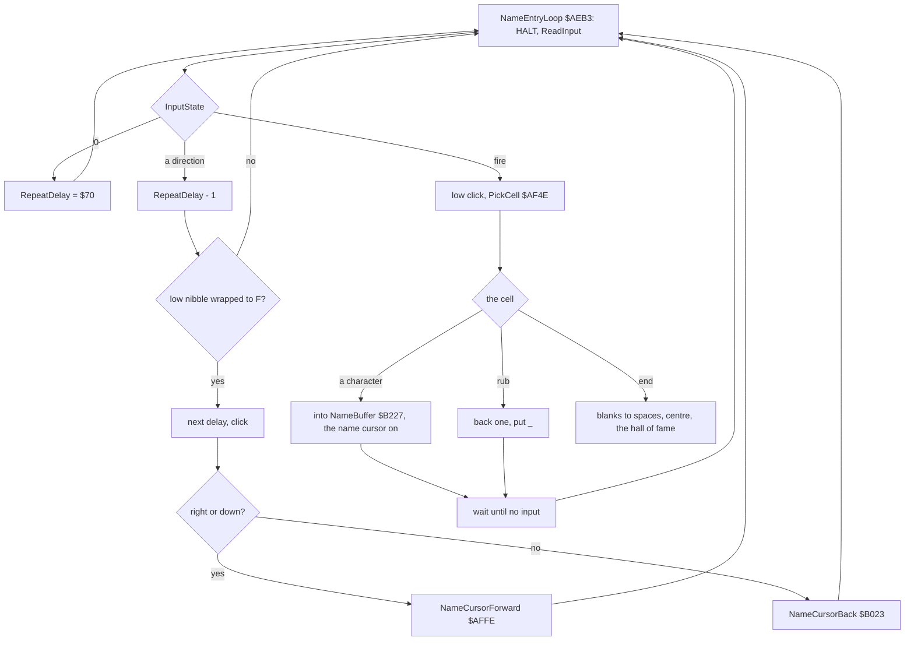

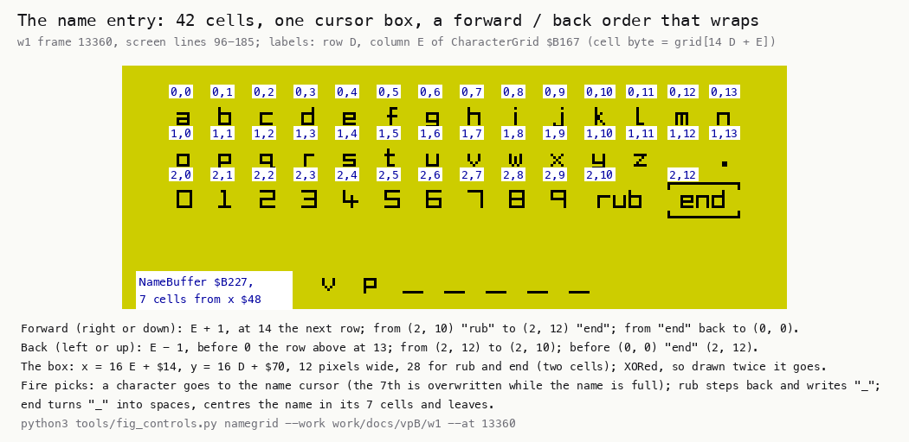

How to read the figure:

- **The crop** is the screen of `w1` frame 13 360, enlarged.
- **Each cell** has its (D, E) label in a white box: D the row, E the column, PickCell's index 14 D + E.
- **The box** at the right of row 2 is the cursor on "end", 28 pixels wide.
- **The name** above the grid is what NameBuffer holds before end.
- **The point**: the grid is a 3 x 14 table read with one multiply. Rub and end take two cells each, so the box is
  wider there.

```bash
python3 tools/fig_controls.py namegrid --work work/docs/vpB/w1 --at 13360 --out docs/img/controls/namegrid.png
```

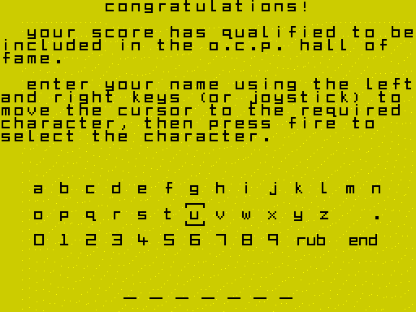

*The screen animation of the name entry in `w1` frames 13 090-13 372, one picture every 2 frames. Command:
`python3 ../../kit/screen_anim.py --work work/docs/vpB/w1 --from 13090 --to 13372 --step 2 --scale 2 --delay 60
--hold 2000 docs/img/routines/NameEntry.gif`.*

How to read the animation: the box moves one cell per tap of SYMBOL SHIFT (right). A letter appears in the name at
each pick. The box goes back with taps of M (left), and at the end it sits on "end".

Worked example: the `w1` bot taps SYMBOL SHIFT for 3 frames at a time. The first frame of a tap takes RepeatDelay
from `$70` to `$6F`: a step, and `$66` stored. The next two frames take it to `$64`. The tap ends, InputState is 0,
and RepeatDelay goes back to `$70`. So each tap is exactly one step (`work/docs/vpB/w1-name.json`, `$B226`). Held
instead, a key would step at frames 0, 7, 13, 18, 22, 25, 27, 29 and on.

Witness: NameEntry ran once in `w1`, at frame 12 023. NameEntryLoop ran 1230 frames (12 025-13 368), with 51 steps
(45 forward, 6 back), XorCursorBox 103 times, and PickCell 3 times (frames 13 102-13 368). Rub (`$AF7B`) and the
left shift of the name (`$AFD1`) are not executed in any recording.

The point: the name entry is a menu of 42 cells driven by the same input byte as the cue. Any device can type a
name, and the repeat counter gives one step per tap and a fast run when held.

## 5.8 The input against the interrupt

All aiming input is read by tasks of the interrupt, once a frame. The order of AimTasks fixes the latency:

| Task | Reads | Effect |
| --- | --- | --- |
| AimPower `$8506` | InputState of the last frame | Power |
| PowerBarTask `$934D` | Power | the bar |
| AimCursorMove `$8546` | InputState of the last frame | CursorSpeed |
| AimCursorDraw `$85EB` | CursorSpeed | the cursor |
| ReadInput `$8106` | the ports | InputState for the next frame |

So a key pressed in a frame acts one frame later. The `w1` samples show it: M, pressed at 880, is read in the tick
of 880 (the sample of 881) and the cursor first moves in the tick of 881 (the sample of 882, section 5.5).

The release is the one long moment. AimShot `$8A02` runs inside the interrupt task and uses the ROM's calculator,
about 455 000 T; the interrupt holding it lasts about 484 000 T, 6.92 video frames (`w1` 1079: 483 665 T). The
six interrupts after it are lost (1080-1085). InputState is not read again until
the next aim. The menus, the editor and the name entry work another way: they are foreground loops with one HALT a
pass, and they call ReadInput themselves.

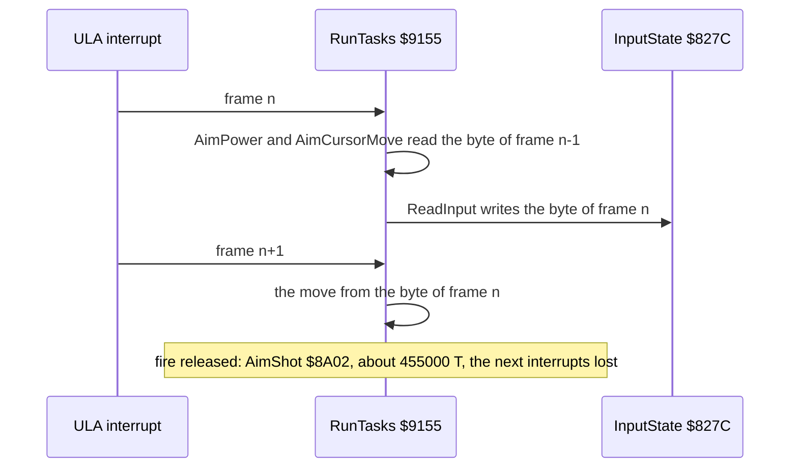

The editor reads the same byte with its own loop (EditorLoop, `src/game/editor.asm`). Its cursor is free on the
table, not on the cushions. Its speed grows from 1 to 5, one step every 16 frames (EditorCursorSpeed). With the
keyboard chosen, EditorStart `$C042` switches Control to 3, the cursor keys, and EditorExit puts it back. Its "play"
button runs the aim on EditorAimTasks `$C518`: the same PowerBarTask, AimCursorMove, AimCursorDraw and ReadInput,
with EditorPower in place of AimPower. The editor itself is in doc 10.

Worked example: in `e1` the editor runs on the cursor keys from frame 632, and its "play" starts the aim at frame
840. EditorAimTasks were read from 844 to 1054, and the shot left at 908.

Witness: the aim tasks run together: AimPower 4425 times, AimCursorMove 4404 and AimCursorDraw 4424 times in `w1`.
No figure: the timing is the table above, and the aim's beam timeline is in doc 04.

The point: the input of the aim lags by one frame and is never read twice in a frame. The game feels steady because
the cursor speed, the power and the bar all change once a frame, in step.
