# 6. Rendering

What this covers: the screen layout and its attributes, the one line primitive and the table drawn with it, the
pre-shifted ball sprites and their XOR draw, the redraw of moving balls against the beam, which routine writes
which bytes of a real frame, and the pen that writes the author's signature.

The recordings it rests on:

- `w1`: the one-player game on the keyboard, replayed from `work/snaps/entry.z80` with `tests/inputs/w1.txt` and TTD
  on (`work/docs/vpB/replay.py`, 13 800 frames). The screen build is at frames 622-700, the break at 1086-1130.
- `m1`: the menu tour, replayed the same way to frame 1600 for the attract sequence: the pen writes from frame 655.
- `m1` frame 7998 (`docs/img/play/m1-7998-small-pockets.png`) for the table with small pockets.

The counts of runs are from the L1 builds of each recording (`tools/l1sum.py`, quoted in the source comments).
There is no back buffer: every routine writes straight into the screen at `$4000`.

## 6.1 The screen layout and the attributes

The play screen is the Spectrum's 32 x 24 cells, in five bands. NewGameScreen `$95DA` clears the pixels, sets the
border white and writes the attributes once a game:

| Rows | Pixels y | Attribute | What is there |
| --- | --- | --- | --- |
| 0-1 | 0-15 | `$39`, words `$38`, numbers `$3A` | the HUD: scores, hi score, frame, shots, the power box |
| 2-4 | 16-39 | `$39` | the messages, the potted row, the lives |
| 5 | 40-47 | `$38` | the top pocket marks x1, x2, x3 |
| 6-22 | 48-183 | `$60` | the table: BRIGHT green paper, black ink |
| 23 | 184-191 | `$38` | the bottom pocket marks x4, x5, x6 |

The table is one attribute. Every ball, the cue ball, the cursor and the cushions are black ink on green paper, so
nothing on the table can clash. The balls of the potted row and the lives sit in rows 2-4 with blue ink (`$39`), so
there they are blue. PrintText writes its own attributes with each text (doc 08).

```text
NewGameScreen:
    clear the pixels; border 7
    attributes: rows 0-4 = $39, row 5 = $38, rows 6-22 = $60, row 23 = $38
    the HUD words and the scores (PrintText, PrintHudNumber)
    DrawPowerBox(); DrawTable(); ParkBalls()
```

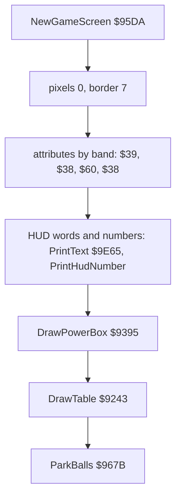

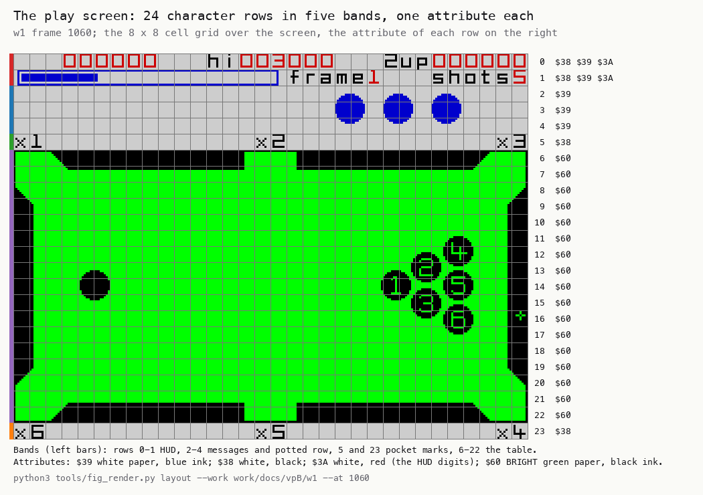

How to read the figure:

- **The screen** is `w1` frame 1060, three times enlarged, with the 8 x 8 cell grid over it.
- **The right column** lists the attribute values found in each row.
- **The bars on the left** mark the five bands.
- **The point**: the game picks one attribute per band and never changes it during play. The table's one attribute is
  why no ball ever clashes.

```bash
python3 tools/fig_render.py layout --work work/docs/vpB/w1 --at 1060 --out docs/img/render/layout.png
```

Worked example: row 14 of `w1` frame 1060 holds the cue ball and ball 1. All its 32 attributes are `$60`. The balls
change only pixels, so the row keeps its colour wherever they go.

Witness: NewGameScreen ran once in `w1` (frame 622), once in `game` (6182) and twice in `v1` (772, 2603).

The point: Video Pool solves colour clash by giving it nothing to do. One colour pair per band, black on green on the
table.

## 6.2 One primitive: XorLine

Almost every line on the screen is drawn by XorLine `$93B3`. It XORs a run of B pixels from (x E, y D) into the
screen, in one pixel row. The table, the power bar, its box, the cursor, the menu ticks, the hall of fame flags and
the editor's boxes all use it. Because it XORs, drawing a figure again erases it.

1. ScreenCell `$95B3` gives the cell's address, and y AND 7 is added to the high byte for the pixel row.
2. The first byte's mask: B ones from bit 7 (or `$FF` when B >= 8), shifted right by x AND 7. The bits shifted out
   are counted back into B.
3. Whole bytes are XORed with `$FF` while 8 or more pixels remain.
4. A last mask of the remaining pixels from the left.

```text
XorLine(x E, y D, length B):
    if B == 0: return
    hl = ScreenCell(y, x) + (y AND 7) * 256
    if B < 8: mask = B ones from the left; B = 0
    else:     mask = $FF; B -= 8
    repeat (x AND 7) times: mask >>= 1; if a one fell out: B += 1
    (hl++) ^= mask
    while B >= 8: (hl++) ^= $FF; B -= 8
    if B: (hl) ^= B ones from the left
```

```text
93B3  78           LD A,B
93B4  B7           OR A
93B5  C8           RET Z
93B6  C5           PUSH BC
93B7  62           LD H,D
93B8  6B           LD L,E
93B9  CD B3 95     CALL ScreenCell
93BC  7A           LD A,D
93BD  E6 07        AND $07
93BF  84           ADD A,H
93C0  67           LD H,A
93C1  78           LD A,B
93C2  D6 08        SUB $08
93C4  30 09        JR NC,XorLineFullMask
93C6  0E 00        LD C,$00
93C8  37           SCF                 ; XorLineShortMask: B < 8, C = B ones from the left
93C9  CB 19        RR C
93CB  10 FB        DJNZ XorLineShortMask
93CD  18 03        JR XorLineShift
93CF  47           LD B,A              ; XorLineFullMask: B >= 8, C = $FF
93D0  0E FF        LD C,$FF
93D2  7B           LD A,E              ; XorLineShift
93D3  E6 07        AND $07
93D5  28 08        JR Z,XorLineFirst
93D7  CB 39        SRL C               ; XorLineShiftLoop: count the lost ones back
93D9  30 01        JR NC,XorLineShiftNext
93DB  04           INC B
93DC  3D           DEC A               ; XorLineShiftNext
93DD  20 F8        JR NZ,XorLineShiftLoop
93DF  7E           LD A,(HL)           ; XorLineFirst
93E0  A9           XOR C
93E1  77           LD (HL),A
93E2  23           INC HL
93E3  78           LD A,B              ; XorLineBytes: whole bytes
93E4  B7           OR A
93E5  28 16        JR Z,XorLineDone
93E7  D6 08        SUB $08
93E9  38 08        JR C,XorLineLast
93EB  47           LD B,A
93EC  7E           LD A,(HL)
93ED  EE FF        XOR $FF
93EF  77           LD (HL),A
93F0  23           INC HL
93F1  18 F0        JR XorLineBytes
93F3  0E 00        LD C,$00            ; XorLineLast
93F5  37           SCF                 ; XorLineLastMask
93F6  CB 19        RR C
93F8  10 FB        DJNZ XorLineLastMask
93FA  7E           LD A,(HL)
93FB  A9           XOR C
93FC  77           LD (HL),A
93FD  C1           POP BC              ; XorLineDone
93FE  C9           RET

95B3  7C           LD A,H              ; ScreenCell: H = y, L = x
95B4  87           ADD A,A
95B5  87           ADD A,A
95B6  E6 E0        AND $E0             ; (y / 8 AND 7) x 32
95B8  CB 3D        SRL L
95BA  CB 3D        SRL L
95BC  CB 3D        SRL L
95BE  85           ADD A,L             ; + x / 8
95BF  6F           LD L,A
95C0  7C           LD A,H
95C1  CB 3F        SRL A
95C3  CB 3F        SRL A
95C5  CB 3F        SRL A
95C7  E6 F8        AND $F8             ; (y / 64) x 8
95C9  F6 40        OR $40
95CB  67           LD H,A
95CC  C9           RET
```

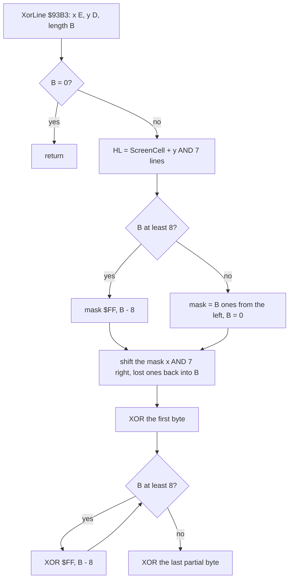

Worked example: the power bar's first line at Power 76 is XorLine(x 4, y 10, 76). ScreenCell gives `$4020` (row 1,
column 0), and y AND 7 = 2 makes it `$4220`. B >= 8: mask `$FF`, B = 68. Shifted right 4 times, the mask is `$0F` and
B = 72. The first byte gets `$0F`, then 9 whole bytes get `$FF`, and B = 0 ends the run: 4 + 72 = 76 pixels, x 4-79.

Witness: XorLine is the busiest drawing routine: `game` 14 976 calls, `w1` 57 235, `f1` 17 840, `p2` 12 040, `v1`
8432, `m1` 28 297. Its animation is the table's, in section 6.3.

The point: one XOR line routine draws all the vector graphics of the game, and its XOR makes every one of them its
own eraser.

## 6.3 The table

DrawTable `$9243` draws the table with nothing but XorLine calls, once per game and once per visit to the editor.
Every run has D = y, E = x, B = length:

- the frame: the top line y 48 and the bottom line y 183 (two runs of 128 each), the left and right edges (134 runs
  of one pixel each);
- the four long cushions, 9 lines each, sloped at 45 degrees on their pocket side: each line starts one pixel later
  and is one shorter;
- the two side cushions, at x 1-9 and x 246-254: 9 sloped lines in, the straight lines, 9 sloped lines out.

Pockets `$B8BC`, the menu's L or S, moves the ends of the cushions:

| | Large (`$B8BC` <> 0, the default) | Small (`$B8BC` = 0) |
| --- | --- | --- |
| top left cushion, line i | x 19+i to 114 (96 - i pixels) | x 15+i to 117 (103 - i pixels) |
| top right cushion | x 141 to 236-i | x 138 to 240-i |
| middle pocket gap | x 115-140 | x 118-137 |
| side cushions | from y 67, 80 straight lines | from y 63, 88 straight lines |

The gaps left between the cushions are the six pockets. There is no pocket graphic.

```text
DrawTable:
    XorLine(0, 48, 128); XorLine(128, 48, 128)          ; the top of the frame
    x, len = (19, 96) if Pockets else (15, 103)
    for i in 0..8: XorLine(x + i, 49 + i, len - i)       ; the top left cushion
    ... the top right, bottom left and bottom right cushions, mirrored
    for y in 49..182: XorLine(0, y, 1)                   ; the left edge
    the left side cushion: 9 lines in, the straight lines, 9 lines out
    ... the right edge and the right side cushion
```

```text
9243  11 00 30     LD DE,$3000         ; DrawTable: y 48, x 0
9246  06 80        LD B,$80            ; 128 pixels
9248  CD B3 93     CALL XorLine
924B  58           LD E,B              ; x 128
924C  CD B3 93     CALL XorLine
924F  11 0F 31     LD DE,$310F         ; y 49, x 15 (small pockets)
9252  06 67        LD B,$67            ; 103 pixels
9254  0E 09        LD C,$09            ; 9 lines
9256  3A BC B8     LD A,(Pockets)
9259  B7           OR A
925A  28 04        JR Z,TableTopLeft
925C  1E 13        LD E,$13            ; large: x 19
925E  06 60        LD B,$60            ; 96 pixels
9260  CD B3 93     CALL XorLine        ; TableTopLeft: x + 1, y + 1, length - 1 a line
```

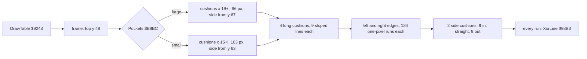

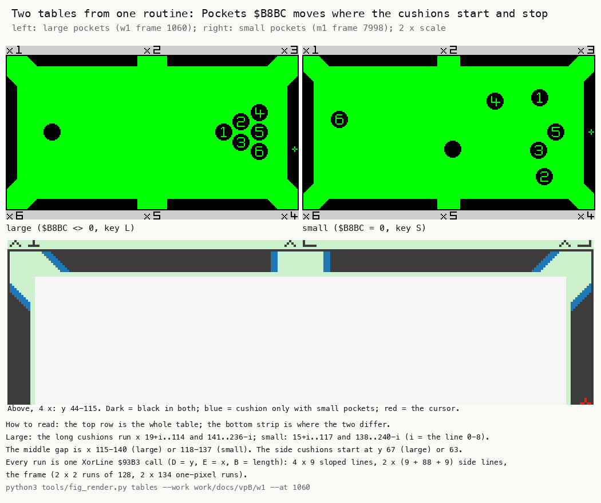

How to read the figure:

- **The top row** is the table area of both screens, twice enlarged: large pockets on the left, small on the right.
- **The bottom strip** is the top cushions and the top of the side cushions, 4 x. Dark is black in both, blue is
  cushion only with small pockets.
- **The blue** sits at the pocket ends of every cushion: small pockets are made by longer cushions.
- **The point**: the two tables are one routine with two sets of start and length values. A pocket is only a gap.

```bash
python3 tools/fig_render.py tables --work work/docs/vpB/w1 --at 1060 --out docs/img/render/tables.png
```

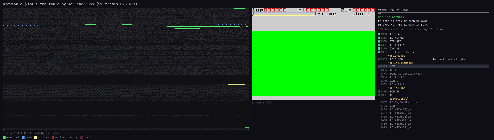

*The routine animation of DrawTable and XorLine (`$9243-$93FF`) in `w1` frames 626-627, one picture each 3500 T,
20 193 instructions. Command: `python3 ../../kit/routine_anim.py --work work/docs/vpB/w1 --window 626:0-628:0
--listing build/game.lst --out docs/img/routines/DrawTable.gif --pc 9243-93FF --view screen --range 8000-FFFF --step
3500 --delay 120`.*

How to read the animation: the frame's top line comes first, then the top cushions line by line, the bottom ones,
then the left edge and the side cushions crawl down one pixel row at a time. The code panel stays in XorLine, where
most of the time goes. The table takes more than one frame: the interrupt tasks run in between.

Worked example: with large pockets, line 3 of the top left cushion is XorLine(x 22, y 52, 93): x 22-114. With
small pockets it is XorLine(18, 52, 100): x 18-117. The four pixels at the outer end (x 18-21) and the three at the
inner end (x 115-117) are the blue of the figure.

Witness: DrawTable ran once in `game` (frame 6186), once in `w1` (626), twice in `v1` and `m1`. Small pockets: `m1`
from frame 7110 (the S key).

The point: the table costs no data at all. Its runs, 504 with large pockets and 520 with small (4 frame lines,
36 cushion lines, 268 edge pixels and 196 or 212 side cushion lines), are computed from a start, a length and a
slope.

## 6.4 The ball sprites: pre-shifted, XORed, no mask

Every ball is a 15 x 15 sprite stored 8 times, once for each pixel offset inside a byte. BallSprites `$D000` holds
56 sprites of 48 bytes (3 bytes x 16 lines, the 16th line empty), 2688 bytes. The index is 7 x shift + ball, where
shift = x AND 7 and ball is 0 for the cue ball and 1-6 for the numbered balls. The sheet is in `src/res/graphics`
(`BallSprites.png`).

DrawBall `$9548` XORs ball A at SpritePos `$95D8`, the top left of the sprite (the ball's centre minus 7). It has no
mask: the sprite's ink is XORed onto the screen. Drawn again at the same place, the ball is gone.

A screen character row has 8 pixel lines, so the 16 lines go in three parts through XorSpriteLines `$959F`:

1. 8 - (y AND 7) lines, from the sprite's first line in its cell row;
2. 8 lines from the next cell row (y + 8);
3. (y AND 7) - 1 lines from the row after (y + 16).

That is 16 lines when y AND 7 = 0 and 15 otherwise. The 16th line of every sprite is zero, so nothing is lost.

```text
DrawBall(ball A):                 ; SpritePos = (x, y) of the top left
    src = $D000 + 48 * (7 * (x AND 7) + A)
    hl  = ScreenCell(y, x) + (y AND 7) lines
    XorSpriteLines(hl, src, 8 - (y AND 7))
    XorSpriteLines(ScreenCell(y + 8, x), next, 8)
    n = (y AND 7) - 1
    if n > 0: XorSpriteLines(ScreenCell(y + 16, x), next, n)

XorSpriteLines(hl, de, b):        ; 3 bytes a line, INC H to the next line
    repeat b: (hl) ^= (de++); (hl+1) ^= (de++); (hl+2) ^= (de++); H += 1
```

```text
9548  16 00        LD D,$00            ; DrawBall: A = the ball
954A  42           LD B,D
954B  87           ADD A,A
954C  87           ADD A,A
954D  87           ADD A,A
954E  87           ADD A,A
954F  4F           LD C,A
9550  87           ADD A,A
9551  81           ADD A,C
9552  4F           LD C,A              ; BC = 48 A
9553  CB 10        RL B
9555  3A D8 95     LD A,(SpritePos)
9558  E6 07        AND $07             ; the shift
955A  67           LD H,A
955B  87           ADD A,A
955C  87           ADD A,A
955D  87           ADD A,A
955E  87           ADD A,A
955F  6F           LD L,A
9560  87           ADD A,A
9561  5F           LD E,A
9562  19           ADD HL,DE
9563  19           ADD HL,DE           ; HL = 336 x shift
9564  09           ADD HL,BC
9565  11 00 D0     LD DE,BallSprites
9568  19           ADD HL,DE
9569  EB           EX DE,HL            ; DE = the sprite
956A  2A D8 95     LD HL,(SpritePos)
956D  4C           LD C,H
956E  CD B3 95     CALL ScreenCell
9571  79           LD A,C
9572  E6 07        AND $07
9574  84           ADD A,H
9575  67           LD H,A
9576  79           LD A,C
9577  2F           CPL
9578  E6 07        AND $07
957A  3C           INC A               ; 8 - (y AND 7) lines
957B  47           LD B,A
957C  CD 9F 95     CALL XorSpriteLines
957F  2A D8 95     LD HL,(SpritePos)
9582  3E 08        LD A,$08
9584  84           ADD A,H             ; y + 8
9585  67           LD H,A
9586  CD B3 95     CALL ScreenCell
9589  06 08        LD B,$08
958B  CD 9F 95     CALL XorSpriteLines
958E  2A D8 95     LD HL,(SpritePos)
9591  3E 10        LD A,$10
9593  84           ADD A,H             ; y + 16
9594  67           LD H,A
9595  CD B3 95     CALL ScreenCell
9598  79           LD A,C
9599  E6 07        AND $07
959B  C8           RET Z
959C  3D           DEC A               ; (y AND 7) - 1 lines
959D  C8           RET Z
959E  47           LD B,A
959F  1A           LD A,(DE)           ; XorSpriteLines
95A0  13           INC DE
95A1  AE           XOR (HL)
95A2  77           LD (HL),A
95A3  2C           INC L
95A4  1A           LD A,(DE)
95A5  13           INC DE
95A6  AE           XOR (HL)
95A7  77           LD (HL),A
95A8  2C           INC L
95A9  1A           LD A,(DE)
95AA  13           INC DE
95AB  AE           XOR (HL)
95AC  77           LD (HL),A
95AD  2D           DEC L
95AE  2D           DEC L
95AF  24           INC H
95B0  10 ED        DJNZ XorSpriteLines
95B2  C9           RET
```

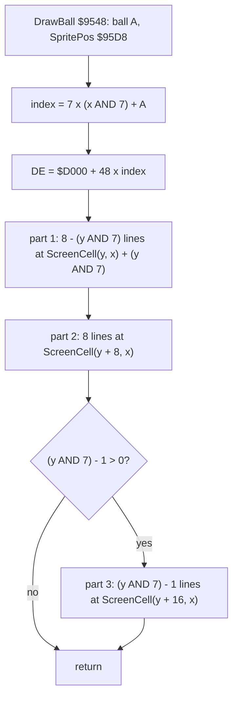

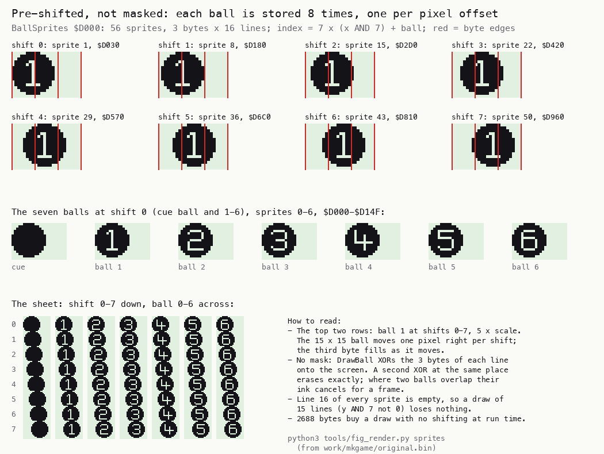

How to read the figure:

- **The top two rows** are ball 1 at shifts 0-7, 5 x, with red lines at the byte edges. The ball moves one pixel right
  per shift, and the third byte fills as it moves.
- **The middle row** is the seven balls at shift 0: the cue ball, then 1 to 6, with the number cut out of the ink.
- **The bottom sheet** is all 56 sprites, shift down and ball across.
- **The point**: 2688 bytes buy a ball draw with no shifting at run time. There is no mask, because the table under
  the ball is plain paper: XOR on paper is a plain draw.

```bash
python3 tools/fig_render.py sprites --out docs/img/render/ball-shifts.png   # from work/mkgame/original.bin
```

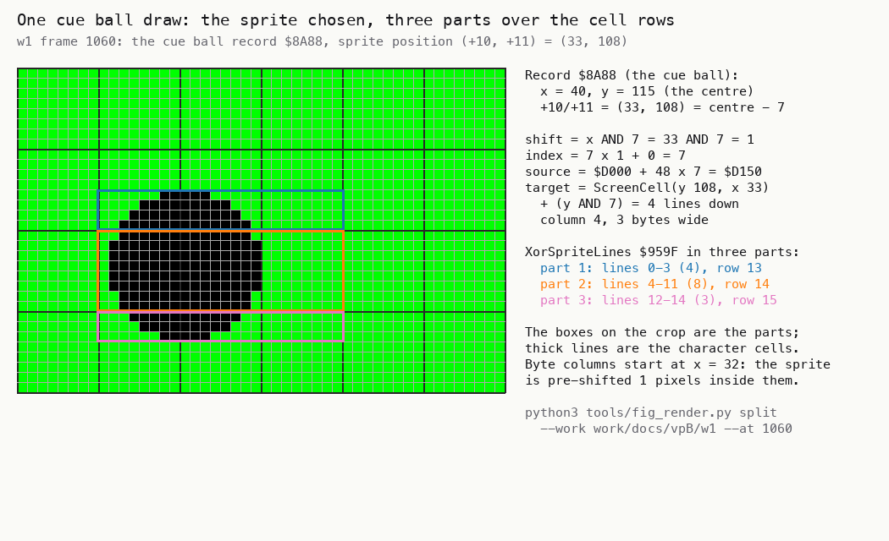

How to read the figure:

- **The crop** is the screen round the cue ball in `w1` frame 1060, 12 x. Thick lines are the character cells.
- **The three boxes** are the parts DrawBall draws: blue 4 lines in cell row 13, orange 8 lines in row 14, pink 3
  lines in row 15.
- **The text** works the numbers out from the ball record.
- **The point**: one 15-line draw touches three cell rows, and the split follows the screen's layout, not the
  sprite's.

```bash
python3 tools/fig_render.py split --work work/docs/vpB/w1 --at 1060 --out docs/img/render/ball-split.png
```

Worked example (the figure's): the cue ball's record `$8A88` has x 40, y 115 at frame 1060, and +10/+11 = (33, 108).
The shift is 33 AND 7 = 1, so the index is 7 and the sprite is at `$D000` + 48 x 7 = `$D150`. ScreenCell(108, 33)
is `$48A4` (row 13, column 4), plus 4 lines: `$4CA4`. Part 1 is 8 - 4 = 4 lines, part 2 is 8 lines at `$48C4`,
part 3 is 4 - 1 = 3 lines at `$48E4`. 15 lines, x 32-55.

Witness: DrawBall ran 1827 times in `game`, 15 290 in `w1`, 4407 in `f1`, 10 210 in `p2`, 7119 in `v1`, 3193 in
`m1`; XorSpriteLines 230 986 times in `w1`.

The point: the balls are drawn by the cheapest method there is, a 3-byte XOR a line from a pre-shifted copy. The
price is memory, 2688 bytes, and the XOR's look where two balls touch.

## 6.5 The moving balls against the beam

While the balls roll, MovingTasks `$84BA` run each interrupt in this order: BallRedraw `$827E`, the physics `$86C1`,
ShotEnd `$8357`, MessagesTask `$9CB7`. BallRedraw comes first.

BallRedraw walks DrawList `$869E`, 7 entries sorted by y by BuildDrawList `$8304`, so the balls are drawn from the top
of the screen down. For each ball RedrawBall `$8297`:

1. returns unless the ball is on the table (record +13 bit 7) and has moved (bit 4);
2. XORs the sprite off at its old place, record +10/+11;
3. computes the new place (SpriteFromBall `$9F36`), stores it in +10/+11, clears bit 4, and XORs the sprite on.

A potted ball (bit 5) is not drawn again on the table. Balls 1-6 go to the potted row at x = 24 (n - 1) + 7, y 27,
drawn there when the message step allows it. The cue ball stays off.

```text
BallRedraw:                       ; first task of the interrupt while the balls move
    for (n, y, record) in DrawList:          ; sorted by y, top first
        if not record.onTable or not record.moved: continue
        DrawBall(n) at record.spritePos      ; XOR off
        if record.potted: move it to the potted row; continue
        record.spritePos = SpriteFromBall(record); record.moved = 0
        DrawBall(n) at record.spritePos      ; XOR on
```

```text
827E  21 9E 86     LD HL,DrawList      ; BallRedraw
8281  06 07        LD B,$07
8283  C5           PUSH BC             ; BallRedrawLoop: number, (y), record address
8284  7E           LD A,(HL)
...
828F  CD 97 82     CALL RedrawBall
8292  E1           POP HL
8293  C1           POP BC
8294  10 ED        DJNZ BallRedrawLoop
8296  C9           RET
8297  DD CB 0D 7E  BIT 7,(IX+$0D)      ; RedrawBall: on the table?
829B  C8           RET Z
829C  DD CB 0D 66  BIT 4,(IX+$0D)      ; moved?
82A0  C8           RET Z
82A1  DD 6E 0A     LD L,(IX+$0A)       ; the old place
82A4  DD 66 0B     LD H,(IX+$0B)
82A7  22 D8 95     LD (SpritePos),HL
82AA  F5           PUSH AF
82AB  DD E5        PUSH IX
82AD  CD 48 95     CALL DrawBall       ; XOR off
82B0  DD E1        POP IX
82B2  DD CB 0D 6E  BIT 5,(IX+$0D)      ; potted?
82B6  20 14        JR NZ,RedrawPotted
82B8  CD 36 9F     CALL SpriteFromBall
82BB  22 D8 95     LD (SpritePos),HL
82BE  DD 75 0A     LD (IX+$0A),L
82C1  DD 74 0B     LD (IX+$0B),H
82C4  DD CB 0D A6  RES 4,(IX+$0D)
82C8  F1           POP AF
82C9  C3 48 95     JP DrawBall         ; XOR on
```

**Is it flicker-free?** Between the erase and the draw a ball is gone from the screen. It does not flicker if both
writes reach its lines before the beam does. BallRedraw is the first task after the interrupt, and the beam reaches
the table's top (line 48) only at T 16 152 + 48 x 224 = 26 904 of the frame. Sorting by y helps: the top ball, the
one the beam meets first, is drawn first. The beam timeline measures it.

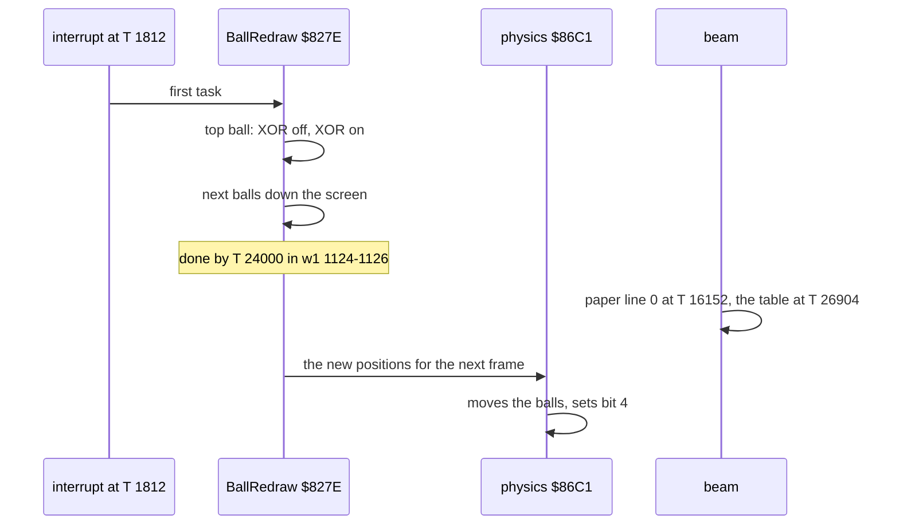

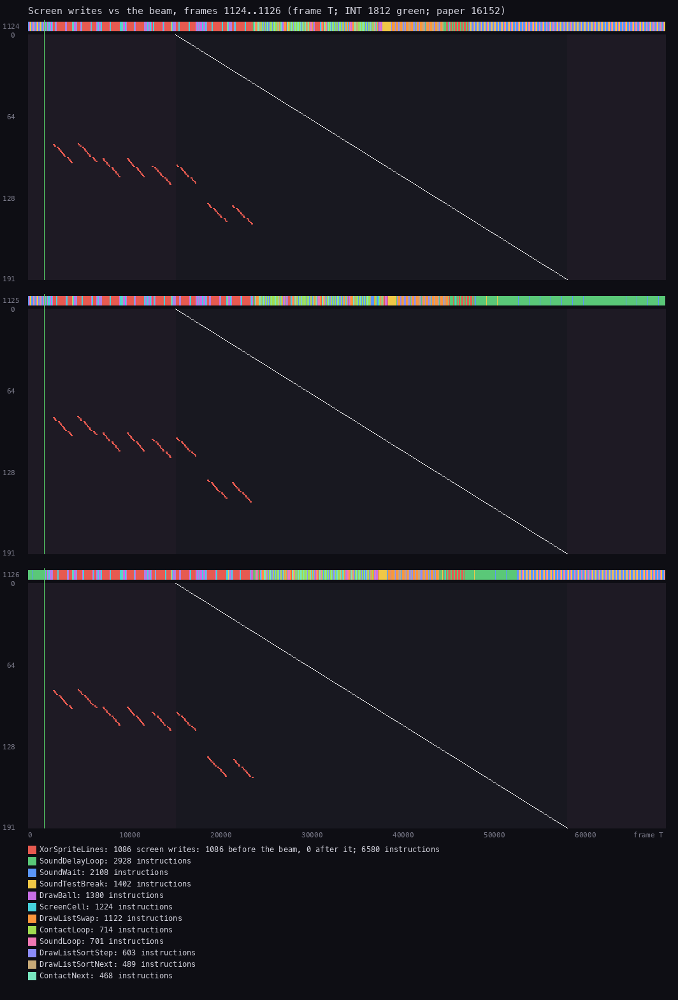

How to read the figure:

- **One panel per frame**, 1124 to 1126, three frames after the break.
- **Across** is the T-state of the frame; **down** the 192 paper lines. The diagonal is the beam.
- **Each red dot** is a write of XorSpriteLines. A dot left of the diagonal lands before the beam shows that line.
- **The strip above** each panel shows the routine the CPU is in: the tasks first, then the foreground sound loop
  (green) for the rest of the frame.
- **The point**: all 1086 writes of the three frames land before the beam, many of them before the paper even
  starts. The XOR erase and redraw cannot be seen.

```bash
python3 ../../kit/beam_timeline.py --work work/docs/vpB/w1 --window 1124:0-1127:0 --listing build/game.lst --out docs/img/render/beam-break.png --frames 3 --pc 8000-FFFF
```

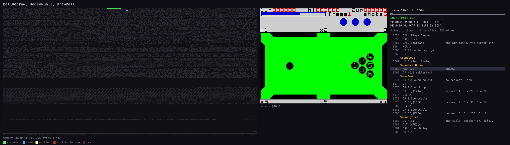

*The routine animation of DrawBall and XorSpriteLines (`$9548-$95D9`) in `w1` frame 1090, one picture each 1500 T,
7457 instructions. Command: `python3 ../../kit/routine_anim.py --work work/docs/vpB/w1 --window 1090:0-1091:0
--listing build/game.lst --out docs/img/routines/DrawBall.gif --pc 9548-95D9 --view screen --range 8000-FFFF --step
1500 --delay 120`.*

How to read the animation: early in the frame the cue ball is XORed off line by line, then drawn a few pixels on.
In the middle pictures it is half drawn: the screen shows it so only for those T-states, above the beam. Then the
physics and the sound loop run, and the screen does not change.

Worked example: in frame 1125, 8 sprite draws run (4 moved balls, off and on). The last write is at about T 24 000,
on line 150. The beam reaches line 150 at T 16 152 + 150 x 224 = 49 752, more than 25 000 T later.

Witness: BallRedraw ran 2839 times in `w1` (frames 1086-11 615), RedrawBall 19 873 times, BuildDrawList 3451 times.
The worst case, all seven balls moving with the lowest near the top, is not in the recordings: its timing is known
only from the code. Seven pairs at about 2750 T a draw would end near T 40 500, when the beam is already at line 108:
balls above that line, drawn last, could be passed by the beam half drawn.

The point: the redraw is safe in every recording because it is first, it is top down, and the screen's top 48 lines
are not table. No back buffer is needed for the loads the recordings reached; with seven balls moving the redraw
could fall behind the beam (known only from the code).

**Clearing blocks.** Two routines clear whole areas instead of XORing: ClearTableForTurn `$947D` clears the middle
of the table (x 16-239, y 64-167) before a turn passes, after XORing off the balls outside it (`p2` once, frame
1778). ClearMessageRows `$94EB` clears rows 2-4 and sets their attributes to `$39` before each message (`w1` 43
times). The caller redraws the potted row after it. No figure: they write zeros, which the screens of doc 01 show
as the empty message rows.

## 6.6 Code vs screen: who wrote the play screen

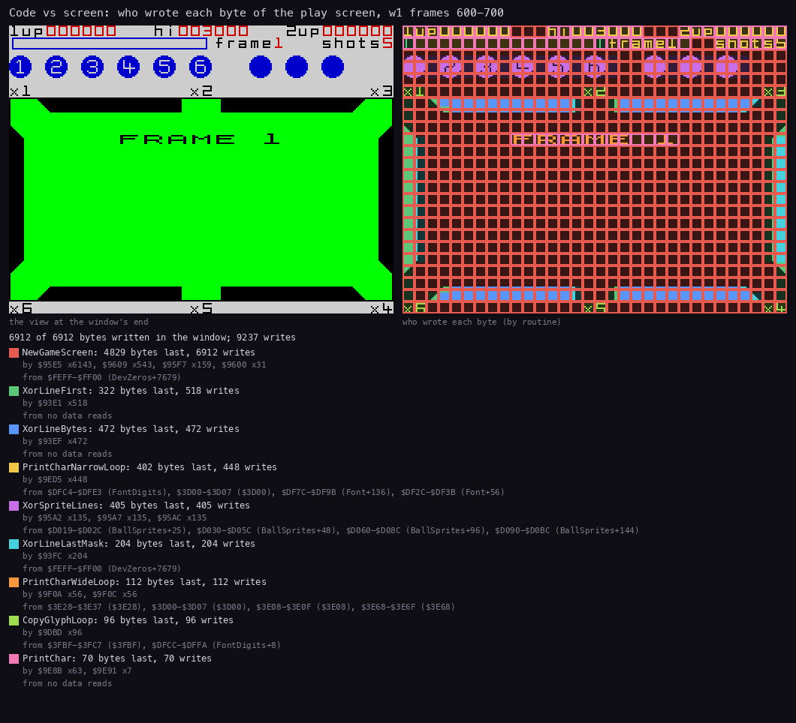

How to read the figure:

- **The left panel** is the screen at frame 700, with "FRAME 1" over the empty table.
- **The right panel** colours each byte by the routine that wrote it last in frames 600-700.
- **Red, NewGameScreen**, is the clear of the whole screen: the bytes nobody wrote after it.
- **Green, blue and cyan** are the three parts of XorLine (first byte, whole bytes, last byte): the cushions and the
  frame's edges, the power box.
- **Yellow and orange** are the print routine (narrow and wide characters): the HUD and the banner. **Purple** is
  XorSpriteLines: the balls of the potted row and the lives.
- **The legend** gives each writer's bytes and where its data came from: FontDigits `$DFC4`, the ROM's CHAR_SET at
  `$3D00`, BallSprites `$D000`.
- **The point**: four routines draw the whole screen: a clear, XorLine, the print routine and the ball XOR.

```bash
python3 ../../kit/writers_map.py --work work/docs/vpB/w1 --window 600:0-700:0 --listing build/game.lst --out docs/img/render/writers-build.png --view screen --sources
```

The screen build in order (NewGameScreen, section 6.1):

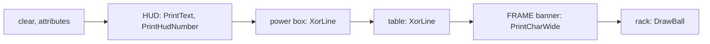

Worked example: XorSpriteLines wrote 405 bytes, 135 times by each of its three XOR stores (`$95A2`, `$95A7`, `$95AC`).
135 lines are 9 sprites of 15 lines: the six balls of row 2-4 and the three lives, at y 20, where y AND 7 = 4 gives
15 lines. Its sources start at `$D030`, ball 1 at shift 0 (`BallSprites+48`), then `$D060` and `$D090`, balls 2 and 3.

Witness: the window holds 9237 screen writes, all 6912 bytes written at least once (`writers_map.py` legend).

The point: code and screen line up one to one. Every byte has one of four writers, and the sources prove which data
each used.

## 6.7 The pen signature

The attract sequence has a pen that writes "written by" and "James Hutchby" on the screen. SignatureWrite `$BD0C`
runs a script, SignatureScript `$DA80`, one command a byte. A move takes one frame a pixel. The pen starts at
(16, 128).

| Byte | Meaning |
| --- | --- |
| `$00` | end: erase the pen and return to PresentsPage |
| `$01` | pen up |
| `$02` | pen down |
| `$03 dx dy` | a dot at the pen point plus (dx, dy), signed bytes; the point stays |
| high nibble not 0 | a move: dy in bits 7-6, dx in bits 5-4 (2-bit two's complement), n steps in bits 3-0 |

Each step of a move:

1. one frame (PresentsFrame `$B91B`; a key aborts the sequence);
2. PenErase `$BE40` erases the pen;
3. PenStep `$BE05` plots the ink pixel at (x, y - 1) when the pen is down, then moves x + dx, y + dy;
4. PenDraw `$BE2F` draws the pen again.

The pen is three parts drawn round its point: a nib of span records (PenNib `$BFCC`: dx, dy, length), a shaft 44
lines long at 45 degrees copied from PenShaftImage `$BFFE`, and an end cap (PenCap `$BFEB`).

**Self-modifying code.** The pen is drawn and erased by the same code. PenDraw writes OR (HL), `$B6`, into the three
NOPs of PenSpan (PenSpanOp1-3), and a JR with displacement 0 into PenShaftBlock `$BEDC`, so the shaft is copied.
PenErase writes XOR (HL), `$AE`, and a JR `$63` that jumps to PenShaftClear `$BF41`, which zeroes the shaft bytes.
The shaft copy itself jumps into one of four copy loops aligned on 16 bytes (PenShaftCopy1-4), 1-4 bytes a line,
chosen by the bytes left to the right edge.

```text
SignatureWrite:
    pen up; IX = $DA80; (x, y) = (16, 128); PenDraw()
    loop: SignatureCommand()             ; the end command leaves the loop

SignatureCommand:
    b = (IX++)
    if b >> 4 == 0:
        0: PenErase(); return to PresentsPage
        1: PenIsDown = 0
        2: PenIsDown = 1
        3: PenPlot(x + (IX++), y + (IX++))
        else: nothing
    else:
        dy, dx, n = sext2(b >> 6), sext2((b >> 4) AND 3), b AND 15
        repeat n: frame; PenErase(); if PenIsDown: plot(x, y - 1); x += dx; y += dy; PenDraw()
```

```text
BD23  DD 7E 00     LD A,(IX+$00)       ; SignatureCommand
BD26  E6 F0        AND $F0
BD28  20 3B        JR NZ,SigMove
BD2A  DD 7E 00     LD A,(IX+$00)
BD2D  E6 0F        AND $0F
BD2F  DD 23        INC IX
BD31  FE 00        CP $00              ; end
BD33  20 04        JR NZ,SigCmdPenUp
BD35  E1           POP HL
BD36  C3 40 BE     JP PenErase
BD39  FE 01        CP $01              ; SigCmdPenUp
BD3B  20 05        JR NZ,SigCmdPenDown
BD3D  AF           XOR A
BD3E  32 3F C0     LD (PenIsDown),A
BD41  C9           RET
BD42  FE 02        CP $02              ; SigCmdPenDown
BD44  20 06        JR NZ,SigCmdDot
BD46  3E 01        LD A,$01
BD48  32 3F C0     LD (PenIsDown),A
BD4B  C9           RET
...
BD9A  CD 1B B9     CALL PresentsFrame  ; SigMoveStep: one frame a step
BD9D  7A           LD A,D
BD9E  FE 60        CP $60              ; y >= 96: the plain step
BDA0  30 55        JR NC,SigStepDraw

BE2F  AF           XOR A               ; PenDraw
BE30  32 DD BE     LD (PenShaftBlock+$0001),A   ; JR 0: copy the shaft
BE33  3E B6        LD A,$B6            ; OR (HL)
BE35  32 93 BF     LD (PenSpanOp1),A
BE38  32 A1 BF     LD (PenSpanOp2),A
BE3B  32 AE BF     LD (PenSpanOp3),A
BE3E  18 10        JR PenRender
BE40  3E 63        LD A,$63            ; PenErase: JR to PenShaftClear
BE42  32 DD BE     LD (PenShaftBlock+$0001),A
BE45  3E AE        LD A,$AE            ; XOR (HL)
BE47  32 93 BF     LD (PenSpanOp1),A
BE4A  32 A1 BF     LD (PenSpanOp2),A
BE4D  32 AE BF     LD (PenSpanOp3),A
```

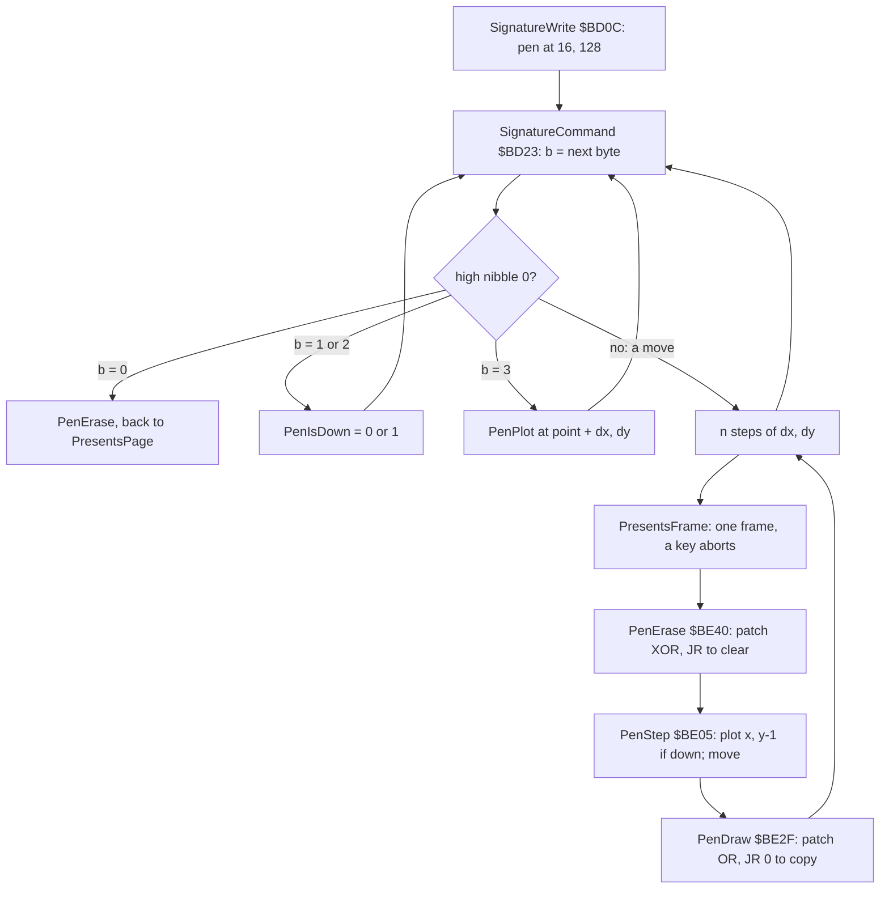

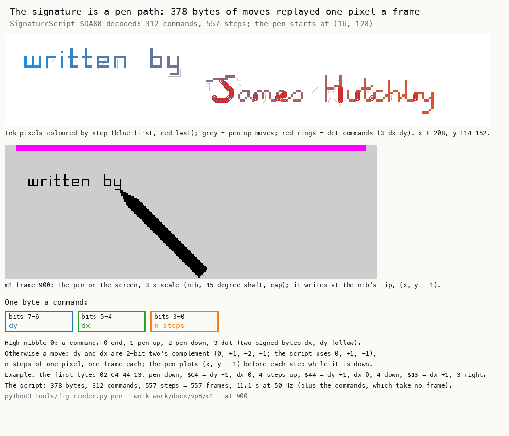

How to read the figure:

- **The top panel** is the script run in Python from the image: each ink pixel coloured by its step, blue first and
  red last. Grey lines are the pen-up moves, red rings the dot commands.
- **The middle panel** is the screen of `m1` frame 900, 3 x: "written by" done and the pen, nib, shaft and cap, about
  to start "James".
- **The bottom** is the byte format, with the first four bytes of the script worked out.
- **The point**: the signature is not a picture. It is a path of 557 one-pixel steps, so the pen can be seen to write
  it.

```bash
python3 tools/fig_render.py pen --work work/docs/vpB/m1 --at 900 --out docs/img/render/pen.png
```

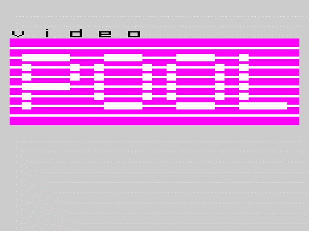

*The screen animation of SignatureWrite in `m1` frames 650-1230, one picture every 4 frames. Command: `python3
../../kit/screen_anim.py --work work/docs/vpB/m1 --from 650 --to 1230 --step 4 --scale 2 --delay 60 --hold 2000
docs/img/routines/SignatureWrite.gif`.*

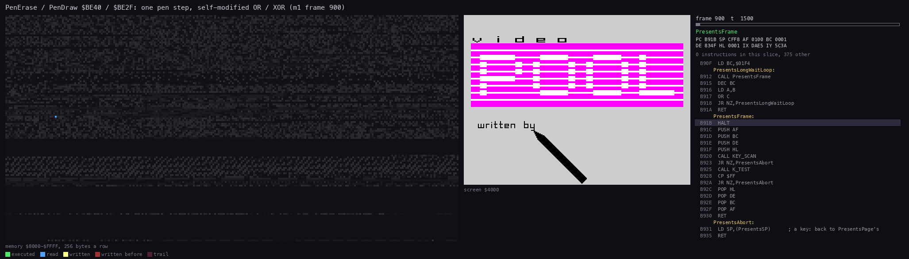

*The routine animation of the pen routines (`$BE2F-$BFFD`) in `m1` frame 900, one picture each 1500 T, 12 276
instructions. Command: `python3 ../../kit/routine_anim.py --work work/docs/vpB/m1 --window 900:0-901:0 --listing
build/game.lst --out docs/img/routines/PenRender.gif --pc BE2F-BFFD --view screen --range 8000-FFFF --step 1500
--delay 120`.*

How to read the animations: in SignatureWrite the pen moves one pixel a frame, leaving ink at its tip, and lifts
between letters. In PenRender the memory map shows the writes into the code at `$BE`-`$BF` (the patched opcodes),
then the pen's spans flash as they are XORed off and ORed on.

Worked example: the script's first bytes are `02 C4 44 13`. `$02` puts the pen down. `$C4` is dy = 3 (two's
complement -1), dx = 0, 4 steps: the pen goes up 4 pixels, plotting each. `$44` is dy +1, dx 0, 4 steps: back down.
`$13` is dy 0, dx +1, 3 steps right. Together they draw the first stroke of the "w".

Witness: SignatureWrite ran only in `m1`, 3 times (frames 655-4498): two whole scripts of 312 commands and 557 steps
each, and a third cut by SPACE at frame 4500. PenDraw ran 1487 times and PenErase 1486. Only PenShaftCopy4 ran: the pen
never came near the right edge. The band paths (SigBandBelow to SigBandSlow, PenDelay) slow the pen for y below 96: y
40-95 through PenDraw, PenDelay and PenErase, y below 40 through SigBandSlow. The script keeps the pen at y 121-147, so
they are not executed in any recording: known only from the code.

The point: the signature is a tiny vector animation, 378 bytes for 11 seconds of writing. One draw routine draws and
erases the pen, switched by four patched bytes.
