# 7. Objects

What this covers: the only objects of Video Pool, the seven balls; their 14-byte records, the state each ball goes
through, the rack scripts that roll the six object balls onto the table before each frame, the movers and the order of
the collision tests. The physics itself (friction, cushions, pockets, the ball-ball exchange) is doc 10.

The recordings it rests on (WALKTHROUGH 6.0), all loaded from `work/snaps/entry.z80`:

- `w1` (one player, frames 1-3 cleared). Replayed for this document with the TTD recording on, on an own instance:
  `python3 work/docs/vpC/replay.py --inputs tests/inputs/w1.txt --work work/docs/vpC/w1 --port-base 34925 --to 12100`.
  The ball block `$8A88-$8B4D` was sampled with `work/docs/vpC/sample.py` at every frame 600-900 (the rack) and
  1075-1560 (the break).
- `v1` (the variations), replayed the same way to frame 3400 (`--work work/docs/vpC/v1`); the ball block and the
  player variables sampled every 5 video frames 2850-3400.
- `p2` (two players: the swap of the ball sets) and the counts over `game`, `w1`, `f1`, `p2`, `v1`, `m1` from the
  stage-2 notes (`work/stage2/NOTES.md`, `work/stage2/ann/02-physics-notes.md`).

There are no other objects: no enemies, no bullets, no list of slots that grows or shrinks. Every mechanism here works
on a fixed array of seven records.

## 7.1 The ball block and the record data sheet

The game keeps the seven balls of the player at the table in `BallRecords $8A88`: the cue ball first, then balls 1 to 6,
14 bytes each. The block ends at `$8AE9`. The next 98 bytes, `OtherPlayerBalls $8AEA-$8B4B`, hold the other player's
seven balls in the same format. Two counters of the physics task follow: `FrictionTurn $8B4C` and `EventCount $8B4D`.

A position is 8.8 fixed point in screen pixels, the fraction byte first, and names the centre of the ball. A velocity is
8.8 two's complement in pixels a tick. Tick is the word of the [Terms](README.md#terms); while the balls move
PhysicsTask runs once a tick, and "physics tick n" is its n-th run since the shot (doc 10.1). The friction steps are
signed bytes in 1/256 pixel a tick, recomputed every seventh tick (doc 10.3).

A sample of a recording (`w1-break.jsonl` and the others, TTD `memory_at`) is the memory at the start of its video
frame. "The block in `w1` frame 1117" is therefore the state after the physics tick that ran in video frame 1116; the
animations, which are traces, show that tick in frame 1116 (doc 10.1).

| Offset | Size | Field | Written by | Read by |
| --- | --- | --- | --- | --- |
| +0/+1 | word | x, 8.8, fraction first | MoveBall `$8701`, StepBack `$8E33`, PocketSnap `$8B71`, RackStep `$A05E` | everything |
| +2/+3 | word | y, 8.8 | the same | everything |
| +4/+5 | word | vx, 8.8 two's complement | AimShot `$8A02` (cue ball), BallContacts `$87EF`, the reflections | MoveBall |
| +6/+7 | word | vy | the same | MoveBall |
| +8/+9 | 2 bytes | friction steps x, y | FrictionSteps `$90F5`; negated by ReflectX `$8DCB` / ReflectY `$8DFF`, swapped by ReflectDiagonal `$8D7D` | MoveBall |
| +10/+11 | 2 bytes | sprite corner x - 7, y - 7 as last drawn | RedrawBall `$8297`, RackBalls `$9F6F` | the erase before each redraw |
| +12 | byte | pocket 1-6 (TL, TM, TR, BR, BM, BL), 0 none | PocketStore `$8BE3`; cleared each shot by ShotReset `$84C7` | ShotEnd `$8357`, ScoreTally |
| +13 | byte | flags: bit 7 on the table, 6 moving, 5 potted, 4 redraw | see 7.2 | everything |

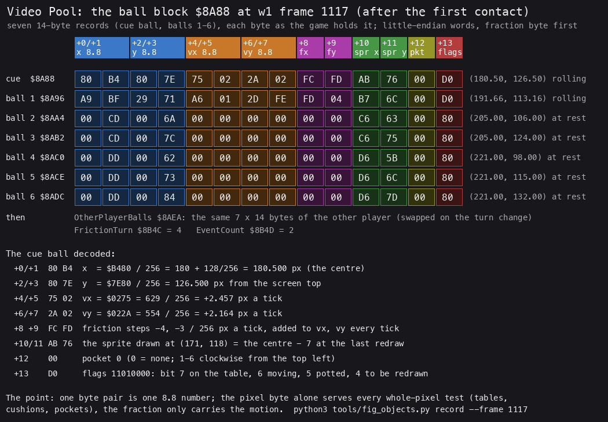

How to read the figure:

- One row a ball record of the block at `$8A88`, one box a byte, in the sample of `w1` frame 1117 (the break, right
  after physics tick 32, in which the cue ball met ball 1). The column heads name the fields; the right column gives the position and the state.
- The cue ball and ball 1 roll (`D0`); balls 2-6 are still at rest on the triangle (`80`).
- The cue ball is decoded below the rows: `80 B4` is x = `$B480` = 180.50 pixels, `75 02` is vx = `$0275` = 629/256 =
  2.457 pixels a tick.
- The friction steps `FC FD` are -4 and -3: about 5/256 pixel a tick against the direction of motion (doc 10.3).
- The flags byte `D0` is bits 7, 6 and 4: on the table, moving, to be redrawn.
- Built from the sample `work/docs/vpC/w1-break.jsonl` (TTD `memory_at`, `w1` frame 1117).

**The point**: a ball is nothing but this record. There is no kind byte, no handler and no slot list: every routine
loops over the seven records and tests the flags.

```bash
python3 tools/fig_objects.py record --samples work/docs/vpC/w1-break.jsonl --frame 1117 --out docs/img/objects/ball-record.png
```

Worked example (the same frame): the cue ball record reads `80 B4 80 7E 75 02 2A 02 FC FD AB 76 00 D0`. That is x
180.50, y 126.50, vx +2.457, vy +2.164 pixels a tick, friction steps -4/-3, last drawn at (171, 118), no pocket, and the
flags on the table + moving + redraw. The sprite corner (171, 118) is (x - 7, y - 7) of the sample before (1116),
(178.35, 125.96): in each tick the redraw runs before the physics (doc 10.1).

Witness: the cue ball's x byte `$8A89` is the most read byte of the block (`w1` 28 930 reads). `FrictionTurn` is read
`w1` 8504 times. `EventCount` never reached 7 in a recording (the stage-2 counts).

## 7.2 The ball state machine

The flags byte +13 is the whole state of a ball. These values appear in the recordings:

| +13 | State | Seen in |
| --- | --- | --- |
| `$80` | at rest on the table | every recording, between shots |
| `$90` | on the table, to be redrawn (the rack-in, a re-spot) | `w1` frames 708-875 (the rack) |
| `$D0` | rolling (moving, redrawn every tick) | every shot |
| `$B0` | potted: bit 7 still set, moving cleared, waiting for the redraw | one tick at each pot |
| `$00` | off the table (in the row of potted balls, or the cue ball gone) | `v1` frame 3045 on: ball 5 |

The transitions, with the routine that makes each:

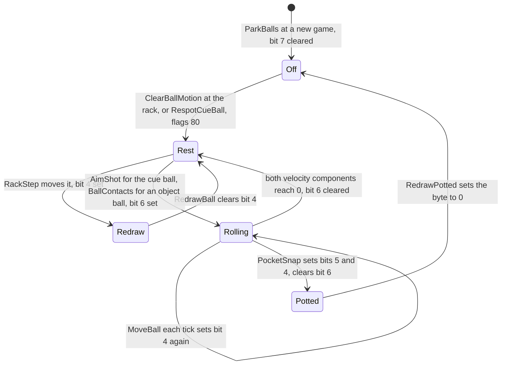

What each routine does to the flags, in pseudocode:

```text
ClearBallMotion:  flags = $80                           ; at rest, on the table
RackStep:         flags |= $10                          ; moved by a script
AimShot:          cue.flags |= $40                      ; the shot
BallContacts:     other.flags |= $40                    ; hit by a moving ball
MoveBall:         flags &= ~$10 ... flags |= $10        ; the redraw test (doc 10.3)
                  if vx == 0 and vy == 0: flags &= ~$40 ; at rest
PocketSnap:       flags |= $30; flags &= ~$40           ; potted, still bit 7
RedrawBall:       if flags & $80 and flags & $10:
                      erase
                      if flags & $20: flags = 0; park in the row      ; RedrawPotted
                      else: draw at the new place; flags &= ~$10
ShotReset:        flags &= $80                          ; each shot
```

The asm of the one transition that takes a ball off the table, in RedrawBall:

```text
$82B2  BIT 5,(IX+$0D)    ; potted?
$82B6  JR NZ,RedrawPotted
...
RedrawPotted:
$82CC  LD (IX+$0D),$00   ; off the table
$82D0  POP AF            ; A = the ball's number
$82D1  LD B,A
$82D2  DEC A
$82D3  RET M             ; the cue ball (n = 0) stays off
       ...               ; ball n to x = 24 (n - 1) + 7, y = 27: the row above the table
```

Worked example (`v1` frames 3040-3045, sampled from the own replay of `v1`): ball 5 reads +12 = 0, +13 = `$D0` at
3040. At 3045 it reads +12 = 3, +13 = `$00`. Between the two samples PocketSnap stored pocket 3 and set `$B0`. The next
redraw cleared the byte and moved the ball to x = 24 × 4 + 7 = 103, y = 27.

**The point**: a ball never leaves the array. "Potted" is a flag and a pocket number, and the cue ball's "off the
table" is the same zero byte. ShotEnd only has to test the flags of seven records with the mask `$70` to know whether
anything still moves.

Witness: RedrawPotted runs `w1` 18 times, one a pot. The rack's `$90` and the rolling `$D0` are in
`work/docs/vpC/w1-rack.jsonl` and `w1-break.jsonl`; the pot of ball 5 in `work/docs/vpC/v1-balls.jsonl`.

## 7.3 The draw list

Each tick the redraw task BallRedraw `$827E` erases and draws the balls in the order of `DrawList $869E`. The list has
7 entries of 4 bytes (ball number, y, record address). BuildDrawList `$8304` sorts it by y with an exchange sort: pass
k (6 passes) compares entry k with each later entry and swaps the two when entry k's y is not smaller, so after pass k
the k-th smallest y is in place (equal y swap too). The balls are drawn from the top of the screen down. The sprite
routine and the XOR drawing are doc 06; here only the order matters.

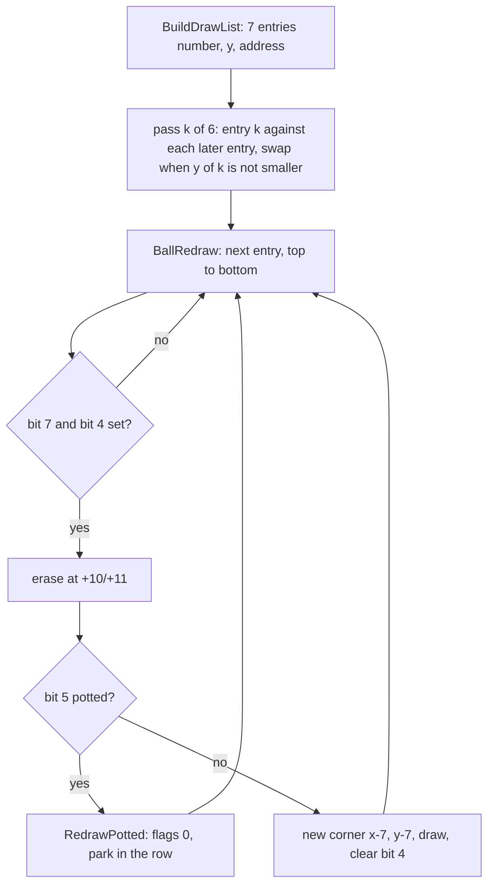

```text
BuildDrawList:
    for k in 0..5:                       ; DE on entry k for the whole pass
        for j in k+1..6:                 ; HL walks the later entries
            if DrawList[k].y >= DrawList[j].y: swap the 4-byte entries k and j
BallRedraw:
for e in DrawList:                       ; sorted by y
    ball = e.record
    if ball.flags & $80 and ball.flags & $10:
        XOR the sprite at ball.corner      ; erase
        if ball.flags & $20: park(ball)    ; 7.2
        else: ball.corner = (x - 7, y - 7); XOR the sprite there; ball.flags &= ~$10
```

The asm of the sort, one pass and its compare:

```text
$8324  LD DE,DrawList
$8327  LD B,$06            ; 6 passes
DrawListSortPass:
$8329  PUSH BC
$832A  LD H,D              ; HL = DE + 4: the entry after k
$832B  LD L,E
$832C  INC HL              ; (four INC HL, $832C-$832F)
DrawListSortStep:
$8330  PUSH BC             ; the inner count is the outer B: 6, 5, ... 1
$8331  INC HL
$8332  INC DE
$8333  LD A,(DE)           ; y of entry k
$8334  CP (HL)             ; against y of the later entry
$8335  DEC HL
$8336  DEC DE
$8337  JR C,DrawListSortNext   ; k's y smaller: keep; equal or larger: swap
$8339  ...                 ; swap the two 4-byte entries ($833D-$8344)
DrawListSortNext:
$8348  INC HL              ; (four INC HL): the next later entry
$834C  POP BC
$834D  DJNZ DrawListSortStep
$834F  INC DE              ; (four INC DE): k + 1
$8353  POP BC
$8354  DJNZ DrawListSortPass
```

Worked example: at `w1` frame 1117 the y bytes are cue 126, ball 1 113, ball 2 106, ball 3 124, ball 4 98, ball 5 115,
ball 6 132. The sorted list reads 4, 2, 1, 5, 3, 0, 6.

**The point**: the sort costs little with seven entries. The balls are drawn top-down in the same order each tick, so
the XOR erase of one ball and the redraw of its neighbour happen in a fixed order.

Witness: BallRedraw `w1` 2839 runs (frames 1086-11 615); RedrawBall `w1` 19 873 calls.

## 7.4 The rack scripts and their interpreter

Before each frame the six object balls roll onto the table from the pockets and stop on the triangle. The motion is
not physics: each ball runs a small byte program, one step a video frame (one `HALT`, `$9FD2`). RackBalls `$9F6F` picks a set of six scripts by
the frame number, set ((frame - 1) / 2) mod 6, from `RackSets $A0C4`:

| Set | Address | Frames | Seen |
| --- | --- | --- | --- |
| 0 | `$A0D0` | 1-2, 13-14, ... | `w1` frame 1 (frames 707-876), `p2`, `f1`, `v1` |
| 1 | `$A162` | 3-4, 15-16, ... | `w1` frames 3 and 4 |
| 2 | `$A1E4` | 5-6 | known only from the code |
| 3 | `$A29C` | 7-8 | known only from the code |
| 4 | `$A38E` | 9-10 | known only from the code |
| 5 | `$A4F8` | 11-12 | known only from the code |

A script has four commands. Each ball's state is 4 bytes in `RackScriptState $9F51`: the script pointer, a wait count
and a move count.

| Bytes | Command | Effect |
| --- | --- | --- |
| `00` | end | the ball is done; B counts the ended scripts; the pointer stays, so each later step ends again |
| `01 x y` | place | the ball's whole x and y bytes set, bit 4 of +13 set |
| `02 n dx dy` | move | n video frames of x += dx, y += dy (signed whole pixels), the first at once |
| `03 n` | wait | n more video frames with nothing done |

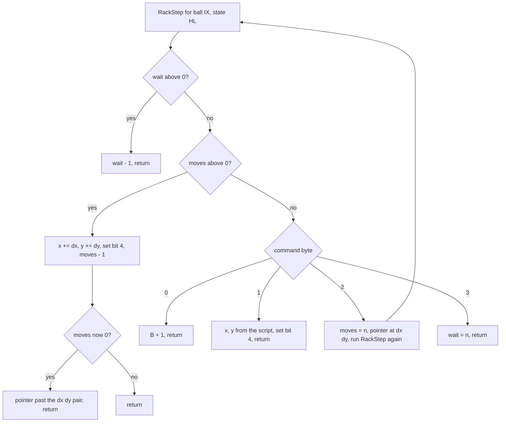

```text
RackStep(ball, st):                        ; st = pointer, wait, moves
    if st.wait > 0: st.wait -= 1; return
    if st.moves > 0:
        ball.x += script[st.ptr]; ball.y += script[st.ptr + 1]; ball.flags |= $10
        st.moves -= 1
        if st.moves == 0: st.ptr += 2
        return
    cmd = script[st.ptr++]
    case cmd:
        0: ended += 1                      ; ptr stays on the 0
        1: ball.x, ball.y = next two bytes; ball.flags |= $10
        2: st.moves = next byte; RackStep(ball, st)     ; the first move this step
        3: st.wait = next byte
RackBalls:
    banner; set = RackSets[((frame - 1) / 2) mod 6]
    for ball 1..6: ClearBallMotion; state = (script, 0, 0)
    repeat: ended = 0; RackStep for balls 1..6; BuildDrawList; HALT; redraw the moved ones
    until ended == 6
    cue ball: ClearBallMotion; x = 40, y = 115, both fractions = R * 2; draw
```

The asm of the move branch, the one that runs most:

```text
RackStepMove:
$A068  INC HL
$A069  LD A,(HL)          ; moves left
$A06A  OR A
$A06B  JR Z,RackStepCommand
$A06D  LD A,(DE)          ; dx
$A06E  INC DE
$A06F  ADD A,(IX+$01)
$A072  LD (IX+$01),A
$A075  LD A,(DE)          ; dy
$A076  INC DE
$A077  ADD A,(IX+$03)
$A07A  LD (IX+$03),A
$A07D  SET 4,(IX+$0D)     ; to be redrawn
$A081  DEC (HL)
$A082  RET NZ             ; more moves: the pointer stays on the pair
$A083  DEC HL             ; the last move: store the pointer past the pair
$A084  DEC HL
$A085  LD (HL),D
$A086  DEC HL
$A087  LD (HL),E
$A088  RET
```

### Worked example: set 0, ball 1 in w1

Ball 1's script at `$A0DC` is `03 4B 01 07 AF 02 1E 02 FE 02 3D 02 00 01 BE 73 00`:

| Step (video frame) | Command | Ball 1 after it |
| --- | --- | --- |
| 1 (707) | `03 4B`: wait 75 | still at (190, 115) from the last game, flags `$80` |
| 2-76 (708-782) | the wait counts down | unchanged |
| 77 (783) | `01 07 AF`: place at (7, 175) | (7, 175), flags `$90` |
| 78 (784) | `02 1E 02 FE`: 30 moves of (+2, -2), the first at once | (9, 173) |
| 107 (813) | the 30th move | (67, 115) |
| 108-168 (814-874) | `02 3D 02 00`: 61 moves of (+2, 0) | (69, 115) ... (189, 115) |
| 169 (875) | `01 BE 73`: place at (190, 115) | (190, 115) |
| 170 (876) | `00`: end, the sixth script to end | flags `$80` after the redraw |

Every value in the right column is in the per-frame sample `work/docs/vpC/w1-rack.jsonl`; frame = step + 706. The
other five balls start earlier (waits 60, 45, 30, 15, 0: ball 6 rolls first), so ball 1 ends last and the rack lasts
170 steps. At frame 877 the cue ball appears at (40, 115) with the fraction `$8C` in both coordinates: twice the R
register at that moment (7.8).

Each script ends on a place command at its ball's start position from `StartPositions $9D5D`: (190, 115), (205, 106),
(205, 124), (221, 98), (221, 115), (221, 132). A step count off by one in a move would not show.

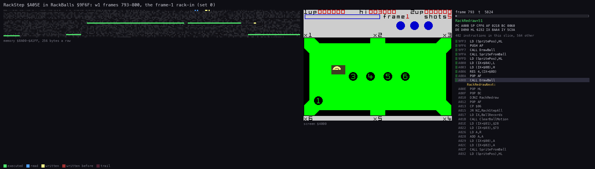

Steps in a recording: `w1` frames 793-800, one RackBalls loop a video frame. Left: the memory `$8A00-$A1FF`; middle:
the screen, balls 3 to 6 run along the middle line while balls 2 and 1 come down their diagonals (ball 2 joins the line
at 799); right: the listing at the PC. Each picture shows the state after one more RackStep.

```bash
python3 ../../kit/routine_anim.py --work work/docs/vpC/w1 --window 793:0-801:0 --listing build/game.lst --view screen \
    --range 8A00-A1FF --pc 9F6F-A0C3 --pictures 96 \
    --title 'RackStep $A05E in RackBalls $9F6F: w1 frames 793-800, the frame-1 rack-in (set 0)' --out docs/img/routines/RackStep.gif
```

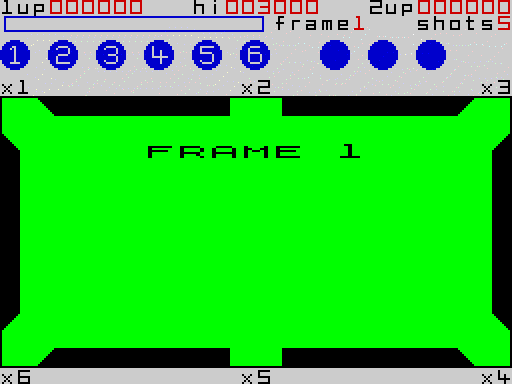

The screen of `w1` from the FRAME banner (frame 700) to the cue ball's appearance (877). The six balls come out of the
two left corner pockets, run along the middle line and turn into the triangle.

```bash
python3 ../../kit/screen_anim.py --work work/docs/vpC/w1 --from 700 --to 880 --step 2 --scale 2 --delay 40 --hold 1500 docs/img/play/w1-0700-rack-in.gif
```

### The racks as a map

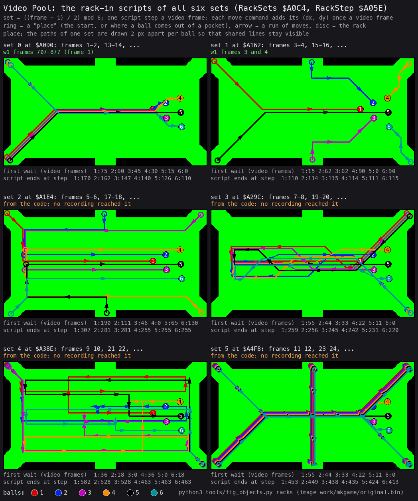

How to read the figure:

- One table a set, set 0 at the top left. The background is the empty table of `w1` frame 707.
- One script step a video frame; a move command adds its (dx, dy) once a step: 2 pixels in most scripts, 1 in a few
  (set 4: `$A3A7` (+0, -1), `$A3B7` (+1, +0)).
- Each ball's path is a line in the ball's colour. A ring marks each place command: the start, a jump (set 5 drops
  balls into pockets and brings them back elsewhere), and the final place on the triangle.
- Under each table, two rows: the first wait of each ball in video frames, and the step on which each ball's script
  ends (the largest is the rack's length: 170 for set 0).
- Sets 0 and 1 are labelled with the `w1` frames that ran them. Sets 2-5 are labelled "from the code": no recording
  reached frame 5.
- Built by running RackStep's rules on the script bytes of the image `work/mkgame/original.bin`. The `w1` rack of set
  0 matches the per-frame sample step for step (the worked example above).

**The point**: the rack is an animation, not physics: 36 byte programs, six per set. The six sets give each pair of
frames its own entrance. A player sees only the first one or two unless he clears four frames.

```bash
python3 tools/fig_objects.py racks --image work/mkgame/original.bin --table work/docs/vpC/shots/t707.png --out docs/img/maps/racks.png
```

The image holds 6 sets of 6 scripts, not 30 racks. Frames 13 and later reuse the sets in turn (the mod 6 of
RackBalls), so every rack a long game can show is one of the six on the map.

Witness: RackStep `game` 1040 calls in one rack (command 1: 12, command 2: 20, command 3: 6). Set 1 is read by `w1`
only (`l1sum.py --reads A162-A1E3`, 1562 reads). `$A1E4-$A701` is read by no recording.

## 7.5 The movers

Three routines move a ball, and they never run at the same time:

| Mover | When | Step | Section |
| --- | --- | --- | --- |
| RackStep `$A05E` | the rack-in, tasks stopped | whole pixels from a script | 7.4 |
| MoveBall `$8701` | a shot, once a tick for each rolling ball | 8.8 velocity, friction | doc 10.3 |
| EditorHoldBall `$C2F4` | the table editor (doc 05), a ball picked up with the cursor | the cursor's step | doc 05 |

MoveBall is the only one that runs in play. PhysicsTask `$86C1` calls it for each ball with bits 7 and 6 set and bit 5
clear, cue ball first:

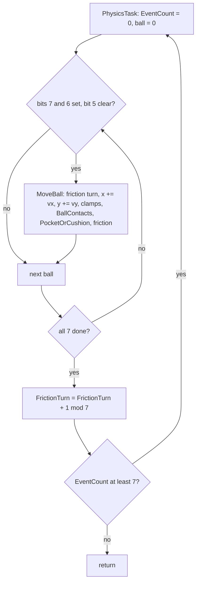

```text
MoveBall(ball):
    if FrictionTurn == 6 - ball.n: FrictionSteps(ball)      ; doc 10.3
    ball.x += ball.vx; clamp to $0700..$F800
    ball.y += ball.vy; clamp to $3700..$B000
    ball.flags &= ~$10
    BallContacts(ball)                                      ; 7.6, doc 10.5
    PocketOrCushion(ball)                                   ; doc 10.4
    vx += fx unless that crosses 0 (then vx = 0); the same for vy
    if vx == 0 and vy == 0: ball.flags &= ~$40              ; at rest
    ball.flags |= $10                                       ; the redraw test, doc 10.3
```

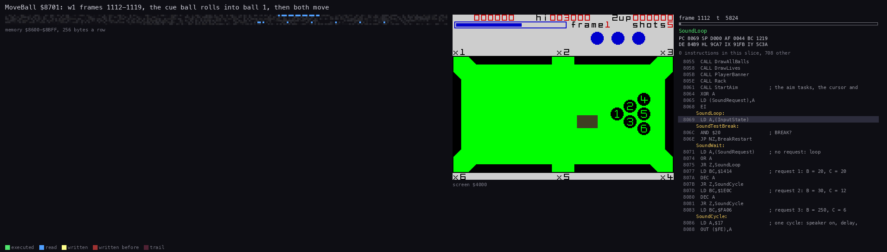

Steps in a recording: `w1` video frames 1112-1119 (a trace, so the frame a tick runs in, one before its sample). Up to
frame 1115 MoveBall runs once a tick for the cue ball only. In 1116 (physics tick 32) the cue ball meets ball 1, which
moves in the same tick; ball 2 joins in 1117 and ball 4 in 1118 (MoveBall's entry runs 1, 2, 3, 4 times a frame:
`work/review/fixC/pcframes.py` on the trace `work/docs/vpC/w1/traces/1112_0-1120_0.uatr`). The right panel is the screen. The
listing shows the add and clamp of x and y and the calls to the two tests.

```bash
python3 ../../kit/routine_anim.py --work work/docs/vpC/w1 --window 1112:0-1120:0 --listing build/game.lst --view screen \
    --range 8600-8BFF --pc 8701-87EE --pictures 96 \
    --title 'MoveBall $8701: w1 frames 1112-1119, the cue ball rolls into ball 1, then both move' --out docs/img/routines/MoveBall.gif
```

Worked example (`w1`, the break): the shot is released at video frame 1079; AimShot runs in that interrupt, which
lasts until frame 1085 (doc 4, 4.7). The cue ball at (40.547, 115.547) gets v = (1213, 86)/256 pixels a tick. The
first MoveBall (physics tick 1, still in the same interrupt, after AimShot) adds them: x = `$288C` + `$04BD` = `$2D49`
(45.29), y = `$738C` + `$0056` = `$73E2` (115.88); the sample of frame 1086 holds these bytes and v (1208, 86) after
the first friction add. The whole break is in doc 10.6, where a Python model of MoveBall reproduces 475 samples byte
for byte.

**The point**: a ball moves by one fixed-point add a tick and stops only through friction or a pot. There is no speed
limit other than the shot's top speed of 7.875 pixels a tick (doc 10.2).

Witness: PhysicsTask runs once a tick during a shot (`w1` 2860 runs, frames 1085-11 615). BallRedraw runs 2839 times
(frames 1086-11 615): 21 fewer, one a shot, because the first physics tick of each of the 21 shots runs inside the shot
set-up's interrupt, where BallRedraw is not called (`tools/task_costs.py --per-irq` on
`work/runs/w1/traces/1070_0-1100_0.uatr`: AimPower 470 382 T, then PhysicsTask 9969 T).

## 7.6 The order of the collision tests

MoveBall tests a ball right after it moved, in a fixed order: ball against ball first, then pockets and cushions. The
tests themselves are doc 10.4 and 10.5; this is the order and what each may change.

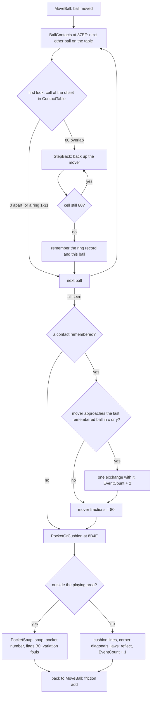

```text
MoveBall(ball):
    ...
    found = none
    for other in balls, other != ball, other on the table:     ; BallContacts
        if cell(other - ball) != $80: continue                  ; a ring or 0 at the first look: next ball
        repeat StepBack(ball) until cell(other - ball) != $80
        found = (other, ring record)                            ; the last one wins
    if found:
        if ball approaches found.other in x or in y:
            exchange (doc 10.5); BallHitFlag = 1; found.other.flags |= $40; EventCount += 2
        ball.x.frac = ball.y.frac = $80
    if ball outside the playing area: PocketSnap(ball)         ; PocketOrCushion
    else: test cushions, corner diagonals, jaws and reflect
```

The asm of the first look and of what is remembered after the step-backs:

```text
$882F  ADD HL,DE                 ; HL = ContactTable + 16 |dy| + |dx|
$8830  LD A,(HL)
$8831  OR A
$8832  RET P                     ; 0 or a ring: back to ContactNext, the next ball
ContactBackOff:                  ; only $80 (overlap) gets here
$8833  CALL StepBack
       ...                       ; dx, dy, the signs again; the cell again
$886A  LD A,(HL)
$886B  OR A
$886C  JP M,ContactBackOff       ; still $80: step back again
$886F  LD HL,CollisionRecords    ; record = CollisionRecords + 6 (n - 1)
       ...
$8879  LD (ContactRecordPtr),HL  ; remembered, not used yet
$887C  LD (ContactOther),IY
$8886  RET                       ; to ContactNext: the scan goes on
```

Worked example (`w1` physics tick 32 of the break, run in video frame 1116, sample 1117): BallContacts finds ball 1
overlapping at offset (-8, 11), backs the cue ball off with three StepBack calls, each subtracting v / 8 = (132,
10)/256, and lands on ring 17 at (-10, 11). After the scan, the one exchange gives the cue ball (633, 557) and ball 1
(425, -471). Only then is PocketOrCushion asked, and it finds nothing. After the friction adds of the same tick (the
cue ball's now, ball 1's when it is moved next) the records hold (629, 554) and (422, -467). Doc 10.5 works the same
contact through in full.

**The point**: one ball is moved and tested at a time, cue ball first. A ball later in the order sees the others
already moved this tick. The model of doc 10.6 has to run the balls in the same order to stay byte-exact.

Witness: contact found and exchanged `w1` 71 times, `f1` 28, `p2` 49, `v1` 31-32, `m1` 17; never in `game`.

## 7.7 The two players' sets

In a two-player game each player has his own table: his own seven balls, his frame, lives and pocket turn. On the turn
change TurnSwap `$9C15` (run by TurnSwapStart `$9C0F`) flips CurrentPlayer `$9B30` (1 <-> 2), swaps the pairs of
player variables (`$9F43/$9F44`, `$9F4E/$9F4F`, `$9F4B/$9F4C`) and exchanges the 98 bytes of `BallRecords` with
`OtherPlayerBalls`, byte by byte. The scores stay by player. When the other player has no lives left (his byte
`$9F4F` negative) nothing is swapped: the same player goes on with his own balls.

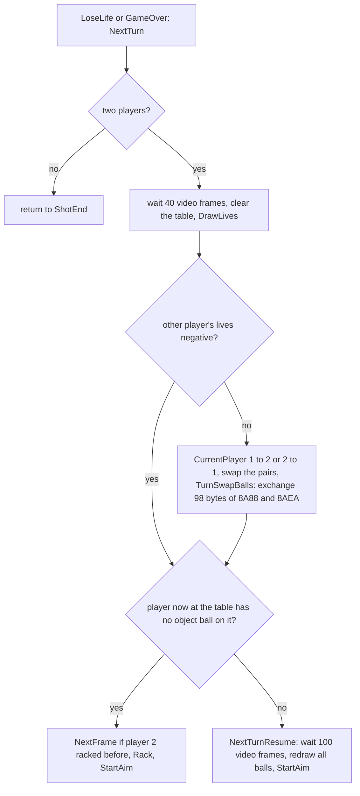

```text
$9C26  LD HL,(LivesLeft)               ; L = this player's lives, H = the other's ($9F4F)
$9C29  LD A,H
$9C2A  OR A
$9C2B  JP M,TurnSwapHud                ; the other is out: no swap, the same player goes on
$9C2E  LD A,(CurrentPlayer)
$9C31  AND $01
$9C33  INC A                           ; 1 -> 2, 2 -> 1
$9C34  LD (CurrentPlayer),A
       ...                             ; swap $9F43/$9F44, $9F4E/$9F4F, $9F4B/$9F4C
TurnSwapBalls:                         ; HL = $8AEA, DE = $8A88, C = 98
$9C5B  LD B,(HL)
$9C5C  LD A,(DE)
$9C5D  LD (HL),A
$9C5E  LD A,B
$9C5F  LD (DE),A
$9C60  INC HL
$9C61  INC DE
$9C62  DEC C
$9C63  JR NZ,TurnSwapBalls
```

Worked example (`p2` frame 1738): player 1 loses a life. The swap brings in player 2's block, which has never been
racked (all flags 0, the sprite corners of the row of potted balls), so NextTurn racks it: "PLAYER 2 FRAME 1" and the
rack-in at frame 1780.

**The point**: the second player is not a second set of objects in the code, only a second copy of the same 98 bytes
parked in memory. All the physics and drawing code knows one table.

Witness: the swap runs `p2` once (frame 1738, 98 bytes). The path "the new player still has balls" (NextTurnResume
`$9801`) is known only from the code: `p2` stopped before player 2 lost a life. The no-swap path is known only from
the code too: `$9C26` and `$9C2E` both ran once in `p2` (`l1sum.py 9C26 9C2E`), so the `JP M` was never taken.

## 7.8 Random numbers

Video Pool has no random number generator. Two places read the Z80's R register, and nothing else is random:

| Address | Routine | Use |
| --- | --- | --- |
| `$A026` | RackBalls `$9F6F` | the cue ball's x and y fractions after the rack = R × 2 |
| `$85D4` | AimCursorReset `$85C8` | the starting place of the aiming cursor from bits of R (doc 05) |

```text
RackBalls end:  cue.x = 40 + (R * 2) / 256;  cue.y = 115 + (R * 2) / 256
AimCursorReset: CursorX = 252
                CursorY = 115 if R bit 6 = 0, else 116 if R bit 0 = 1, else 114     ; doc 05
```

The asm of the two reads:

```text
$A026  LD A,R              ; RackBalls, after x = 40, y = 115
$A028  ADD A,A             ; R x 2
$A029  LD (IX+$00),A       ; x fraction
$A02C  LD (IX+$02),A       ; y fraction, the same byte

$85D0  LD H,$73            ; AimCursorReset: y 115
$85D2  LD L,$FC            ; x 252
$85D4  LD A,R
$85D6  BIT 6,A
$85D8  JR Z,CursorResetStore
$85DA  DEC H               ; y 114
$85DB  BIT 0,A
$85DD  JR Z,CursorResetStore
$85DF  INC H
$85E0  INC H               ; y 116
CursorResetStore:
$85E1  LD (CursorX),HL     ; CursorX = L, CursorY = H
```

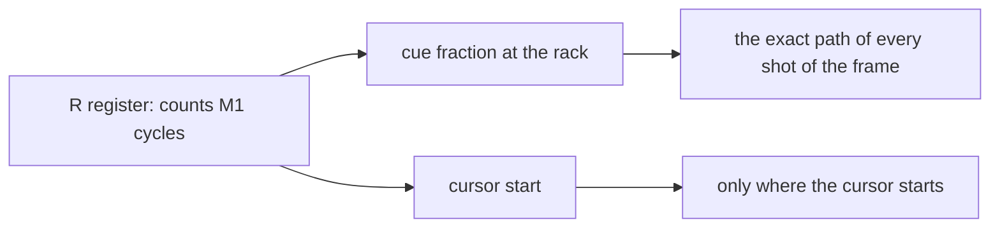

Worked example (`w1` frame 877): R × 2 = `$8C`, so the cue ball stands at (40.547, 115.547). That half pixel is in
every later position of the break. AimShot takes dx and dy from the integer bytes only (doc 10.2), but the motion
carries the fraction.

**The point**: R depends on the exact number of instructions run since the reset. A replay of a recording from its
snapshot gives the same R, the same fraction and the same break, byte for byte (doc 10.6). The game is deterministic
given the inputs and their timing.

Witness: `$8C` read at frame 877 in `work/docs/vpC/w1-rack.jsonl`; the w1 replay reproduces the stage-1 recording.

## 7.9 What no recording reached

| What | Where | Known from |
| --- | --- | --- |
| rack sets 2-5 (frames 5-12) | `$A1E4-$A701` | the code; drawn in 7.4 by the decoder |
| the second player keeping his balls after a life (NextTurnResume) | `$9801` | the code |
| no turn swap because the other player is out of lives | `$9C2B` | the code |
| EventCount reaching 7 (the repeated physics pass) | `$86FB` | the code; never taken |
| frame 10 and later (two shots a frame) | ShotsForFrame `$9BE6` | the code (doc 10.9) |

None of these is unused: each is reached by a longer game than the recordings played. Doc 10.12 lists the gaps of the
physics and the rules.
