# 8. HUD and text

What this covers: the one print routine of the game and its record format, the two fonts it mixes, the number
printer, the HUD panel in rows 0-1 and its two blinking fields, the score tally after each shot, the foul messages
and the banners, the pocket multiplier marks, the hall of fame table, and a data sheet of every text record.

The recordings it rests on:

- `w1`: a one-player game on the keyboard, through GAME OVER to the name entry and the hall of fame. It was replayed
  for these documents from `work/snaps/entry.z80` with `tests/inputs/w1.txt` and TTD on, 13 800 frames
  (`work/docs/vpB/replay.py`; [section 5](05-controls.md) lists the checks). The HUD is printed in frame 625. The
  first pot is tallied in frames 1254-1352. The name "vp" enters the hall of fame in frame 13 553.
- `game`, `f1`, `p2`, `v1`, `m1`, `j1`, `e1`: the counts of runs and their frames are from the L1 builds
  (`tools/l1sum.py`). `v1` holds the only WRONG ORDER! and WRONG POCKET! messages. `f1` holds the only "last shot"
  blink.

Frames are the recording's frames from the snapshot.

## 8.1 One print record, one print routine

Every text of the game is a print record: four header bytes, then the characters. There is no end marker; the
fourth byte is the length. PrintText `$9E65` prints one record. The game holds 75 records, 1537 bytes
(section 8.9).

| Byte | Meaning |
| ---: | --- |
| +0 | row, 0-23 |
| +1 | column, 0-31 |
| +2 | attribute; bit 7 means double width, not FLASH |
| +3 | length in characters |
| +4.. | the characters, one byte each |

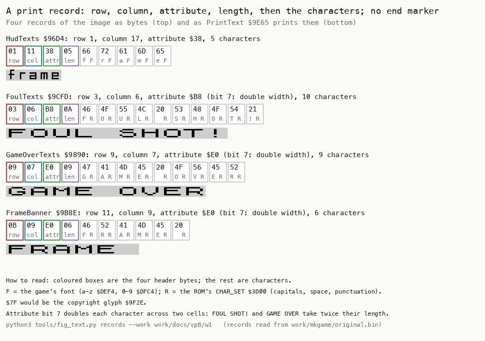

How to read the figure:

- **Each block** is one record of the image. The four header boxes come first (row red, column blue, attribute
  green, length purple), then one box per character.
- **Under each character byte** are the character and its font: F is the game's font, R the ROM's.
- **Under the bytes** is the record as the print routine draws it, in its own width.
- **The point**: the record format is fixed and short. The attribute's bit 7 is the only switch, and it doubles the
  width.

```bash
python3 tools/fig_text.py records --work work/docs/vpB/w1 --out docs/img/text/records.png
```

PrintText reads the header into D (row), E (column), C (attribute) and B (length). Then it calls PrintChar `$9E7C`
for each character. The column moves one cell after each character, or two when bit 7 of C is set.

```text
PrintText(record HL):
    row, col, attr, len = HL[0], HL[1], HL[2], HL[3]
    for each of the len characters ch:
        PrintChar(ch, row, col, attr)
        col += 1
        if attr bit 7: col += 1
```

```text
9E65  56           LD D,(HL)           ; PrintText: row
9E66  23           INC HL
9E67  5E           LD E,(HL)           ; column
9E68  23           INC HL
9E69  4E           LD C,(HL)           ; attribute
9E6A  23           INC HL
9E6B  46           LD B,(HL)           ; length
9E6C  23           INC HL
9E6D  EB           EX DE,HL            ; HL = row, column; DE = the characters
9E6E  1A           LD A,(DE)           ; PrintTextLoop
9E6F  CD 7C 9E     CALL PrintChar
9E72  2C           INC L
9E73  CB 79        BIT 7,C
9E75  28 01        JR Z,PrintTextNext
9E77  2C           INC L               ; a wide character takes two cells
9E78  13           INC DE              ; PrintTextNext
9E79  10 F3        DJNZ PrintTextLoop
9E7B  C9           RET
```

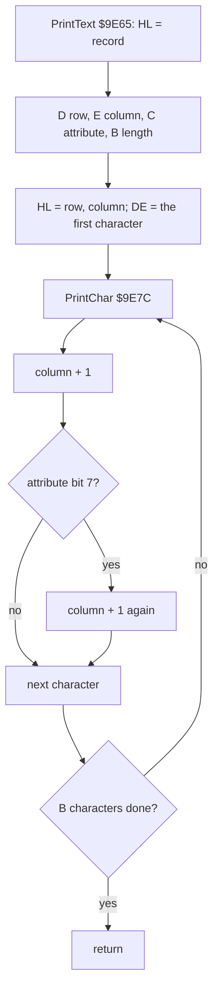

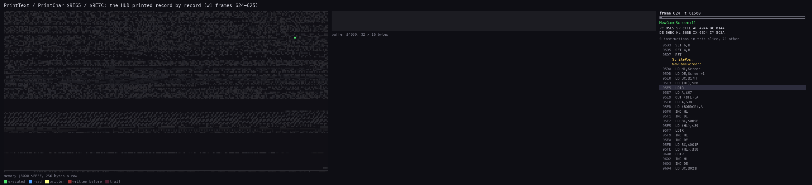

*The routine animation of the print routines (`$9E13-$9F2D`: PrintNumber, PrintDigit, PrintText, PrintChar,
PrintCharWide, CellAddress, CellAttr) in `w1` frames 624-625, one picture each 1500 instructions, 54 pictures over
8101 instructions. The view is the top 16 character rows of the screen. Command:
`python3 ../../kit/routine_anim.py --work work/docs/vpB/w1 --window 624:60000-626:0 --listing build/game.lst --out
docs/img/routines/PrintText.gif --pc 9E13-9F2D --view buffer:4000:32x16:screen --range 8000-FFFF --step 1500
--delay 120`.*

How to read the animation: the screen is blank after the clear of NewGameScreen (frames 622-624). The highlighted
lines are the print routine's instructions in each slice. The HUD appears record by record: "1up", "2up", "hi",
the blank of row 1, "frame", "shots". Then come the numbers of section 8.3.

Worked example: the HUD's "frame" record at `$96D4` is `01 11 38 05 66 72 61 6D 65`. That is row 1, column 17,
attribute `$38` (black ink on white paper, bit 7 clear), and 5 characters, "frame". PrintText calls PrintChar five
times, at columns 17 to 21. The FOUL SHOT! record at `$9CFD` has attribute `$B8`. Its bit 7 is set, so its 10
characters take columns 6-25.

Witness: PrintText ran 138 times in `game`, 449 in `w1`, 210 in `f1`, 181 in `p2`, 169 in `v1`, 144 in `m1`, 173 in
`j1` and 30 in `e1`. Its `w1` runs span frames 419-16 235 of the original recording.

The point: every string of the game, from the HUD to the menus, is one record of four bytes plus its text, drawn by
one routine.

## 8.2 PrintChar: one cell, two fonts, two widths

PrintChar `$9E7C` draws one character in one cell. It first finds the cell's screen address and writes the
attribute. Then it chooses the glyph by the character code, and draws it narrow or wide.

1. CellAddress `$9F14` turns (row, column) into the screen address of the cell's top pixel line.
2. CellAttr `$9F23` turns that address into the attribute address. The attribute is stored with bit 7 cleared. A
   wide character writes it into two cells.
3. The glyph: `$7F` is the copyright sign at `$9F2E`. `0-9` come from FontDigits `$DFC4`, and `a-z` from Font
   `$DEF4`. Any other code comes from the ROM's CHAR_SET at `$3D00`, at (code - `$20`) x 8.
4. Narrow: 8 bytes are copied down the cell. Wide: PrintCharWide `$9EDE` doubles each pixel into two bytes.

```text
PrintChar(ch, row, col, attr):
    scr = CellAddress(row, col)           ; $4000 + (row AND $18) * 256 + (row AND 7) * 32 + col
    at  = CellAttr(scr)                   ; $5800 + row * 32 + col
    at[0] = attr AND $7F
    if attr bit 7: at[1] = attr AND $7F
    if ch == $7F:            glyph = $9F2E
    elif "0" <= ch <= "9":   glyph = FontDigits + (ch - "0") * 8
    elif "a" <= ch <= "z":   glyph = Font + (ch - "a") * 8
    else:                    glyph = CHAR_SET + (ch - $20) * 8
    for line in 0..7:
        if attr bit 7: scr[line*256], scr[line*256 + 1] = Double(glyph[line])
        else:          scr[line*256] = glyph[line]
```

```text
9E80  CD 14 9F     CALL CellAddress    ; PrintChar (after PUSH HL, BC, DE, AF)
9E83  F1           POP AF
9E84  E5           PUSH HL
9E85  CD 23 9F     CALL CellAttr
9E88  41           LD B,C
9E89  CB B8        RES 7,B             ; the attribute without the width bit
9E8B  70           LD (HL),B
9E8C  CB 79        BIT 7,C
9E8E  28 02        JR Z,PrintCharCopyright
9E90  23           INC HL
9E91  70           LD (HL),B           ; the second cell of a wide character
9E92  FE 7F        CP $7F              ; PrintCharCopyright
9E94  20 07        JR NZ,PrintCharDigit
9E96  D6 7F        SUB $7F
9E98  11 2E 9F     LD DE,CopyrightGlyph
9E9B  18 23        JR PrintCharGlyph
9E9D  FE 30        CP $30              ; PrintCharDigit
9E9F  38 0B        JR C,PrintCharLower
9EA1  FE 3A        CP $3A
9EA3  30 07        JR NC,PrintCharLower
9EA5  D6 30        SUB $30
9EA7  11 C4 DF     LD DE,FontDigits
9EAA  18 14        JR PrintCharGlyph
9EAC  FE 61        CP $61              ; PrintCharLower
9EAE  38 0B        JR C,PrintCharRom
9EB0  FE 7B        CP $7B
9EB2  30 07        JR NC,PrintCharRom
9EB4  D6 61        SUB $61
9EB6  11 F4 DE     LD DE,Font
9EB9  18 05        JR PrintCharGlyph
9EBB  D6 20        SUB $20             ; PrintCharRom: any other code
9EBD  11 00 3D     LD DE,CHAR_SET
9EC0  87           ADD A,A             ; PrintCharGlyph: DE += A * 8
9EC1  26 00        LD H,$00
9EC3  6F           LD L,A
9EC4  29           ADD HL,HL
9EC5  29           ADD HL,HL
9EC6  19           ADD HL,DE
9EC7  EB           EX DE,HL
9EC8  E1           POP HL
9EC9  CB 79        BIT 7,C
9ECB  28 05        JR Z,PrintCharNarrow
9ECD  CD DE 9E     CALL PrintCharWide
9ED0  18 08        JR PrintCharDone
9ED2  06 08        LD B,$08            ; PrintCharNarrow
9ED4  1A           LD A,(DE)           ; PrintCharNarrowLoop
9ED5  77           LD (HL),A
9ED6  24           INC H
9ED7  13           INC DE
9ED8  10 FA        DJNZ PrintCharNarrowLoop

9EE1  1A           LD A,(DE)           ; PrintCharWideLoop: one glyph byte
9EE2  0F           RRCA                ; bit 0 into the carry
9EE3  CB 19        RR C                ; the carry into bit 7 of C
9EE5  CB 29        SRA C               ; bit 7 copied: one pixel is now two
                                       ; (the same three for bits 1-3 into C, then bits 4-7 into B)
9F0A  70           LD (HL),B           ; the left byte: the high nibble doubled
9F0B  23           INC HL
9F0C  71           LD (HL),C           ; the right byte: the low nibble doubled

9F14  7C           LD A,H              ; CellAddress: H = row, L = column
9F15  E6 07        AND $07
9F17  0F           RRCA
9F18  0F           RRCA
9F19  0F           RRCA                ; (row AND 7) * 32
9F1A  85           ADD A,L
9F1B  6F           LD L,A
9F1C  7C           LD A,H
9F1D  E6 F8        AND $F8             ; the third of the screen
9F1F  F6 40        OR $40
9F21  67           LD H,A
9F22  C9           RET
9F23  CB 3C        SRL H               ; CellAttr: $40-$57 to $58-$5A
9F25  CB 3C        SRL H
9F27  CB 3C        SRL H
9F29  CB F4        SET 6,H
9F2B  CB E4        SET 4,H
9F2D  C9           RET
```

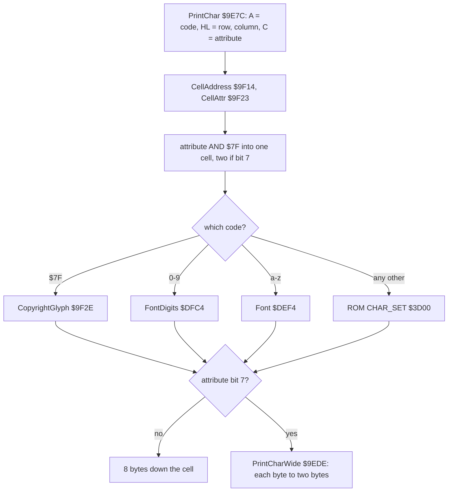

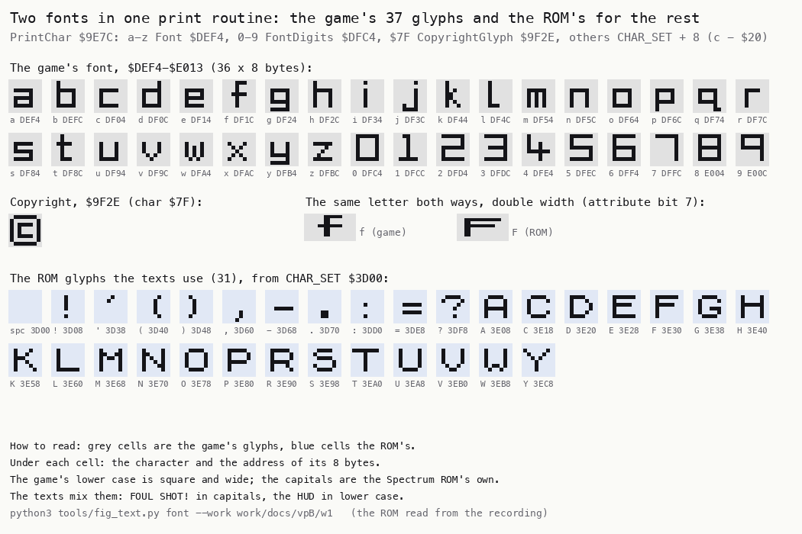

How to read the figure:

- **The grey cells** are the game's glyphs, `$DEF4-$E013`, with the character and the glyph's address under each.
- **The blue cells** are the ROM glyphs that the 75 records use: space, punctuation and capitals, from `$3D00`.
- **The middle row** shows the copyright glyph, and the letter f printed wide from both fonts. The game's square
  lower case stands beside the ROM's capital.
- **The point**: the game carries only 37 glyphs of its own: 26 letters and 10 digits at `$DEF4-$E013` and the
  copyright sign at `$9F2E`. It borrows every capital and sign from the ROM.

```bash
python3 tools/fig_text.py font --work work/docs/vpB/w1 --out docs/img/text/font.png
```

Worked example, the cell address: "frame" starts at row 1, column 17. CellAddress gives L = (1 AND 7) x 32 + 17 =
`$31` and H = (1 AND `$F8`) OR `$40` = `$40`, so `$4031`. CellAttr shifts `$40` right three times to `$08`, then sets
bits 6 and 4: `$58`. The attribute goes to `$5831`, which is `$5800` + 32 + 17.

Worked example, the wide print: the second line of the ROM's capital F (`$3E31`) is `$7E`, `01111110`. The low
nibble `1110` becomes `11111100` = `$FC` in C. The high nibble `0111` becomes `00111111` = `$3F` in B. The two bytes
on the screen are `$3F $FC`: the same shape, each pixel twice as wide.

Witness: PrintChar ran 1094 times in `game`, 4388 in `w1`, 2243 in `v1` and 2143 in `m1`. PrintCharWide ran 285
times in `w1` (frames 631-11 768) and 56 in `game`. The writers map of `w1` frames 600-700 (section 8.4) gives the
print routine's bytes: PrintCharNarrowLoop 402, PrintCharWideLoop 112, and PrintChar's attribute stores 70.

The point: one character routine serves both fonts and both widths. The attribute's FLASH bit, never wanted, becomes
the width switch.

## 8.3 Numbers: digits by subtraction, the position on the stack

PrintNumber `$9E13` prints HL in decimal, up to five digits. Bit 7 of B says whether a digit has been printed yet; a
zero digit is skipped while it is clear. So B = `$80` prints leading zeros, and B = 0 suppresses them. A value of 0
with B = 0 still prints one "0".

PrintDigit `$9E40` counts how many times the power of ten in DE fits into HL, by subtraction. Its trick is the
screen position. PrintNumber pushes the position once (PUSH DE). Each PrintDigit swaps it with its own return address
on the stack (POP HL, EX (SP),HL), prints, and swaps it back. So the position lives on the stack between the five
calls. The final POP DE of PrintNumber returns the cell after the number.

PrintHudNumber `$9DC3` picks the number by A:

| A | Number | Position | B | After it |
| ---: | --- | --- | --- | --- |
| 0 | ScorePlayer1 `$9F45` | row 0, column 3 | `$80`, leading zeros | a fixed "0" |
| 1 | ScorePlayer2 `$9F47` | row 0, column 26 | `$80` | a fixed "0" |
| 2 | HiScore `$9F49` | row 0, column 14 | `$80` | a fixed "0" |
| 3 | ShotsLeft `$9F4D` | row 1, column 31 | 0, no leading zeros | nothing |
| 4 | FrameNumber `$9F4B` | row 1, column 22 | 0 | a space |

All five use attribute `$3A`, red ink on white paper. The scores are kept in tens, and the fixed "0" multiplies them
by 10 on the screen. The space after the frame number clears a second digit.

```text
PrintNumber(HL value, DE position, B flags, C attribute):
    push position
    if B bit 7 == 0 and value == 0: B bit 7 = 1; skip to the units
    for power in 10000, 1000, 100, 10, 1:
        digit = 0
        while value >= power: value -= power; digit += 1
        if digit != 0 or B bit 7:
            B bit 7 = 1
            PrintChar("0" + digit, position, C)
            position += 1 (2 when C bit 7)
    pop position                          ; the cell after the number
```

```text
9E13  D5           PUSH DE             ; PrintNumber: the position goes to the stack
9E14  CB 78        BIT 7,B
9E16  20 08        JR NZ,PrintNumberDigits
9E18  7C           LD A,H
9E19  B5           OR L
9E1A  20 04        JR NZ,PrintNumberDigits
9E1C  CB F8        SET 7,B             ; 0 without leading zeros: one "0"
9E1E  18 18        JR PrintNumberUnits
9E20  11 10 27     LD DE,$2710         ; PrintNumberDigits: 10000
9E23  CD 40 9E     CALL PrintDigit
9E26  11 E8 03     LD DE,$03E8         ; 1000
9E29  CD 40 9E     CALL PrintDigit
9E2C  11 64 00     LD DE,$0064         ; 100
9E2F  CD 40 9E     CALL PrintDigit
9E32  11 0A 00     LD DE,$000A         ; 10
9E35  CD 40 9E     CALL PrintDigit
9E38  11 01 00     LD DE,$0001         ; PrintNumberUnits
9E3B  CD 40 9E     CALL PrintDigit
9E3E  D1           POP DE              ; DE = the cell after the number
9E3F  C9           RET
9E40  AF           XOR A               ; PrintDigit
9E41  B7           OR A                ; PrintDigitCount
9E42  ED 52        SBC HL,DE
9E44  38 03        JR C,PrintDigitShow
9E46  3C           INC A
9E47  18 F8        JR PrintDigitCount
9E49  19           ADD HL,DE           ; PrintDigitShow: the remainder back
9E4A  EB           EX DE,HL            ; DE = remainder
9E4B  E1           POP HL              ; HL = the return address
9E4C  E3           EX (SP),HL          ; HL = the position; the return address on the stack
9E4D  B7           OR A
9E4E  20 04        JR NZ,PrintDigitPrint
9E50  CB 78        BIT 7,B
9E52  28 0D        JR Z,PrintDigitDone ; a leading zero: skip it
9E54  CB F8        SET 7,B             ; PrintDigitPrint
9E56  C6 30        ADD A,$30
9E58  CD 7C 9E     CALL PrintChar
9E5B  2C           INC L
9E5C  CB 79        BIT 7,C
9E5E  28 01        JR Z,PrintDigitDone
9E60  2C           INC L
9E61  E3           EX (SP),HL          ; PrintDigitDone: the position back under the return address
9E62  EB           EX DE,HL            ; HL = remainder, DE = the return address
9E63  D5           PUSH DE
9E64  C9           RET

9DC3  06 80        LD B,$80            ; PrintHudNumber: scores with leading zeros
9DC5  0E 3A        LD C,$3A
9DC7  B7           OR A
9DC8  20 0B        JR NZ,HudNumberScore2
9DCA  2A 45 9F     LD HL,(ScorePlayer1)
9DCD  11 03 00     LD DE,$0003         ; row 0, column 3
9DD0  CD 13 9E     CALL PrintNumber
9DD3  18 1A        JR HudNumberTimesTen
                                       ; (score 2 and the hi score the same way)
9DEF  EB           EX DE,HL            ; HudNumberTimesTen: the fixed "0" after a score
9DF0  3E 30        LD A,$30
9DF2  C3 7C 9E     JP PrintChar
9DF5  06 00        LD B,$00            ; HudNumberSmall: no leading zeros
9DF7  2A 4D 9F     LD HL,(ShotsLeft)
9DFA  26 00        LD H,$00
9DFC  11 1F 01     LD DE,$011F         ; row 1, column 31
9DFF  3D           DEC A
9E00  28 11        JR Z,PrintNumber
9E02  2A 4B 9F     LD HL,(FrameNumber)
9E05  26 00        LD H,$00
9E07  11 16 01     LD DE,$0116         ; row 1, column 22
9E0A  CD 13 9E     CALL PrintNumber
9E0D  EB           EX DE,HL
9E0E  3E 20        LD A,$20            ; a space after the frame number
9E10  C3 7C 9E     JP PrintChar
```

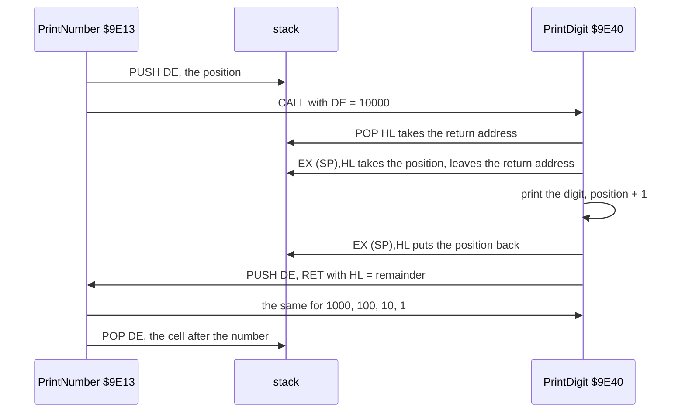

The animation of section 8.1 shows the numbers too. After the texts come the three six-digit groups of the scores and
the hi score, then the frame and shot numbers.

Worked example: the hi score at the start of `w1` is HiScore = 300 (james, section 8.8). PrintHudNumber 2 sets B =
`$80` and DE = row 0, column 14. 10000 fits 0 times, and "0" goes to column 14, because bit 7 of B is set. 1000 fits
0 times: "0" at 15. 100 fits 3 times: "3" at 16, remainder 0. Then "0" at 17 and "0" at 18. HudNumberTimesTen adds
"0" at 19. The screen reads `003000`, as in the HUD figure of section 8.4.

Witness: PrintNumber ran 420 times in `w1` (frames 625-13 732), 118 in `v1` and 16 in `game`. PrintHudNumber ran 322
times in `w1`, 92 in `v1` and 15 in `game`; in `m1`, with almost no game, 6 times.

The point: a five-digit decimal printer in 82 bytes, with the screen position kept on the stack instead of in a
register or a variable.

## 8.4 The HUD panel and its two blinks

The HUD is rows 0-1 of the screen. NewGameScreen prints six records and five numbers into it. The power box is
XorLine's ([section 6.2](06-rendering.md)), and the lives are ball sprites ([section 6.4](06-rendering.md)). Rows
2-4 below hold the messages and the row of potted balls. Rows 5 and 23 hold the pocket marks (section 8.7).

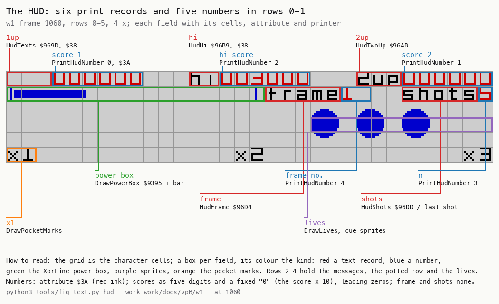

How to read the figure:

- **The grid** is the character cells of rows 0-5. Each field has a box, coloured by its kind.
- **Red boxes** are text records: "1up", "hi", "2up", "frame", "shots". **Blue boxes** are PrintHudNumber's numbers.
- **Green** is the power box drawn by XorLine. **Purple** marks the lives, drawn by DrawBall. **Orange** is a pocket
  mark.
- **The labels** name each field's record or routine.
- **The point**: the panel is built from the same records and the same number printer as every other text.

```bash
python3 tools/fig_text.py hud --work work/docs/vpB/w1 --at 1060 --out docs/img/text/hud.png
```

The panel as code against screen: the writers map of `w1` frames 600-700, the screen build of a new game.

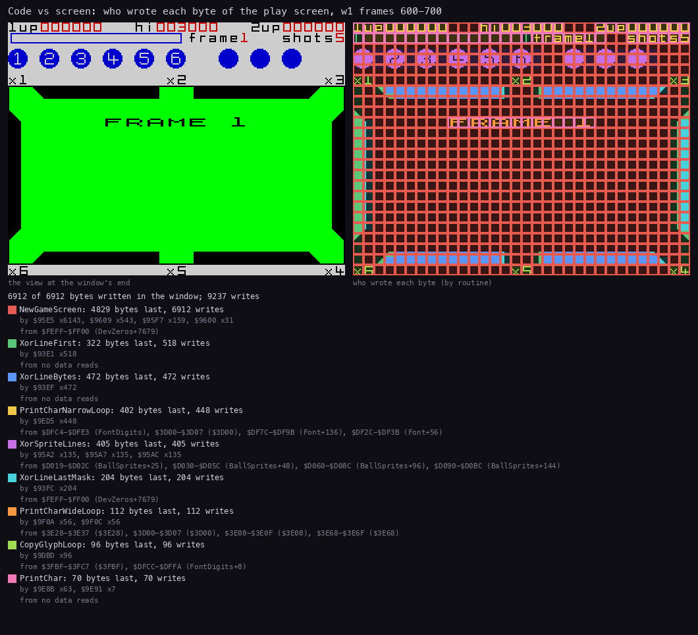

How to read the figure:

- **The right panel** colours each byte by the routine that wrote it last in frames 600-700.
- **Yellow and orange**, the print routine's narrow and wide loops, cover the HUD in rows 0-1 and the FRAME banner.
- **The legend** lists the bytes per writer and their sources: FontDigits `$DFC4` and the ROM's CHAR_SET for the
  HUD, BallSprites `$D000` for the lives.
- **The point**: rows 0-1 are written by the print routine alone, apart from XorLine's power box.

```bash
python3 ../../kit/writers_map.py --work work/docs/vpB/w1 --window 600:0-700:0 --listing build/game.lst --out docs/img/render/writers-build.png --view screen --sources
```

Two HUD fields blink while a shot is aimed and while the balls run. StartAim adds, among its periodic tasks in the
scheduler ([section 4.4](04-game-loop.md)), UpBlinkTask `$96E6` with period 20 and ShotsBlinkTask `$970E` with period
25. A task of period p runs every p + 1 ticks (RunTasks `$9155`, [Terms](README.md#terms)), so they run every 21 and
every 26 ticks: `f1`'s last-shot beeps, from LastShotBeepTask with the same period 25, come every 26 frames (2667, 2693,
2719, ...).

- **UpBlinkTask** prints "1up" (or "2up") or three spaces, by the flag UpBlink `$9B31`, then inverts the flag. So
  the current player's label flashes with a period of 42 ticks.
- **ShotsBlinkTask** does nothing unless ShotsLeft is 1. On the last shot it alternates the records "last  " `$9740`
  and "  shot" `$974A` over "shots n" (row 1, columns 26-31).
- **StopShotTasks** removes both tasks at the end of a shot. It runs each once more with its flag at `$FF`: "1up" is
  shown, and "shots" with its number is restored.

```text
UpBlinkTask:                          ; period 20: every 21 ticks
    record = (UpBlink != 0) ? "1up" : "   "    ; "2up" / "   " for player 2
    PrintText(record)
    UpBlink = NOT UpBlink

ShotsBlinkTask:                       ; period 25: every 26 ticks
    if ShotsLeft != 1: return
    if LastShotBlink == $FF: PrintText("shots"); PrintHudNumber(3); LastShotBlink = 0; return
    PrintText(LastShotBlink == 0 ? "last  " : "  shot")
    LastShotBlink = (LastShotBlink + 1) AND 1
```

```text
96E6  3A 30 9B     LD A,(CurrentPlayer)   ; UpBlinkTask
96E9  3D           DEC A
96EA  3A 31 9B     LD A,(UpBlink)
96ED  20 0B        JR NZ,UpBlinkPlayer2
96EF  21 9D 96     LD HL,HudTexts         ; "1up"
96F2  B7           OR A
96F3  20 03        JR NZ,UpBlinkPrint1
96F5  21 A4 96     LD HL,HudOneUpBlank    ; "   "
96F8  18 09        JR UpBlinkPrint
96FA  21 AB 96     LD HL,HudTwoUp         ; UpBlinkPlayer2
96FD  B7           OR A
96FE  20 03        JR NZ,UpBlinkPrint
9700  21 B2 96     LD HL,HudTwoUpBlank
9703  CD 65 9E     CALL PrintText         ; UpBlinkPrint
9706  3A 31 9B     LD A,(UpBlink)
9709  2F           CPL
970A  32 31 9B     LD (UpBlink),A
970D  C9           RET
970E  3A 4D 9F     LD A,(ShotsLeft)       ; ShotsBlinkTask
9711  3D           DEC A
9712  C0           RET NZ                 ; only on the last shot
9713  3A 32 9B     LD A,(LastShotBlink)
9716  FE FF        CP $FF
9718  28 16        JR Z,ShotsBlinkRestore
971A  21 40 97     LD HL,HudLastShot      ; "last  "
971D  B7           OR A
971E  28 03        JR Z,ShotsBlinkPrint
9720  21 4A 97     LD HL,HudShot          ; "  shot"
9723  CD 65 9E     CALL PrintText         ; ShotsBlinkPrint
9726  3A 32 9B     LD A,(LastShotBlink)
9729  3C           INC A
972A  E6 01        AND $01
972C  32 32 9B     LD (LastShotBlink),A
972F  C9           RET
9730  21 DD 96     LD HL,HudShots         ; ShotsBlinkRestore: "shots"
9733  CD 65 9E     CALL PrintText
9736  3E 03        LD A,$03
9738  CD C3 9D     CALL PrintHudNumber
973B  AF           XOR A
973C  32 32 9B     LD (LastShotBlink),A
973F  C9           RET
```

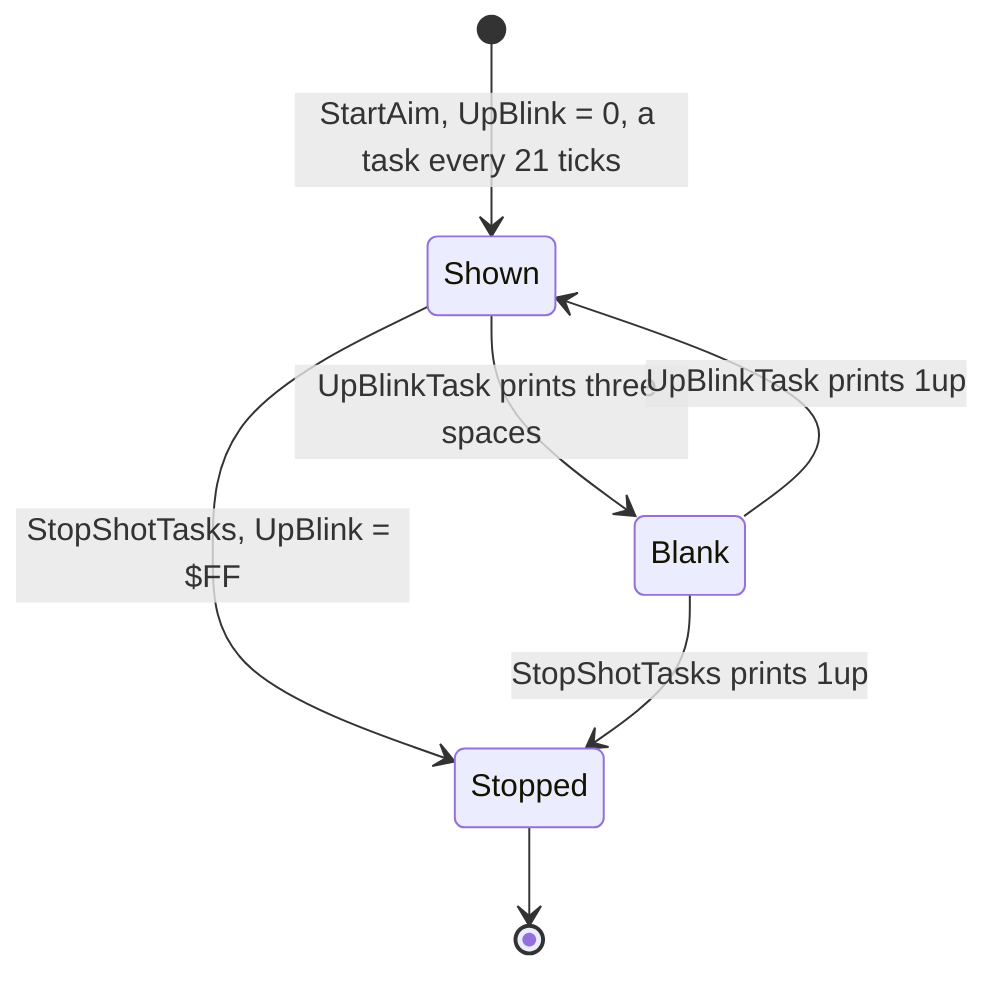

Worked example: in `w1` the first aim starts at frame 877 with UpBlink = 0. The first UpBlinkTask call prints the
three spaces; the next, 21 ticks later, prints "1up" again. UpBlinkTask ran 377 times in `w1` over 21 shots, about
18 calls a shot, so the label flashed about 9 times in each aim and run.

Witness: UpBlinkTask ran 377 times in `w1`, 88 in `game` and 145 in `f1`. ShotsBlinkTask ran 308 times in `w1`, but
it printed the "last shot" records only in `f1` (15 times, `$9723`). `f1` is the one recording that reached a last
shot with the tasks running.

The point: the HUD is static text plus two scheduler tasks that blink it. Nothing redraws the panel each frame.

## 8.5 The tally: the score of a shot, term by term

After each shot with a pot, ScoreTally `$98FF` scores it. Each potted ball gives one term: frame number x ball
number x pocket multiplier. The tally prints the terms in the message rows, one factor every 15 video frames (TallyPause
`$9B07`). Then it counts the sum into the player's score with a rising beep.

1. For each ball record with a pocket (+`$0C` not 0), the term is FrameNumber x PotBall x PotMultiplier (AddTerm
   `$9A67`, MultiplyTerm `$9B0D`, a 16 x 8-bit shift-and-add). The multiplier is PocketTurn + pocket, wrapped to
   1-6 (section 8.7). The sum goes into ShotScore `$9B2C`. Before anything is printed, the first potted ball found
   waits 15 frames (TallyPause) and clears the message rows (ClearMessageRows `$94EB`, unless MessagesTask is at
   step `$4F`). Each further ball first prints the term before it with "+" (TallyTermPlus `$9A01`), waits 15 frames
   and clears the rows again.
2. PrintTerm `$9A87` prints each term as "f x b x m x 10", wide, attribute `$B8`, with a TallyPause after each
   factor. With more than one ball, "+" goes between the terms (TallyTermPlus `$9A01`). After the last comes "=" and
   the sum with its fixed "0" (TallyTermTotal `$9A1A`), centred by the number of digits.
3. TallyCount `$9975` sets TallyPitch to 1200 (`$04B0`). The step is round(ShotScore / 128) + 1: the high byte of
   2 x ShotScore, plus bit 6 as the carry, plus 1 (step 1 for ShotScore 0-63, 2 for 64-191, 3 for 192-319). Each
   step subtracts it from ShotScore, adds it to the score (AddScoreStep `$99C1`), prints the score, beeps, and waits
   a frame. The pitch value falls by 10 each step. The rest, 0 included, goes in one more step with its beep. The
   count takes at least 45 frames; the rest is waited out. More than 45 steps needs ShotScore 46 or more (at most
   127 steps, from ShotScore 8255); then `JP M` skips the wait. No recording got there: the largest ShotScore was 36.
4. Then the message rows are cleared, the potted row is redrawn, the shots for the frame are reset, and the tally
   waits 5 more frames (TallyEndWait `$99BB`) before it returns.

For k potted balls the tally takes 20 + 60 k + max(steps, 45) frames: 15 for the first ball's pause, 60 for each
term (three factors and one pause of 15), the count, and 5 at the end. The count's first beep can lose an interrupt
and add a frame ([section 9.4](09-sound.md)): `w1`'s first tally runs from frame 1254 to 1380, 126 frames.

```text
ScoreTally:
    ShotScore = 0
    if no ball 1..6 has a pocket: return
    HALT 15 times; ClearMessageRows() unless MessageStep == $4F    ; the first ball's TallyPause
    for each further ball with a pocket:                           ; TallyTermPlus
        AddTerm(the ball before); print its term, 15 frames a factor; print "+"
        HALT 15 times; ClearMessageRows()
    AddTerm(the last ball); print its term, 15 frames a factor     ; TallyTermTotal
    HALT 15 times; print "=", ShotScore and "0"
    TallyPitch = 1200
    step = (ShotScore >> 7) + bit 6 of ShotScore + 1                ; round(ShotScore / 128) + 1
    frames = 45
    while ShotScore >= step:
        ShotScore -= step; AddScoreStep(step); HALT; frames -= 1
    AddScoreStep(ShotScore)                ; the remainder, maybe 0
    if frames > 0: HALT frames times       ; skipped past 45 steps (JP M)
    clear the message rows; DrawPottedRow; ShotsLeft = ShotsForFrame()
    HALT 5 times                           ; TallyEndWait $99BB

AddTerm(ball):
    ShotScore += FrameNumber * ball * ((PocketTurn + pocket - 1) mod 6 + 1)

AddScoreStep(n):
    score[current player] += n
    PrintHudNumber(current player - 1)
    BEEPER(pitch = TallyPitch, DE = 6000 / TallyPitch)       ; DE + 1 cycles: a beep of 13.1-15.5 ms
    TallyPitch -= 10
```

```text
9975  21 B0 04     LD HL,$04B0         ; TallyCount: the pitch starts at 1200
9978  22 34 9B     LD (TallyPitch),HL
997B  2A 2C 9B     LD HL,(ShotScore)
997E  CB 25        SLA L
9980  CB 14        RL H
9982  7C           LD A,H              ; A = ShotScore * 2 / 256
9983  CB 25        SLA L
9985  CE 01        ADC A,$01           ; + bit 6 (the carry) + 1: round(ShotScore / 128) + 1
9987  16 00        LD D,$00
9989  5F           LD E,A
998A  06 2D        LD B,$2D            ; 45 frames
998C  2A 2C 9B     LD HL,(ShotScore)   ; TallyCountStep
998F  AF           XOR A
9990  ED 52        SBC HL,DE
9992  38 0A        JR C,TallyCountLast
9994  22 2C 9B     LD (ShotScore),HL
9997  CD C1 99     CALL AddScoreStep
999A  76           HALT
999B  05           DEC B
999C  18 EE        JR TallyCountStep
999E  ED 5B 2C 9B  LD DE,(ShotScore)   ; TallyCountLast: the remainder
99A2  CD C1 99     CALL AddScoreStep
99A5  78           LD A,B
99A6  B7           OR A
99A7  28 06        JR Z,TallyDone
99A9  FA AF 99     JP M,TallyDone      ; the count took longer than 45 frames
99AC  76           HALT                ; TallyWaitRest
99AD  10 FD        DJNZ TallyWaitRest
99AF  CD EB 94     CALL ClearMessageRows ; TallyDone
99B2  CD B5 9A     CALL DrawPottedRow
99B5  CD E6 9B     CALL ShotsForFrame
99B8  32 4D 9F     LD (ShotsLeft),A
99BB  06 05        LD B,$05            ; 5 frames more
99BD  76           HALT                ; TallyEndWait
99BE  10 FD        DJNZ TallyEndWait
99C0  C9           RET

99C1  3A 30 9B     LD A,(CurrentPlayer) ; AddScoreStep
99C4  3D           DEC A
99C5  20 09        JR NZ,AddScorePlayer2
99C7  2A 45 9F     LD HL,(ScorePlayer1)
99CA  19           ADD HL,DE
99CB  22 45 9F     LD (ScorePlayer1),HL
99CE  18 07        JR AddScorePrint
                                       ; (AddScorePlayer2 the same on ScorePlayer2)
99D7  C5           PUSH BC             ; AddScorePrint
99D8  D5           PUSH DE
99D9  CD C3 9D     CALL PrintHudNumber ; A = player - 1: the score field
99DC  21 70 17     LD HL,$1770         ; 6000
99DF  ED 4B 34 9B  LD BC,(TallyPitch)
99E3  11 FF FF     LD DE,$FFFF
99E6  13           INC DE              ; AddScoreCycles: DE = 6000 / pitch
99E7  B7           OR A
99E8  ED 42        SBC HL,BC
99EA  30 FA        JR NC,AddScoreCycles
99EC  2A 34 9B     LD HL,(TallyPitch)
99EF  CD B5 03     CALL BEEPER         ; the ROM beeper
99F2  2A 34 9B     LD HL,(TallyPitch)
99F5  11 F6 FF     LD DE,$FFF6
99F8  19           ADD HL,DE           ; pitch - 10
99F9  30 03        JR NC,AddScoreDone
99FB  22 34 9B     LD (TallyPitch),HL
```

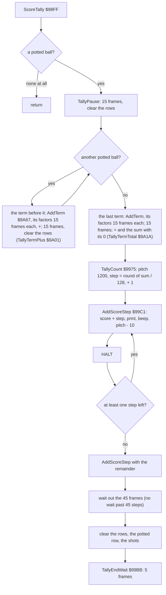

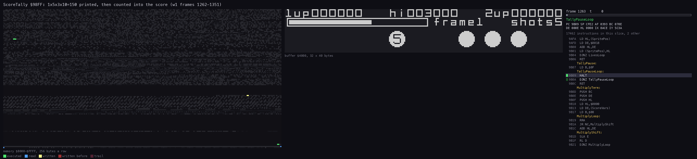

*The routine animation of ScoreTally and its helpers (`$98FF-$9B33`) in `w1` frames 1262-1352, one picture a frame,
90 pictures. The view is the top 40 pixel lines of the screen. Command:
`python3 ../../kit/routine_anim.py --work work/docs/vpB/w1 --window 1262:0-1352:0 --listing build/game.lst --out
docs/img/routines/ScoreTally.gif --pc 98FF-9B33 --view buffer:4000:32x40:screen --range 8000-FFFF --step 69888
--delay 100`.*

How to read the animation: the highlighted lines are the instructions run in each frame. For the first 67 frames
only TallyPause's HALT loop is lit (75 from the tally's start at 1254: 15 for the first ball, then 15 after each of
"1", "5", "3" and "10"), while "1x", "5x", "3x" and "10" appear one by one in row 3. Then "=150" appears. The
count loop lights up while the score field in row 0 counts from `000000` to `000150`.

Worked example: the first pot of `w1` is ball 5 in pocket 3 on frame 1, with PocketTurn 0, so the multiplier is 3. The
term is 1 x 5 x 3 = 15. AddTerm runs at frame 1269, after the first ball's 15 frames from 1254; ShotScore is 15 in the
sample of 1272 (`work/docs/vpB/w1-tally.json`, one sample every 4 frames, each the memory at the start of its frame).
The screen shows "1x5x3x10=150". The step is round(15 / 128) + 1 = 1 (15 >> 7 is 0, bit 6 is clear). Fifteen steps of 1
take ShotScore to 0, then the remainder step adds 0: 16 calls of AddScoreStep, 16 beeps, from frame 1329; the first
loses the interrupt of 1330 (section 9.4), so the 45 frames of the count end at 1375, where DrawPottedRow runs, and the
tally returns at 1380. The samples:

| Frame | ScorePlayer1 | ShotScore | TallyPitch |
| ---: | ---: | ---: | ---: |
| 1272 | 0 | 15 | - |
| 1332 | 2 | 13 | 1180 |
| 1336 | 6 | 9 | 1140 |
| 1340 | 10 | 5 | 1100 |
| 1344 | 14 | 1 | 1060 |
| 1348 | 15 | 0 | 1040 |

The pitch value fell 16 times, from 1200 to 1040 (`$0410`). The HUD shows the score as `000150`.

Witness: ScoreTally ran 21 times in `w1`, 4 in `game` and 9 in `f1`. TallyTermTotal ran 17 times in `w1`, once per
shot with a pot. TallyTermPlus ran once, at frame 4588: two balls in one shot. AddScoreStep ran 287 times in `w1`,
frames 1329-10 175, and 72 times in `v1`.

The point: the score is told, not just added. Each factor stays on the screen for 15 frames, and the count beeps
down the scale as the score climbs.

## 8.6 The messages and the banners

Four kinds of message appear over the table, all as wide print records:

- **The fouls**, in row 3, by MessagesTask `$9CB7`: FOUL SHOT! (FoulCode 1), WRONG ORDER! (2, variation 1) and
  WRONG POCKET! (3, variation 2). [Section 10.9](10-gameplay-logic.md) gives the rules that set FoulCode `$8E80`.
- **The FRAME banner**, by ShowFrameBanner `$9B36`: "FRAME n" in row 9 (row 11 under a PLAYER banner), for 75
  frames.
- **The PLAYER banner**, by PlayerBanner `$9C7B`: "PLAYER 1" or "PLAYER 2" in row 9, only with two players.
- **GAME OVER**, by GameOver `$97A2`, in row 9, with "PLAYER n" under it in a two-player game.

MessagesTask is a moving task ([section 4](04-game-loop.md)). It runs once a frame while the balls run, and
WaitMessages runs it on after they stop. It steps MessageStep `$9F50`. With no foul, MessageStep stays 0 and
nothing is printed.

| MessageStep | What the task does |
| ---: | --- |
| 0 | if FoulCode is set, go to 1 |
| 1 | clear the three message rows (ClearMessageRows `$94EB`) |
| 2 | print the foul's record |
| 3-`$4D` | nothing: the message stays 75 frames |
| `$4E` | clear the message rows again |
| `$4F` | redraw the row of potted balls (DrawPottedRow `$9AB5`) |
| `$50` | stop: the step stays here |

```text
MessagesTask:                         ; once a frame
    if MessageStep == 0:
        if FoulCode == 0: return
    elif MessageStep == 1:   ClearMessageRows()
    elif MessageStep == 2:   PrintText(FoulTexts[FoulCode])
    elif MessageStep < $4E:  pass
    elif MessageStep == $4E: ClearMessageRows()
    elif MessageStep == $4F: DrawPottedRow()
    else: return                          ; $50: no increment
    MessageStep += 1
```

```text
9CB7  3A 50 9F     LD A,(MessageStep)  ; MessagesTask
9CBA  B7           OR A
9CBB  28 33        JR Z,MessageIdle
9CBD  21 F5 9C     LD HL,MessageNextStep
9CC0  E5           PUSH HL             ; every step below returns into the increment
9CC1  FE 01        CP $01
9CC3  CA EB 94     JP Z,ClearMessageRows
9CC6  FE 02        CP $02
9CC8  20 17        JR NZ,MessageLaterSteps
9CCA  3A 80 8E     LD A,(FoulCode)
9CCD  21 FD 9C     LD HL,FoulTexts     ; FOUL SHOT!
9CD0  FE 01        CP $01
9CD2  28 0A        JR Z,MessagePrint
9CD4  21 0B 9D     LD HL,WrongOrderText
9CD7  FE 02        CP $02
9CD9  28 03        JR Z,MessagePrint
9CDB  21 1B 9D     LD HL,WrongPocketText
9CDE  C3 65 9E     JP PrintText        ; MessagePrint
9CE1  FE 4E        CP $4E              ; MessageLaterSteps
9CE3  D8           RET C
9CE4  FE 4E        CP $4E
9CE6  CA EB 94     JP Z,ClearMessageRows
9CE9  FE 4F        CP $4F
9CEB  CA B5 9A     JP Z,DrawPottedRow
9CEE  E1           POP HL              ; $50: drop the increment
9CEF  C9           RET
9CF0  3A 80 8E     LD A,(FoulCode)     ; MessageIdle
9CF3  B7           OR A
9CF4  C8           RET Z
9CF5  3A 50 9F     LD A,(MessageStep)  ; MessageNextStep
9CF8  3C           INC A
9CF9  32 50 9F     LD (MessageStep),A
9CFC  C9           RET
```

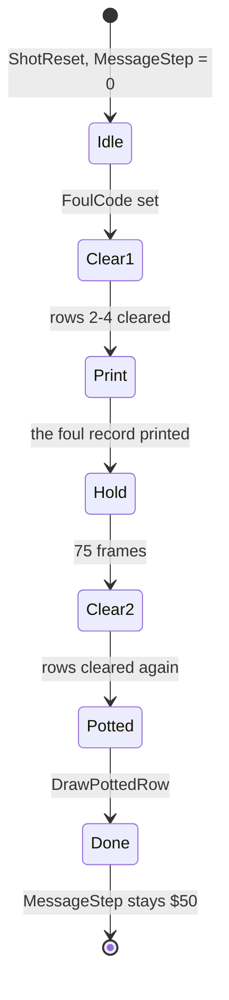

The FRAME banner patches its own record. ShowFrameBanner writes the row into `$9B8E`: 9, or 11 when it finds pixels
in row 9, column 8 (a PLAYER banner). It writes the column: 9, or 8 for a two-digit frame. It prints "FRAME ", then
the number, wide, with PrintNumber. It waits 75 frames and blanks rows 9 and 11 with the 28-space record `$9B98`,
whose row it patches too. The records figure of section 8.1 shows FOUL SHOT!, GAME OVER and the FRAME banner as
bytes.

Worked example: every foul of `w1` is a FOUL SHOT! (FoulCode 1). Step 1 clears rows 2-4. Step 2 prints
`03 06 B8 0A "FOUL SHOT!"`: row 3, columns 6-25, black ink on white, wide. 75 frames later, step `$4E` clears the
rows, and step `$4F` redraws the potted balls.

Witness: MessagePrint ran 4 times in `w1` and in `game`, 3 times in `f1` and in `v1`. Only `v1` reached the other
texts: WRONG POCKET! twice (`$9CDB`) and WRONG ORDER! once. ShowFrameBanner ran 4 times in `w1` (frames 630-10 271),
once per frame of the game. PlayerBanner ran in every game but returned at once, with one player. GameOver ran once
in `w1`, at frame 11 768. MessagesTask ran 3159 times in `w1`.

The point: one counter in a frame task shows, holds and removes a message, so the balls keep running underneath.

## 8.7 The pocket multiplier marks

Six marks beside the pockets show each pocket's multiplier: an "x" from the ROM and a digit 1-6 from FontDigits.
DrawPocketMarks `$9D6B` copies them straight to the screen with CopyGlyph `$9DB4`, not through PrintChar. The digit
for each pocket is PocketTurn `$9F43` + 1, and PocketTurn steps (mod 6) after each mark. So six marks bring
PocketTurn back to where it started. Each new frame (NextFrame) decrements PocketTurn before the redraw, so the
multipliers move one pocket on.

| Pocket | Screen | Cell |
| ---: | --- | --- |
| 1 | `$40A0` | row 5, column 0 |
| 2 | `$40AF` | row 5, column 15 |
| 3 | `$40BE` | row 5, column 30 |
| 4 | `$50FE` | row 23, column 30 |
| 5 | `$50EF` | row 23, column 15 |
| 6 | `$50E0` | row 23, column 0 |

From `$4800` up, CopyGlyph starts one byte early (DEC DE). So the bottom marks are lowered one pixel line: the
cell's top line gets the byte before the glyph, and the glyph's last line is not copied.

```text
DrawPocketMarks:
    for pocket in 1..6 (clockwise from the top left):
        CopyGlyph(cell, ROM "x" at $3FC0)
        CopyGlyph(cell + 1, FontDigits + (PocketTurn + 1) * 8)
        PocketTurn = (PocketTurn + 1) mod 6

multiplier(pocket) = PocketTurn + pocket, minus 6 when above 6      ; in ScoreTally
```

```text
9D6B  21 A0 40     LD HL,Screen+160    ; DrawPocketMarks: pocket 1, row 5 column 0
9D6E  CD 8C 9D     CALL PrintPocketMark
9D71  21 AF 40     LD HL,Screen+175
9D74  CD 8C 9D     CALL PrintPocketMark
9D77  21 BE 40     LD HL,Screen+190
9D7A  CD 8C 9D     CALL PrintPocketMark
9D7D  21 FE 50     LD HL,Screen+4350
9D80  CD 8C 9D     CALL PrintPocketMark
9D83  21 EF 50     LD HL,Screen+4335
9D86  CD 8C 9D     CALL PrintPocketMark
9D89  21 E0 50     LD HL,Screen+4320   ; pocket 6 falls through
9D8C  11 C0 3F     LD DE,CHAR_SET+$02C0 ; PrintPocketMark: the ROM's "x"
9D8F  E5           PUSH HL
9D90  CD B4 9D     CALL CopyGlyph
9D93  E1           POP HL
9D94  2C           INC L
9D95  3A 43 9F     LD A,(PlayerVars)   ; PocketTurn
9D98  3C           INC A
9D99  87           ADD A,A
9D9A  87           ADD A,A
9D9B  87           ADD A,A
9D9C  11 C4 DF     LD DE,FontDigits    ; "0" + 8 * (PocketTurn + 1)
9D9F  83           ADD A,E
9DA0  5F           LD E,A
9DA1  30 01        JR NC,PocketMarkDigit
9DA3  14           INC D
9DA4  CD B4 9D     CALL CopyGlyph      ; PocketMarkDigit
9DA7  3A 43 9F     LD A,(PlayerVars)
9DAA  3C           INC A
9DAB  FE 06        CP $06
9DAD  38 01        JR C,PocketMarkStore
9DAF  AF           XOR A
9DB0  32 43 9F     LD (PlayerVars),A   ; PocketMarkStore
9DB3  C9           RET
9DB4  7C           LD A,H              ; CopyGlyph
9DB5  FE 48        CP $48
9DB7  38 01        JR C,CopyGlyphStart
9DB9  1B           DEC DE              ; below the top third: one line higher
9DBA  06 08        LD B,$08            ; CopyGlyphStart
9DBC  1A           LD A,(DE)           ; CopyGlyphLoop
9DBD  77           LD (HL),A
9DBE  13           INC DE
9DBF  24           INC H
9DC0  10 FA        DJNZ CopyGlyphLoop
9DC2  C9           RET
```

```mermaid
flowchart LR
    T0["PocketTurn T"] --> P1["pocket 1 top left: T+1"]
    P1 --> P2["pocket 2 top middle: T+2"]
    P2 --> P3["pocket 3 top right: T+3"]
    P3 --> P4["pocket 4 bottom right: T+4"]
    P4 --> P5["pocket 5 bottom middle: T+5"]
    P5 --> P6["pocket 6 bottom left: T+6"]
    P6 --> T1["PocketTurn back to T; the digits wrap from 7 to 1"]
    T1 --> NF["NextFrame: T - 1, each digit moves one pocket on"]
```

The HUD figure of section 8.4 shows the top three marks at frame 1060: x1, x2 and x3 at columns 0, 15 and 30 of row
5.

Worked example: on frame 1 PocketTurn is 0, so the marks read x1 x2 x3 along the top, and x4 x5 x6 from the bottom
right to the bottom left. On frame 2 NextFrame sets PocketTurn to 5. Then pocket 1 reads x6, pocket 2 x1 and pocket
3 x2. The first pot of `w1`, ball 5 in pocket 3 on frame 1, scores multiplier 0 + 3 = 3 (section 8.5). The writers
map of section 8.4 counts CopyGlyphLoop's bytes in frames 600-700: 96, which is 6 marks x 2 glyphs x 8 lines.

Witness: DrawPocketMarks ran 7 times in `w1` (frames 630-11 385): once at the start, then for each new frame or turn.
It ran 4 times in `game` and 5 in `v1`.

The point: the multipliers rotate round the table every frame, and the same PocketTurn that draws them computes the
score.

## 8.8 The hall of fame

The hall of fame keeps three names and scores in HofTable `$AC08`: three slots of 71 bytes. It is not saved. Every
load brings back the defaults james 300, francis 200 and bill 100 (shown 3000, 2000 and 1000).

| Offset | Bytes | Meaning |
| ---: | ---: | --- |
| +0 | 2 | score, in tens |
| +2 | 7 | name, padded with spaces |
| +9 | 2 | flag x, y |
| +`$0B` | 2 | pole x, y |
| +`$0D` | 1 | attribute of the flag |
| +`$0E` | 1 | the flag moves (set when a new score beats the slot) |
| +`$0F` | 56 | the name's bitmap, 7 bytes x 8 lines |

After GAME OVER, GameOverHallOfFame `$A702` clears the three move flags. It counts the slots the new score beats
with CountBeaten `$A7EB`, from the lowest slot up. TestSlot `$A802` computes score - slot - 1 (SBC with the carry
set), so a tie does not beat a slot. At the first slot not beaten, TestSlot drops its own return address (POP DE)
and returns straight from CountBeaten. A count of 0 returns at once. Otherwise:

1. The name entry ([section 5.7](05-controls.md)) takes the name.
2. ShowAndSlideDown `$A86D` shows the table and slides the beaten flags down.
3. InsertEntry `$A817` moves the table.
4. SlideFlagsUp `$A8C7` raises the flags.

InsertEntry moves only the first 9 bytes of a slot: the score and the name. The flag, the pole, the colour and the
bitmap stay with the screen place. RenderName `$AADF` then rebuilds each slot's bitmap from its name.

```text
CountBeaten(score):                   ; slots 3, 2, 1
    n = 0
    for slot in 3, 2, 1:
        if score - slot.score - 1 < 0: return n      ; ties do not beat
        n += 1; slot.moves = 1
    return n

InsertEntry(entry):                   ; entry = score and name, 9 bytes
    if entry.score == 0: return
    n = CountBeaten(entry.score)
    if n >= 2: slot3[0..8] = slot2[0..8]
    if n == 3: slot2[0..8] = slot1[0..8]
    slot(4 - n)[0..8] = entry
    RenderName(slot1); RenderName(slot2); RenderName(slot3)
```

```text
A7EB  AF           XOR A               ; CountBeaten
A7EC  DD 21 96 AC  LD IX,HofSlot3
A7F0  CD 02 A8     CALL TestSlot
A7F3  DD 21 4F AC  LD IX,HofSlot2
A7F7  CD 02 A8     CALL TestSlot
A7FA  DD 21 08 AC  LD IX,HofTable
A7FE  CD 02 A8     CALL TestSlot
A801  C9           RET
A802  DD 5E 00     LD E,(IX+$00)       ; TestSlot
A805  DD 56 01     LD D,(IX+$01)
A808  E5           PUSH HL
A809  37           SCF
A80A  ED 52        SBC HL,DE           ; score - slot - 1
A80C  E1           POP HL
A80D  30 02        JR NC,SlotBeaten
A80F  D1           POP DE              ; not beaten: drop the return into CountBeaten
A810  C9           RET                 ; and return from CountBeaten itself
A811  3C           INC A               ; SlotBeaten
A812  DD 36 0E 01  LD (IX+$0E),$01
A816  C9           RET
A817  1A           LD A,(DE)           ; InsertEntry: DE = the new score and name
A818  6F           LD L,A
A819  13           INC DE
A81A  1A           LD A,(DE)
A81B  67           LD H,A
A81C  1B           DEC DE
A81D  7C           LD A,H
A81E  B5           OR L
A81F  C8           RET Z               ; no score, no entry
A820  D5           PUSH DE
A821  CD EB A7     CALL CountBeaten
A824  F5           PUSH AF
A825  3D           DEC A
A826  28 19        JR Z,InsertCopy
A828  21 4F AC     LD HL,HofSlot2      ; beaten 2 or 3: slot 2 down to slot 3
A82B  11 96 AC     LD DE,HofSlot3
A82E  01 09 00     LD BC,$0009
A831  ED B0        LDIR
A833  3D           DEC A
A834  28 0B        JR Z,InsertCopy
A836  21 08 AC     LD HL,HofTable      ; beaten 3: slot 1 down to slot 2
A839  11 4F AC     LD DE,HofSlot2
A83C  01 09 00     LD BC,$0009
A83F  ED B0        LDIR
A841  F1           POP AF              ; InsertCopy: DE = the slot the rank frees
A842  11 96 AC     LD DE,HofSlot3
A845  3D           DEC A
A846  28 09        JR Z,InsertStore
A848  11 4F AC     LD DE,HofSlot2
A84B  3D           DEC A
A84C  28 03        JR Z,InsertStore
A84E  11 08 AC     LD DE,HofTable
A851  E1           POP HL              ; InsertStore
A852  01 09 00     LD BC,$0009
A855  ED B0        LDIR
```

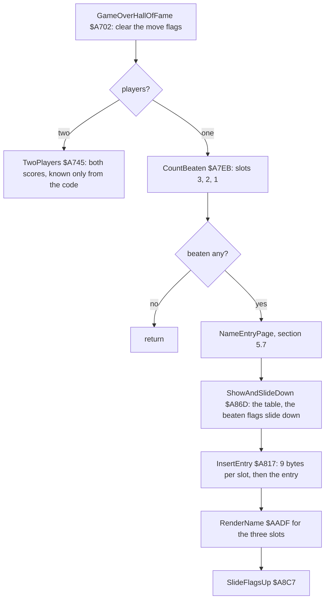

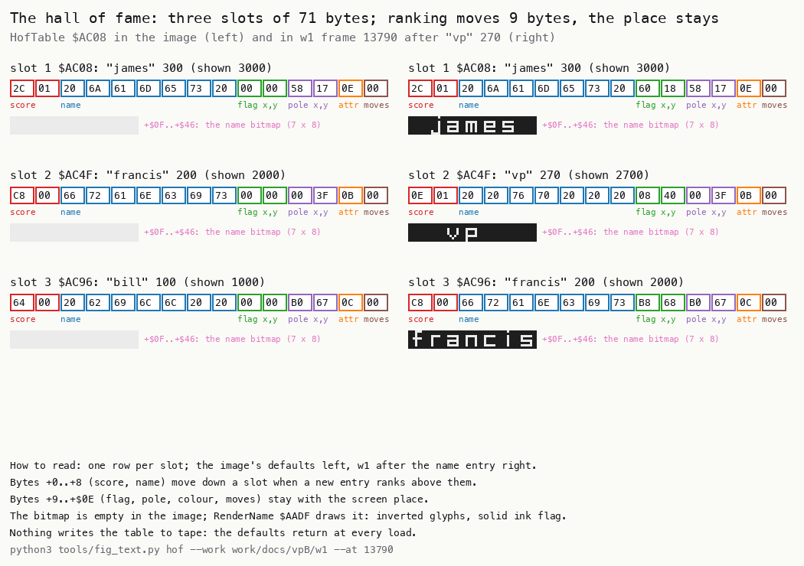

How to read the figure:

- **Each row** is one slot. The left half is the image's defaults; the right half is `w1` at frame 13 790.
- **The boxes** are the first 15 bytes, coloured by field: score red, name blue, flag green, pole purple, attribute
  orange, move flag brown. Under them is the 56-byte name bitmap at 3 x.
- **The point**: the score and the name move between slots. The flag, the pole and the colour stay in place, and the
  bitmap is rebuilt.

```bash
python3 tools/fig_text.py hof --work work/docs/vpB/w1 --at 13790 --out docs/img/text/hof.png
```

Worked example: `w1` ends with ScorePlayer1 = 270 (shown 2700). CountBeaten tests slot 3: 270 - 100 - 1 >= 0, so it
is beaten, A = 1. Slot 2: 270 - 200 - 1 >= 0, beaten, A = 2. Slot 1: 270 - 300 - 1 < 0, so TestSlot pops the return
address and CountBeaten returns 2. InsertEntry copies francis 200 from slot 2 to slot 3; bill is gone. Then it stores
"vp" 270 in slot 2. On the right of the figure, slot 2 reads `0E 01` (270) and "  vp   ", and slot 3 reads `C8 00`
(200) and "francis". Slot 3 keeps its pole `B0 67` and attribute `0C`.

Witness: GameOverHallOfFame ran once in `game` (frame 9061), in `w1` (12 018) and in `f1` (4695). Only `w1`
qualified: CountBeaten ran twice (frames 12 018 and 13 553), ShowHallOfFame once (13 368-13 374), InsertEntry once
(13 553) and RenderName 6 times. The two-player path `$A745-$A7E8` is not executed in any recording.

The point: three slots in fixed screen places. Ranking a new score is a 9-byte shuffle, and the table is lost at
every load.

## 8.9 Every string: the data sheet of the print records

The 75 records of the game, in address order. An attribute of `$80` and up is the wide print. The texts of spaces
are blanks that erase a field.

| Address | Row, col | Attr | Text | Printed by |
| --- | --- | --- | --- | --- |
| `$969D` | 0, 0 | `$38` | 1up | NewGameScreen, UpBlinkTask |
| `$96A4` | 0, 0 | `$39` | (3 spaces) | UpBlinkTask |
| `$96AB` | 0, 23 | `$38` | 2up | NewGameScreen, UpBlinkTask |
| `$96B2` | 0, 23 | `$39` | (3 spaces) | UpBlinkTask |
| `$96B9` | 0, 12 | `$38` | hi | NewGameScreen |
| `$96BF` | 1, 0 | `$39` | (17 spaces) | NewGameScreen: row 1 under the power box |
| `$96D4` | 1, 17 | `$38` | frame | NewGameScreen |
| `$96DD` | 1, 26 | `$38` | shots | NewGameScreen, ShotsBlinkTask |
| `$9740` | 1, 26 | `$38` | "last  " | ShotsBlinkTask |
| `$974A` | 1, 26 | `$38` | "  shot" | ShotsBlinkTask |
| `$9890` | 9, 7 | `$E0` | GAME OVER | GameOver |
| `$989D` | 11, 8 | `$E0` | PLAYER 1 | GameOver, two players |
| `$98A9` | 11, 8 | `$E0` | PLAYER 2 | GameOver, two players |
| `$9B8E` | patched | `$E0` | "FRAME " | ShowFrameBanner |
| `$9B98` | patched, 2 | `$60` | (28 spaces) | ShowFrameBanner |
| `$9C8F` | 9, 8 | `$E0` | PLAYER 1 | PlayerBanner |
| `$9C9B` | 9, 8 | `$E0` | PLAYER 2 | PlayerBanner |
| `$9CFD` | 3, 6 | `$B8` | FOUL SHOT! | MessagesTask |
| `$9D0B` | 3, 4 | `$B8` | WRONG ORDER! | MessagesTask |
| `$9D1B` | 3, 3 | `$B8` | WRONG POCKET! | MessagesTask |
| `$AA6A` | 0, 0 | `$0F` | (6 spaces) | the hall of fame's score blank |
| `$AD4F` | 0, 8 | `$30` | congratulations! | the name entry page |
| `$AD63` | 0, 3 | `$30` | congratulations!  player 1 | the name entry, two players |
| `$AD81` | 0, 3 | `$30` | congratulations!  player 2 | the name entry, two players |
| `$AD9F` | 2, 0 | `$30` | "  your score has qualified to be" | the name entry page |
| `$ADC3` | 3, 0 | `$30` | included in the o.c.p. hall of | the name entry page |
| `$ADE5` | 4, 0 | `$30` | fame. | the name entry page |
| `$ADEE` | 6, 0 | `$30` | "  enter your name using the left" | the name entry page |
| `$AE12` | 7, 0 | `$30` | and right keys (or joystick) to | the name entry page |
| `$AE35` | 8, 0 | `$30` | move the cursor to the required | the name entry page |
| `$AE58` | 9, 0 | `$30` | character, then press fire to | the name entry page |
| `$AE79` | 10, 0 | `$30` | select the character. | the name entry page |
| `$B407` | 21, 2 | `$0F` | select key for left ? | the key redefinition |
| `$B426` | 21, 2 | `$0F` | select key for right ? | the key redefinition |
| `$B445` | 21, 2 | `$0F` | select key for fire ? | the key redefinition |
| `$B484` | 0, 9 | `$0F` | - video pool - | the main menu |
| `$B496` | 2, 0 | `$0F` | select options:- | the main menu |
| `$B4AA` | 4, 2 | `$0F` | 1..one player game | the main menu |
| `$B4C0` | 5, 2 | `$0F` | 2..two player game | the main menu |
| `$B4D6` | 7, 2 | `$0F` | s..small pockets | the main menu |
| `$B4EA` | 8, 2 | `$0F` | l..large pockets | the main menu |
| `$B4FE` | 10, 2 | `$0F` | k..keyboard | the main menu |
| `$B50D` | 11, 2 | `$0F` | i..interface two joystick | the main menu |
| `$B52A` | 12, 2 | `$0F` | j..kempston joystick | the main menu |
| `$B542` | 13, 2 | `$0F` | c..cursor joystick | the main menu |
| `$B558` | 15, 2 | `$0F` | b..begin game | the main menu |
| `$B569` | 17, 2 | `$0F` | v..game variations | the main menu |
| `$B57F` | 18, 2 | `$0F` | e..edit table | the main menu |
| `$B590` | 19, 2 | `$0F` | r..reconfigure keys used | the main menu |
| `$B5AC` | 23, 0 | `$0F` | (c) ocp 1984, written by j.hutchby | the main menu; the first byte is `$7F`, the copyright glyph |
| `$B5D0` | 15, 16 | `$0F` | (standard game) | the main menu |
| `$B5E3` | 15, 16 | `$0F` | (variation 1) | the main menu |
| `$B5F4` | 15, 16 | `$0F` | (variation 2) | the main menu |
| `$B65F` | 21, 2 | `$0F` | left=    right=    fire= | the main menu's keys line |
| `$B74D` | 0, 6 | `$0F` | - game variations - | the variations page |
| `$B764` | 2, 0 | `$0F` | select options:- | the variations page |
| `$B778` | 4, 2 | `$0F` | s..pot the balls in any order | the variations page |
| `$B799` | 5, 5 | `$0F` | in any of the pockets. | the variations page |
| `$B7B3` | 7, 2 | `$0F` | 1..pot the balls in numeric | the variations page |
| `$B7D2` | 8, 5 | `$0F` | order, the '1' ball first, | the variations page |
| `$B7F0` | 9, 5 | `$0F` | in any of the pockets. | the variations page |
| `$B80A` | 11, 2 | `$0F` | 2..pot the balls in their | the variations page |
| `$B827` | 12, 5 | `$0F` | respective pockets but in | the variations page |
| `$B844` | 13, 5 | `$0F` | any order.  e.g. the '6' | the variations page |
| `$B860` | 14, 5 | `$0F` | ball in the '6' pocket. | the variations page |
| `$B87B` | 17, 2 | `$0F` | b..begin game | the variations page |
| `$B88C` | 19, 2 | `$0F` | m..main menu | the variations page |
| `$B936` | 16, 12 | `$38` | presents | the presents screen |
| `$B942` | 16, 12 | `$38` | (8 spaces) | the presents screen |
| `$B94E` | 23, 3 | `$38` | press any key to continue. | the presents screen |
| `$C54E` | 0, 11 | `$38` | - editor - | the table editor |
| `$C55C` | 3, 19 | `$39` | play | the table editor |
| `$C564` | 3, 26 | `$39` | reset | the table editor |
| `$C56D` | 0, 11 | `$39` | (10 spaces) | the table editor |
| `$C57B` | 0, 18 | `$39` | (14 spaces) | the table editor |

The records live in `src/res/text/` as binary files (`src/res/text/README.md`). The list was decoded from the image
by `tools/fig_text.py`: `records()` over the address ranges of `RECORD_FILES`.

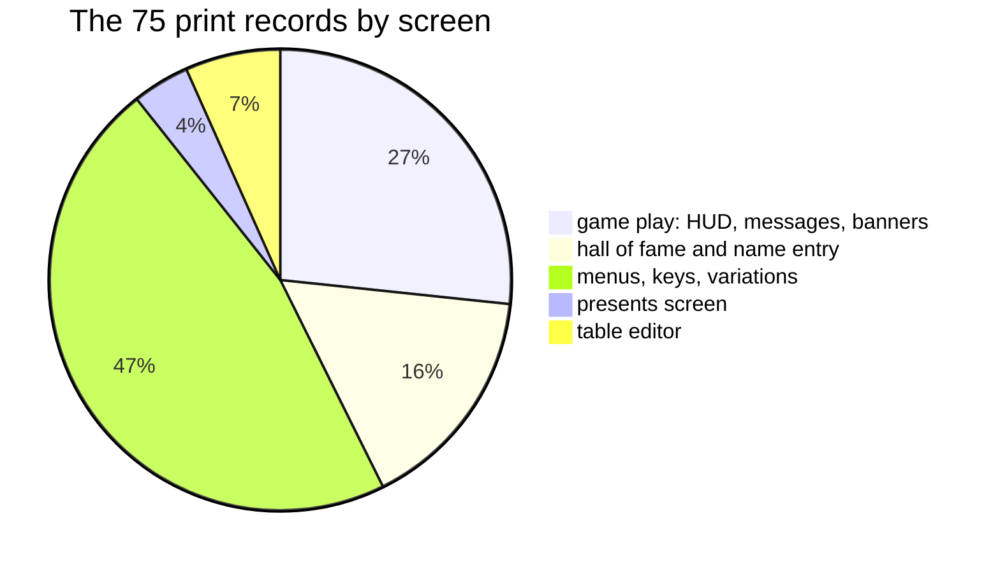

The records figure of section 8.1 shows four of these records as bytes and as printed text.

Worked example: "- video pool -" at `$B484` is `00 09 0F 0E` and 14 characters. That is row 0, column 9, white ink
on blue paper (`$0F`), narrow. The "-" and the spaces come from the ROM at `$3D00`. The letters "v i d e o p l" come
from the game's font at `$DEF4`.

Witness: the menus, the presents screen, the editor and the name entry page all print through PrintText
(`src/game/menu.asm`, `presents.asm`, `editor.asm`, `nameentry.asm`). PrintText's 449 runs in `w1` cover the HUD,
the messages, the banners and the name entry page. In `m1` its 144 runs cover the menus, the variations page and the
editor.

The point: the whole text of the game is 75 records, 1537 bytes, in one format.
