# 9. Sound

What this covers:

- the engine: the 48K beeper only, reached two ways: the game's own foreground loop and the ROM's BEEPER (9.1);
- the foreground sound loop SoundLoop `$8069` and its half-period delay SoundDelay `$809D`: the three tones, their
  timing, and why the interrupt bends them (9.2);
- the requests: who asks for which tone, the priority rules, the tone cut short or dropped (9.3);
- the BEEPER notes: the clicks, the score count-up, the last-shot beep and the foul jingle, each decoded (9.4);
- what each sound costs and what the game loses while it plays (9.5);
- the parameters as a data sheet, byte by byte (9.6);
- the rendered audio files (9.7) and what no recording reached (9.8).

The names are those of `src/game/game.ann` ([Terms](README.md#terms)). The recordings it rests on, all on the 48K,
each replayed on the writer's own instance from `work/snaps/entry.z80` (the game's entry in `c1`, frame 5556) with
the input script of WALKTHROUGH 6.0. The replay was checked identical to the stage-1 trace of `w1` (frames
1070-1100: 229 456 instructions, every PC, register and T-state equal).

- `w1`: a whole one-player game, 16 378 frames: every tone of the physics, the score count-ups, the foul jingle, the
  name entry clicks, one menu click;
- `f1`: the fouls and the shots running out (6108 frames);
- `e1`: the table editor (1368 frames).

Every sound event of a recording was taken from access traces of the whole recording, 200 frames at a time
(`tools/sound_events.py`): each `OUT` to port `$FE` with its value, T-state and PC, each BEEPER call with HL, DE and
the caller, each request SoundLoop took, each write to SoundRequest `$827D`, each interrupt entry. The figures and
the audio files are drawn from those events by `tools/fig_sound.py`. No sound was played aloud while writing this.

```bash
. work/env.sh
python3 work/docs/vpD/replay.py --inputs tests/inputs/w1.txt --frames 16378 --work work/docs/vpD/w1 --port-base 35100
python3 tools/sound_events.py --work work/docs/vpD/w1 --frames 0-16378 --out work/docs/vpD/w1-sound.json
# f1 from its TTD recording (an instance with the session loaded, muted), with the SoundRequest writes
python3 $RS open --work work/sources/f1 --ttd work/docs/vpD/f1/session.ttd --model 48K \
    --ranges 4000-FFFF --port-base 36810 --binary $BIN
python3 tools/sound_events.py --work work/sources/f1 --frames 0-6108 --out work/docs/vpD/f1-sound.json
python3 $RS stop --work work/sources/f1
python3 tools/fig_sound.py table      # every sound instance measured (the numbers of this document)
```

## 9.1 The engine

- **The beeper only.** Every sound goes through bit 4 of port `$FE`, the 48K speaker. There is no AY code, and nothing
  reads the EAR bit: the only `IN` from port `$FE` are the keyboard reads of doc 5 (doc 2, 2.1).
- **Two players.**
  - The **foreground loop** SoundLoop `$8069` plays three short tones that the physics asks for through
    SoundRequest `$827D`: 1 a ball against a ball, 2 a cushion, 3 a pocket. It runs outside the interrupt, in the
    time the interrupt's tasks leave (9.2, 9.3).
  - The ROM's **BEEPER** `$03B5` (HL the period, DE + 1 the cycles) plays everything else: the key clicks of the menu,
    the variations page, the name entry and the editor; the score count-up; the last-shot beep; the two notes of the
    foul jingle (9.4). Twelve `CALL BEEPER` and one `JP BEEPER` in the image.
- **The other `OUT ($FE)` are silent.** Six more `OUT ($FE),A` set the border after a page is cleared: `$95E9` (7),
  `$A915` (1), `$AD07` (6), `$B246` (1), `$B97B` (7), `$C060` (7). Bit 4 is clear in every value, so the speaker
  does not move. In `w1` they wrote 7 times in all, against 10 211 speaker writes.
- **No music.** No routine plays a tune: there is no note table and no player in the interrupt.

| Site | What | Player | Trigger | `w1` |
| --- | --- | --- | --- | ---: |
| `$8993` `LD (SoundRequest),A` = 1 | ball against ball | SoundLoop | BallContacts `$87EF`, the exchange | 48 taken |
| `$8DC0`, `$8DF4`, `$8E28` = 2 | cushion | SoundLoop | ReflectDiagonal `$8D7D`, ReflectX `$8DCB`, ReflectY `$8DFF` | 76 taken |
| `$8C17` = 3 | pocket | SoundLoop | PocketMark `$8C06` | 17 taken |
| `$B2CD`, `$B6DE` CALL BEEPER | key click (HL 1000, DE 20) | BEEPER | MenuKey, VariationsKey | 1 |
| `$AF12` | step click (1000, 20) | BEEPER | the name entry's cursor | 51 |
| `$AF35` | pick (1200, 22) | BEEPER | NameEntryFire | 3 |
| `$C264`, `$C3B7`, `$C3D4`, `$C423`, `$C538` | editor beep (1000, 20) | BEEPER | EditorPickBall, a ball potted, EditorDropBall, EditorPlay, EditorReset | `e1` |
| `$99EF` | count-up tick (TallyPitch, 6000 / TallyPitch) | BEEPER | AddScoreStep `$99C1` | 287 |
| `$9CB2` | last-shot beep (500, 10) | BEEPER | LastShotBeepTask `$9CA7` | 0 |
| `$9791`, `$979F` (JP) | foul jingle (8350, 26), (10750, 23) | BEEPER | FoulJingleNotes `$9786` | 4 + 4 |

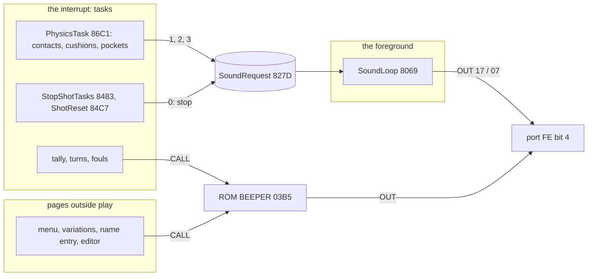

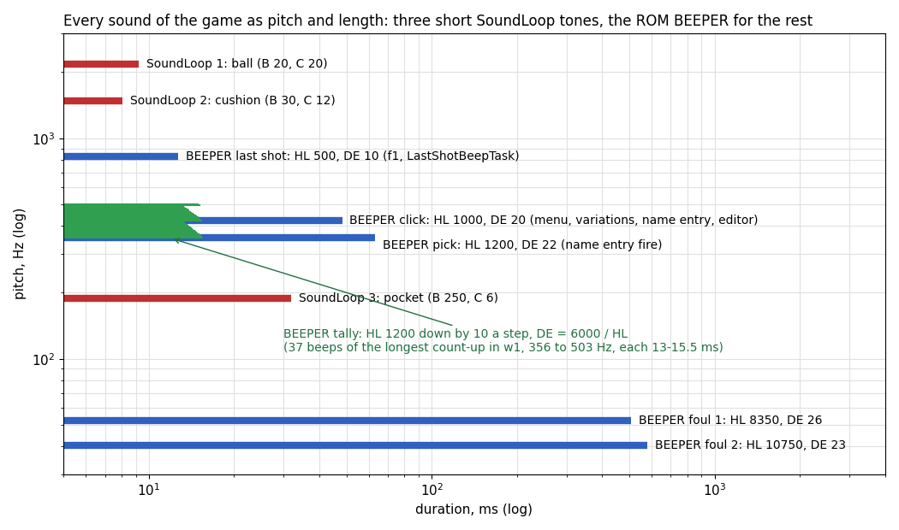

How to read the figure:

- One bar a sound: its pitch (y, log) and its length (x, log), as the code sets them.
- Red bars are the three SoundLoop tones, modelled from the instruction timings with no interrupt in them (9.2).
- Blue bars are BEEPER notes, each from its HL and DE: pitch 437 500 / (HL + 30.125) Hz; length from the first
  speaker write to the last, DE + 1/2 cycles (BEEPER plays DE + 1 cycles, 9.4). The recordings measured every one of
  them within 0.42 Hz of this (9.4).
- The green fan is the score count-up: the 37 beeps of the longest count-up in `w1`, each 13-15.5 ms, rising from
  356 to 503 Hz.
- The last-shot beep is blue like the other notes: `f1` played it 13 times (9.4).

**The point**: the game has nine distinct sounds, all short: the three SoundLoop tones and six BEEPER notes (the click,
the pick, the count-up tick, the last-shot beep and the jingle's two notes); the two longest (half a second each) are
the foul jingle's low notes. The table sounds are tiny tones of 8 to 32 ms, high for a contact and a cushion, low for a
pocket.

```bash
python3 tools/fig_sound.py roll    # docs/img/sound/roll.png, from work/docs/vpD/{w1,f1,e1}-sound.json
```

Witness: `w1` (16 378 frames): 141 tones taken by SoundLoop, 350 BEEPER calls, 10 211 speaker writes (`$8088` 1962,
`$808F` 1960, `$80AC` 4, the ROM's BEEPER at `$03E1` 6278, the border sites 7).

## 9.2 The sound loop and its timing

Once a game starts, GameRestart `$8013` falls into SoundLoop and the foreground never leaves it: all of play runs in
the interrupt as tasks (doc 2, 2.4; [doc 4](04-game-loop.md)). The loop does two things:

- it watches InputState `$827C` bit 5 (BREAK, set by the input task) and restarts the game at the menu;
- it waits for SoundRequest `$827D` to be non-zero and plays that tone on the speaker.

A tone is C full cycles. Each cycle is the speaker on (`OUT` `$17`: bit 4 set, border 7), a delay of B passes, the
speaker off (`OUT` `$07`), the same delay. The delay loop SoundDelay reads SoundRequest on every pass: a cleared request
(9.3) stops the tone at the next delay pass the foreground runs, at once when the task that cleared it returns, 128-375
frames later for the frozen pocket tone (9.3). At the end the loop clears the request itself.

Why the authors did it this way: the interrupt is busy with the physics, the drawing and the HUD, and a beeper tone
needs the CPU for its whole length. The foreground is otherwise idle, so the tone costs the game nothing: it is
played in the time the interrupt leaves. The price is the pitch: every interrupt that comes during a tone freezes the
speaker for as long as its tasks run.

```text
SoundLoop:                                   ; $8069, the foreground, interrupts on
    loop:
        if InputState bit 5: goto BreakRestart          ; $80B0: the menu again
        request = SoundRequest                           ; $827D
        if request == 0: continue
        (delay, cycles) = (20, 20) if request == 1       ; ball against ball
                          (30, 12) if request == 2       ; cushion
                          (250, 6) otherwise             ; pocket
        repeat cycles times:
            OUT($FE, $17)                                ; speaker on, border 7
            SoundDelay(delay)
            OUT($FE, $07)                                ; speaker off
            SoundDelay(delay)
        SoundRequest = 0

SoundDelay(delay):                           ; $809D
    repeat delay times:                      ; 37 T a pass
        if SoundRequest == 0:                ; a task stopped the tone
            drop the saved BC and SoundCycle's return address; OUT($FE, $07); goto SoundLoop.loop
```

```asm
SoundLoop:
$8069  LD A,(InputState)
SoundTestBreak:
$806C  AND $20                 ; BREAK?
$806E  JP NZ,BreakRestart
SoundWait:
$8071  LD A,(SoundRequest)     ; no request: loop
$8074  OR A
$8075  JR Z,SoundLoop
$8077  LD BC,$1414             ; request 1: B = 20, C = 20
$807A  DEC A
$807B  JR Z,SoundCycle
$807D  LD BC,$1E0C             ; request 2: B = 30, C = 12
$8080  DEC A
$8081  JR Z,SoundCycle
$8083  LD BC,$FA06             ; request 3 (or any other): B = 250, C = 6
SoundCycle:
$8086  LD A,$17                ; speaker on, border 7
$8088  OUT ($FE),A
$808A  CALL SoundDelay
$808D  LD A,$07                ; speaker off
$808F  OUT ($FE),A
$8091  CALL SoundDelay
$8094  DEC C
$8095  JR NZ,SoundCycle
$8097  XOR A
$8098  LD (SoundRequest),A     ; the tone is done: clear the request
$809B  JR SoundLoop
SoundDelay:
$809D  PUSH BC
SoundDelayLoop:
$809E  LD A,(SoundRequest)     ; 13 T
$80A1  OR A                    ;  4 T
$80A2  JR Z,SoundAbort         ;  7 T (not taken)
$80A4  DJNZ SoundDelayLoop     ; 13 T: 37 T a pass
$80A6  POP BC
$80A7  RET
SoundAbort:
$80A8  POP BC                  ; SoundDelay's own BC
$80A9  POP BC                  ; and SoundCycle's return address
$80AA  LD A,$07                ; speaker off
$80AC  OUT ($FE),A
$80AE  JR SoundLoop
```

- **The pitch from the T-states.** One pass of SoundDelayLoop is 37 T (13 + 4 + 7 + 13). A call of SoundDelay costs
  37 B + 43 T (`CALL` 17, `PUSH` 11, the passes less 5 for the last `DJNZ` not taken, `POP` 10, `RET` 10). From one
  `OUT` to the next: speaker on to off 37 B + 61 T (the call, `LD A,$07` 7, the `OUT` 11), off to on 37 B + 77 T (the
  call, `DEC C` 4, `JR NZ` 12, `LD A,$17` 7, `OUT` 11). One cycle is 74 B + 138 T.
- **A request outside 1-3** plays the pocket tone: the code tests 1 and 2 and lets anything else fall through. No
  writer stores another value (9.3).
- **The abort drops two frames of the stack.** SoundAbort pops SoundDelay's saved BC and SoundCycle's return
  address, so the stack is back where SoundLoop left it; the speaker is switched off.
- **The border does not flash.** `$17` and `$07` both carry border 7 (white), the colour every page of play sets, so
  the tones leave no stripes.

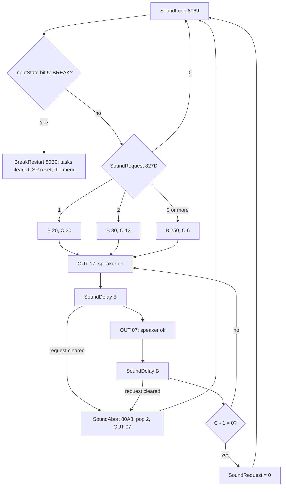

### Worked example: the pocket tone

The pocket of `w1`'s break shot: ball 5 falls at frame 1200 and PocketMark writes 3 at `$8C17`. SoundLoop takes the
request at frame 1200, T 56 599 (`$8077` reached with A = 3):

| Step | Value | T-states |
| --- | --- | ---: |
| `LD BC,$FA06` | B = `$FA` = 250 passes, C = 6 cycles | |
| one SoundDelay | 37 x 250 + 43 | 9293 |
| speaker on to off | 9293 + 7 + 11 | 9311 |
| speaker off to on | 9293 + 4 + 12 + 7 + 11 | 9327 |
| one cycle | 9311 + 9327 | 18 638 |
| pitch | 3 500 000 / 18 638 | 187.8 Hz |
| six cycles | 6 x 18 638 | 111 828 (32.0 ms, 1.6 frames) |

The same sums for the other two: the ball tone, B = 20, gives 801 / 817 T, 2163 Hz, 20 cycles in 32 360 T (9.25 ms);
the cushion tone, B = 30, gives 1171 / 1187 T, 1484 Hz, 12 cycles in 28 296 T (8.08 ms).

The recording keeps to these numbers only while no interrupt comes during the tone:

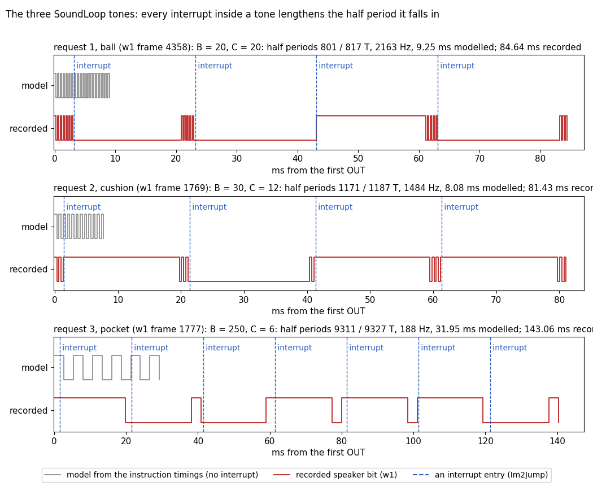

How to read the figure:

- One panel a request: the longest instance of that tone in `w1` (the frame in the panel's title).
- Grey, top: the tone as the instruction timings give it, with no interrupt. Red, bottom: the speaker bit as the
  recording wrote it, from the `OUT` at `$8088` / `$808F` (high = bit 4 set).
- Dashed blue lines: interrupt entries (Im2Jump `$FCFC`). The handler runs the tasks (the physics, the redraw of every
  moving ball) for most of a frame; the speaker holds its level all that time.
- Between two interrupts the tone runs at its true pitch: the bursts of 2-3 ms in the top panel are 2163 Hz.

**The point**: the tones are exact only when no interrupt falls inside them. With several balls rolling, the
interrupt takes about 18 of every 20 ms, so a contact's 9 ms tone comes out as bursts spread over up to 85 ms. In
`w1`, 32 of 48 ball tones, 26 of 76 cushion tones and all 17 pocket tones had at least one interrupt inside; the
median ball tone lasted 20.8 ms instead of 9.25, the median pocket tone 50.2 ms instead of 32.0. The cushion tone,
mostly heard when one ball is left rolling, kept its 8.09 ms in the median.

```bash
python3 tools/fig_sound.py tones   # docs/img/sound/tones.png
```

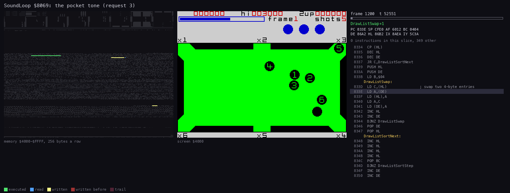

The animation: SoundLoop playing the pocket tone of the break shot, `w1` frames 1200 (T 50 000) to 1204 (T 0),
90 pictures of 2551 T each. The code panel follows SoundLoop and SoundDelay (`--pc 8069-80B0`); the long stretches
counted as "other" are the interrupts, which redraw the moving balls on the screen panel while the speaker waits.

```bash
python3 ../../kit/routine_anim.py --work work/docs/vpD/w1 --window 1200:50000-1204:0 --listing build/game.lst \
    --out docs/img/routines/SoundLoop.gif --view screen --range 4000-FFFF --pictures 90 --pc 8069-80B0 \
    --title 'SoundLoop $8069: the pocket tone (request 3)'
```

Witness: `w1`: 141 requests taken at `$8077` (48 of 1, 76 of 2, 17 of 3); 1962 speaker-on `OUT` at `$8088` and 1960
off at `$808F`; SoundAbort `$80A8` 4 times (frames 3044, 4269, 7064, 10387). `f1`: 51 taken (25 of 1, 23 of 2, 3 of
3), no SoundAbort.

## 9.3 The requests

The physics asks for a tone by writing its number to SoundRequest `$827D`; SoundLoop takes it in the foreground. The
writers all run inside the interrupt, in PhysicsTask's calls:

| Writer | Value | When | `w1` writes | `f1` writes |
| --- | ---: | --- | ---: | ---: |
| ExchangeOtherVyStore `$8993` | 1 ball | two balls exchange velocity (the end of the exchange, ExchangeVx `$8912` to ExchangeOtherVyStore `$8984`, in BallContacts `$87EF`; it also sets BallHitFlag `$89BB`) | 71 | 28 |
| ReflectXFrac `$8DF4` | 2 cushion | a ball bounces off a vertical cushion | 31 | 11 |
| ReflectYFrac `$8E28` | 2 cushion | off a horizontal cushion | 48 | 9 |
| ReflectDiagonalStore `$8DC0` | 2 cushion | off a pocket's slanted jaw | 10 | 7 |
| PocketMark `$8C17` | 3 pocket | a ball drops into a pocket | 18 | 3 |
| SoundCycle's end `$8098` | 0 | the tone is done | 137 | 51 |
| StopShotTasks `$84A6` | 0 | the shot ends: the moving tasks removed | 21 | 9 |
| ShotReset `$84D1` | 0 | a new shot is set up | 21 | 9 |
| GameRestart `$8065`, EditorPlay `$C467` | 0 | start of a game, the editor's play | 1, 0 (`e1` 1) | 1, 0 |

```asm
ExchangeOtherVyStore:           ; the exchange's last store (BallContacts): the other ball's vy
$8984  LD (IY+$06),L
$8987  LD (IY+$07),H
$898A  SET 6,(IY+$0D)           ; the other ball moves
$898E  LD A,$01
$8990  LD (BallHitFlag),A       ; a ball was hit (the foul rules)
$8993  LD (SoundRequest),A      ; and the ball tone
...
PocketMark:
$8C06  LD (IX+$0C),A            ; +12 = the pocket
$8C09  SET 5,(IX+$0D)           ; potted, redraw, stopped
$8C0D  SET 4,(IX+$0D)
$8C11  RES 6,(IX+$0D)
$8C15  LD A,$03
$8C17  LD (SoundRequest),A      ; the pocket tone
```

There is no queue and no priority. The rules come from the two sides of one byte:

- **Pending: the last write wins.** Two writes in one tick, before SoundLoop runs, leave only the second (a ball
  contact and a cushion in the same tick: the cushion).
- **Playing: every write is lost.** SoundDelay only tests the byte for zero, so a new request does not change the
  tone, and SoundCycle's end clears it with `LD (SoundRequest),A`. A cushion that comes 4 ms into a ball tone is
  never heard, even a pocket.
- **Zero: the tone stops.** A task that writes 0 while a tone plays makes the next SoundDelay pass abort it
  (SoundAbort `$80A8`: speaker off).

```text
interrupt (PhysicsTask):        SoundRequest = 1, 2 or 3   at each contact, bounce, pot
interrupt (StopShotTasks, ...): SoundRequest = 0
foreground (SoundLoop):
    wait until SoundRequest <> 0
    B, C = the tone of SoundRequest              ; taken once, here
    repeat C: speaker on, delay B; speaker off, delay B
        each delay pass: if SoundRequest = 0: speaker off, back to the wait
    SoundRequest = 0                              ; a request written meanwhile is lost
```

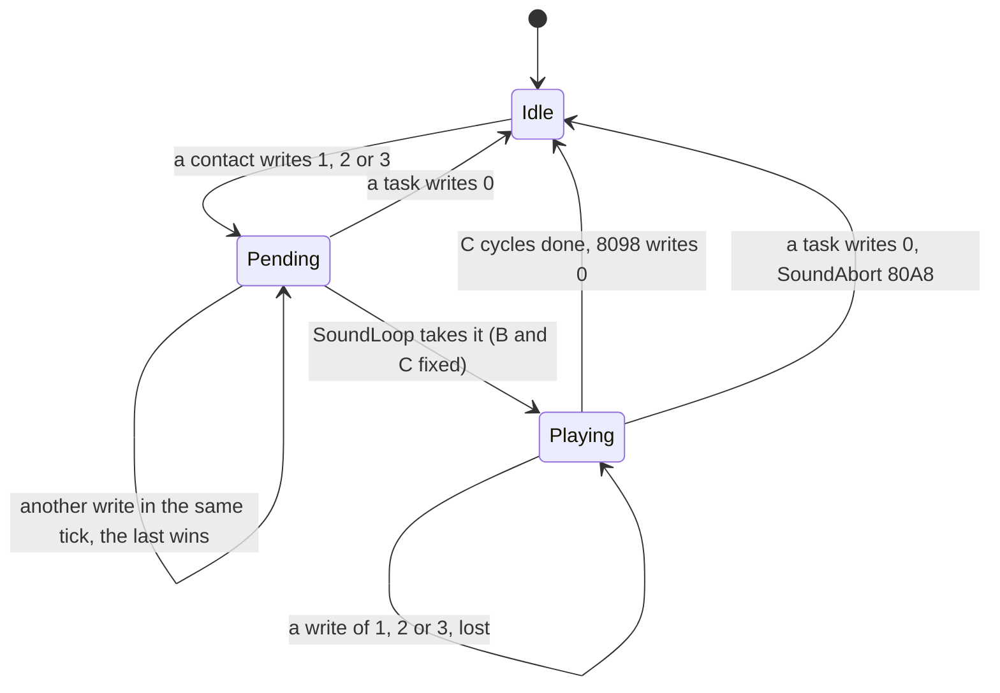

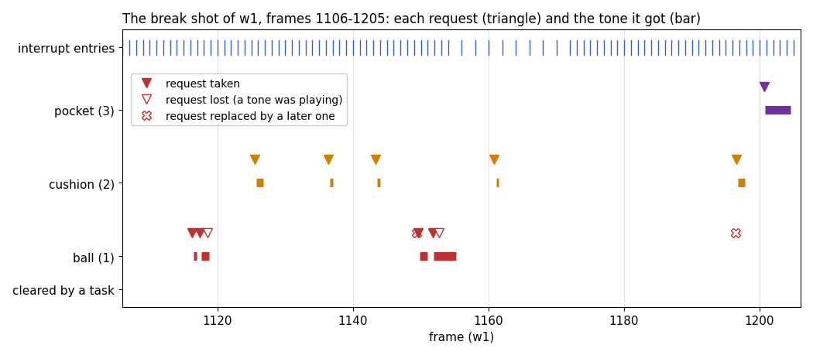

How to read the figure:

- One row per tone. A triangle is a write to SoundRequest at its moment; a bar is the tone SoundLoop played, from its
  first speaker write to its last.
- A filled triangle got its tone. A hollow triangle was written while a tone played and was lost. A cross was
  replaced by a later write before SoundLoop took it.
- The ticks at the top are the interrupt entries: their gaps in 1155-1171 (every second frame) are the passes with
  all seven balls moving, each longer than a video frame, so the next interrupt is lost (nine in all; doc 4, 4.6).

**The point**: the sound follows the physics only roughly. In this break 14 requests gave 10 tones: two ball
contacts came during a ball tone and were lost, two were replaced in their own tick. The longest ball bar (from
frame 1151) is a 9 ms ball tone stretched to 67 ms by three interrupts; the pocket tone of frame 1200 took 75 ms
instead of 32 for four.

```bash
python3 tools/fig_sound.py shot   # docs/img/sound/shot.png
```

### Worked example: the break, frames 1116-1200

The writes of `w1` in the break (frame, T, value, writer) and their fate, as `tools/fig_sound.py` classifies them
(`request_fates`):

| Frame | Writer | Value | Fate |
| ---: | --- | ---: | --- |
| 1116 | ExchangeOtherVyStore | 1 | taken: the cue ball hits the pack |
| 1117 | ExchangeOtherVyStore | 1 | taken (the first tone was done) |
| 1118 | ExchangeOtherVyStore | 1 | lost: the second tone was still playing |
| 1125 | a cushion | 2 | taken |
| 1136 | a cushion | 2 | taken |
| 1143 | a cushion | 2 | taken |
| 1149 | ExchangeOtherVyStore | 1 | replaced by the next write of the same tick |
| 1149 | ExchangeOtherVyStore | 1 | taken |
| 1151 | ExchangeOtherVyStore | 1 | taken |
| 1152 | ExchangeOtherVyStore | 1 | lost |
| 1160 | a cushion | 2 | taken |
| 1196 | ExchangeOtherVyStore | 1 | replaced: a cushion in the same tick |
| 1196 | a cushion | 2 | taken |
| 1200 | PocketMark | 3 | taken: the first pot |

The whole of `w1`: 178 requests, 141 taken (48 ball, 76 cushion, 17 pocket), 21 lost under a playing tone (10 ball,
10 cushion, 1 pocket at frame 4470), 16 replaced in their tick (13 ball, 3 cushion). `f1`: 58 requests, 51 taken (25 ball, 23 cushion,
3 pocket), 4 lost (1 ball, 3 cushion: frames 1014, 3437, 3460, 3490), 3 replaced (2 ball, 1 cushion); none of its
9 StopShotTasks clears came while a tone played. `e1`: 9 requests, 8 taken, 1 replaced.

### The frozen pocket tone

Four pocket tones of `w1` (frames 2916, 3894, 6744, 10 067) play three cycles and then stop with the speaker held for
128 to 375 frames. Each is the pot that ends a shot:

1. PocketMark writes 3; SoundLoop starts the pocket tone (half periods of 9311 T).
2. The next interrupt finds every ball stopped and runs the end of the shot inside the interrupt: StopShotTasks
   writes 0 (`$84A6`: 4 of its 21 writes came while a tone played), then the message, the score count-up and the
   rest wait for frames with HALT in WaitFrameNoTasks (doc 4, 4.9).
3. The foreground is frozen inside SoundDelay for all that time; the speaker holds its last level, which is silent.
4. When the interrupt finally returns (frames 3044, 4269, 7064, 10 387), the next SoundDelay pass reads 0 and
   SoundAbort turns the speaker off (`$80AC`, the 4 aborts of `w1`).

So the last pot of a shot sounds as a click of three cycles, not the full low tone: the score count-up's ticks come
from BEEPER inside the same interrupt, while the foreground tone waits.

Witness: `w1-sound.json` writes at `$84A6` with value 0 at frames 2917, 3895, 6745, 10 068 while a pocket tone
played; aborts at 3044 T 25 053, 4269 T 18 580, 7064 T 18 555, 10 387 T 18 544.

## 9.4 The BEEPER notes

Everything that is not a table sound is a call of the 48K ROM's BEEPER `$03B5`. BEEPER takes HL (the period) and DE
(the cycle count), disables the interrupts, toggles the speaker at one cycle every 8 x (HL + 30.125) T-states, and
ends with `EI`. It tests DE for zero only after a full cycle, so it plays DE + 1 cycles: 2 DE + 2 speaker writes, the
first about 230 T after the call (every call in the recordings has exactly 2 DE + 2 writes at `$03E1`). So a note has

- pitch = 3 500 000 / (8 x (HL + 30.125)) = 437 500 / (HL + 30.125) Hz;
- length, from the first write to the last, 2 DE + 1 half cycles: (DE + 1/2) x 8 x (HL + 30.125) T-states, all of
  it with the interrupts off.

The ROM formula is checked by the recordings: every note's pitch measured from the speaker writes at `$03E1` (the
ROM's toggling `OUT`) is within 0.42 Hz of it, and every length within 0.1 ms (`tools/fig_sound.py table`).

| Sound | Caller | HL | DE | Pitch | Length | Measured | Recordings |
| --- | --- | ---: | ---: | ---: | ---: | --- | --- |
| key click | MenuKey `$B2CD`, VariationsKey `$B6DE` | 1000 | 20 | 424.7 Hz | 48.3 ms | 424.8 Hz | `w1`, `f1`, `e1` (menu) |
| name step | NameEntryStep `$AF12` | 1000 | 20 | 424.7 Hz | 48.3 ms | 424.9 Hz | `w1` 51 |
| name pick | NameEntryFire `$AF35` | 1200 | 22 | 355.7 Hz | 63.3 ms | 355.8 Hz | `w1` 3 |
| editor beep | `$C264`, `$C3B7`, `$C3D4`, `$C423`, `$C538` | 1000 | 20 | 424.7 Hz | 48.3 ms | 424.8 Hz | `e1` 3: `$C264` frame 700, `$C3D4` 760, `$C423` 840 |
| count-up tick | AddScoreStep `$99EF` | TallyPitch: 1200, 1190, ... | 6000 / HL | 355.7 Hz up | 13.1-15.5 ms | 355.8 Hz (first) | `w1` 287, `f1` 27 |
| last shot | LastShotBeepTask `$9CB2` | 500 | 10 | 825.3 Hz | 12.7 ms | 825.7 Hz | `f1` 13 |
| foul, note 1 | FoulJingleNotes `$9791` | 8350 | 26 | 52.2 Hz | 507.6 ms | 52.2 Hz | `w1` 4, `f1` 4 |
| foul, note 2 | FoulJingleNotes `$979F` (`JP`) | 10750 | 23 | 40.6 Hz | 579.0 ms | 40.6 Hz | `w1` 4, `f1` 4 |

### The score count-up

After a shot that potted, ScoreTally `$98FF` prints each ball's term and counts the shot's score into the player's
score in steps, one step a video frame, each with a tick (TallyCount `$9975`, AddScoreStep `$99C1`):

- TallyPitch `$9B34` starts at 1200 for every count;
- the step is DE = round(ShotScore / 128) + 1: `SLA L` / `RL H` doubles the score, its high byte is
  ShotScore >> 7, and the second `SLA L` carries bit 6 into `ADC A,$01`; so ShotScore 0-63 counts in steps of 1,
  64-191 in steps of 2, 192-319 in steps of 3 (not ShotScore / 64 + 1, which agrees only below 128);
- each step moves DE points from ShotScore into the player's score, prints it, ticks at TallyPitch, and lowers
  TallyPitch by 10: the pitch rises a little with every step;
- the steps go on while at least DE points are left: floor(ShotScore / DE) steps, at most 127 (ShotScore 8255 and
  above); the rest, 0 included, goes in one last step, so a count-up has one beep more than steps;
- then the count waits out the rest of 45 video frames (B = 45, counted down by every step). More than 45 steps
  needs ShotScore 46 or more (460 points in one shot); then `JP M` skips the wait (B is negative for 46-173 steps).
  No recording reached it: the largest ShotScore was 36 (`w1` 8456, 37 beeps);
- then ClearMessageRows, DrawPottedRow `$9AB5`, ShotsLeft = ShotsForFrame `$9BE6`, and 5 more frames (`LD B,5` at
  `$99BB`, TallyEndWait `$99BD`). With the term printing (15 frames for the first ball, 60 for each ball's
  factors and pause), the whole tally is 20 + 60 k + max(steps, 45) frames for k balls, plus the interrupt the
  first beep can lose (below):
  `w1`'s first, one ball and 15 steps, runs from frame 1254 to 1380.

The tick's cycles are not a constant: DE = 6000 / HL, counted by repeated subtraction. As the length of a note is
(DE + 1/2) x 8 x (HL + 30.125) T, this keeps every tick between 13.1 and 15.5 ms whatever its pitch (the whole part
of the division makes the steps: HL 1010 gives DE 5 and 13.1 ms, HL 1000 DE 6 and 15.3 ms).

```text
TallyCount:                                  ; $9975, with the tasks stopped (WaitFrameNoTasks $80DE)
    TallyPitch = 1200
    step = (ShotScore >> 7) + bit 6 of ShotScore + 1   ; round(ShotScore / 128) + 1
    frames = 45
    while ShotScore >= step:
        ShotScore -= step
        AddScoreStep(step); HALT; frames -= 1
    AddScoreStep(ShotScore)                  ; the rest, maybe 0: still a beep
    if frames > 0: HALT frames times         ; skipped past 45 steps (JP M)
    ClearMessageRows(); DrawPottedRow(); ShotsLeft = ShotsForFrame()
    HALT 5 times                             ; TallyEndWait $99BD

AddScoreStep(points):                        ; $99C1
    score of the current player += points; print it
    DE = 6000 / TallyPitch                    ; whole part, by subtraction
    BEEPER(TallyPitch, DE)                    ; DE + 1 cycles
    if TallyPitch >= 10: TallyPitch -= 10
```

```asm
TallyCount:
$9975  LD HL,$04B0             ; TallyPitch = 1200
$9978  LD (TallyPitch),HL
$997B  LD HL,(ShotScore)       ; step = high byte of 2 x ShotScore + bit 6 + 1
$997E  SLA L
$9980  RL H
$9982  LD A,H
$9983  SLA L
$9985  ADC A,$01
$9987  LD D,$00
$9989  LD E,A
$998A  LD B,$2D                ; 45 frames in all
TallyCountStep:
$998C  LD HL,(ShotScore)
$998F  XOR A
$9990  SBC HL,DE
$9992  JR C,TallyCountLast     ; less than a step left
$9994  LD (ShotScore),HL
$9997  CALL AddScoreStep
$999A  HALT                    ; one step a frame
$999B  DEC B
$999C  JR TallyCountStep
TallyCountLast:
$999E  LD DE,(ShotScore)       ; the rest, maybe 0
$99A2  CALL AddScoreStep
$99A5  LD A,B
$99A6  OR A
$99A7  JR Z,TallyDone
$99A9  JP M,TallyDone          ; more than 45 steps: no wait
TallyWaitRest:
$99AC  HALT
$99AD  DJNZ TallyWaitRest
TallyDone:
$99AF  CALL ClearMessageRows
$99B2  CALL DrawPottedRow
$99B5  CALL ShotsForFrame
$99B8  LD (ShotsLeft),A
$99BB  LD B,$05                ; 5 frames more
TallyEndWait:
$99BD  HALT
$99BE  DJNZ TallyEndWait
$99C0  RET
...
AddScorePrint:
$99D7  PUSH BC
$99D8  PUSH DE
$99D9  CALL PrintHudNumber
$99DC  LD HL,$1770             ; 6000
$99DF  LD BC,(TallyPitch)
$99E3  LD DE,$FFFF
AddScoreCycles:
$99E6  INC DE                  ; DE = how many times TallyPitch fits in 6000
$99E7  OR A
$99E8  SBC HL,BC
$99EA  JR NC,AddScoreCycles
$99EC  LD HL,(TallyPitch)
$99EF  CALL BEEPER
$99F2  LD HL,(TallyPitch)      ; TallyPitch - 10 unless it would go below 0
$99F5  LD DE,$FFF6
$99F8  ADD HL,DE
$99F9  JR NC,AddScoreDone
$99FB  LD (TallyPitch),HL
```

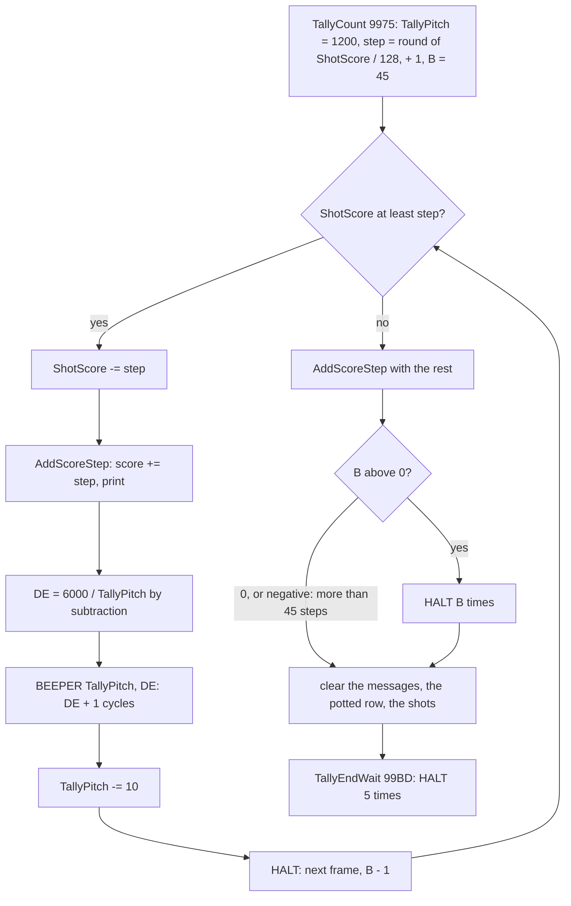

#### Worked example: the first tick

`w1`, frame 1329: the first pot of the game is counted. TallyPitch = 1200 (`$04B0`).

| Pass of AddScoreCycles | DE after `INC DE` | HL after `SBC HL,BC` | Carry |
| --- | ---: | ---: | --- |
| 1 | 0 | 6000 - 1200 = 4800 | no |
| 2 | 1 | 3600 | no |
| 3 | 2 | 2400 | no |
| 4 | 3 | 1200 | no |
| 5 | 4 | 0 | no |
| 6 | 5 | -1200 | yes: out |

BEEPER(1200, 5): 437 500 / 1230.125 = 355.7 Hz, DE + 1 = 6 cycles of 9841 T. The recording: BEEPER entered at
frame 1329, T 19 304 with HL = 1200, DE = 5; 12 speaker writes at `$03E1`, the first at T 19 537, the last at frame
1330, T 3753: 11 half cycles, 54 104 T (model 11 x 4920.5 = 54 126 T), 15.5 ms, measured 355.8 Hz. The beep came
straight after the printing of "=150" and the score, late in the frame, so it ran past frame 1330's interrupt
(entered at about T 1830 of each frame) with the interrupts off: `w1` has no interrupt in frame 1330. TallyPitch
becomes 1190; the next tick comes after the HALT, at frame 1331, T 8215: BEEPER(1190, 5), 358.6 Hz.

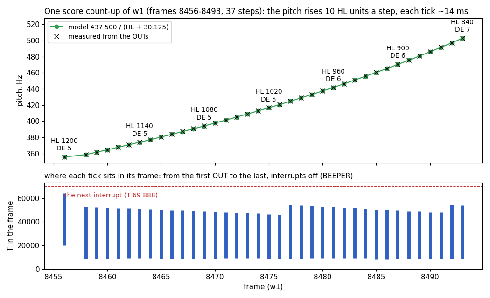

How to read the figure:

- Top: each beep of the longest count-up of `w1` (frames 8456-8493, 37 beeps: 36 steps and the rest 0) at its frame.
  Green: the pitch from the ROM formula; black crosses: the pitch measured from the recorded speaker writes. HL and DE
  are written over every sixth tick: DE grows from 5 to 7 as HL falls, which keeps the ticks equal in length.
- Bottom: where each beep sits in its frame, from its first speaker write to its last (T-states of the recording's
  frame; the interrupt is entered at about T 1830 of each frame). The red line is the next frame's interrupt: the
  first beep, at frame 8456, crosses it and that interrupt is lost (8457); the others end below it.

**The point**: the count-up is a rising scale of 13-15.5 ms beeps, one a video frame. The later beeps start after
the HALT, at T 8171-8667, and end before the next interrupt. The first starts only after the total is printed: at
T 19 296-19 781 when the total has three digits (100 points or more) it runs past the next interrupt, and as BEEPER
has the interrupts off, that interrupt is lost (12 of 17 count-ups in `w1`, 1 of 1 in `f1`); the five two-digit
totals started at T 16 877-17 325 and lost none. The tasks are stopped for the tally anyway, so the loss only makes
the count-up one frame longer. Its pitch keeps rising for big scores (37 beeps: 356 to 503 Hz).

```bash
python3 tools/fig_sound.py tally   # docs/img/sound/tally.png
```

Witness: AddScoreStep's BEEPER `$99EF`: `w1` 287 calls, HL from 1200 down to 840, DE 5 to 7; `f1` 27 calls, HL 1200
to 940. Interrupts lost (no `irq` entry in the frame after the beep's call): `w1` 12, at frames 1330, 2522, 3972,
4709, 5065, 5616, 6366, 6822, 7455, 8457, 9082 and 10 145, each under the first beep of a count-up of 100 points or
more; `f1` 1, at 3705. None under the other beeps. `tools/l1sum.py 98FF 9AB5`: `w1`'s first ScoreTally at 1254, its
DrawPottedRow at 1375.

### The last-shot beep

LastShotBeepTask `$9CA7` is a task StartAim `$8425` installs (at `$844B`) with period 25 (every 26 ticks) for every aim;
AimPower `$8506` removes it (at `$8526`, past its label AimShoot `$851B`) when the shot is played. It runs in the
interrupt about twice a second and beeps only when ShotsLeft `$9F4D` is 1: a warning that this is the last shot of the
frame.

```asm
LastShotBeepTask:
$9CA7  LD A,(ShotsLeft)
$9CAA  DEC A
$9CAB  RET NZ                  ; more than one shot left: silent
$9CAC  LD HL,$01F4             ; 500
$9CAF  LD DE,$000A             ; DE 10: 11 cycles
$9CB2  CALL BEEPER
$9CB5  DI                      ; BEEPER ends with EI: closed again, this is the interrupt
$9CB6  RET
```

- BEEPER(500, 10): 437 500 / 530.125 = 825.3 Hz, 11 cycles of 4241 T; from the first write to the last 21 half
  cycles, 44 530 T, 12.7 ms. `f1` measured 825.7 Hz and 12.7 ms (22 writes).
- The `DI` matters: BEEPER's `EI` would let the next interrupt nest inside the handler.
- `w1` ran the task 179 times and never beeped: no aim of `w1` had only one shot left. In `f1`, 13 beeps, every
  26 ticks from 2640 to 2953 (every 26 video frames from 2667; the first gap is 27, the interrupt of 2641 being
  lost). Twelve started at T 13 171-18 100 and lost nothing. The first, at 2640, started at
  T 26 694 in a busier interrupt; it ended before the next one, but the tasks after it ran past it, so `f1` has no
  interrupt in frame 2641.

### The foul jingle

A lost life plays two low notes. LoseLife `$9754` is called by the end-of-shot task `$8357` on a foul (the foul code
`$8E80` set, the cue ball off the table) or when the last shot potted nothing. It calls FoulJingle `$9780`, which runs
FoulJingleNotes `$9786` through WaitFrameNoTasks `$80DE`, so the interrupt is a bare `EI; RET` and no task runs while it
plays.

```asm
FoulJingleNotes:
$9786  LD B,$0A                ; 10 frames of silence
JingleWaitOne:
$9788  HALT
$9789  DJNZ JingleWaitOne
$978B  LD HL,$209E             ; 8350: 52.2 Hz
$978E  LD DE,$001A             ; DE 26: 27 cycles, 0.51 s
$9791  CALL BEEPER
$9794  LD B,$05                ; 5 frames of silence
JingleWaitTwo:
$9796  HALT
$9797  DJNZ JingleWaitTwo
$9799  LD HL,$29FE             ; 10750: 40.6 Hz
$979C  LD DE,$0017             ; DE 23: 24 cycles, 0.58 s
$979F  JP BEEPER               ; returns to FoulJingleNotes' caller
```

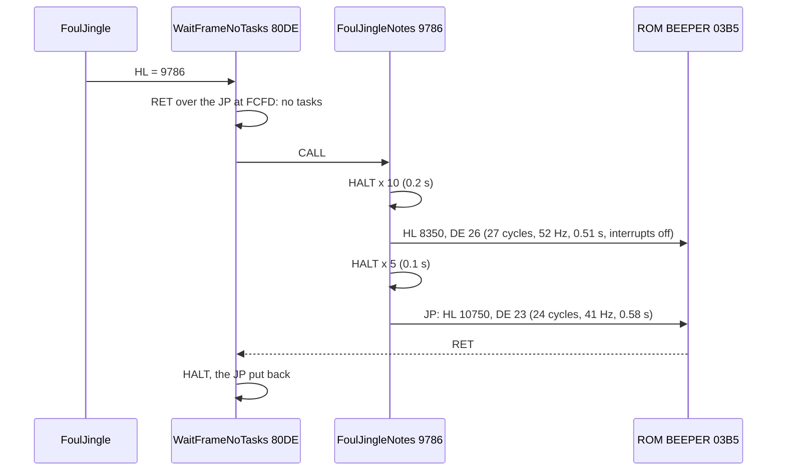

- The two notes fall by a little more than a major third (52.2 to 40.6 Hz, ratio 1.29). They take 507.6 and
  579.0 ms, 25.4 and 29.0 video frames, with the interrupts off: 25 and 29 interrupts lost. With the waits the
  jingle holds the game 1.4 s.
- `w1` played it four times (first notes at frames 10 556, 10 944, 11 325, 11 708, the second note 30 frames later
  each time), `f1` four times (frames 1112, 3126, 3993, 4385).
- With InfiniteLives `$B8C4` set (the four-key cheat, doc 10.10) LoseLife skips the jingle and the life loss: its one
  branch, `JP NZ,NextTurn` at `$9758`, jumps over `CALL FoulJingle` and the decrement. The `f1c` experiment
  (doc 10.10) takes it: the lives stay 3 through the fouls where `f1` loses them. `f1c` has no sound event file, so
  the silence follows from the branch, not from a measure.

Witness for this section: the BEEPER calls of `w1`, `f1`, `e1` (`work/docs/vpD/*-sound.json`): 350, 49 and 4 calls,
each with its HL, DE and caller as in the table.

## 9.5 What the sounds cost

The two players cost the game in opposite ways.

- **SoundLoop costs nothing.** It is the foreground: the time it plays in is the time the interrupt leaves over, which
  the game would spend in the same loop waiting for a request. The interrupts stay enabled; every task runs on time.
  What it pays instead is the sound itself: the interrupt freezes the speaker for as long as the handler runs, so a
  tone with an interrupt inside comes out longer and broken (9.2).
- **BEEPER costs interrupts.** It runs with the interrupts off. A note that covers a frame start loses that frame's
  interrupt: the tasks do not run, the game's clock (the interrupt count) does not advance. The game does not break,
  it pauses: a lost interrupt is one tick of the game that happens one frame later.

```text
lost interrupts of a BEEPER note = interrupt times (about T 1830 of each frame) between its call and its last
                                   speaker write
                                 = about length / 69 888 T, if the note starts right after an interrupt
a note never loses an interrupt if it starts after the interrupt and ends before the next one:
    start + 230 + (DE + 1/2) x 8 x (HL + 30.125) < 69 888 + 1830
```

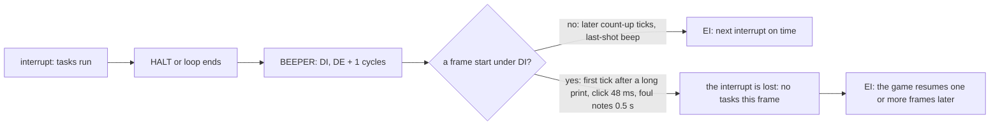

| Sound | Length | Lost per note | Where | What waits |
| --- | ---: | ---: | --- | --- |
| count-up tick | 13-15.5 ms | 1 on the first of a count-up of 100 points or more, else 0 | the first after the printed total, T 16 877-19 781; the rest after HALT, T 8171-8667 | the count-up, one frame longer (the tasks are stopped for the tally anyway) |
| last-shot beep | 12.7 ms | 0 | inside the interrupt, after the earlier tasks | the later tasks of that interrupt by 12.7 ms; the `DI` keeps the next interrupt out |
| click, name step | 48 ms | 2 | key handlers | the name entry: 51 steps lost 102 interrupts in `w1` (2 s of game time) |
| name pick | 63 ms | 3 | NameEntryFire | 9 interrupts for 3 picks |
| editor beep | 48 ms | 2 | editor keys | 6 in `e1` |
| foul notes | 0.51 + 0.58 s | 25 + 29 | FoulJingleNotes, tasks already stopped | nothing more: the tasks are stopped for the jingle anyway |

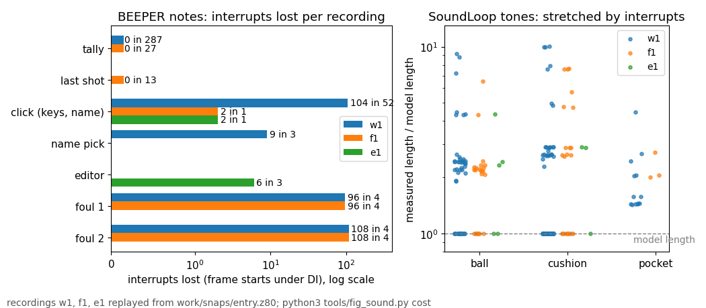

How to read the figure:

- Left: for each kind of BEEPER note, the interrupts it lost in each recording (log scale; a zero is drawn as a thin
  stub), with the count of notes.
- Right: each complete SoundLoop tone, its measured length (first to last speaker write, plus the last half cycle)
  divided by its model length. A dot on the dashed line had no interrupt inside; a dot above it was stretched.

**The point**: the only sounds that hold the game are the ones the player hears when nothing moves: the clicks, the
name entry and the foul jingle. The sounds of play cost nothing: the table tones live in the foreground and the
count-up ticks fit between two interrupts, but for the first tick of a count-up of 100 points or more, which loses one
while the tasks are stopped anyway. The price of the table tones is their sound: in `w1` two of three ball tones, one
of three cushion tones and every pocket tone were stretched; a stretched ball tone mostly to 2-2.5 times its length,
a few to nine times.

```bash
python3 tools/fig_sound.py cost   # docs/img/sound/cost.png
```

Witness: `tools/fig_sound.py table` for `w1`, `f1`, `e1`: "lost interrupts" per BEEPER caller: tally 12 and 1 (287 and
27 notes), last shot 0 (13; the interrupt lost at `f1` 2641 is the handler's, after the beep), name step 102 (51), menu
click 2, pick 9 (3), editor 6 (3), foul 100 + 116 in each of `w1` and `f1`. A lost interrupt here is a frame with no
interrupt entry whose interrupt time falls between the call and the last speaker write.

## 9.6 The data sheet

Every parameter of every sound is an immediate operand in the code; there is no sound table. The bytes, in game
memory order:

| Address | Bytes | Instruction | Meaning |
| --- | --- | --- | --- |
| `$8077` | `01 14 14` | `LD BC,$1414` | ball tone: C = 20 cycles, B = 20 delay passes a half cycle |
| `$807D` | `01 0C 1E` | `LD BC,$1E0C` | cushion tone: C = 12, B = 30 |
| `$8083` | `01 06 FA` | `LD BC,$FA06` | pocket tone (and any request above 2): C = 6, B = 250 |
| `$8086` | `3E 17` | `LD A,$17` | speaker on (bit 4), border 7 (white) |
| `$808D` | `3E 07` | `LD A,$07` | speaker off, border 7 |
| `$80AA` | `3E 07` | `LD A,$07` | speaker off after an abort |
| `$9786` | `06 0A` | `LD B,$0A` | foul jingle: 10 frames of silence first |
| `$978B` | `21 9E 20` | `LD HL,$209E` | foul note 1: HL = 8350, 52.2 Hz |
| `$978E` | `11 1A 00` | `LD DE,$001A` | DE 26: 27 cycles |
| `$9794` | `06 05` | `LD B,$05` | 5 frames between the notes |
| `$9799` | `21 FE 29` | `LD HL,$29FE` | foul note 2: HL = 10750, 40.6 Hz |
| `$979C` | `11 17 00` | `LD DE,$0017` | DE 23: 24 cycles |
| `$9975` | `21 B0 04` | `LD HL,$04B0` | count-up: TallyPitch starts at 1200, 355.7 Hz |
| `$998A` | `06 2D` | `LD B,$2D` | count-up: 45 frames at least |
| `$99DC` | `21 70 17` | `LD HL,$1770` | 6000: DE = 6000 / TallyPitch, ticks 13.1-15.5 ms |
| `$99F5` | `11 F6 FF` | `LD DE,$FFF6` | TallyPitch - 10 a tick |
| `$9CAC` | `21 F4 01` | `LD HL,$01F4` | last-shot beep: HL = 500, 825.3 Hz |
| `$9CAF` | `11 0A 00` | `LD DE,$000A` | DE 10: 11 cycles |
| `$AF0C` | `21 E8 03` | `LD HL,$03E8` | name step click: HL = 1000, 424.7 Hz |
| `$AF0F` | `11 14 00` | `LD DE,$0014` | DE 20: 21 cycles |
| `$AF2F` | `21 B0 04` | `LD HL,$04B0` | name pick: HL = 1200, 355.7 Hz |
| `$AF32` | `11 16 00` | `LD DE,$0016` | DE 22: 23 cycles |
| `$B2C7`, `$B6D8`, `$C25E`, `$C3B1`, `$C3CE`, `$C41D`, `$C532` | `21 E8 03` | `LD HL,$03E8` | the menu, variation and editor clicks: HL = 1000 |
| `$B2CA`, `$B6DB`, `$C261`, `$C3B4`, `$C3D1`, `$C420`, `$C535` | `11 14 00` | `LD DE,$0014` | DE 20: 21 cycles each |

The requests are the values written to SoundRequest `$827D` (9.3): 1 ball, 2 cushion, 3 pocket, 0 none.

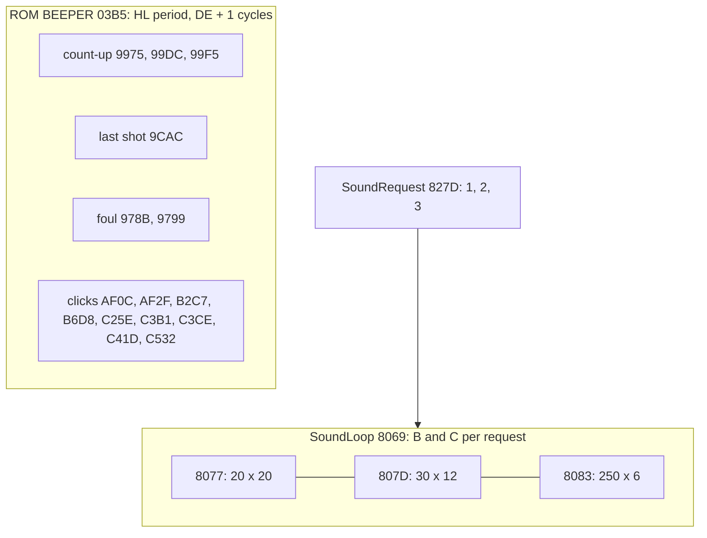

A sound changes by patching these operands: for example `$8079` (the ball tone's B) sets the ball tone's pitch,
`$8078` its length. Nothing else reads them.

## 9.7 The sounds rendered

Each sound is rendered from its recorded speaker writes, not from the model: the speaker bit is held between two
writes, sampled at 44.1 kHz and passed through a soft high-pass (the DC of a held bit removed, as a speaker would).
What the files hold is therefore what the 48K played in the recording, interrupt gaps included.

| File | What | Taken from | Length |
| --- | --- | --- | ---: |
| [`ball.wav`](img/sound/ball.wav) | ball tone, 20 cycles at 2163 Hz (half periods 801 and 817 T) | `w1`, the first ball tone without an interrupt | 9.3 ms |
| [`cushion.wav`](img/sound/cushion.wav) | cushion tone, 12 cycles at 1484 Hz | `w1`, the first cushion tone without an interrupt | 8.1 ms |
| [`pocket.wav`](img/sound/pocket.wav) | pocket tone, 6 cycles at 188 Hz, as played: no pocket tone of any recording escaped an interrupt | `w1`, the first complete pocket tone | 75 ms (32 ms without the gaps) |
| [`last-shot.wav`](img/sound/last-shot.wav) | last-shot beep, BEEPER(500, 10) | `f1` | 12.7 ms |
| [`click.wav`](img/sound/click.wav) | key click, BEEPER(1000, 20) | `w1`, the menu key | 48 ms |
| [`pick.wav`](img/sound/pick.wav) | name pick, BEEPER(1200, 22) | `w1` | 63 ms |
| [`tally.wav`](img/sound/tally.wav) | the longest score count-up, 37 ticks rising 356 to 503 Hz | `w1` frames 8456-8493 | 0.75 s |
| [`foul.wav`](img/sound/foul.wav) | the foul jingle, both notes and the 5-frame gap between them | `w1`, the first jingle | 1.18 s |

```text
render(edges):                                ; tools/fig_sound.py render()
    level = 0
    for each sample time s (1 / 44 100 s):
        level = speaker bit (value bit 4) of the last write at or before s
        y = 0.995 x (y_prev + level - level_prev)   ; one-pole high-pass, about 35 Hz
        write y x 12 000 as a 16-bit sample
```

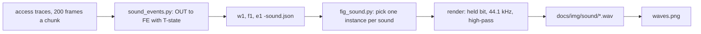

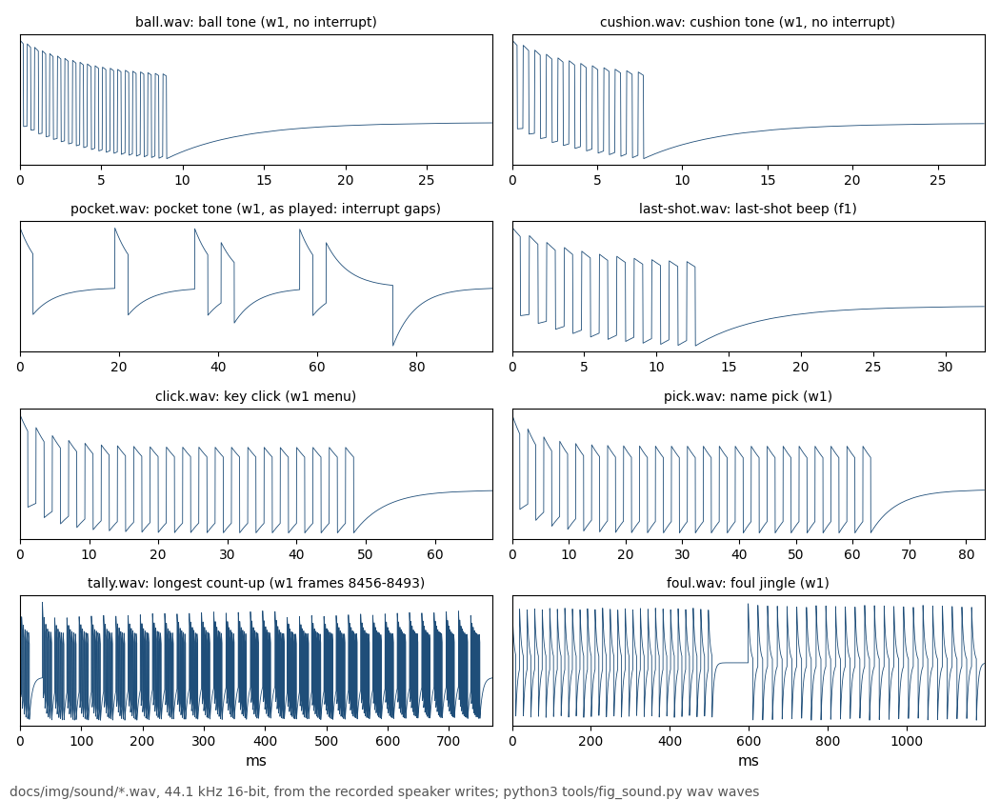

How to read the figure:

- One panel per file, the samples against milliseconds, as written to the WAV.
- A pulse train is a tone; a flat stretch is the speaker held while nothing toggled it (an interrupt in the pocket
  tone, the 5 silent frames between the foul notes, the HALT between two count-up ticks); the slow curve after each
  sound is the high-pass letting the last held level decay.

**The point**: the table tones are very short (8 to 9 ms when nothing interrupts them), the BEEPER notes are clean
and regular because nothing can interrupt them, and the pocket tone is the one sound that is never heard as written:
its six cycles always come out broken by the interrupt.

```bash
python3 tools/fig_sound.py wav     # docs/img/sound/*.wav
python3 tools/fig_sound.py waves   # docs/img/sound/waves.png
```

## 9.8 Not reached

- **The variations click** (VariationsKey `$B6DE`, BEEPER(1000, 20)): in the code; none of `w1`, `f1`, `e1` opened
  the variations screen. The parameters are those of the menu click, so it sounds the same.
- **The editor's potted-ball beep** (`$C3B7`) and **EditorReset's beep** (`$C538`): `e1` potted nothing in the
  editor and never chose reset. Same parameters as every click (known only from the code).
- **A request above 3**: SoundLoop plays any value above 2 as the pocket tone (`$8083` is reached by falling
  through). No writer stores such a value (the stores are 0, 1, 2, 3; 9.3), so it never happens.
- **LoseLife without the jingle** (InfiniteLives `$B8C4` set): reached only by the `f1c` experiment (doc 10.10),
  which has no sound events; the silence follows from the branch at `$9758` (9.4).
