# 10. Gameplay logic

What this covers: the rules of Video Pool as code. The physics profile comes first: the number formats, the shot
through the ROM calculator, the motion step and the friction, the cushions and pockets, the ball-ball exchange, and a
proof that a Python model of the physics is the game's. The rules follow: the three variations, fouls, scoring, lives
and frames, the infinite-lives key combination, and the notable features. The objects these act on, the seven ball
records, are doc 07.

The recordings it rests on (WALKTHROUGH 6.0), all loaded from `work/snaps/entry.z80`:

- `w1`: one player, frames 1-3 cleared, game over. Replayed with the TTD recording on, on an own instance
  (`python3 work/docs/vpC/replay.py --inputs tests/inputs/w1.txt --work work/docs/vpC/w1 --port-base 34925 --to 12100`).
  Sampled with `work/docs/vpC/sample.py`: the ball block `$8A88-$8B4D` at every frame 1075-1560 (the break,
  `w1-break.jsonl`), the player variables `$9F43-$9F50` every 5 video frames 600-12100 (`w1-course.jsonl`).
- `v1`: the variations, replayed the same way to frame 3400; the ball block, `FoulCode $8E80` and the player variables
  every 5 video frames 2850-3400 (`v1-balls.jsonl`, `v1-foul.jsonl`, `v1-course.jsonl`).
- `f1c`: an experiment, `f1` with the four cheat keys held at frame 500 (10.10).
- `f1`, `p2`, `m1`, `game`: the stage-2 counts (`work/stage2/NOTES.md`, `work/stage2/ann/02-physics-notes.md`) and the
  screenshots of WALKTHROUGH 6.1.

## 10.1 Number formats and the tick

Every quantity of the physics is an integer. Four formats cover all of them:

| Quantity | Format | One unit | Example (`w1` frame 1117, the cue ball) |
| --- | --- | --- | --- |
| position x, y | 8.8 unsigned, fraction byte first | 1/256 pixel | `80 B4` = 180.50 |
| velocity vx, vy | 8.8 two's complement | 1/256 pixel a tick | `75 02` = +629 = +2.457 |
| friction step | signed byte | 1/256 pixel a tick, per tick | `FC` = -4 |
| collision coefficient | 0.8, `$0100` = 1.0 | 1/256 | `$0071` = 0.441 |

Tick, video frame and pass are the words of the [Terms](README.md#terms). PhysicsTask `$86C1` is a period-0 task of
`MovingTasks $84BA`, so it runs once a tick: 50 a second while the balls move, fewer when interrupts are lost. "Physics
tick n" is its n-th run since the shot; `tools/physics_model.py` counts these. In each interrupt the redraw task
BallRedraw `$827E` runs first, then PhysicsTask, then ShotEnd `$8357` (doc 04). The screen therefore shows the positions of the tick before.

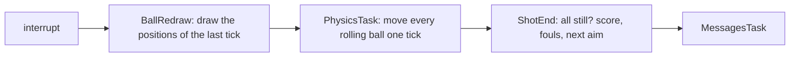

```text
each interrupt while a shot runs:
    BallRedraw()          ; doc 07.3
    PhysicsTask()         ; 10.3 - 10.5
    ShotEnd()             ; 10.9
```

The task list the scheduler walks (doc 04): a period byte and an address per task, `$FF` at the end.

```text
MovingTasks:
$84BA  DEFB $00,$7E,$82    ; period 0, BallRedraw $827E
$84BD  DEFB $00,$C1,$86    ; period 0, PhysicsTask $86C1
$84C0  DEFB $00,$57,$83    ; period 0, ShotEnd $8357
$84C3  DEFB $00,$B7,$9C    ; period 0, MessagesTask $9CB7
$84C6  DEFB $FF            ; the end
```

A sample (`work/docs/vpC/*.jsonl`, TTD `memory_at`) is the memory at the start of its video frame, so it shows the
ticks run up to the frame before. A frame number given with a physics tick below is the sample that first shows it;
the tick ran in the video frame before, which is the frame the traces and animations show.

Worked example: the break of `w1` is released at video frame 1079. AimShot holds that interrupt until frame 1085 (doc
4, 4.7), and physics tick 1 runs at its end, after AimShot, in the same interrupt (`tools/task_costs.py --per-irq` on
`work/runs/w1/traces/1070_0-1100_0.uatr`: AimPower 470 382 T, PhysicsTask 9969 T, the interrupt 483 665 T). Ticks 2-159
run in the interrupts from 1086; the last ball stops in tick 159, run in frame 1252 (sample 1253). That is 159 ticks
of motion in 168 video frames (1085-1252), 3.4 seconds, plus the final pass of tick 160 in 1253 that redraws the last
stop (ball 4: `$90` in sample 1253, `$80` in 1254; 10.6). Nine interrupts are lost: video frames 1155, 1157, ..., 1171, so the
samples 1156, 1158, ..., 1172 repeat the one before. Physics tick 68 (ball 5 meets ball 2, 10.6) sets the seventh ball
rolling, and ball 1 stops in tick 78; the passes of ticks 70-78, with all seven balls moving, are longer than a video
frame, so each runs past the next INT and that interrupt is lost. The losses alternate because the pass after a lost
interrupt starts one INT later.

The evidence, from the `w1` event file `work/docs/vpD/w1-sound.json` (no new run):

- `irq`: an interrupt is accepted in every video frame 1086-1252 at T 1831-1843, except 1155, 1157, ..., 1171.
- The pass entered at 1154 T 1836 is still running at the INT of 1155 and has returned when SoundLoop, the main loop,
  writes the speaker at 1155 T 3499: it lasts between about 69 880 and 71 551 T. The pass entered at 1160 T 1833 writes
  SoundRequest 2 at 1160 T 58 437 (`$8E28` in ReflectY: ball 4 off a cushion, tick 73) and has returned when
  SoundLoop takes the request at 1161 T 7977: less than 76 032 T.
- Not a sound: `beeper` has no ROM BEEPER call between 620 and 1329, and SoundLoop runs with the interrupts enabled,
  only between passes.

The exact length of each long pass needs a trace of frames 1150-1175, which was not made.

**The point**: the whole simulation is integer arithmetic at a fixed rate. Nothing depends on the time a tick takes,
so a replay is exact (doc 07.8).

Witness: PhysicsTask's first instruction ran `w1` 2860 times (frames 1085-11 615), `game` 290, `f1` 742, `p2` 1180,
`v1` 822, `m1` 313.

## 10.2 The shot through the ROM calculator

When the player releases fire, AimPower `$8506` calls ShotReset `$84C7` and AimShot `$8A02`. AimShot turns the aim
cursor and the power into the cue ball's velocity with the Spectrum ROM's floating-point calculator (RST `$28`):

- dx = cursor x - cue x and dy = cursor y - cue y, from the whole-pixel bytes (`CursorX $86BA`, `CursorY $86BB`,
  `$8A89`, `$8A8B`); the fractions are not used.
- r = SQR (dx² + dy²).
- vy = 16 P · dy / r and vx = 16 P · dx / r, converted by FP-TO-BC into a 16-bit word.
- P = `Power $86BF`. Values of `$80` or more are taken as `$7E`; the power is always even (it grows by 2 from 0, doc
  05), so P is at most 126 and the top speed is 126 / 16 = 7.875 pixels a tick.
- A negative product gets 65536 added before FP-TO-BC, which yields its two's complement.

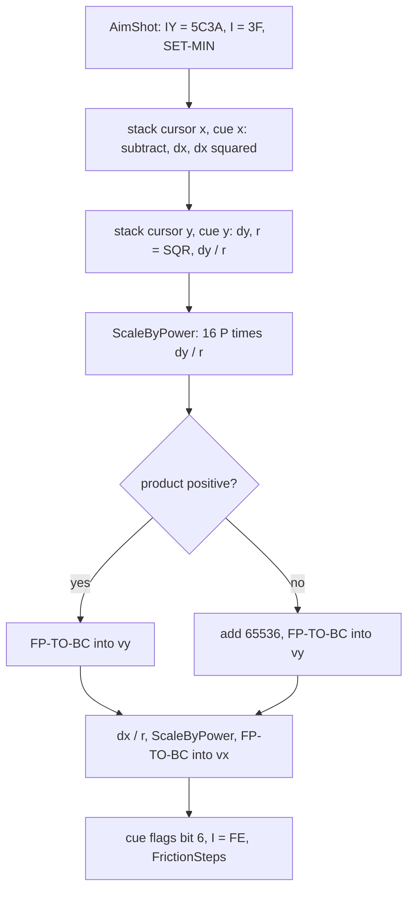

```text
AimShot:
    dx = CursorX - cue.px;  dy = CursorY - cue.py
    r  = sqrt(dx*dx + dy*dy)                       ; the ROM's SQR
    cue.vy = to_word(16 * P * dy / r)               ; ScaleByPower
    cue.vx = to_word(16 * P * dx / r)
    cue.flags |= $40
    FrictionSteps(cue)
to_word(v): if v <= 0: v += 65536                   ; jump-true skips this for v > 0
            return FP-TO-BC(v)                      ; rounds to the nearest integer
```

The asm of ScaleByPower `$8A5D`, the part that ends in the calculator:

```text
ScaleByPower:
$8A5D  LD A,(Power)
$8A60  CP $80
$8A62  JR C,ScalePowerOk
$8A64  LD A,$7E            ; at most 126
ScalePowerOk:
$8A66  ADD A,A
$8A67  LD B,$00
$8A69  LD C,A
$8A6A  SLA C               ; three times: BC = 16 P
       ...
$8A76  CALL STACK_BC
$8A79  RST $28
$8A7A  DEFB $04,$31,$37    ; multiply; duplicate; greater-0
$8A7D  DEFB $00,$06        ; jump-true to the end-calc
$8A7F  DEFB $34,$00,$41,$00  ; stk-data 65536
$8A83  DEFB $0F,$38        ; addition; end-calc
$8A85  JP FP_TO_BC
```

### Worked example: the break of w1

At `w1` frame 1085 the cursor bytes `$86BA`/`$86BB` read `FC 82`, so the cursor is at (252, 130). Power reads `$4C`
= 76. The cue ball stands at (40.547, 115.547), whole pixels (40, 115).

| Step | Value |
| --- | --- |
| dx, dy | 252 - 40 = 212, 130 - 115 = 15 |
| r | SQR (44 944 + 225) = 212.530 |
| 16 P | 1216 |
| vy | 1216 × 15 / 212.530 = 85.82, so 86 = `$0056` |
| vx | 1216 × 212 / 212.530 = 1212.97, so 1213 = `$04BD` |
| speed | 1215.99 / 256 = 4.75 pixels a tick, P / 16 |

The sample of frame 1086 holds `B8 04 56 00` in the cue ball's +4..+7: 1213 less the friction step -5 of physics tick
1, which runs in the same interrupt (10.1, 10.3); `physics_model.py` reproduces it from 1213.

The calculator is slow: AimShot costs about 455 000 T-states (454 950 at `w1` 1079, 454 880 at 4335; 6.5 video frames),
99.8 % of it in the ROM, 85 % in the ROM's SQR. The interrupt that runs it, the shot set-up, lasts 483 665 T (6.92 video
frames) with the interrupts off: the interrupts of the six video frames after the release are lost (1080-1085, doc 4,
4.7).

**The point**: the only square root and the only division of the game are the ROM's, used once a shot. Everything
that runs every tick (10.3-10.5) uses tables instead.

Witness: AimShot runs once a shot: `game` 4, `w1` 21, `f1` 9, `p2` 6, `v1` 4, `m1` 1. A zero product (the cursor on the
cue ball's row or column) also gets 65536 added; FP-TO-BC then returns BC = 0 with the carry set, so the component is
0 after all. That case is known only from the ROM's code.

## 10.3 The motion step and the friction table

MoveBall `$8701` is the motion step of one ball (the mover of doc 07.5). The friction is not a division of the
velocity: a step of about 5/256 pixel a tick is added against the motion every tick. The step is recomputed for one
ball a tick in turn (`FrictionTurn $8B4C`, 0..6), so each ball gets a fresh direction every seventh tick.

FrictionSteps `$90F5` finds the direction without trigonometry:

1. |vx| and |vy| are shifted left together until bit 3 of either high byte is set, at most 8 times.
2. The high bytes give nx and ny, 0..15. The index 16 ny + nx picks a byte of `FrictionTable $DD3A`.
3. The low nibble is the x step and the high nibble the y step, each negated to oppose the motion.

The table holds round(5 × the unit vector of (nx, ny)): a deceleration of 5/256 pixel a tick² in every direction.

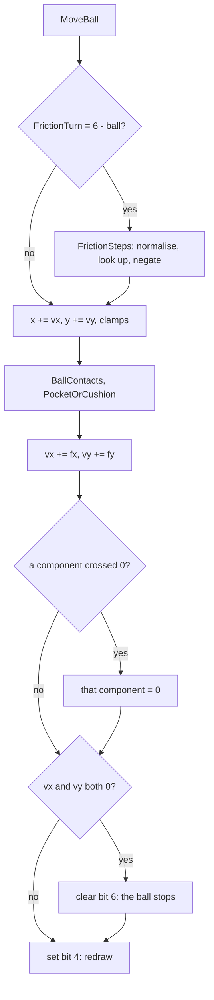

```text
FrictionSteps(b):
    ax = |b.vx|; ay = |b.vy|
    repeat at most 8 times while bit 11 of ax and of ay are both clear:
        ax <<= 1; ay <<= 1
    cell = FrictionTable[16 * (ay >> 8) + (ax >> 8)]
    b.fx = cell & 15  negated unless vx < 0
    b.fy = cell >> 4  negated unless vy < 0
MoveBall friction add:
    v' = v + sext(f); if the sign of v flipped: v' = 0      ; never overshoots
```

The asm of the normalising loop and the look-up:

```text
$9108  LD B,$08
FrictionNormalise:
$910A  BIT 3,H             ; |vy| high byte
$910C  JR NZ,FrictionLookup
$910E  BIT 3,D             ; |vx| high byte
$9110  JR NZ,FrictionLookup
$9112  SLA L
$9114  RL H
$9116  SLA E
$9118  RL D
$911A  DJNZ FrictionNormalise
FrictionLookup:
$911C  LD A,H              ; A = 16 ny + nx
$911D  ADD A,A
$911E  ADD A,A
$911F  ADD A,A
$9120  ADD A,A
$9121  ADD A,D
$9122  LD H,$00
$9124  LD L,A
$9125  LD DE,FrictionTable
$9128  ADD HL,DE
$9129  LD A,(HL)
$912A  AND $0F             ; the x step
$912C  BIT 7,(IX+$05)
$9130  JR NZ,FrictionStoreX
$9132  NEG                 ; vx positive: a negative step
FrictionStoreX:
$9134  LD (IX+$08),A
```

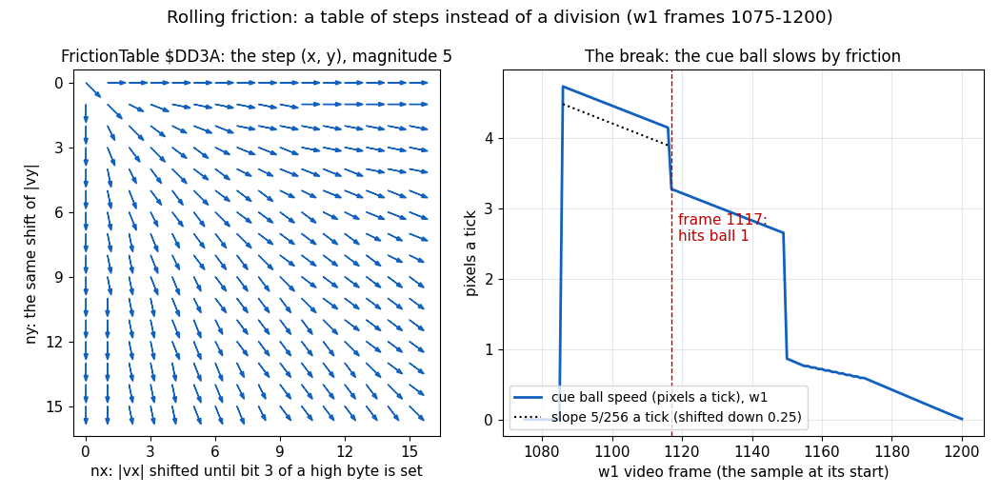

How to read the figure:

- Left: one arrow a cell of `FrictionTable $DD3A`, at (nx, ny). The arrow is the step (x, y) before the sign is put
  in. All arrows have length 5 within rounding except cell (0, 0), which holds `$44`: a step of (4, 4), used for a
  velocity below 8/256 in both components after the eight shifts, or for v = (0, 0); it then does not point along the
  motion (harmless: the add clamps a crossing to 0).
- Right: the cue ball's speed in pixels a tick in each sample of `w1` 1075-1200 (the x axis: the video frame whose
  start the sample is).
- The dotted line has the slope 5/256 a tick, shifted down to sit beside the curve. The curve runs parallel to it
  until the contact at frame 1117.
- The drops at 1117 and 1150 are the contacts with ball 1 and ball 6 (10.5), not friction. The flatter part
  1156-1172 is the stretch where every second interrupt is lost (10.1): the samples step two at a time.

**The point**: the friction is a constant deceleration along the motion, found by a table look-up on the shifted
velocity. The balls slow linearly and stop at a finite time; they do not decay exponentially.

```bash
python3 tools/fig_physics.py friction --image work/mkgame/original.bin --samples work/docs/vpC/w1-break.jsonl --out docs/img/physics/friction.png
```

Worked example (`w1`, the break): AimShot ends in FrictionSteps for the cue ball. |vx| = `$04BD` and |vy| = `$0056`
are shifted once to `$097A` and `$00AC`. Bit 3 of `$09` is set, so nx = 9, ny = 0, index 9. The cell holds x step 5,
y step 0. vx is positive, so fx = -5; fy = 0. The model's ticks then give vx 1208, 1203, ... 1173 at tick 8: five less
a tick, as the samples show.

Two details of MoveBall are worth noting:

- The clamps: x to `$0700..$F800` with the add's carry caught; y to `$3700..$B000` with no carry test on the low side.
  The limits lie past the potting line, so a clamped ball is potted in the same move (clamps fired `w1` 7 / 9 times).
- The redraw test compares the pixel x, y with +10, +11. Those hold the sprite corner (x - 7, y - 7), so the test never
  matches and bit 4 is always set: every rolling ball is redrawn every tick (`$87EA` ran exactly as often as `$87DB`).

Witness: the friction add zeroed a component `w1` 61 / 58 times (`$8795`, `$87B9`); a ball stopped (`$87D2`) `w1` 53
times, `game` 4.

## 10.4 Cushions and pockets

After the ball-ball test, PocketOrCushion `$8B4E` decides between a pot and a bounce. A ball whose centre leaves x
8..247 or y 56..175 is potted. Inside, the cushion code of the pocket size runs: CushionsLarge `$8FBB` (the image's
default, menu option `$B8BC` = 1) or CushionsSmall `$8E81`. All tests use the centre's whole pixels.

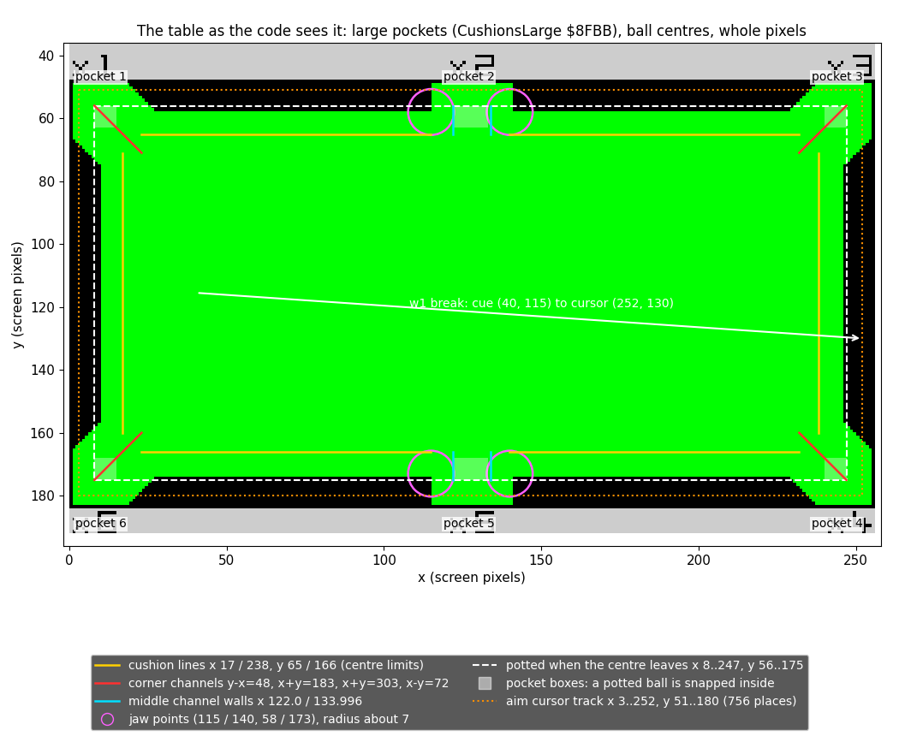

How to read the figure:

- The background is the empty table of `w1` frame 707. The coloured lines are the geometry of CushionsLarge, in the
  coordinates of the ball's centre (so 7 pixels inside the drawn cushions).
- Yellow: the cushion lines x 17 / 238, y 65 / 166. A ball past one is stepped back onto it and reflected.
- Red: the corner channels, 45-degree lines y - x = 48 (top left), x + y = 303 (top right), x + y = 183 (bottom left),
  x - y = 72 (bottom right). A ball 6 or 7 pixels off the line hits the jaw.
- Cyan: the middle channel walls x 122.0 and 133.996. Magenta circles: the jaw points (115 / 140, 58 / 173).
- White dashes: the potting boundary. Light boxes: the pocket boxes a potted ball is snapped into.
- Orange dots: the aim cursor's track (10.8). The white arrow: the break of `w1`.
- Built from the constants of `src/game/cushions.asm`; no recording.

**The point**: the table is a handful of straight lines and four points. Pockets are not holes but channels: a ball is
potted only when it has passed the jaws and left the playing rectangle.

```bash
python3 tools/fig_physics.py geometry --table work/docs/vpC/shots/t707.png --out docs/img/physics/geometry.png
```

The tests, in order:

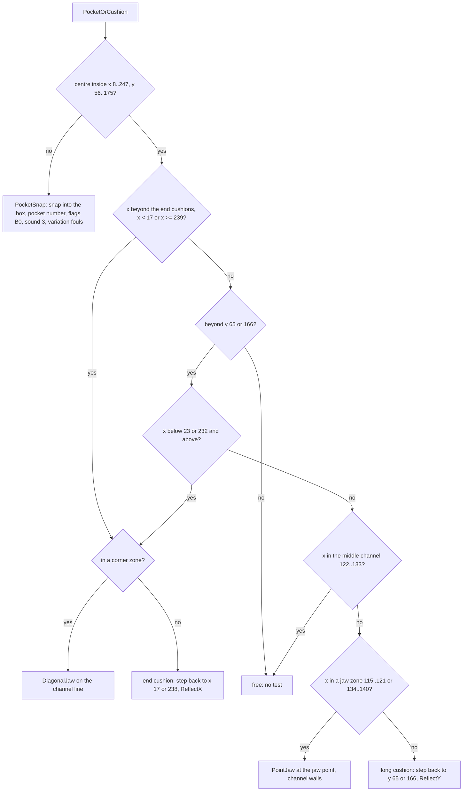

```text
PocketOrCushion(ball):
    if not (8 <= px < 248 and 56 <= py < 176):
        PocketSnap(ball); return
    CushionsLarge(ball)
ReflectX(ball):  vx = -vx; fx = -fx; x fraction = $FF if px >= 128 else $00; EventCount += 1; sound 2
ReflectY(ball):  the same for y
ReflectDiagonal(ball, B, C):  (vx, vy, fx, fy) = (vy, vx, fy, fx), all negated when B == C
```

### The jaw that patches itself

DiagonalJaw `$8C7E` tests the signed distance A of the ball from a corner channel's line. A distance in the band
(6-7 large, 2-3 small) is a contact: JawContact reflects the ball (ReflectDiagonal) if it moves into the jaw, in both
components or in the larger one; otherwise JawAway only sets the fractions and the ball goes on. Less is inside the
channel: no bounce. More means the
ball went too deep in one tick. Then the routine patches its own exit: `JawShallowExit $8C92` holds `RET C / NOP`,
and the deep case writes `JR C,JawContact` there. It then steps the ball back with StepBack `$8E33`, with the cushion
test pushed as the return address, so the test repeats until the ball is in the band. With the patch in place, a ball
backed off too far is still a contact. PocketOrCushion writes `RET C / NOP` back at each call.

The band operands themselves are patched too: CushionsLarge writes 6 and 7 into `$8C8B` and `$8C8F`, CushionsSmall
writes 2 and 3.

```text
JawDepthTest:
$8C8A  CP $02              ; patched: 2 (small) or 6 (large)
$8C8C  JR Z,JawContact
$8C8E  CP $03              ; patched: 3 or 7
$8C90  JR Z,JawContact
JawShallowExit:
$8C92  RET C               ; patched to JR C,JawContact ($38 $0E) after a deep step
$8C93  NOP
$8C94  LD A,$38            ; too deep: patch the exit
$8C96  LD (JawShallowExit),A
$8C99  LD A,$0E
$8C9B  LD (JawShallowExit+$0001),A
$8C9E  PUSH HL             ; the test to repeat
$8C9F  JP StepBack
```

JawContact, the test that decides between a bounce and none (C, B: the normal's sign bytes):

```text
$8CA2  LD A,C
$8CA3  XOR (IX+$05)        ; L bit 7: moving into the jaw in x
$8CA6  LD L,A
$8CA7  LD A,B
$8CA8  XOR (IX+$07)        ; H bit 7: moving into the jaw in y
$8CAB  LD H,A
$8CAC  OR L
$8CAD  JP P,JawAway        ; away in both: no bounce
$8CB0  LD A,H
$8CB1  AND L
$8CB2  JP M,JawReflect     ; into the jaw in both: bounce
       ...                 ; one of each: |vx| against |vy|, the larger decides
$8CE2  JR C,JawAway
JawReflect:
$8CE4  LD (IX+$00),C       ; fractions = C, B
$8CE7  LD (IX+$02),B
$8CEA  JP ReflectDiagonal
JawAway:
$8CED  ...                 ; fractions = the complements of C and B, RET
```

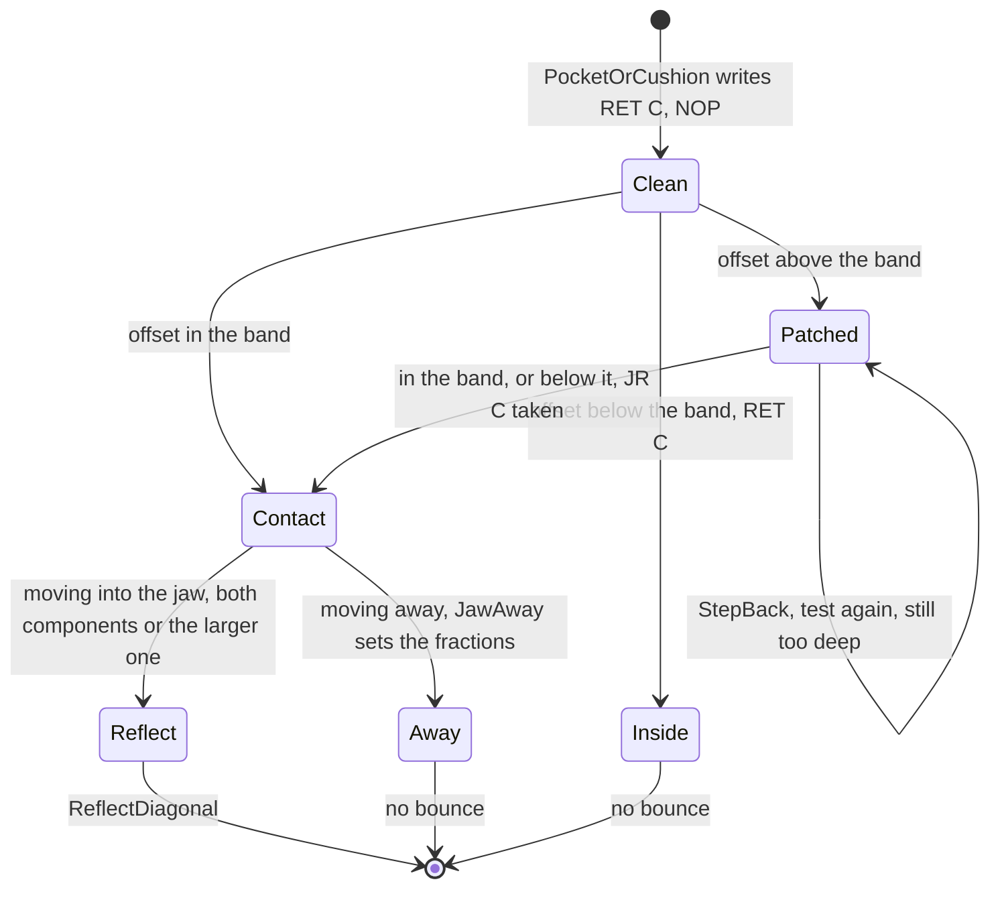

Worked example 1, a long cushion (`w1` tick 52, frame 1137): the cue ball at (224.512, 165.613) with v (553, 497)
moves to y 167.55, past the line 166. StepBack halves (553, 497) twice to (138, 124) and subtracts it until the pixel
y is 166. ReflectY then sets the y fraction to `$FF` (bottom half) and negates vy and fy. After the friction add the
ball is at (225.594, 166.996) with v (549, -494) and steps (-4, +3).

Worked example 2, a corner jaw (`w1` tick 103, frame 1197): ball 5 at (240.051, 58.566) moves up and right with v
(109, -296) into the top right corner zone. Its offset from the line x + y = 303 is in the band: JawContact. The normal's
signs are equal, so ReflectDiagonal swaps and negates: v becomes (296, -109), and (291, -107) after friction. The ball,
which was heading up into the cushion, now heads right into the pocket mouth (10.7).

**The point**: the bounce off a 45-degree jaw is a swap of the two velocity components, the cheapest exact reflection
there is. The self-patching exit lets one routine serve both the first test and the repeated test after a step back.

Witness: CushionsLarge ran `w1` 5626, `game` 286, `f1` 1571, `p2` 3848, `v1` 2294 times; CushionsSmall only in `m1`
(970). DiagonalJaw entered `w1` 43 times, the deep case `w1` 7. ReflectX `w1` 31, ReflectY `w1` 48, ReflectDiagonal
`w1` 10. PointJaw `w1` 7, `v1` 3, `m1` 8.

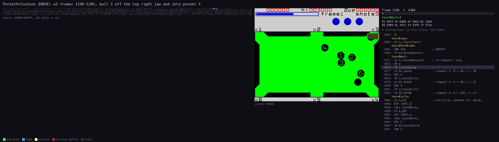

Steps in a recording: `w1` video frames 1196-1201 (a trace: each tick in the frame it runs in, one before its
sample). The listing follows PocketOrCushion and CushionsLarge for each moving ball; in frame 1196 (physics tick 103,
sample 1197) it reaches DiagonalJaw, JawContact and ReflectDiagonal for ball 5, and in frame 1200 (tick 107)
PocketSnap (`work/review/fixC/pcframes.py` on `work/docs/vpC/w1/traces/1196_0-1202_0.uatr`). The right
panel is the screen.

```bash
python3 ../../kit/routine_anim.py --work work/docs/vpC/w1 --window 1196:0-1202:0 --listing build/game.lst --view screen \
    --range 8A00-90FF --pc 8B4E-90F4 --pictures 96 \
    --title 'PocketOrCushion $8B4E: w1 frames 1196-1201, ball 5 off the top right jaw and into pocket 3' --out docs/img/routines/PocketOrCushion.gif
```

## 10.5 Ball against ball

BallContacts `$87EF` runs for the moving ball IX against every other ball IY on the table. It uses no trigonometry and
no square root:

1. The whole-pixel offsets |dx|, |dy| (both below 16) index `ContactTable $DBFA[16 |dy| + |dx|]`. The cell is `$80`
   for d² ≤ 212 (overlap), a ring number 1-31 for d² 218..250 (touching), 0 otherwise. Only an overlap starts a
   contact: a ball that lands exactly on the ring without overlapping is passed over.
2. On overlap, StepBack `$8E33` moves IX back along its own velocity by less than a pixel (the velocity halved until
   below 1), and the table is read again. This repeats until the cell is no longer `$80`.
3. The ring number n selects a record of `CollisionRecords $DE3A + 6 (n - 1)`: three 0.8 coefficients w0 =
   floor(256 dx² / 225), w1 = floor(256 dy² / 225), w2 = floor(256 |dx dy| / 225) for that cell (rings 8 and 24 hold
   41 for the small one, one above the floor 40).
4. The exchange runs only if IX moves towards IY in x or in y. With dv = v(IY) - v(IX): A = w0 dvx, B = w2 dvy,
   C = w2 dvx, D = w1 dvy (ScaleVelocity `$89C4` with MulByte `$89F5`). The cross terms are added when dx and dy have
   the same sign (ContactSigns 0 or 3), subtracted otherwise.
5. IX.v += (A ± B, D ± C) and IY.v -= the same. IY is set moving, BallHitFlag `$89BB` = 1, the sound request 1,
   EventCount + 2, and both balls get new friction steps.
6. The mover's fractions are set to `$80`, the centre of its pixel.

This is the projection of the relative velocity onto the line of centres, given to one ball and taken from the other:
an elastic collision of equal masses.

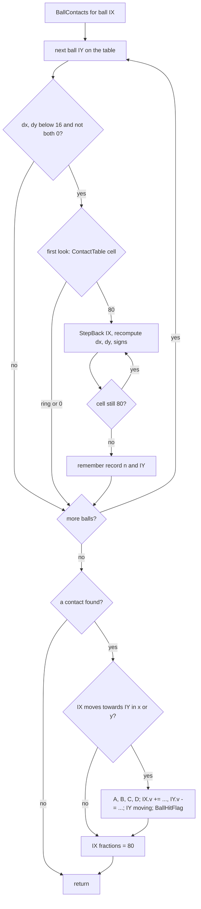

```text
BallContacts(me):
    found = none
    for o in balls on the table:
        dx = me.px - o.px; dy = me.py - o.py
        if |dx| >= 16 or |dy| >= 16 or dx == dy == 0: continue
        if ContactTable[16|dy| + |dx|] != $80: continue        ; only an overlap starts a contact
        repeat: StepBack(me); recompute dx, dy
        until ContactTable[...] != $80
        found = (o, record n, signs = 2*(dx < 0) + (dy < 0))     ; the last one wins
    if found and me approaches o:
        dv = o.v - me.v
        A, B, C, D = w0*dv.x, w2*dv.y, w2*dv.x, w1*dv.y
        s = +1 if signs in (0, 3) else -1
        me.v += (A + s*B, D + s*C);  o.v -= (A + s*B, D + s*C)
        o.flags |= $40; BallHitFlag = 1; EventCount += 2
        FrictionSteps(me); FrictionSteps(o)
    if found: me.x.frac = me.y.frac = $80
```

The asm of the approach test and the first term:

```text
$889C  LD A,(ContactSignsFound)  ; bit 1: dx < 0, bit 0: dy < 0
$889F  RRCA
$88A0  RRCA                      ; bit 1 to bit 7
$88A1  XOR (IX+$05)              ; against the sign of vx
$88A4  LD L,A
$88A5  LD A,(ContactSignsFound)
$88A8  RRCA                      ; bit 0 to bit 7
$88A9  XOR (IX+$07)              ; against the sign of vy
$88AC  OR L
$88AD  JP P,ContactCentre        ; moving away in both: no exchange
$88B0  LD L,(IY+$04)             ; dvx = IY.vx - IX.vx
$88B3  LD H,(IY+$05)
$88B6  LD E,(IX+$04)
$88B9  LD D,(IX+$05)
$88BC  XOR A
$88BD  SBC HL,DE
$88BF  EX DE,HL
$88C0  PUSH DE
$88C1  LD HL,(ContactRecordPtr)  ; w0
$88C4  LD A,(HL)
$88C5  INC HL
$88C6  LD H,(HL)
$88C7  LD L,A
$88C8  CALL ScaleVelocity
$88CB  LD (ExchangeA),HL         ; A = w0 dvx
```

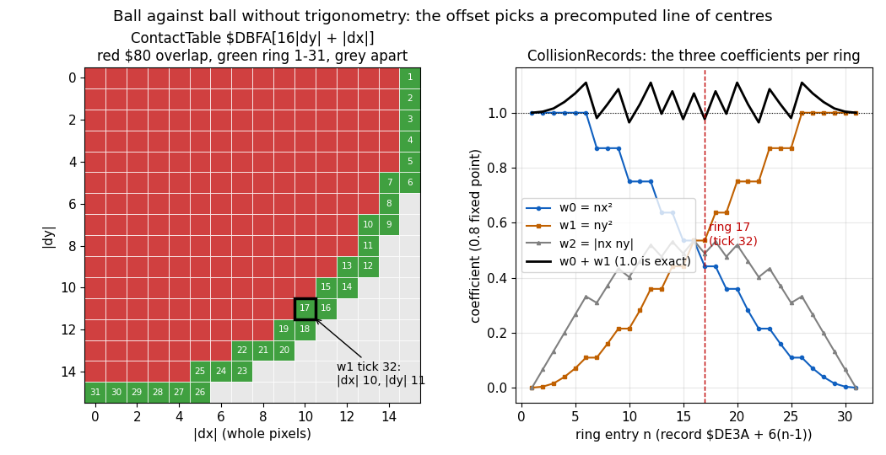

How to read the figure:

- Left: `ContactTable $DBFA` as a 16 × 16 grid of (|dx|, |dy|). Red cells are `$80` (overlap), green cells carry their
  ring number, grey cells are apart. The black frame is the cell of the worked example below.
- Right: the three coefficients of each ring record, and their sum w0 + w1. An exact projection would have w0 + w1 =
  1.0 on every ring.
- The sum is d² / 225 truncated, because the records divide by 15² and not by the cell's own d². It runs from 0.965
  (ring 10, d² 218) to 1.109 (ring 26, d² 250); ring 16 (11, 11), the 45-degree contact, has 274 / 256 = 1.070 (242 /
  225 = 1.075 before the truncation).
- Built from the image `work/mkgame/original.bin`; no recording.

**The point**: a collision costs two table reads and four 8 × 16-bit multiplications. The price is accuracy: a contact
may hand out up to 11 % more or 3.5 % less of the relative velocity than it should (10.11).

```bash
python3 tools/fig_physics.py contact --image work/mkgame/original.bin --out docs/img/physics/contact.png
```

### Worked example: the cue ball meets ball 1 (w1 physics tick 32, run in video frame 1116, sample 1117)

Before the tick (sample 1116): the cue ball at (178.35, 125.96) = (`$B25A`, `$7DF6`) with v (1058, 86); ball 1 at rest at
(190, 115).

| Step | Cue ball | Test |
| --- | --- | --- |
| MoveBall adds v | (`$B67C`, `$7E4C`) = (182.48, 126.30) | dx = 182 - 190 = -8, dy = 11: cell (8, 11), d² 185: `$80` |
| StepBack 1: v / 8 = (132, 10) | (`$B5F8`, `$7E42`), pixel (181, 126) | (9, 11), d² 202: `$80` |
| StepBack 2 | (`$B574`, `$7E38`), pixel (181, 126) | still `$80` |
| StepBack 3 | (`$B4F0`, `$7E2E`), pixel (180, 126) | (10, 11), d² 221: ring 17 |

Ring 17 is the record at `$DE9A`: w0 = `$71` = 0.441, w1 = `$89` = 0.535, w2 = `$7D` = 0.488. (The exact values for
the direction (10, 11) are 100/221 = 0.452, 121/221 = 0.548, 110/221 = 0.498.) The signs are 2 (dx < 0, dy ≥ 0), so
the cross terms are subtracted. The cue ball moves towards ball 1 in x: the exchange runs.

| Term | Value |
| --- | --- |
| dv | (0 - 1058, 0 - 86) = (-1058, -86) |
| A = w0 dvx | -467 |
| B = w2 dvy | -42 |
| C = w2 dvx | -517 |
| D = w1 dvy | -46 |
| cue v += (A - B, D - C) | (1058 - 425, 86 + 471) = (633, 557) |
| ball 1 v -= the same | (425, -471) |

The cue ball's fractions become `$80`: (180.5, 126.5). The friction add then gives the cue ball (629, 554); ball 1 is
moved later in the same tick (it is next in the order) and ends at (191.66, 113.16) with v (422, -467). Frame 1117 of
the sample holds exactly these bytes (the record of doc 07.1). The energy is kept within 1.2 %: 1 126 760 before,
1 113 404 after, in (1/256 pixel a tick)².

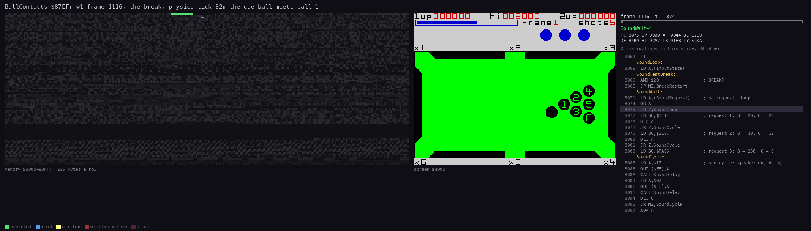

Steps in a recording: `w1` video frame 1116, the whole frame (physics tick 32 runs in its interrupt; its sample is
1117). The listing shows BallContacts scanning the seven records,
the three passes through StepBack and the four ScaleVelocity calls of the exchange. The right panel is the screen.

```bash
python3 work/docs/vpA/slice_trace.py work/docs/vpC/w1/traces/1112_0-1120_0.uatr 1116 1117 work/review/fixC/1116_0-1117_0.uatr
python3 ../../kit/routine_anim.py --trace work/review/fixC/1116_0-1117_0.uatr --listing build/game.lst --view screen \
    --range 8000-DFFF --pc 87EF-89FF --pictures 80 \
    --title 'BallContacts $87EF: w1 frame 1116, the break, physics tick 32: the cue ball meets ball 1' \
    --out docs/img/routines/BallContacts.gif
```

Witness: a contact found and exchanged `w1` 71, `f1` 28, `p2` 49, `v1` 31-32, `m1` 17 times; the overlap path `w1`
201 times; ScaleVelocity 4 calls a contact (`w1` 284). The exchange was skipped for a ball moving away in no recording
(the `JP P` at `$88AD` never taken).

## 10.6 The trajectory against the model

`tools/physics_model.py` is the physics of 10.3-10.5 in Python, instruction for instruction: MoveBall, FrictionSteps,
StepBack, BallContacts with ScaleVelocity, PocketOrCushion with CushionsLarge, both jaws and the three reflections. It
reads the four tables from the image. It runs a tick on the 98-byte ball block and compares every recorded frame with
the model's block, byte for byte.

```bash
python3 tools/physics_model.py --image work/mkgame/original.bin --samples work/docs/vpC/w1-break.jsonl --shot 1085,252,130,76 --events
```

Result: "475 frames equal to a model tick byte for byte (98 bytes); last frame 1560, tick 160". Every sampled frame of
the break, from the shot to long after the last ball stopped, equals one model tick. A sample after a lost interrupt
(the nine of 10.1) equals the one before. Tick 160 is the last redraw after the last stop.

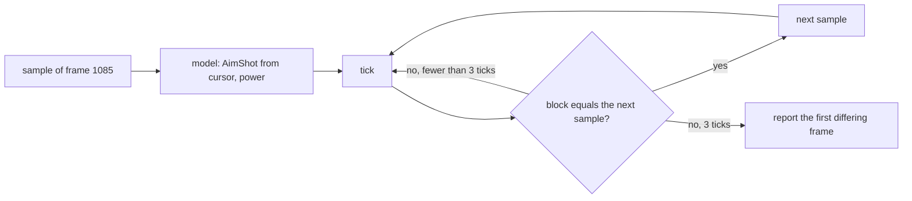

```text
balls = sample[1085]; model.shot(balls, (252, 130), 76)
for each later sample:
    run up to 3 ticks until balls.raw() == sample        ; 98 bytes
    if not equal: report and stop
```

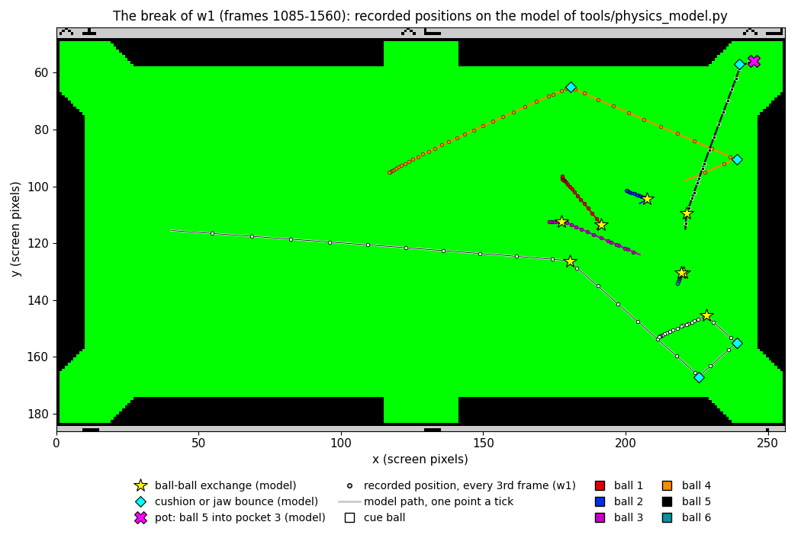

How to read the figure:

- The background is the empty table of `w1` frame 707. Each ball has its colour (legend).
- A line is the model's path, one point a tick. A dot is the recorded position of a moving ball in every third sample
  of `w1` 1085-1560.
- Yellow stars are the model's ball-ball exchanges; cyan diamonds its cushion and jaw bounces; the magenta cross the
  pot of ball 5 into pocket 3 at frame 1201.
- Every dot lies on its line: not near it, on it, because the bytes are equal.

**The point**: the model is the game's physics. Every claim of 10.3-10.5 is checked by 475 frames of a real break, not
only by reading the code.

```bash
python3 tools/fig_physics.py trajectory --image work/mkgame/original.bin --samples work/docs/vpC/w1-break.jsonl \
    --table work/docs/vpC/shots/t707.png --shot 1085,252,130,76 --out docs/img/physics/trajectory.png
```

Worked example: every event the model prints for the break (`--events`), with the sample that first shows it and the
video frame the tick ran in.

| Tick | Sample | Runs in | Event |
| --- | --- | --- | --- |
| 32 | 1117 | 1116 | cue ball meets ball 1 (ring 17, three step-backs) |
| 33 | 1118 | 1117 | ball 1 meets ball 2 (ring 9) |
| 34 | 1119 | 1118 | ball 2 meets ball 4 (ring 8) |
| 41 | 1126 | 1125 | ball 4 off the right cushion (ReflectX) |
| 42 | 1127 | 1126 | ball 2 stops |
| 52 | 1137 | 1136 | cue ball off the bottom cushion (ReflectY) |
| 59 | 1144 | 1143 | cue ball off the right cushion |
| 65 | 1150 | 1149 | cue ball meets ball 6; ball 6 meets ball 5 |
| 67 | 1152 | 1151 | ball 6 meets ball 3 |
| 68 | 1153 | 1152 | ball 5 meets ball 2: all seven balls roll |
| 73 | 1161 | 1160 | ball 4 off a long cushion (ReflectY); interrupts lost in 1155-1171 (10.1) |
| 78 | 1171 | 1170 | ball 1 stops |
| 87 | 1181 | 1180 | ball 6 stops |
| 94 | 1188 | 1187 | ball 2 stops |
| 103 | 1197 | 1196 | ball 3 meets ball 1 (ring 31); ball 5 off the top right jaw (ReflectDiagonal) |
| 107 | 1201 | 1200 | cue ball stops; ball 5 potted, pocket 3 |
| 114 | 1208 | 1207 | ball 1 stops |
| 124 | 1218 | 1217 | ball 3 stops |
| 159 | 1253 | 1252 | ball 4 stops: the last |

Witness: the samples are TTD `memory_at` reads of the own `w1` replay; the comparison is printed by the command above.

## 10.7 A ball into a pocket

A pot is the end of a path through PocketOrCushion: the ball's centre leaves the playing rectangle, PocketSnap `$8B71`
snaps it into its pocket's box and marks it. The next redraw takes it off the table (doc 07.2).

```text
PocketSnap(ball, n):
    column = 1 if px < 64 else 2 if px < 192 else 3
    clamp x into the column's box (8-15, 122-133, 240-247 large); fraction 0
    clamp y into the row's box (56-63 if py < 115 else 168-175); fraction 0
    ball.pocket = column if top else 7 - column               ; 1-3 top, 4-6 bottom right to left
    ball.flags = (ball.flags | $30) & ~$40                    ; potted, to be redrawn, not moving
    SoundRequest = 3
    variation fouls (10.9)
```

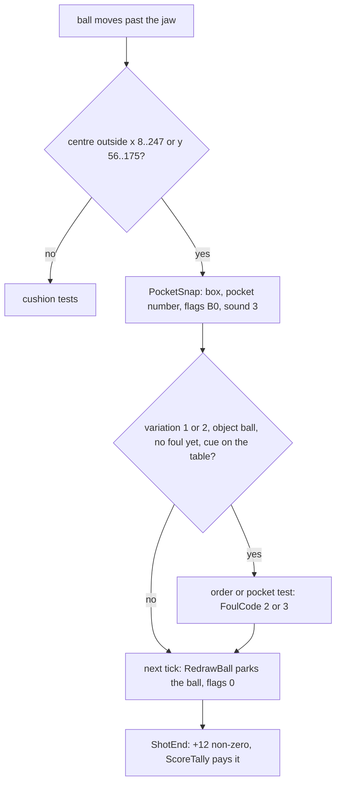

Worked example (`w1` physics ticks 103-108, samples 1197-1202): ball 5 leaves the jaw at (240.0, 57.0) with v (291, -107).
From (240.0, 57.0) the tick-104 move gives (241.137, 56.582); pixel (241, 56) lies in the top-right jaw band, so
JawContact `$8CA2` runs, and with the larger component in x JawAway `$8CED` writes the complements of the jaw point
into both fractions, here `$FF`: (241.996, 56.996), the jaw's clamp, not a plain move (sample 1198: `FF F1 FF 38`).
Then it moves on about 1.1 pixels right and 0.4 up: (243.113, 56.586), (244.211, 56.184). In tick
107 the move takes y to 55.79: pixel 55, outside. The column is 3 (x 245 ≥ 192), the row is the top: pocket 3. The ball
is snapped to (245, 56) with flags `$B0`. In tick 108 RedrawBall erases it and parks it at (103, 27), flags 0.

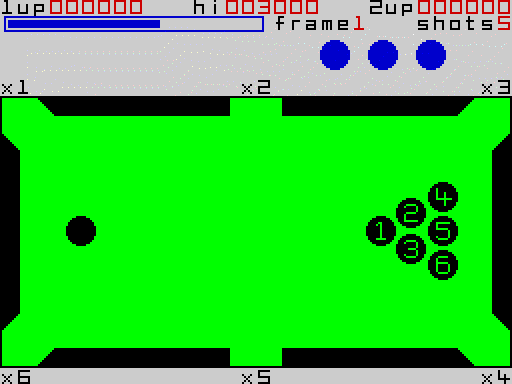

The screen of `w1` from the frame before the shot (1084) to the frame after the last ball stopped (1256), every frame.
Ball 5 drops into the top right pocket at frame 1201 and appears in the row above the table.

```bash
python3 ../../kit/screen_anim.py --work work/docs/vpC/w1 --from 1084 --to 1256 --step 1 --scale 2 --delay 40 --hold 2000 docs/img/play/w1-1084-break.gif
```

**The point**: a pocket is a box outside the playing rectangle. The ball is never "in a hole": it crosses a line and is
moved into a fixed box, from which the pocket number follows by column and row.

Witness: PocketSnap ran `w1` 18, `f1` 3, `p2` 2, `v1` 5 times; never in `game` or `m1`.

## 10.8 The aiming aid, and no computer player

There is no aiming line, no ghost ball and no predicted path. The only aid is the cursor: a small cross that runs round
the cushion line (x 3..252, y 51..180, the orange track of the geometry figure) on a perimeter coordinate of 756
places: AimCursorMove `$8546` turns the input into CursorSpeed `$86BC` (±1, accelerated to 6), and AimCursorDraw `$85EB`
turns CursorX, CursorY into the perimeter coordinate, adds the speed modulo `$2F4` (CursorAddSpeed `$863B`) and turns it
back into x, y (CursorToLeft `$8657` and the next tests). The cue ball is shot straight at the cursor (10.2). The cursor's
movement and the power bar are doc 05.

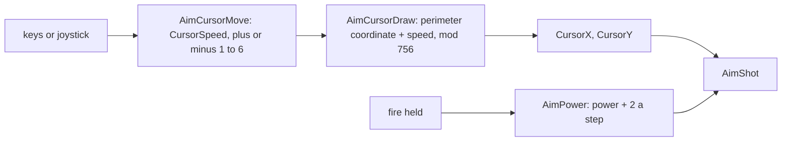

```text
AimCursorMove: speed = from InputState, ±1, accelerated up to ±6
AimCursorDraw: if speed == 0: return
               h = perimeter(CursorX, CursorY)        ; top x - 3, right 249 + (y - 51),
                                                     ; bottom 378 + (252 - x), left 627 + (180 - y)
               h = (h + speed) mod 756; (CursorX, CursorY) = point(h)
AimShot:       direction = (CursorX - cue.px, CursorY - cue.py)        ; 10.2
```

The asm of the step along the perimeter, in AimCursorDraw:

```text
CursorAddSpeed:
$863B  LD A,(CursorSpeed)   ; + the speed, signed
$863E  LD E,A
$863F  LD D,$00
$8641  OR A
$8642  JP P,CursorSpeedSigned
$8645  DEC D
CursorSpeedSigned:
$8646  ADD HL,DE            ; HL = the perimeter coordinate
$8647  LD DE,$02F4          ; 756
$864A  BIT 7,H
$864C  JR Z,CursorWrapHigh
$864E  ADD HL,DE            ; below 0: + 756
$864F  JR CursorToLeft
CursorWrapHigh:
$8651  XOR A
$8652  SBC HL,DE            ; 756 or more: - 756
$8654  JR NC,CursorToLeft
$8656  ADD HL,DE
```

Is there a computer opponent? No. The evidence:

- `CursorX $86BA` and `CursorY $86BB` are written only by `aim.asm` (the player's keys) and `editor.asm` (the editor's
  cursor).
- AimShot is called from two places only: `aim.asm` line 39 (AimPower, on the release of fire) and `editor.asm` line
  762 (the editor's test shot).
- The two-player mode swaps two human players' sets (doc 07.7); the menu offers one or two players, nothing else.
- The attract sequence (logo, signature, "press any key") plays no demo game: no AimShot runs in `m1` before the menu.

Worked example (`w1` frame 1085): the cursor stands at (252, 130) on the right part of the track; the cue ball at (40,
115). The direction is (212, 15), 4.0 degrees below the horizontal, and the cue ball meets ball 1 in tick 32.

**The point**: Video Pool is a game for one or two humans; every shot comes from a cursor a person moved.

Witness: AimShot `m1` 1 call (the shot on small pockets, after the menu); the attract part of `m1` (frames 300-1500) has
none.

## 10.9 The rules: variations, fouls, scoring, lives and frames

The game is played in frames. Each frame racks the six object balls (doc 07.4); the player must pot all six. The rules
around it:

- **Shots**: each frame gives a number of shots without a pot (`ShotsLeft $9F4D`): 5, 5, 4, 4, 4, 3, 3, 3, 3 for frames
  1-9 (`ShotsPerFrame $9C06`), then 2. A variation adds variation + 1 (`ShotsForFrame $9BE6`): variation 2 on frame 1
  gives 8 (`v1`). A pot refills the count (ScoreTally ends with ShotsLeft = ShotsForFrame).
- **Fouls** (`FoulCode $8E80`): 1 "FOUL SHOT!" (no ball touched, or the shots ran out), 2 "WRONG ORDER!", 3 "WRONG
  POCKET!". The cue ball potted is a foul too, without a code.
- **Lives**: 3 at the start (`LivesLeft $9F4E`). A foul costs one (LoseLife `$9754`); below 0 is GAME OVER.
- **Score**: each potted ball pays frame × ball number × the pocket's multiplier, shown × 10.
- **Frames**: the last object ball potted ends the frame: NextFrame `$9BB8` (frame + 1, the pocket marks turn), a new
  rack and the next aim.

The three variations (menu, `Variation $B8C3`):

| Variation | Rule | Foul | Code |
| --- | --- | --- | --- |
| 0, standard | any ball in any pocket | none of its own | - |
| 1, numeric order | the lowest ball on the table first | a pot while a lower ball is still on the table (and not potted in this shot) | `$8C4B`, FoulCode 2 |
| 2, own pockets | ball n into the pocket marked × n | (pocket + PocketTurn) wrapped into 1-6 ≠ the ball | `$8C37`, FoulCode 3 |

The pocket multipliers are the "×1" ... "×6" marks round the table (DrawPocketMarks `$9D6B`). Pocket p pays ((PocketTurn
+ p - 1) mod 6) + 1, where PocketTurn, 0..5, is the first byte of `PlayerVars $9F43` (the label covers the pair
`$9F43/$9F44` of the two players). NextFrame lowers PocketTurn by one each frame (0 wraps to 5), so the marks turn one
place a frame.

The end of a shot, ShotEnd `$8357`:

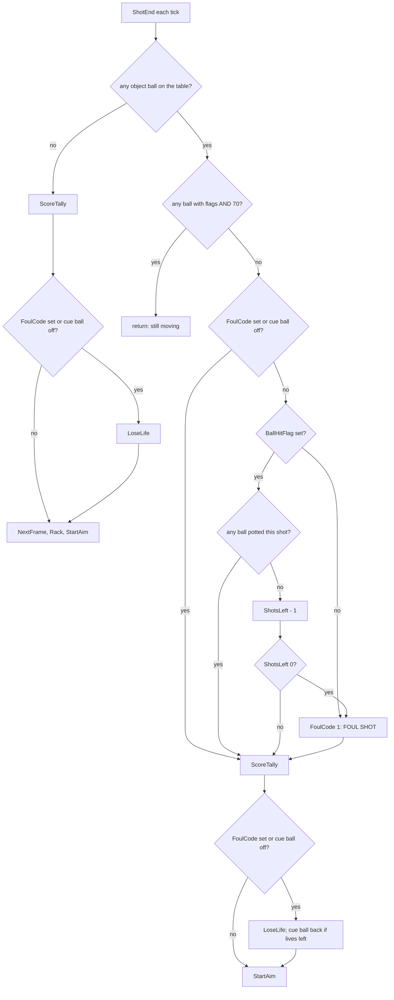

```text
ShotEnd:
    if no object ball on the table:                       ; the frame is cleared
        ScoreTally(); if FoulCode or cue off: LoseLife()
        NextFrame(); Rack(); StartAim(); return
    if any ball has flags & $70: return                   ; still moving
    if not FoulCode and cue on the table:
        if not BallHitFlag: FoulCode = 1
        elif no ball has a pocket number:
            ShotsLeft -= 1; if ShotsLeft == 0: FoulCode = 1
    ScoreTally()                                          ; also on a foul
    if FoulCode or cue off: LoseLife(); if cue off and lives >= 0: RespotCueBall()
    StartAim()
LoseLife:
    if InfiniteLives: NextTurn(); return                  ; 10.10
    FoulJingle(); lives -= 1; if lives < 0: GameOver()
    erase a life ball; NextTurn()                         ; two players: swap (doc 07.7)
```

The asm of the shot-count branch:

```text
ShotEndPottedTest:
$83DC  ADD IX,DE           ; was a ball potted this shot?
$83DE  LD A,(IX+$0C)
$83E1  OR A
$83E2  JR NZ,ShotEndScore
$83E4  DJNZ ShotEndPottedTest
$83E6  LD A,(ShotsLeft)    ; one shot fewer
$83E9  DEC A
$83EA  LD (ShotsLeft),A
$83ED  JR NZ,ShotEndScore
ShotFoul:
$83EF  LD A,$01            ; FoulCode 1: FOUL SHOT!
$83F1  LD (FoulCode),A
$83F4  CALL WaitMessages
ShotEndScore:
$83F7  CALL ScoreShot      ; also after a foul
```

The game as states:

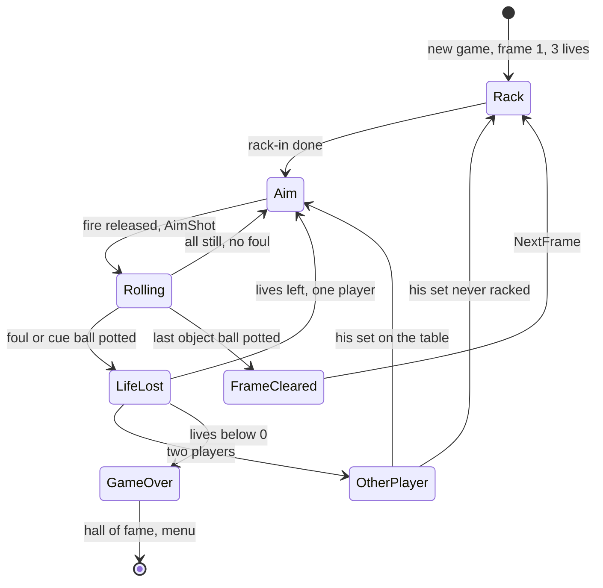

### Worked example 1: a wrong pocket that still scores (v1)

In `v1` variation 2, at frame 1, PocketTurn 0, the player pots ball 5 into pocket 3 at frame 3045. PocketSnap's test:
(3 + 0) = 3 ≠ 5, so FoulCode = 3 and "WRONG POCKET!" (frame 3100). ShotEnd still runs ScoreTally: the pot pays 1 × 5 ×
3 = 15, shown "1x5x3x10=150", and the score counts up from frame 3250 to 15 (shown 000150) at 3265. Then LoseLife:
lives 3 → 2 at frame 3375. The samples `work/docs/vpC/v1-course.jsonl` and `v1-foul.jsonl` hold each step.

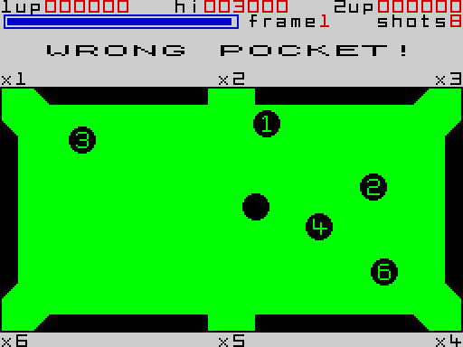

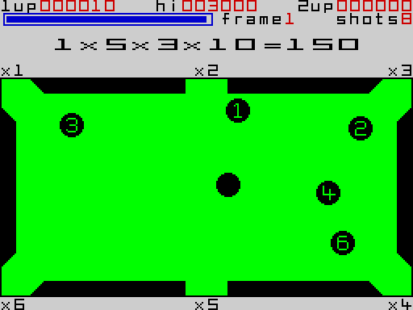

### Worked example 2: the course of w1

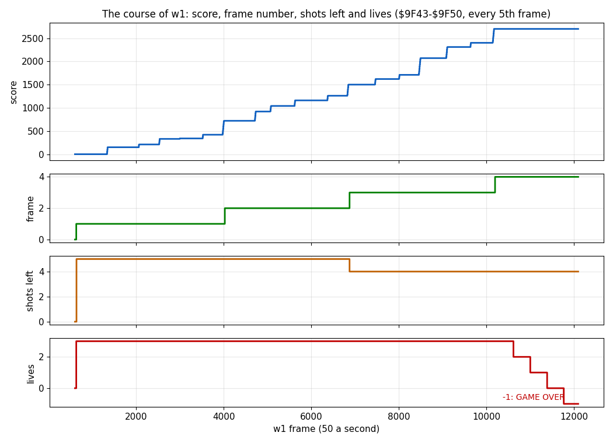

How to read the figure:

- Four rows share the `w1` frame axis; it spans video frames 600-12 100, every 5th video frame: the first rack is at
  630, game over at 11 770.
- Score: each step is one ScoreTally; its count-up takes at least 45 video frames. 18 pots bring 2700.
- Frame: 1 to 4. Frames 1-3 were cleared at frames 4025, 6875 and 10 200 (to the 5-frame step of the samples).
- Shots left: 5 for frames 1-2, 4 for frames 3-4. It never fell: every shot of `w1` either potted (a refill) or
  touched nothing (a foul).
- Lives: 3 until the four fouls of frame 4 (frames 10 620, 11 005, 11 390, 11 770); -1 is GAME OVER.

**The point**: a pot both pays and refills the shots, so a good player never sees the count fall; the frame number
multiplies every pot, so later frames pay more (frame 3's pots paid 3 × ball × multiplier).

```bash
python3 tools/fig_physics.py course --samples work/docs/vpC/w1-course.jsonl --out docs/img/physics/course.png
```

Further screenshots of the rules in the recordings:

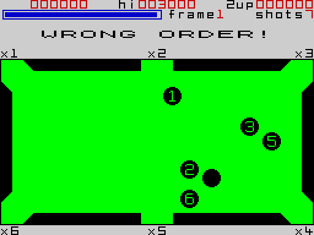

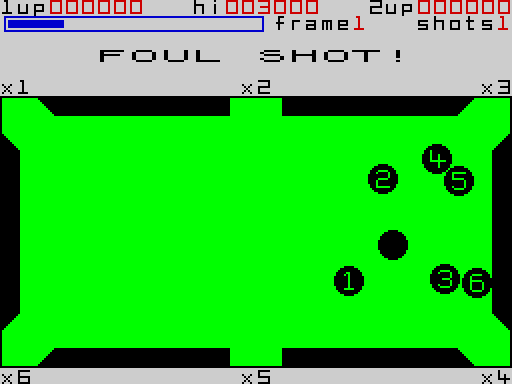

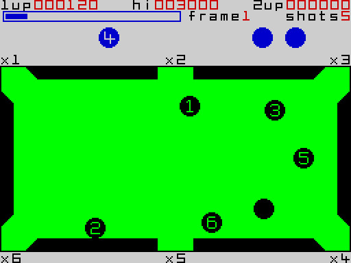

Witness: LoseLife `game` 4, `w1` 4, `f1` 4, `p2` 1, `v1` 3; GameOver `game` 1 (frame 8811), `w1` 1 (11 768), `f1` 1
(4445). The variation fouls `$8C47` and `$8C69` ran `v1` only, 2 times each. ShotsPerFrame read for frames 1-4 only;
frames 5-9 and the "2 from frame 10" are known only from the code.

## 10.10 The infinite-lives key combination

Hold CAPS SHIFT, SPACE, 1 and 0 together while the menu is drawn: `InfiniteLives $B8C4` flips between 0 and `$FF`.
WaitNoKey `$B38E` (run at every menu redraw and after every menu key) asks TestCheatKeys `$B3B8` while any key is held.
With the flag set, LoseLife jumps straight to NextTurn: no jingle, no life lost. Nothing on the screen shows it.

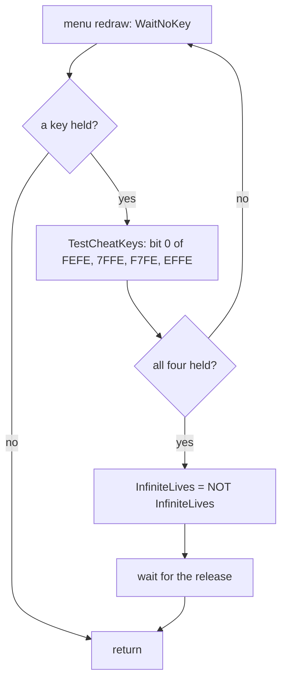

```text
TestCheatKeys:                  ; Z when CAPS SHIFT, SPACE, 1 and 0 are all down
    a = IN($FEFE) | IN($7FFE) | IN($F7FE) | IN($EFFE)
    return bit 0 of a == 0
WaitNoKeyHeld:
    if TestCheatKeys(): InfiniteLives = ~InfiniteLives; wait for no key
```

```text
TestCheatKeys:
$B3B8  LD BC,$FEFE         ; CAPS SHIFT ... V: bit 0 CAPS SHIFT
$B3BB  IN A,(C)
$B3BD  LD BC,$7FFE         ; SPACE ... B: bit 0 SPACE
$B3C0  IN C,(C)
$B3C2  OR C
$B3C3  LD BC,$F7FE         ; 1 ... 5: bit 0 is 1
$B3C6  IN C,(C)
$B3C8  OR C
$B3C9  LD BC,$EFFE         ; 0 ... 6: bit 0 is 0
$B3CC  IN C,(C)
$B3CE  OR C
$B3CF  BIT 0,A             ; 0 only if all four are down
$B3D1  RET
WaitNoKeyHeld:
$B39C  CALL TestCheatKeys
$B39F  JR NZ,WaitNoKey
$B3A1  LD A,(InfiniteLives)
$B3A4  CPL
$B3A5  LD (InfiniteLives),A
```

### Worked example: f1 with the keys held

No recording of the case used the combination: the flip at `$B3A1` ran in no build. To see it work, `f1` was replayed
on an own instance with one change: at frame 500, where `f1` presses SPACE to leave the attract sequence, it holds CAPS
SHIFT, SPACE, 1 and 0.

```bash
sed 's/^500 SPACE$/500 CS SPACE 1 0/' tests/inputs/f1.txt > work/docs/vpC/f1-cheat.txt
python3 work/docs/vpC/replay.py --inputs work/docs/vpC/f1-cheat.txt --work work/docs/vpC/f1c --port-base 34925 --to 4600
python3 work/docs/vpC/sample.py --work work/docs/vpC/f1c --range 9F43-9F50 --frames 600-4600:10 --out work/docs/vpC/f1c-course.jsonl
```

| Frame | `f1` (original) | `f1c` (keys held at 500) |
| --- | --- | --- |
| 508 / 510 | `$B8C4` = 0 | `$B8C4` = 0, then `$FF` |
| about 1000 | the cue ball potted: lives 3 → 2 | lives stay 3 |
| about 3050 | the shots ran out, "FOUL SHOT!": a life | lives stay 3, shots refilled to 5 at 3140 |
| 4445 / 4600 | GAME OVER (4445) | lives 3, score 390, still playing |

**The point**: a developer's switch left in the release: four keys no one presses by chance, on the four half-rows
whose bit 0 they share, read at the one moment (the menu) when the game waits for all keys up.

Witness: `work/docs/vpC/f1c-flag.jsonl` (the flag at frames 490-530) and `f1c-course.jsonl` (lives through frame
4600). TestCheatKeys is asked in every build (`game` 70, `m1` 176 times); the flip only in `f1c`.

## 10.11 Bugs and oddities

| What | Where | Effect | Seen |
| --- | --- | --- | --- |
| the collision coefficients divide by 15², not by d² | `CollisionRecords $DE3A` | a contact hands out 0.965-1.109 times the relative velocity's projection; 1.070 at 45 degrees (274/256) | every contact (10.5) |
| the redraw test compares x with x - 7 | `$87DB` in MoveBall, RedrawSet `$87EA` | never matches: every rolling ball is redrawn every tick | `$87EA` = `$87DB` in every build |
| the y clamp's low side has no carry test | MoveYClamp `$8768` | harmless: y never goes below 0 inside a tick | clamps fired `w1` 9 times |
| a foul pot still scores | ShotEndScore `$83F7` | ScoreTally runs before LoseLife | `v1` frames 3045-3375 (10.9) |
| EventCount 7 repeats the pass | `$86FB` in PhysicsTask | meant for crowded contacts; never reached | never taken |
| ContactFound is the high byte of the record pointer | `$89B8` | cleared before the scan; the pointer's `$DE` makes it non-zero: one store, two meanings | every contact |
| WaitFramesB sits right before the GAME OVER texts | `$988C` | the bytes `76 10 FD C9` (HALT, DJNZ, RET) between the code WaitFramesBStopped `$9886` and GameOverTexts `$9890` | not executed in any recording |

None of these changes the play much. The gain of up to 11 % is the one a player could feel: a thin cut sends the object
ball a little faster than it should.

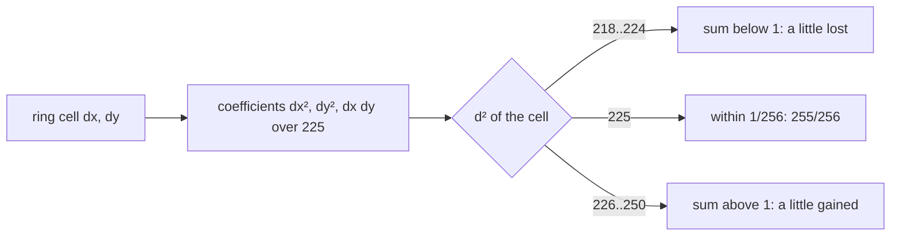

```text
w0 + w1 = floor(256 dx² / 225) + floor(256 dy² / 225), about 256 d² / 225   ; the ring holds 218 <= d² <= 250
ring 16 (11, 11): 137 + 137 = 274 = 1.070 x 256    (242 / 225 = 1.075 before the truncation)
rings 13, 19 (d² 225): 163 + 92 = 255; only rings 1 and 31 sum to 256
```

Worked example: the contact of 10.5 uses ring 17, (10, 11), d² = 221: w0 + w1 = 0.977, so the cue ball keeps a little
more and ball 1 gets a little less than an exact projection gives; the energy after is 98.8 % of the energy before.

**The point**: the oddities are the price of speed and of hand-built tables; none breaks a rule of the game.

Witness: the coefficients are read from the image (the contact figure); the redraw counts and the clamp counts are the
stage-2 counts.

## 10.12 What no recording reached

| What | Where | Known from |
| --- | --- | --- |
| frames 5-9: shots 4, 3, 3, 3, 3 | `$9C0A-$9C0E` | the code |
| frames 5-12: racks 2-5 | `$A1E4-$A701` | the code (doc 07.4) |
| frame 10 and later: two shots | ShotsForFrame `$9BE6` | the code |
| two players, one out of lives while the other plays on | GameOver `$97A2`, WaitFramesB `$988C` | the code |
| the second player's turn with his balls still on the table | NextTurnResume `$9801` | the code |
| a zero velocity component from AimShot (cursor on the cue ball's row or column) | `$8A7A` in ScaleByPower | the ROM's code |
| the infinite-lives flip in an original recording | `$B3A1` | the `f1c` experiment only (10.10) |
| EventCount reaching 7 | `$86FB` | the code |

Each would be reached by a longer or a different game; none is unused.

## 10.13 Notable features

- **Tables instead of trigonometry.** Friction (`$DD3A`), contact (`$DBFA`), collision coefficients (`$DE3A`) and the
  jaw radius (`$DCFA`) are all look-ups on whole-pixel offsets. The only square root and division are the ROM
  calculator's, once a shot (10.2-10.5).
- **The shot through the ROM calculator.** 34 bytes of calculator code (`$8A1A-$8A1E`, `$8A2D-$8A3C`, `$8A45-$8A46`
  and ScaleByPower's `$8A7A-$8A84`) do the vector arithmetic. AimShot costs about 455 000 T-states; the shot set-up's
  interrupt holds the interrupts off for 483 665 T, 6.92 video frames, and the game simply loses six interrupts each
  shot (10.2).
- **A model that matches byte for byte.** The physics is deterministic integer code; `tools/physics_model.py` reproduces
  475 frames of the `w1` break exactly (10.6).
- **The self-patching jaw.** DiagonalJaw rewrites its own exit after a deep step and is reset by its caller each move;
  the band operands are patched by the pocket-size routine (10.4).
- **One store, two meanings.** ContactFound is the high byte of the collision record pointer (10.11). BallContacts
  clears it, the contact found stores the record pointer over it, and the end of the loop reads it as the flag (the
  records lie at `$DE3A` up, so a found contact always leaves a non-zero high byte):

  ```text
  $87F2  LD (ContactFound),A        ; A = 0: no contact yet
  $8879  LD (ContactRecordPtr),HL   ; $89B7 = record low byte, $89B8 = ContactFound = record high byte ($DE)
  $8895  LD A,(ContactFound)        ; OR A / JP Z,ContactDone: zero = no contact
  ```

  Witness (trace `work/runs/w1/traces/1090_0-1130_0.uatr`, `work/review/fix2C/writes.py`): every tick `$87F2` writes
  `$00` to `$89B8`; in video frame 1116 (sample 1117, the ball-1 contact of 10.11) `$8879` writes `$9A` to `$89B7`
  and `$DE` to `$89B8`: the record `$DE9A`, ring 17.
- **Round-robin friction.** One ball a tick gets new friction steps, so seven balls cost one look-up a tick (10.3).
  PhysicsTask advances the turn after the ball loop, and MoveBall recomputes the steps of the ball whose turn it is:

  ```text
  $86EA  LD A,(FrictionTurn)   ; $8B4C
  $86ED  INC A
  $86EE  CP $07
  $86F0  JR NZ,PhysicsTurnStore
  $86F2  XOR A
  $86F3  LD (FrictionTurn),A   ; FrictionTurn = (FrictionTurn + 1) mod 7
  ...
  $8705  LD A,(FrictionTurn)   ; MoveBall, B = 7 - the ball number
  $8708  DEC B
  $8709  CP B
  $870A  CALL Z,FrictionSteps  ; only the ball with 6 - number = FrictionTurn
  ```

  Witness (same trace and script): while only the cue ball rolls, its fx / fy bytes (`$8A90`, `$8A91`) are written by
  FrictionSteps (`$9134`, `$9146`) in video frames 1091, 1098, 1105 and 1112, every seventh tick, each time in the
  tick after `$86F3` stored FrictionTurn 6; `$86F3` writes 0, 1, ..., 6 in turn in the frames between.
- **Equal-mass elastic collisions with a 15² denominator.** Up to 11 % more or 3.5 % less of the projected velocity
  per contact (10.5, 10.11).
- **A foul pot still scores.** The score is paid before the life is taken (10.9).
- **The marks turn.** The pocket multipliers rotate one place a frame, so the best pocket changes (10.9). NextFrame:
  `$9BC9 LD A,(PlayerVars)` / `DEC A` / `JP P,NextFrameTurn` / `LD A,$05` / `$9BD2 LD (PlayerVars),A` /
  `CALL DrawPocketMarks`. Witness: `w1-course.jsonl` reads the pocket turn 0, then 5 from frame 4025, 4 from 6875, 3
  from 10 200: one step at each frame cleared.
- **The rack is an animation.** Six sets of byte scripts; four of them seen by no recording (doc 07.4).
- **No random numbers but R.** The cue ball's fraction after the rack and the cursor start come from the R register;
  a replay is exact (doc 07.8).
- **A hidden switch.** CAPS SHIFT + SPACE + 1 + 0 at the menu gives infinite lives, shown nowhere (10.10).
- **No computer player.** Every shot comes from a human's cursor (10.8).
- **Development leftovers.** `$E014-$E0FF` is code for another memory layout that no build runs or reads
  (`l1sum.py --range E014-E0FF` and `--reads E014-E0FF` print no count; its parser `$E0B8` starts `INC HL` / `LD A,(HL)`
  / `CP $0D` / `RET Z`); `$C591` a stale copy of `$C34C-$C3BA` in the editor, read by no build (`l1sum.py --reads
  C591-C5FF`); the turbo loader keeps "*TES*RESU*" (USER and SET backwards); the hall of fame starts with james,
  francis and bill (doc 11, `HofTable $AC08`).
