# 14. Porting to the UKNC

What this covers: a plan to port Video Pool to the UKNC (Elektronika MS-0511), written from documents 01-10 and the
recordings, before any port code exists.

- the two machines side by side (14.1);
- the game's time budget measured on the Spectrum and estimated on the UKNC's two processors (14.2), from the
  instruction timings of both (14.3);
- the porting plan per subsystem: what moves, what is rewritten, what is converted (14.4);
- the conversion tool and its output, previewed in the target's format (14.5);
- the hot routines re-thought for the PDP-11, with pseudocode and assembly sketches (14.6);
- what the player must not notice, and how the port is checked against the original (14.7);
- the risks, ranked (14.8);
- notes for the BK-0010 / BK-0011M and the Soyuz-Neon (14.9).

Nothing here was run on a UKNC. The machine facts come from the sources below; each is quoted where it is used.
Costs on the target are estimates from instruction timings, not measurements.

### Sources

| Tag | Source | What it gives |
| --- | --- | --- |
| [BTL] | UKNCBTL emulator source, <https://github.com/nzeemin/ukncbtl>: `emulator/emubase/Board.cpp`, `Board.h`, `Processor.cpp`, `Memory.cpp`, `emulator/Emulator.cpp` | the frame (20 ms, 10 000 ticks of 2 µs), the clocks (CPU 16 steps a tick = 8 MHz, PPU 12.5 = 6.25 MHz), the K1801VM2 instruction timings in clock cycles ("Technical description of KM1801VM2"), the address translation of both processors, the screen's line table as the emulator draws it |
| [DOC] | ukncbtl-doc, <https://github.com/nzeemin/ukncbtl-doc>: `uknc-memory.md`, `uknc-ports.md` | the memory planes, the CPU and PPU address maps, every port: channels, plane access, keyboard, timer, system register |
| [WIKI] | Wikipedia, "UKNC", <https://en.wikipedia.org/wiki/UKNC> | the machine overview: 640 x 288, 8 colours a line out of 16, 96 KB of video memory, the MS-7007 keyboard |
| [KRK] | Krakout for the UKNC, <https://github.com/blairecas/krakout>: `bmain.mac`, `acpu.mac`, `appu.mac` | a working game: how the CPU loads and starts a PPU program over channel 2, the mailbox in CPU RAM, the PPU's 50 Hz handler, sound by the PPU timer, the line table with a 320-pixel mode |
| [HWY] | Highway Encounter for the UKNC, <https://github.com/nzeemin/uknc-highwayencounter>: `HWYENC.MAC` | a ZX Spectrum game ported to the UKNC: CPU-only drawing through the plane window 176640/176642, pre-shifted sprites, the sound left as a stub |
| [BK] | Wikipedia, "Electronika BK", <https://en.wikipedia.org/wiki/Electronika_BK> | the BK-0010 / 0011M (14.9) |
| [NEON] | Cyclowiki, "Союз-Неон ПК-11/16", <https://cyclowiki.org/wiki/%D0%A1%D0%BE%D1%8E%D0%B7-%D0%9D%D0%B5%D0%BE%D0%BD_%D0%9F%D0%9A-11/16> | the Soyuz-Neon (14.9) |
| [1801] | Wikipedia, "1801 series CPU", <https://en.wikipedia.org/wiki/1801_series_CPU> | the second source on the Soyuz-Neon's processor: the N1806VM2 is the CMOS 1806VM2, functionally equivalent to the K1801VM2 (rated 5 MHz); the PC-11/16 listed with the N1806VM2; the K1801VM3 is a different chip (MMU, 22-bit bus, DVK computers) (14.9) |

Spectrum numbers are hex with `$`; UKNC addresses and words are octal, as in the PDP-11 sources (`177010`).

## 14.1 The two machines side by side

| | ZX Spectrum 48K (the original) | UKNC |
| --- | --- | --- |
| CPU | one Z80 at 3.5 MHz, 69 888 T a frame | two K1801VM2 (PDP-11 instruction set with `MUL`, `DIV`, `ASH`, `ASHC`, `XOR`, `SOB`): the CPU at 8 MHz and the PPU at 6.25 MHz, 160 000 and 125 000 clock cycles a 20 ms frame [BTL Board.cpp] |
| Word | 8-bit with 16-bit pairs; little-endian | 16-bit, little-endian; byte and word instructions; eight registers (R6 = SP, R7 = PC) |
| Instruction timing | 4-23 T; `ADD HL,DE` 11, `LD A,(HL)` 7, `DJNZ` 13 | 11-269 clock cycles: `MOV R,R` 11, `MOV (R)+,R` 32, `XOR R,(R)+` 43, `MUL R` 96, `DIV R` 128, branch taken 37, `SOB` 45 [BTL Processor.cpp] (14.3) |
| Memory | 64 KB: 16 KB ROM, 48 KB RAM, the screen in it | three planes of 64 KB. The CPU sees 56 KB of RAM: a word at address A is byte A/2 of plane 1 (low) and plane 2 (high). The PPU sees plane 0's low 32 KB as its RAM and the rest through ports [BTL Memory.cpp, DOC] |
| Video memory | `$4000-$5AFF`: 256 x 192 pixels, 1 bit, attributes per 8 x 8 cell | the planes' high halves (plane addresses 100000-177777, 3 x 32 KB = 96 KB [WIKI]): 3 bits a pixel, the same byte offset in planes 0, 1, 2. Bit 0 of a byte is the leftmost pixel [BTL Emulator.cpp] |
| Video modes | one | a chain of line records from PPU address 000270: each line has its own address in the planes; 4-word records change the palette or the scale (640, 320, 160 or 80 pixels a line); 288 visible lines [BTL Emulator.cpp] |
| Colour | 15 colours; ink and paper per 8 x 8 cell; Video Pool uses BRIGHT green paper with black ink for the table | 16 YRGB colours; 8 a line through the palette of a record, any line can change it [BTL Emulator.cpp, WIKI] |
| Sound | the beeper: port `$FE` bit 4, toggled by the CPU (doc 9) | bit 7 of the PPU's system register 177716 drives the speaker directly; the PPU timer 177710-177714 (12-bit, 2-16 µs steps, interrupt vector 304) can toggle it [DOC uknc-ports.md, KRK appu.mac] |
| Input | the keyboard matrix through port `$FE`, Kempston and others (doc 5) | the 88-key MS-7007 keyboard [WIKI] on the PPU: scan code at 177702, interrupt vector 300 [DOC, BTL Board.cpp]; no standard joystick |
| Interrupts and timers | IM 2 at 50 Hz (the ULA's INT), nothing else | the 50 Hz EVNT interrupt (vector 100) on both processors, each masked by a bit of 177054 (bit 8 PPU, bit 9 CPU; 0 = enabled) [BTL Board.cpp, KRK]; the PPU timer |
| Between processors | | three channels: the CPU writes 176674/176676 (channel 2) and 177564/177566 (channel 0), the PPU reads 177060-177064 and answers on 177070/177072; the PPU can read and write CPU RAM through 177010/177014 [DOC] |
| Storage | tape (doc 3) | floppy disks under RT-11; a program is a `.SAV` file loaded by the CPU, the PPU part sent over channel 2 [KRK bmain.mac] |

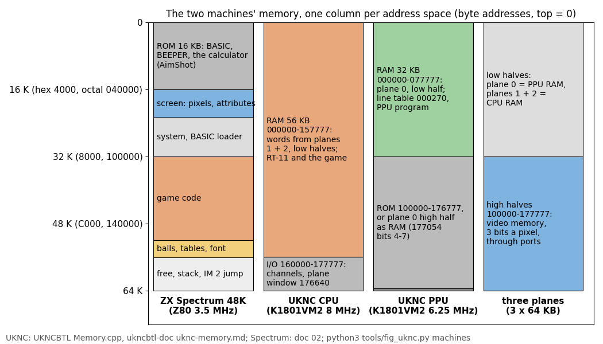

How to read the figure:

- One column per address space, address 0 at the top, all drawn to the same 64 KB scale.
- The Spectrum's one space holds everything: the ROM the game calls, the screen, the game.
- The UKNC has three: the CPU's (orange: its RAM is the low halves of planes 1 and 2, word by word), the PPU's (green:
  its RAM is the low half of plane 0), and the planes themselves, whose high halves are the video memory.

**The point**: on the UKNC the game and its screen live apart. The CPU, which would run the game, does not see the
screen; the PPU, which owns the screen, the speaker and the keyboard, has 32 KB and the slower clock. Every port
decision follows from this split.

```bash
python3 tools/fig_uknc.py machines   # docs/img/uknc/machines.png
```

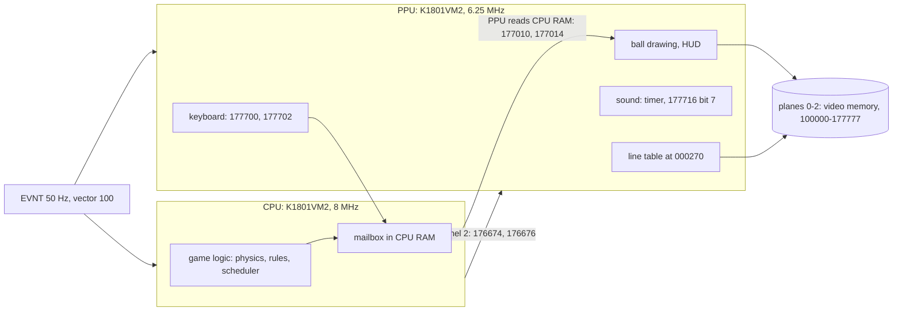

The two ways to the screen, both in use by the sources:

- **From the CPU** through the plane window: write a plane address to 176640, then a word to 176642, which is the
  byte of plane 1 and the byte of plane 2 at that address [DOC]. Highway Encounter draws this way [HWY]: one port
  write a byte pair, planes 1 and 2 only (4 colours), plane 0 out of reach.
- **From the PPU**: through 177010 (address) and 177012 (plane 0 byte), 177014 (planes 1 and 2), or 177024 to write
  eight pixels in one colour [DOC]; or as plain memory when the plane 0 high half is switched in as RAM by 177054
  bits 4-7 [BTL Memory.cpp]. Krakout draws from the PPU [KRK].

Witness: the clocks are the emulator's frame loop (`Board.cpp`: the CPU stepped 16 times and the PPU 12.5 times per
2 µs tick, 10 000 ticks a frame); the address maps are `CFirstMemoryController` and `CSecondMemoryController::
TranslateAddress` in `Memory.cpp`; the pixel order is `Emulator_PrepareScreenRGB32`.

## 14.2 The time budget

The game's clock is the interrupt: each tick runs the scheduler's tasks once (doc 4, 4.4). What a tick costs on the
Spectrum, measured (doc 4, 4.6, `tools/task_costs.py --per-irq` on `w1`):

| Tick | Z80 T | Redraw (BallRedraw `$827E`) | Physics (PhysicsTask `$86C1`) | Rest | Share of 69 888 T |
| --- | ---: | ---: | ---: | ---: | ---: |
| aiming (frame 1070) | 15 237 | | | 15 237 | 22 % |
| one ball rolling (1086) | 19 932 | 6649 | 9969 | 3314 | 29 % |
| six balls, typical (4375) | 62 248 | 33 442 | 25 492 | 3314 | 89 % |
| six balls, the heaviest (4373) | 73 768 | 33 429 | 37 025 | 3314 | 106 % |
| the shot set-up (1079) | 483 665 | | AimShot 454 950 (in the ROM 453 853) | | 692 % |

Interrupts are lost on the Spectrum at the shot set-up (six each, doc 4, 4.7), on heavy six- and seven-ball ticks
(the heaviest six-ball pass above is 73 768 T; in the `w1` break every pass with all seven balls rolling ran past the
next INT, nine lost in video frames 1155-1171, doc 10, 10.1), and in the BEEPER notes (doc 9, 9.5): about 490 video
frames of `w1` in all had none (doc 4, 4.6). Between shots the game runs its sequences inside one interrupt with the
tasks stopped (doc 4, 4.9).

On the UKNC the work splits in two: the CPU runs the logic, the PPU draws. The cost on each is the Z80 time times a
factor from the instruction timings of 14.3: 0.8 for the logic on the CPU, 0.65 for the drawing on the PPU.

```text
CPU share of a frame = (physics + rest) / 3 500 000 x 0.8 x 50
PPU share of a frame = redraw            / 3 500 000 x 0.65 x 50
the heaviest tick:  CPU (37 025 + 3314) x 0.8 / 70 000 = 46 %,  PPU 33 429 x 0.65 / 70 000 = 31 %
the shot set-up:    AimShot rewritten in integers (14.6.3): about 6 % of a frame (estimate) instead of 692 %
```

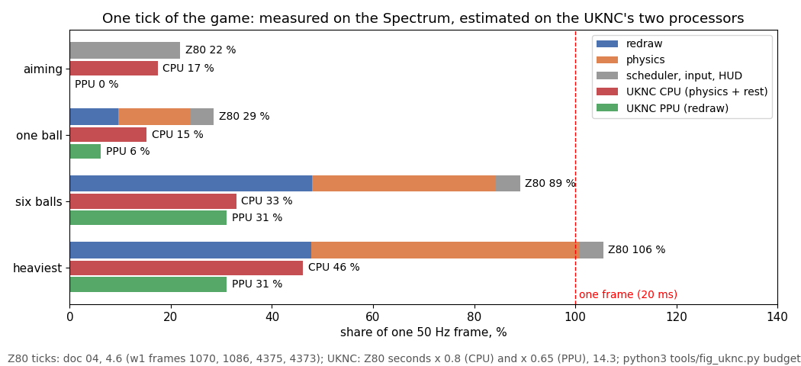

How to read the figure:

- One group per kind of tick. The top bar is the Spectrum's measured tick, split into redraw, physics and the rest.
- The red bar is the CPU's estimated share (physics and the rest), the green one the PPU's (the redraw).
- The dashed line is one 20 ms frame.

**The point**: no tick comes near the frame on either processor, so the port never loses an interrupt in play. The
gain comes from the split, not from speed: one VM2 is barely faster than the Z80 at this kind of code (14.3), but
two of them run the drawing and the physics at the same time, and the shot set-up stops costing seven frames.

```bash
python3 tools/fig_uknc.py budget   # docs/img/uknc/budget.png (--k-cpu, --k-ppu change the factors)
```

```mermaid
gantt
    title The heaviest tick (w1 frame 4373), 20 ms frame
    dateFormat X
    axisFormat %s
    section Spectrum Z80
    redraw 33 429 T        :a1, 0, 9551
    physics 37 025 T       :a2, 9551, 20130
    rest                   :a3, 20130, 21077
    section UKNC CPU
    physics and rest       :b1, 0, 9220
    section frame
    20 ms                  :f1, 0, 20000
    section UKNC PPU
    redraw (last tick)     :c1, 0, 6208
```

The Gantt chart is in microseconds: the Spectrum runs 21 077 µs, past the 20 000 µs frame; the CPU about 9200 µs;
the PPU about 6200 µs, drawing the positions of the previous tick while the CPU computes the next (14.6.5).

## 14.3 Instruction costs: the Z80 against the K1801VM2

The factors of 14.2 come from the operations the hot loops are made of, each timed on both machines: Z80 T-states at
3.5 MHz, VM2 clock cycles from UKNCBTL's tables [BTL Processor.cpp] at 8 MHz (CPU) or 6.25 MHz (PPU).

| Operation | Z80 | Z80 µs | VM2 | cycles | CPU µs | PPU µs | CPU / Z80 |
| --- | --- | ---: | --- | ---: | ---: | ---: | ---: |
| 16-bit add | `ADD HL,DE` | 3.14 | `ADD R1,R2` | 11 | 1.38 | 1.76 | 0.44 |
| 16-bit field load | `LD E,(IX+d)`, `LD D,(IX+d+1)` | 10.86 | `MOV d(R5),R1` | 41 | 5.13 | 6.56 | 0.47 |
| 16-bit field store | `LD (IX+d),E`, `LD (IX+d+1),D` | 10.86 | `MOV R1,d(R5)` | 51 | 6.38 | 8.16 | 0.59 |
| byte table read | `LD L,A`, `LD H,n`, `LD A,(HL)` | 5.14 | `MOVB T(R0),R1` | 41 | 5.13 | 6.56 | 1.00 |
| compare and branch | `CP n`, `JR NZ` taken | 5.43 | `CMP #n,R1`, `BNE` taken | 62 | 7.75 | 9.92 | 1.43 |
| loop step | `DJNZ` | 3.71 | `SOB` | 45 | 5.63 | 7.20 | 1.52 |
| 8 x 8 multiply | MulByte `$89F5`, about 396 T | 113 | `MUL R2,R3` | 96 | 12.0 | 15.4 | 0.11 |
| one sprite line, XOR | XorSpriteLines `$959F`: 3 bytes, 114 T | 32.6 | 2 x (`MOV (R1)+,R0`, `XOR R0,(R2)+`), `ADD R3,R2` | 161 | 20.1 | 25.8 | (PPU) 0.79 |

```text
Z80 µs  = T / 3.5
VM2 µs  = cycles / 8      (CPU)      cycles / 6.25   (PPU)
MulByte = 7 + 8 x (RRCA 4 + JR 7 or 12 + [ADD HL,DE 11] + SLA E 8 + RL D 8 + DJNZ 13) - 5 + RET 10
        = about 396 T with half the bits set
```

- **Words and multiplies win.** A 16-bit add or load costs half; `MUL` replaces an eight-step loop at a ninth of
  the time. The physics is 8.8 words, multiplies on contacts and table reads.
- **Bytes and branches lose.** A taken branch is 37 cycles, `SOB` 45: at 8 MHz that is slower than `JR` and `DJNZ`
  at 3.5 MHz. The rules, the scheduler and the input are such code.
- **The mix**: weighting the physics' own instructions (about a third 16-bit work, a third compares and branches, a
  third byte work, plus the multiplies) gives about 0.8 for the CPU. The drawing, as one straight 15-line run per
  sprite with the copy found by a table read, gives 2715 PPU cycles a sprite, 434 µs against DrawBall's 2497 T,
  713 µs: 0.61; 0.65 with the loop overhead of 14.6.4.

```asm
; one sprite line on the PPU: R1 = the sprite copy, R2 = the screen word, R3 = 40 - 4 (the next line)
        MOV     (R1)+,R0        ; 32 cycles
        XOR     R0,(R2)+        ; 43
        MOV     (R1)+,R0        ; 32
        XOR     R0,(R2)+        ; 43
        ADD     R3,R2           ; 11: 161 cycles a line, 25.8 µs at 6.25 MHz
```

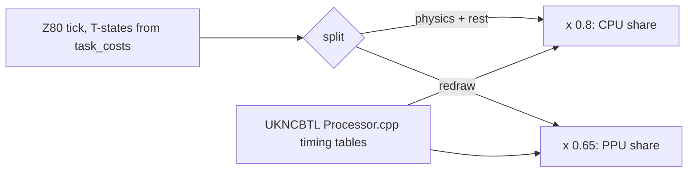

The caveat: UKNCBTL counts the processor's cycles only. Memory shared with the video (the CPU's RAM is in the planes)
may add wait states the emulator does not model; the factors are a lower bound of the cost (14.8, risk 3).

## 14.4 The porting plan per subsystem

| Subsystem | Original (doc) | On the UKNC | Moves as is | Rewritten | Converted (tool) |
| --- | --- | --- | --- | --- | --- |
| Scheduler | IM 2, 25 task slots, periods (4.4) | CPU EVNT handler at vector 100 runs the same slot table | the slot table, periods, task order | the handler, `WaitFrameNoTasks` as a flag instead of patching `$FCFD` | |
| Physics | PhysicsTask, MoveBall, BallContacts, cushions, pockets, friction (7, 10) | CPU, 8.8 words in registers | every rule, every constant, every table, the order of the tests (7.6) | the arithmetic in PDP-11 words, `MUL` for ScaleVelocity (14.6.1-2) | the four tables, byte for byte (`uknc_convert.py`) |
| Shot set-up | AimShot through the ROM calculator (4.7) | CPU, integers | the formula v = 16 P d / r and its rounding | an integer square root and `DIV` (14.6.3) | a check table against the ROM (14.7) |
| Rules, scores, HUD texts | the end-of-shot sequences, ScoreTally, fouls (4.9, 10) | CPU | the logic, the texts | the HALT waits as frame waits on the CPU | the 14 text files as they are; no tool yet: `uknc_convert.py` does not write them (their print records name Spectrum screen positions, which the port's PrintChar must map) |
| Ball drawing | 56 pre-shifted sprites, XOR, no mask, sorted by y (6.4, 6.5) | PPU, XOR of words in plane 0 | the XOR method, the draw order | DrawBall for words and 16 shifts (14.6.4) | `balls16`: 112 copies, 6720 bytes |
| Table and screen | XorLine, the cushions, pockets, attributes (6.2, 6.3) | PPU: the table drawn once into plane 0; colours from the line table's palettes | the line primitive, the coordinates | the attribute bands as palette records per line | |
| Font and text | PrintChar, own a-z 0-9 and the ROM's CHAR_SET (8) | PPU | the print records | PrintChar for the plane layout | `font`: 36 glyphs bit-reversed; the ROM glyphs the game uses have no tool: they are not in `src/res` and have to be cut from a Spectrum ROM image (14.8, risk 6) |
| Sound | SoundLoop tones in the foreground, BEEPER notes (9) | PPU timer interrupt toggling 177716 bit 7 | the pitches and lengths of 9.6 | both players as one timer player (14.6.6) | the data sheet of 9.6 as half-period counts (14.6.6); no tool yet: `uknc_convert.py` does not write them |
| Input | the keyboard matrix, Kempston, the redefinable keys (5) | PPU keyboard interrupt, a key-state word in the mailbox | the mapping of keys to actions | the reader | |
| Random | the R register at the rack and the cursor reset (7.8) | CPU: a counter that reproduces the Spectrum's R at those two moments | where R is read | R itself (14.7) | |
| Loading | tape, BASIC loader (3) | RT-11 `.SAV` on the CPU; the PPU program sent over channel 2 | | the loader [KRK bmain.mac] | |

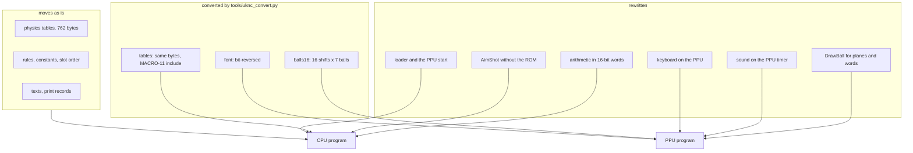

The split puts the physics' state (the 98-byte ball block) in CPU RAM. Each tick the CPU publishes the draw list
(doc 7, 7.3: which ball, old and new place) in the mailbox; the PPU reads it at its EVNT and draws. The ball sprites,
the font and the screen stay on the PPU side; the tables and the logic on the CPU side.

The screen geometry: the 320-pixel mode holds the Spectrum's 256 pixels with 32 to spare on each side, at 40 bytes a
line; the 192 lines sit in the 288 visible ones with room for the HUD. On a 4:3 screen a 320-mode pixel is 1.2 times
as wide as high [BTL: 640 x 288 for the full picture], a little wider than the Spectrum's.

The colour: the Spectrum's attribute bands are horizontal (doc 6, 6.1: HUD rows, the table rows 6-22, the pocket
mark rows), so each band is a palette record in the line table: index 0 green and 1 black on the table's lines, other
colours on the HUD's. Only the HUD's per-cell colours (words `$38` next to numbers `$3A`) need a second plane.

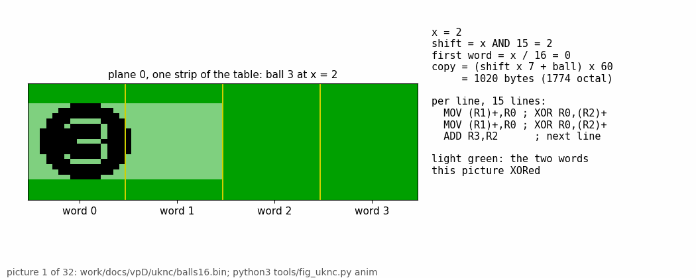

How to read the animation:

- The strip is 64 pixels (four words) of the table in plane 0, at the UKNC's pixel aspect.
- Each picture moves ball 3 one pixel right: the PPU XORs the copy of the old place off and the copy of the new
  place on. The light green band is the two words a line it touched.
- The text gives the copy: shift = x AND 15, first word = x / 16, the copy's offset in `balls16`.

**The point**: one copy per pixel position inside a word means every ball line is exactly two word XORs, whatever x
is; on the Spectrum it is three byte XORs and a sprite split across character rows.

```bash
python3 tools/uknc_convert.py && python3 tools/fig_uknc.py anim   # docs/img/uknc/ball-xor.gif
```

## 14.5 The data conversion

`tools/uknc_convert.py` reads `src/res` through the case's own `tools/res_formats.py` (the PNG sheets and CSV tables
build back to the bytes the game INCBINs) and writes each resource as a raw binary and as a MACRO-11 include of
octal `.WORD` or `.BYTE` lines, into `work/docs/vpD/uknc` by default (`--out` for the port's tree).

| Output | Bytes | From | Conversion |
| --- | ---: | --- | --- |
| `balls16` (`BALLS`) | 6720 | `graphics/BallSprites.png` | the unshifted copy of each ball (shift 0), shifted 0-15 pixels; each line two words, pixel x = bit x; 15 lines (the 16th is empty) |
| `font` (`FONT`) | 288 | `fonts/Font.png` | each byte bit-reversed: bit 0 the leftmost pixel |
| `ContactTable` (`CONTAB`) | 256 | `tables/ContactTable.csv` | none |
| `Table8x8` (`JAWTAB`) | 64 | `tables/Table8x8.csv` | none |
| `FrictionTable` (`FRICTB`) | 256 | `tables/FrictionTable.csv` | none |
| `CollisionRecords` (`COLREC`) | 186 | `tables/CollisionRecords.csv` | none: the PDP-11 is little-endian like the Z80, so the 8.8 words keep their bytes |

```text
balls16(shift, ball, line) = two words at (shift x 7 + ball) x 60 + line x 4
for each line of the ball's shift-0 copy (24 pixels, Spectrum bit 7 = pixel 0):
    word pair = sum of 1 << (x + shift) over the ink pixels x    ; x + shift < 32 always (15 + 15)
check: for shift 0-7 the pair, turned back to Spectrum bit order, equals the Spectrum's own pre-shifted copy
```

```python
for shift in range(16):
    for ball in range(7):
        for row in ball_rows(sheet, ball)[:15]:
            line = 0
            for x in range(24):
                if row >> (23 - x) & 1:            # Spectrum: bit 7 of the first byte = pixel 0
                    line |= 1 << (x + shift)       # UKNC: bit 0 of the first word = pixel 0
            out += (line & 0xFFFF).to_bytes(2, 'little') + (line >> 16).to_bytes(2, 'little')
```

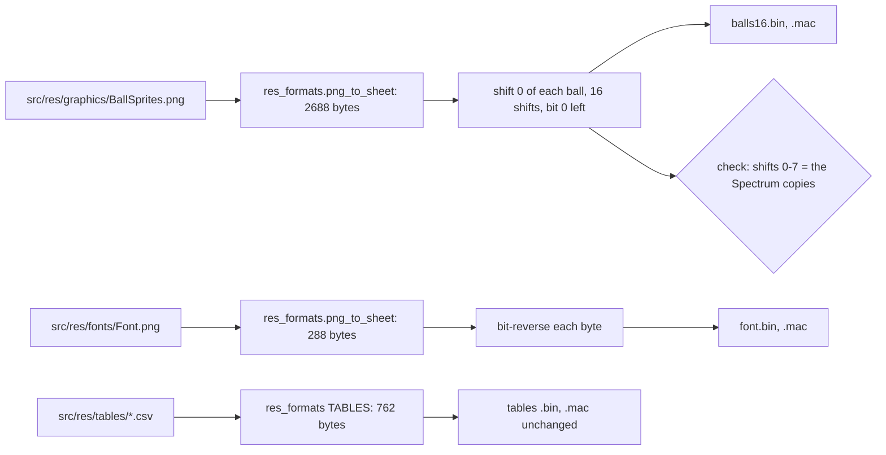

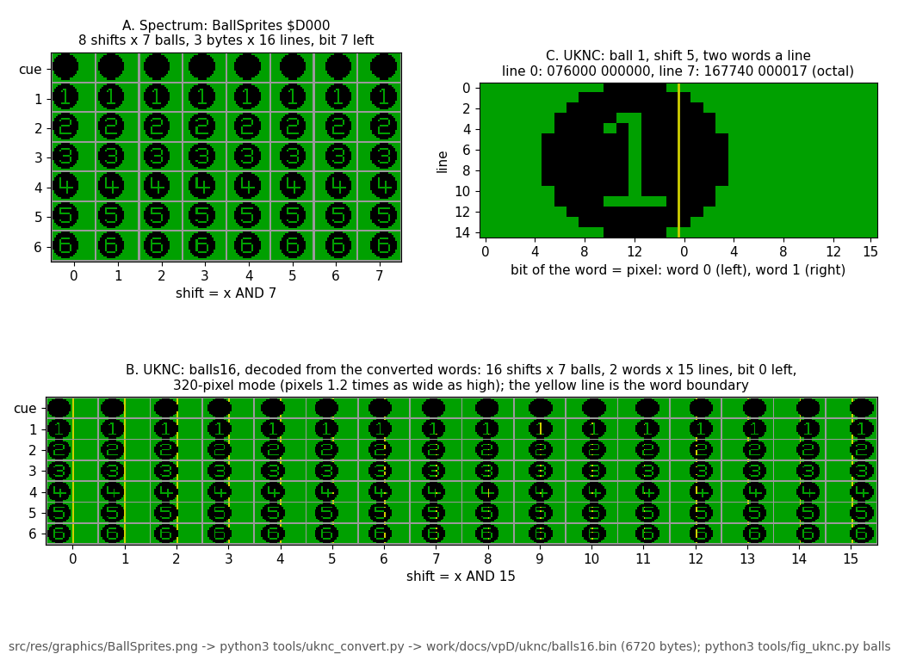

How to read the figure:

- A: the Spectrum's sheet as the game holds it, eight shifts of seven balls, three bytes a line.
- B: the converted `balls16`, decoded from the written words exactly as the UKNC's video would read them (bit 0 =
  leftmost pixel), at the 320-pixel mode's pixel aspect; 16 shifts, two words a line, the yellow line the word
  boundary.
- C: one copy enlarged, ball 1 at shift 5, with its words for lines 0 and 7 in octal.

**The point**: the Spectrum's eight copies are pure shifts of the first one (the check passes for all 56), so the
sixteen word-aligned copies are made from the first copy alone. The sheet grows from 2688 to 6720 bytes, which fits
the PPU's 32 KB with the screen and its program.

```bash
python3 tools/uknc_convert.py --check
#   balls16: 6720 bytes ... CollisionRecords: 186 bytes
#   check: shifts 0-7 of 7 balls against the Spectrum sheet, 4 tables: OK
python3 tools/fig_uknc.py balls    # docs/img/uknc/balls-uknc.png
```

### Worked example: ball 1, shift 5, line 7

| Step | Value |
| --- | --- |
| the shift-0 line 7 of ball 1, Spectrum bytes | the disc with the "1" cut out, 15 pixels at x 0-14 |
| the ink pixels shifted by 5 | x 5-11 and 13-19 (the gap at 12 is the "1") |
| word 0 = bits 5-11, 13-15 | `167740` octal (`$EFE0`) |
| word 1 = bits 0-3 (pixels 16-19) | `000017` |
| offset in `balls16` | (5 x 7 + 1) x 60 + 7 x 4 = 2188 |

The same words are in panel C of the figure and in `work/docs/vpD/uknc/balls16.mac`.

## 14.6 The hot routines re-thought

### 14.6.1 Fixed point on a 16-bit CPU: MoveBall

The ball record keeps x, y, vx and vy as 8.8 words (doc 7, 7.1); the Z80 moves them through HL and DE a byte pair at
a time. On the PDP-11 each is one word in one register, and the carry of `ADD` is the Z80's carry of `ADD HL,DE`, so
the clamps of MoveBall `$8701` keep their exact behaviour (`tools/physics_model.py`, `Model.move`):

```text
MoveBall(b):                                     ; every moving ball, every tick
    if FrictionTurn = 6 - ball: FrictionSteps(b)
    x = x + vx;  vx >= 0: carry or x >= $F800 -> $F800;  vx < 0: no carry or x < $0700 -> $0700
    y = y + vy;  vy >= 0: carry or y >= $B000 -> $B000;  vy < 0: y < $3700 -> $3700 (no carry test)
    BallContacts; PocketOrCushion
    vx = FrictionAdd(vx, fx);  vy = FrictionAdd(vy, fy)  ; a sign change gives 0
    vx = vy = 0: the ball stops
```

```asm
; R5 = the ball record: x +0, y +2, vx +4, vy +6, fx +10, fy +11 (octal offsets)
MOVEX:  MOV     (R5),R0         ; x
        MOV     4(R5),R1        ; vx
        BMI     1$
        ADD     R1,R0           ; carry as the Z80's ADD HL,DE
        BCS     2$
        CMP     R0,#174000      ; $F800
        BLO     4$
2$:     MOV     #174000,R0
        BR      4$
1$:     ADD     R1,R0
        BCC     3$              ; no carry: crossed below zero
        CMP     R0,#3400        ; $0700
        BHIS    4$
3$:     MOV     #3400,R0
4$:     MOV     R0,(R5)

; FrictionAdd for vx: MOVB sign-extends the step for free (the Z80 needs a branch for it)
        MOVB    10(R5),R2       ; fx
        BEQ     7$
        MOV     4(R5),R1
        BMI     6$
        ADD     R2,R1
        BCS     5$              ; still positive
        CLR     R1              ; crossed zero: stop
5$:     MOV     R1,4(R5)
        BR      7$
6$:     ADD     R2,R1
        BCC     5$
        CLR     R1
        BR      5$
7$:
```

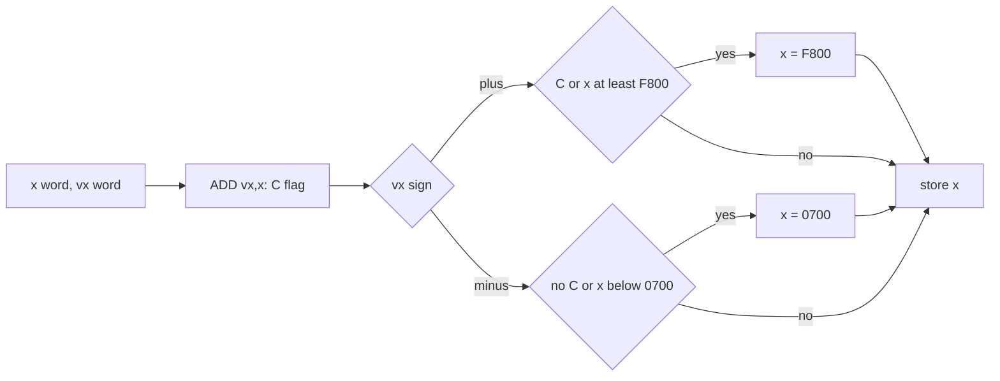

Worked example: the cue ball of `w1` after the release, frames 1087 to 1088 (`work/docs/vpC/w1-break.jsonl`, the
ball block read with TTD):

| Word | Frame 1087 | The PDP-11 step | Frame 1088 |
| --- | --- | --- | --- |
| x | `$3201` | `ADD R1,R0` with vx = `$04B3`: `$36B4`, no carry, below `$F800` | `$36B4` |
| y | `$7438` | `ADD` vy = `$0056`: `$748E` | `$748E` |
| vx | `$04B3` | `MOVB` fx = `$FB` gives -5 in R2; `ADD`: `$04AE`, carry set, still positive | `$04AE` |
| vy | `$0056` | fy = 0: unchanged | `$0056` |

The recorded block of frame 1088 holds exactly these words. The one thing to keep is the missing carry test on the
y-minus side (the model's comment in `Model.move`): a port that "fixes" it changes the game.

### 14.6.2 The friction and contact tables, and the multiply

The tables move unchanged (14.5); the lookups become one indexed `MOVB`.

```text
FrictionSteps(b):                                ; $90F5
    a = |vx|, c = |vy|
    up to 8 times, while bit 11 of neither: a <<= 1, c <<= 1
    cell = FrictionTable[(c >> 8) << 4 + (a >> 8)]  ; 16 x 16 nibbles
    fx = -(cell AND 15) with the sign of vx opposed; fy = -(cell >> 4) likewise
BallContacts:  |dx| < 16 and |dy| < 16: k = ContactTable[16 |dy| + |dx|]; $80 overlap, 1-31 the ring record
ScaleVelocity(v, f):                             ; $89C4, f = 0.8 fraction, f = $100 returns v
    |v| = hi:lo;  p = round(f x lo / 256) + f x hi; sign back
```

```asm
FRICST: MOV     4(R5),R1        ; |vx|
        BPL     1$
        NEG     R1
1$:     MOV     6(R5),R2        ; |vy|
        BPL     2$
        NEG     R2
2$:     MOV     #8.,R3
3$:     BIT     #4000,R1        ; bit 11
        BNE     4$
        BIT     #4000,R2
        BNE     4$
        ASL     R1
        ASL     R2
        SOB     R3,3$
4$:     CLRB    R1              ; keep the high bytes: nx in R1, ny in R2
        SWAB    R1
        CLRB    R2
        SWAB    R2
        ASH     #4,R2           ; 16 ny
        ADD     R2,R1
        BIC     #177400,R1      ; the Z80 adds in 8 bits
        MOVB    FRICTB(R1),R0   ; the cell: y step high nibble, x step low

; ScaleVelocity: R1 = |v| (8.8), R2 = f (0-255); result in R4
SCALEV: MOV     R1,R3
        BIC     #177400,R3      ; lo
        MUL     R2,R3           ; R3 = f x lo (16 bits, unsigned meaning)
        ADD     #200,R3         ; + 128: round
        CLRB    R3
        SWAB    R3              ; (f x lo + 128) / 256
        CLRB    R1
        SWAB    R1              ; hi
        MUL     R2,R1           ; R1 = f x hi (odd register: the low word only)
        ADD     R3,R1
        MOV     R1,R4           ; R5, the ball record of the other sketches, is not touched
```

ScaleVelocity runs four times a contact (284 calls in `w1`, doc 10, 10.5); with `MUL` it is about 30 instructions instead of
two eight-step loops.

### 14.6.3 The shot set-up without the ROM calculator

AimShot `$8A02` computes v = 16 P d / r with the ROM's floating point: about 455 000 T (454 950 at `w1` 1079), 85 % of
it in the ROM's SQR (doc 4, 4.7; doc 10, 10.2). A negative product gets 65 536 added before FP-TO-BC rounds it, so v = floor(16 P d / r + 0.5) as
a 16-bit word (`Model.shot`). Doc 10's break: dx 212, dy 15, P 76 give vx `$04BD`, vy `$0056`. In integers:

Rounding to the nearest is a question about squares, which integers answer exactly: q = floor(x + 0.5) for
x = 16 P |d| / r is the largest q with (2q - 1)² r² <= (32 P d)².

```text
AimShotInt(dx, dy, P):                     ; dx, dy whole pixels, P = power, at most $7E
    r2 = dx*dx + dy*dy                     ; 1..130 050: 17 bits
    for d in (dy, dx):
        A = (32 x P x d)²                  ; up to 40 bits
        k = isqrt(floor(A / r2))           ; A / r2 <= (32 P)² = 16.3 million: 24 bits, k <= 4032
        q = (k + 1) / 2                    ; floor (x + 0.5)
        if d < 0 and (2q - 1)² x r2 = A: q -= 1   ; a tie: the ROM's +65536 rounds toward zero
        v = sign(d) x q, as a 16-bit word
```

```python
def aim_int(dx, dy, p):                    # checked against Model.shot: 12 329 856 inputs, 0 differences
    r2 = dx * dx + dy * dy
    out = []
    for d in (dy, dx):
        a = (32 * p * d) ** 2
        q = (math.isqrt(a // r2) + 1) // 2
        if d < 0 and q and (2 * q - 1) ** 2 * r2 == a:
            q -= 1
        out.append((q if d >= 0 else -q) & 0xFFFF)
    return out                             # [vy, vx]
```

Worked example, doc 10's break (dx 212, dy 15, P 76): for vy, A = (32 x 76 x 15)² = 1 330 790 400, r2 = 45 169,
A / r2 = 29 462, k = 171, q = 86 = `$0056`; for vx, A = (32 x 76 x 212)² = 2.658 x 10^11, A / r2 = 5 885 161,
k = 2425, q = 1213 = `$04BD`. Both are the recorded words.

```asm
; isqrt of R0:R1 (at most 16.3 million) into R2: Newton's method from above with DIV
ISQRT:  MOV     #4096.,R2       ; above every root (at most 4032)
1$:     MOV     R0,R4
        MOV     R1,R5
        DIV     R2,R4           ; R4 = N / r: fits a word because r >= the root
        ADD     R2,R4           ; r + N / r
        ROR     R4              ; halved
        CMP     R4,R2
        BHIS    2$              ; stopped falling: R2 = floor (sqrt N)
        MOV     R4,R2
        BR      1$
2$:     RETURN
; A / r2 has a 17-bit divisor, beyond DIV: a 24-step shift-and-subtract loop on three words (ASHC, SUB, SBC)
```

The cost: four `MUL` for the squares, the long division (24 steps of about 100 cycles), the root (at most about 12
Newton steps of about 220 cycles), for each of vx and vy: about 10 000 cycles, 1.3 ms on the CPU (6 % of the
160 000-cycle frame), against 130 ms on the Spectrum. The shot starts in the same tick as the release; the six lost interrupts of the original are gone
(14.7 says why that does not change the game).

The integer method agrees with the Python model on every input the game can give: dx -255..255, dy -191..191 and the
63 powers 2, 4, ..., 126 (the power is always even, doc 10, 10.2; P 0 does not move the ball):
`python3 tools/uknc_aimcheck.py --dy-step 1 --powers "$(python3 -c "print(','.join(map(str, range(2, 127, 2))))")"`,
"12329856 inputs, 0 differences" (30 s). The model is the game's on the 475 frames of doc 10, 10.6, but those are one shot: whether the ROM's
SQR, which is exp (0.5 ln x) with series, ever rounds a near-tie differently is still to be checked against the ROM
itself (14.7, 14.8 risk 1).

### 14.6.4 Ball drawing in plane 0 on the PPU

```text
DrawBall(ball, x, y):                       ; x, y = the sprite's top left on the screen
    src = BALLS + COPY[(x AND 15) x 7 + ball]   ; COPY: 112 offsets, (shift x 7 + ball) x 60
    dst = LINE[y] + (x >> 4) x 2                 ; LINE: the plane address of each screen line (40 bytes apart)
    15 times: dst[0] ^= src[0]; dst[1] ^= src[1]; src += 2 words; dst += 40 bytes
```

```asm
; R4 = ball, R0 = x, R5 = y; the screen in plane 0 seen as PPU RAM (177054 bit 4: 100000-117777)
DRAWB:  MOV     R0,R1
        BIC     #177760,R1      ; shift
        MOV     R1,R3
        ASL     R3
        ASL     R3
        ASL     R3
        SUB     R1,R3           ; 7 x shift
        ADD     R4,R3
        ASL     R3
        MOV     COPY(R3),R1
        ADD     #BALLS,R1       ; source
        ASL     R5
        MOV     LINE(R5),R2     ; screen line
        ASH     #-4,R0
        ASL     R0
        ADD     R0,R2           ; first word
        MOV     #36.,R3         ; 40 - 4
        .REPT   15.             ; unrolled: 161 cycles a line
        MOV     (R1)+,R0
        XOR     R0,(R2)+
        MOV     (R1)+,R0
        XOR     R0,(R2)+
        ADD     R3,R2
        .ENDR
        RETURN
```

- **No mask, as on the Spectrum**: XOR keeps the original's look where balls overlap and its erase-by-redraw.
- **The beam**: the Spectrum stays ahead of the beam by drawing first in the tick and in y order (doc 4, 4.8). The
  PPU does the same at its EVNT, with the draw list in y order; six balls erased and drawn take 12 x 434 µs = 5.2 ms,
  about 81 of the 312 lines. If that ever tears, the line table can flip between two copies of the table (14.8).
- **Plane 0 only**: one plane gives two colours a line, which is what the table has. Planes 1 and 2 stay free for the
  HUD's colours.

### 14.6.5 Splitting the work between the two processors

```text
CPU, EVNT (vector 100):                      PPU, EVNT (vector 100):
    run the slot table (the scheduler)          if mailbox.seq <> last: copy the draw list (177010, 177014)
    physics, rules, input from mailbox.keys     erase and draw the balls (14.6.4), HUD changes
    write the draw list, mailbox.seq += 1       sound: start the next tone or note (14.6.6)
                                                keyboard interrupt: mailbox.keys
```

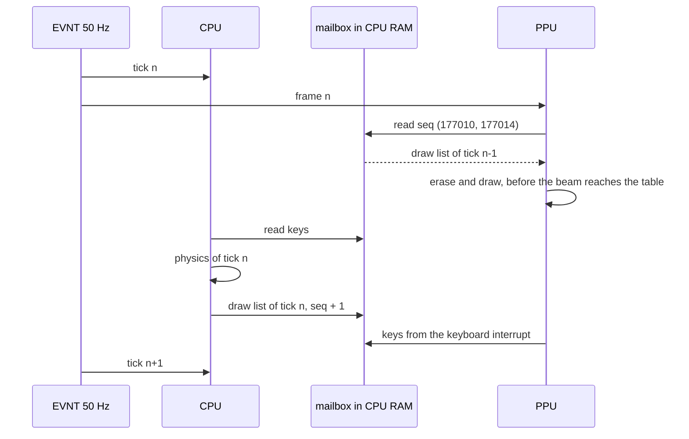

- The PPU draws one tick behind the CPU: the picture of tick n appears in frame n + 1. The Spectrum draws the
  positions of the previous tick too (the redraw runs first in the tick, before the physics, doc 4, 4.8), so the lag
  is the original's.
- The mailbox is the pattern Krakout uses: a block in CPU RAM that the PPU reads with 177010 = address / 2 and
  177014 [KRK appu.mac].
- The long sequences between shots (the tally, the messages) stay on the CPU as loops of "wait for the next EVNT";
  the PPU keeps drawing and playing what the mailbox says.

### 14.6.6 Sound on the PPU timer

Both players become one: the PPU timer interrupt (vector 304) toggles bit 7 of 177716 every half period, counting
down the cycles; the CPU puts a sound number in the mailbox, the PPU starts it. Krakout plays its effects this way:
177712 = the count, 177710 = interrupt enable, start and the rate [KRK appu.mac]. The timer count is 12 bits, at most 4095 [BTL Board.cpp: `m_timer &= 07777; // 12 bit only`]. The half periods of
doc 9, 9.6:

| Sound | Half period on the Spectrum | µs | Timer count at 4 µs | at 2 µs | Cycles |
| --- | --- | ---: | ---: | ---: | ---: |
| ball tone | 801 / 817 T | 229 / 233 | 58 | 116 | 20 |
| cushion tone | 1171 / 1187 T | 335 / 339 | 84 | 168 | 12 |
| pocket tone | 9311 / 9327 T | 2660 / 2665 | 666 | 1331 | 6 |
| key click | 4 x (1000 + 30.125) T | 1177 | 294 | 589 | 21 |
| name pick, first count-up tick | 4 x (1200 + 30.125) T | 1406 | 351 | 703 | 23, 6 |
| last-shot beep | 4 x (500 + 30.125) T | 606 | 151 | 303 | 11 |
| foul note 1 | 4 x (8350 + 30.125) T | 9577 | 2394 | (over 4095) | 27 |
| foul note 2 | 4 x (10750 + 30.125) T | 12 320 | 3080 | (over 4095) | 24 |

```text
PlaySound(n):  half, cycles, rate = SOUNDS[n]; edges = 2 x cycles; 177712 = half; 177710 = start | rate | interrupt
TimerIRQ:      177716 ^= 200 (bit 7); edges -= 1; if edges = 0: 177710 = 0 (stop)
count-up tick: half = 4 x (TallyPitch + 30.125) / 3.5 / 4 µs, cycles = 6000 / TallyPitch + 1, as AddScoreStep and BEEPER
```

```asm
TIMIRQ: MOV     R0,-(SP)
        MOV     #200,R0
        XOR     R0,@#177716     ; flip the speaker bit (XOR takes a register source)
        MOV     (SP)+,R0
        DEC     EDGES
        BNE     1$
        CLR     @#177710        ; the sound is done
1$:     RTI
```

The decision for the player: the port plays each sound as the data sheet says, without the Spectrum's interrupt
gaps. A pocket tone becomes the 32 ms tone the code asks for, not the broken one of doc 9, 9.2; a port that wants the
original's sound adds the gaps on purpose.

## 14.7 What the player must not notice

| Must stay | Why it can change | How the port keeps it |
| --- | --- | --- |
| the physics, byte for byte | 16-bit arithmetic rewritten; the tables moved | the same 8.8 words, carries and clamps (14.6.1); tables unchanged; the y-minus clamp's missing carry test kept |
| the shot | AimShot without the ROM | the exact integer rounding (14.6.3), checked against the model (14.6.3); the ROM check is planned in 14.8 (risk 1) |
| the random start | the R register does not exist on the PDP-11 | the two reads (`$A026` in RackBalls, `$85D4` in AimCursorReset, doc 7, 7.8) take R from a counter that advances like the Z80's R between the same events, or from a table recorded per rack |
| the tick | the UKNC has time to spare | the game advances one tick per EVNT, as on the Spectrum; inputs are read once per tick |
| the frame rate | the Spectrum loses interrupts (six at each shot, about 490 frames in `w1`) | not kept: the port never loses one, so it runs at the speed the game was meant to have. The ticks are the same; only their spacing in real time differs |
| the look | 320-pixel mode, palette bands | the same pixels in the same places, XOR overlap kept |
| the sounds | the timer player | the data sheet's pitches and lengths (14.6.6), without the interrupt gaps |

The check compares ticks, not frames: the original's frame without an interrupt simply repeats the previous tick
(doc 10, 10.6).

```text
for each recording (w1, f1, v1 ...):
    from the Spectrum: the ball block (98 bytes) after every tick, the inputs read at every tick   ; TTD
    on the port:       the same inputs fed per tick, the ball block dumped after every tick        ; UKNCBTL
    compare tick by tick; the first difference names the tick, the ball, the field
AimShot: for every (dx, dy, P) the ROM's result (the ROM calculator run on the Spectrum emulator)
         against aim_int; differences become a table of exceptions in the port
```

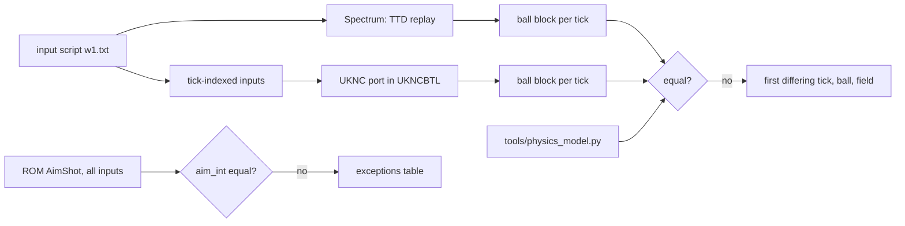

- **Three references, one answer.** The recording, `tools/physics_model.py` (475 frames equal, doc 10, 10.6) and the
  port must agree; the model lets the port be checked on shots no recording made.
- **The ROM check** needs every (dx, dy, P) run through the ROM's calculator once: 511 x 383 x 126 = 24 659 838
  inputs, at about 0.13 s of Spectrum time each, 37 days in all. The signs give the same magnitudes (the tie rule
  aside), which cuts it by four, and the power is always even (doc 10, 10.2), so 63 values of P instead of 126 halve
  it again: about 4.6 days of Spectrum time, which an emulator at a hundred times speed runs in about an hour. It
  turns risk 1 into a table.
- **The input timing**: the Spectrum samples the keys inside the tick (doc 5); the port must hand the CPU the key
  state the PPU saw before the EVNT, never mid-tick.

## 14.8 Risks and open questions, ranked

| Rank | Risk | Effect | What settles it |
| ---: | --- | --- | --- |
| 1 | The ROM's SQR rounds some shot differently from the exact integer method | one shot in many takes another path: the game is no longer the same | run every (dx, dy, P) through the ROM (14.7); keep the differences as exceptions |
| 2 | R at the rack and at the cursor reset | the cue ball's half-pixel fraction differs: every shot of the frame differs | reproduce R from instruction counts of the original (hard: R counts M1 cycles of the whole program), or record the R values per rack as a seed table and accept that new play differs |
| 3 | CPU memory wait states | the CPU's RAM is in the planes the video reads; UKNCBTL does not model the waits; the CPU factor 0.8 may be optimistic | measure on a real machine; the budget has more than half a frame to spare |
| 4 | Plane 0's high half as PPU RAM (177054 bits 4-7) replaces the PPU ROM in that window | the firmware's handlers there are gone while the game runs | own every PPU vector; or draw through 177010/177012 at about twice the cost |
| 5 | Tearing | the PPU draws while the beam scans | draw in y order at EVNT (14.6.4); or flip two copies of the table in the line table, each kept by XOR of its own old positions |
| 6 | The ROM glyphs | the game prints the ROM's CHAR_SET for every character but a-z, 0-9 (`src/res/fonts/README.md`) | cut the glyphs the texts use from a ROM image into the port's font (`src/res` lacks them) |
| 7 | The K1801VM2 timings | the tables are UKNCBTL's reading of the processor's description | measure the two hot loops on a real machine |
| 8 | Keyboard ghosting and the redefinable keys | the MS-7007 gives scan codes, not a matrix | map scan codes to the game's actions; two keys at once (fire and a direction) must work |

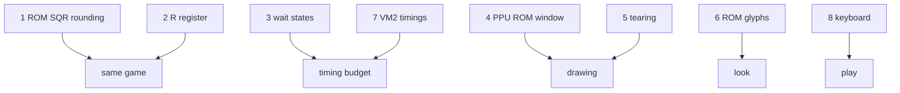

Open questions for the owner: whether the port keeps the original's slow-downs (risk-free but odd on a faster
machine) or runs every tick on time (the plan); and whether the table may get colour from the spare planes.

## 14.9 Notes: BK-0010 / BK-0011M and Soyuz-Neon

**BK-0010 / BK-0011M** [BK]: one K1801VM1 at 3 MHz (0011M: 4 MHz), 32 KB of RAM of which 16 KB is the screen
(0011M: 128 KB in 16 KB pages), 512 x 256 in one bit or 256 x 256 in two bits, a one-bit speaker (an AY add-on
exists), a timer.

- The 256 x 256 four-colour mode holds the 256 x 192 table at two bits a pixel: the ball copies double (two bits a
  pixel), the table needs two colours, so one bit of the pair would do.
- One processor at 3 MHz, without `MUL`: the physics and the drawing run in one tick again, as on the Spectrum, with a
  slower clock and slower byte code (the VM1's timings are not in the sources read; to measure). The heaviest tick,
  106 % of a Spectrum frame, would not fit: the BK would lose interrupts as the original does, or more.
- ScaleVelocity goes back to a shift-and-add loop; AimShot's integer method (14.6.3) needs a software multiply and
  divide but stays far cheaper than the ROM calculator.
- 32 KB (16 KB free) is tight for 6.7 KB of ball copies: the BK keeps eight byte-shifted copies (the Spectrum's
  2688 bytes, bit-reversed, doubled for two-bit pixels).

**Soyuz-Neon PK-11/16** [NEON]: Cyclowiki gives N1801VM2 / N1806VM2 class processors at 8 MHz with 1-4 MB of RAM, a
16 KB ROM, and a screen built from a table of video lines (16-128 words each, anywhere in RAM) with 16 video modes.
The processor is settled by a second source [1801]: the PC-11/16 uses the N1806VM2, the CMOS version of the K1801VM2
and functionally equivalent to it, so the VM2 instruction timings of 14.2 apply. TODO.md's lead, which says a K1801VM3
class CPU, is wrong: the VM3 is another chip (with an MMU, used in the DVK computers). The clock stays open: Cyclowiki
says 8 MHz, while [1801] rates the 1806VM2 at 5 MHz; the estimate below takes 8 MHz, and at 5 MHz every share grows
by 8 / 5.

- What carries over from the UKNC plan: all of the CPU side (the PDP-11 physics of 14.6.1-14.6.3), the tables, the
  integer AimShot, the tick check of 14.7.
- What changes: one processor instead of two, so the drawing joins the logic (about 70 % of a frame at the heaviest
  tick by the factors of 14.2, with VM2 timings at 8 MHz: 46 % logic, and the drawing's 31 % of a 6.25 MHz PPU frame
  is 24 % at 8 MHz; before wait states; at 5 MHz the same work is about 112 % of a frame and would not fit); the screen is in main memory, so DrawBall XORs RAM directly; the
  line table gives the same per-line palette trick.

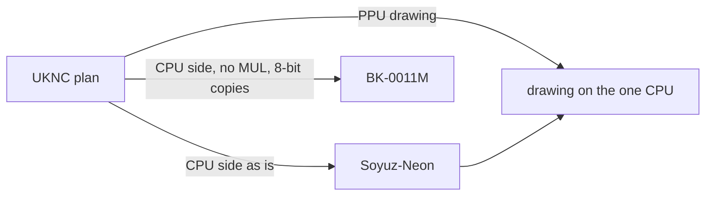

Witness: [BK], [NEON] and [1801] as cited; no BK or Neon emulator was run for this document.
