# 1. Game design

What this covers: Zynaps 2 in 1 as a player meets it.

- the way in: the boot list, the intro's three pictures and its options (1.1);
- the play screen (1.2) and the game menu's pages (1.3);
- the controls in short (1.4);
- the ship, its weapons and the pods (1.5);
- scoring, lives and the high scores (1.6);
- the twelve levels, each with a screenshot (1.7);
- the end of a level (1.8) and the guardians (1.9);
- difficulty (1.10) and the sound in short (1.11);
- what no recording reached (1.12).

Zynaps is a horizontally scrolling shoot-'em-up by Dominic Robinson, published by Hewson in 1987. The graphics are
by Steve Crow and Dominic Robinson. Zynaps 2 in 1 is its 128K edition, made by goodboy and tiboh in 2018 (the options
screen: `2018 (R) GOODBOY&TIBOH`). It loads from a TR-DOS disk, opens with a new intro (a title picture signed
`RVS.M.STAWICKI`, an options screen, a Hewson picture, and a STarKos tune), and plays the CPC version's AY music and
effects by Dave Rogers, whose name the credits page shows for the music. Two options are new: INF.LIVES (the lives
never drop) and K-MOUSE (a Kempston mouse places the ship).

The names are those of `src/game/game.ann` and the other `.ann` files of `src/`. The terms are in the
[index](README.md#terms).

The recordings it rests on, each on a Pentagon 128 with TR-DOS:

- `r3`: the bot through all 12 levels and the wrap to the first, 76 001 frames (`work/z128A/r3`). It starts from
  the game menu's snapshot `work/stage2/stubs/title-inf-ffd7.szx` (INF.LIVES on, and Invulnerable `$FFD7` = 1 poked
  in as an experiment), with the bot's inputs `work/z128A/inputs/r3.txt`:

  ```bash
  python3 $RS capture --work work/z128A/r3 --snapshot work/stage2/stubs/title-inf-ffd7.szx --model PENTAGON \
      --inputs work/z128A/inputs/r3.txt --ranges 5B00-FFFF --port-base 16250 --binary $B
  ```

  It plays with the Kempston joystick. It loses no life; the take-a-weapon branch `$A209` runs in 119 frames, the
  first at 849; it never takes the seeker.
- `c1`: power-on, the TRD, the boot list, the intro (options off), the game menu, then six short games with the
  keys Q, A, O, P and space (`work/stage1/c1`, [3.7](03-build-and-load.md#37-the-stages-in-c1)), opened as
  `work/z128A/c1` (port base 16237). It loses 17 lives and ends five games.
- `o3`: power-on to the game menu with the options toggled (`work/z128A/o3`, port base 16260).
- `m1`: one life played with the mouse, K-MOUSE on ([5.4](05-controls.md#54-k-mouse-the-kempston-mouse-driver)).

`$RS`, `$B` and the bot's run are in the [NOTES](../work/docs/z128A-NOTES.md) and the
[fork NOTES](../work/docs/z128A-fork-NOTES.md).

## 1.1 The way in

On the TRD the disk boots into a list of its BASIC files; ENTER on `ZYNAPS` loads the game. (The SCL has no boot:
the player types `RUN "ZYNAPS"`.) The load and the two unpacks take about 34 seconds
([3](03-build-and-load.md)). Between them the intro shows three pictures:

| The title (`c1` 2600) | The options (`c1` 2740) | The Hewson picture (`c1` 2850) |
| --- | --- | --- |
| 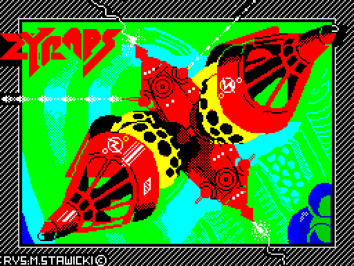 | 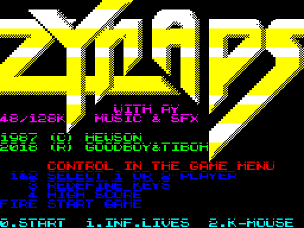 | 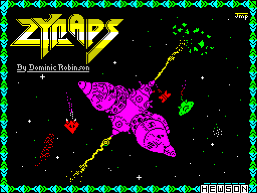 |

How to read the pictures:

- **Left**: the title, a key to go on. The STarKos tune plays from here (IntroInterrupt `$60D0`).
- **Middle**: the options screen. It names the game's menu keys (1 and 2 players, 3 keys, 4 high score, fire) and
  the intro's own: `0.START  1.INF.LIVES  2.K-MOUSE`. Keys 1 and 2 toggle an option and invert its words.
- **Right**: the Hewson picture. It stays while block 2 loads; a key then starts the game.
- **The point**: the options are chosen once, here, before the game is on the disk's second block; the game itself
  has no options screen.

```bash
python3 ../../kit/screen_shot.py --work work/z128A/c1 --out-dir docs/img/design intro-title=2600 intro-options=2740 \
    intro-hewson=2850 credits=3400 hiscore=3600 banner=3950
```

Each picture appears pixels first, then one random attribute row a frame
([6.9](06-rendering.md#69-the-intros-pictures)). The options' code is
[5.6](05-controls.md#56-the-intros-options-inflives-and-k-mouse).

## 1.2 The play screen

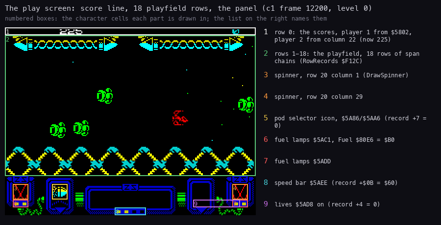

How to read the figure:

- **The picture** is `c1` frame 12200, level 0, at 2x.
- **A numbered box** is the character cells one part of the screen is drawn in. The list on the right names it, with
  the address the code draws it at and the value it shows at that frame:
  1. row 0: the scores; player 1 from `$5802`, player 2 from column 22 (225 here);
  2. rows 1-18: the playfield, 18 rows of span chains ([6.2](06-rendering.md#62-the-playfield-span-chains));
  3. and 4. the two spinners, row 20, columns 1 and 29 (DrawSpinner `$A8BE`);
  5. the pod selector icon, rows 20-21, columns 6-7 (`$5A86` / `$5AA6`, PodIconJob `$AC2C`; selector 0);
  6. and 7. the fuel lamps, `$5AC1` and `$5ADD`, lit by Fuel `$80E6` (`$B0`);
  8. the speed bar `$5AEE`, from the speed (player record `+$0B`, `$60`);
  9. the lives `$5AD8`, from the record's `+4` (0 here: the last life).
- **The point**: the screen is a playfield framed by a fixed panel. The panel shows the ship's state; the only text in
  play is the score line.

```bash
python3 tools/fig_screen.py --work work/z128A/c1 --frame 12200 --out docs/img/design/play-screen.png
```

## 1.3 The game menu

The game menu alternates two pages until fire; a level starts with a banner:

| Credits page (`c1` 3400) | High-score page (`c1` 3600) | Level banner (`c1` 3950) |
| --- | --- | --- |
| 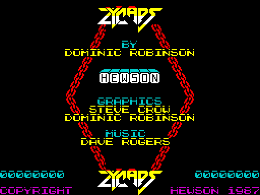 | 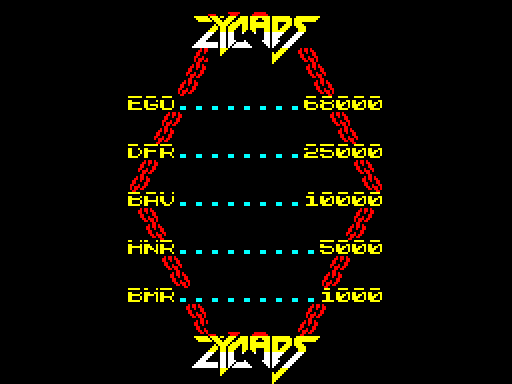 | 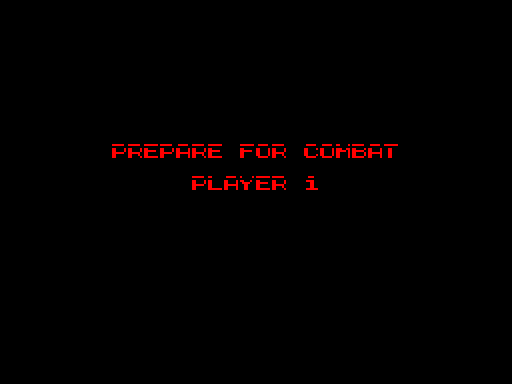 |

How to read the pictures:

- **Left**: CreditsPage `$B095`. The logo twice; BY DOMINIC ROBINSON; the HEWSON plate; GRAPHICS STEVE CROW, DOMINIC
  ROBINSON; MUSIC DAVE ROGERS (the set-up writes the name over the 48K's credit at `$8484`); the two players' last
  scores; COPYRIGHT HEWSON 1987. The AY music plays here. Keys 1-3 are read when the page ends.
- **Middle**: HiScorePage `$B0C9`. The five entries of HiScoreTable `$8261`: EGO 68000, DFR 25000, BAV 10000,
  HNR 5000, BMR 1000. It stays 500 frames or until fire.
- **Right**: PREPARE FOR COMBAT, PLAYER 1, coloured line by line by the raster
  ([6.10](06-rendering.md#610-the-banner-raster-one-colour-per-scan-line)). The level's music stops here and a short
  effect plays.
- **The point**: the menu has no option screen: the options are keys on the credits page, and the device is chosen
  by the fire that starts the game ([5.3](05-controls.md#53-which-device-the-start-test)).

## 1.4 The controls in short

[5](05-controls.md) has them all. In short:

- five keys, SPACE fire, Q up, A down, O left, P right by default, redefinable with key 3;
- or a joystick: Kempston (chosen by starting the game with Kempston fire), cursor (5-8, 0) or Sinclair (6-9, 0);
- or, with K-MOUSE, a Kempston mouse: a left click starts the game, the ship goes where the mouse is, either button
  fires;
- 1 / 2 on the credits page: one or two players (two players take turns, each with a player record: Player1 `$7F9C`,
  Player2 `$7FCC`);
- 4 pauses and stops the music; in the pause fire resumes and Q quits the game.

## 1.5 The ship, the weapons and the pods

- The ship flies anywhere on the playfield. It starts with the laser at level 1 and speed `$40`: `r3` reads laser
  (`+$0A`) 1 and speed (`+$0B`) `$40` when play starts at frame 504.
- Fire shoots the laser. A side weapon, once taken, fires with it ([10](10-gameplay-logic.md)).
- A wave of enemies destroyed whole leaves a **pod** (sound `$1C`). The panel's five icons are the weapons it can
  give: speed-up, laser, plasma, homing missiles, seeker. The lit icon is the selector (record `+7`).
- **Touching a pod** moves the selector to the next icon and gives 100 points.
- **Touching a pod with fire held for 8 passes** (about a third of a second) takes the lit weapon and resets the
  selector ([5.9](05-controls.md#59-the-weapon-pods-touch-to-select-hold-fire-to-take)).
- **Fuel** (`$80E6`, the panel's lamps) starts at `$5A` and falls by one every 16 frames in play (PassBit bit 0),
  about 29 s. At 0, FuelOut `$9C03` sets it back to `$5A` and takes a laser level and a speed step away.
- The speed-up pod sets it to `$BB`; a selector wrap past the fifth icon sets it to `$B4`; a pod that scrolls away
  untouched halves it (`$A25A`). In `r3` the laser drops 1 -> 0 at 2052 this way.
- So the game asks the player to keep collecting pods, and to choose when to hold fire on one.

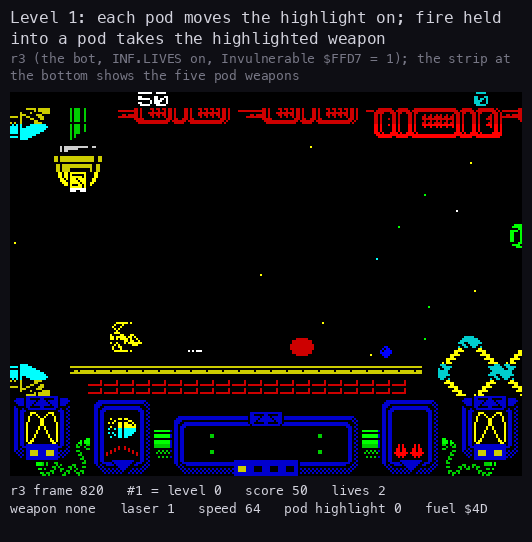

How to read the animation:

- **The picture** is `r3` frames 820-1760, one every 8 frames; the strip at the bottom shows the five pod weapons.
- **Under it**: the frame, the play order and level, the score, the lives; the side weapon, the laser, the speed,
  the pod highlight and Fuel, all read from the same frame's memory. A yellow line names an event found in the
  recording.
- **What it shows**: the highlight moves 0 to 1 at 852 and to 2 at 1008; at 1097 the bot holds fire into a pod and
  takes plasma (weapon 2 at 1100); later the highlight reaches 3 and homing missiles are taken at 1713 (weapon 3
  at 1716).
- **The point**: the same touch selects or takes; the weapon is in use at once.

```bash
python3 tools/fig_play_anim.py --work work/z128A/r3 --from 820 --to 1760 --step 8 \
    --title 'Level 1: each pod moves the highlight on; fire held into a pod takes the highlighted weapon' \
    --out docs/img/design/pods-weapons.gif    # with a --mark F:TEXT per event, listed in the fork NOTES
```

(The GIF's title counts the levels from 1 in play order: "Level 1" is the first played, level 0.)

## 1.6 Scoring, lives and the high scores

- Each enemy kind has a score index into PointsTable `$8231`: 0, 25, 50, 75, 100, 150, 200, 250, 500, 1000, 2000,
  5000. AddScore `$A489` adds the entry.
- Pods: 100 points for any pod, 1000 when the selector wraps past the fifth icon.
- A guardian destroyed: 1025 or 2025 points in `r3` (1.9).
- The score is 8 BCD digits (record `+0` to `+3`), printed by ScoreJob in the main loop
  ([4.2](04-game-loop.md#42-the-main-loop-in-play-jobs-only)).
- **Lives**: 2 in reserve at the start (record `+4`), shown as red marks on the panel. One more at each of
  ExtraLifeScores `$800F`: 10 000, 30 000, 50 000, 70 000 and 90 000, with sounds `$0F` + `$10` (HookExtraLife
  `$B334`). In `r3` the lives read 2 at score 9000, 3 at 19 150, 4 at 31 825, 5 at 56 050 and 6 at 76 675.
- **INF.LIVES**: a lost life plays as usual (the explosion, the fade, the banner), but the count stays.
- **High scores**: at the game over a score above the fifth entry takes its place, with three initials picked with
  left, right and fire. Below it the screen says UNRANKED ([5.8](05-controls.md#58-the-high-score-initials)).

## 1.7 The twelve levels

LevelOrder `$8003` sets the order of the twelve level records:

- levels 0, 1, 2 come first and 9, 10, 11 last;
- levels 3-8 are shuffled for each game by PlayersSetup `$AFB7`;
- after level 11 the game wraps to the first level (LevelDone `$B174`).

`r3`'s order is 0 1 2 3 7 5 4 8 6 9 10 11 (LevelOrder read from its memory).

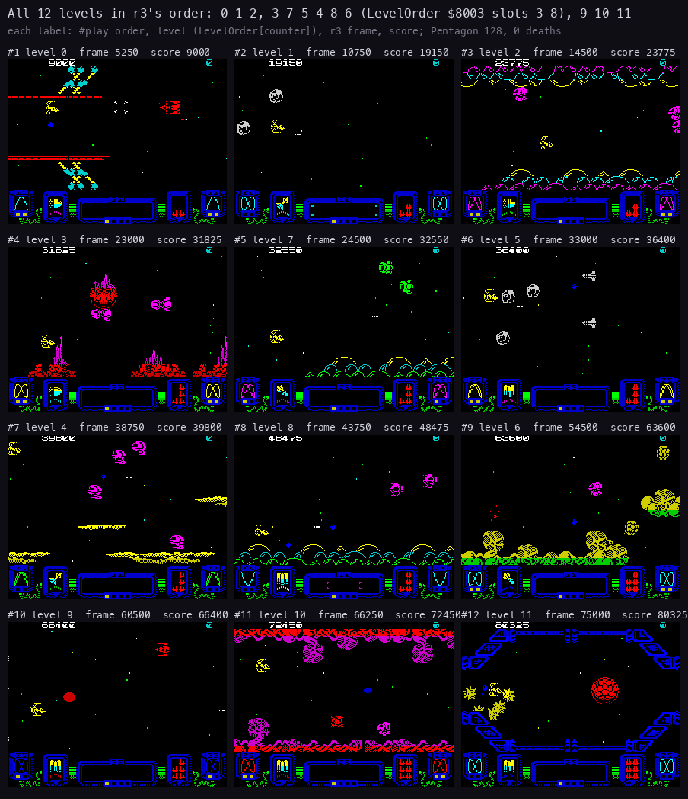

How to read the figure:

- **One picture per level**, in the order `r3` played them, left to right and top to bottom.
- **The label**: the play order (#1-#12), the level (LevelOrder at the level counter, record `+6`), the `r3` frame
  and the score at that frame. Both numbers are read from the frame's memory.
- **The frames** are, for each level, the one of its 250-frame screens with the most ink in the play area, guardian
  stretches left out.
- **The point**: twelve different scenes from one engine: three are open space (1, 5, 9), the others have scenery
  above, below or both.

```bash
python3 tools/fig_levelshots.py shots --work work/z128A/r3 \
    --frames 5250,10750,14500,23000,24500,33000,38750,43750,54500,60500,66250,75000 --out-dir docs/img/design
```

The level records (LevelTable `$6B2D`, `src/res/levels/levels.lev.txt`) and the levels in `r3`:

| Order | Level | First frame | Score, lives there | Shot | Scroll start | Scenery script | Fire bias | On the screen |
| ---: | ---: | ---: | --- | --- | ---: | ---: | ---: | --- |
| 1 | 0 | about 504 (play) | 0, 2 | [5250](img/design/level-01-0.png) | `$40` | 1 | 0 | a base: girders, pipes, lattice towers |
| 2 | 1 | 5610 | 9000, 2 | [10750](img/design/level-02-1.png) | `$30` | 2 | 0 | open space, asteroids |
| 3 | 2 | 11 901 | 19 150, 3 | [14500](img/design/level-03-2.png) | `$30` | 3 | 0 | arches above and below, a guardian |
| 4 | 3 | 18 720 | 26 475, 3 | [23000](img/design/level-04-3.png) | `$38` | 4 | 0 | red and magenta spires |
| 5 | 7 | 23 495 | 31 825, 4 | [24500](img/design/level-05-7.png) | `$40` | 11 | 15 | hexagon blocks below, a guardian |
| 6 | 5 | 30 952 | 34 675, 4 | [33000](img/design/level-06-5.png) | `$30` | 9 | 10 | open space, a wave in formation |
| 7 | 4 | 36 763 | 38 450, 4 | [38750](img/design/level-07-4.png) | `$30` | 6 | 3 | yellow ledges, a guardian |
| 8 | 8 | 42 902 | 47 475, 4 | [43750](img/design/level-08-8.png) | `$10` | 12 | 15 | arches below, a guardian |
| 9 | 6 | 50 354 | 56 050, 5 | [54500](img/design/level-09-6.png) | `$30` | 10 | 20 | rock clusters, a guardian |
| 10 | 9 | 57 173 | 63 725, 5 | [60500](img/design/level-10-9.png) | `$30` | 2 | 15 | open space, asteroids |
| 11 | 10 | 62 472 | 68 250, 5 | [66250](img/design/level-11-10.png) | `$30` | 14 | 20 | organic walls, a guardian |
| 12 | 11 | 69 560 | 76 675, 6 | [75000](img/design/level-12-11.png) | `$30` | 8 | 15 | a blue frame above and below |
| (wrap) | 0 | 75 411 | 81 800, 6 | | | | | |

- **First frame** is the exact first frame of the level counter's value (binary search with `memory_at`,
  `tools/fig_levelshots.py scan`). LevelDone runs one frame before each.
- **Scroll start** is ScrollCount's start, not a speed: the map columns built before the level opens, under the
  banner ([6.4](06-rendering.md#64-the-scroll-a-new-column-every-four-passes)).
- **Scenery script** is the coroutine that writes the map. Levels 1 and 9 share script 2.
- **Fire bias** is ScriptLevelBias `$81DE`, added to the enemies' fire chance (1.10).
- Each level runs its wave script to its `levelend`.

## 1.8 A level ends

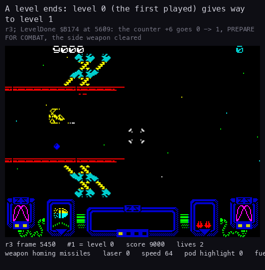

How to read the animation:

- **The picture** is `r3` frames 5450-6250, one every 8 frames.
- **Under it**: the same readout as 1.5.
- **What it shows**:
  - the level's script reaches its `levelend`; the handler becomes TitleInterrupt and the screen fades;
  - frame 5609: LevelDone `$B174`; at 5610 the level counter is 1;
  - the banner PREPARE FOR COMBAT / PLAYER 1 while the level's first columns are built under it;
  - play again on level 1 (open space) with the same score and lives. The side weapon (`+8`) was cleared by the
    level script at 5544, before LevelDone.
- **The point**: a level ends by its script, not by a kill. Play stops for a few seconds between levels.

```bash
python3 tools/fig_play_anim.py --work work/z128A/r3 --from 5450 --to 6250 --step 8 \
    --title 'A level ends: level 0 (the first played) gives way to level 1' \
    --out docs/img/design/level-end.gif    # marks: the fork NOTES
```

## 1.9 The guardians

The big enemies are built in the main loop by BuildBigSprite `$8F0C` and run by BigEnemyHandler `$A03E`. In `r3`
(`time_travel coverage_scan`):

| Level (order) | Built | Its end | How |
| --- | ---: | ---: | --- |
| 2 (3rd) | 16 205 | 18 232 | escaped (BigEnemyLeaves `$A04A`), score unchanged |
| 7 (5th) | 28 437 | 30 464 | escaped |
| 4 (7th) | 41 867 | 42 731 | destroyed, +1025 |
| 8 (8th) | 47 879 | 50 183 | destroyed, +2025 |
| 6 (9th) | 54 658 | 57 109 | not resolved: no BigEnemyLeaves, no score |
| 10 (11th) | 67 397 | 69 369 | destroyed, +2025 |

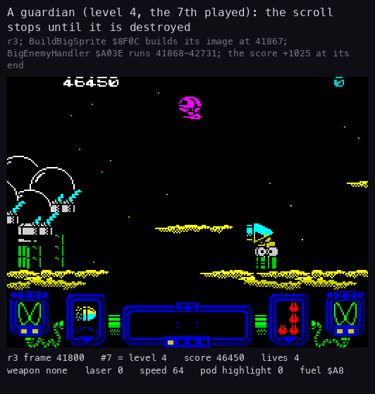

How to read the animation:

- **The picture** is `r3` frames 41800-42800, one every 8 frames.
- **Under it**: the same readout as 1.5.
- **What it shows**:
  - BuildBigSprite builds the guardian's image at 41867, and it comes in at the right;
  - the scroll stops while BigEnemyHandler runs (41868-42731);
  - the ship shoots it; each hit plays BigEnemyHitSound (243 frames over `r3`);
  - at 42731 it is destroyed: the score goes from 46 450 to 47 475.
- **The point**: a guardian is one big sprite drawn by the same strip code as the small enemies
  ([6.7](06-rendering.md#67-the-sprites-strips-in-paper-colour)); it can be beaten or outlasted.

```bash
python3 tools/fig_play_anim.py --work work/z128A/r3 --from 41800 --to 42800 --step 8 \
    --title 'A guardian (level 4, the 7th played): the scroll stops until it is destroyed' \
    --out docs/img/design/guardian.gif    # marks: the fork NOTES
```

The guardians' behaviour and hit points are [7](07-objects.md) and [10](10-gameplay-logic.md).

## 1.10 Difficulty

Zynaps adapts to the player's arms. WeaponRating `$9B75` runs at each score print and at each level start:

- L = the laser level + the side weapon;
- WeaponRatingValue `$80E8` = ((speed / 32 + L) × 4) AND `$F0`, + the level's bias: the enemies' chance to fire on
  their turn;
- WeaponRatingMask `$80E7` = `$30` from L = 4 (instead of `$FF`);
- WeaponRatingLevel `$80E9` = 8 from L = 7: the waves take their other colour set.

What the three values do (EnemyFire `$A0EB`, LaunchWave `$9271`):

- an enemy fires on its pass when a random number less WeaponRatingValue is below its fire rate: the higher the
  value, the more shots;
- WeaponRatingMask is the trigger column an enemy that has not fired yet fires at;
- WeaponRatingLevel is added to a wave kind's colour select and speed level: a well-armed ship meets the other colour
  set and faster waves.

So a well-armed, fast ship draws more fire, and the later levels (bias 10-20) fire more still. There is no
difficulty option; INF.LIVES is the only help. How much more often enemies fire was not measured here
([10](10-gameplay-logic.md)).

## 1.11 The sound in short

- The intro plays a STarKos tune (the SK10 song) from the title to the Hewson picture.
- The game menu plays the CPC Zynaps music on the AY. A level's start stops it; play has the AY effects only:
  the shot, the pods, the explosions, the launches, the extra life.
- Key 4 stops the music; the pause's end restarts it.
- The 48K beeper is cut off: no beeper effect, no title tune on the beeper, no explosion noise on the speaker.

The engine, the songs and every effect are [9. Sound](09-sound.md).

## 1.12 What no recording reached

- **A ranked high score and the initials**: every game of `c1` ends unranked; `r3` never dies.
- **The two-player game**: every recording has one player.
- **The pause**: no recording presses 4 in play ([4.7](04-game-loop.md#47-the-pause-and-the-end-of-a-round)).
- **The seeker**: the bot never takes it ([10](10-gameplay-logic.md) has the weapons in flight).
- **The key definition with new keys**: `k128` only shows the screen with the defaults.
- **The game on a 48K**: in the code only; this case runs on 128K machines.
