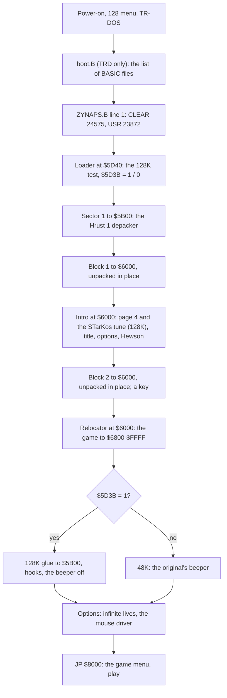

# 2. Architecture

Draft (stage 1): the memory map and the stages from the disk to play. The frame, the main loop's call graph and the
module map come with stage 3.

<!-- Figures this document needs (GUIDE.md 4.2), remove each line when it is in: -->
<!-- - the memory map (`kit/heatmap.py`, regions) -->

The recordings it rests on: `c1` (Pentagon 128 + TR-DOS, power-on to play, [3. Build and load](03-build-and-load.md))
and the model runs `work/stage1/models` (3.9).

## 2.1 The machine budget

The game is the 48K Zynaps: its code and data fill `$6800`-`$FFFF` with the screen at `$4000`. Its 128K version
adds one page: page 4 holds the AY engine and all music and effect data. The game stays in the 48K map with bank 0
at `$C000` and pages in page 4 only for the engine's calls. No other page is used in play. The machine needs a 128K with
`$7FFD` paging, an AY and TR-DOS; a Kempston mouse is optional.

| Page | Where | In play | What |
| --- | --- | --- | --- |
| 5 | `$4000`-`$7FFF` | always | the screen (`$4000`-`$5AFF`), the 128K glue (`$5B00`-`$5BE2`), the BASIC variables with the loader's flags (`$5D3B` 128K, `$5D40` INF.LIVES, `$5D41` K-MOUSE), the game from `$6800` |
| 2 | `$8000`-`$BFFF` | always | the game (code, texts at `$83B0`-`$8516`, the hook stubs at `$B30D`-`$B3A8`) |
| 0 | `$C000`-`$FFFF` | mapped except during an engine call | the game; I = `$FE`, the IM 2 table `$FE00`-`$FF00` filled with `$FD` (from `$FEE8` when K-MOUSE is on), the `JP` at `$FDFD`; the mouse driver at `$FE00`-`$FEDC` when K-MOUSE is on |
| 4 | `$C000`-`$FFFF` | paged in by the stubs and the interrupt glue | the sound engine `$C968`-`$CD22`, its music and effect data `$DE48`-`$FE6F` |
| 1 | | | only byte 0 = `$11`, the loader's paging test |
| 7 | | | `$EBF7`-`$FD72`: the Pentagon 128 menu's leftovers (not the game's) |
| 3, 6 | | | not used |

The intro, before the game, uses the same pages differently: block 1 unpacks to `$6000`-`$E8D4` (banks 5, 2, 0),
the STarKos player with its song runs at `$8000` from an IM 2 table at `$FC00`, and the three pictures go straight
to the screen. Block 2 then overwrites all of it.

## 2.2 Images

`work/images/` holds the eight pages and the 64 K CPU view at six points of `c1` (`tools/ttd_dump.py`):

| Name | Frame:T | What |
| --- | --- | --- |
| `intro-unpacked` | 2182:53027 | block 1 unpacked, at the intro's `CALL $6000` |
| `intro-title` | 2600 | the intro running: page 4 filled, the player at `$8000`, the title shown |
| `game-unpacked` | 3302:0 | block 2 unpacked, before its relocator |
| `game-entry` | 3313:51573 | at `JP $8000`: the game relocated and patched |
| `menu` | 3450 | the game menu |
| `play` | 6000 | in play |

Each is `NAME-bankN.bin` (16 384 bytes, page N) and `NAME-cpu.bin` (the 64 K as mapped then).

## 2.3 The stages

The frames of each stage in `c1` are in [3.7](03-build-and-load.md#37-the-stages-in-c1).

## 2.4 The frame (128K)

The game's own IM 2 handlers (`$A9E5`, `$A9F7`, `$AB03`, `$A581`) are patched to the glue at `$5B00`: each frame the
glue pages 4 in, calls the engine's play entry `$C96E`, and pages 0 back. Game events call the hook stubs, which
page 4 in, call one of the engine's effect entries `$C971`-`$C9B1`, and page 0 back ([9. Sound](09-sound.md)). The
rest of the frame is the 48K game's, stage 3's subject.
