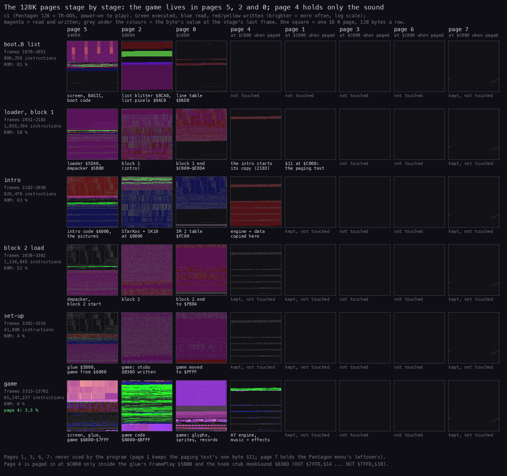
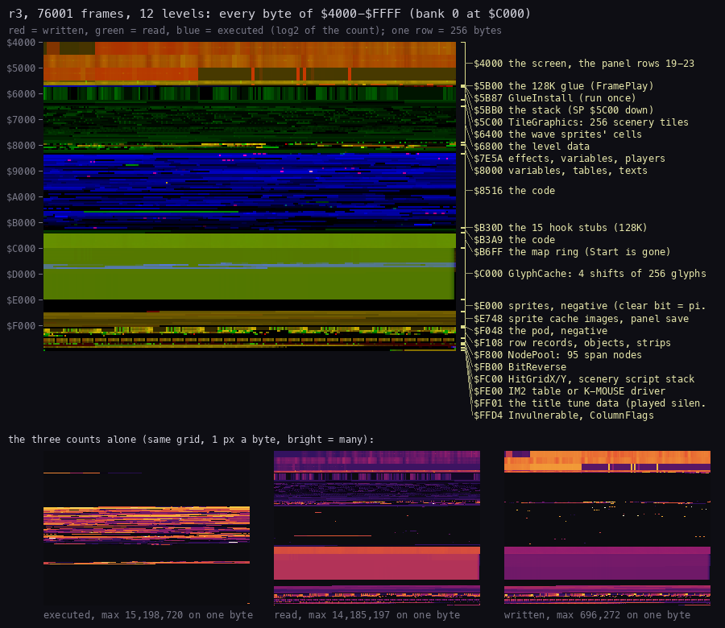
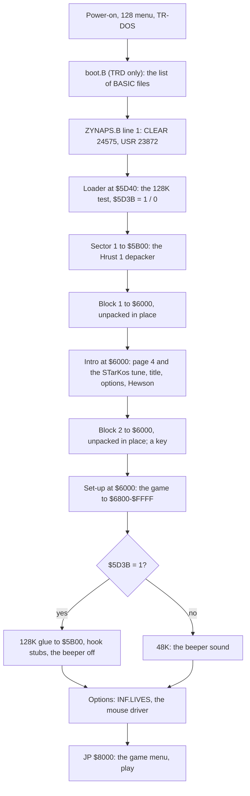
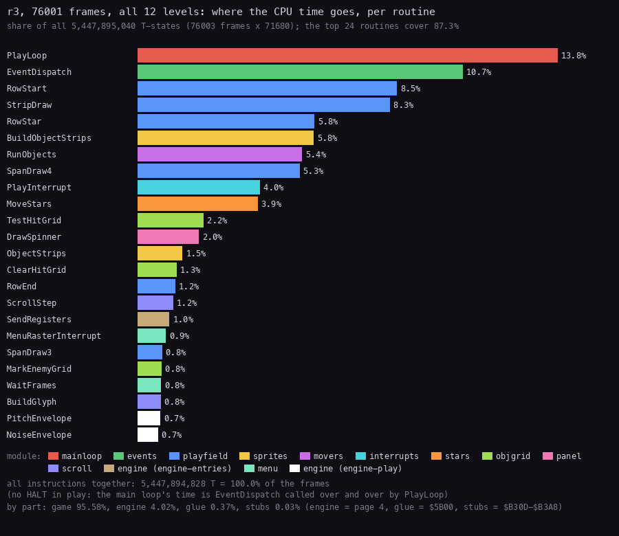
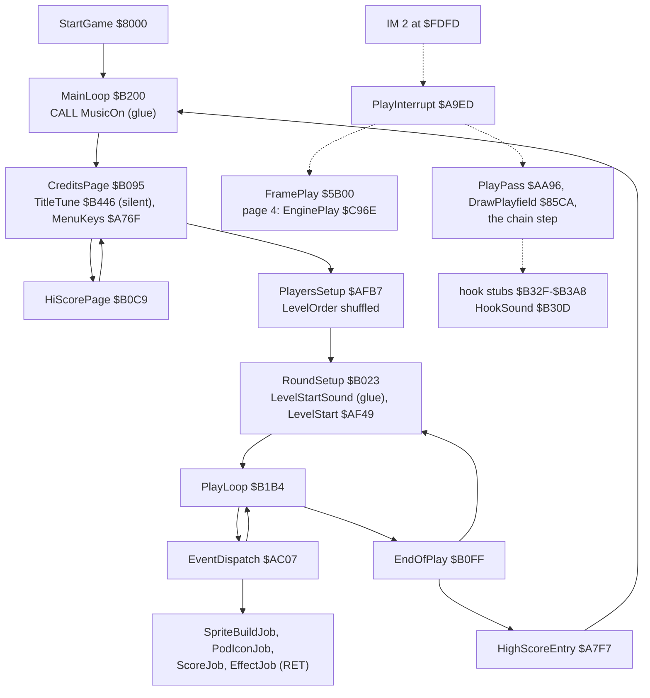

# 2. Architecture

What this covers:

- the machine budget: which 128K page holds what in play (2.1);
- the eight pages at each stage from the boot to play, as heatmaps (2.2);
- the 64 K as the game sees it in play, as a heatmap of a whole game (2.3);
- the memory images kept from the recording (2.4);
- the stages from the disk to play (2.5);
- where the CPU's time goes over a whole game (2.6);
- the frame: the interrupt, the 128K glue, the AY engine and the hook stubs (2.7);
- the main loop's call graph (2.8) and the module map (2.9);
- the stack (2.10).

The names are those of the `.ann` files of `src/`: `src/game/game.ann` (the game), `glue.ann`, `stubs.ann`,
`setup.ann`, `mouse.ann`, `src/intro/intro.ann`, `src/sound/engine.ann`. The terms are in the
[index](README.md#terms).

The recordings it rests on, each on a Pentagon 128 with TR-DOS (a frame is 71 680 T):

- `c1`: power-on, the TRD, the boot list, the intro, the game menu, six short games (`work/stage1/c1`,
  [3.7](03-build-and-load.md#37-the-stages-in-c1)). Its stage windows have their own L1 builds
  (`work/stage2/<stage>/l1.json`, WALKTHROUGH 4). Opened as `work/z128A/c1` (port base 16237) for the page images.
- `r3`: the bot through all 12 levels and the wrap, 76 001 frames from the title with INF.LIVES on and Invulnerable
  `$FFD7` = 1 (`work/z128A/r3`, [1](01-game-design.md)). Its L1 (`work/z128A/r3/l1.json`, 344 routines,
  596 736 584 instructions) gives the heatmap and the budget.
- `r1`, `r2`: the stub recordings of stage 2 (`work/stage2/stubs`), for the hooks.
- `models`: the same load on every 128K model with TR-DOS ([3.9](03-build-and-load.md#39-the-runs-on-other-models)).

`$RS` and `$B` are named in the [NOTES](../work/docs/z128A-NOTES.md).

## 2.1 The machine budget

The game proper fills `$6800`-`$FFFF` with the screen at `$4000`. It runs in the 48K map (pages 5, 2, 0) and pages
in page 4 only for the AY engine. The machine needs `$7FFD` paging, an AY and TR-DOS; a Kempston mouse is optional.

| Page | Where | In play | What |
| --- | --- | --- | --- |
| 5 | `$4000`-`$7FFF` | always | the screen (`$4000`-`$5AFF`), the 128K glue (`$5B00`-`$5BE2`), the stack (down from `$5C00`), the tile set (`$5C00`-`$67FF`), the level data and the variables from `$6800` |
| 2 | `$8000`-`$BFFF` | always | the game's tables, texts and code; the hook stubs at `$B30D`-`$B3A8`; the map ring `$B700`-`$BFFF` |
| 0 | `$C000`-`$FFFF` | mapped except inside an engine call | the glyph cache, the sprites, the records, the tables; I = `$FE`, the IM 2 table `$FE00`-`$FF00` filled with `$FD` (from `$FEE8` with K-MOUSE), the `JP` at `$FDFD`; the mouse driver at `$FE00`-`$FEDC` with K-MOUSE |
| 4 | `$C000`-`$FFFF` | paged in by FramePlay and HookSound | the AY engine `$C968`-`$CD22`, its music and effect data `$DE48`-`$FE6F` |
| 1 | | | only byte 0 = `$11`, the loader's paging test |
| 7 | | | `$EBF7`-`$FD72`: the Pentagon 128 menu's leftovers (not the program's) |
| 3, 6 | | | never touched |

- Paging: `OUT ($7FFD),$14` puts page 4 at `$C000`, `$10` page 0. Both keep the 48 BASIC ROM and screen 0.
- The loader's flags (`$5D3B` 128K, `$5D40` INF.LIVES, `$5D41` K-MOUSE) are read once by the set-up. In play the
  tile set covers them: `c1` frame 12200 reads `00` at `$5D3B` and `00 3C` at `$5D40`.
- So the 128K adds 16 K of sound to a 48K game, and 227 bytes of glue below the stack.

## 2.2 The eight pages, stage by stage



How to read the figure:

- **A row** is one stage of `c1`, with its frames, its instruction count and its share of ROM time.
- **A square** is one 16 K page, 128 bytes a row, offset 0 top left. Pages 5, 2 and 0 are where the CPU sees them
  normally; pages 4, 1, 3, 6, 7 are shown as they would be at `$C000`.
- **The colours** are the stage's accesses from its L1 build, by physical page: green executed, blue read, red and
  yellow written, magenta read and written; brighter is more often (log scale). The grey under them is the page's
  bytes at the stage's last frame.
- **The text** under a square names what the stage put there or used it for.
- **What it shows**:
  - boot.B (1870-2051, 81 % ROM): the list's blitter at `$8CA0` and pixels at `$9AC0`, the line table at `$D6D8`;
  - the loader and block 1 (2051-2183, 58 % ROM: TR-DOS reads the sectors): page 1 gets its one byte `$11`;
  - the intro (2182-2838): the engine and its data copied into page 4, STarKos at `$8000`, the IM 2 table at `$FC00`;
  - block 2's load (2838-3302): page 4 kept, not touched;
  - the set-up (3302-3314): the glue at `$5B00`, the stubs at `$B30D`, the game moved to `$FFFF`;
  - the game (3313-13702, 65 247 237 instructions, no ROM): pages 5, 2, 0 busy, page 4's engine and data read
    (3.3 % of the instructions run in page 4).
- **The point**: the program never uses pages 3 and 6, and page 7 only holds the menu's leftovers. Page 4 is the
  128K's whole addition.

```bash
python3 tools/fig_banks.py --work work/z128A/c1 --out docs/img/arch/banks-stages.png
```

## 2.3 The 64 K in play



How to read the figure:

- **The large grid** is `$4000`-`$FFFF` as the CPU sees it with page 0 at `$C000`, 256 bytes a row, `$4000` at the
  top left. Red is written, green read, blue executed: log2 of the count over all of `r3`.
- **The labels** on the right name each region (`tools/heatmap-regions-z128A.txt`), joined to its bracket.
- **The three small grids** are the executed, read and written counts alone, with each one's maximum.
- **What it shows**:
  - the screen is written all over, the panel rows least;
  - `$5B00` (the glue) runs, `$5B87` (GlueInstall, run once at the set-up) is dark, `$5BB0`-`$5BFF` is the stack;
  - `$5C00`-`$67FF` (the tile set) and `$C000`-`$DFFF` (the glyph cache) are read and written: the scroll;
  - the code `$8516`-`$B72E` is blue, with the 15 hook stubs at `$B30D`;
  - `$FE00` is the IM 2 table, read once an interrupt (no driver: `r3` plays with K-MOUSE off);
  - `$FF01`-`$FFD3` is the title tune's data, played silent on the credits page, which `r3` never shows.
- **The point**: the game's map is the 48K's; page 4's engine is not in this picture: it is paged in only inside
  FramePlay and HookSound, and the picture shows bank 0 at `$C000`.

```bash
python3 tools/fig_heatmap.py work/z128A/r3/l1.json docs/img/arch/heatmap.png --regions tools/heatmap-regions-z128A.txt \
    --title 'r3, 76001 frames, 12 levels: every byte of $4000-$FFFF (bank 0 at $C000)'
```

The regions in play (the ranges are the `.ann` entries'):

| Range | What |
| --- | --- |
| `$4000`-`$5AFF` | the screen; the panel rows 19-23 |
| `$5B00`-`$5B86` | the 128K glue: FramePlay and its entries, the music switch, the level and key-4 entries |
| `$5B87`-`$5BE2` | GlueInstall, run once |
| `$5BB0`-`$5BFF` | the stack (SP from `$5C00` down) |
| `$5C00`-`$67FF` | TileGraphics: 256 scenery tiles; the wave sprites' cells |
| `$6800`-`$7E59` | the level data |
| `$7E5A`-`$7FFF` | the effects' and sprites' descriptors, the variables, the player records |
| `$8000`-`$8515` | the variables, the tables, the texts |
| `$8516`-`$B72E` | the code, with the hook stubs at `$B30D`-`$B3A8` |
| `$B72F`-`$BFFF` | the map ring |
| `$C000`-`$DFFF` | GlyphCache: 4 shifts of 256 glyphs |
| `$E000`-`$F107` | the sprites (negative: a clear bit is a pixel), the sprite cache images, the panel save, the pod |
| `$F108`-`$F7FF` | the row records, the object records, the strips |
| `$F800`-`$FDFF` | NodePool (95 span nodes), BitReverse, the hit grid, the scenery script stack |
| `$FE00`-`$FF00` | the IM 2 table, or the K-MOUSE driver and the table from `$FEE8` |
| `$FF01`-`$FFD3` | the title tune's data |
| `$FFD4`-`$FFFF` | Invulnerable `$FFD7`, ColumnFlags, the glyph bitmap |

## 2.4 Images

`work/images/` holds the eight pages and the 64 K CPU view at six points of `c1` (`tools/ttd_dump.py`):

| Name | Frame:T | What |
| --- | --- | --- |
| `intro-unpacked` | 2182:53027 | block 1 unpacked, at the intro's `CALL $6000` |
| `intro-title` | 2600 | the intro running: page 4 filled, the player at `$8000`, the title shown |
| `game-unpacked` | 3302:0 | block 2 unpacked, before its relocator |
| `game-entry` | 3313:51573 | at `JP $8000`: the game relocated and patched |
| `menu` | 3450 | the game menu |
| `play` | 6000 | in play |

Each is `NAME-bankN.bin` (16 384 bytes, page N) and `NAME-cpu.bin` (the 64 K as mapped then).

## 2.5 The stages



How to read the diagram:

- **A box** is a stage; its code and its frames in `c1` are in [3.7](03-build-and-load.md#37-the-stages-in-c1).
- **The diamond** is the loader's paging test. Every machine of this case takes "yes"; the 48K branch is in the code
  and was not run (the case's scope is the 128K).
- **The point**: two packed blocks and one flag make the "2 in 1"; the 128K layer is added only at the set-up.

The load as a time line, the disk as a picture and both unpacks are in [3](03-build-and-load.md).

## 2.6 Where the time goes



How to read the figure:

- **A bar** is one routine's share of all the T-states of `r3` (76 003 frames × 71 680 T), summed from the L1 build.
  The colour is its module (the legend).
- **The bottom lines** check the sum (all instructions together = 100.0 % of the frames) and give the share by part.
- **What it shows**:
  - PlayLoop 13.8 % and EventDispatch 10.7 %: the main loop spinning between passes
    ([4.2](04-game-loop.md#42-the-main-loop-in-play-jobs-only)); there is no `HALT` in play;
  - the renderer (RowStart 8.5 %, StripDraw 8.3 %, RowStar 5.8 %, SpanDraw4 5.3 %, MoveStars 3.9 %) and the
    objects (BuildObjectStrips 5.8 %, RunObjects 5.4 %);
  - the AY engine's top routine, SendRegisters (page 4, 1.0 %);
  - by part: the game 95.58 %, the engine in page 4 4.02 %, the glue 0.37 %, the stubs 0.03 %.
- **The point**: a quarter of the machine is free time, and the 128K's sound costs 4 %.

```bash
python3 tools/fig_budget.py work/z128A/r3/l1.json docs/img/arch/budget.png \
    --title 'r3, 76001 frames, all 12 levels: where the CPU time goes, per routine'
```

The engine's share depends on what plays: 4.02 % over `r3`, 3.86 % over `r1`, 2.88 % over `c1`'s game window (more
menu time, where it steps once an interrupt and the music plays).

## 2.7 The frame

Every frame of the game belongs to an IM 2 handler: the table at `$FE00` is filled with `$FD`, so every vector leads
to the `JP` at `$FDFD`, whose target is the handler of the state ([4.1](04-game-loop.md#41-the-state-machine)).

The 128K glue (`src/game/glue.asm`) patches the three handlers in four places, each to a small entry that calls
FramePlay `$5B00` and then does the instructions the patch overwrote:

| Site | Handler | Glue entry | Engine steps |
| --- | --- | --- | --- |
| `$A9E5` | TitleInterrupt `$A9E4` | PlayAtA9E5 `$5B21` | one an interrupt |
| `$A581` | the tail of MenuRasterInterrupt `$A512` | PlayAtA581 `$5B28` | one an interrupt |
| `$A9F7` | PlayInterrupt `$A9ED`, its start | PlayAtA9F7 `$5B31` | two a pass |
| `$AB03` | PlayInterrupt, its end | PlayAtAB03 `$5B3C` | |

FramePlay `DI`s, saves the registers, does `OUT ($7FFD),$14` (page 4 in), `CALL $C96E` (the engine's EnginePlay: one step of
the music and the effects), `OUT ($7FFD),$10` (page 0 back), and returns with interrupts off.

- A pass takes two frames ([4.3](04-game-loop.md#43-the-play-interrupt-one-pass-four-phases)) and steps the engine
  twice, so the engine runs once a frame in play as at the menus: 75 988 steps in `r3`'s 76 003 frames.
- The game's events reach the engine through the hook stubs (`src/game/stubs.asm`): HookSound `$B30D` pages 4 in,
  calls one of the engine's effect entries `$C971`-`$C9B1` and pages 0 back. The 15 hooks at `$B32F`-`$B3A8` each
  do the instruction their call site lost and start one or two effects ([9.2](09-sound.md#92-which-event-starts-which-effect)).
  In `r3` HookSound runs 6487 times; in `c1` 269.
- The glue switches the music: ClearThenMusic `$5B46` (after the menu's screen clears), MusicOn at the main loop's
  `$B200`, LevelStartSound `$5B6D` (the music off at a level's start), Key4MusicOff `$5B7B` and Key4MusicOn `$5B82`
  around the pause.
- The beeper is cut off: `RET` at EffectPlay `$B30C` and BeeperSound `$B2F0`, `NOP: NOP` over four `OUT ($FE),A`
  (the title tune's at `$B496`; the three toggles of the 48K's explosion noise: per row at `$86D7`, per strip at
  `$8FBD`, per slot at `$949C`).

## 2.8 The main loop's call graph



How to read the diagram:

- **A solid arrow** is a call or a jump of the main program; **a dotted arrow** is what the interrupt runs, every
  pass.
- **The point**: the main program is a menu loop and a job dispatcher. The game's work runs in the interrupt, and
  the sound is reached from there (FramePlay) and from the game's events (the hooks).

## 2.9 The module map

The game is `src/game/game.ann` cut into 49 modules (`kit/mkgame.py`); the 128K parts are their own `.ann` files.

| Module | Range | What |
| --- | --- | --- |
| `glue` | `$5B00`-`$5BE2` | the 128K glue: FramePlay, the music switch, GlueInstall |
| `leveldata` | `$6800`-`$7E59` | enemy paths, waves, kinds, the level table and scripts, the scenery |
| `effectdata`, `gamevars`, `playerdata` | `$7E5A`-`$7FFC` | the effects' and sprites' descriptors, the play variables, the two player records |
| `gameentry`, `systemvars`, `handlertables`, `controldata`, `scoredata`, `texts` | `$8000`-`$8515` | the entry, the level order, the jump tables, the keys, the points, the high scores, the messages |
| `system`, `playfield`, `stars`, `scroll` | `$8516`-`$8C3A` | interrupt set-up, random, fades; the renderer; the stars; the scroll |
| `levels`, `scenery`, `sprites`, `objgrid`, `waves` | `$8C3B`-`$9462` | the level set-up, the scenery coroutine, the sprite builders, the hit grid, the wave launcher |
| `movers`, `objutil`, `player`, `weapons`, `enemies`, `objects` | `$9463`-`$A320` | the object loop, the path interpreter, the ship, the weapons, the enemies, fire and pods |
| `print`, `score`, `menu`, `input`, `options`, `hiscore`, `panel` | `$A321`-`$A9A0` | printing, the score, the menu raster, the controls, the selections, the initials, the spinners |
| `interrupts`, `hud`, `events`, `wavescript`, `rounds`, `mainloop` | `$A9A1`-`$B2EF` | the handlers and the pass, the panel, the job dispatcher, the wave script, the levels, the loops |
| `effects`, `stubs` | `$B2F0`-`$B3A8` | the beeper effects (cut off), the 15 hook stubs over them |
| `tune`, `icons`, `font`, `start` | `$B3A9`-`$B72E` | the (silent) title tune, the pod icons, the font, the start-up |
| `buffers`, `graphics`, `records`, `tables` | `$B72F`-`$FE00` | the map ring, the glyph cache, the sprites, the records, the node pool, the hit grid |
| `mouse` | `$FE00`-`$FEDC` | the K-MOUSE driver (only with K-MOUSE) |
| `tunedata`, `topcells` | `$FF01`-`$FFFF` | the title tune's data, Invulnerable and the work cells |
| `engine` (page 4) | `$C968`-`$CD22` | the AY engine and its entries (`src/sound/engine.asm`) |

The routines one by one are [12. Routine reference](12-routine-reference.md), the data [11](11-data-reference.md).

## 2.10 The stack

- The game sets SP to `$5C00`. The stack grows down into `$5BFF` and below, inside page 5.
- In `c1` the deepest write is at `$5BB0`. That is inside GlueInstall (`$5B87`-`$5BE2`), which runs once at the
  set-up: the stack overwrites code that is never run again, so it is harmless.
- The glue's code that runs in play, `$5B00`-`$5B86`, lies below `$5BB0`, out of the stack's reach. Its only byte
  written in play is `$5B5F`, the music switch's operand (MusicFlag).
- In `r3` the heatmap shows the same: `$5BB0`-`$5BFF` written, `$5B87`-`$5BAF` dark.
