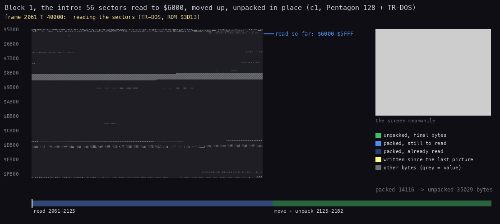
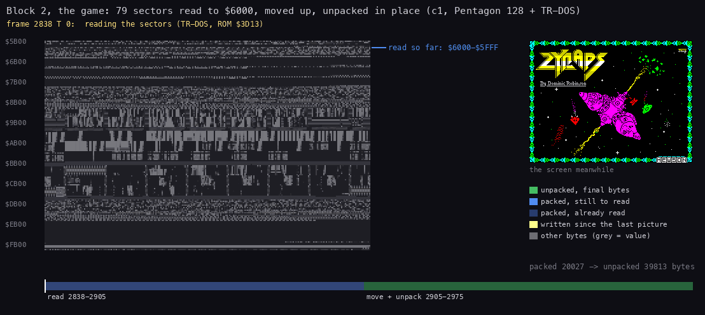
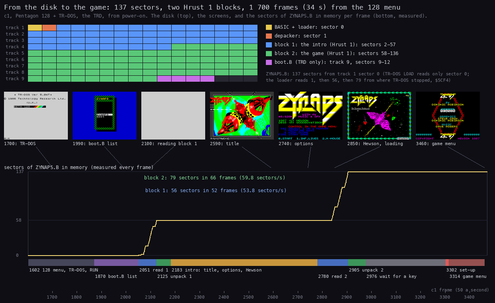
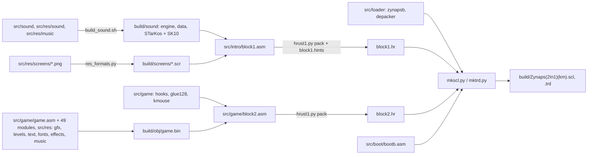

# 3. Build and load

What this covers:

- the disk and its one file (3.1), the loader in the REM line and its paging test (3.2);
- the Hrust 1 packer, with an animation of each unpack (3.3);
- the two blocks: the intro (3.4), the game with its 128K set-up and glue (3.5), and where the game image comes
  from (3.6);
- the whole load against time, from the 128 menu to the game menu (3.7), and which machine takes which path (3.8);
- the runs on other models (3.9), the source build (3.10) and the boot (3.11).

This document covers how Zynaps 2 in 1 gets from its disk into the 128 K. The disk is simple: one BASIC file of 137
sectors carries a loader in a REM line, a Hrust 1 depacker and two packed blocks. The first block is the intro (three
pictures, the options, the STarKos tune, and the sound engine for page 4). The second is the game, Hewson's code, with the
128K glue that sends its sound calls to the AY. A paging test in the loader picks the 128K path or the 48K one.

The recordings and runs it rests on:

- `c1`: power-on on Pentagon 128 + TR-DOS with the TRD, the 128 menu to TR-DOS, `RUN` (the boot), the boot's list
  (ENTER on `ZYNAPS`), the title, the options (`0`, options off), the Hewson screen, the game menu (`4`: high
  scores), then play with QAOP + space to frame 13 702 (`work/stage1/c1`, inputs
  `work/stage1/inputs/c1-trd-pentagon.txt`). A recording frame is the input script's frame + 1602.
- `models`: `tools/model_run.py`, the same keys on a fresh machine of every model with TR-DOS and 128 K or more
  (`work/stage1/models`, 3.9). `models-mouse`: the same with both options on, play started by the mouse.

## 3.1 The disk

The release comes as `Zynaps(2In1)(km).scl` and `Zynaps(2In1)(km).trd` (the md5 and SHA-1 of both are in the
[README](../README.md)). `python3 tools/disk.py compare` shows `ZYNAPS.B` the same in both, header and body; the TRD
adds a boot.

| File | Catalogue | Sectors | Place (TRD) | What |
| --- | --- | --- | --- | --- |
| `ZYNAPS.B` | BASIC, 168 bytes (program 168), autostart line 1 | 137 | track 1 sector 0 | the loader (a REM), then raw sectors: the depacker, block 1, block 2 |
| `boot.B` | BASIC, 988 bytes | 4 | track 9 sector 9 | TRD only: a generic boot that lists the disk's BASIC files and runs the one picked |

- The TRD's label is `ZYNAPS  `, 2 files, 2403 free sectors; no sector outside the two files holds data.
- `ZYNAPS.B`'s catalogue length covers 168 bytes (one sector); its sector count says 137. TR-DOS `LOAD` reads the
  first sector; the loader reads the rest by number, from where TR-DOS left off (`$5CF4`).
- `boot.B` has no text of its own and no author mark; no signature in the base matches it. On the SCL the player
  types `RUN "ZYNAPS"`.

The sectors of `ZYNAPS.B`, in order:

| Sectors | Bytes | Loaded to | What |
| --- | --- | --- | --- |
| 0 | 168 | the BASIC area | line 0: `REM` with the loader at `$5D40`; line 1: `CLEAR VAL "24575": RANDOMIZE USR VAL "23872"` |
| 1 | 256 | `$5B00` | the Hrust 1 depacker |
| 2-57 | 56 × 256 | `$6000` | block 1, the intro: Hrust 1, 14 116 bytes packed, 35 029 (`$88D5`) unpacked |
| 58-136 | 79 × 256 | `$6000` | block 2, the game: Hrust 1, 20 027 bytes packed, 39 813 (`$9B85`) unpacked |

## 3.2 The loader (`$5D40`, in the REM)

`work/stage1/dis/zynaps-rem.asm`. In order:

1. Sets TR-DOS's hook `$5CC2` to `POP AF: RET`, rebuilds the stack for a return to BASIC (`$1303`, `$1B76`),
   and restores channel `P`'s addresses from the ROM's table (`$15BE`).
2. **The 128K test**: `OUT ($7FFD),$10` and `$10` to `$C000`; `OUT ($7FFD),$11` and `$11` to `$C000`;
   `OUT ($7FFD),$10` and `CP ($C000)`. If it reads back `$10`, banks 0 and 1 are two pages and the machine pages
   (L = 1). Otherwise the second write hit the same memory: a 48K (L = 0). L goes to **`$5D3B`**, the flag every
   later stage reads: 1 = 128K, 0 = 48K. Bank 1 keeps the `$11` (the only byte of it the program ever writes).
3. Reads sector 1 to `$5B00` (ROM `$3D13`, C = 5, DE = `($5CF4)`).
4. Reads 56 sectors to `$6000`, then `JP $5B00` with HL = DE = `$6000`: the depacker unpacks block 1 in place.
   `CALL $6000` runs the intro (3.4).
5. Reads 79 sectors to `$6000` and unpacks block 2 in place.
6. Border blue for three frames (`OUT ($FE),1`), black, waits for any key (`IN A,($FE)` with A = 0, all rows), and
   `JP $6000`: block 2's relocator (3.5).

The "2 in 1" is this flag: the same blocks load on both machines. The intro skips its tune and page 4 when `$5D3B`
is 0; block 2 skips the 128K glue. The 48K path is in the code and was not run (the case's scope is the 128K
version).

## 3.3 The packer: Hrust 1

Both blocks are Hrust 1 (Dmitry Pyankov) with its `HR` header:

| Offset | Size | What |
| --- | --- | --- |
| 0 | 2 | `HR` |
| 2 | 2 | the unpacked length (LE) |
| 4 | 2 | the packed length, header included (LE) |
| 6 | 6 | the last 6 bytes of the unpacked data, stored apart |
| 12 | | the bit stream: 16-bit LE words, bits MSB first; the first data byte is a literal |

The depacker at `$5B00` (`work/stage1/dis/depacker-5b00.asm`) moves the packed block to the end of the
destination (LDDR) when the two overlap, takes the six bytes aside, unpacks forward and writes the six after the end
code. `tools/hrust1.py unpack` (the token grammar of lvd's mhmt, as in unreal-ng's `zxdepackers.cpp`) gives both
blocks with **0 bytes** different from the memory of `c1` at the end of each unpack. No signature in the base
matches this depacker (it is new to the base).

| Block | Packed | Unpacked | Last 6 bytes | md5 of the unpacked |
| --- | --- | --- | --- | --- |
| 1 | `$3724` | `$88D5` (`$6000`-`$E8D4`) | `0e ce c4 0f c2 ff` | `257122c695da3fb66a056855e9782dd7` |
| 2 | `$4E3B` | `$9B85` (`$6000`-`$FB84`) | `00 00 00 00 00 73` | `538bde1c38b329498d81d9468d2ec93f` |

Both unpacks, as `c1` ran them:





How to read the animations:

- **The big panel** is the memory `$5B00`-`$FFFF`, one row per 256 bytes, read with `memory_at` at each picture's
  frame and T (the title line names them and the phase: reading, moving, unpacking).
- **The colours** come from comparing that memory with the block's own bytes:
  - green: unpacked bytes already final, below the output pointer;
  - bright blue: the packed block still to be read; dim blue: packed bytes already read;
  - yellow: written since the previous picture; grey: anything else (its value).
- **The two arrows**: the output pointer (DE, the first byte from `$6000` not yet final) and the input pointer
  (where the bit reader stands for that much output, from `tools/hrust1.py`'s decoder on the same block).
- **Right**: the screen at that moment (the Hewson picture stays while block 2 loads), the input's lead over the
  output, and the two lengths.
- **The strip at the bottom**: the stretch of `c1` with the read and the move + unpack; the white tick is the
  picture's moment.
- **What it shows**:
  - the sectors arrive at `$6000` upwards;
  - the LDDR moves the packed block to end at the block's end (`$E8D4` / `$FB84`);
  - the output then grows from `$6000` towards the input and never overtakes it (block 2: 19 405 bytes ahead
    at 2915).
- **The point**: Hrust 1 unpacks in place, in one buffer: the packed bytes sit at the top of the destination and are
  consumed just ahead of the output. Block 1 takes 57 frames (2125-2182), block 2 70 frames (2905-2975).

```bash
python3 tools/fig_unpack.py --work work/z128A/c1 --block 1 --out docs/img/load/unpack-block1.gif
python3 tools/fig_unpack.py --work work/z128A/c1 --block 2 --out docs/img/load/unpack-block2.gif
```

## 3.4 Block 1: the intro

| Range | Size | What | Goes to |
| --- | --- | --- | --- |
| `$6000`-`$632C` | `$32D` | the intro's code | runs in place |
| `$632D`-`$66E7` | `$3BB` | the game's sound engine (effects and the music driver) | page 4 `$C968` (128K only) |
| `$66E8`-`$870F` | `$2028` | the engine's music and effect data | page 4 `$DE48` (128K only) |
| `$8710`-`$A20F` | 6912 | the title picture (`RVS.M.STAWICKI`) | the screen |
| `$A210`-`$BD0F` | 6912 | the options screen | the screen |
| `$BD10`-`$D80F` | 6912 | the Hewson picture (`By Dominic Robinson`) | the screen |
| `$D810`-`$E8D4` | | the STarKos player and the `SK10` song | `$8000`, `$10C5` bytes (128K only) |

The intro (`work/stage1/dis/blk1.asm`), 128K path:

1. Copies the engine and its data to page 4, and the STarKos player and song to `$8000` (`$8000` init with
   DE = the song, `$8003` play, `$8006` stop).
2. IM 2 with the table at `$FC00` and the vector's `JP` at `$FDFD` to `$60D0`, which calls `$8003` each frame: the
   intro tune plays from the title on.
3. Each screen appears through `$62A4`: the pixels first, then the attribute rows in a random order, one row a frame.
4. The title waits for a key. The options screen takes `1` (toggles `$5D40`, INF.LIVES), `2` (toggles `$5D41`,
   K-MOUSE), each shown by inverting its attributes (XOR `$2D`), and `0` (start).
5. The Hewson picture; then IM 1, `JP $8006` (the tune stops) and back to the loader, which loads block 2 while the
   picture stays.

On 48K the copies to page 4 and to `$8000` and the IM 2 tune are skipped; the screens and the options are the same.

## 3.5 Block 2: the game and its glue

Block 2 unpacks to `$6000`-`$FB84`. Its code at `$6000` (`work/stage1/dis/blk2.asm`):

1. `LDDR` moves `$9800` bytes from `$6385`-`$FB84` to `$6800`-`$FFFF`: the 48K game (3.6).
2. If `$5D3B` = 1, the **128K glue**:
   - copies `$61B6` (`$E3` bytes) to `$5B00` and calls `GlueInstall` (`$5B87`, `src/game/glue.asm`). It patches
     the game's interrupt handler in four places (`$A9E5`, `$A581`, `$A9F7`, `$AB03`) to small entries that call
     `FramePlay` (`$5B00`: page 4, `CALL $C96E`, page 0) and then do what the patch overwrote. It sends the three
     screen clears (`CALL $858B` at `$AFB4`, `$A7F3`, `$A620`) to `ClearThenMusic` (`$5B46`), which clears and
     starts the music (`MusicSwitch`, `$5B50`: `$C96B` stop, then `$C968` start); `MusicOn` also rewrites the main
     loop's `CALL $AFB0` at `$B200` to call it. A level's start (`CALL $AD56` at `$B024`) goes to
     `LevelStartSound` (`$5B6D`: the music off, effect `$C9A5`, then `$AD56`), key 4's routine (`CALL Z,$B197` at
     `$ABDB`) to `Key4MusicOff` (`$5B7B`), and its end (`$B1B0`) to `Key4MusicOn` (`$5B82`);
   - puts `RET` at `$B30C` and `$B2F0` (the beeper's per-frame player and its sound start) and a `NOP` over the
     `DI` of the beeper's tone routine at `$B446`;
   - copies the shared stub to `$B30D` (page 4 with `OUT ($7FFD),$14`, `CALL $C9xx`, page 0 with
     `OUT ($7FFD),$10`) and the 15 hooks from `$6130` to `$B32F` on, writing each hook's address into its call site
     as it goes. Each hooked call site in the game now calls a hook that does the site's own instruction and starts
     one page-4 effect ([9. Sound](09-sound.md));
   - writes `DAVE ROGERS ` over `STEVE TURNER` at `$8484` (the credits name the CPC musician);
   - sets `$B21B` = `$E4`: the `JR $B203` that ends a game becomes `JR $B200`, so the menu loop passes `$B200`'s
     call again (the music restarts at the menu);
   - zeros `$B496`, `$86D7`, `$8FBD`, `$949C`: four `OUT ($FE),A` (the beeper's tone and three border clicks)
     become `NOP NOP`.
3. On both machines:
   - `$5D40` ≠ 0 (INF.LIVES): `$B171` = `$B6`, which turns `DEC (IX+4)` into `OR (IX+4)`: lives never drop;
   - `$5D41` ≠ 0 (K-MOUSE): copies the mouse driver (`$6299`, `$DD` bytes) to `$FE00` and patches four places.
     `$A6D4` = `CALL $FE1D` (the Kempston-stick read becomes the mouse read). `$A74E` = `LD A,$FA: IN A,($DF): AND 2`
     (the start test: button bit 1 down selects the stick path, now the mouse). `$851E` = `$E8 $FE` (the
     game's IM 2 table fill starts at `$FEE8`, past the driver). `$B212` = `CALL $FE00` (each life: the driver
     resets X = 0, Y = `$44` and takes the counters' first values).
4. `JP $8000`: the game's own start.

## 3.6 Where the game image comes from

The game image is the original Hewson tape's main block (`ZYNAPS.TAP`, the code block of 38 910 bytes at `$6801`;
`work/ref48`). The 128K image `$6800`-`$FFFF` before the glue differs from it in **151 bytes, 11 runs**:

| Where | Hewson tape | This disk | What |
| --- | --- | --- | --- |
| `$8188`-`$8191` | `DF01 BF02 7F02 FD01 FD02` | `7F01 FB01 FD01 DF02 DF01` | the default keys: SPACE fire, Q, A, O, P |
| `$86B7` | `$0A` | `$0C` | a delay count |
| `$8C15` | `$13` | `$14` | a delay count |
| `$A538`, `$A545` | `$3D`, `$10` | `$4D`, `$17` | a delay loop |
| `$A568`-`$A570` | 3 × `NOP`, `JP NZ` | `LD B,(HL)` × 2, `JR NZ` | the line loop, slower |
| `$AA68`, `$AA7B`, `$AA8D` | `$02`, `$05`, `$10` | `$0B`, `$10`, `$77` | delay counts |
| `$FDE8`-`$FE4A` | the tape loader's rest | zeros | |
| `$FFD9`-`$FFFE` | a font's rest | zeros | |

The delay changes are the "Pentagon fix". The Pentagon has no contended memory and its interrupt comes at another
place in the frame, so the original's beam-timed loops ran early; the new counts move them back. Which loop times
what is stage 3's.

## 3.7 The stages in `c1`



How to read the figure:

- **Top left**: the disk's tracks 1-9, one cell per sector, coloured by what it holds. `ZYNAPS.B` runs from track 1
  sector 0 to sector 136 (the BASIC with the loader, the depacker, block 1, block 2); `boot.B` (TRD only) sits after it.
- **Middle**: the screen at seven moments of `c1`, each with its frame, joined by a line to its place on the time
  axis.
- **The yellow curve**: how many sectors of `ZYNAPS.B` are in memory, compared with the file every frame
  (measured). The two climbs are the loader's reads: block 1, 56 sectors in 52 frames (53.8 a second), and block 2,
  79 sectors in 66 frames (59.8 a second).
- **The bar under it**: the stages of the table below, by frame.
- **The point**: the intro is not a wait screen. It runs between the two reads, and the load of the game happens
  under the Hewson picture; the whole way from the 128 menu to the game menu takes about 34 seconds.

```bash
python3 tools/fig_load_timeline.py --work work/z128A/c1 --out docs/img/load/load-timeline.png
```

The moments, to the T state where the recording gives it:


| Frame:T | What |
| --- | --- |
| 1870:23473 | `boot.B`'s code runs (`$5D40`, then `$8CA0` at 1904) |
| 2051:30363 | `ZYNAPS.B` loaded, the loader runs |
| 2061:19071 | sector 1 at `$5B00` |
| 2124:54960 | block 1 read; the depacker's move starts at 2125:10448 |
| 2182:53027 | block 1 unpacked, `CALL $6000` (the intro) |
| 2214 | the STarKos player at `$8000` |
| 2602 | the options screen; `0` at 2752; the Hewson picture; back to the loader at about 2780 |
| 2838:14782 | block 2's first sector |
| 2905:56587 - 2975:28332 | block 2 unpacked |
| 3302:~1400 | a key: `JP $6000`, the relocator |
| 3313:51573 | `JP $8000`: the game menu |
| 3502 | `4`: the high scores; play from 3902 |

The memory at these points is in `work/images/` ([2. Architecture](02-architecture.md)).

## 3.8 Which machine gets which path

| Machine | `$5D3B` | Path |
| --- | --- | --- |
| any with `$7FFD` paging (bank 1 at `$C000` when bit 0 is set) | 1 | 128K: AY music and effects, the glue |
| a 48K (writes to `$7FFD` do nothing) | 0 | 48K: the original's beeper effects, no music; in the code, not run here |

The program writes only `$10`, `$11` and `$14` to `$7FFD` (bank 0, 1, 4 with the 48 BASIC ROM, screen 0). A
static scan of every code block finds its paging `OUT`s only behind `LD BC,$7FFD` (the loader at `$5D6F`, the intro
at `$600E` and `$6028`, block 2's glue and stubs at `$611A`-`$621C`); no `$1FFD`, `$DFFD` or `$EFF7`. Bits 5-7 of
`$7FFD` stay 0, so Pentagon 512/1024 and Scorpion's extended pages see plain 128K paging (the runs' paging state at
the end: `$7FFD` = `$10`, `$1FFD` = 0).

## 3.9 The runs on other models

`python3 tools/model_run.py --out work/stage1/models --port-base 14900 MODEL[:RAM] ...` on a fresh machine of each
model (muted, RAM zeroed): the TRD autostarted (quick reset into TR-DOS, `boot.B`), ENTER on `ZYNAPS`, a key on the
title, `0` on the options, a key on the Hewson picture, space held 35 frames on the menu, about 900 frames of play.
For each model it checks `$5D3B`, the engine in page 4 (`$C968`, compared with block 1's `$632D`; about 92 % equal
once it runs, its channel records change) and the glue at `$5B00` (compared with block 2's `$61B6`; its variables
change). Results: `work/stage1/models/summary.txt`, `models*.json`, the screens per model, and the sheet
`work/stage1/models/montage-models.png`.

| Model | RAM | Loads | `$5D3B` | Page 4 engine | Reaches play | Note |
| --- | --- | --- | --- | --- | --- | --- |
| PENTAGON | 128 | yes | 1 | 0.92 | yes | the reference: steps 1-5 screens equal `c1` |
| PENTAGON | 512 | yes | 1 | 0.92 | yes | screens equal Pentagon 128 |
| PENTAGON | 1024 | yes | 1 | 0.92 | yes | screens equal Pentagon 128 |
| SCORPION (ZS-256) | 256 | yes | 1 | 0.91 | yes | `$1FFD` stays 0; the options shot is caught mid-reveal (other frame timing) |
| PROFSCORP | default | yes | 1 | 0.91 | yes | as Scorpion |
| ATM450 | default | yes | 1 | 0.92 | yes | |
| ATM710 | default | yes | 1 | 0.92 | yes | |
| TSL (TS-Conf) | default | yes | 1 | 0.92 | yes | |
| PROFI3 | default | yes | 1 | 0.92 | yes | |
| PROFI (v5) | default | yes | 1 | 0.92 | yes | only with `--route matrix`: on the default PS/2 route the injected keys never reach the boot list (the harness's input path, not the game) |
| GMX | default | yes | 1 | 0.92 | yes | only with `--pre enter`: the GMX starts on a black screen that takes a key before the boot runs |
| ZXPOLY-PENTAGON | default | yes | 1 | 0.92 | yes | screens equal Pentagon 128 |
| ATM3 (ZX-Evo) | default | not run | | | | the emulator's autostart does not drive ZX-Evo's BaseConf boot menu |
| 128k, PLUS2, ZXPOLY-128K | | no | | | | no TR-DOS on these models |
| PLUS2A, PLUS3 | | no | | | | the Beta 128 interface is disabled on these models |
| KAY, QUORUM, LSY256, PHOENIX | | no | | | | the machine is not created in this build (config folder or ROMs missing) |

No model that loads it failed: every one with TR-DOS takes the 128K path (`$5D3B` = 1), runs the AY engine in
page 4 and reaches play. Every model fits a Kempston mouse at `$FADF`/`$FBDF`/`$FFDF`, and no port clash was
seen. With both options on (`--options 1,2 --start mouse`, `work/stage1/models/models-mouse.json`), Pentagon 128,
Pentagon 1024 and Scorpion 256 all show `$B171` = `$B6` and the driver at `$FE00`. The ship's X follows the mouse
(a glide of 24 to the right gives the driver's X `$18`, the ship's X `$0013`). On Scorpion an enemy hit the ship
after that glide, and the life reset sent the driver back to X = 0, Y = `$44`.

The mouse's buttons: the start test reads bit 1 of `$FADF`, the in-play fire either bit 0 or 1. On a real Kempston
mouse interface bit 1 is the **left** button and bit 0 the right (MAME's `kempmouse.cpp`, ZEsarUX, the ZX Next VHDL),
so the game starts in mouse mode with a left click, as a player would expect. unreal-ng's `mouse.cpp` has the two
swapped (left on bit 0), so on it the right button starts the game: an emulator bug, listed in the WALKTHROUGH's tool
gaps.

## 3.10 The source build

`tools/build.sh` builds both media from `src/` and compares every step with the original (`tools/parts.py` cuts the
original's parts from the TRD into `build/orig/parts/`):



Every `.asm` is written from its `.ann` (`tools/part_mkasm.py`, kit/mkgame.py's pipeline; `tools/mkasm_all.sh`
regenerates all of them and installs a part only when it assembles to the original's bytes). The modules:

| Part | Sources | At | Entries |
| --- | --- | --- | --- |
| ZYNAPS.B's BASIC | `src/loader/loader.ann` | `$5D3B` | 7 |
| the depacker | `src/loader/depacker.ann` | `$5B00` | 1 (every internal label named) |
| block 1, the intro | `src/intro/intro.ann` | `$6000` | 15 (9 routines, 6 resources) |
| block 2's set-up | `src/game/setup.ann` | `$6000` | 7 (the set-up, 5 resources and the name) |
| the hook stubs | `src/game/stubs.ann` | `$B30D` | 16 |
| the 128K glue | `src/game/glue.ann` | `$5B00` | 11 |
| the mouse driver | `src/game/mouse.ann` | `$FE00` | 9 |
| boot.B | `src/boot/boot.ann` | `$5D3B` | 21 |
| the game | `src/game/game.ann` (`kit/mkgame.py`, `tools/mkgame.sh`) | `$6800` | 519 in 49 modules |
| the STarKos player and SK10 | `src/sound/starkos.ann` | `$8000` | 15 |
| the page-4 engine | `src/sound/engine.ann` | `$C968` | 39 |

The game in block 2 is the 48K's annotations made this game's: `src/game/game.ann` was seeded from the 48K case's
(`../zynaps/src/game/game.ann`, the same bytes keep their names and descriptions, the 48K's evidence named "48K c2"
and so on), with this game's default keys and Pentagon counts described where they differ (3.6), zeros where the
48K tape had leftovers (`$FDE8`-`$FE4A`, `$FFD9`-`$FFFF`), and an "On a 128K" paragraph on each of the 34 entries the
set-up or the glue patches at load. `kit/mkgame.py` writes the 49 modules; the resources (graphics, levels, texts,
effects, the title tune) are in the 48K's editable formats (the plugins `tools/res_*.py`, copied). The routines and
the data are listed in [11. Data reference](11-data-reference.md) and [12. Routine reference](12-routine-reference.md),
with this case's counts.

### The packer

`tools/hrust1.py pack` reproduces hrust-packer v1.3's choices: on block 2 every token, on block 1 every token but
one, given by `src/intro/block1.hints` (`12105 m 3 5803`: at 12 105 bytes the original takes the 3-byte match at
distance 5803 where the rule finds the nearer one at 3756; that one lies inside the long match at 8348, and which
rule of the original's match finder skips it is not known). The rules are in the tool's docstring: the longest match
within 8 K, the nearest of that length, the search stopping at 255 bytes or more; a 2-byte match within 768 when
shorter than 3; an X ? X token unless a 1-byte match and a better next token are there; literal runs of 12 or more
as one run token of the even count; the window grows right before the first match needing it. After each block the
packer wrote a TR-DOS descriptor of the plain file (`INTRO`, `BLOK`, type C, `$6000`, the unpacked length and
sectors), CR LF, `hrust-packer v1.3 by Dima Pyankov,Gorno-Altaisk.` and zeros: `--file NAME` writes the same tail.

## 3.11 boot.B

`src/boot/boot.ann`: a generic boot. It reads track 0's first nine sectors (`$3D13`, C = 5), lists the BASIC files
(type `B`) of the catalogue in a frame titled with the disk's label (sector 9 `$F5`, read with the catalogue), in a
bold copy of the ROM font (`$DAC0`), and keeps the list as pixels in a buffer at `$9AC0` that an unrolled
`POP DE` + 8 `LDI` blitter it builds at `$8CA0` copies to the screen each frame (lines 40-143, column 12, through
a line table at `$D6D8`). Q / A (and 9 / 8 with their row partners) move the bar with a 4-frame smooth scroll; ENTER,
SPACE or 0 writes the name into line 1's `RUN "        "` and returns to BASIC, whose line 1 then runs
`RANDOMIZE USR VAL "15619": REM : RUN "name"` through TR-DOS. Each frame it also calls six TR-DOS ROM routines
(`$2FC1`, `$2A53`, `$2740`, `$1FF3`, `$1FEB`, `$2FC1`, through the `$3D30` jump) and compares bit 6 of `$5CCD`
with the value at the start: a change reads the catalogue again (a new disk). What each of those ROM routines does
is not traced.
