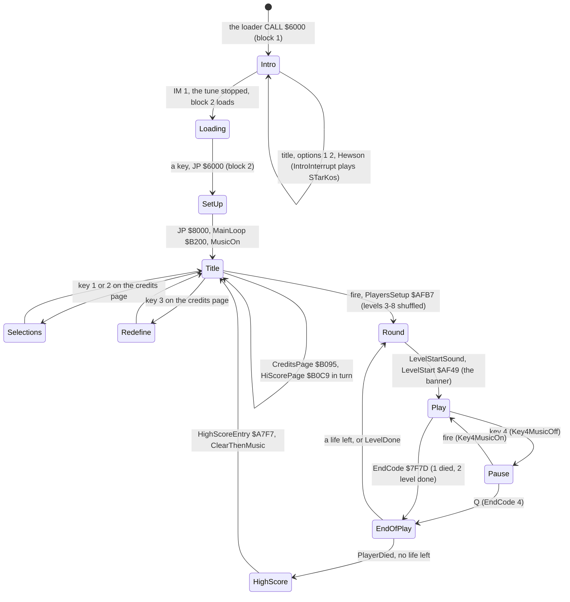
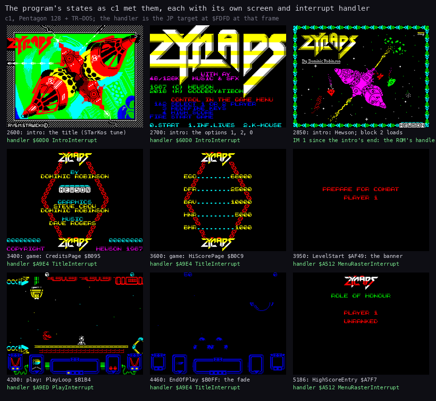
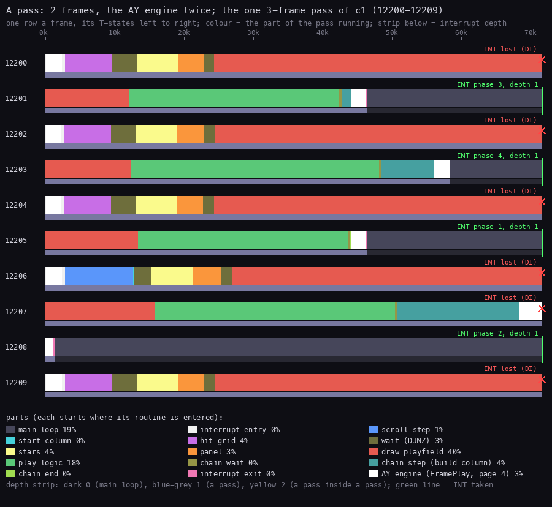
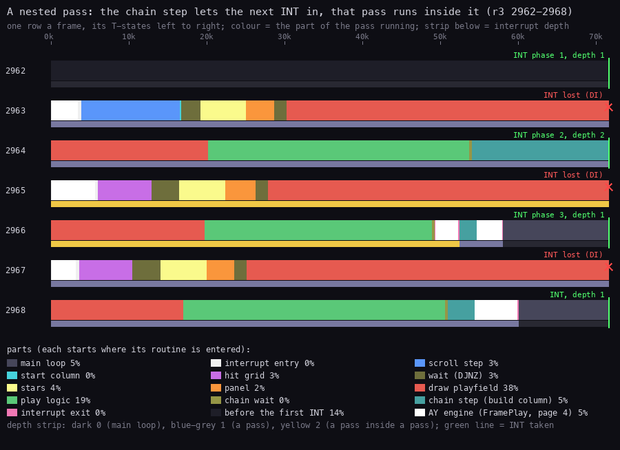

# 4. Game loop

What this covers:

- the state machine from the intro to play and back, with the interrupt handler of each state (4.1);
- the main loop in play: a job dispatcher that spins (4.2);
- the play interrupt: one pass of the game in two frames, its four phases, its drawing chain, and the AY engine
  stepped twice in it (4.3);
- the pass and interrupt counts over a short game and a whole game (4.4);
- the nested pass, when a chain step is cut by the next interrupt (4.5);
- the pass against the beam (4.6);
- the pause, the end of a life or a level, and the game over (4.7).

The names are those of `src/game/game.ann`, `src/game/glue.ann` and `src/intro/intro.ann`. The terms are in the
[index](README.md#terms).

The recordings it rests on, each on a Pentagon 128 with TR-DOS (a frame is 71 680 T):

- `c1`: power-on to six short games with QAOP + space, frames 1-13 702 (`work/stage1/c1`,
  [3.7](03-build-and-load.md#37-the-stages-in-c1)). Its game window, frames 3313-13702, has the game menu, the
  high-score page, 17 lives lost and five games over. It is opened read-only as `work/z128A/c1`:

  ```bash
  python3 $RS open --work work/z128A/c1 --ttd work/stage1/c1/session.ttd --model PENTAGON --port-base 16237 --binary $B
  ```

  - its access trace of frames 12199-12210 (`work/z128A/c1/traces/12199_0-12210_0.uatr`) gives the pass figure;
  - its L1 (`work/c1/l1.json`, a link to `work/stage2/game/l1.json`, the window 3313:51573-13702) gives the counts;
  - `time_travel find_last access=execute` over it gives the frame of every pass (`work/z128A/figs/c1-passes.txt`).
- `r3`: the bot through all 12 levels and the wrap, 76 001 frames from the title with INF.LIVES on and
  Invulnerable `$FFD7` = 1 (an experiment's poke; `work/z128A/r3`, [1](01-game-design.md)). Its L1 gives the
  whole-game counts. It is opened as `work/z128A/r3o` (port base 16283) for the nested pass: the trace
  `work/z128A/r3o/traces/2961_0-2969_0.uatr`.
- the code of `src/game/interrupts.asm`, `mainloop.asm`, `events.asm` and `glue.asm`.

`$RS` and `$B` are named in the [NOTES](../work/docs/z128A-NOTES.md).

## 4.1 The state machine



How to read the diagram:

- **A state** is a stretch of the program with its own screen and its own interrupt handler. In the game the
  handler is the target of the IM 2 jump at `$FDFD` (the table `$FE00`-`$FF00` filled with `$FD`, I = `$FE`):
  - TitleInterrupt `$A9E4` everywhere but in play and the raster screens: it steps the AY engine once (the glue's
    PlayAtA9E5) and sets EffectTick `$7F96`;
  - MenuRasterInterrupt `$A512` on the selections, the key definition, the banner and the game over: the raster of
    [6.10](06-rendering.md#610-the-banner-raster-one-colour-per-scan-line), then one engine step (PlayAtA581);
  - PlayInterrupt `$A9ED` in play: the game itself and two engine steps (PlayAtA9F7, PlayAtAB03).
- **The intro** has its own IM 2 table at `$FC00` and the handler IntroInterrupt `$60D0` (the STarKos tune). From
  ShowHewson `$60A8` to the game's start the machine is in IM 1 with I = `$3F`: the ROM's handler runs during the
  load of block 2.
- **An arrow** is a transition, labelled with the key or the routine that takes it.
- **The point**: play is one state with one handler. Everything the game does in play happens in that handler or in
  the jobs it posts. The main loop only runs the jobs.



How to read the figure:

- **Nine screens** of `c1`, each read at the end of its frame (`memory_at`, exact).
- **Under each**: the frame and the state, then (green) the handler in force: the JP target at `$FDFD` read at the
  same frame. Between the intro's end and the game's start the note says IM 1.
- **What it shows**:
  - 2600 the title, 2700 the options (IntroInterrupt `$60D0`), 2850 the Hewson picture under IM 1 while block 2
    loads;
  - 3400 the credits page and 3600 the high-score page (TitleInterrupt `$A9E4`);
  - 3950 the banner (MenuRasterInterrupt `$A512`), 4200 play (PlayInterrupt `$A9ED`);
  - 4460 the fade after a lost life (TitleInterrupt), 5186 ROLE OF HONOUR, PLAYER 1, UNRANKED (MenuRasterInterrupt).
- **The point**: each state of the diagram is a screen and a handler, and the recording passes through them all but
  the selections, the key definition and the pause.

```bash
python3 tools/fig_states.py --work work/z128A/c1 --out docs/img/loop/states.png
```

Witnesses (`c1`, `find_last access=execute` over 3313-13702):

- CreditsPage at 3331, 5202, 6783, 8344, 10331 and 12395: after the game's start and after each game over.
- HiScorePage at 3504: key 4 at 3502 ended the credits page (any key 1-5 does, MenuKeys then ignores 4).
- LevelStart at 3902, 4461, ... (one per life); PlayLoop at 4010, 4569, ....
- EndOfPlay 17 times, all PlayerDied. HighScoreEntry at 5165, 6746, 8307, 10294 and 12358; each game was
  unranked (the screen at 5186).
- `r3` goes Round, Play, EndOfPlay, Round 12 times by LevelDone (5609, 11900, ..., 75410) and never dies.
- No recording selects players, redefines the keys or pauses. Those states are known from the code (and the
  key definition from the screen of `k128`, [compare](img/compare/06-keyboard-definition.png)).

## 4.2 The main loop in play: jobs only

PlayLoop `$B1B4` prepares the play state, waits one frame with `HALT`, installs PlayInterrupt and then runs:

```text
PlayLoopPass:   CALL EventDispatch      ; $AC07: one job, the highest asked for
                LD A,(EndCode)          ; $7F7D, set by CheckPauseAndEnd inside the interrupt
                AND A
                JR NZ,PlayLoopEnd
                JR PlayLoopPass
```

- That `HALT` is the only one in play. The rest of the frame belongs to the interrupt.
- EventDispatch runs the highest bit of EventRequests `$81C5` that EventMask `$81C6` allows. The bit is cleared and
  its handler runs from EventHandlers `$81C7`:

| Bit | Job | Posted by | What it does |
| ---: | --- | --- | --- |
| 7 | SpriteBuildJob `$ACA6` | the wave launch | builds the shifted sprite copies of a new wave, and BuildBigSprite `$8F0C` for a guardian |
| 2 | PodIconJob `$AC2C` | PodStep `$A1FD`, PlayLoop | draws the pod selector icon on the panel |
| 1 | ScoreJob `$AC7A` | AddScore `$A489` | prints the score and checks the extra lives |
| 0 | EffectJob `$AC6F` | the weapons, the collisions | the beeper effect: EffectPlay `$B30C`, a `RET` in this game |

- Bits 3-6 are EventNone.
- The beeper's effect player EffectPlay `$B30C` and its start BeeperSound `$B2F0` are `RET` here (the glue,
  [3.5](03-build-and-load.md#35-block-2-the-game-and-its-glue); `c1` frame 12200 reads `$C9` at both). The sounds go to
  the AY engine through the hook stubs instead ([9.2](09-sound.md#92-which-event-starts-which-effect)).
- So the main loop has nothing to wait in: it calls EventDispatch over and over. In `c1`'s game window EventDispatch
  ran 1 270 667 times, about 122 calls a frame.
- Over all of `r3` PlayLoop takes 13.8 % of the CPU and EventDispatch 10.7 %
  ([2.6](02-architecture.md#26-where-the-time-goes)). That quarter of the machine is the spin: the time the passes
  leave.

## 4.3 The play interrupt: one pass, four phases

PlayInterrupt `$A9ED` (`src/game/interrupts.asm`) saves every register. At `$A9F7` the glue's JP PlayAtA9F7 `$5B31`
steps the AY engine once (FramePlay `$5B00`: page 4 in, the engine's `$C96E`, page 0 back), then the handler reads
PassPhase `$7F65`:

- phase 4 (a pass whose chain has not ended yet): nothing more, the registers come back through `$AB03`;
- otherwise PassCount `$7F62` +1, PassBit `$7F63` rotated, PassDepth `$7F64` +1, PassPhase +1.

Then it runs the work of the new phase:

| Phase | Start of the pass | Then | The play logic (PlayPass `$AA96`) | The chain step |
| ---: | --- | --- | --- | --- |
| 1 | ScrollStep `$8AED`, the chain reset, StartColumn `$894D`, a wait | MoveStars `$8894`, PanelFrame `$AB13`, a wait, DrawPlayfield `$85CA` | CheckPauseAndEnd `$ABD5`, ScrollControl `$A9A1`, RunObjects `$9463`, ObjectStrips `$8F9B`; MarkEnemyGrid `$90CB` | ChainBuildColumn1 `$AAEA` |
| 2 | TestHitGrid `$9150`, ClearHitGrid `$91C6`, a wait | the same | the four; WaveScriptStep `$AD66`; ResumeScript `$8D45` at depth 1 | ChainBuildColumn2 `$AAEF` |
| 3 | TestHitGrid, ClearHitGrid, a wait | the same | the four; MarkEnemyGrid; ResumeScript at depth 1 | ChainBuildColumn3 `$AAF4` |
| 4 | TestHitGrid, ClearHitGrid, a wait | the same | the four only | ChainEnd `$AAF9`: PassPhase = 0 |

- "The four" are CheckPauseAndEnd, ScrollControl, RunObjects and ObjectStrips: every phase runs them.
- The next interrupt after ChainEnd finds phase 0 and starts phase 1: the cycle is 1, 2, 3, 4, 1. The scroll GIF of
  [6.4](06-rendering.md#64-the-scroll-a-new-column-every-four-passes) reads it in `c1` 12203-12224.
- A chain step is `CALL BuildColumn; DI; RET`. BuildColumn `$896D` builds glyphs of the next map column into the
  glyph cache. It enables interrupts while it works (`EI` at `$8AA2`).
- The waits are `DJNZ` loops (PlayInterruptWait `$AA7C`). They hold the panel work and the playfield behind the
  beam (4.6). This game's counts at `$AA68`, `$AA7B` and `$AA8D` are set for the Pentagon
  ([13.5](13-differences-from-zynaps-48k.md#135-timing-the-pentagon-retiming)).
- At the end, at `$AB03`, the glue's JP PlayAtAB03 `$5B3C` steps the engine a second time, then PlayInterruptExit
  `$AAFF` restores the registers and returns with `EI; RET`.

So a pass steps the AY engine twice: once at its start, once at its end, after the chain step. Because a pass
takes two frames, that is one step a frame on average, the same 50 Hz as the menus' one step per interrupt.
The port timeline of [9.8](09-sound.md#98-when-the-engine-steps-the-port-timeline) measures the steps' spacing.

### The pass as the CPU runs it



How to read the figure:

- **A row** is one frame of `c1`. Across: the T-states of the frame, 0 to 71 680.
- **A colour** is the part of the pass the CPU is in. A part starts where its routine is entered and lasts until the
  next part starts:
  - main loop (dark grey): everything outside the interrupt;
  - AY engine (white): FramePlay `$5B00`, page 4, from its entry to its return;
  - scroll step (blue) and start column: phase 1 only;
  - hit grid (violet) and the wait (olive): phases 2-4;
  - stars (yellow), panel (orange), draw playfield (red);
  - play logic (green): PlayPass;
  - chain step (teal): BuildColumn from the chain; chain end: phase 4's ChainEnd.
- **A green line with "INT phase n, depth d"** at the right edge is an interrupt the CPU took, at the end of the
  frame (T 71 640-71 680). The phase is the one PlayInterrupt set; the depth is PassDepth. The pass it starts is
  drawn on the next rows.
- **A red cross "INT lost (DI)"** is an interrupt the CPU did not take: it was inside DrawPlayfield, or in
  FramePlay, with interrupts off.
- **The strip under each row** is the interrupt depth: dark 0 (the main loop), blue-grey 1 (a pass).
- **What it shows**:
  - each pass starts with the AY engine (white, T 0 to about 2 700), then the scroll step or the hit grid;
  - DrawPlayfield runs from T about 24 400 of the first frame to about 12 200 of the second;
  - the play logic then runs to T 42 000-47 000, the chain step after it, and the second AY engine step ends the
    pass;
  - the INT at the end of the first frame is always lost (under DI in DrawPlayfield);
  - the phase-1 pass of 12206-12208 has a long chain step (12207, T about 50 800 to 68 400). Its second engine step
    runs past the end of 12207, under DI, so that INT is lost too: this pass takes 3 frames.
- **The point**: one interrupt starts one pass, and the pass runs to the middle of the next frame. So a pass takes
  two frames, the game runs at 25 passes a second, and the AY engine is stepped at each end of the pass.

The parts over the ten frames (the table `fig_pass.py` prints):

| Part | Share of the 10 frames |
| --- | ---: |
| draw playfield | 40 % |
| main loop | 19 % |
| play logic | 18 % |
| hit grid | 4 % |
| stars | 4 % |
| chain step (build column) | 4 % |
| panel | 3 % |
| AY engine (FramePlay, page 4) | 3 % |
| wait (`DJNZ`) | 3 % |
| scroll step | 1 % |

```bash
python3 tools/fig_pass.py --work work/z128A/c1 --window 12199:0-12210:0 --rows 12200-12209 \
    --title 'A pass: 2 frames, the AY engine twice; the one 3-frame pass of c1 (12200-12209)' \
    --out docs/img/loop/pass.png
```

Over the whole game window of `c1` the passes start (`$A9ED`) 3221 times. Of the 3220 intervals between them 3202
are 2 frames, one is 3 frames (12205 to 12208, the pass of the figure), and the other 17 are the breaks between lives,
174-251 frames long. There are 18 stretches of play. The 3221st pass, at frame 13701, is cut by the recording's end.

## 4.4 The pass counts

From the L1 of `c1`'s game window (frames 3313-13702) and of `r3` (76 003 frames):

| Count | `c1` | `r3` | What it says |
| --- | ---: | ---: | --- |
| interrupts taken (`$FDFD` executed) | 7174 | 39 343 | |
| PlayInterrupt `$A9ED` | 3221 | 36 646 | the passes |
| TitleInterrupt `$A9E4` | 2550 | 1450 | the menu, the fades between lives and levels |
| MenuRasterInterrupt `$A512` | 1403 | 1247 | the banners and the game over |
| FramePlay `$5B00` (engine steps) | 10 393 | 75 988 | |
| DrawPlayfield `$85CA` | 3220 | | once a pass |
| ChainEnd `$AAF9` | 799 | 9152 | once in four passes |
| ScrollStep `$8AED` | 1945 | 9800 | phase 1, plus the replay of the scroll at each level start |
| BuildColumn `$896D` | 5877 | 29 437 | three chain steps in four passes, plus the level starts |
| the `NOP` store `$AADD` | 0 | 6 | the nested passes (4.5) |

- The handlers add up: in `c1` 3221 + 2550 + 1403 = 7174; in `r3` 36 646 + 1450 + 1247 = 39 343.
- The engine steps add up too: in `c1` the glue's entries ran PlayAtA9E5 `$5B21` 2550, PlayAtA581 `$5B28` 1403,
  PlayAtA9F7 `$5B31` 3220 and PlayAtAB03 `$5B3C` 3220 times: 2550 + 1403 + 2 × 3220 = 10 393, the count of
  FramePlay and of the engine's `$C96E`.
- In `r3`, 75 988 steps over 76 003 frames: one step a frame. The music and the effects run at 50 Hz in play as at
  the menus.
- `c1` plays in about 6 500 of its 10 390 frames (3221 passes); the rest is the menu, the banners and the fades.

## 4.5 The nested pass

BuildColumn enables interrupts. When a chain step is still building glyphs at the end of the frame after its pass,
the next interrupt is taken inside it:

1. PlayInterrupt runs at depth 2 (PassDepth `$7F64` = 2). The engine step, the next phase, the stars, the panel,
   the playfield and the play logic all run inside the step.
2. PlayChain `$AAC3` sees depth 2. It does not run its own chain step. It writes `NOP; NOP` over the `DI; RET` of
   the step before its own (the stores at `$AADD`), and leaves (with the second engine step).
3. The interrupted step resumes in BuildColumn. When it returns, its `DI; RET` is now `NOP; NOP`, so it falls into
   the next chain step: two steps back to back, in one call.
4. Phase 1 writes `DI; RET` (`$C9F3`) back over all three steps (`$AA58`-`$AA63`).



How to read the figure:

- **The rows, colours, lines and crosses** are those of the figure in 4.3, here `r3` frames 2962-2968.
- **Frame 2962** is before the first INT of the window (dark): the INT at its end starts phase 1.
- **Frames 2963-2964**: the phase-1 pass: the engine, the scroll step, the playfield, the play logic, then its chain
  step (teal) from T about 54 000 of 2964, still running at the frame's end.
- **The end of 2964**: "INT phase 2, depth 2". The yellow depth strip of 2965-2966 is a pass inside a pass: the
  phase-2 pass runs in full inside the phase-1 chain step, with its own two engine steps (white).
- **Frame 2966**: after the nested pass leaves (T about 53 000), the outer chain step continues (teal over the
  blue-grey strip), then the outer pass's second engine step and the main loop. The INT at its end starts phase 3.
- **The shares** (5 % main loop, 38 % draw playfield) differ from 4.3: the nested pass eats the main loop's time.
- **The point**: a slow chain step does not lose a pass. The next pass runs inside it, and its chain step is done by
  the interrupted one. The pass rate stays one every two frames.

`find_event exec $AADD` on `r3` (the `NOP` store) gives every nested pass: frames 2966, 3863, 28009, 63704, 66177
and 66596. Six in 76 003 frames: the chain is almost never late. `c1` has none.

```bash
python3 $RS open --work work/z128A/r3o --ttd work/z128A/r3/session.ttd --model PENTAGON --port-base 16283 --binary $B
python3 tools/fig_pass.py --work work/z128A/r3o --window 2961:0-2969:0 --rows 2962-2968 \
    --title 'A nested pass: the chain step lets the next INT in, that pass runs inside it (r3 2962-2968)' \
    --out docs/img/loop/nested.png
```

## 4.6 The pass against the beam

- On unreal-ng's Pentagon the INT falls at frame T 71 656-71 679, the end of a recording frame. The beam reaches
  screen line 0 about 17 900 T into the next frame and moves one line every 224 T.
- PlayInterrupt does the work that does not touch the playfield first: the engine step, the scroll step or the hit
  grid, the stars, the panel. The panel (lines 152-191) is written at T 18 000-21 000, before the beam reaches line
  152 at about T 51 900.
- DrawPlayfield starts at frame T about 24 400, when the beam is at line 29. It writes each row behind the beam;
  the last rows are written in the next frame ahead of it.
- So frame 12200 shows the old playfield and 12201 the new one, with no tear: the beam figure of
  [6.5](06-rendering.md#65-drawplayfield-against-the-beam).
- The engine's AY writes come at T 0-2 700 of the pass's first frame and after the chain step in its second, at T
  about 44 000-58 000 in the frames of the pass figure (past the frame's end in the 3-frame pass). The AY has no beam
  to chase; the spacing of the steps is measured in [9.8](09-sound.md#98-when-the-engine-steps-the-port-timeline).

## 4.7 The pause and the end of a round

CheckPauseAndEnd `$ABD5` runs at the start of every PlayPass:

- key 4 (half-row `$F7FE`, bit 3) calls, through the glue, Key4MusicOff `$5B7B`: the music off, then Pause `$B197`,
  inside the interrupt;
- Pause runs StopAndSettle `$ABF0`, then a loop: fire (TitleFireCheck `$A748`) returns to play, Q (half-row
  `$FBFE`, bit 0) sets EndPending `$7F7C` = 4;
- Pause's last store at `$B1B0` jumps to Key4MusicOn `$5B82`: the music on again;
- a pending end code (EndPending: 1 a life lost, 2 the level done, 4 abort) moves to EndCode `$7F7D`; the handler
  becomes TitleInterrupt and StopAndSettle silences the effect.

The pause stops the whole game:

- Key4MusicOff's MusicSwitch stops the music (and enables interrupts);
- StopAndSettle gives two frames under TitleInterrupt (`EI; HALT; HALT`: two engine steps, the effect stopped), then
  `DI` and the play handler back;
- the pause loop then runs inside the interrupt with interrupts off: no pass, no engine step, until fire or Q.

No recording pauses: this is known from the code (`src/game/mainloop.asm`, `hud.asm`, `glue.asm`).

EndOfPlay `$B0FF` waits 50 frames, fades the attributes (FadeAttributes `$85AD`) and jumps through EndHandlers
`$B111`:

| Code | Handler | What | Seen |
| ---: | --- | --- | --- |
| 1 | PlayerDied `$B119` | TakeLife `$B170`; with no life left, the game over and HighScoreEntry | `c1`: 17 times, 5 games over |
| 2 | LevelDone `$B174` | the level counter (record `+6`) +1, wrapping from 11 to 0 | `r3`: 12 times |
| 3, 4 | AbortGame `$B18A` | SP reset, the title pages | no recording |

- With INF.LIVES on, TakeLife's `DEC (IX+4)` at `$B171` is `OR (IX+4)`: a life is lost on the screen but the count
  stays ([5.6](05-controls.md#56-the-intros-options-inflives-and-k-mouse)).
- At the game over HighScoreEntry `$A7F7` runs (the screen wipe and its sound through HookScreenWipe `$B39C`), then
  the main loop's `JR $B200` (made so by the set-up at `$B21A`) passes MusicOn again: the menu's music restarts. In
  `c1` CreditsPage follows each HighScoreEntry by 37 frames (5165 to 5202, 12358 to 12395).
- A level ends by its script, not by a kill: the level-end GIF of [1.8](01-game-design.md#18-a-level-ends) shows one.
