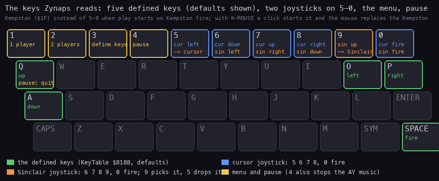
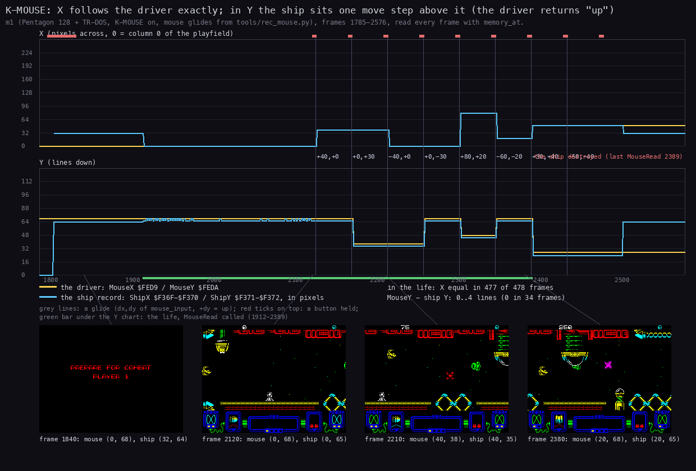
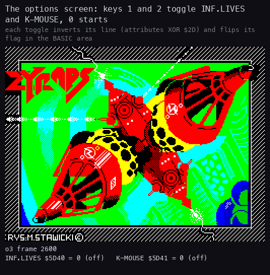

# 5. Controls

What this covers:

- the keys, the joysticks and the mouse the game reads (5.1);
- ReadControls: one routine for every device, and how the start picks the device (5.2, 5.3);
- the Kempston mouse driver of K-MOUSE: its patches, its routine, and a recording that plays with it (5.4);
- the title keys, the selections and the key definition (5.5);
- the intro's options screen: INF.LIVES and K-MOUSE (5.6);
- the pause (5.7);
- the high-score initials (5.8);
- the weapon pods: touch to select, hold fire to take (5.9).

The names are those of `src/game/game.ann`, `src/game/mouse.ann`, `src/game/setup.ann`, `src/game/glue.ann` and
`src/intro/intro.ann`. The code is `src/game/input.asm`, `options.asm`, `menu.asm`, `hiscore.asm`, `objects.asm`,
`mouse.asm` and `setup.asm`. The terms are in the [index](README.md#terms).

The recordings it rests on, each on a Pentagon 128 with TR-DOS (a frame is 71 680 T):

- `c1`: power-on to six short games played with the keys Q, A, O, P and space, options off (`work/stage1/c1`,
  inputs `work/stage1/inputs/c1-trd-pentagon.txt`, [3.7](03-build-and-load.md#37-the-stages-in-c1)). Opened as
  `work/z128A/c1` (port base 16237).
- `m1`: K-MOUSE on, one life played with the mouse, 792 frames recorded from the game menu (`work/z128A/m1`):

  ```bash
  python3 tools/rec_mouse.py --work work/z128A/m1 --port-base 16271 --binary $B
  ```

  A fresh Pentagon 128 (RAM zeroed, muted): the TRD autostarted, ENTER on the boot list, a key on the title, `2`
  on the options (K-MOUSE on), `0`, a key on the Hewson picture. The recording starts at the game menu, at frame
  1785. Then:

  | Frames | Input (MCP `mouse_input`) | What it does |
  | ---: | --- | --- |
  | 1795-1830 | a button held 35 frames | the start test (5.4): play in mouse mode |
  | 2080 + 44 k | glide k of (+40,0), (0,+30), (-40,0), (0,-30), (+80,+20), (-60,-20), (+30,+40), (-50,-40) | the mouse moved (+dy = up) |
  | 2120 + 44 k | the left button, 4 frames | fire |

- `o3`: power-on to the game menu with the options toggled on the intro's options screen (`work/z128A/o3`, the
  fork's [NOTES](../work/docs/z128A-fork-NOTES.md)).
- `r3`: the bot through all 12 levels with INF.LIVES on, 76 001 frames (`work/z128A/r3`); it takes pods 119 times.
- `k128`: the TRD to the key definition (`work/stage2/compare/k128`, WALKTHROUGH 4).

`$RS` and `$B` are named in the [NOTES](../work/docs/z128A-NOTES.md).

## 5.1 The keys



How to read the figure:

- **A key with a coloured outline** is read by the game. Its roles are written in it, in the colour of the reader.
- **Green**: the five defined keys, the defaults of KeyTable `$8188`: SPACE fire, Q up, A down, O left, P right.
  `c1` frame 12200 reads `7F01 FB01 FD01 DF02 DF01` there: five pairs of half-row and bit mask.
- **Blue**: the cursor joystick on 5-8 and 0.
- **Orange**: the Sinclair joystick on 6-9 and 0. Key 9 also selects it; key 5 drops back to the cursor joystick.
- **Yellow**: the title keys 1, 2, 3, the pause key 4 (which also stops the AY music), and Q to quit from the pause.
- **The subtitle**: the Kempston joystick (port `$1F`) replaces the number row when play starts on Kempston fire;
  with K-MOUSE a left click starts play and the mouse replaces the Kempston (5.4).
- **The point**: the five defined keys and one joystick are read together, every pass. The number row is reserved
  for the joysticks and the menu.

```bash
python3 tools/fig_keys.py --out docs/img/controls/keys.png
```

The defaults are this game's: the five pairs at `$8188`-`$8191` are SPACE, Q, A, O, P
([3.6](03-build-and-load.md#36-where-the-game-image-comes-from)). `c1` plays with them.

## 5.2 ReadControls: one routine for all devices

ReadControls `$A6B6` is called by the ship's handler PlayerHandler `$9A5B` once a pass, and by HighScoreEntry. It
builds one byte C, bit 4 fire, 3 up, 2 down, 1 left, 0 right:

1. **The five keys**: for each pair of KeyTable (the half-row port's high byte, the bit mask) it reads `IN ($FE)`
   and shifts "pressed" into C. Fire comes first, so it lands in bit 4.
2. **The joystick**, by JoystickFlags `$8187`:
   - bit 0 set: the Kempston, `IN A,($1F)`: `AND $1F` at `$A6D4` (fire 4, up 3, down 2, left 1, right 0). With
     K-MOUSE this is `CALL MouseRead: NOP` (5.4);
   - otherwise the number row (half-rows `$EF` and `$F7`): the cursor joystick (5 left, 6 down, 7 up, 8 right,
     0 fire), or the Sinclair joystick (6 left, 7 right, 8 down, 9 up, 0 fire) when key 9 is down or JoystickFlags
     bit 1 is set. Key 9 sets bit 1 (sticky); key 5 clears it.
3. **The merge**: the joystick bits are ORed into C.
4. **The outputs**:
   - FireHeld `$8184`: +1 each call while fire is held, 0 when it is released;
   - FireChanged `$8185`: `$FF` when fire was pressed or released since the last call;
   - ControlBits `$8186`: the four direction bits (fire removed).

In `c1` ReadControls ran 2818 times in 3221 passes: once a pass while the ship is alive (not in the death sequence).
The cursor and Sinclair paths ran in no recording: they are known from the code.

## 5.3 Which device: the start test

TitleFireCheck `$A748` is the title's fire test. It decides the device for the whole game:

```text
TitleFireCheck: SET 0,(JoystickFlags)   ; $8187: try the Kempston
                IN A,($1F)              ; $A74E: the start test
                AND $1F
                CP $10                  ; exactly fire?
                JR Z,TitleFireYes       ; yes: keep bit 0, the Kempston is the joystick
                RES 0,(JoystickFlags)   ; no: the number row
                ...                     ; the fire key of KeyTable, or 0
```

- So the game uses the Kempston when the title is left with Kempston fire, and the number row otherwise. The fire
  key of KeyTable or 0 also starts the game.
- TitleFireCheck is also the fire test of the pause and the high-score entry.
- `c1` starts each game with SPACE: JoystickFlags bit 0 is clear and ReadControls reads the keys and the number row.

## 5.4 K-MOUSE: the Kempston mouse driver

With K-MOUSE on (`$5D41` = 1 from the intro's options, 5.6), block 2's set-up (SetMouse `$60DE`,
[3.5](03-build-and-load.md#35-block-2-the-game-and-its-glue)) copies the driver, 221 bytes, to `$FE00`-`$FEDC` and
patches four places of the game:

| Site | Was | Becomes | What for |
| --- | --- | --- | --- |
| `$A6D4` | `IN A,($1F): AND $1F` | `CALL MouseRead: NOP` | the Kempston read in ReadControls is the mouse |
| `$A74E` | `IN A,($1F): AND $1F: CP $10` | `LD A,$FA: IN A,($DF): AND 2` | the start test: the left button (bit 1 of `$FADF`, active low) |
| `$851E` | `$FE00` | `$FEE8` | the game's IM 2 table fill starts past the driver |
| `$B212` | `CALL $B1B4` | `CALL MouseReset` | each life: the driver's position reset |

The ports of a Kempston mouse (`src/game/mouse.ann`):

| Port | What |
| --- | --- |
| `$FBDF` | the X counter, a free-running byte, up when the mouse moves right |
| `$FFDF` | the Y counter, up when the mouse moves away from the player (up) |
| `$FADF` | the buttons, active low: bit 1 the left, bit 0 the right |

The driver:

- **MouseReset `$FE00`** (each life, from `$B212`): the position to X = 0, Y = `$44`, the counters' present values
  taken as the last ones, then the game's LifeStart `$B1B4`.
- **MouseRead `$FE1D`** (from ReadControls, once a pass): for each axis MouseMove `$FEB5` adds the counter's step
  (the byte difference with MouseLastX `$FED7` / MouseLastY `$FED8`) to the position and clamps it: X 0-239 in
  MouseX `$FED9`, Y 0-127 in MouseY `$FEDA`. For Y the step's sign is turned (`NEG` written at MouseSign `$FEB9`),
  so the mouse moved up moves the ship up.
- MouseRead then writes the position straight into the ship's object record: ShipX `$F36F`/`$F370` (the column + 16,
  the pixel in bits 5-7) and ShipY `$F371`/`$F372` (the row, the line).
- It returns A = `$08`, or `$18` with either button down: the stick's "up" bit, and fire. So in play both buttons
  fire.

So in mouse mode the ship is placed, not steered. The game's own mover still runs after the read and sees "up".



How to read the figure:

- **Two charts**, X on top and Y below, over `m1` frames 1785-2576, read every frame with `memory_at`.
  - Yellow is the driver's position, MouseX `$FED9` / MouseY `$FEDA`.
  - Blue is the ship's record, ShipX / ShipY, in the same pixel units.
  - A grey line is a glide, labelled with its dx,dy; a red tick on top is a button held.
  - The green bar under the Y chart is the life: MouseReset at 1910, MouseRead every second frame from 1912 to 2389
    (`find_last` over `m1`).
- **The four screens** are frames 1840 (the banner), 2120, 2210 and 2380, with the two positions of that frame.
- **What it shows**:
  - before the life the ship's record holds (32, 64); from 1912 X follows the driver: equal in 477 of the life's 478
    frames (the one other frame is 1912, the first read);
  - each glide moves both: (+40,0) takes X from 0 to 40; (0,+30) takes Y from 68 to 38 (the mouse up, the ship up);
  - in Y the ship stays 3 lines above the driver in 443 of 478 frames (0 in 34, 4 in 1);
  - at 2389 the ship is destroyed by an enemy: EndOfPlay `$B0FF` at 2438, PlayerDied `$B119` at 2500, and the
    record goes back to its start values while the driver keeps its last position.
- **Why 3 lines**: MouseRead's A always has the stick's up bit (bit 3) set. PlayerHandler's PlayerVertical `$9A90`
  then moves the ship up with Vy = -(speed - `$20`) in the same pass, after the driver has placed it. The amount, 3
  lines at the start speed `$40`, is measured; the mover's arithmetic that gives it is not traced.
- **The point**: the mouse sets the ship's position each pass; X is exact, Y is offset by the game's own "up" move.

```bash
python3 tools/fig_mouse.py --work work/z128A/m1 --out docs/img/controls/mouse-ship.png
```

What `m1` does not reach: a second life (MouseReset again), the clamps at 239 and 127, and a mouse game started
with the keys (then ReadControls never calls MouseRead, from the code).

**Tool note (unreal-ng)**: on a real Kempston mouse interface bit 1 of `$FADF` is the left button and bit 0 the right
(MAME's `kempmouse.cpp`, ZEsarUX, the ZX Next VHDL), so this game starts in mouse mode with a left click, as a player
expects. unreal-ng's `core/src/emulator/io/mouse/mouse.cpp` gives the left button on bit 0 and the right on bit 1
(D1 = Right, D0 = Left), the two swapped. That is why `m1` presses the right button to start: on unreal-ng it is the
one the game reads as left. It is an emulator bug, listed in the WALKTHROUGH's tool gaps; the game is right.

## 5.5 The title keys and the selections

The title pages alternate (MainLoop `$B200`, [4.1](04-game-loop.md#41-the-state-machine)):

- CreditsPage `$B095` runs the title tune TitleTune `$B446` until fire or a key 1-5, then calls MenuKeys `$A76F`,
  then TitleFireCheck. In this game the tune is silent (its `OUT` is `NOP: NOP`): the loop only times the page,
  while the interrupt plays the engine's music ([9.2](09-sound.md#92-which-event-starts-which-effect));
- HiScorePage `$B0C9` shows the table for 500 frames or until fire.

MenuKeys reads keys 1-3, so they act only on the credits page:

| Key | Routine | What |
| --- | --- | --- |
| 1 | SelectOnePlayer, SelectPlayers `$A790` | one player (`$7F9B` = 1): the SELECTIONS screen with a colour bar sweeping the chosen line, about 5 s |
| 2 | SelectTwoPlayers | two players, the same screen |
| 3 | RedefineKeys `$A5D1` | the KEYBOARD DEFINITION screen |

- In `c1` key 4 at frame 3502 ends the credits page; MenuKeys does not take it, and HiScorePage follows at 3504.
- The SELECTIONS screen starts with HookSelections `$B38F` (the music off, sounds `$1E` + `$1F`); the key
  definition with HookScreenWipe `$B39C` (the same sounds). The screen clear that follows (ClearThenMusic `$5B46`)
  turns the music on again.
- The menu screens are coloured by MenuRasterInterrupt `$A512`: one colour per scan line
  ([6.10](06-rendering.md#610-the-banner-raster-one-colour-per-scan-line)).
- RedefineKeys prints each prompt (FIRE, UP, DOWN, LEFT, RIGHT) with the current key's name, waits for a new key
  (WaitKeyPress `$A65B`), prints its name and stores it.
- WaitKeyPress scans only six half-rows (KeyScanRows `$8192`: `$FE`, `$FD`, `$FB`, `$DF`, `$BF`, `$7F`). The number
  rows `$F7` (1-5) and `$EF` (6-0) cannot be defined: they belong to the joysticks and the menu.
- It waits for exactly one key down in a half-row, then for all keys up.

`k128` reaches the key definition: its frame 3900 shows FIRE SP, UP Q, DOWN A, LEFT O, RIGHT P, and KeyTable reads
back unchanged ([the comparison](img/compare/06-keyboard-definition.png)). No recording defines a new key or selects
two players: those paths are known from the code.

## 5.6 The intro's options: INF.LIVES and K-MOUSE

The intro's second picture is the options screen: WITH AY, 48/128K MUSIC & SFX, the credits, the keys, and the
line `0.START 1.INF.LIVES 2.K-MOUSE`. OptionsKeys `$6083` reads the row 1-5 and the row 6-0 each frame (between
frames of the colour bars, [6.9](06-rendering.md#69-the-intros-pictures)):

- **1**: ToggleOption `$60C7` flips `$5D40` (INF.LIVES) and inverts its 9 attributes from `$5AEB` (InvertAttrs
  `$60BD`, XOR `$2D`);
- **2**: flips `$5D41` (K-MOUSE) and inverts its 7 attributes from `$5AF8`;
- **0**: goes on to the Hewson picture;
- after each toggle OptionsRelease `$6077` waits until no key is down, so a held key toggles once.

The flags lie in the BASIC line of `ZYNAPS.B`, over the loader's first two bytes (IntroStart clears them). Block 2's
set-up reads them once, before the game's start ([3.5](03-build-and-load.md#35-block-2-the-game-and-its-glue)):

- `$5D40` ≠ 0, INF.LIVES: SetOptions `$60D3` writes `$B6` at `$B171`: TakeLife's `DEC (IX+4)` becomes
  `OR (IX+4)`. A life is lost on the screen (the explosion, the fade, the banner), but the count never drops;
- `$5D41` ≠ 0, K-MOUSE: SetMouse `$60DE`, the driver and its patches (5.4).

After the game starts the tile set at `$5C00`-`$67FF` covers both flags (`c1` frame 12200 reads `00 3C` at `$5D40`):
only the patches remember them.



How to read the animation:

- **The picture** is the screen of `o3`, frames 2600-3060, one every 4 frames.
- **Under it**: the frame and the two flags `$5D40` / `$5D41`, read from the same frame's memory.
- **What it shows**: `00 00` until 2752; key 1 at 2752 gives `01 00` and INF.LIVES inverted; key 2 at 2804 gives
  `01 01`; key 1 at 2852 gives `00 01`; key 1 again at 2904 gives `01 01`; key 0 at about 3004 leaves for the Hewson
  picture.
- **The point**: an option is one byte and one inverted line; the screen shows exactly what the set-up will read.

```bash
python3 tools/fig_play_anim.py --work work/z128A/o3 --from 2600 --to 3060 --step 4 --info options \
    --out docs/img/design/options-toggle.gif
```

`r3` and the stub recordings start from a title snapshot with INF.LIVES on (`work/stage2/stubs/title-inf-ffd7.szx`):
in `r3` `$B171` reads `$B6`, and the lives rise from 2 to 6 with no `DEC`.

## 5.7 The pause

- Key 4 (half-row `$F7FE`, bit 3), read by CheckPauseAndEnd `$ABD5` at the start of each pass, calls Key4MusicOff
  `$5B7B` (the music off), then Pause `$B197`.
- The pause runs inside the play interrupt with interrupts off: the game, the scroll and the sound stop
  ([4.7](04-game-loop.md#47-the-pause-and-the-end-of-a-round)).
- Fire (TitleFireCheck: the Kempston, the fire key or 0; the left button in mouse mode) resumes; Key4MusicOn
  `$5B82` turns the music on again at the pause's end.
- Q (half-row `$FBFE`, bit 0) sets EndPending `$7F7C` = 4: the game is abandoned and the title comes back (AbortGame
  `$B18A`).
- In `c1` key 4 is pressed only on the credits page. No recording pauses: the pause is known from the code.

## 5.8 The high-score initials

HighScoreEntry `$A7F7` (`src/game/hiscore.asm`) runs at the game over:

- HookScreenWipe `$B39C` first: the music off, the screen wipe, sounds `$1E` + `$1F`;
- ROLE OF HONOUR, PLAYER n (HookHonour `$B344`, sound `$12`); a score below the five entries gets UNRANKED for 150
  frames or until fire (HookHonourResult `$B34C`, sounds `$14` + `$15`);
- a ranked score moves the lower entries down and takes its place;
- three letters at row 13, column 13, two cells apart. Each starts at A. Right and left (ReadControls) step it
  through A-Z with wrap-around, one step every 5 frames. Fire takes it and prints a dot;
- 100 steps without input (10 seconds) also take the letter.

In `c1` HighScoreEntry runs at 5165, 6746, 8307, 10294 and 12358, and every game is unranked: the screen at 5186
shows ROLE OF HONOUR, PLAYER 1, UNRANKED ([4.1](04-game-loop.md#41-the-state-machine)). The fifth entry is 1000
points (BMR); no game of `c1` scores that much. The initials are known from the code only.

## 5.9 The weapon pods: touch to select, hold fire to take

A wave destroyed whole can leave a pod (object kind 4, handler PodStep `$A1FD`). Its arrival plays sound `$1C`
(HookPodAppears `$B381`). The panel shows five weapon icons; the selector (the player record `+7`) is the lit one:

| Selector | Icon | PodActions `$80F0` | What it gives |
| ---: | --- | --- | --- |
| 0 | speed-up | PodSpeedUp `$9D4C` | Fuel `$80E6` = `$BB`; speed (`+$0B`) + `$20`, up to `$A0` |
| 1 | laser | PodLaser `$9D5D` | laser level (`+$0A`) +1, up to 3 |
| 2 | plasma | PodPlasma `$9D68` | side weapon (`+8`) = 2; a second plasma pod gives the double (`+9` = 1) |
| 3 | homing missiles | PodHoming `$9DA5` | side weapon = 3, the sight on |
| 4 | seeker | PodSeeker `$9DDD` | side weapon = 4 |

When the ship touches a pod, PodStep:

- **fire held 8 passes or more** (FireHeld `$8184` ≥ 8): the selected action runs through PodActions (the call at
  `$A21A` is HookWeaponSelect `$B379`: the action, then sound `$0F`), and the selector goes back to 0;
- **otherwise**: the selector moves to the next icon (the call at `$A247` is HookPodTaken `$B364`: TakePod, then
  sound `$16`). Past the fifth it wraps to 0, with 1000 points and Fuel = `$B4`;
- **always**: 100 points, the icon job (EventRequests bit 2) and the pod removed.

A pod that scrolls off untouched halves Fuel. Fuel falls one step on the passes where PassBit `$7F63` (rotated each pass) has bit 0 set, and at 0 FuelOut `$9C03` takes a
laser level and a speed step ([10](10-gameplay-logic.md)).

In `r3` the pod's pick-up with fire held (`$A209`) runs in 119 frames, the first at 849. The selector moves 0 to 1
at 852 and to 2 at 1008; plasma (`+8` = 2) is taken at 1100 (HookWeaponSelect at 1097), homing missiles (3) at 1716
(at 1713). The bot never took the seeker. The GIF of [1.5](01-game-design.md#15-the-ship-the-weapons-and-the-pods)
shows both takes.
