# 6. Rendering

What this covers:

- the screens of the program, from the intro's pictures to the play screen and its three areas (6.1);
- the playfield as 18 chains of span nodes, drawn by a chain of `RET`s (6.2);
- the glyph cache: every scenery glyph in four shifts (6.3);
- the scroll: 2 pixels a pass, a new column every four passes, built by BuildColumn (6.4);
- DrawPlayfield against the beam: no back buffer, no tear (6.5);
- who writes the screen in one pass (6.6);
- the sprites: strips drawn in paper colour (6.7);
- the stars, and the row click that this game silences (6.8);
- the intro's pictures: pixels first, then one random attribute row a frame, and the colour bars (6.9);
- the banner raster: one colour per scan line (6.10);
- the cost of drawing over a whole game (6.11).

The names are those of `src/game/game.ann` and `src/intro/intro.ann`. The renderer is `src/game/playfield.asm`,
`scroll.asm`, `stars.asm`, `sprites.asm` and `menu.asm`. The terms are in the [index](README.md#terms).

The recordings it rests on, each on a Pentagon 128 with TR-DOS (a frame is 71 680 T):

- `c1`: power-on, the TRD, the boot list, the intro, the game menu, then six short games with QAOP + space, frames
  1-13 702 ([3.7](03-build-and-load.md#37-the-stages-in-c1), `work/stage1/c1`). It is opened read-only on an own
  instance as `work/z128A/c1`:

  ```bash
  python3 $RS open --work work/z128A/c1 --ttd work/stage1/c1/session.ttd --model PENTAGON --port-base 16237 --binary $B
  ```

  - frame 12200 (the fifth game, level 0) gives the structure figures, frames 12200-12224 the scroll;
  - the access traces in `work/z128A/c1/traces/` give the beam, the writers, the sprite cells and the animations;
  - frames 2184-2780 give the intro's pictures, frame 3950 the banner raster.
- `r3`: the bot through all 12 levels, 76 001 frames from the title with INF.LIVES on
  ([1](01-game-design.md), `work/z128A/r3`). Its L1 (`work/z128A/r3/l1.json`) gives the costs.

`$RS` is `$UNREAL_NG/tools/verification/analysis/re_session.py`. `$B` is the read-only unreal-qt build named in the
[NOTES](../work/docs/z128A-NOTES.md).

## 6.1 The screens

The program draws on one screen, `$4000`-`$5AFF`, from the boot list to the game over. It never shows the 128K's
second screen: every `OUT ($7FFD)` it makes writes `$10`, `$11` or `$14`, all with bit 3 clear
([3.8](03-build-and-load.md#38-which-machine-gets-which-path)).

| Stage | What is on the screen | Drawn by |
| --- | --- | --- |
| the boot list | the disk's BASIC files in a frame | `boot.B`'s blitter at `$8CA0` ([3.11](03-build-and-load.md#311-bootb)) |
| the intro | the title, the options, the Hewson picture: three full 6912-byte pictures | ShowPicture `$62A4`, CycleColours `$60F2` on the options (6.9) |
| the load of block 2 | the Hewson picture stays | nothing |
| the game menu | the credits page, the high scores, the selections, the key definition | the print routines, the raster of MenuRasterInterrupt `$A512` (6.10) |
| the level banner | PREPARE FOR COMBAT, PLAYER 1 | the same raster |
| play | the score line, the playfield, the panel | DrawPlayfield `$85CA` and the panel's routines (below) |

The play screen has three areas ([1.2](01-game-design.md#12-the-play-screen) names every part):

| Rows | Lines | What | Drawn by |
| --- | --- | --- | --- |
| 0 | 0-7 | the scores | PrintPlayerScore `$A4AE` from ScoreJob, in the main loop |
| 1-18 | 8-151 | the playfield: scenery, sprites, stars | DrawPlayfield `$85CA`, every pass |
| 19-23 | 152-191 | the panel | PanelFrame `$AB13` (attributes), DrawSpinner `$A8BE`, PodIconJob `$AC2C`, DrawLives `$A4EF` |

- There is no back buffer. Every byte of the playfield is written straight into the screen, once a pass.
- Nothing is erased. Each pass writes every cell of every row, scenery or empty.
- The panel's bitmap is drawn once at the level start. In play only its attributes change (the fuel lamps, the
  ink-step cells, the speed bar), and the two spinners turn (6.6).

## 6.2 The playfield: span chains

Each playfield row is a chain of span nodes. A node names a run of 1-4 consecutive glyphs of the glyph cache and the
number of empty columns before it.

- **The row record** (RowRecords `$F12C` + 32 × row, 18 records):
  - `+0` the map ring pointer;
  - `+2` the attribute address of column 31;
  - `+4` the screen address of the row;
  - `+6` the head node;
  - `+$15`-`+$17` the sprite strips of the row (6.7);
  - `+$18`-`+$1F` the row's star (6.8).
- Row 0's record holds attribute address `$583F` and screen address `$4020`: playfield row 0 is screen row 1.
- **The node** (8 bytes, NodePool `$F800`, 95 nodes, free list NodeFreeList `$7F68`):
  - `+0`/`+1` the handler: SpanDraw1-4 for a run of 1-4 glyphs, SpanDraw0 for none;
  - `+2` the first glyph;
  - `+3` the gap;
  - `+4`/`+5` the next node.
- **SentinelNode `$85E4`** ends every chain. Its handler is RowEnd `$85E7`. An empty row's head is the sentinel.
- **The columns**: the first node's run starts at column = its gap. Each next run starts at the column after the run
  before, plus the gap.

DrawPlayfield sets SP to the first record and runs the rows as a chain of `RET`s:

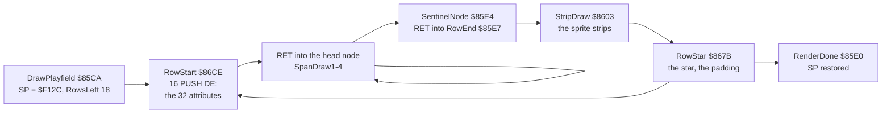

How to read the diagram:

- **A box** is a routine entered by `RET`, not by `CALL`. SP points into the row record or the node, so each `RET`
  pops the next handler's address.
- **The loop on SpanDraw** is the chain of nodes of one row.
- **The point**: the scenery is drawn by data. The code never tests what it draws; it only copies bytes.

The steps:

- RowStart pops the record's fields, pushes the row's 32 attributes from the map ring with 16 `PUSH DE`, sets SP to
  the head node and returns into it.
- A span handler pops its glyph and gap, copies 8 lines of its glyphs and returns into the next node.
- RowEnd draws the strips, RowStar the star. Then the padding: a row cheaper than four glyphs waits 10 `DJNZ` loops
  per missing glyph, so every row costs about the same.

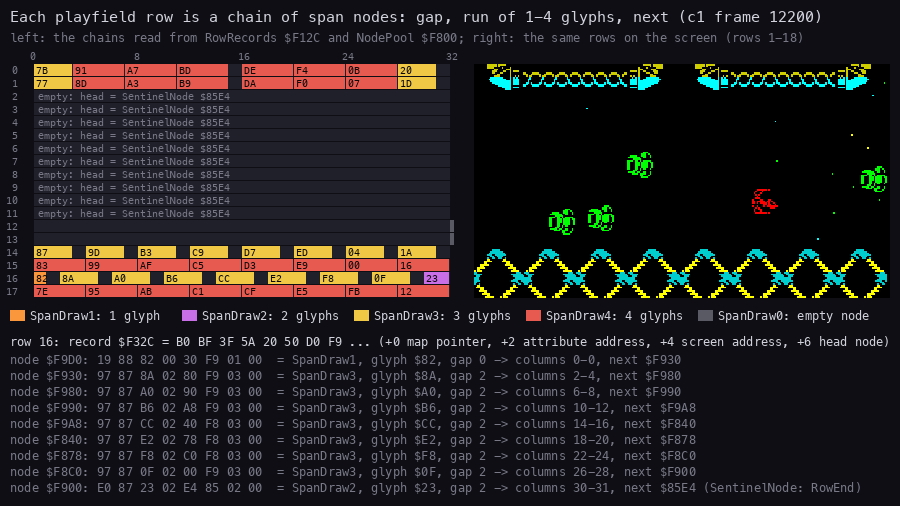

How to read the figure:

- **The left grid** is the 18 rows of `c1` frame 12200 as the records and nodes hold them, 32 columns a row.
  - A dark cell is a gap column.
  - A coloured block is one node's run, coloured by its handler (the legend): orange SpanDraw1, violet SpanDraw2,
    yellow SpanDraw3, red SpanDraw4.
  - The hex number in a block is the run's first glyph.
  - "empty: head = SentinelNode `$85E4`" is a row with no scenery (rows 2-11 here).
- **The right picture** is the playfield on the screen at the same frame (screen rows 1-18).
- **The dump below** is row 16 node by node: the bytes, the handler, the first glyph, the gap, the columns, the next
  node. The columns follow the rule above: `$F9D0` gap 0 fills 0; `$F930` gap 2 fills 2-4; `$F980` gap 2 fills 6-8.
  The last node `$F900` (SpanDraw2, glyph `$23`) fills 30-31 and links to SentinelNode.
- **What it shows**: rows 0-1 are the ceiling (runs of three and four), rows 14-17 the floor lattice. The open space
  between holds no node at all.
- **The point**: the scenery is not a bitmap. It is lists of glyph runs.

```bash
python3 tools/fig_render.py spans --work work/z128A/c1 --frame 12200 --row 16 --out docs/img/render/spans.png
```

### DrawPlayfield at work

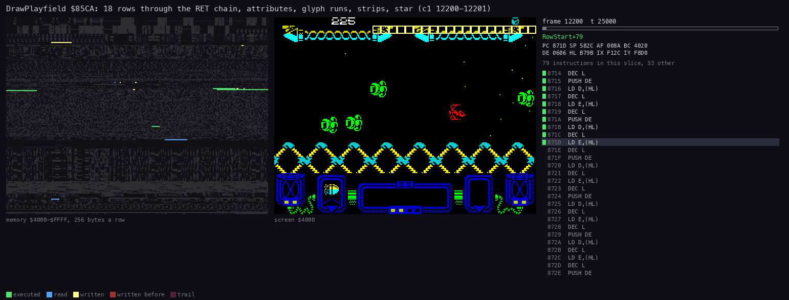

How to read the animation:

- **The left panel** is memory `$4000`-`$FFFF`, 256 bytes a row: green executed, blue read, yellow written now, red
  written before, a dim trail.
- **The middle** is the screen. The cells the slice wrote are lit and boxed.
- **The right panel** is the frame, the T-state, the routine, the registers and the instructions of the slice.
- **What it shows**: the rows are written from the top down. In each row the attributes land first in one burst
  (RowStart's `PUSH`es), then the glyph runs left to right, then the sprites, then the star.
- **The point**: one DrawPlayfield is 18 × (RowStart, a few span handlers, RowEnd, StripDraw, RowStar). In `c1` it
  runs from frame T about 24 400 of the pass's first frame to about 12 200 of the second: about 59 500 T
  ([4.3](04-game-loop.md#43-the-play-interrupt-one-pass-four-phases)).

```bash
python3 ../../kit/routine_anim.py --work work/z128A/c1 --window 12200:24000-12201:12300 --listing build/lst/game.lst \
    --range 4000-FFFF --pictures 60 --pc 85CA-88FF \
    --title 'DrawPlayfield $85CA: 18 rows through the RET chain (c1 12200-12201)' \
    --out docs/img/render/drawplayfield.gif
```

## 6.3 The glyph cache: four shifts

The glyph cache `$C000`-`$DFFF` (in RAM page 0) holds 256 glyphs, each in four copies:

| Page | Shift | ShiftPage `$7F6A` |
| --- | --- | --- |
| `$C0` | 0 px | `$C0` |
| `$C8` | 2 px | `$C8` |
| `$D8` | 4 px | `$D8` |
| `$D0` | 6 px | `$D0` |

- Line k of glyph n is at page + 256 k + n. A span handler steps lines with `INC H` and glyphs with `INC L`.
- Each shifted copy holds the glyph joined with its left neighbour: the bits that leave on the right come in from
  the glyph on the left (BuildGlyph `$89C9`, `ADD HL,HL` twice per two pixels). So a run of consecutive glyphs draws
  one continuous shifted strip.
- ShiftPage is the high byte of the page in use. ScrollControl `$A9A1` steps it through a 2-bit Gray code
  (FineScrollToggle `$7F6B` XORed into ShiftPage): `$C0`, `$C8`, `$D8`, `$D0`. That is why the pages lie in the
  order 0, 2, 6, 4 in memory.
- A run is copied with `LDI` on even lines and `LDD` back on odd lines (a zigzag), so the handler never resets the
  column between lines.

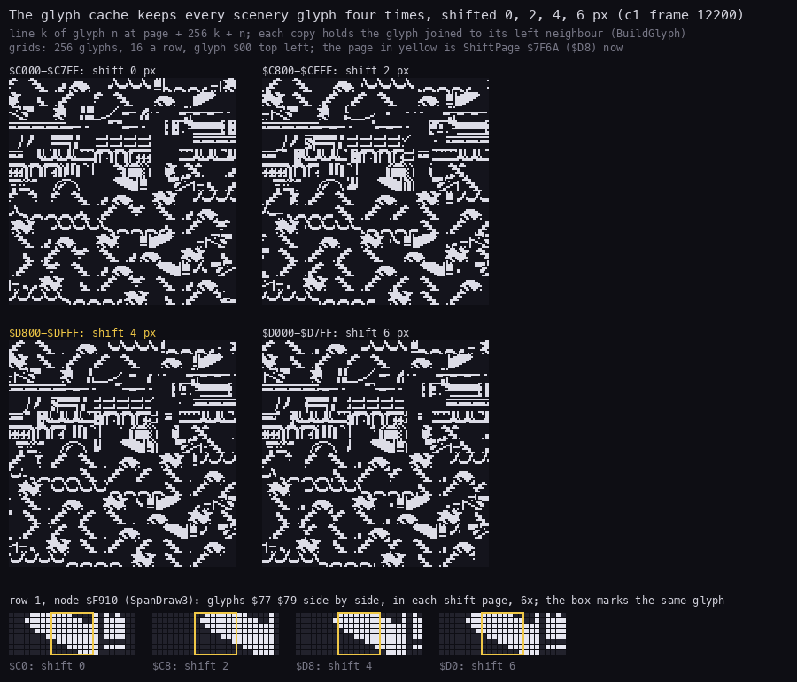

How to read the figure:

- **The four grids** are the four pages of the glyph cache at `c1` frame 12200: 256 glyphs, 16 a row, glyph `$00`
  top left. White is a set bit.
- **The yellow page title** is the page ShiftPage names at that frame (`$D8`, shift 4).
- **The strip below** is row 1's node `$F910` (SpanDraw3, glyphs `$77`-`$79`) side by side in each page, 6x. The
  yellow box marks the same glyph in the four pages: its content moves right 2 pixels a page, and the pixels of its
  left neighbour come in.
- **The point**: the scroll is paid once, when a column is built. Drawing a shifted glyph costs the same as drawing a
  plain one.

```bash
python3 tools/fig_render.py glyphs --work work/z128A/c1 --frame 12200 --row 1 --out docs/img/render/glyphs.png
```

## 6.4 The scroll: a new column every four passes

- ShiftPage changes once a pass: the scenery moves 2 pixels left a pass.
- After four passes the shift is back to `$C0`. ScrollStep `$8AED` (phase 1) then moves the rows one column: it
  retires the leftmost glyph of every row, frees its slot (GlyphBitmap `$FFE0`-`$FFFF`) and its node, and links the
  new ones. ScrollColumn `$801C` +1.
- StartColumn `$894D` reads the new map column from the map ring (`$B700`-`$BFFF`) and marks the cells to build.
- BuildColumn `$896D`, from the three chain steps ([4.3](04-game-loop.md#43-the-play-interrupt-one-pass-four-phases)),
  builds those cells into the glyph cache.
- So the scroll speed is fixed by the pass rate: 2 pixels a pass, a pass every 2 frames, 50 pixels a second.
- ScrollCount `$81DB` counts the columns. The level table's "scroll" field is its start value (`$10`-`$40`).
  ReplayScroll builds that many columns at the level start, under the banner (6.10). It is not a speed.
- The scroll stops when PlayFlags `$81DA` bit 5 is cleared: by the level script or during a death. Then ShiftPage
  only runs on to `$C0`.

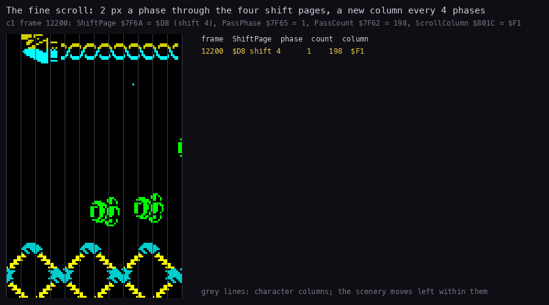

How to read the animation:

- **The left picture** is the playfield's left 12 columns at `c1` frames 12200-12224, one picture a frame, 3x.
- **The grey lines** are the character columns. The scenery moves left within them.
- **The table** is one line a frame: ShiftPage `$7F6A` and its shift, PassPhase `$7F65`, PassCount `$7F62`, the
  map column ScrollColumn `$801C`. The current frame is yellow.
- **What it shows**:
  - ShiftPage changes every 2 frames: `$C0`, `$C8`, `$D8`, `$D0`;
  - once it holds for 3 frames (`$D8` at 12208-12210): the one 3-frame pass of `c1`
    ([4.3](04-game-loop.md#43-the-play-interrupt-one-pass-four-phases));
  - PassCount +1 every 2 frames (200 at 12203, 210 at 12224);
  - ScrollColumn +1 every 8 or 9 frames: `$F1` to `$F2` at 12207, `$F3` at 12216, `$F4` at 12224.
- **The point**: one pass is 2 pixels, and a column comes every four passes.

```bash
python3 tools/fig_render.py scroll --work work/z128A/c1 --from 12200 --to 12224 --out docs/img/render/scroll.gif
```

### BuildColumn at work

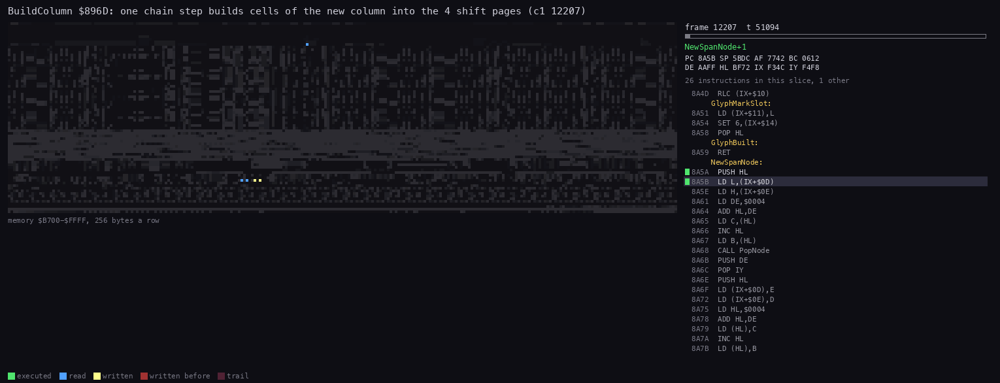

How to read the animation:

- **The left panel** is memory `$B700`-`$FFFF`: the map ring, the glyph cache, the sprites, the records and the
  tables. Green executed, blue read, yellow written now, red written before.
- **The right panel** is the routine and its instructions (`--view none`: the screen does not change here).
- **What it shows**: for each cell, the tile's 8 lines are read from the tile set (`$5C00`, below the panel's
  range), and four groups of writes land in the four pages of the glyph cache: `$C0xx`, `$C8xx`, `$D8xx`, `$D0xx`.
  The bitmap at `$FFE0` is marked as slots are taken.
- **The point**: the cost of the scroll is here, in the chain step, between passes. In `c1` frame 12207 this step
  runs from T about 50 800 to 68 400 (the teal stretch of the pass figure,
  [4.3](04-game-loop.md#43-the-play-interrupt-one-pass-four-phases)).

```bash
python3 ../../kit/routine_anim.py --work work/z128A/c1 --window 12207:50800-12207:68400 --listing build/lst/game.lst \
    --view none --range B700-FFFF --pictures 60 --pc 896D-8AEC \
    --title 'BuildColumn $896D: one chain step builds cells of the new column into the 4 shift pages (c1 12207)' \
    --out docs/img/render/buildcolumn.gif
```

## 6.5 DrawPlayfield against the beam

On unreal-ng's Pentagon the INT comes at the end of a recording frame (frame T 71 656-71 679). The beam reaches screen
line 0 at frame T about 17 900 and moves one line every 224 T.

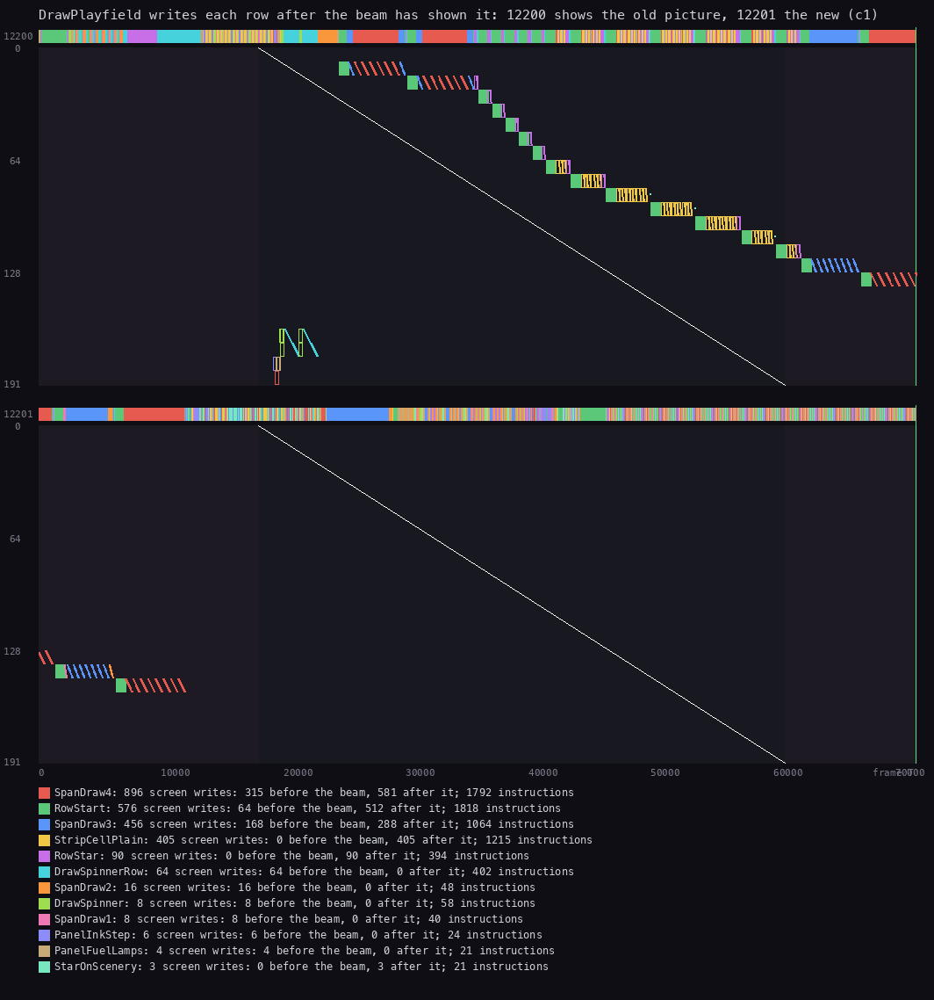

How to read the figure:

- **Two panels**, frames 12200 and 12201 of `c1`. Across: the frame T, 0 to 71 680. Down: the screen line, 0 to 191.
- **The white diagonal** is the beam: the line the TV shows at that moment.
- **A dot** is a byte written into the screen at that T and line, coloured by the routine that wrote it (the legend
  with the counts).
- **The strip on top** of each panel is the routine running at each T.
- **What it shows**:
  - in frame 12200 the panel (lines 150-191: the spinners, the ink step, the fuel lamps) is written at T about
    18 000-21 000, far ahead of the beam;
  - the playfield is written from T about 24 400, row by row, to the right of the beam: the TV has already shown
    those lines in this frame;
  - the last rows (lines 128-151) are written in frame 12201 at T 0-11 000, before the beam reaches line 0.
- **The counts**: SpanDraw4 896 writes, 315 before the beam and 581 after it; RowStart 576 (64 / 512); SpanDraw3
  456 (168 / 288); StripCellPlain 405 (0 / 405). The writes "before the beam" are those of frame 12201's start:
  RowStart's 64 are rows 16-17 (2 × 32 attributes).
- **The point**: every playfield byte of the pass is shown first in frame 12201. Frame 12200 shows the whole old
  picture, 12201 the whole new one. Drawing straight into the screen does not tear, because the pass chases the
  beam.

```bash
python3 ../../kit/beam_timeline.py --work work/z128A/c1 --window 12200:0-12202:0 --listing build/lst/game.lst \
    --machine pentagon --frames 2 \
    --title 'DrawPlayfield writes each row after the beam has shown it: 12200 shows the old picture, 12201 the new (c1)' \
    --out docs/img/render/beam-pass.png
```

## 6.6 Who writes the screen in one pass

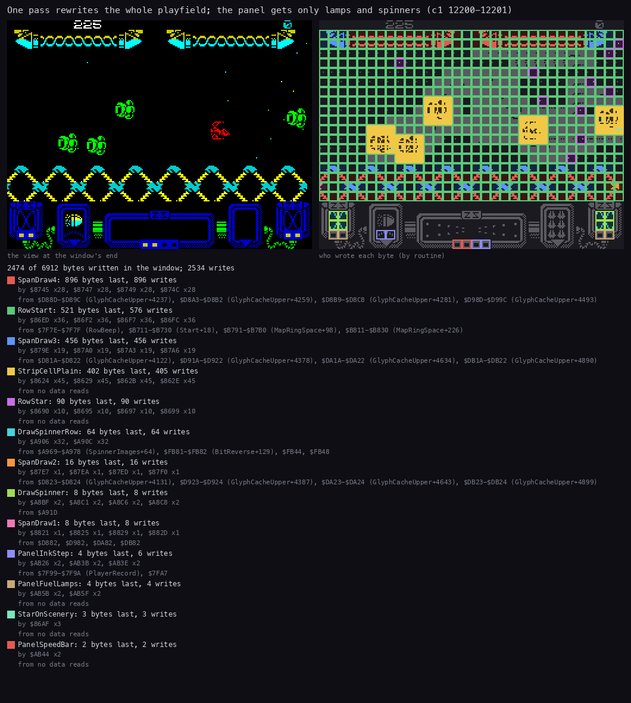

How to read the figure:

- **The left picture** is the screen at the end of the window (`c1` 12199:71000 to 12201:71000, one pass).
- **The right picture** is the same screen with each written byte coloured by the routine that wrote it last. The
  green grid is RowStart's attributes; red SpanDraw4, blue SpanDraw3; yellow boxes StripCellPlain (the sprites);
  violet RowStar (the stars).
- **The list** gives each writer: the bytes it wrote last, its writes, the instructions that wrote, and where its
  data came from (GlyphCacheUpper for the span handlers, MapRingSpace for RowStart's attributes, SpinnerImages for
  the spinners).
- **What it shows**:
  - 2474 of the screen's 6912 bytes are written in one pass, by 13 routines (2534 writes);
  - the playfield's 18 rows get all their 576 attributes (RowStart) and every glyph byte;
  - the panel gets only DrawSpinnerRow (64 bytes), DrawSpinner (8), PanelInkStep (4), PanelFuelLamps (4) and
    PanelSpeedBar (2);
  - the score line is not written: ScoreJob prints only when the score changes.
- **The point**: the playfield is rebuilt in full every pass; the panel is touched only where it moves.

```bash
python3 ../../kit/writers_map.py --work work/z128A/c1 --window 12199:71000-12201:71000 --listing build/lst/game.lst \
    --sources --title 'One pass rewrites the whole playfield; the panel gets only lamps and spinners (c1 12200-12201)' \
    --out docs/img/render/writers-pass.png
```

## 6.7 The sprites: strips in paper colour

The objects are not drawn by the object loop. ObjectStrips `$8F9B` (with BuildObjectStrips `$8FC2`) cuts each
object's sprite into strips, one per character row it covers, and links them to the row's record (`+$15` the count,
`+$16`/`+$17` the list). RowEnd draws them right after the row's scenery.

- **The sprites are negative**: in play a clear bit is a sprite pixel and a set bit keeps the cell black
  (`src/game/graphics.asm`). The game's start complements the images in place before play.
- **The colour is the paper**: the strip carries C' = the object's colour (record `+$25`).
- StripDraw `$8603` looks at each cell's attribute, already written by RowStart this pass:

| Case | Attribute AND `$3F` | What is written |
| --- | --- | --- |
| StripCellPlain `$8621` | 0 (an empty cell) | the attribute = C'; the 8 lines stored as they are. The ink is black, so the clear bits show in the paper colour |
| StripCellMask `$8643` | 8 or more | the 8 lines ANDed into the scenery: the sprite clears scenery pixels and shows through as the scenery's paper; the attribute stays |
| StripCellSkip `$863E` | 1-7 (paper black, ink coloured) | nothing |

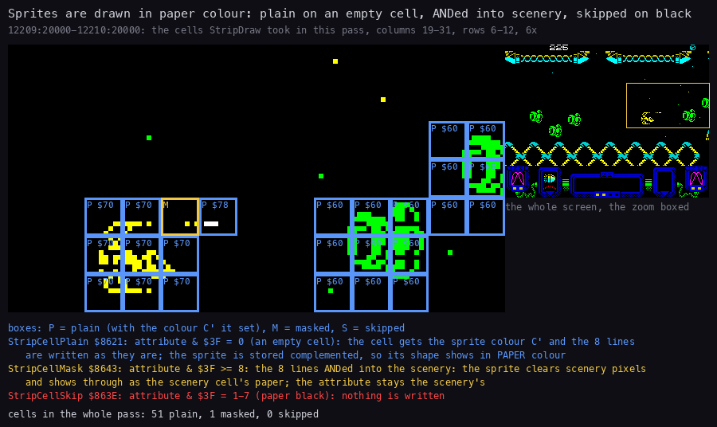

How to read the figure:

- **The left picture** is the screen at the end of the window, columns 19-31 and rows 6-12, 6x.
- **A box** is a cell StripDraw took in the pass (12209:20000 to 12210:20000, from the trace):
  - blue P with the colour: StripCellPlain and the attribute it set (`$60` paper green bright, `$70` paper yellow
    bright, `$78` paper white bright);
  - yellow M: StripCellMask, ANDed into scenery;
  - red S: StripCellSkip, the cell left alone.
- **The right picture** is the whole screen with the zoom boxed.
- **The line at the bottom** counts the cells of the whole pass: 51 plain, 1 masked, 0 skipped.
- **The point**: there are no sprite masks. A sprite is a paper-coloured hole in black ink: on an empty cell it gets
  its own colour, on scenery it cuts the scenery's pixels, on a black-paper cell it is not drawn at all.

```bash
python3 tools/fig_render.py paper --work work/z128A/c1 --window 12209:20000-12210:20000 --zoom 19,6,13,7 \
    --out docs/img/render/paper.png
```

### StripDraw at work

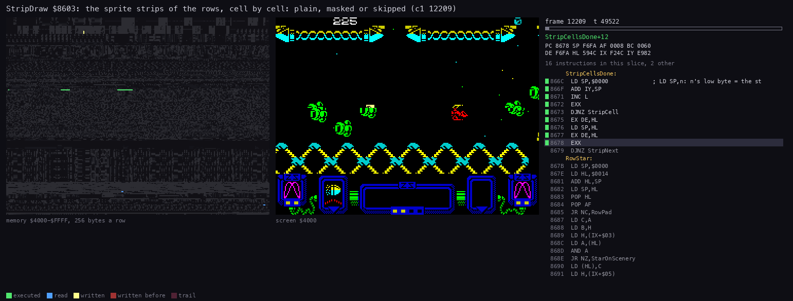

How to read the animation:

- **The panels** are those of the DrawPlayfield animation (6.2), here `c1` frame 12209, T 49 400-56 700.
- **What it shows**: the strips of a few rows. For each cell the attribute is read, then either the colour and 8
  stores (StripCellPlain: `LD (HL),C` sets the colour, then `POP DE` and `LD (HL),E` / `LD (HL),D` store the lines),
  or 8 `AND`s, or nothing.
- **The point**: the three branches of the table above, one cell at a time.

```bash
python3 ../../kit/routine_anim.py --work work/z128A/c1 --window 12209:49400-12209:56700 --listing build/lst/game.lst \
    --range 4000-FFFF --pictures 60 --pc 8603-8678 \
    --title 'StripDraw $8603: the sprite strips of the rows, cell by cell: plain, masked or skipped (c1 12209)' \
    --out docs/img/render/stripdraw.gif
```

Masked cells are rare in `c1` and `r3`: the players keep the ship away from the scenery. Which sprite parts each object
kind has is in [7. Objects](07-objects.md).

## 6.8 The stars and the silent row click

Both are per row, inside DrawPlayfield.

- **The stars** (`src/game/stars.asm`): each row record holds one star (`+$18`-`+$1F`): a random speed, a position
  and a colour `$44`-`$47`. MoveStars `$8894` moves them every pass while the scroll runs. RowStar `$867B` draws the
  row's star:
  - on an empty cell: the attribute set and one dot on pixel line 3;
  - on a used cell: the dot XORed into line 3 of the scenery (StarOnScenery, 3 writes in the pass of 6.6).
- The stars are shown only when PlayFlags `$81DA` bit 7 is set (the level script's `starson` / `starsoff`).
- **The row click**: RowStart toggles RowBeep `$7F7E` once a row and writes it, ANDed with a mask, with an
  `OUT ($FE),A` at `$86D7`. In this game that `OUT` is `NOP: NOP`, written by the set-up at load
  ([3.5](03-build-and-load.md#35-block-2-the-game-and-its-glue)). `c1` frame 12200 reads `00 00` at `$86D7`.
- On the 48K this toggle is one of the three parts of the explosion noise: its mask is 0 (silence) except in the 16
  passes after an explosion or a guardian's hit. Here the 18 toggles of a pass reach no port at all. The row's work
  and its padding stay, so every row still takes the same time
  ([13.6](13-differences-from-zynaps-48k.md#136-sound)).
- The explosion's noise is the AY engine's sound `$1D` instead (HookExplosion, [9. Sound](09-sound.md)).

## 6.9 The intro's pictures

The intro (block 1, `src/intro/intro.asm`) shows three full pictures, each through ShowPicture `$62A4`:

1. the attributes of the whole screen black, the border black, a frame;
2. the 6144 pixel bytes copied at once (invisible: ink and paper are both black);
3. then one attribute row a frame: Random `$6305` picks a row 0-23 not shown yet (RowShown `$6315`, one byte a
   row), and its 32 attributes are copied from the picture; 24 frames for the whole screen.

On the options screen CycleColours `$60F2` runs every frame while the keys are read, and moves the two colour bars
every fourth call:

- the upper bar: rows 0-7, one CycleTable `$6274` byte a row, the pointer (TopBar's operand `$60FC`) one byte on;
- the lower bar: nine rows from row 16's end back, one byte a row, only over cells of `$46` or more (the text stays);
- CycleTable holds `$46` (bright yellow on black) and `$47` (bright white on black).

The intro's interrupt is IntroInterrupt `$60D0` (IM 2, table at `$FC00`). It plays one frame of the STarKos tune
and nothing else. The pictures are drawn by the main code between `HALT`s.

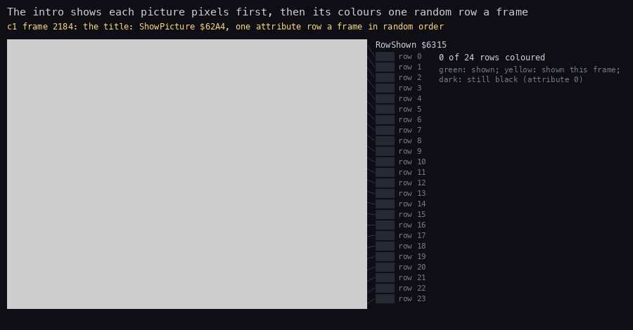

How to read the animation:

- **The left picture** is the screen of `c1`, 2x, one picture a frame (the bars every second frame).
- **The column of 24 boxes** is RowShown `$6315`: green a row shown, yellow a row shown this frame, dark a row still
  black. A line joins each box to its screen row.
- **The text** gives the count of rows shown. On the options screen it also gives CycleColours' counter (the operand
  at `$60F3`, 0-3: the bars move at 0) and the two bar pointers.
- **What it shows**, in four stretches:
  - 2184-2212: the title appears row by row in a random order (ShowPicture called at 2185);
  - 2602-2630: the options screen the same way;
  - 2631-2700: the bars move one step every fourth frame, the text lines keep their colour;
  - 2752-2780: the Hewson picture; block 2 then loads under it ([3.7](03-build-and-load.md#37-the-stages-in-c1)).
- **The point**: a picture costs one copy of its pixels and 24 copies of 32 attribute bytes, spread over 24 frames.
  The black attributes hide the pixel copy; the random rows are the effect.

```bash
python3 tools/fig_intro.py --work work/z128A/c1 --out docs/img/render/intro-reveal.gif
```

The options' keys and their inverted lines are in [5.6](05-controls.md#56-the-intros-options-inflives-and-k-mouse).

## 6.10 The banner raster: one colour per scan line

The game menu, the selections, the key definition and the level banner colour each scan line of a character row
differently. The handler is MenuRasterInterrupt `$A512`: the IM 2 jump at `$FDFD` points to it on these screens
([4.1](04-game-loop.md#41-the-state-machine)).

- It waits (MenuRasterDelay) until the beam is near the first line.
- Then for each scan line it pushes 20 attribute bytes into the row that line belongs to (MenuRasterPush), from
  run-length colour lists (ColoursTop, ColoursMenu, ColoursHighlight at `$82A7`-`$82E0`).
- The TV shows that line with those colours; the next line gets the next colour.
- So the 8 lines of one character row show 8 colours, although a cell has one attribute.

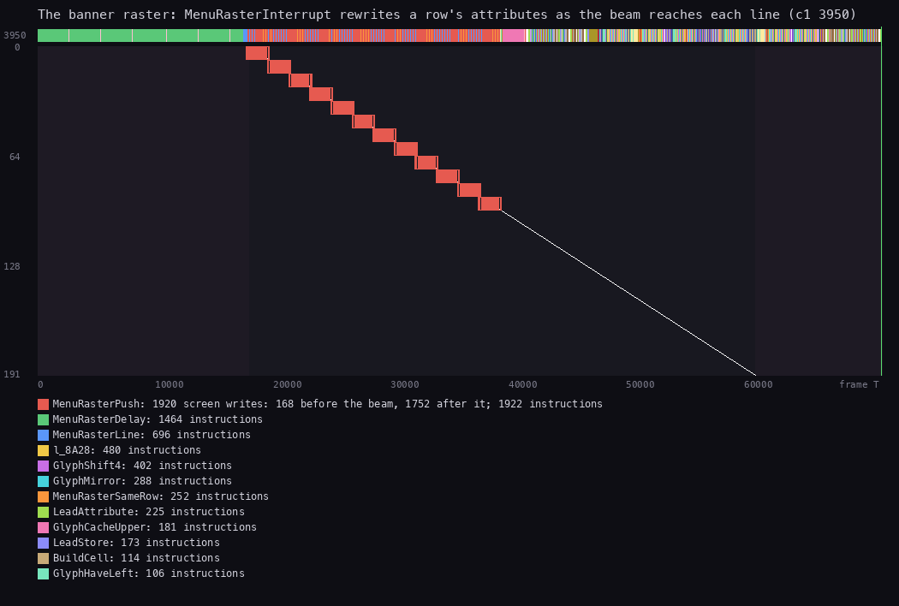

How to read the figure:

- **The panel** is `c1` frame 3950 (the PREPARE FOR COMBAT banner). Across: the frame T. Down: the screen line.
- **The white diagonal** is the beam. **A red block** is MenuRasterPush's attribute writes for one character row.
- **The strip on top** is the routine running: MenuRasterDelay (green) to T about 17 000, the raster to about
  38 000, then the main loop's work (BuildCell, GlyphShift4 and the others: ReplayScroll building the level's first
  columns under the banner).
- **The counts**: MenuRasterPush 1920 writes (96 lines × 20 bytes), 168 before the beam and 1752 after it.
- **What it shows**: the pushes follow the beam line by line over lines 0-95. A row's attributes are rewritten 8
  times in its 8 lines' time, each just as the beam reaches the line.
- **The point**: the raster colours are timed to the beam, so the handler must start at the same T every frame. That
  is why this game's delay counts are set for the Pentagon, whose screen starts 16 lines later after the INT than a
  48K's ([13.5](13-differences-from-zynaps-48k.md#135-timing-the-pentagon-retiming): `$A538`, `$A545`,
  `$A568`-`$A570`).

```bash
python3 ../../kit/beam_timeline.py --work work/z128A/c1 --window 3950:0-3951:0 --listing build/lst/game.lst \
    --machine pentagon --frames 1 \
    --title "The banner raster: MenuRasterInterrupt rewrites a row's attributes as the beam reaches each line (c1 3950)" \
    --out docs/img/render/raster-beam.png
```

## 6.11 The cost of drawing

From L1 of `r3` (76 003 frames, all 12 levels; the budget figure of [2.6](02-architecture.md#26-where-the-time-goes)):

| Routine | Share of all T-states | What |
| --- | ---: | --- |
| RowStart `$86CE` | 8.5 % | the 32 attributes, the record, the silent click |
| StripDraw `$8603` | 8.3 % | the sprite cells |
| RowStar `$867B` | 5.8 % | the star and the padding |
| BuildObjectStrips `$8FC2` | 5.8 % | cutting the sprites into strips |
| SpanDraw4 `$873E` | 5.3 % | runs of four glyphs |
| MoveStars `$8894` | 3.9 % | the stars |
| DrawSpinner `$A8BE` | 2.0 % | the two panel spinners |
| RowEnd `$85E7` | 1.2 % | the strip list |
| ScrollStep `$8AED` | 1.2 % | the column step |
| SpanDraw3 | 0.8 % | runs of three glyphs |
| BuildGlyph `$89C9` | 0.8 % | the four shifted copies |

- Drawing (these eleven) is about 44 % of the machine over a whole game.
- SpanDraw4 does most of the scenery: the column builder makes runs of four whenever it can.
- In ten frames of `c1` (12200-12209, [4.3](04-game-loop.md#43-the-play-interrupt-one-pass-four-phases)) the draw
  playfield part alone is 40 % of the T-states.
- The AY engine never touches the screen. Its 4.02 % of the CPU is the sound
  ([2.6](02-architecture.md#26-where-the-time-goes)).

Known from code only: the row padding's count per missing glyph (10 `DJNZ` loops, RowStar), and the StripCellSkip
branch, which no traced pass took.
