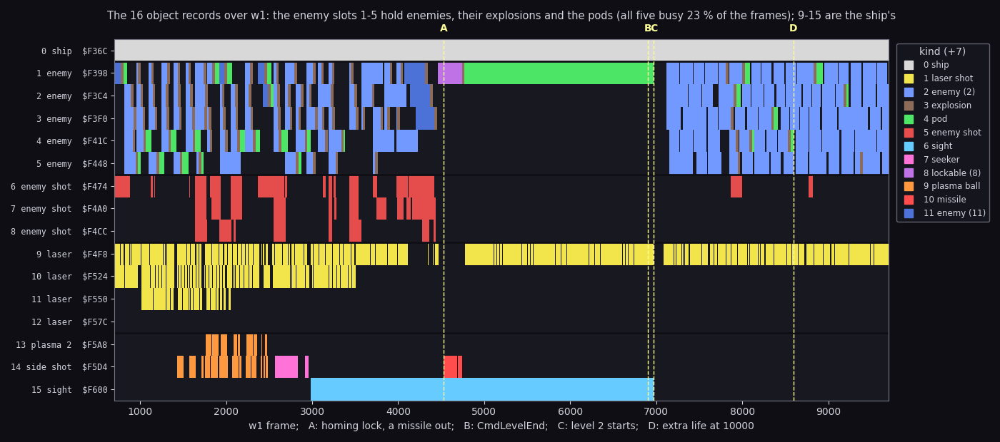
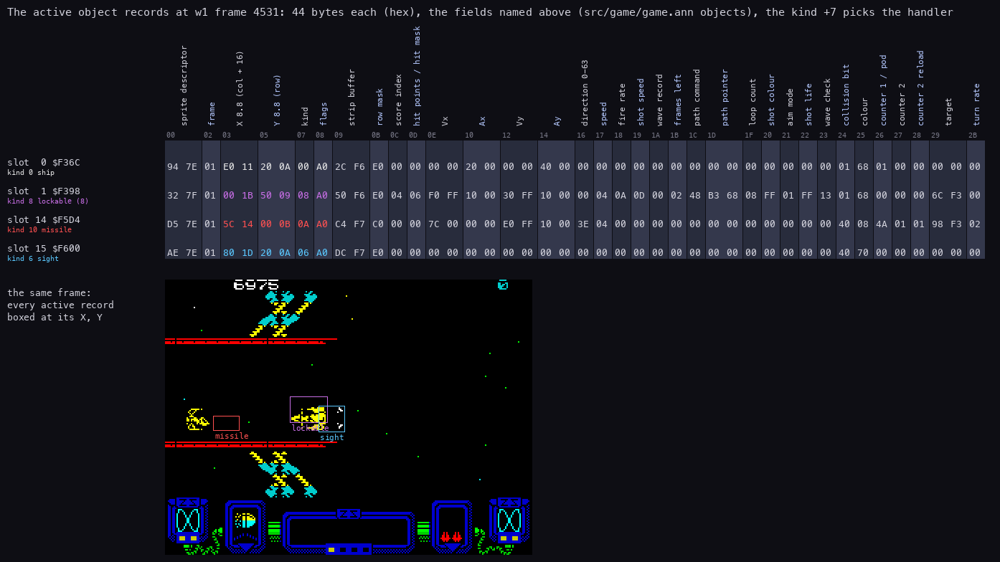
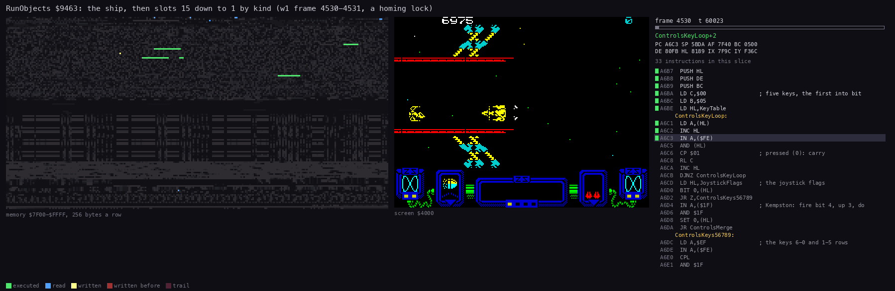
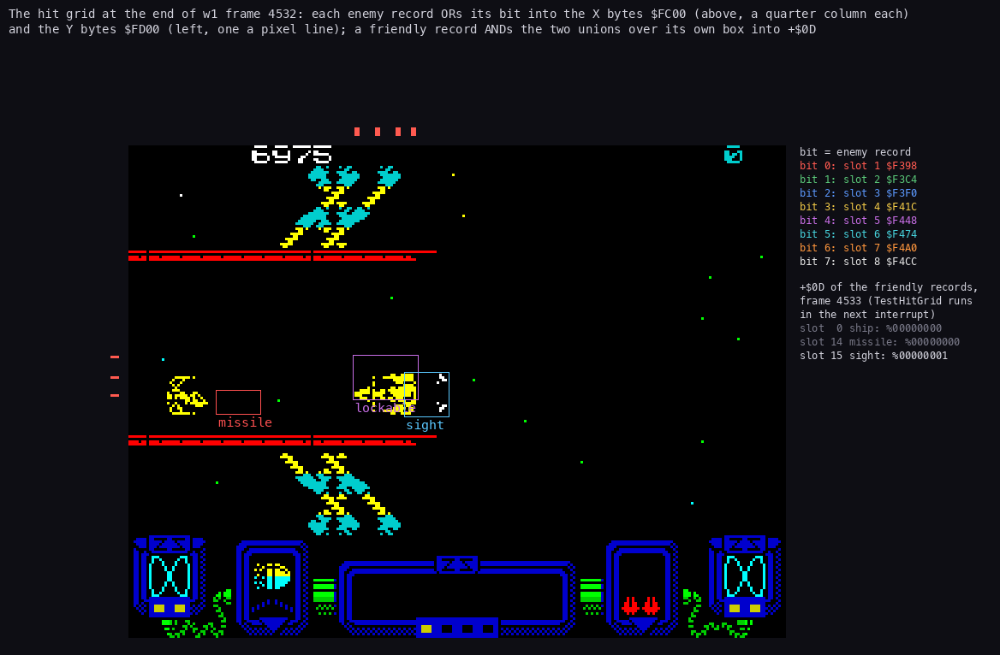
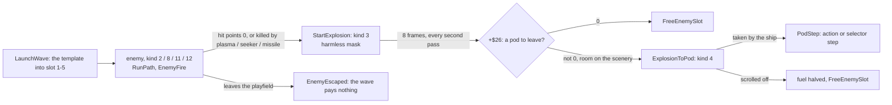

# 7. Objects

What this covers: the 16 object records and what each slot holds, the 44-byte record, the kinds and their handlers,
the pass's object loop RunObjects, the path bytecode the enemies fly by, the collision grid, the wave launcher and
the sprite cache, the life of an enemy (explosion, pod), and the big enemy's sprite.

The recordings it rests on (Pentagon 128, `tools/play_live.py`: RAM zeroed, a Kempston card, muted):

| Recording | Made by | Frames | Used here for |
| --- | --- | ---: | --- |
| `work/z128B/w1` | `tools/weapons_bot.py --plan 0,1,2,2,4,3 --lock --park 17,10 --record` from `work/stage2/stubs/title-inf-ffd7.szx` (`Invulnerable` `$FFD7` = 1), doc 10 | 9700 | every slot but one in use, all weapon kinds, the record sheet, RunObjects, the hit grid |

- `tools/frames_dump.py --work work/z128B/w1 --frames 700:9700 --screen --out work/z128B/w1-frames.npz` read TTD
  `memory_at` of `$7F9C`-`$81FF` and of the records at the end of every frame.
- The records sit in RAM page 0 at `$C000` and up. The interrupt's engine call maps page 4 there for a while, so the
  records are read from RAM page 0 directly (space `ram`), never through the CPU's view.
- "Not touched" below means TTD `find_last` over all of w1 (frames 0-9699) found no read or write of the range.

Doc 10 says what the weapons and the enemies do; this document says how the records carry them.

## 7.1 Sixteen records, fixed roles

Every moving thing is one of 16 records of 44 bytes (`$2C`), from `$F36C` to `$F62B` (records.asm).
Each slot has a fixed role.
The code looks for a free enemy record only among slots 1-5 (TakeEnemySlot `$938D`), and for a free enemy shot only
among slots 6-8 (EnemyFire `$A0EB`).

| Slot | Address | Label | Holds | Kinds in w1 (slot-frames) |
| ---: | --- | --- | --- | --- |
| 0 | `$F36C` | PlayerObject | the ship | 0 |
| 1-5 | `$F398`-`$F448` | EnemyObjects | enemies, then their explosions, then the pods | 2 (16847), 3 (2872), 4 (3429), 11 (970), 8 (283) |
| 6-8 | `$F474`-`$F4CC` | EnemyShots | enemy shots (at most 3: EnemyShotsLeft `$8074`) | 5 (3791) |
| 9-12 | `$F4F8`-`$F57C` | LaserShots | the ship's laser shots | 1 (10148) |
| 13 | `$F5A8` | PlasmaBall2 | the second ball of the double plasma | 9 |
| 14 | `$F5D4` | SideShot | the side weapon's shot: a plasma ball, a missile or a seeker | 9, 7, 10 |
| 15 | `$F600` | SightObject | the homing sight | 6 (3987) |

Two groups of records matter for the collisions (7.6):

- the 8 enemy records, slots 1-8, each with one bit in `+$24` (slot n has bit n - 1);
- the 8 friendly records: the ship, the four lasers, the two side-weapon slots and the sight.



```sh
python3 tools/fig_objects.py slots --npz work/z128B/w1-frames.npz
```

How to read:

- One line a slot, one column a frame. The colour is the kind `+7` while `+8` bit 7 (active) is set; dark is free.
- The thin lines split the groups: the ship, the enemies, the enemy shots, the lasers, the side weapons.
- The dashed verticals: A the homing lock and a missile out (4530), B CmdLevelEnd (6905), C the next level starts
  (6972; the label counts levels from 1), D the extra life at 10000 points (8596).

What it shows:

- Slots 1-5 cycle blue (enemy) → brown (explosion) → green (pod) or free: an enemy's record lives on as its
  explosion and its pod (7.8). All five were busy in 23 % of the frames.
- The lasers follow the laser level: slot 11 fires only with laser 2 (frames 1018-2051), slot 12 never (w1's laser
  went no higher than 2). With laser 0 (after 3494) only slot 9 runs. So laser level n gives n + 1 shots.
- Slots 13 and 14 turn orange with the plasma (1434) and the double plasma (1764).
  Slot 14 turns pink with the seeker (2565) and red with the two homing missiles (4531, 4691).
  Slot 15 turns cyan with the homing sight (2985).
- Slot 1 holds the lockable enemy (purple, 4458-4741), then its pod to the level end: the scroll is off and nobody
  takes it (doc 10, 10.6).
- At C every record is free: the new level starts empty.

## 7.2 The record

Every slot has the same layout.
The fields come from records.asm, movers.asm, objects.asm and their uses:

| Offset | Field | Notes |
| --- | --- | --- |
| `+0`/`+1` | the sprite descriptor | a 13-byte record: the image, the shifted-copy size, rows, width, row mask (effectdata.asm) |
| `+2` | the animation frame | explosions 1-8 (ExplosionStep) |
| `+3`/`+4` | X, 8.8 | in columns of the playfield; the screen shows columns 16-47 (`+4` - 16 = the screen column) |
| `+5`/`+6` | Y, 8.8 | in rows 0-15 of the playfield |
| `+7` | the kind | the handler (7.3) |
| `+8` | flags | bit 7 active, bit 6 fired once (EnemyFire), bit 5 on the playfield (drawn) |
| `+9`/`+$0A` | the strip buffer | the object's 12-byte strip entries (7.4) |
| `+$0B` | the row mask | `$E0`, `$C0`, `$80`: how many character rows the sprite covers |
| `+$0C` | the score index | the award AddScore pays when it dies (doc 10, 10.5) |
| `+$0D` | hit points (enemies) or the overlap mask (friendlies) | TestHitGrid writes the friendlies' mask (7.6) |
| `+$0E`-`+$15` | Vx, Ax, Vy, Ay | 8.8 velocities and the kind's accelerations |
| `+$16` | the direction 0-63 | SetVelocity `$98F1` |
| `+$17` | the speed | the kind byte 2's high nibble |
| `+$18` | the fire rate | 0: never fires |
| `+$19` | the shot speed | bits 0-2 the steps, bits 3-7 the speed index |
| `+$1A` | the wave record | an index into WaveRecords `$8075` |
| `+$1B` | passes left of the path command | RunPath |
| `+$1C` | the path command | RunPath |
| `+$1D`/`+$1E` | the path pointer | RunPath |
| `+$1F` | the loop count | PathOpSetLoop, PathOpLoop |
| `+$20` | the shot colour | EnemyFire |
| `+$21` | the aim mode | the kind byte 1 AND `$E3` |
| `+$22` | the shot life | EnemyFire |
| `+$23` | the wave check | compared with the descriptor's `+$0F` (EnemyGone) |
| `+$24` | the collision bit | one bit per enemy record and per friendly record |
| `+$25` | the colour | flashes (CycleColour), fades (ExplosionAdvance `$A1EC`), the sight's lock colour |
| `+$26`/`+$27` | counters | `+$26`: the pod to leave (explosions), the bounces (plasma), the life (missile) |
| `+$28` | counter 2's reload | PathOpSetInterval |
| `+$29`/`+$2A` | the target record | homing paths, the missile, the seeker |
| `+$2B` | the turn rate | homing |



```sh
python3 tools/fig_objects.py record 4531 --npz work/z128B/w1-frames.npz
```

How to read:

- One row a record, one column a byte. The field names stand rotated above the columns, the offsets under them.
- The coloured bytes are X, Y, the kind and the flags, in the kind's colour.
- The screen below has each active record boxed at its X, Y, with its kind's name.
- Frame 4531 is the first missile's launch, two frames after the lock (doc 10, 10.3).

What the sheet shows:

- The ship (slot 0): X `$11E0`, column 17, screen column 1; Y `$0A20`, row 10.
- The lockable enemy (slot 1, kind 8): 6 hit points (`+$0D`), fire rate `$0A`, collision bit `+$24` = 1.
- The missile (slot 14, kind 10): its life `+$26` = `$4A` (74: 75 set by HomingFrame, one pass gone), its target
  `+$29`/`+$2A` = `$F398` (slot 1), turn rate `+$2B` = 2.
- The sight (slot 15, kind 6): colour `+$25` = `$70`, the locked colour (`$78` without a lock).
- The friendly bits `+$24`: the ship 1, the missile `$40`, the sight `$40`. The two groups reuse the bit numbers
  for different records.

## 7.3 Kinds and handlers

The kind `+7` indexes KindHandlers `$80FA` (handlertables.asm):

| Kind | Handler | Address | What it is |
| ---: | --- | --- | --- |
| 0 | PlayerHandler | `$9A5B` | the ship: controls, fire, fuel |
| 1 | LaserHandler | `$9E32` | a laser shot |
| 2 | EnemyHandler | `$9F88` | a common enemy |
| 3 | ExplosionStep | `$A1C8` | an explosion |
| 4 | PodStep | `$A1FD` | a weapon pod |
| 5 | EnemyShotStep | `$A263` | an enemy shot |
| 6 | SightHandler | `$9E03` | the homing sight |
| 7 | SeekerHandler | `$9F13` | the seeker |
| 8 | LockableHandler | `$9FC8` | an enemy the sight can lock |
| 9 | PlasmaHandler | `$9E67` | a plasma ball |
| 10 | MissileHandler | `$9ED7` | the homing missile |
| 11 | EnemyHandler | `$9F88` | a common enemy the seeker ignores (doc 10, 10.3) |
| 12 | BigEnemyHandler | `$A03E` | the big enemy |

- An enemy's handler kind comes from the kinds table `$6A65`, byte 5 (src/res/levels/README.md).
  So many enemy kinds of the level data share handlers 2, 8, 11 and 12.
- w1 ran every kind but 12: no big enemy comes in level 0. r3 ran kind 12 in six spans (doc 10, 10.7).

## 7.4 RunObjects: the object half of a pass

RunObjects `$9463` (movers.asm) is called once a pass from PlayPass `$AA96`:

1. The ship, slot 0, through its handler.
2. Slots 15 down to 1 (B = 15, IY from `$F600`, step -44): an active one through KindHandlers by its kind.
3. After each slot: SlotBeep `$7F86` XOR `$18`, AND SlotBeepMask `$7F87`, `OUT ($FE)` (`$949C`).
4. With 8 or more idle slots (C idle): a pad of (C - 7) × 128 `DJNZ` turns, so a pass with few objects takes about
   the time of one with many.
5. The pass's hit masks cleared: `$80BB`, `$80E3`, `$80E4`, `$80E5`, `$F379` (the ship's `+$0D`) and the `+$0D` of
   the 7 friendly records from `$F4F8`.

Step 3 is a speaker click per slot, the slot part of the explosion noise.
In this game it is silent:

- The set-up writes two `NOP`s over the `OUT ($FE),A` at `$949C` (setup.asm; r3 memory at `$949C`: `00 00`).
- The rest of step 3 still runs. SlotBeepMask is reloaded each interrupt from a sound pattern bit (`$AA46`): `$00`
  in w1 (frames 700, 2000, 4600, 8000), `$FF` in r3 at 18230 while a big enemy is hit.
- TTD `port_events` finds 0 beeper changes: w1 frames 700-9699 (302 847 `OUT`s), r3 frames 500-76000
  (2 370 690 `OUT`s).
- The sounds of the objects come from the page-4 engine instead, through the hook stubs (doc 09).



```sh
python3 ../../kit/routine_anim.py --work work/z128B/w1 --window 4530:59700-4531:7400 --listing build/lst/game.lst --out docs/img/routines/RunObjects.gif --view screen --range 7F00-FFFF --pictures 60 --delay 120 --title 'RunObjects $9463: the ship, then slots 15 down to 1 by kind (w1 frames 4530-4531, the homing lock)'
```

How to read:

- Left: the memory `$7F00`-`$FFFF`, 256 bytes a row: green executed, blue read, yellow written in this picture, red
  written earlier.
- Middle: the screen. Right: the listing round the instruction last run, the registers, the routine's name.
- The window: RunObjects runs from frame 4530 T 59 713 to frame 4531 T 7047, 1759 instructions, about 19 000 T.
  The pass started in frame 4530 and crosses into the next frame (a pass is two frames, doc 04).

What it shows:

- The record area `$F36C`-`$F62B` lights from the top (the sight) down, as IY walks down.
- The variables at `$7F00`-`$81FF` are read by every handler (the hit masks, PassBit, the player record).
- Nothing on the screen changes: RunObjects only moves records; ObjectStrips `$8F9B` and the drawing put them on
  screen later (doc 06).

## 7.5 The path bytecode

An enemy flies by a path, a byte program in the level data (the path starts at `$6800`, the paths at `$681C`,
src/res/levels/README.md).
RunPath `$94CB` runs it, one command a pass:

- `+$1D`/`+$1E` point at the next byte; `+$1C` holds the command; `+$1B` counts the passes it still runs.
- A byte with bit 7 set is a repeat count (`b AND $7F`, 0 = for ever) for the command after it. Without it a
  command runs one pass.
- A command's bits 0-2 pick the routine (PathOps `$8114`), bits 3-6 are its parameter P.
- A routine that returns carry is a setting: the next command runs in the same pass. No carry ends the object's
  pass.

| Command | Routine | What it does |
| ---: | --- | --- |
| 0 | PathOpAccelerate `$9529` | add or subtract the kind's accelerations (P: the flags), then move |
| 1 | PathOpSetLoop `$9591` | the loop counter `+$1F` = P |
| 2 | PathOpSetInterval `$959C` | the homing interval `+$27` = `+$28` = P |
| 3 | PathOpBounce `$95AA` | move, bouncing off the scenery |
| 4 | PathOpHomePlayer `$95FC` | home on the player, turn rate P |
| 5 | PathOpSetDirection `$9613` | direction P × 4 of 64, then move |
| 6 | PathOpHomeTarget `$9625` | home on the target, the player once it is gone |
| 7 | PathOpExtended `$9509` | P picks one of 16 routines from `$8124` |

The 16 extended routines (movers.asm, `$9640`-`$9890`):

- 0 PathOpScroll (move with the landscape), 1 PathOpStop, 2 PathOpRandomDirection;
- 3 PathOpLoop (back to a word target while `+$1F` counts down), 4 PathOpDriftMiddle, 5 PathOpAimPlayer;
- 6 PathOpScrollAlways, 7 PathOpMove, 8 PathOpHome, 9 PathOpToCentre, 10 PathOpLand, 11 PathOpRandomSpeed;
- 12 PathOpBounceArena, 13 PathOpDive, 14 PathOpMoveFragile, 15 PathOpWait `$9890`.

Each pass PathOpMove `$96A8` adds Vx and Vy to X and Y.
The pods use PathOpScroll: they move with the landscape (PodStep).
The paths as text, every byte decoded, are in `src/res/levels/levels.lev.txt` (`tools/res_levels.py`).

## 7.6 The collision grid

The game does not test pairs of objects.
It rebuilds a bitmap grid every second pass (objgrid.asm):

1. ClearHitGrid `$91C6` zeroes `$FC00`-`$FD8F`.
2. MarkEnemyGrid `$90CB` (odd phases) ORs each enemy record's bit `+$24` into the X bytes it covers, at `$FC00` (one
   byte a quarter column), and into the Y bytes, at `$FD00` (one byte a pixel line).
3. TestHitGrid `$9150` (in the pass after the marking) ORs the X bytes and the Y bytes under each friendly record's
   box, and ANDs the two unions into its `+$0D`: the set of enemies that overlap it.
4. The ship's and the active lasers' union goes into `$80BB`; each enemy handler tests its own bit there.

The weapons have masks of their own, cleared by RunObjects every pass:

| Mask | Who writes it | What the enemy handler does with its bit |
| --- | --- | --- |
| `$80BB` | the ship and the lasers (TestHitGrid) | one hit point off (EnemyHandler, LockableHandler, BigEnemyHandler) |
| `$80E5` | the plasma balls and the seeker | killed at once |
| `$80E3` | the homing missile | killed, if it is the locked one (w1 4741) |
| `$80E4` | the sight | the lockable enemy locks (`$80E0`, `$80E2`) |
| `$F379` | the ship's `+$0D` | the pod is taken (PodStep), the enemy shot hits |

HarmlessMaskA `$80BD` and HarmlessMaskB `$80BE` hold the enemy bits that neither kill the ship nor stop a laser:

- StartExplosion puts an explosion's bit into `$80BE`;
- ExplosionToPod moves a pod's bit into `$80BD`;
- FreeEnemySlot `$992A` clears both.



```sh
python3 tools/fig_objects.py grid 4532 --work work/z128B/w1
```

How to read:

- The screen of w1 frame 4532 in the middle.
- Above it, the X bytes `$FC00`: one tick per set bit, at the column the byte stands for, in the colour of the bit.
  Left of it, the Y bytes `$FD00`, one tick per set bit at its pixel line.
- The legend on the right names the bits (bit n = enemy slot n + 1).
  Below them, the friendly records' `+$0D` at frame 4533, after TestHitGrid ran.

What it shows:

- The grid holds boxes, not shapes: the ticks span the lockable enemy's box (bit 0, slot 1), in X and in Y.
- The sight's `+$0D` = `%00000001`: it overlaps slot 1. SightHandler copies it to SightMask `$80E4`, and the
  lockable enemy finds its bit there: that is the lock.
- The ship and the missile have 0: they touch nothing.
- The grid exists only after an odd phase: in w1 it is non-zero at the end of 4528 and 4532 and zero at 4529-4531.
  So the figure reads the grid at 4532 and the masks at 4533 (TTD `memory_at`).
- The grid's last write in w1 is PC `$913B` (frame 9698): MarkEnemyGrid's store.

The grid routines walk the records and the grid with SP (POP is the fastest read).
Each saves SP into its own final `LD SP,$0000` and runs with the interrupts on.
An interrupt's pushes land in the grid, which is rebuilt the next time.

## 7.7 The wave launcher and the sprite cache

LaunchWave `$91EC` (waves.asm) starts wave A when the script asks (doc 10, 10.6):

1. Refused when no enemy slot is free (`$8072` = 0) or no wave record is allowed (`$8073` = 0).
2. A wave record (3 bytes at WaveRecords `$8075`, `$FF` free) is taken: the live count, the bonus byte.
3. The wave index `$6926`[A] gives the wave's data at `$6943`: the bonus byte (bits 6-7 the pod, bits 0-5 the bonus
   award), the kind, the object count, the path numbers (`$806A`).
4. The kind's 8 bytes (`$6A65`) fill the 44-byte template at `$803E`: the fire rate, the colour set (with
   WeaponRatingLevel `$80E9`), the score, the speed, the accelerations, the handler kind, the colour, the hit points.
5. Each object of the wave is the template copied into a free enemy slot (TakeEnemySlot `$938D`).
   It gets its own path, X (`$C0` + x / 2, the right edge), Y (the script's row offset + y) and a start delay that
   grows by the wave's gap from object to object.

Each enemy that dies or escapes counts its wave down (EnemyGone `$9954`).
The last one pays the bonus and leaves the pod (doc 10, 10.5).

The sprite cache keeps the images of the kinds on screen:

- 6 records of 16 bytes at `$7EF2` (records 1-6).
  Record 0 at `$7EE2` serves the kinds from `$14` up (the big enemies), uncached, its image at `$C008`.
- GetSpriteCache `$93A7` finds the record of a kind (`+$0E` = kind OR `$80`, `+$0D` the use count), or takes a free
  one (the mask `$8087`, the free-record table `$8088`).
- A new kind is queued in a ring at `$8025` (8 entries of 3 bytes), and event bit 7 is posted.
  SpriteBuildJob `$ACA6` builds the image and its pre-shifted copies in the play loop's spare time (doc 04).
  It ran last in w1 at frame 9308.
- EnemyGone counts the use down; at 0 the record's bit leaves `$8087`.

## 7.8 An enemy's life: explosion and pod



How to read: each box is a state of one enemy record (slots 1-5), with the routine that puts it there; each arrow
is labelled with the condition.

- StartExplosion `$A293` turns the record into kind 3 in place: the explosion animation from frame 1, colour `$70`.
  On the 48K it also set the three sound patterns of the explosion noise; on the 128K the explosion's sound is the
  engine's EffectExplosion, started by hook stub `$B386` (site `$A29F`, doc 09).
- ExplosionStep `$A1C8` runs in odd passes only. Each of the 8 frames is held for `+$27` passes, drawn black (a
  flash) while held; ExplosionAdvance `$A1EC` fades the colour one ink step an animation frame.
- The last enemy of a wave gets `+$26` = the bonus byte's bits 6-7 (EnemyGone): its explosion becomes a pod.
- ExplosionToPod `$A2D6` rounds Y to the cell and asks SceneryAt4 `$99BB` for room; with none the pod is lost.
  The pod's appearance starts EffectPodAppears (stub `$B381`, site `$A31D`).

Witnessed in w1:

- slot 1: the lockable enemy (kind 8) from 4458, the explosion (kind 3) at 4742, the pod (kind 4) from 4772;
- StartExplosion ran last at frame 9367, ExplosionToPod at 9208 (TTD `find_last` execute).

## 7.9 The big enemy's sprite

The big enemies (kinds 20 and 21 of the level data, handler 12) are too big for the cell sprites.
BuildBigSprite `$8F0C` (sprites.asm) draws one from a one-bit cell map:

- A 7 × 9 cell image at `$C000` (72 × 56 pixels), column-major, complemented, like the cell sprites.
- A = 1: the glyphs from `$66E0` with the cell map at `$8098`; otherwise the tile set from `$5CDC` with the map at
  `$80A1`.
- A clear bit of the map is a blank cell (eight `$FF` bytes, FillBlankCell `$8EFF`).
- The big waves come at the end of levels 2, 4, 6, 7, 8 and 10 (waves 20, 21 and 28 in `levels.lev.txt`).

BuildBigSprite never ran in w1 (TTD `find_last` execute of `$8F0C`: not found).
z128A's r3 (all twelve levels, `work/docs/z128A-fork-NOTES.md`) ran it 6 times, once for each big wave: frames
16205, 28437, 41867, 47879, 54658 and 67397 (levels 2, 7, 4, 8, 6, 10 in that game's order).
The fights are in doc 10, 10.7; the image's layout is known from the code only (no figure of it here).

## 7.10 Bytes that stay unexplained

All of these are untouched in w1 (TTD `find_last` read, write or execute over frames 0-9699):

- RecordsGap `$F108`-`$F12B`: 36 bytes before the row records.
- The strip entries `$F704`-`$F733`: four spare 12-byte entries after the enemies' (records.asm), never linked.
- SpareCacheRecord `$7F52`: a seventh sprite-cache record of the same layout, outside the search (B = 6).
- FindFreeObjectSlot `$90B5`: a free-record search over all 16 slots that nothing calls.
- UnusedRet `$A1EB`: a `RET` after ExplosionStep's `JP` that no jump reaches.

The descriptors' bytes `+2`/`+3`, `+9`, `+$0A` are in every descriptor, but no routine found reads them (code only).
