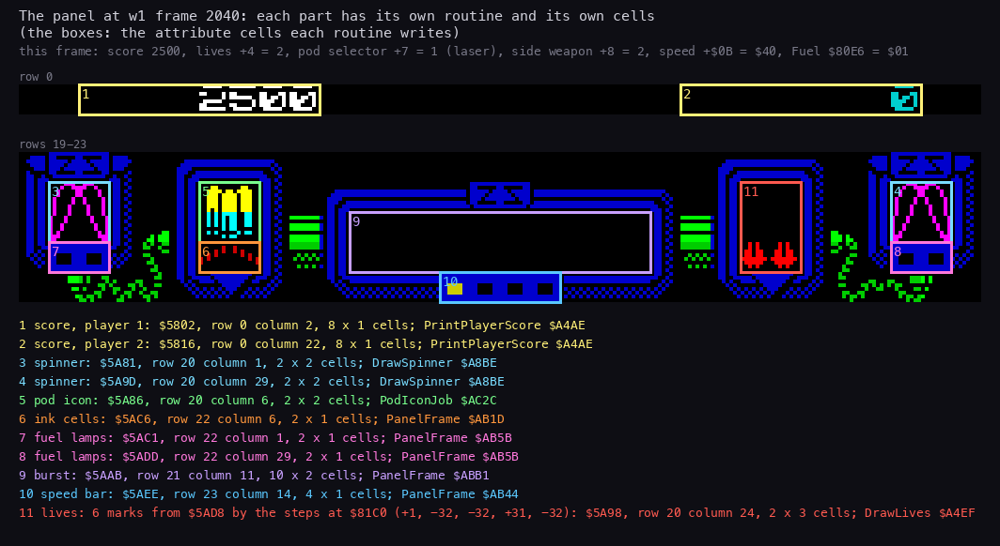
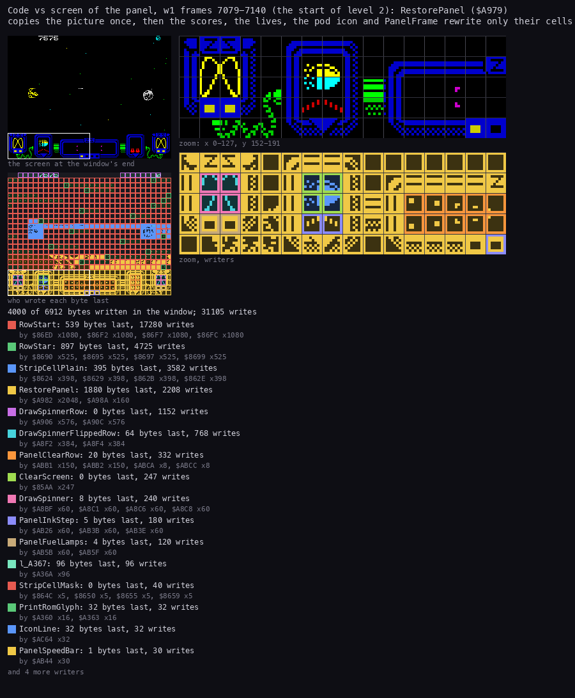
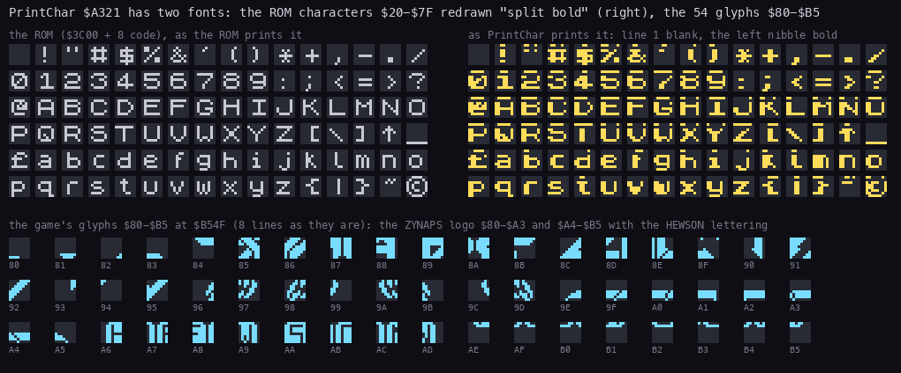
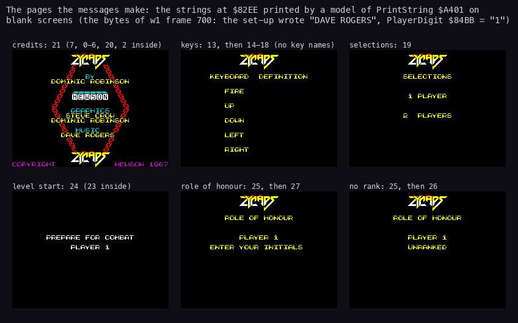

# 8. HUD and text

What this covers: the play panel and what draws each part of it, the gauges, the pod icon, the score and the lives,
the print routine and its codes, the two fonts, and the 28 messages with the pages they make.

Every text a player meets, as text, is in [texts/](texts/):

- [texts/boot.md](texts/boot.md): the machine's menu, the disk catalogue, the loaders;
- [texts/intro.md](texts/intro.md): the title picture, the options screen (`0.START  1.INF.LIVES  2.K-MOUSE`), the
  Hewson picture;
- [texts/game.md](texts/game.md): the game's pages, the ones this document draws from the bytes;
- [texts/differences.md](texts/differences.md): the texts that differ from the 48K tape, side by side.

The recordings it rests on:

| Recording | Made by | Frames | Used here for |
| --- | --- | ---: | --- |
| `work/z128B/w1` | `tools/weapons_bot.py --plan 0,1,2,2,4,3 --lock --park 17,10 --record` from `work/stage2/stubs/title-inf-ffd7.szx` (Pentagon 128, doc 10) | 9700 | the panel at every fuel state, the extra life, the panel restored at level 1's start (frames 7079-7140) |

- The screen of every frame of w1 is in `work/z128B/w1-frames.npz` (`tools/frames_dump.py --screen`, TTD `memory_at`
  of RAM page 5).
- The text figures are drawn from the bytes alone, printed by a model of the print routine (`tools/fig_text.py`):
  - a 64 K image of the game in play, `work/z128B/images/w1-700-game.bin` (w1 frame 700: the CPU view below `$C000`,
    RAM page 0 above), with the set-up's patches in it;
  - the 48K ROM of unreal-ng (`data/rom/48.rom`): the game runs with the 48 BASIC ROM paged in.
- The messages as text are `src/res/text/messages.msg.txt`, the high-score table `src/res/text/hiscores.hsc.txt`
  (`tools/res_text.py`).

## 8.1 The panel at a glance

The play screen has the score line at row 0 and the panel at rows 19-23.
The panel's pixels are a picture:

- RestorePanel `$A979` copies the bottom screen third and the panel's attributes from `$E748`, once at each start
  of play.
- SavePanel `$A98D` keeps them there while another page covers the screen.
- From then on the code touches only small parts of the panel.



```sh
python3 tools/fig_panel.py 2040
```

How to read:

- Top: the frame's values in the subtitle (score 2500, lives 2, the selector on the laser, plasma, speed `$40`, Fuel
  `$01`: one pass before a FuelOut).
- Middle: row 0 and rows 19-23 of w1 frame 2040 at 4× scale. Each box is the set of attribute cells one routine
  writes, numbered.
- Bottom: the list, one line a box: the part, its first attribute address, its row and column, its size in cells,
  the routine.

The parts:

| Mark | Part | Address | Writer | When |
| ---: | --- | --- | --- | --- |
| 1, 2 | the scores | `$5802`, `$5816` (row 0, columns 2 and 22) | PrintPlayerScore `$A4AE` | ScoreJob, after each award |
| 3, 4 | the spinners | `$5A81`, `$5A9D` (row 20, columns 1 and 29) | DrawSpinner `$A8BE` | each pass (PanelFrame) |
| 5 | the pod icon | `$5A86` (rows 20-21, columns 6-7) | PodIconJob `$AC2C` | the start of play, each pod taken |
| 6 | the ink cells | `$5AC6` | PanelFrame (PanelInkStep, `$AB1D`) | every fourth pass |
| 7, 8 | the fuel lamps | `$5AC1`, `$5ADD` | PanelFrame (PanelFuelLamps, `$AB5B`) | each pass |
| 9 | the burst | `$5AAB`: rows 21-22, columns 11-20 | PanelFrame (PanelClearRow, `$ABB1`) | every second pass while PanelBurst `$7F77` runs |
| 10 | the speed bar | `$5AEE`-`$5AF1` | PanelFrame (PanelSpeedBar, `$AB44`) | each pass |
| 11 | the lives | six marks from `$5AD8`: rows 20-22, columns 24-25 | DrawLives `$A4EF` | the start of play, an extra life |

## 8.2 PanelFrame: attributes only

PanelFrame `$AB13` (hud.asm) runs once a pass from the play interrupt and writes only attributes of rows 20-23
(`$5A80`-`$5AFF`):

1. **The ink step:** the ink of `$5AC6`-`$5AC7` + 1 every fourth pass (PassCount `$7F62` AND 3 = 0).
2. **The speed bar:** `$5AEE`-`$5AF1` = `$01` (dark), then (speed >> 5) - 1 cells of `$31` from the left.
   Speed `$40` lights 1 cell, `$60` 2, `$80` 3, `$A0` 4.
3. **The fuel lamps:** DE = `$3131`, stored at `$5AC1` and `$5ADD` (E at the address, D after it).
   Fuel below `$40` makes D `$01`: the right lamp of each pair dark. Below `$20` E too: both dark.
4. **The spinners and their colour:** SpinnerFrame `$7F78` + (PassCount AND 1), 0-15; SpinnerColour `$7F79` moves by
   its step on odd passes and turns at 7 or 1; DrawSpinner draws both spinners (8.4).
5. **The burst:** on even passes rows 21-22 columns 11-20 are cleared. While PanelBurst `$7F77` is not 0 it counts
   down, and its value n is the attribute of columns 15 + n and 16 - n: a pair of cells walks out from the middle.
   FireLaser `$9C1D` sets it to 6 when it is 0, so the burst follows the laser.

The gauges as w1 showed them (the attribute bytes of the recorded screens, the first frame each state appears):

| w1 frame | Fuel `$80E6` | `$5AC1` `$5AC2` | `$5ADD` `$5ADE` | Shown |
| ---: | ---: | --- | --- | --- |
| 700 | 85 | `$31` `$31` | `$31` `$31` | both lamps lit |
| 1043 | 63 | `$31` `$01` | `$31` `$01` | the right lamps dark: below `$40` |
| 1555 | 31 | `$01` `$01` | `$01` `$01` | all dark: below `$20` |
| 6972 | 27 | `$00` ... | `$00` ... | the level banner covers the panel |

- The speed bar was `$31 $01 $01 $01` (one lit cell, speed `$40`) from 700 on.
- At 6963, in the level end, it went all dark (`$01`), and at 6972 the banner page cleared it.
- w1 never had more speed (doc 10, 10.2), so the bar's other states are known from the code only.

## 8.3 The pod icon

PodIconJob `$AC2C` (event bit 2) draws the icon of the selected pod:

- n = the player record's `+7` (the selector, 0-4); the icon is PodIcons `$B4AF` + 32 n, 16 × 16 pixels.
- IconRow `$AC5E` draws it as two rows of 2 cells at the screen addresses `$5086` and `$50A6`: rows 20 and 21,
  columns 6-7 (attribute `$5A86`).
- The attributes: `$46` (bright yellow ink) on the top row `$5A86`-`$5A87`, `$45` (bright cyan) on the bottom row
  `$5AA6`-`$5AA7`.
- While it runs, only event bit 7 may interrupt it (EventMask AND `$80`).

PodStep posts it for every pod taken (`$A243`), and the play loop's start posts it too.
So the icon steps with the selector (doc 10, 10.2).
The five icons, in the selector's order: the speed-up, the laser, the plasma, the homing missiles, the seeker.

In w1's level start the icon's lines were written by IconLine `$AC64`: 32 writes, 32 bytes (8.5).
`src/game/game.ann` says the icon sits at rows 16-17; the cells PodIconJob writes are rows 20-21.

## 8.4 The spinners

Two 16 × 16 spinners turn at row 20, columns 1 and 29 (panel.asm):

- 5 shapes are stored as their left 8 pixels only (SpinnerImages); the right half is the bit mirror, read from the
  bit-reverse table `$FB00`.
- SpinnerFrames maps the frame 0-15 to an offset. An even offset reads a shape top down, an odd one bottom up (the
  shape upside down). So 5 stored shapes give 16 frames.
- DrawSpinner `$A8BE` writes the pixels (DrawSpinnerRow, DrawSpinnerFlippedRow) and the attributes of the four
  cells.

## 8.5 Code against screen: who writes the panel



```sh
python3 tools/fig_writers.py --out docs/img/hud/writers-panel.png --zoom 0,152,128,40 --title 'Code vs screen of the panel, w1 frames 7079-7140 (the start of level 2): RestorePanel ($A979)\ncopies the picture once, then the scores, the lives, the pod icon and PanelFrame rewrite only their cells' -- --work work/z128B/w1 --window 7079:0-7140:0 --listing build/lst/game.lst
```

`tools/fig_writers.py` runs `kit/writers_map.py` on the window and stacks its four panels two by two.

How to read:

- Top left: the screen at the window's end. Below it: each screen byte coloured by the routine that wrote it last.
- Right: the box (x 0-127, y 152-191: the left half of the panel) zoomed, above the same box's writers.
- The legend lists the writers with the bytes they wrote last and their writes in the window, and the instruction
  addresses that wrote.
- "Level 2" in the title counts from 1: it is level index `+6` = 1.

What it shows (61 frames from the end of the level banner into level 1's play):

- 4000 of the 6912 screen bytes written in the window, 31 105 writes.
- RestorePanel ran at frame 7079, T 6841: 2208 writes, 1880 bytes last. The `LDIR` at `$A982` copies the 2048 bytes
  of the third (`x2048`), `$A98A` the 160 attribute bytes.
- After it only the parts of 8.1 write the panel:
  - the spinners: DrawSpinnerRow 1152 writes, DrawSpinnerFlippedRow 768, DrawSpinner 240;
  - the burst: PanelClearRow, 332 writes;
  - the ink step: PanelInkStep, 180 writes, 5 bytes last;
  - the fuel lamps: PanelFuelLamps, 120 writes, 4 bytes last;
  - the speed bar: PanelSpeedBar, 30 writes, 1 byte last;
  - the pod icon: IconLine `$AC64`, 32 writes.
- The score: PrintCharBold (`$A36A`, listed as `l_A367`) wrote 96 bytes, 12 character cells of 8 lines; PrintRomGlyph
  32 more.
- The playfield above is written by the drawing code of doc 06 (RowStart, RowStar, StripCellPlain, StripCellMask).

## 8.6 Score, lives and the score job

The score is 4 BCD bytes at the player record's `+0`-`+3`, high first.

- AddScore `$A489` adds award A of PointsTable `$8231` (doc 10, 10.5) and posts event bit 1.
- ScoreJob `$AC7A` (event bit 1): PrintPlayerScore, WeaponRating (doc 10, 10.6) and the extra-life test against
  ExtraLifeScores `$800F`.
- PrintPlayerScore `$A4AE`: player 1 at column 2, player 2 at column 22 of row 0.
  `$47` (bright white) for the player in play, `$05` (cyan) for the other.
  Leading zeros print as spaces (PrintBcd `$A43E`, with its copy in BcdScratch `$7FFC`).
- DrawLives `$A4EF`: six marks from `$5AD8`, the steps between them in LifeSteps `$81C0` (`01 E0 E0 1F E0`:
  +1, -32, -32, +31, -32).
  The marks are `$5AD8`, `$5AD9`, `$5AB9`, `$5A99`, `$5AB8`, `$5A98`: a 2 × 3 block, columns 24-25, rows 20-22.
  The first `+4` marks are red on black (`$42`), the rest black.
- SpriteBuildJob (bit 7) outranks both: the jobs run in the play loop, highest bit first (EventDispatch `$AC07`), and
  the score and the icon allow only bit 7 while they run.

w1 frames 8596-8597 show the chain:

- 8596: the selector wraps (1100 points); the score goes 9500 → 10600; `$5AD8` and `$5AD9` are `$42` (two marks).
- 8597: the lives are 3, and `$5AB9` is `$42` too: a third red mark.

## 8.7 The print routine

PrintString `$A401` prints bytes up to `$FF` through PrintChar `$A321`:

| Byte | Meaning | Routine |
| --- | --- | --- |
| `$00` n | the attribute = n | PrintSetAttr `$A3B1` |
| `$01` n | the ink = n | PrintSetInk `$A3B6` |
| `$02` n | the paper = n | PrintSetPaper `$A3BF` |
| `$03` n | the column = n | PrintSetColumn `$A3CD` |
| `$04` n | the row = n | PrintSetRow `$A3D6` |
| `$05` n | the column + n (the low byte only, no carry into the row) | PrintColumnRight `$A3ED` |
| `$06` n | the row + n | PrintRowDown `$A3F4` |
| `$1B` n | message n, then go on | PrintString |
| `$20`-`$7F` | a ROM character, "split bold" | PrintChar |
| `$80`-`$B5` | one of the game's 54 glyphs | PrintChar |
| `$FF` | the end | PrintString |

The state:

- PrintPos `$80AA` is an attribute address (`$5800`-`$5AFF`): the row and the column in one word.
- The screen address of the cell's first line: the attribute's high byte rotated left 3 times, XOR `$82` (`$58` →
  `$40`, `$59` → `$48`, `$5A` → `$50`); the low byte stays.
- PrintAttr `$80AC` is the attribute written with each character. PrintPending `$80AD` holds a code waiting for its
  byte (`$20` none).
- PrintMessage `$A423` finds message n by counting n + 1 `$FF` bytes from `$82ED`: the messages are a list, not a
  table of pointers.

## 8.8 Two fonts



```sh
python3 tools/fig_text.py font
```

How to read:

- Top left: the ROM characters `$20`-`$7F` from `$3C00` as the ROM prints them. Top right: the same codes as PrintChar
  prints them.
- Bottom: the game's glyphs `$80`-`$B5`, 8 bytes each as they are stored, with their codes.

The "split bold" ROM font:

- ROM line 0 (always blank) is dropped. ROM line 1 is printed on line 0, line 1 is left blank, ROM lines 2-7 go on
  lines 2-7. So capitals get a gap under their top bar.
- Each byte is printed as (b << 1 AND `$F0`) OR b: the left nibble emboldened by one pixel, the right nibble as it
  was.
- PrintCharBold `$A366` does it; PrintRomGlyph `$A357` reads the ROM.

The game glyphs:

- 54 glyphs at `$B54F`; the address of code c is c × 8 + `$B14F`.
- `$80`-`$A3` build the ZYNAPS logo, `$A4`-`$B5` the HEWSON lettering (messages 0 and 2).

## 8.9 The messages and their pages

28 messages follow each other from `$82EE` to `$8515`, each ending with `$FF` (src/res/text/messages.msg.txt).
Messages call messages (`$1B` n), so a page is one message that prints others:

| Message | Contents | Printed by |
| ---: | --- | --- |
| 0 | the ZYNAPS logo in glyphs, three colours | 1, 13, 19, 25 |
| 1 | row 0, then 0 | 7 |
| 2 | the HEWSON lettering | 21 |
| 3-6 | frame pieces (3 and 4), five of each (5 and 6) | 7 |
| 7 | the border of the credits page | 21, 22 |
| 8 | `.....` in cyan (the high-score line's dots) | the high-score table |
| 9-12 | `CS`, `SS`, `SP`, `EN`: the names of CAPS SHIFT, SYMBOL SHIFT, SPACE, ENTER | PrintKeyName `$A623` |
| 13 | the logo and `KEYBOARD  DEFINITION` | the key definition (menu.asm) |
| 14-18 | `FIRE`, `UP`, `DOWN`, `LEFT`, `RIGHT`, each 3 rows down | the key definition, one prompt a key |
| 19 | the logo, `SELECTIONS`, `1 PLAYER`, `2  PLAYERS` | the player selection (options.asm) |
| 20 | `DOMINIC ROBINSON` | 21 |
| 21 | the credits: by Dominic Robinson, the HEWSON lettering, graphics Steve Crow, music, copyright | CreditsPage `$B095` |
| 22 | the credits border alone | HiScorePage `$B0C9` (under the table) |
| 23 | `PLAYER n` | 24, 25 |
| 24 | `PREPARE FOR COMBAT`, `PLAYER n` | LevelStart `$AF49` (the level banner) |
| 25 | the logo, `ROLE OF HONOUR`, `PLAYER n` | HighScoreEntry `$A7F7` |
| 26 | `UNRANKED` | HighScoreEntry, no place in the table |
| 27 | `ENTER YOUR INITIALS` | HighScoreEntry, a place |

The musician's name in message 21:

- The file holds `STEVE TURNER` at CreditName `$8484`.
- The set-up (setup.asm) copies `DAVE ROGERS ` (12 bytes from MusicianName `$61AA`, the `LDIR` after `$60B5`) over
  it before the game starts: the musician of the Amstrad CPC music the game plays (doc 09).
- w1's memory at frame 700 has `DAVE ROGERS ` at `$8484`; the credits page of [texts/game.md](texts/game.md) shows
  it on screen.



```sh
python3 tools/fig_text.py pages
```

How to read:

- Six blank screens, each printed by the model with the messages named in its title: the credits (21), the keys
  (13, then 14-18), the selections (19), the level start (24), the role of honour (25 and 27), no rank (25 and 26).
- The bytes are w1's at frame 700, so `DAVE ROGERS` is in the credits and PlayerDigit `$84BB` is `1`.
- Every one of the 28 messages appears in one of the six pages.

The model (`tools/fig_text.py`, class Printer) follows print.asm code for code.
The key-definition page leaves the key names out: the game prints each key's own character, or messages 9-12 for
the four keys without one (PrintKeyName).
The pages as the game showed them on screen, with their texts, are in [texts/game.md](texts/game.md).

The high-score table (ROLE OF HONOUR) is a list of 5 lines at `$8261`-`$82A6`, each a row, a column, three initials,
message 8 (the dots) and a BCD score: EGO 68000, DFR 25000, BAV 10000, HNR 5000, BMR 1000.

## 8.10 What stays unexplained

- LifeSteps `$81C0` has 5 bytes; DrawLives reads 6, the sixth is EventRequests `$81C5`. The sixth step is added after
  the last mark is written, so it moves nothing drawn: a harmless over-read.
- PrintBcdSpaces `$A43C`: an entry two bytes before PrintBcd that nothing calls (code only).
- Message 1 (row 0, then the logo) is printed only inside message 7; no code prints it alone (code only).
- No recording here showed the high-score entry or the two-player score colours: those are known from the code only.
