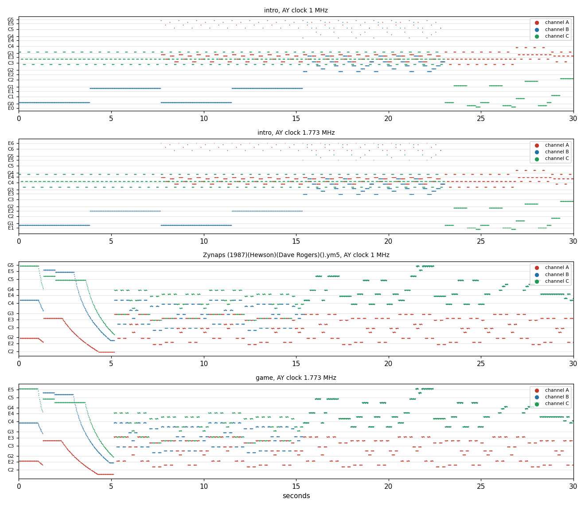

# 9. Sound

The two music players, their formats, the tunes, the pitch they sound at against the Amstrad CPC, and which game
event starts which effect.

- **The intro** plays the STarKos song `SK10` with a STarKos player, the CPC tracker's player patched for the ZX's
  ports.
- **The game** plays the Amstrad CPC Zynaps's own music and effects (J. Dave Rogers, Hewson 1987) with the CPC
  game's own driver, moved to the 128K's page 4.

Both players are assembled from `src/sound/` and `src/res/music/`, `src/res/sound/` to the original's bytes by
`tools/build_sound.sh`.

<!-- Figures this document needs (GUIDE.md 4.2), remove each line when it is in: -->
<!-- - a routine animation of the player -->

What this rests on:

- **The recording `c1`** (Pentagon 128, random play from frame 3902 to 13702: five games to their end and a sixth),
  with the L1 builds of its intro window (`work/stage2/intro/l1.json`, frames 2182-2838) and its game window
  (`work/stage2/game/l1.json`, frames 3313-13702). They give the run counts.
- **A simulation of each player** from its loaded bytes, frame by frame, in SkoolKit's Z80 simulator
  (`tools/sound_render.py`). It is checked against `c1`: after `Init` and 385 `Play` calls the STarKos image equals
  the recording's page 2 at frame 2600 (`work/images/intro-title-bank2.bin`, `$8000`-`$90C4`). After `StartMusic`
  and 118 `PlayFrame` calls the engine equals page 4 of the menu image (`work/images/menu-bank4.bin`,
  `$C968`-`$CD22`). Both players keep all their state inside these bytes, so equal bytes mean equal state
  (`python3 tools/sound_render.py witness intro|game`).
- **The CPC originals** (section 9.6):
  - the AY rip of the CPC game's driver and data, by The Cyborg: `zynaps.cpc.emul`, from the modland collection;
  - the CPC game's register dump from cpc-power: `Zynaps (1987)(Hewson)(Dave Rogers).ym`, YM5, 1 MHz, 10 306 frames;
  - the CPC disk and tape images.

  Copies of all of these are in `work/stage2/sound/cpc/`.
- **The stage-1 captures** `work/stage1/audio/intro-tune.wav` and `play-fire.wav`, and the renders of section 9.6.
  All are written to files only, never played.

## 9.1 Two players

| | The intro | The game |
| --- | --- | --- |
| Where | `$8000`-`$90C4`, copied from block 1 `$D810` | page 4: `$C968`-`$CD22`, copied from block 1 `$632D`; data `$DE48`-`$FE6F`, from `$66E8` |
| Player | STarKos (Targhan / Arkos, a CPC tracker's player). Entries: `$8000` init with DE = the song, `$8003` play, `$8006` stop | the CPC Zynaps's driver, moved up by `$5000`. Entries: `$C968` start the music, `$C96B` stop it, `$C96E` play a frame, `$C971`-`$C9B1` start an effect |
| Called | by the intro's IM 2 handler, once a frame (`$60DF`) | by the glue's interrupt handler (`$5B00`), once a frame, with page 4 paged in |
| Song | `SK10` at `$8990`, 1845 bytes | sounds `$0B`, `$0C`, `$0D` (the music's three channels) and effects `$0E`-`$1F`, through the sound table at `$DF4D` |
| Periods | `$860D`, 96 words: note 12 = 3822 (C0 at 1 MHz), notes 0-11 = 0. The CPC's table, unchanged | `$DE48`, 95 words: note 13 = 4126, notes 0-12 = 0. The CPC driver's table moved up 12 notes |
| AY | only the registers that changed, through `$FFFD` / `$BFFD` | the whole register image `$CC8B`-`$CC98`, R13 down to R0, with `OUTD` every frame |
| Source | `src/sound/starkos*.asm` from `starkos.ann`; the song `src/res/music/sk10.txt` | `src/sound/engine*.asm` from `engine.ann`; the data `src/res/sound/engine-data.txt` |

- Spectrum Computing's entry for this release (alt 42055) says: "AY music and sound effects from the Amstrad CPC".
  For the game, section 9.6 proves it byte by byte. Who wrote or chose `SK10` is not known.
- No signature in the base matches either player (both are new to the base).
- The effects alternate between channels B and C by `XOR 1` of `LastChannel` (`$CC9B`). The channel records are at
  `$CC9C`, `$CCC9`, `$CCF6`.

## 9.2 Which event starts which effect

The 128K glue replaces the 48K game's beeper calls (`CALL $B2F0` with A = the beeper sound, and a few other calls)
with calls to 15 hook stubs at `$B32F`-`$B3A8`. Each stub loads L with an engine entry, jumps to the shared stub at
`$B30D` (page 4, `CALL $C9xx`, page 0), then does what the site did. The event names come from the 48K code around
each site (`work/stage1/dis/game48-static.asm`) and from screenshots at the frames each stub ran in `c1`
(`time_travel coverage_scan`, `work/stage1/stub-frames.txt`; shots in `work/stage1/screens/events/`).

| Site | Stub | Entry, sounds | Runs in `c1` | The event |
| --- | --- | --- | --- | --- |
| `$9C77` | `$B32F` | `$C971`: `$0E` | 91 | the player fires: `$9C1D` takes a free shot slot of four (`$F4F8`, `$2C` each) and places it at the ship (48K beeper sound 2) |
| `$A29F` | `$B386` | `$1D` | 43 | an explosion starts: `$A293` sets an object's explosion frames (`$FD00`, `$EDB2`, `$D6ED`); alone 25 times (an enemy destroyed), 18 times with `$B354` |
| `$9BFF` | `$B354` | `$14` + `$15` | 18 | the player's ship destroyed: three times per game, the game over after the third (`c1` 4351, 4626, 5055, game over 5165; six games, the sixth cut by the recording's end), with the explosion `$1D` in the same frame |
| `$A1C4` | `$B374` | `$19` | 6 | an enemy fires a missile aimed at the ship (`$A14F` copies the firer's place, aims at `$F36C`; 48K sound 1) |
| `$A31D` | `$B381` | `$1C` | 4 | a pod appears: an object gets the pod descriptor `$7EBB` (48K sound 4; 29 times in `r1`) |
| `$A21A` | `$B379` | `$0F` | 1 | a weapon selected: a pod taken with fire held 8 frames or more (`$8184` ≥ 8) runs the highlighted entry (player record +7) of the table at `$80F0`: 0 speed, 1 laser, 2 bombs, 3 homing, 4 seekers (48K sound 6; `r1` 1097 bombs, 1713 homing) |
| `$A247` | `$B364` | `$16` | 1 | a pod taken: the highlight (player record +7) moves on, wrapping after 5 with a bonus; `$81C5` bit 2 set (23 times in `r1`) |
| `$A5D1` / `$A7F7` | `$B39C` | `$1E` + `$1F` | 5 | the screen wipe (`$A685`): `$A7F7` before the role of honour at the game over, `$A5D1` before KEYBOARD DEFINITION (title key 3) |
| `$A81B` | `$B344` | `$12` | 5 | the role of honour shown (18 frames after the wipe) |
| `$A8B7` | `$B34C` | `$14` + `$15` | 5 | the role of honour's result (2 frames later; `UNRANKED` in all five) |
| `$ACA2` | `$B334` | `$0F` + `$10` | 0 (`r1` 6590) | an extra life: `$AC7A` compares the score's second BCD byte with the `$800F` table (`01 03 05 07 09 FF`), a life at 10 000, 30 000, 50 000, 70 000, 90 000 (`INC (IX+12)`, `INC (IX+4)`), the stub calls `$A4EF` (the lives redrawn) first |
| `$9EC2` | `$B33C` | `$11` | 0 (`r1`: 22 frames from 1141) | a plasma bomb bounces off the ground: handler `$9E67` negates and halves its vertical speed, `DEC (IY+38)` counts three bounces, then `$9ECE` removes it; the 48K beeper call at `$9EA5` became a `RET` |
| `$9CFA` | `$B35C` | `$1A` + `$1B` | 0 (`r2` 127, 287) | a homing missile launched: `$9CCA` runs while fire is held with a lock (`$80E2` ≠ 0); through `$9CB0` the launch also plays `$18` in the same tick |
| `$9CB0` | `$B36C` | `$18` | 0 (`r1`: 9 frames from 1113) | a special weapon placed at the ship's place (`$F36F`): `$9CB0` is shared by the bombs (`$9C83`, fire held 3 frames, slots `$F5D4` then `$F5A8`), the homing missiles (`$9CFA`) and the seekers (`$9D1F`, from the code only) |
| `$A7BB` | `$B38F` | `$1E` + `$1F`, the music stopped first | 0 (`r1` 23) | the SELECTIONS screen: key 1 or 2 on the title's credits page runs `$A76F` → `$A790`; the effect starts between the heading and the 1 PLAYER / 2 PLAYERS lines. Not a game end: the game has none (a level done wraps 0-11) |

One more effect starts outside the stubs: the glue's `LevelStartSound` (`$5B6D`, hooked into `CALL LevelSetUp` at
`$B023`) stops the music and calls `$C9A5` (sound `$10`) at each level's start, 18 times in `c1`. The engine entries
`$C983` (`$13`) and `$C995` (`$17`) are called by nothing.

Five events never happened in `c1` (the play was random keys over short games). Stage 2 witnessed them in two bot
recordings (`work/stage2/stubs/r1`, 7701 frames from the title with INF.LIVES and `$FFD7` = 1, and `r2`, 1001 frames
from `r1`'s frame 4400 with homing missiles against the level-1 guardian): each stub's first byte (page 2) and its
engine entry (page 4) ran in the same frame (`tools/play_stubs.py`), and `time_travel find_last` gives the chain to
the T-state. The fourth column gives the frames there. The shots are in `work/stage2/stubs/screens/`.

`$FFD7` works as in the 48K (`$9B4C`: `LD A,($FFD7)`, `AND A`, `RET NZ`): no ship is lost. Poke it into RAM page 0
(`PUT /api/v1/emulator/{id}/memory/ram/0/16343`): a CPU-space write while paused can land in page 4, when the pause
falls in the interrupt's engine call.

Only enemies running `$9FC8` / `$A03E` (the guardians) take a homing lock (`$80E0` / `$80E2`), through the sight
object `$F600` 10 X units ahead of the ship's place 8 moves ago (the ring at `$80C0`). In `r2` the missiles did not
take the guardian's 6 hit points before they expired; whether homing is meant to be that weak is not settled.

## 9.3 The STarKos player

`src/sound/starkos.ann` describes the player. It modifies itself: nearly every variable is the operand of one of its
own instructions (`LD A,n`, `CP n`, `LD HL,nn`, or an `OR A` / `SCF` opcode used as a flag), and the source names the
instruction (`SpeedCounter`, `TrackAPointer`, ...; the variable is `Label+1`). The intro window of `c1` gives these
run counts:

| Routine | Address | Runs | What |
| --- | --- | --- | --- |
| `Init` | `$8872` | 1 | the song's header into the player's operands. Then `ResetTable` (`$892E`): 24 operands set to 0, 17 set to `$FF` (the last-sent register values, so that every register is written at the first frame), 3 set to `OR A` |
| `Play` | `$800D` | 566 | `SpeedCounter` counts to `Speed` (5: six frames a line). On a new line (95 runs): the pattern streams at a pattern's first line (3 runs), the special track, then each of the three tracks (`ReadTrackLine`, 142 runs) |
| `PlayInstruments` | `$82B0` | 566 | every frame, for channels A, B, C: the pitch slide, `InstrumentLine` (1698 runs) and the instrument's counter, loop and end; then the mixer |
| `InstrumentLine` | `$8444` | 1698 | one instrument line: the volume minus the track's attenuation, arpeggio, pitch, noise, a fixed period, or the hardware envelope (`HardLine`, `$84FA`: not run in the intro window) |
| `SendRegisters` | `$86CD` | 567 | the 14 registers: each value (`AYRegN+1`) is compared with the value sent before (`AYRegN+3`) and written only when it differs. R13 is also written when an instrument's retrigger bit asks for it |

`SendRegisters` keeps the CPC player's layout. Each register is a 28-byte row: the two `OUT`s of the ZX, then nine
and one `NOP`s where the CPC's PPI sequence was longer.

The hardware envelope (`HardLine`) takes the envelope period from the tone period, `>> (7 - R)` with the ratio R
(R = 3 puts the sawtooth at the note's own pitch), or the tone period back from the envelope's (the sync mode).
`SK10`'s instrument `i4` is the only hardware one. It plays with shape 12 (sawtooth up) in 3392 of the tune's 9504
frames, from frame 1152 on (`tools/sound_render.py`). That is after the intro window of `c1`, which is why the L1
counts show no run.

## 9.4 The SK10 song

`src/res/music/sk10.txt` holds the song as text (`tools/sk10.py`; the format is in its docstring,
[the README](../src/res/music/README.md)). `tools/sk10.py check` proves that the text gives the 1845 bytes back.

| Part | `SK10` |
| --- | --- |
| Header | compiled for `$8990`, drum channel 1, rate 50, speed 5 (six frames a line), the four loop points all 0 |
| Patterns | 48, in the linker: three tracks a pattern. Heights 32 (44 patterns), 48 (2), 16 (1) and 64 (1): 1584 lines |
| Instruments | 13: `i0` (silence), soft instruments, `i4` with the hardware envelope |
| Tracks | 38, and one special track (the speed) |
| Length | 9504 frames, 190.08 s at 50 Hz. The song then restarts from pattern 0 (`tools/sound_render.py loop intro`: every channel repeats every 9504 frames) |

The song's pitch classes, by share of the sounding channel-frames (`tools/sound_render.py notes intro --frames 9504
--clock 1000000`):

| Note | G# | F# | B | D# | C# | F | A# | C |
| --- | --- | --- | --- | --- | --- | --- | --- | --- |
| Share | 21.4 % | 18.4 % | 17.3 % | 16.8 % | 11.2 % | 5.4 % | 5.1 % | 3.8 % |

Written at the CPC's clock, the tune is B major / G# minor. The tempered deviation is a median -0.1 cents: the
composer's notes sit exactly on the table. On the 128K every note sounds 9.92 semitones higher (section 9.6). The
listener hears the same shape in A major / F# minor: G# → F#, F# → E, B → A, D# → C#, C# → B.

The first 30 seconds of each, one dot a sounding channel and frame (`tools/sound_render.py chart`):

1. `SK10` at the CPC's 1 MHz.
2. `SK10` at the 128K's 1.7734 MHz. The same picture moved up by 9.92 semitones.
3. The CPC game's music, from the cpc-power register dump.
4. The 128K game's music from the page-4 engine. The same picture moved down by 2.08 semitones.

## 9.5 The page-4 engine and its data

`src/sound/engine.ann` describes the engine. The game window of `c1` gives these run counts:

- `PlayFrame` (`$CA60`): 10 393 runs. It sends the register image, then for each active channel counts down the
  note, reads commands at its end (`ReadCommands`, 1352 runs), and steps the volume, pitch and noise envelopes.
- `StartMusic` (`$CA25`): 6 runs.
- `StopMusic` (`$CA0F`): 29 runs.
- `StartSound`: 218 runs.

The data image `$DE48`-`$FE6F` is `src/res/sound/engine-data.txt` (`tools/sound_data.py`;
[the README](../src/res/sound/README.md)):

| Table | Address | What |
| --- | --- | --- |
| `PeriodTable` | `$DE48` | 95 words: the period of notes 0-94 (note 13 = 4126, each next note a tempered semitone higher) |
| `EnvelopeTable` | `$DF06` | 35 words: envelopes 0-30 and four zeros |
| `SoundTable` | `$DF4D` | 36 words: sounds 0-35. `$0B`-`$0D` are the music's channels, `$0E`-`$1F` the effects |

A sound is a list of commands:

| Command | Bytes | What |
| --- | --- | --- |
| a note with its length | 1-`$64`, then the frames | the note, plus the channel's transposition |
| a one-byte note | `$65`-`$DB` | 8 frames |
| rest | `$00` | |
| noise | `$E4` | |
| call / return | `$E5` / `$FF` | a call to another sound, and back. At the top level `$FF` starts the sound again |
| transpose | `$E6` | |
| volume / pitch / noise envelope | `$E8` / `$E9` / `$EA` | |
| mixer bits | `$EB` | |
| swap | `$EC` | swaps sounds 0 and 1 in `SoundTable` |
| end | `$E1` | |

An envelope is a list of three-byte steps (frames, change + `$80`, repeats), and `$FF` starts it again. The pitch
envelope adds twice the change to the period (`PitchStep`, `$CA53`).

The music is the three sounds `$0B`, `$0C`, `$0D`:

- All three call sounds 0 and 1 as phrases.
- `$0C` runs `swap` once a pass (first after frame 6528), so the phrases alternate.
- A pass is 10 304 frames (206.08 s). Channels B and C repeat with it. Channel A's registers repeat only every
  20 608 frames (`tools/sound_render.py loop game --frames 40000`).
- The volume envelopes of channels B and C run below 0, to `$FF`-`$FA` in R9 / R10, in 752 frames of a pass. Bit 4
  of the volume then selects the hardware envelope (R13 = 0, period 0). The `OUTD` loop rewrites R13 every frame,
  so the envelope restarts each frame: a short click every frame where the volume should have stayed at 0. The CPC
  dump holds the same register values, so this is the original's behaviour, not the port's.

## 9.6 The pitch against the CPC

**Answer.**

- **The game's music** is the CPC music, note for note and frame for frame. On a 128K or +2 it sounds 2.08 semitones
  (208 cents) lower than on the CPC; on a Pentagon (1.75 MHz) 2.31 semitones lower. The tempo is the same: one step
  a frame, 50.02 Hz on the 128K against the CPC's 50.08 Hz; on the Pentagon (48.83 Hz) it is 2.5 % slower.
- **The intro's `SK10`** was not transposed. It plays the CPC player's 1 MHz table unchanged, so on the 128K it sounds
  9.92 semitones (992 cents) higher than written; on the Pentagon 9.69 semitones higher. No CPC original of `SK10`
  was found.

The evidence for the game:

1. **The driver.** The engine is the CPC driver moved up by `$5000`. The rip's code block (`$7968`, the same jump
   table `JP $7A25` / `JP $7A0F` / `JP $7A60`) equals the 955 ZX bytes except in these places:
   - the high bytes of the driver's own addresses;
   - the output routine: the CPC's PPI ports `$F4xx` / `$F6xx` against `OUT` to `$FFFD` / `$BFFD`. The shorter ZX
     routine leaves room for `PitchStep`;
   - the pitch step at `$CC43`: the CPC adds `step - $80` to the period, the ZX twice that;
   - `StartMusic`'s `LastChannel`: `$FF` in the rip, 3 here;
   - the variables: a running engine's values in the rip, a fresh engine's here.

   `src/sound/engine.ann`'s first module header lists these.
2. **The data.** The rip's data block holds the 128K's data image at the same address, `$DE48`. Two kinds of
   difference:
   - **The period table.** The CPC has 4126 at note 1, the 128K at note 13: the ZX table is the CPC's moved up 12
     entries (all 82 shared words equal).
   - **The screen gaps.** 2530 bytes after the table differ. All of them lie in four zero runs of the ZX image,
     `$E000`-`$E63F`, `$E800`-`$EE3F`, `$F000`-`$F63F`, `$F800`-`$FE3F`. On the CPC this is screen memory: each 2K
     block of the screen at `$C000` holds 1600 bytes of pixels, and the driver's data lives in the free bytes at
     `$x640`-`$x7FF`. The data begins at `$DE48`, just after the `$D800` block's pixels end at `$DE3F`. The rip has
     pixels in the gaps, the ZX zeros.

   So the same note number has twice the CPC's period on the ZX, and the doubled pitch step keeps the vibrato's
   depth.
3. **The sound.** Compare the CPC register dump with the simulated 128K engine over 10 300 frames, two frames apart
   (the dump starts two frames later). The volume and mixer bits agree on all three channels in every channel-frame.

   The periods agree too, except in one section. Every sounding period of the 128K is twice the CPC's, within the
   CPC table's rounding (ratio 1.994-2.007). The exception is channel A in frames 7105-9152 (2016 channel-frames):
   there the CPC plays other notes with the same rhythm. That section starts after the 128K's `swap` at frame 6528
   (section 9.5). If the simulation undoes the swap after every frame, all 10 300 frames agree on every channel:
   periods, volumes and mixer. In the run the dump was made from, the swap did not take effect. Section 9.7 says why
   this is open.

   The pass lengths agree: 10 306 frames for the dump, 10 304 for one pass on the 128K.
4. **The arithmetic.** On the 128K a note sounds at 1 773 400 / (16 x 2P) Hz against the CPC's 1 000 000 / (16 x P)
   Hz. The ratio is 0.8867: 1200 x log2(0.8867) = -208 cents. On a Pentagon it is 0.875: -231 cents. The renders
   agree: the strongest partial between 80 Hz and 2 kHz in seconds 20-60 is 321.0 Hz for the 128K render and
   361.6 Hz for the CPC dump, a ratio of 0.8876.
5. **Against A = 440.** The CPC table itself is not A = 440. At 1 MHz its notes lie a median 36.6 cents flat (the
   dump, `tools/sound_render.py notes ym:FILE`). The table is an exact tempered series anchored at 4126, and no
   common clock puts it in tune: -32 cents at 1 MHz, -40 at 1.7734 MHz, +37 at 1.75 MHz.

   The CPC's leading pitch classes are F, G, A#, D, C. On the 128K the same notes come 208 cents lower: about 37 + 208
   = 245 cents below the tempered names. That is a whole tone down and then almost half a semitone more flat (a
   median -39 cents from the nearest tempered note in the simulation, the pitch envelopes included). So the 128K's
   tune sits between the keys of the equal-tempered scale. Naming its pitch classes is not meaningful.

Whoever ported the game doubled the periods by moving the table up an octave. That roughly matches the ratio of the
clocks (1.7734 instead of 2) and leaves the music a whole tone low. Taking the table for the ZX's clock instead
(periods times 1.7734) would have kept the CPC's pitch.

The evidence for the intro: the period table at `$860D` is STarKos's 1 MHz table (3822 = C0 at 1 MHz; the tempered
deviation of the song is a median -0.1 cents at 1 MHz). Nothing in the player or the song corrects for the clock:
the song's transpositions are all 0 (`[transpositions]`: `set 0 0 0`, `hold 47`). The emulator's own sound agrees with the
simulation. The stage-1 capture `work/stage1/audio/intro-tune.wav` comes from `title.szx`, a Pentagon 128 (SZX machine
7). Its strongest partial between 300 Hz and 3 kHz is 459.6 Hz. The 128K render's is 465.8 Hz (seconds 36-48, 60-72,
108-120 and 132-144). The ratio 0.9867 is the ratio of the clocks, 1.75 / 1.7734 = 0.9868. The song is not the CPC game's
music: its notes and form share nothing with the dump (the chart above). The CPC game has no STarKos player. No
STarKos song of that name was found:

- not in the Arkos Tracker packages' song folders (`ARKOSTR1.zip`, `ARKOS2TR1.zip`);
- not on the web (Spectrum Computing names no musician; zxart and demozoo did not answer).

Renders, written only (`tools/sound_render.py wav`, 44.1 kHz mono, never played):

| File | What |
| --- | --- |
| `work/stage2/sound/intro-sk10-zx128.wav` | `SK10`, one pass (9504 frames, 190.1 s), at the 128K's 1 773 400 Hz |
| `work/stage2/sound/intro-sk10-cpc-1mhz.wav` | the same at 1 MHz: the pitch the composer wrote |
| `work/stage2/sound/game-music-zx128.wav` | the game's music, one pass (10 304 frames, 206.1 s), at 1 773 400 Hz |
| `work/stage2/sound/game-music-cpc-ym.wav` | the CPC dump (10 306 frames) at its 1 MHz |

## 9.7 Open

- The CPC rip's `StartMusic` sets `LastChannel` to `$FF`. With it, `StartSound`'s `XOR 1` gives `$FE`, then `$FF`:
  both go to channel C, and channel B would get no music. The cpc-power dump plays all three channels, so it did not
  run the rip's byte. cpc-power lists a trainer release with a "non-bugged theme song". Whether some CPC releases
  play the theme without channel B is not checked: the CPC disk images in `work/stage2/sound/cpc/` were not run.
- The CPC dump played without the `swap` of sounds 0 and 1 taking effect at its frame 6530. The CPC code and data
  of `CmdSwap` and `s0C` are the same bytes as the 128K's, so the reason lies outside the rip. The CPC game may
  restore `SoundTable`, or the dump may come from a release with other code: not checked. The 128K, simulated from its
  loaded image, swaps there. `CmdSwap` (`$CB11`) never ran in `c1`: the music restarts with each life and never
  reached frame 6528 of a pass in that recording. A recording that plays the music past 131 s would show whether a
  128K, too, plays channel A's phrase as the simulation does: for 41 s of each pass, a different phrase from the CPC
  dump.
- Where `SK10` comes from, and who wrote it.
