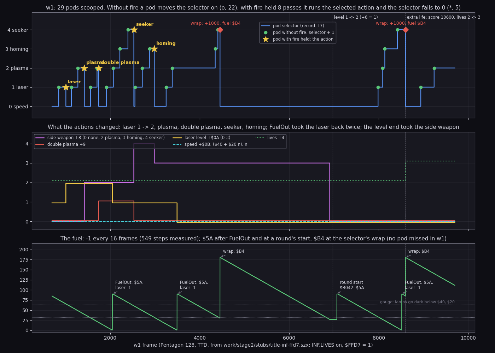
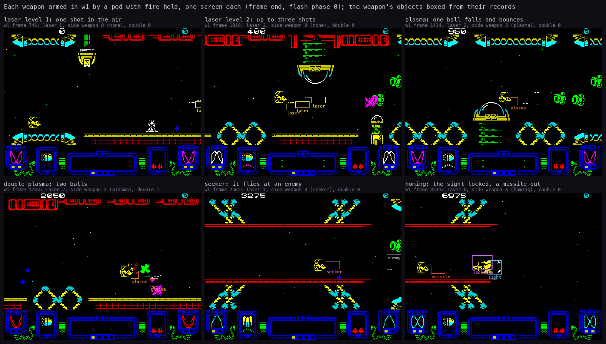
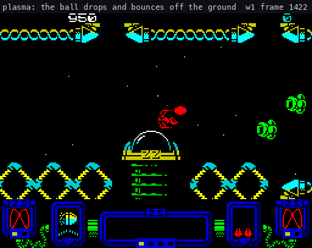
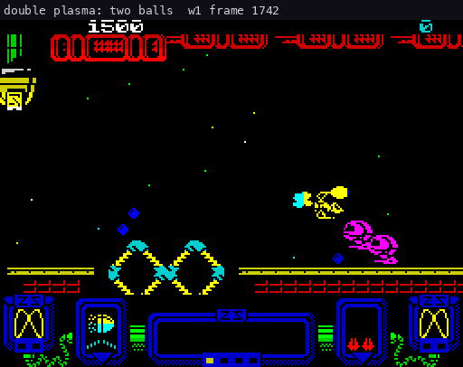
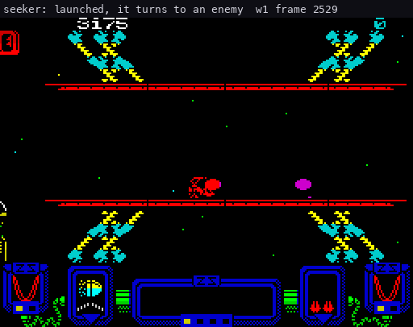
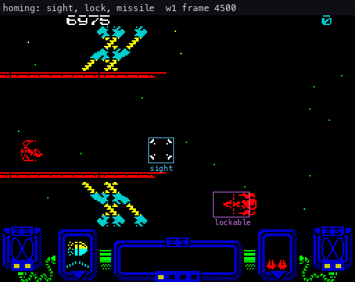

# 10. Gameplay logic

What this covers: the rules as code. The player record, the pods and the five weapons they give, the fuel, the score
and the extra lives, the enemy fire and the weapon rating, the waves and the level scripts, the level end, the death
and INF.LIVES.

The recordings it rests on (all Pentagon 128, `tools/play_live.py`: RAM zeroed, a Kempston card, muted):

| Recording | Made by | Frames | What it reached |
| --- | --- | ---: | --- |
| `work/z128B/w1` | `tools/weapons_bot.py --record` (below), port 16410 | 9700 | laser 2, plasma, double plasma, seeker, homing with a lock and a missile kill, three FuelOuts, two selector wraps, the level 0 end, an extra life |
| `work/z128B/w0` | the same bot and plan, an earlier run, port 16410 | 9700 | three speed pods (`$60`, `$80`, `$A0`), the level 0 end, an extra life |
| `work/z128B/d1` | the same bot with `--plan 1`, from `work/stage2/stubs/title-inf.szx` (`$FFD7` = 0), port 16480 | 3700 | three ships lost with INF.LIVES on, the lives kept |
| `r1` | `work/stage2/stubs/r1`, the stub recording of doc 09, `$FFD7` = 1 | 7701 | an extra life at 6590 |
| `work/z128A/r3` | z128A's replay of a 76000-frame bot run from `title-inf-ffd7.szx` (`$FFD7` = 1; `work/docs/z128A-fork-NOTES.md`), opened here on port 16445 | 76004 | all twelve levels and the wrap to level 0, six big enemies, four extra lives |

w1 was made with:

```sh
python3 tools/weapons_bot.py --work work/z128B/w1 --snapshot work/stage2/stubs/title-inf-ffd7.szx \
    --plan 0,1,2,2,4,3 --frames 9000 --prefix work/stage2/stubs/inputs/start-1player.txt \
    --lock --park 17,10 --record --script work/z128B/w1/bot-w1.txt --log work/z128B/w1/bot-w1.tsv
```

- `tools/weapons_bot.py` plays with `tools/play_bot.py`'s bot and steps the pod selector to each wanted entry. It holds
  fire into a pod only when the selector shows the entry it wants (10.2).
- `--record` makes the run itself the TTD recording, so no replay can drift from it.
- `--lock --park 17,10` keeps the ship below a lockable enemy once the homing missiles are on (10.3).
- `tools/frames_dump.py --work work/z128B/w1 --frames 700:9700 --screen --out work/z128B/w1-frames.npz` read every
  frame of w1 by TTD `memory_at`: the variables `$7F9C`-`$81FF`, the 16 object records and the screen.
- w0 and d1 are read from the bot's own state log (`frames.tsv`: one row each bot step, about every 2 frames) and by
  TTD `find_last`.

Frames below are TTD frames of the named recording.
w1, w0, r1 and r3 have `Invulnerable` `$FFD7` = 1: no collision kills the ship there.
d1 has `$FFD7` = 0, so its ship dies.

## 10.1 The player record

Each player has a record of 48 bytes: Player1 `$7F9C` and Player2 `$7FCC`.
PlayerRecord `$7F99` points at the one in play.
From `+$0D` on it holds the 35-byte state of the script and the scroll, saved at each checkpoint.

| Offset | Field | Set by | Read by |
| --- | --- | --- | --- |
| `+0`-`+3` | the score, 4 BCD bytes, high first | AddScore `$A489` | PrintPlayerScore `$A4AE`, ScoreJob `$AC7A` |
| `+4` | the lives left (2 at the start: three ships) | PlayersSetup `$AFB7`, ScoreJob, TakeLife `$B170` | DrawLives `$A4EF` |
| `+5` | the lives lost in this level | PlayerDied `$B119` | (the checkpoint) |
| `+6` | the level order index 0-11 | LevelDone `$B174` | SetLevelStart `$B062` |
| `+7` | the pod selector 0-4 | PodStep `$A1FD` | PodIconJob `$AC2C` |
| `+8` | the side weapon: 0 none, 2 plasma, 3 homing, 4 seeker | the pod actions | PlayerHandler `$9A5B` |
| `+9` | 1 = double plasma | PodPlasma `$9D68` | PlasmaFrame `$9C83` |
| `+$0A` | the laser level 0-3 | PodLaser `$9D5D`, FuelOut `$9C03` | FireLaser `$9C1D` |
| `+$0B` | the speed `$40`-`$A0` | PodSpeedUp `$9D4C`, FuelOut | the ship's mover |
| `+$0C` | the next extra life: an index into ExtraLifeScores `$800F` | ScoreJob | ScoreJob |
| `+$0D`-`+$2F` | the checkpoint: the level record, the script state, the scroll | SetLevelStart, CmdCheckpoint `$AED2` | RestoreCheckpoint `$AD56` |

w1 at frame 700 (the first frame it was read at): score 0, lives 2, laser 1, speed `$40`, no side weapon, the
selector at 0, Fuel `$55`.

## 10.2 Pods and the selector

A pod is what an enemy wave leaves when its last enemy is destroyed (10.6).
It flies with the landscape until the ship touches it or it scrolls off.

PodStep `$A1FD` (the handler of kind 4) runs the rule when the player's hit mask has the pod's bit:

- **Fire held 8 passes or more** (FireHeld `$8184`): the selector `+7` goes back to 0, and the action it pointed at
  runs (PodActions `$80F0`). The call at `$A21A` goes through hook stub `$B379`, which also starts EffectWeaponSelect
  (doc 09, 9.2).
- **No fire:** the selector moves on by one. Past the fifth entry it wraps to 0, awards 1000 points (AddScore
  award 9) and sets the fuel to `$B4` (PC `$A239`).
- **Either way:** event bit 2 (the pod icon redrawn by PodIconJob, doc 08) and 100 points (award 4). That call at
  `$A247` goes through stub `$B364`, which starts EffectPodTaken.
- **Not taken:** at the screen's edge the pod is removed and the fuel is halved (`SRL (HL)` at `$A25D`).

| Selector | Action | Effect on the record |
| ---: | --- | --- |
| 0 | PodSpeedUp `$9D4C` | fuel `$BB`; speed + `$20`, up to `$A0` |
| 1 | PodLaser `$9D5D` | laser + 1, up to 3 |
| 2 | PodPlasma `$9D68` | side weapon 2, the sight off; a second plasma pod also sets `+9` (double plasma) |
| 3 | PodHoming `$9DA5` | side weapon 3, `+9` = 0, the second ball off, the sight on (PlaceSight `$9E16`), no lock |
| 4 | PodSeeker `$9DDD` | side weapon 4, `+9` = 0, the sight off |



```sh
python3 tools/fig_weapons.py course --npz work/z128B/w1-frames.npz
```

How to read:

- **Top: the selector `+7`.** A green dot is a pod taken without fire (the selector + 1). A star is a pod taken
  with fire held (the action named, the selector back to 0). A red diamond is the wrap past the seeker (+1000, fuel
  `$B4`).
- **Middle: what the actions changed**: `+8` (purple), `+9` (red), `+$0A` (yellow), `+$0B` as a step count above
  `$40` (cyan, dashed), the lives `+4` (green, dotted).
- **Bottom: the fuel `$80E6`.** The labels are the refills; the two dotted lines are the panel lamps' thresholds
  (doc 08).
- The dashed verticals are the level end (`+6` 0 → 1 at 6972, labelled "level 1 -> 2") and the extra life (8597).

What w1 shows:

- **29 pods scooped**: 22 steps of the selector, 5 actions and 2 wraps.
- **The score agrees.** 25 steps of exactly 100, 2 of 1100 (the wraps, 1000 + 100) and 2 of 125 (a pod and a kill of
  25 in one frame): 29.
- **The actions, in order:**
  - laser 1 → 2 at 1010;
  - plasma at 1422;
  - double plasma at 1742 (a second plasma pod: `+9` 0 → 1);
  - seeker at 2529 (`+9` back to 0: PodSeeker's `LD (IX+$09),$00`);
  - homing at 2985.
- **The rule shows plainly.** From 0 the bot needs n scoops without fire, then one with fire, to run action n.
- **The selector wraps twice**: 4454 and 8596, each after five steps without fire.
- **A pod with fire runs both stubs.** `$B379` (the action) and `$B364` (the points) run in the same frame: 1009,
  1421, 1741, 2528 and 2984 (doc 09, 9.2).

w1 has no speed action.
Its bot counted the speed entry done at 820 by a false test of its own (the selector was 0 before and after).
w0, the same bot's earlier run, took the speed pod three times:

| w0 frame | Speed `+$0B` | Fuel |
| ---: | --- | ---: |
| 700 | `$40` | `$55` |
| 850 | `$60` | `$BB` |
| 982 | `$80` | `$BB` |
| 1150 | `$A0` | `$BB` |

A fourth speed pod would leave `$A0` (`CP $A0`, `RET Z`), but no recording took one.



```sh
python3 tools/fig_weapons.py sheet --npz work/z128B/w1-frames.npz
```

How to read:

- One screen per weapon state: laser 1 (frame 746), laser 2 (1018), plasma (1434), double plasma (1764), seeker
  (2565), homing with its sight and lock (4531).
- The boxes are the weapon's object records, with their kind (`+7`): laser shots (kind 1), plasma balls (kind 9),
  the seeker (kind 7), the sight (kind 6), the missile (kind 10), the lockable enemy (kind 8).
- The laser level shows as the number of laser shots in flight (slots 9-12, `$F4F8`-`$F57C`): one more a level.

## 10.3 The five weapons in flight

PlayerHandler `$9A5B` calls the side weapon's frame routine (table `$80EA`, by `+8` - 2).
FireHeld `$8184` counts the passes fire is held.
A tap fires only the laser; holding fire releases the side weapon.

| Weapon | Frame routine | Released | Handler | What it does |
| --- | --- | --- | --- | --- |
| laser | FireLaser `$9C1D` | each press and release | LaserHandler `$9E32` (kind 1) | X + 1.25 columns a pass; 1 hit point off an enemy it overlaps; gone on scenery or at column 48 |
| plasma | PlasmaFrame `$9C83` | fire held exactly 3 passes | PlasmaHandler `$9E67` (kind 9) | falls (Y acceleration `$10`), bounces 3 times on scenery (Vy = -Vy / 2); kills what it touches (PlasmaHitMask `$80E5`) |
| double plasma | the same, the second ball in `$F5A8` | when `$F5D4` is busy | PlasmaHandler | two balls at once |
| homing | HomingFrame `$9CCA` | fire with a lock (LockMask `$80E2` not 0) and `$F5D4` free | MissileHandler `$9ED7` (kind 10) | life 75 passes; homes on the locked enemy; a hit kills a lockable enemy, takes 4 hit points of a big one |
| seeker | SeekerFrame `$9CFE` | fire held exactly 7 passes | SeekerHandler `$9F13` (kind 7) | flies to the first busy enemy slot of kind 2, kills it, then the next, then comes home |
| speed | (none) | | | the ship's step `+$0B` |

The sounds come from hook stubs at the weapons' call sites (doc 09, 9.2):

- a laser shot: stub `$B32F` (site `$9C77`), EffectShot;
- a plasma bounce: stub `$B33C` (site `$9EC2`), EffectBombBounce;
- a plasma ball, a missile or a seeker placed at the ship: stub `$B36C` (site `$9CB0`), EffectSpecialLaunch;
- a homing missile launched: stub `$B35C` (site `$9CFA`), EffectHomingLaunch.



```sh
python3 tools/fig_weapons.py gif plasma-bounce 1422 1530 --only 9,1 --title 'plasma: the ball drops and bounces off the ground'
```



```sh
python3 tools/fig_weapons.py gif double-plasma 1742 1850 --only 9 --title 'double plasma: two balls'
```



```sh
python3 tools/fig_weapons.py gif seeker 2529 2640 --only 7,2,11,3 --title 'seeker: launched, it turns to an enemy'
```

How to read the three GIFs:

- The screen at 2× scale, one picture every 2 frames.
  The caption gives the recording, the frame and the title.
- The object records of the kinds given with `--only` are boxed in their kind's colour: orange plasma (9), yellow
  laser (1), pink seeker (7), white enemy (2, 11), brown explosion (3).

What they show:

- The plasma ball loses half its fall speed at each bounce, as PlasmaHandler's `Vy = -Vy / 2` says.
- The double plasma throws a ball from each of slots 13 and 14.
- The seeker (slot 14) leaves after 7 passes of fire and turns to the enemies.
- SeekerHandler tests `CP $02` twice (`$9F28` and `$9F2C`): kind 11 enemies share EnemyHandler but are never hunted.
  No recording shows a kind 11 enemy near a seeker, so this is known from the code only.

### The homing missile: a lock and a kill (w1)

The bot took the homing missiles at 2985 and kept them to the level end.
Level 0's script launches its one lockable enemy at its end (10.6), and `--park 17,10` holds the ship below it:

| w1 frame | What happened | Witness |
| ---: | --- | --- |
| 4458 | wave 19 in enemy slot 1: kind 8 (LockableHandler `$9FC8`), 6 hit points | slot 1 `+7` = 8, `+$0D` = 6 |
| 4529 | the lock: LockMask `$80E2` = 1 (slot 1's bit), LockTarget `$80E0` = slot 1's record | `$80E2` |
| 4531 | the first missile: kind 10 in slot 14 (`$F5D4`), active | slot 14 `+8` bit 7 |
| 4689 | the first missile burns out (MissileFade `$9F03`) after 158 frames, 79 passes | slot 14 inactive |
| 4691 | the second missile | slot 14 active |
| 4741 | the hit: MissileHitMask `$80E3` = 1, the enemy becomes an explosion (kind 3), the lock is cleared | slot 1 `+7` = 3, `$80E2` = 0 |

- The enemy still had all 6 hit points when it died: no laser shot touched it, so the missile made the kill.
- The second missile flew 50 frames; the first missed and ran out its life.



```sh
python3 tools/fig_weapons.py gif homing-missile 4500 4760 --every 3 --only 6,8,10,3 --title 'homing: sight, lock, missile'
```

How to read:

- One picture every 3 frames, 2× scale.
- Blue box: the sight (kind 6). Purple: the lockable enemy (kind 8). Red: the missile (kind 10). Brown: the
  explosion (kind 3).
- The sight's colour turns from `$78` to `$70` with the lock (SightHandler `$9E03`).

## 10.4 The fuel

Fuel `$80E6` is a timer: when it runs out the ship loses a laser level and a speed step.

| Event | Fuel | Address | Witness |
| --- | --- | --- | --- |
| a round's start | `$5A` | RoundPlaySetup `$B03A` (PC `$B044`) | w1 7065 (27 → 90) |
| one step down | - 1 on passes with PassBit `$7F63` bit 0 | PlayerHandler `$9A5B` | w1: 549 steps, every 16 frames |
| a speed pod (action 0) | `$BB` | PodSpeedUp `$9D4C` | w0 850, 982, 1150 |
| the selector wrap | `$B4` | PodStep (PC `$A239`) | w1 4454 (30 → 180), 8596 (85 → 180) |
| a pod lost off the edge | halved | PodStep (`$A25D`) | none: code only |
| 0 reached | `$5A`; laser - 1 (not below 0); speed - `$20` (not below `$40`) | FuelOut `$9C03` (PC `$9C06`) | w1 2050, 3494, 8514 |
| a life lost | FuelOut | PlayerDied `$B119` | d1 (10.9) |

The timing:

- A game pass is 2 TV frames (doc 04), and PassBit rotates one bit a pass.
- Bit 0 comes round once in 8 passes, so the fuel falls 1 every 16 TV frames.
- A speed pod's `$BB` (187) lasts 187 × 16 = 2992 frames, about 60 s; a round's `$5A` (90) 1440 frames.

What w1's FuelOuts did:

- 2050: laser 2 → 1, fuel 1 → `$5A`.
- 3494: laser 1 → 0. The speed stays `$40`.
- 8514: the laser stays 0, the speed `$40`.

With laser level 0 the ship still fires one shot at a time (slot 9 keeps running after 3494 in doc 07's slot figure).
The panel's fuel lamps show the fuel in three states (doc 08).

## 10.5 Score and extra lives

AddScore `$A489` adds award A of PointsTable `$8231` to the current player's score:

| Award | 0 | 1 | 2 | 3 | 4 | 5 | 6 | 7 | 8 | 9 | 10 | 11 |
| --- | ---: | ---: | ---: | ---: | ---: | ---: | ---: | ---: | ---: | ---: | ---: | ---: |
| Points | 0 | 25 | 50 | 75 | 100 | 150 | 200 | 250 | 500 | 1000 | 2000 | 5000 |

Who awards what:

- **An enemy destroyed:** its record's `+$0C` (from the kinds table).
- **A pod:** 4 (100). The selector's wrap: 9 (1000) on top.
- **A wave wholly destroyed:** bits 0-5 of its bonus byte + 7 (EnemyGone `$9954`).
- **An escape** (EnemyEscaped `$994A`: the enemy left the screen): the wave record gets bit 7, pays no bonus and
  leaves no pod.

The score steps of w1 (frames 700-9700, 0 → 11025 points):

| Step | 25 | 50 | 75 | 100 | 125 | 525 | 550 | 600 | 1100 |
| --- | ---: | ---: | ---: | ---: | ---: | ---: | ---: | ---: | ---: |
| Times | 58 | 12 | 17 | 25 | 2 | 2 | 2 | 1 | 2 |

- 25, 50 and 75 are the common enemies.
- 525, 550 and 600 are a wave bonus of 500 (award 8) with the last kill (25, 50, 100) in the same frame.

The extra lives: ScoreJob `$AC7A` (event bit 1) compares the score's byte `+1` with ExtraLifeScores `$800F` at `+$0C`.
The table is `01 03 05 07 09 FF` (w1's memory): an extra life at 10000, 30000, 50000, 70000 and 90000, and none after.

- **w1 8596:** the second wrap (1100 points) takes the score from 9500 to 10600.
  - Lives 2 → 3 and `+$0C` 0 → 1 at 8597.
  - Hook stub `$B334` (site `$ACA2`: DrawLives, then EffectExtraLife) at 8596.
- **w0 7170:** lives 2 → 3 (the bot's log).
- **r1 6590:** lives 2 → 3 (doc 09, 9.2).
- **r3:** ScoreJob's store (PC `$AC9F`) wrote the lives four times (TTD `find_last` write of `$7FA0`):

  | r3 frame | Score after it | Lives | `+$0C` |
  | ---: | ---: | ---: | ---: |
  | 6590 | 10300 | 3 | 1 |
  | 21702 | 30025 | 4 | 2 |
  | 45038 | 50400 | 5 | 3 |
  | 64060 | 70000 | 6 | 4 |

  r3 ends at 81900 points with 6 lives and `+$0C` = 4: 90000 was not reached.
- So 10000-70000 are witnessed; the 90000 entry and the `$FF` end are known from the code only.

## 10.6 Waves and the level scripts

A level is an 8-byte record of LevelTable `$6B2D` (HL = `$6B2D` + 8 n):

- `+0`: 0 in all twelve, never read;
- `+1`-`+2`: the script's start;
- `+3`: PlayFlags (`$FF`);
- `+4`: the scroll count;
- `+5`: 0;
- `+6`: the scenery script;
- `+7`: ScriptLevelBias `$81DE` (the weapon rating's add, below).

SetLevelStart copies the record of LevelOrder[`+6`] (LevelOrder `$8003`) into the checkpoint.
RestoreCheckpoint `$AD56` copies it into ScriptState `$81D7`.

### The script interpreter

WaveScriptStep `$AD66` runs once a pass, and only while DeathTimer `$7F7B` is `$FF` (the ship alive).
A step is a wait byte and a command:

- ScriptWaitCount `$81E1` counts up once a call. When it equals the step's wait the command runs and the counter
  starts again from 0.
- Commands with no wait run in the same call.
- `$40`-`$7F` is a conditional jump, `$C0`-`$FF` a call, `$80`-`$BF` a wave (LaunchWave `$91EC`), below `$40` one of
  the commands of ScriptCommands.

The end of level 0 in w1 (ScriptPC `$81D8`, PlayFlags `$81DA` and the slots read every frame):

| w1 frame | ScriptPC | What ran |
| ---: | --- | --- |
| 3978-4202 | `$6BEC`-`$6BF5` | the last common waves |
| 4452 | | `scrolloff` (CmdScrollStop: PlayFlags bit 5 cleared, `$FF` → `$DF`): the landscape stops |
| 4458 | `$6C02` | wave 19 (the lockable enemy of 10.3), ScriptCounter `$81E4` = 60, then `anyenemies` every 5 counts |
| 4772 | | the missile's kill (4741) leaves a pod in slot 1, parked at X 28 |
| 6858 | `$6C16` | `$81E4` ran out: 60 polls × 40 frames = 2400 frames after 4458 |
| 6905 | `$6C18` | `levelend` (CmdLevelEnd `$AE40`) |
| 6972 | `$6C1A` | level index `+6` = 1: level 1's script |

The 2400-frame wait is a rule, not the bot's slowness:

- A pod sits in an enemy record (slots 1-5), so `anyenemies` (CmdEnemiesLeft `$AF26`) counts it as an enemy.
- After `scrolloff` nothing scrolls, so a pod nobody takes never leaves.
- w1's bot did not take the last pod, so the script waited the full 60 polls.
- A player who scoops the last pod ends the level at once (code only: CmdEnemiesLeft then finds no busy record).

### The twelve levels

Read from w1's memory at frame 700 (`work/z128B/images/w1-700-game.bin`):

| Level | Script | Scroll count `+4` | ScriptLevelBias `+7` |
| ---: | --- | --- | ---: |
| 0 | `$6B8D` | `$40` | 0 |
| 1 | `$6C1A` | `$30` | 0 |
| 2 | `$6C97` | `$30` | 0 |
| 3 | `$6D18` | `$38` | 0 |
| 4 | `$6E50` | `$30` | 3 |
| 5 | `$6FCA` | `$30` | 10 |
| 6 | `$7068` | `$30` | 20 |
| 7 | `$70F6` | `$40` | 15 |
| 8 | `$7181` | `$10` | 15 |
| 9 | `$6DC0` | `$30` | 15 |
| 10 | `$7212` | `$30` | 20 |
| 11 | `$6F00` | `$30` | 15 |

- LevelOrder in the loaded file is `00 01 02 00 00 00 00 00 00 09 0A 0B`.
- PlayersSetup `$AFB7` fills entries 3-8 with the six numbers 3-8 in a random order for each game.
- w1's game drew `00 01 02 03 07 05 04 08 06 09 0A 0B`.
- r3's game drew the same order. z128A's `coverage_scan` of r3 found LevelDone at 5609, 11900, 18719, 23494,
  30951, 36762, 42901, 50353, 57172, 62471, 69559 and 75410: twelve level ends.
- After index 11 LevelDone wraps `+6` to 0: r3 is back at level 0 from 75411, with 81800 points. Nothing in LevelDone
  or SetLevelStart counts the rounds, and PlayersSetup is not called again, so the order is not redrawn (code).

### The weapon rating and the enemy fire

WeaponRating `$9B75` rates the ship's arms after each score print (ScoreJob) and at the level start:

- L = laser level + side weapon (`+$0A` + `+8`).
- WeaponRatingMask `$80E7` = `$FF`, or `$30` when L ≥ 4.
- WeaponRatingValue `$80E8` = ((speed >> 5 + L) × 4) AND `$F0`, + ScriptLevelBias `$81DE`.
- WeaponRatingLevel `$80E9` = 0, or 8 when L ≥ 7. LaunchWave uses it to pick the colour set of the kinds.

EnemyFire `$A0EB` uses the first two:

- An enemy whose fire rate `+$18` is 0 never fires.
- Its first shot comes when its column `+4` equals `$80E7`. With `$30` (L ≥ 4) every enemy fires as it reaches
  column `$30`; with `$FF` never by this rule.
- Then on its turn (its bit `+$24` in PassBit) it fires when Random < `$80E8`, or when Random - `$80E8` is below its
  fire rate.
- At most 3 enemy shots fly at once (EnemyShotsLeft `$8074`, the records `$F474`-`$F4CC`).
- Each shot starts EffectEnemyMissile (stub `$B374`, site `$A1C4`).

So a better armed and faster ship draws more fire. Measured in w1:

| w1 frame | `$80E7` | `$80E8` | Why |
| ---: | --- | --- | --- |
| 700 | `$FF` | 0 | speed `$40`, laser 1: (2 + 1) × 4 = 12, AND `$F0` = 0 |
| 1010 | `$FF` | `$10` | laser 2: (2 + 2) × 4 = 16 |
| 1422 | `$30` | `$10` | plasma: L = 2 + 2 = 4 |
| 2070 | `$FF` | `$10` | FuelOut at 2050 took laser 2 → 1: L = 3 (rated at the next score print) |
| 2529 | `$30` | `$10` | seeker: L = 1 + 4 = 5, (2 + 5) × 4 = 28, AND `$F0` = 16 |
| 3494 | `$FF` | `$10` | FuelOut: laser 0 with homing, L = 3 |
| 7080 | `$FF` | 0 | level 1: the side weapon gone, L = 0 |

- EnemyShotsLeft changed 85 times in w1, always between 0 and 3: never more than three shots at once.
- `$80E9` stayed 0: L never reached 7 (laser 3 with the seeker would).
- ScriptLevelBias stayed 0: levels 0 and 1 have 0.

## 10.7 The lockable and the big enemies

Two handlers take more than one hit:

- **LockableHandler `$9FC8`** (kind 8): the sight can lock it (10.3).
  The laser takes 1 hit point; a plasma ball or the seeker kills it (`$80E5`); the locked missile kills it (`$80E3`,
  w1 4741).
- **BigEnemyHandler `$A03E`** (kind 12): 48 hit points (`$30`).
  A missile hit takes 4, a laser hit 1, each with a colour flash. Below 0 it is destroyed.

The big enemy is drawn from a one-bit cell map by BuildBigSprite `$8F0C` (doc 07).
The big enemies come at the end of levels 2, 4, 6, 7, 8 and 10 (waves 20, 21 and 28 in their scripts).
It can also leave: BigEnemyHandler goes to BigEnemyLeaves `$A04A` when its column `+4` is below 7 or above 55
(EnemyEscaped: no score, no pod).

r3 (z128A's `coverage_scan`, `work/docs/z128A-fork-NOTES.md`) has all six:

| Level | BuildBigSprite | BigEnemyHandler runs | End |
| ---: | ---: | --- | --- |
| 2 | 16205 | 16206-18232 | left at 18232 (BigEnemyLeaves), score unchanged |
| 7 | 28437 | 28438-30464 | left at 30464 |
| 4 | 41867 | 41868-42731 | destroyed: 46450 → 47475 |
| 8 | 47879 | 47880-50183 | destroyed: 54025 → 56050 |
| 6 | 54658 | 54659-57109 | unresolved: no score, no BigEnemyLeaves |
| 10 | 67397 | 67398-69369 | destroyed: 74650 → 76675 |

- The hit routine BigEnemyHitSound `$A0BD` ran in 243 frames of r3.
- A hit sets the 48K's noise pointers `$7F80`, `$7F84`, `$7F88`, and SlotBeepMask follows them (`$FF` at r3 18230).
  But no sound comes of it: the set-up made RunObjects' `OUT ($FE)` at `$949C` two `NOP`s (r3 memory: `00 00`).
  TTD `port_events` over r3 frames 500-76000 finds 0 beeper changes among 2 370 690 `OUT`s.

## 10.8 The level end

CmdLevelEnd `$AE40` (script command 5):

1. CmdScrollStop: the scroll stops.
2. EndPending = 2: the play loop ends after this pass.
3. The record's `+8` and `+9` are zeroed: the side weapon and the double plasma are lost.

LevelDone `$B174` (end code 2) then adds 1 to `+6`, wraps 12 to 0 and calls SetLevelStart.
The next round starts with RoundPlaySetup `$B03A` (fuel `$5A`) and LevelStartSound `$5B6D` (the music off, then the
level-start sound: doc 09, 9.2).

What w1 shows:

- 6906: the side weapon `+8` 3 → 0 (the homing missiles lost).
- 6972: `+6` 0 → 1.
- 7065: the fuel 27 → `$5A`.
- The laser (0) and the speed (`$40`) are kept.

PlayerSetup `$B21C` re-arms the side weapon at a round's start when `+8` ≥ 2 (`$B276`).
Every path into a round zeroes `+8` first (CmdLevelEnd, PlayerDied), and w1 has `+8` = 0 at 6972.
So the re-arm never runs (code only).

## 10.9 Death and INF.LIVES

KillPlayer `$9B5F` starts the death (the collision test reads `Invulnerable` `$FFD7` first):

- DeathTimer `$7F7B` = `$16`: the scroll and the script stop.
- All 16 records lose `+8` bit 7 (inactive).
- ScatterDebris `$9BAB` turns the five enemy records into debris round the ship.
- Hook stub `$B354` (site `$9BFF`) starts EffectShipLost.

PlayerDied `$B119` (end code 1):

1. `+5` + 1 (lives lost in this level).
2. `+8`, `+9` = 0: the side weapon and the double plasma are lost.
3. FuelOut: fuel `$5A`, laser - 1, speed - `$20`.
4. No lives left: HighScoreEntry `$A7F7`, then NextPlayer; carry when no player has a life (the game is over).
5. With lives: NextPlayer `$B149` (two players: the other plays when it has lives), then TakeLife `$B170`.

The level restarts from the last checkpoint (`save` in the script: RestoreCheckpoint `$AD56`).

INF.LIVES (the loader's option, doc 03) changes one instruction:

- TakeLife `$B170` holds `DEC (IX+4)` in the file; the set-up writes `OR (IX+4)` (`DD B6 04`) there.
- `OR` leaves the lives as they are: the ship is lost, but no life is taken.
- `$FFD7` (`Invulnerable`) is a separate switch: 1 skips the collision test, 0 lets the ship die.

d1 (`$FFD7` = 0, INF.LIVES on) shows the death three times:

| d1 frame | What ran | Witness |
| ---: | --- | --- |
| 1713, 2522, 3311 | KillPlayer `$9B5F` (T 12859, 11156, 17978) and stub `$B354` in the same frame | TTD `find_last` execute |
| 1823, 2632, 3420 | PlayerDied `$B119`, then TakeLife `$B170` (the `OR`) | TTD `find_last` execute |
| 1823, 2632, 3420 | `+5` (`$7FA1`) 1, 2, 3, written by `$B11D` | TTD `find_last` write |
| 500 | the lives `$7FA0` = 2, written by `$AFD1` (PlayersSetup), never again | TTD `find_last` write |

So three ships were lost, and the lives stayed at 2.
w1's memory shows the same patch: `$B170` = `DD B6 04` and `$FFD7` = 1 (`work/z128B/images/w1-700-game.bin`).

## 10.10 What no recording reached

- 90000 points: the fifth extra life.
- A pod lost off the screen's edge (the fuel halved).
- Laser level 3, a fourth speed pod, `$80E9` = 8 (L ≥ 7).
- A homing missile's hit on a big enemy (r3's bot never took the homing missiles into a big fight; code only).
- A kind 11 enemy near the seeker.
- The two-player change (NextPlayer, CurrentPlayer `$7F98` XOR 3).
- The last life lost without INF.LIVES, and the high-score entry.

## 10.11 Bytes and code that stay unexplained

- The level record's byte `+0` (ScriptState `$81D7`): 0 in all twelve, never read.
- The second `CP $02` of SeekerHandler (`$9F2C`, 10.3): probably meant another kind.
- PlayerSetup's re-arm at `$B276` (10.8): no path reaches it with `+8` ≥ 2.
- FindFreeObjectSlot `$90B5`: a free-slot search over the 16 records that nothing calls.
- LifeSteps `$81C0` has 5 bytes, DrawLives reads 6: the sixth is EventRequests `$81C5`, a harmless over-read
  (doc 08).
