# 13. Differences from Zynaps (48K)

This document covers what Zynaps 2 in 1 changed in the 48K Zynaps, why, and what the player gets from it. Each
point comes with the bytes, the code and the recordings behind it.

## 13.0 The two games and the verdict

- **The 48K** is Zynaps (Hewson, 1987), a 48K tape game by Dominic Robinson. Its case is
  [`../zynaps`](../../zynaps/README.md). A path after "the 48K" is in that case.
- **The 2 in 1** is this case: Zynaps 2 in 1 (goodboy and tiboh, 2018), a TR-DOS disk (the SCL and the TRD hold
  the same `ZYNAPS.B`; the TRD adds `boot.B`). "2 in 1" means one disk for the 48K and the 128K: the loader tests the
  paging and takes the 128K path when it works. Paths are relative to this case.

The short answer:

- **The game is the 48K's game, at the 48K's addresses.** Block 2 holds the 48K game image cut to
  `$6800`-`$FFFF`.
  - Of the 38 911 bytes the two images share, 38 760 are the same: 99.61 %.
  - The 151 that differ are in 11 places: the default keys (9 bytes), nine delay bytes and one line loop retimed
    for the Pentagon (14 bytes), and two leftovers of the 48K tape that the 2 in 1 holds as zeros (127 bytes).
  - 42 of the game's 49 modules have no differing byte (13.4).
- **Every 128K change is made at load.** On a 128K the set-up writes 241 more bytes in 35 runs into the image: the
  beeper is silenced, 16 sound sites call 15 hook stubs into the CPC Zynaps's AY engine in page 4, and four
  interrupt sites call the engine every frame.
- **Everything else is the 48K's code, with the 48K's bugs.** That covers the waves, the weapons, the pods, the
  scroll, the renderer, the level order, the score and the high scores. The 48K's unexplained bytes and dead code
  are all still there, in the same bytes (13.9).
- **For the player:**
  - the load is a disk's: about 13 s of machine time against 264 s of tape signal, with an intro of three pictures
    and an options screen (13.1);
  - the sound is the Amstrad CPC's: J. Dave Rogers's music at the menus and 16 AY sounds for the events, in place of
    Steve Turner's beeper tune, six beeper effects and the explosion noise (13.6);
  - SPACE Q A O P as the default keys, a Kempston mouse option and an infinite-lives option (13.7, 13.8);
  - on the Pentagon it was made for, the game runs 2.5 % slower than a 48K, as every 2-frame-pass game does there;
    the retiming keeps the drawing behind the beam (13.5).

How it was compared:

- Both reverses are complete, and both cases rebuild their originals byte for byte from source. Both annotations use
  the same names where the code is the same.
- The game images were compared address by address (`tools/diff_48k.py`). The two images put the game at the same
  addresses, so nothing had to be paired or masked: a byte is the same or it is not. Each changed place is named
  from both cases' `game.ann` and shown from both listings side by side (13.11).
- The set-up's writes are the difference between the game image as moved and `c1`'s memory at the game's entry
  (`work/images/game-entry-cpu.bin`, `JP $8000`, the options off).
- The CPU costs come from the L1 builds both cases already had (the 48K's `r1`, this case's `r3`). The screens come
  from `r48` (the 48K tape on a 48K) against `c1` and `k128`. No new emulator run was made for this document.

Witnesses:

- "48K line N" is a line of the 48K's `build/game.lst`; "line N" is a line of this case's `build/lst/game.lst`.
- Recordings ([Terms](README.md#terms)):
  - the 2 in 1: `c1` (`work/z128A/c1`, power-on to play), `r3` (`work/z128A/r3`, 76 003 frames, twelve levels),
    `w1` (`work/z128B/w1`), `d1` (`work/z128B/d1`), `k128` (`work/stage2/compare/k128`);
  - the 48K: `r48` (`work/stage2/compare/r48`, made by this case), and the 48K case's own `c1`, `c2` and `r1`.
- A 48K frame is 69 888 T (19.97 ms). A Pentagon frame is 71 680 T (20.48 ms). A Sinclair 128K frame is 70 908 T
  at 3.5469 MHz (19.99 ms).
- The figures are in `docs/img/diff/` and `docs/img/compare/`. Every command is run from this case's root.

## The differences at a glance

| What | 48K | 2 in 1 | Why | For the player | |
| --- | --- | --- | --- | --- | --- |
| medium | tape: BASIC, the Countdown II loader, the loading screen, the game | TR-DOS disk: `ZYNAPS.B` (loader, two Hrust 1 blocks), `boot.B` | a disk release | | [13.1](#131-the-media-and-the-load) |
| load to the menu | 264.4 s of signal | 31.6 s from RUN in `c1`, 13.2 s of it the machine's | packed, read from disk | 20 times faster (8 times with the intro's waits) | [13.1](#131-the-media-and-the-load) |
| before the game | the Hewson picture while loading | three pictures, an options screen, the `SK10` tune | the release's own intro | INF.LIVES, K-MOUSE | [13.2](#132-around-the-game-the-2-in-1s-own-code) |
| machine | 48K | 128K (`$7FFD` paging, AY, TR-DOS); a 48K with a disk takes the 48K path | page 4 for the engine | | [13.3](#133-memory-and-banks) |
| game image | `$61A8`-`$FFFE` | `$6800`-`$FFFF` | the zeros below `$6800` are not carried | nothing visible | [13.4](#134-the-game-image-eleven-places) |
| game code | the 48K's | 99.61 % the same bytes; 11 places; 42 of 49 modules unchanged | keys, Pentagon timing | the same game | [13.4](#134-the-game-image-eleven-places) |
| set-up at load | | 241 bytes in 35 runs (128K path) | the sound | | [13.4](#134-the-game-image-eleven-places) |
| beam timing | for the 48K | 7 counts and the raster's line loop for the Pentagon | the Pentagon's screen starts 16 lines later | no tear on the Pentagon | [13.5](#135-timing-the-pentagon-retiming) |
| game speed | 25.04 passes a second | 24.41 on the Pentagon, 25.01 on a 128K | the frame rate | 2.5 % slower on the Pentagon | [13.5](#135-timing-the-pentagon-retiming) |
| music | Steve Turner's beeper tune on the credits page, interrupts off | the CPC's music at the menus, the `SK10` tune in the intro | the CPC conversion's | 2.3 semitones lower than the CPC on a Pentagon | [13.6](#136-sound) |
| effects | six beeper effects in the main loop's time; the explosion noise from the pass | 16 of the engine's 18 AY sounds, from 16 sites and the level start; no speaker at all | the CPC engine | more events heard, no explosion noise | [13.6](#136-sound) |
| sound's CPU | EffectPlay 22.5 % | engine, glue and stubs 4.4 % | the AY plays by itself | | [13.6](#136-sound) |
| default keys | FIRE `P`, UP `L`, DOWN `SS`, LEFT `A`, RIGHT `S` | FIRE `SPACE`, UP `Q`, DOWN `A`, LEFT `O`, RIGHT `P` | the edit | | [13.7](#137-controls) |
| mouse | | K-MOUSE: a 221-byte driver, four patches | the option | the ship placed by the mouse | [13.7](#137-controls) |
| lives | `$FFD7`: a developer switch, 0, no ship lost when set | INF.LIVES: `DEC (IX+4)` becomes `OR (IX+4)`; `$FFD7` kept | the option | ships are lost, lives are not | [13.8](#138-lives-inflives-and-ffd7) |
| credits | music STEVE TURNER | DAVE ROGERS | the music is the CPC's | | [13.10](#1310-what-the-player-sees) |
| bugs | the 48K's 10.13 | all kept; a few of its own | | the same quirks | [13.9](#139-bugs-kept-and-added) |

## 13.1 The media and the load

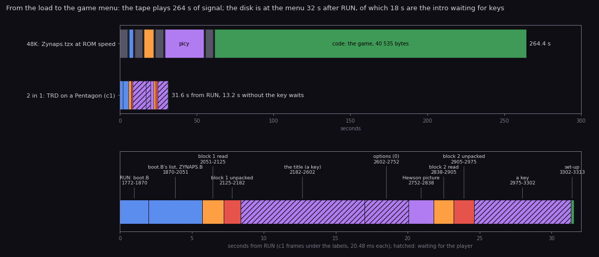

How to read it:

- **Top**: the two loads to scale.
  - **The 48K** is the TZX's nine blocks at ROM speed, signal and pauses
    (the 48K's [3.1](../../zynaps/docs/03-build-and-load.md#31-the-tape)). The Hewson loader reads `picy` and the
    game at the signal's own speed, so this is the real time. The game block alone takes 202.8 s.
  - **The 2 in 1** is `c1`'s frames from RUN (frame 1772) to `JP $8000` (frame 3313), 20.48 ms a frame
    ([3.7](03-build-and-load.md#37-the-stages-in-c1)).
- **Bottom**: the 2 in 1 alone, each stage with its `c1` frames. Hatched: the intro waiting for the player's keys.
- **The claim**: the disk is at the game menu 31.6 s after RUN, and 18.4 s of that is the player reading the title
  and the options. The machine's own work, the reads and the unpacking, takes 13.2 s. The tape plays 264.4 s.
- Drawn by `python3 tools/fig_diff_load.py --out docs/img/diff/load-time.png`.

| | 48K | 2 in 1 |
| --- | --- | --- |
| medium | tape, 9 TZX blocks, all at ROM timings | TRD (`ZYNAPS.B`, `boot.B`) or SCL (`ZYNAPS.B`) |
| boot | BASIC `zynaps`, `LOAD "" CODE` of the loader | `boot.B`'s list, or `RUN "ZYNAPS"`: a BASIC line whose REM holds the loader |
| loader | Hewson Countdown II, 768 bytes at `$FC00`, its code encrypted, a countdown of the bytes to come | in the BASIC's REM (`$5D40`): TR-DOS reads by `$3D13`, a paging test sets `$5D3B`; the Hrust 1 depacker at `$5B00` |
| packing | the loading screen packed (`picy`); the game raw, 40 535 bytes | Hrust 1: block 1 14 116 bytes to 35 029, block 2 20 027 to 39 813 |
| screens | the Hewson picture while the game loads | the intro: the new title picture, the options, the Hewson picture |
| the game | `$5DA8`-`$FBFE`, moved to `$61A8`-`$FFFE` | block 2: `$6000`-`$FB84`, the game moved to `$6800`-`$FFFF` by `LDDR` |
| to the menu | 264.4 s of signal; the 48K's `c1` reached the game at frame 12 323 | 1 541 frames from RUN, 31.6 s, 13.2 s of it the machine's |

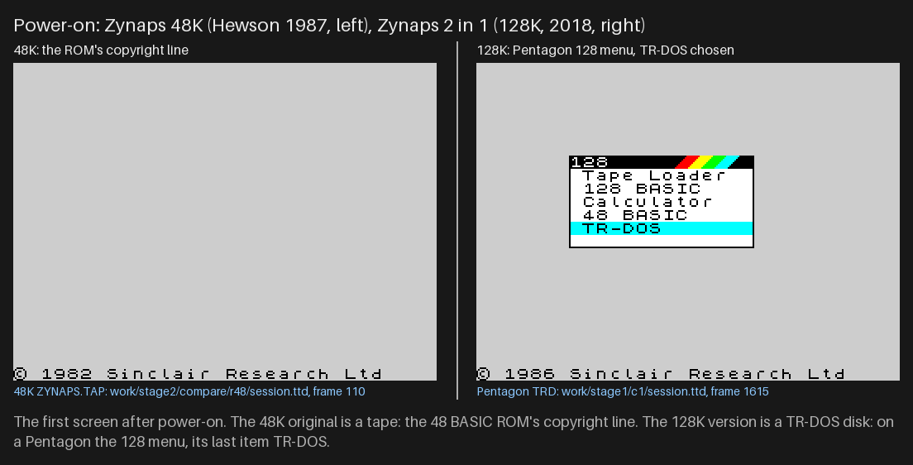

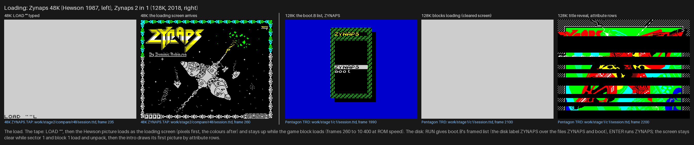

How to read the two figures: left the 48K tape on a 48K (`r48`), right the TRD on a Pentagon (`c1`), the screen
bytes of the recordings at 2x. `python3 tools/fig_compare.py`.

- **What.** The 48K loads one 40 535-byte block at ROM speed through its own loader. The 2 in 1 reads 137 sectors
  of one file: the loader in the BASIC's REM, the depacker, and two Hrust 1 blocks, the intro and the game.
- **Why.** A disk release, and a packer: both blocks shrink to 40 % and 50 %, and TR-DOS reads 54-60 sectors a
  second.
- **For the player.** Twenty times faster to the menu, and on the way the intro, which is new. The 48K's countdown
  and its loading screen are gone; the Hewson picture is now the intro's third.

## 13.2 Around the game: the 2 in 1's own code

The 2 in 1 adds code in five places. None of it is the 48K's.

| Part | Where, size | Runs | What | Source |
| --- | --- | --- | --- | --- |
| `boot.B` | `$5D3B`, 988 bytes | once, TRD only | a generic TR-DOS file list | `src/boot/boot.ann` |
| the loader | the REM of `ZYNAPS.B` (`$5D40`), the depacker at `$5B00` (256 bytes) | at load | the paging test (`$5D3B` = 1 on a 128K), the reads, the Hrust 1 depacker | `src/loader/` |
| the intro (block 1) | `$6000`-`$632C`, 813 bytes | between the reads | three pictures, the options `1` / `2` / `0`, the `SK10` tune through STarKos at `$8000`, the engine and its data copied to page 4 | `src/intro/` |
| the set-up (block 2) | `$6000`-`$6384`: 270 bytes of code, the glue, the hooks and the driver to copy | once, before `JP $8000` | moves the game, then the 128K glue, INF.LIVES, K-MOUSE (3.5) | `src/game/setup.ann` |
| the glue | `$5B00`-`$5BE2`, 227 bytes | every interrupt (128K) | FramePlay: page 4 in, one engine step, page 0 back; the music on and off at the menus and the levels | `src/game/glue.ann` |
| the hook stubs | `$B30D`-`$B3A8`, 156 bytes, over the 48K's EffectPlay | at each sound event (128K) | HookSound and 15 hooks: the site's lost instruction, then one engine entry | `src/game/stubs.ann` |
| the mouse driver | `$FE00`-`$FEDC`, 221 bytes (K-MOUSE) | once a pass | the Kempston mouse's counters to the ship's place | `src/game/mouse.ann` |
| the AY engine | page 4 `$C968`-`$CD22`, data `$DE48`-`$FE6F` | from the glue and the stubs | the CPC Zynaps's driver, moved up by `$5000` | `src/sound/engine.ann` |

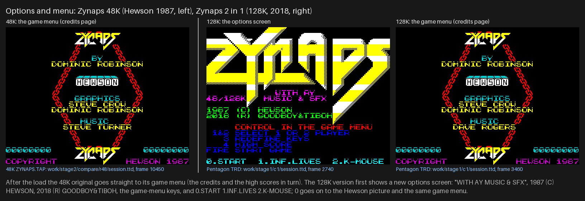

How to read it: the 48K side has no such screen (its game menu comes straight after the load); the 2 in 1's screen
is `c1`'s. The intro's texts are in [texts/intro.md](texts/intro.md), every difference in
[texts/differences.md](texts/differences.md).

- **What.** The intro is new code with new pictures (the title `RVS.M.STAWICKI`) and the Hewson picture reused. The
  set-up and the glue are the conversion: they change nothing on disk in the game image but the 11 places of 13.4,
  and all of the 128K's work is written into memory at load.
- **Why.** One image serves both machines. The set-up reads `$5D3B` and writes the 128K patches only when the paging
  works; on a 48K the image runs as the 48K's game with the 2018 keys and timing.
- **For the player.** Two options before the game, chosen once per load. A 48K owner with a disk gets the 48K game
  with its beeper (no music: the 48K's tune is still there) and the Pentagon timing (13.5).

## 13.3 Memory and banks

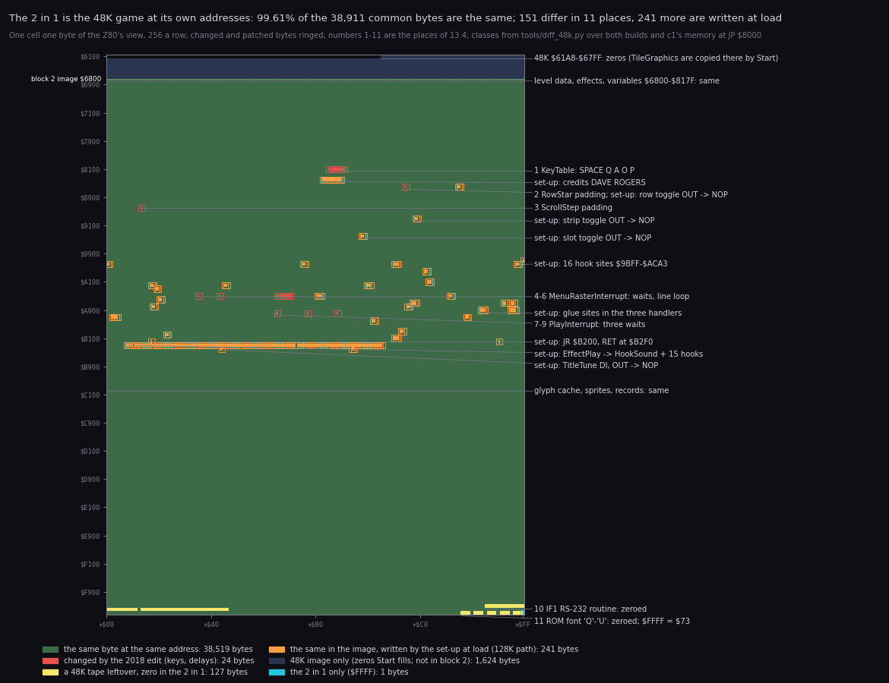

How to read it:

- **One cell** is one byte of the Z80's view, `$6100`-`$FFFF`, 256 bytes a row; the addresses on the left.
- **The colours** are the classes of `tools/diff_48k.py`: green the same byte; red changed by the 2018 edit; yellow
  a 48K tape leftover that the 2 in 1 holds as zero; orange the same on disk but written by the set-up at load
  (the 128K path); dark blue the 48K's zeros below `$6800` that block 2 does not carry; cyan `$FFFF`, the 2 in 1
  only. Changed and patched bytes are ringed so that single bytes show.
- **The labels** number the 11 places of 13.4 and name the set-up's groups.
- **The claim**: the image is the 48K's, address for address. The edit touches 151 bytes, the set-up 241.
- Drawn by `python3 tools/fig_diff_memmap.py --out docs/img/diff/memmap-diff.png`.

| | 48K | 2 in 1 |
| --- | --- | --- |
| pages | the 48K map | the 48K map (pages 5, 2, 0) with the 48 BASIC ROM; page 4 at `$C000` only inside FramePlay and HookSound |
| the game | `$61A8`-`$FFFE`, `Start` copies the tile set to `$5C00`-`$67FF` | `$6800`-`$FFFF`, the same `Start` |
| below the game | the system variables, overwritten | the glue `$5B00`-`$5BE2` in the printer buffer, below the stack `$5C00` |
| sound | EffectPlay `$B30C`, EffectTable `$7E5A`, TitleTune `$B446` and its data `$FF01`-`$FFD3` | the same bytes; EffectPlay's first byte `RET` and the stubs over its body; the engine and 8 232 bytes of music and effects in page 4 |
| IM 2 | I = `$FE`, `$FE00`-`$FF00` filled with `$FD`, `JP` at `$FDFD` | the same; with K-MOUSE the fill from `$FEE8` and the driver at `$FE00` |
| unused | | pages 1 (one byte, the paging test), 3, 6, 7 |

- **What.** Block 2 is the 48K's image from `$6800`. The 48K's `$61A8`-`$67FF` (1 624 zeros, filled by `Start`
  with the tile set) is not on the disk; `Start` fills the same place.
- **Why.** The page-4 engine needs no room in the 48K map. The glue fits under the stack, the stubs in EffectPlay's
  place (now dead), the mouse in the IM 2 table's low half (the vector read is `$FF` on these machines, so only
  `$FEFF`-`$FF00` of the table is ever read).
- **For the player.** Nothing visible: the 128K adds 16 K of sound and changes no game memory.

## 13.4 The game image: eleven places

`python3 tools/diff_48k.py --summary`:

| # | Where | Entry (both cases) | Module | Bytes | What |
| ---: | --- | --- | --- | ---: | --- |
| 1 | `$8188`-`$8191` | KeyTable | controldata | 9 | the default keys: `P L SS A S` → `SPACE Q A O P` |
| 2 | `$86B7` | RowStar (RowPadGlyph) | playfield | 1 | the row padding per missing glyph: 10 → 12 `DJNZ` |
| 3 | `$8C15` | ScrollStep (ScrollPad) | scroll | 1 | the scroll step padding: `$13` → `$14` `DJNZ` |
| 4 | `$A538` | MenuRasterInterrupt | menu | 1 | the wait for the beam: `$3D` → `$4D` rounds |
| 5 | `$A545` | MenuRasterInterrupt | menu | 1 | and a little more: `$10` → `$17` `DJNZ` |
| 6 | `$A568`-`$A570` | MenuRasterInterrupt | menu | 8 | the line loop: 12 T longer |
| 7 | `$AA68` | PlayInterrupt | interrupts | 1 | phase 1 wait: 2 → `$0B` rounds (scroll on; `$26` → `$2F` off) |
| 8 | `$AA7B` | PlayInterrupt (PlayInterruptPhase) | interrupts | 1 | phases 2-4 wait: 5 → `$10` rounds |
| 9 | `$AA8D` | PlayInterrupt | interrupts | 1 | the wait before the playfield: `$10` → `$77` `DJNZ` |
| 10 | `$FDE8`-`$FE4A` | ScriptStack / VectorTable | tables | 97 | an Interface 1 RS-232 download routine of the mastering machine: zeroed |
| 11 | `$FFD9`-`$FFFF` | WorkGlyph / ColumnFlags | topcells | 31 | the ROM font's `Q`-`U` left by the 48K load: zeroed (`$FFFF`: `$73`) |

Modules with a changed byte: 7 of 49 (controldata 9, interrupts 3, menu 10, playfield 1, scroll 1, tables 97,
topcells 31).

- **Places 1-9** are the 2018 edit: the keys (13.7) and the timing (13.5). They are on the disk.
- **Places 10 and 11** are not edits of the game. The 48K tape's block carries bytes that the game never reads before
  writing them: the tail of an RS-232 routine that sits in the script stack and the IM 2 table (both written by the
  game before use), and a copy of the ROM font that the 48K loader leaves above the tune data. The 2 in 1 holds
  zeros there. `$FFFF` holds `$73`; the 48K's block ends
  at `$FFFE`. ColumnFlags `$FFE0`-`$FFFF` is cleared by each level's start before any read, so none of it matters.

The code against the code, `python3 tools/diff_48k.py --runs` (left the 48K's listing, right this case's):

```text
6. $A568-$A570 MenuRasterInterrupt: the line loop: 12 T longer (LD B,(HL) x 2, NOP x 2, JR NZ)
48K (../zynaps build/game.lst)                               2 in 1 (build/lst/game.lst)
$A568 00          NOP                                      | $A568 46          LD B,(HL)
$A569 00          NOP                                      | $A569 46          LD B,(HL)
$A56A 00          NOP                                        $A56A 00          NOP
$A56B D9          EXX                                      | $A56B 00          NOP
$A56C 08          EX AF,AF'                                | $A56C D9          EXX
$A56D 0D          DEC C                                    | $A56D 08          EX AF,AF'
$A56E C2 4C A5    JP NZ,MenuRasterLine                     | $A56E 0D          DEC C
                                                           | $A56F 20 DB       JR NZ,MenuRasterLine

9. $AA8D-$AA8D PlayInterrupt: the wait before the playfield: $10 -> $77 DJNZ
48K (../zynaps build/game.lst)                               2 in 1 (build/lst/game.lst)
$AA8C 06 10       LD B,$10                                 | $AA8C 06 77       LD B,$77
```

The line loop shows the edit's care: the 48K's `NOP NOP NOP` and `JP NZ` (22 T) become `LD B,(HL)` twice, two
`NOP`s and `JR NZ` (34 T taken), in the same 9 bytes, so the loop is 12 T longer and nothing after it moves.

### 13.4.1 What the set-up writes at load

On the 128K path, `python3 tools/diff_48k.py --patches` (`c1`'s memory at `JP $8000` against the image as moved;
the options off):

| Site | Entry | 48K bytes | Now | Name (setup.ann, glue.ann) |
| --- | --- | --- | --- | --- |
| `$8484` | Messages | `STEVE TURNER` | `DAVE ROGERS ` | CreditName |
| `$86D7`, `$8FBD`, `$949C` | RowStart, ObjectStrips, RunObjects | `OUT ($FE),A` | `NOP NOP` | BeeperOut2-4: the explosion noise's three toggles |
| `$9BFF`-`$ACA3`, 16 sites | the event sites | `CALL RequestEffect` and others | `CALL` a hook | SiteShot and the others (9.2) |
| `$A581`, `$A9E5`, `$A9F7`, `$AB03` | the three interrupt handlers | their first or last instructions | `JP` / `CALL` the glue | IntTailSite, IntMenuSite, IntPlaySite, IntEndSite |
| `$A620`, `$A7F3`, `$AFB4` | RedefineKeys, SelectTwoPlayers, InterruptSetup | `CALL ClearScreen` | `CALL ClearThenMusic` | ClearSite1-3 |
| `$ABDC`, `$B1B0`, `$B024` | key 4, its end, RoundSetup | `CALL` | the glue | Key4Site, Key4End, LevelSite |
| `$B21B` | MainLoop | `JR $B203` | `JR $B200` | MenuLoopJump: the menu restarts the music |
| `$B2F0` | RequestEffect | `PUSH HL` | `RET` | BeeperSound |
| `$B30C`-`$B3A8` | EffectPlay | the beeper effects' player | `RET`, HookSound and 15 hooks | BeeperPlay |
| `$B446` | TitleTune | `DI` | `NOP` | BeeperTone |
| `$B496` | TitleTune | `OUT ($FE),A` | `NOP NOP` | BeeperOut1 |

241 bytes in 35 runs. With INF.LIVES one more byte (`$B171`, 13.8), with K-MOUSE four sites and the driver (13.7).
One site from both listings:

```text
48K line 6271                                   2 in 1, c1 at JP $8000
$9C77 CD F0 B2    CALL RequestEffect  ; 2       $9C77 CD 2F B3    CALL HookShot   ; sound $0E, page 4
```

- **What.** The 48K requests its six effects with `CALL RequestEffect` (`$B2F0`) and A = the effect, and the main
  loop plays them. The 2 in 1 points each event's call at a stub; three sites were beeper calls, the other 13 were
  ordinary instructions or calls that the stub does first.
- **Why.** The AY engine needs a call per event, and the 48K's six effects do not cover the CPC's sounds.
- **For the player.** The events of 13.6 are heard; the speaker is silent.

## 13.5 Timing: the Pentagon retiming

The 48K game times two things to the beam: the banner raster of the menus, which rewrites a row's attributes line by
line (MenuRasterInterrupt, [6.10](06-rendering.md#610-the-banner-raster-one-colour-per-scan-line)), and the play
pass, which draws the playfield behind the beam ([4.6](04-game-loop.md#46-the-pass-against-the-beam)). Both start
from the INT, and the Pentagon puts the screen later after the INT than a 48K:

| | 48K | Sinclair 128K, +2 | Pentagon 128 |
| --- | ---: | ---: | ---: |
| frame | 69 888 T, 50.08 Hz | 70 908 T, 50.02 Hz | 71 680 T, 48.83 Hz |
| T a line | 224 | 228 | 224 |
| line 0 after the INT | 14 336 T (64 lines) | 14 364 T (63 lines) | about 17 920 T (80 lines) |
| contended memory | yes | yes | no |

The 2018 counts, one round of each wait being one 224 T line (PlayInterruptWait, MenuRasterWait) or one 13 T `DJNZ`:

| Place | Count | Adds | Holds |
| --- | --- | ---: | --- |
| 4 `$A538` | 61 → 77 rounds | 3 584 T, 16 lines | the banner raster's start: the Pentagon's 16 extra lines |
| 5 `$A545` | 16 → 23 `DJNZ` | 91 T | the raster's start within the line |
| 6 `$A568` | the line loop 212 → 224 T | 12 T a line | one raster line = one Pentagon line, without the 48K's contention |
| 7 `$AA68` | 2 → 11 rounds (`$26` → `$2F` with the scroll off) | 2 016 T | phase 1: the panel and stars behind the beam |
| 8 `$AA7B` | 5 → 16 rounds | 2 464 T | phases 2-4 |
| 9 `$AA8D` | 16 → 119 `DJNZ` | 1 339 T | the playfield's start |
| 2 `$86B7` | 10 → 12 `DJNZ` | 26 T a missing glyph | a row's time without contention |
| 3 `$8C15` | `$13` → `$14` `DJNZ` | 13 T | the scroll step's time |

So a play pass waits 3 355 T more in phase 1 and 3 803 T more in phases 2-4 before DrawPlayfield.

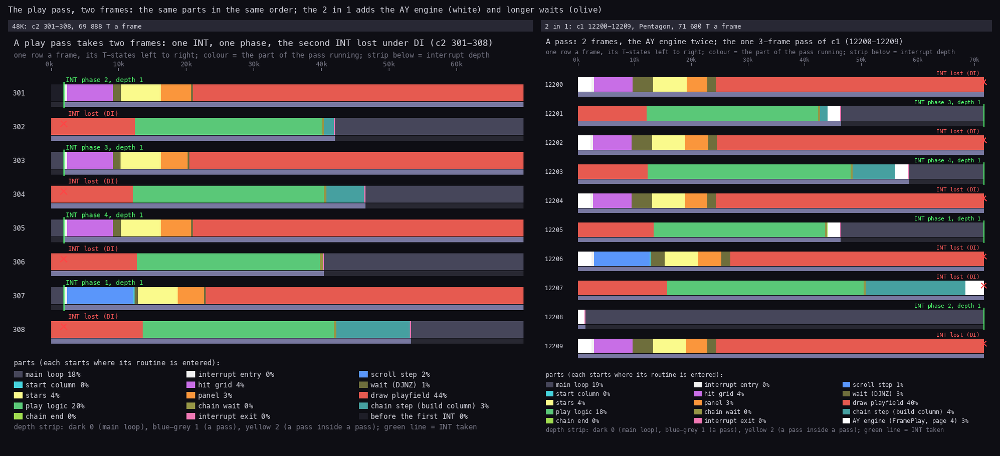

How to read it:

- **Left** the 48K's pass figure (`c2` 301-308), **right** this case's (`c1` 12200-12209), both from the cases'
  doc 4. One row is a frame, its T-states left to right, coloured by the part of the pass running.
- **The olive** is the waits: 1 % of the 48K's frames, 3 % of the 2 in 1's. **The white** in the 2 in 1 is the
  engine's two steps, at the pass's start and end.
- **The claim**: the pass is the same program; the 2 in 1 waits longer before drawing and steps the AY twice.
- Drawn by `python3 tools/fig_diff_pairs.py pass`.

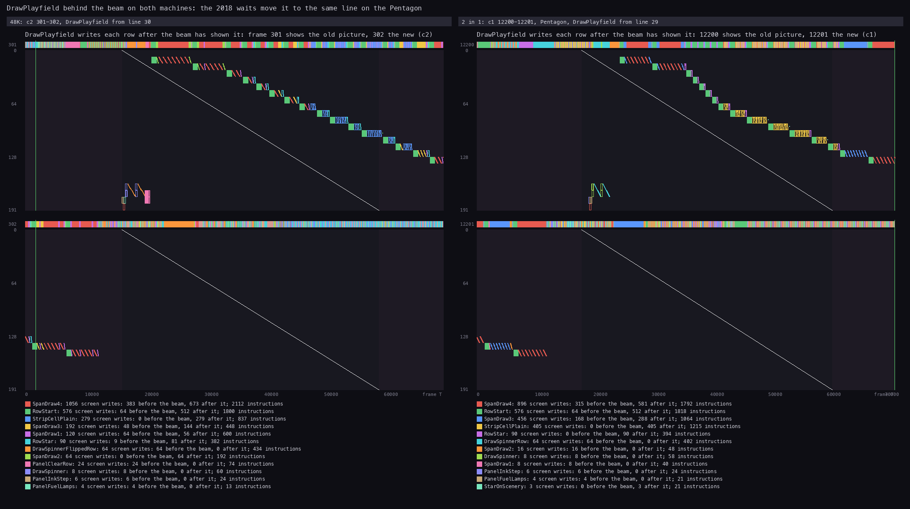

How to read it: the two cases' beam figures (the 48K's [6.5](../../zynaps/docs/06-rendering.md#65-drawplayfield-against-the-beam),
this case's [6.5](06-rendering.md#65-drawplayfield-against-the-beam)). Across the frame T, down the screen line;
the white diagonal is the beam, the coloured marks the screen writes. Both draw each row after the beam has shown
it, from line 30 on the 48K (frame T about 21 000, 19 200 T after the INT) and from line 29 on the Pentagon (24 400
T after the INT). `python3 tools/fig_diff_pairs.py beam`.

- **What.** Seven counts and the raster's line loop move the beam-timed work by the Pentagon's 16 lines and make up
  for its uncontended memory. The measured result is the same beam line on both machines.
- **Why.** On a Pentagon the 48K's counts start the raster 16 lines early (3 584 T) and DrawPlayfield about 16 lines
  higher, at line 14 or earlier (computed from the counts, not recorded), close behind the beam.
- **On other machines** (computed from the counts and the frame table above, not recorded):
  - **a Sinclair 128K or +2**: the raster starts about 16 lines late (3 675 T after where line 0 begins) and slips
    4 T a line more over its 96 lines (224 T loop, 228 T line); DrawPlayfield starts near line 43, later behind the
    beam but still before the next frame's beam reaches its rows. The banner's colour bands sit two rows low; the
    play screen does not tear;
  - **a 48K with a disk interface** (the 48K path): the same 16 lines late for the raster;
  - the 2 in 1 has no per-model counts: it was retimed for the Pentagon only.
- **The game's speed.** The game logic steps once a pass, and a pass is two frames on every machine (an INT is lost
  under `DI` in the pass): 25.04 passes a second on the 48K, 25.01 on a 128K, 24.41 on the Pentagon. On the Pentagon
  the game, the scroll and the waves run 2.5 % slower than on the 48K. The waits cost no speed: they fit inside the
  pass's two frames (PlayInterrupt grows from 1.6 % to 4.0 % of the time, 13.6's figure).
- **For the player.** On the Pentagon the banner's colours and the play screen look as on a 48K. On a Sinclair
  128K the banner's bands are lower.

## 13.6 Sound

| | 48K | 2 in 1 (128K path) |
| --- | --- | --- |
| hardware | the beeper (port `$FE` bit 4) | the AY (`$FFFD` / `$BFFD`); no `OUT ($FE)` with sound |
| music | TitleTune `$B446`: Steve Turner's two-voice tune on the credits page, interrupts off, 3500000 / (81 p) Hz, 179-800 Hz | the CPC Zynaps's music (J. Dave Rogers) at the menus: started by every screen clear and the menu loop, stopped by a level start; TitleTune still runs, silent |
| intro | none | `SK10` by STarKos, from IM 2 every frame (9.3) |
| effects | six (EffectTable `$7E5A`): enemy shot, laser, plasma bounce, pod appears, next weapon, weapon on | 16 of the 18 sounds `$0E`-`$1F`, from 16 sites and the level start (9.2): the 48K's events and the explosion, the ship lost, a pod taken, an extra life, the homing launch, the menus |
| who plays | EffectPlay in the main loop's spare time, a tone loop that calls EventDispatch from inside | the engine in page 4, one step from the interrupt twice a pass (once a TV frame on average); once an interrupt at the menus |
| explosion noise | three speaker toggles in the pass (per row, strip, slot), opened for 16 passes after an explosion or a guardian's hit | the three `OUT`s `NOP`ped; the AY's sound `$1D` instead |
| pitch | the beeper's own | the CPC's music 2.08 semitones lower than on the CPC on a 128K, 2.31 on a Pentagon; `SK10` 9.92 and 9.69 higher than written (9.6) |
| CPU | EffectPlay 22.5 % of `r1` | engine 4.02 %, glue 0.37 %, stubs 0.03 % of `r3` |

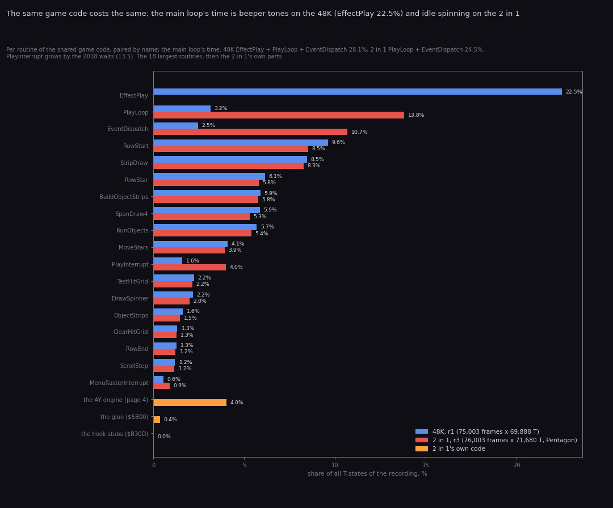

How to read it:

- **A pair of bars** is one routine of the shared game code: blue its share of all the T-states of the 48K's `r1`
  (75 003 frames), red of this case's `r3` (76 003 Pentagon frames). Both are bot runs through the twelve levels.
  Orange: the 2 in 1's own parts.
- **The claim**: the game's routines cost the same on both, to a tenth of a percent. EffectPlay's 22.5 % on the 48K
  is the beeper's tone loop in the main loop's time; on the 2 in 1 that time is PlayLoop and EventDispatch spinning
  (13.8 % + 10.7 %). The AY engine costs 4.0 %; PlayInterrupt grows from 1.6 % to 4.0 % by the 2018 waits.
- Drawn by `python3 tools/fig_diff_budget.py --out docs/img/diff/budget-diff.png`.

The beeper's last `OUT`, from both:

```text
48K line (TitleTune)                            2 in 1, c1 at JP $8000
$B446 F3          DI                            $B446 00          NOP
$B496 D3 FE       OUT ($FE),A                   $B496 00 00       NOP NOP
```

- **What.** All four of the game's speaker writes are gone on the 128K path: the title tune's and the three toggles
  of the explosion noise. RequestEffect and EffectPlay return at once. The AY engine, the CPC game's own driver with
  its data, plays the music at the menus and the effects in play; the music is off in play, as the 48K's tune is.
- **Why.** "AY music and sound effects from the Amstrad CPC" (the release's description): the CPC version had
  both. On the 48K the beeper's tone loop took 22.5 % of the time; the AY plays by itself.
- **Pitch and tempo.** The port doubled the CPC's periods by moving the period table up an octave, against a clock
  ratio of 1.77 (128K) or 1.75 (Pentagon) to the CPC's 1 MHz; the music is a whole tone and a bit low. The engine
  steps once a TV frame, so on a Pentagon the music is 2.5 % slower than on the CPC, as the game is than on the
  48K (9.6, 9.8).
- **The silent tune.** With its `OUT` `NOP`ped the tone loop's pass is 78 T, not 81, and with its `DI` gone the
  interrupts cut into it, so the credits page's timing differs from the 48K's; it is not measured here.
- **For the player.** Music at the menus and in the intro, AY sounds for 16 events, no explosion noise, no
  beeper. The 48K's six effects are among them but sound the CPC's way. On a 48K (the 48K path) the beeper
  effects and the explosion noise stay, and there is no music but Steve Turner's tune.

The 48K's renders are in the 48K's [09](../../zynaps/docs/09-sound.md) (its `docs/audio/`); this case's in
[09](09-sound.md).

## 13.7 Controls

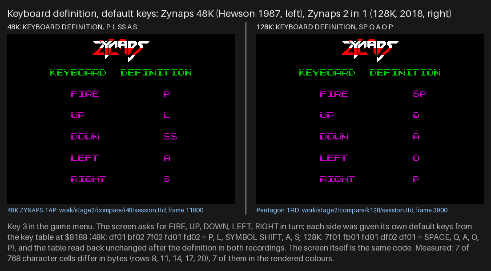

How to read it: both recordings typed the defaults on the KEYBOARD DEFINITION screen (`r48`, `k128`); the screens
differ only in the five key names. `python3 tools/fig_compare.py`.

| | 48K | 2 in 1 |
| --- | --- | --- |
| KeyTable `$8188` | FIRE `P`, UP `L`, DOWN `SS`, LEFT `A`, RIGHT `S` | FIRE `SPACE`, UP `Q`, DOWN `A`, LEFT `O`, RIGHT `P` |
| joysticks | Kempston (chosen by fire on the title), the number row | the same |
| mouse | | K-MOUSE: the driver at `$FE00`, four patches (5.4) |
| the code | ReadControls, TitleFireCheck | the same bytes |

The K-MOUSE patches, from both:

| Site | 48K | 2 in 1 with K-MOUSE |
| --- | --- | --- |
| `$A6D4` | `IN A,($1F): AND $1F` (the Kempston stick) | `CALL MouseRead: NOP` |
| `$A74E` | `IN A,($1F): AND $1F: CP $10` (the start test) | `LD A,$FA: IN A,($DF): AND 2` (the left button) |
| `$851E` | `$FE00` (the IM 2 table's fill) | `$FEE8` |
| `$B212` | `CALL LifeStart` | `CALL MouseReset` |

- **What.** New default keys, the 48K's QAOP layout with SPACE to fire. The mouse driver places the ship where the
  mouse is and returns "up" plus fire with either button.
- **Why.** QAOP is the common layout; the 48K's `P` for fire and `SS` for down are not.
- **For the player.** The keys can still be redefined (title key 3). With K-MOUSE the ship follows the mouse
  directly, one move step above the pointer, since the game's mover still sees "up" (5.4).

## 13.8 Lives: INF.LIVES and `$FFD7`

Both games hold the same developer switch: PlayerHit `$9B4C` reads `$FFD7` and kills nothing when it is not 0. It
is 0 in both images and nothing writes it. The 2 in 1 adds its own option instead:

```text
48K line 10673                                  2 in 1 with INF.LIVES (set-up: $B171 = $B6)
$B170 DD 35 04    DEC (IX+$04)  ; TakeLife      $B170 DD B6 04    OR (IX+$04)
```

| | `$FFD7` ≠ 0 (both games, poked) | INF.LIVES (the 2 in 1's option) |
| --- | --- | --- |
| the ship hit | nothing happens | destroyed: the explosion, the debris, the sounds |
| weapons | kept | lost: the side weapon, the double plasma, a laser level, a speed step (PlayerDied) |
| the level | goes on | restarts from the last checkpoint |
| lives | unchanged | unchanged (`OR` leaves them) |

- **Witnesses.** `d1` (`$FFD7` = 0, INF.LIVES on) loses three ships at 1713, 2522 and 3311 and keeps 2 lives
  ([10.9](10-gameplay-logic.md#109-death-and-inflives)). The 48K's death is from its `c2` and its code
  (the 48K's [10.11](../../zynaps/docs/10-gameplay-logic.md#1011-death)).
- **For the player.** INF.LIVES is a practice mode that still punishes a crash: the game never ends, but every
  loss costs the weapons.

## 13.9 Bugs: kept and added

Kept, in the same bytes (the 48K's [10.13](../../zynaps/docs/10-gameplay-logic.md#1013-bytes-and-code-that-stay-unexplained),
this case's [10.11](10-gameplay-logic.md#1011-bytes-and-code-that-stay-unexplained)):

- the second `CP $02` of SeekerHandler (`$9F2C`): probably meant another kind;
- FindFreeObjectSlot `$90B5`: a free-slot search that nothing calls;
- LifeSteps `$81C0` has 5 bytes and DrawLives reads 6 (a harmless over-read of EventRequests);
- the level record's byte `+0`, never read; the script commands no script uses;
- the `$FFD7` switch, still in place.

Added by the conversion:

- **The silent title tune still runs** (13.6): the credits page waits on a tone loop that makes no sound.
- **Dead code**: EffectPlay's body, RequestEffect after its `RET`, and the engine entries `$C983` (sound `$13`) and
  `$C995` (`$17`), which nothing calls ([9.2](09-sound.md#92-which-event-starts-which-effect)).
- **The engine's `LastChannel`** is 3 at `StartMusic` where the CPC rip has `$FF`, and a section of channel A plays
  other notes than the CPC's register dump after the `swap` at frame 6528; whether either is a porting slip is open
  ([9.9](09-sound.md#99-open)).
- **K-MOUSE**: the ship sits one move step above the pointer (the driver returns "up"), and both buttons fire (5.4).
- **Timing on other machines**: the counts are for the Pentagon only (13.5): the banner's bands are low on a Sinclair
  128K and on a 48K.
- **`$FFFF` = `$73`**: a byte past the 48K's block, cleared by each level's start before any read. Harmless.

Not bugs of the game: the unreal-ng Kempston mouse swaps the two buttons against a real interface (5.4, tool note),
and the 128K / +2 models had no TR-DOS in the build used (3.9).

## 13.10 What the player sees

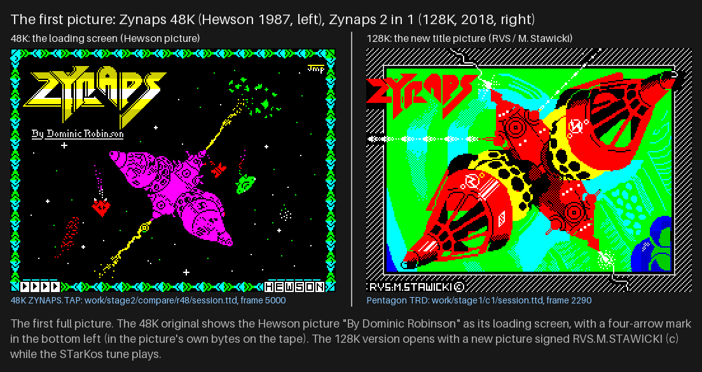

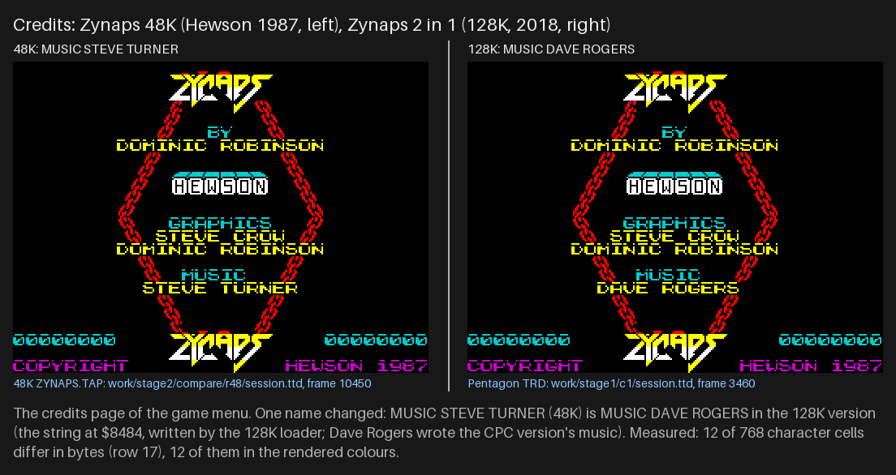

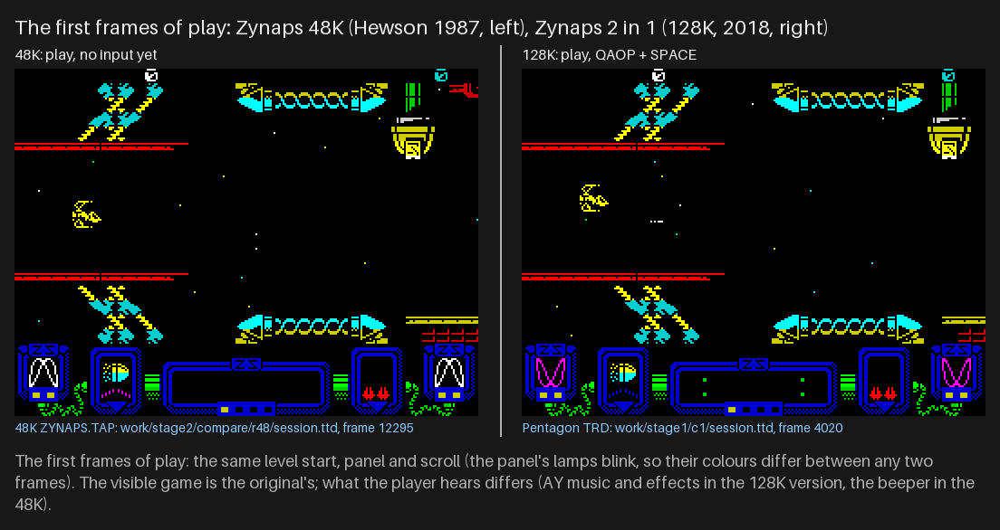

How to read the three figures: left the 48K (`r48`), right the 2 in 1 (`c1`), at the same moments; the captions name
the frames and the cells that differ. `python3 tools/fig_compare.py`.

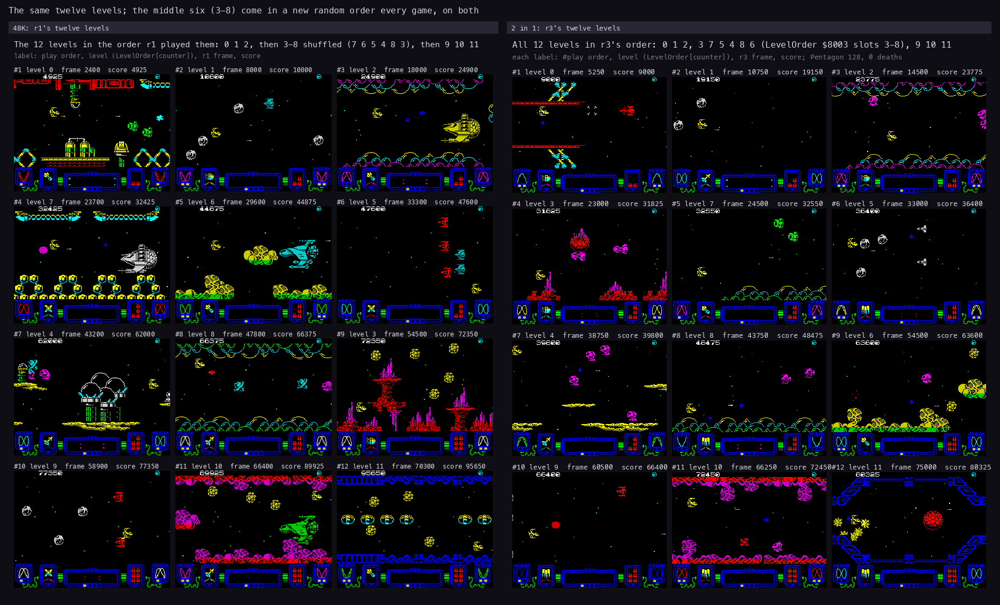

How to read it: the two cases' level sheets (doc 1 of each), one shot per level in the order each bot played them.
PlayersSetup shuffles levels 3-8 for every game from Random `$8544`, so the 48K's `r1` played
`0 1 2 7 6 5 4 8 3 9 10 11` and this case's `r3` played `0 1 2 3 7 5 4 8 6 9 10 11`. The scenes match level for
level. `python3 tools/fig_diff_pairs.py levels`.

- **The same.** The game menu, the high scores, PREPARE FOR COMBAT, the play screen, the panel, the levels, the
  weapons, the enemies: byte-identical code and data ([texts/differences.md](texts/differences.md): the
  high-score page and PREPARE FOR COMBAT are byte-identical screens).
- **Different.** The intro and the options, the title picture, the credits' musician, the default keys on the
  KEYBOARD DEFINITION screen, the sound, and on the Pentagon a 2.5 % slower game.

## 13.11 Method and tools

### 13.11.1 The game image: `diff_48k.py`

`tools/diff_48k.py` (adapted from `../nether-earth-gs/tools/diff_ne.py`) reads:

- the 48K: `../zynaps/build/game.bin` (`$61A8`-`$FFFE`), its listing and `src/game/game.ann`;
- this case: `build/obj/game.bin` (`$6800`-`$FFFF`, the game as the set-up moves it), `build/lst/game.lst`,
  `src/game/game.ann`; for `--patches` `work/images/game-entry-cpu.bin` and the names of `setup.ann` and
  `glue.ann`.

Every byte is one of: same, changed, zeroed (a 48K leftover held as 0), 48K-only, 2 in 1-only. `PLACES` names the 11
places; the script stops if a differing byte falls outside them or a place has none. Options: `--summary`,
`--runs` (both listings side by side), `--patches`, `--show NAME`, `--json`.

### 13.11.2 The figures

| Figure | Section | Command |
| --- | --- | --- |
| `load-time.png` | 13.1 | `python3 tools/fig_diff_load.py` |
| `memmap-diff.png` | 13.3 | `python3 tools/fig_diff_memmap.py` |
| `pass-pair.png`, `beam-pair.png`, `levels-pair.png` | 13.5, 13.10 | `python3 tools/fig_diff_pairs.py` (the two cases' own figures side by side) |
| `budget-diff.png` | 13.6 | `python3 tools/fig_diff_budget.py` (both L1 builds) |
| `../compare/*.png` | 13.1, 13.2, 13.7, 13.10 | `python3 tools/fig_compare.py` (frames of `tools/compare_shots.py`) |

All of them read the existing builds, recordings and figures. None starts an emulator. The machine numbers of 13.5
for the Sinclair 128K and the 48K path are computed from the counts, not recorded.
