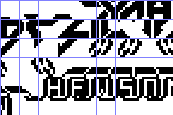

# Fonts

8 x 8 glyphs as indexed PNG, one cell a glyph, bit 7 at the left: palette index 0 a clear pixel, 1 a set one, 2 the
lines past the resource's end (not data). `tools/res_font.py` (Pillow) turns each `*.font.png` into the bytes the
source INCBINs and back; `tools/res_formats.py check` proves both ways, `python3 tools/res_font.py check FILE.bin`
does it for one file, `python3 tools/res_font.py preview FILE.bin OUT.png` draws the `*.preview.png` files (4x, a
grid line between glyphs).

| File | Address | Size | Format | Readers | Preview |
| --- | --- | --- | --- | --- | --- |
| `glyphs.font.png` | `$B54F-$B6FE` | 432 | 54 glyphs, 9 a row: the print codes `$80-$B5`, left to right | PrintChar `$A321` (HL = code x 8 + `$B14F`) |  |

`glyphs.font.png`: rows 1-4 (codes `$80-$A3`) are the pieces of the ZYNAPS logo, rows 5-6 (codes `$A4-$B5`) the rest of
the logo and the HEWSON name in its lettering (row 5). The codes below `$80` print with the ROM's character set.

The 48K tape's other "font", the ROM character set's leftover at `$FFD8-$FFFE`, is not here: in the 2 in 1 those
bytes are zero from `$FFD9`, and WorkGlyph (`$FFD8`) and ColumnFlags (`$FFE0-$FFFF`) are plain data in
`src/game/topcells.asm`. The formats and the plugin are the 48K case's (`../zynaps`), the bytes the same.
