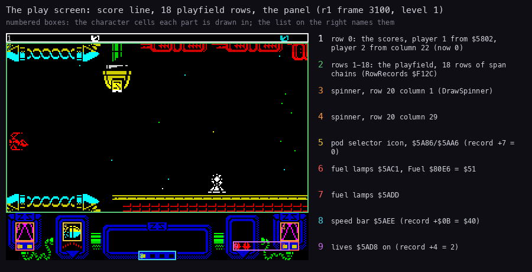
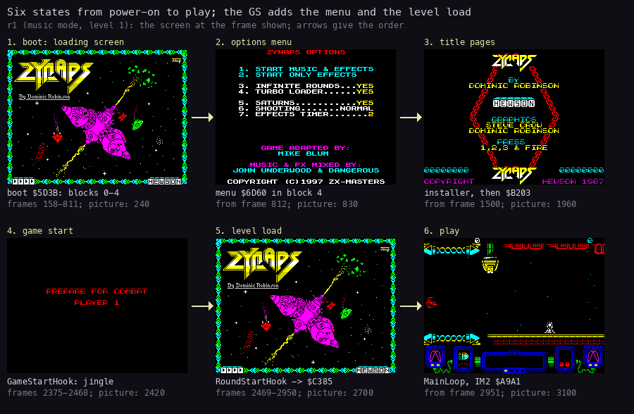
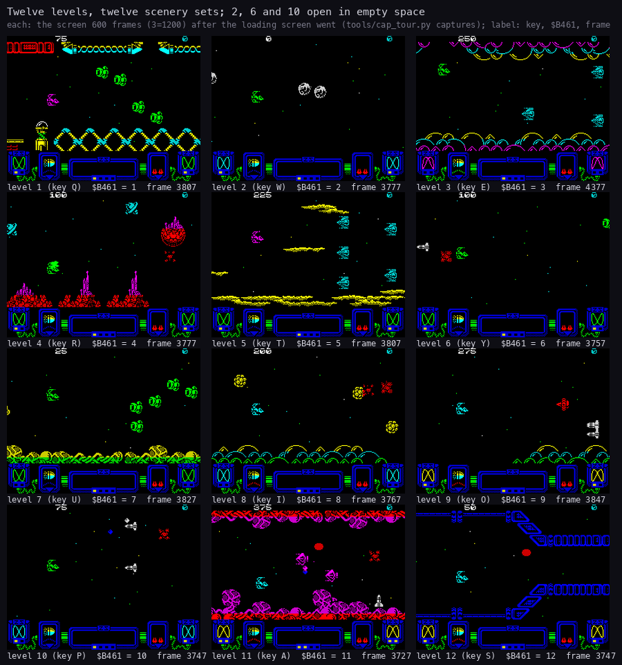

# 1. Game design

What this covers: Zynaps GS as a player meets it.

- the game and the machine it needs (1.1);
- the play screen (1.2);
- the way in: the boot, the options menu, the title pages (1.3);
- the controls in short (1.4);
- the ship, its weapons, the pods and the fuel (1.5);
- scoring, lives and the high scores (1.6);
- the twelve levels (1.7);
- the sound: music mode and effects-only mode (1.8);
- the end of a round and of the game (1.9);
- what no recording reached (1.10).

Zynaps is a horizontally scrolling shoot-'em-up by Dominic Robinson (graphics Steve Crow and Dominic Robinson),
published by Hewson in 1987. Zynaps GS is ZX-Masters' 1997 disk version of it for a 128K machine with TR-DOS and a
General Sound card. The options menu credits "GAME ADAPTED BY MIKE BLUM" and "MUSIC & FX MIXED BY JOHN UNDERWOOD &
DANGEROUS" (1.3). The names are those of `src/game/game.ann` (the game), `src/disk/*.ann` (the disk parts) and
`src/disk/install.asm` (the installer and its stubs).

The recordings it rests on:

- `r1`: `work/stage2/r1/session.ttd`, 4724 frames from power-on: the boot, the menu (key 1, music and effects), the
  title, the game start, level 1's load and 1773 frames of level 1. Opened read-only on an own instance as
  `work/zgsA/r1` (port base 16620, `work/zgsA/probe.py`).
- `tour`: `work/zgsA/tour/L01`..`L12`, one fresh boot per level: key 0, key 8 (INFINITE LIFE), the level's key
  (SELECT LEVEL), key 1, fire on the title, then 1500 frames of play with a fixed stick pattern and fire held. A
  capture every 2 frames (`tools/cap_tour.py level`).
- `menu`: `work/zgsA/menu`, a fresh boot with the option keys pressed one by one, a capture every 2 frames
  (`tools/cap_tour.py menu`).
- `fx2`: `work/zgsA/fx2/session.ttd`, 62931 frames: effects only, level 1, no INFINITE LIFE, a TTD recording from the
  boot (`tools/cap_tour.py level --mode fx --mortal --no-select --ttd`).

## 1.1 The game and the machine

- **The game** is Hewson's Zynaps, its code run at its own addresses (`$5C00-$FFFF`,
  [2.2](02-architecture.md#22-the-memory-map)).
- **The sound** is a General Sound card's:
  - a ProTracker module for each of the 12 levels and one for the title pages;
  - sampled effects for the shots, the explosions, the weapons, and for events that are otherwise silent;
  - no beeper sound at all: the installer removes or redirects every beeper call
    ([3.5](03-build-and-load.md#35-the-patch-installer)).
- **The options menu** comes before the game, with two hidden options (1.3, [5](05-controls.md)).
- **The machine**: a 128K Spectrum (it was run on a Pentagon 128) with TR-DOS and a General Sound card. The game is
  one TRD. The level music is read from the disk at each level change
  ([3.6](03-build-and-load.md#36-what-goes-to-the-card-and-when)).
- **The card**: 512 KB or 128 KB. Both work. On 128 KB the effects are sent again at every level change
  ([9](09-sound.md)).

## 1.2 The play screen



How to read the figure:

- **The picture** is `r1` frame 3100, level 1 in music mode, at 2x.
- **A numbered box** is the character cells one part of the screen is drawn in. The list on the right names it, with
  the address the code draws it at and the value it shows at that frame:
  1. row 0: the scores; player 1 from `$5802`, player 2 from column 22 (PrintPlayerScore `$A4AE`);
  2. rows 1-18: the playfield, 18 rows of span chains (RowRecords `$F12C`, [6.3](06-rendering.md#63-the-playfield));
  3. and 4. the two spinners, row 20, columns 1 and 29 (DrawSpinner `$A8BE`);
  5. the pod selector icon, rows 20-21, columns 6-7 (`$5A86` / `$5AA6`, PodIconJob `$AC2C`);
  6. and 7. the fuel lamps, `$5AC1` and `$5ADD`, lit by Fuel `$80E6`;
  8. the speed bar `$5AEE`, from the speed (player record `+$0B`);
  9. the lives `$5AD8`, from the record's `+4`.
- **The point**: the play screen is a scrolling playfield in a fixed panel. The only text in play is the score line.
  Nothing on the screen shows the sound card: the GS parts draw nothing in play.

```bash
python3 tools/fig_screen.py --work work/zgsA/r1 --frame 3100 --out docs/img/design/play-screen.png
```

## 1.3 The way in: boot, options menu, title pages



How to read the figure:

- **Six pictures**, left to right and top to bottom, are `r1`'s screen in each state, at the frame under it.
- **Under each**: the code that runs the state ([4.1](04-game-loop.md#41-the-states)) and the frames it lasted.
- **The point**: a player sees the loading screen, an options menu, the Hewson title pages, the PREPARE FOR COMBAT
  banner, the loading screen again while the level's music loads, and then play.

```bash
python3 tools/fig_states.py --work work/zgsA/r1 --out docs/img/loop/states.png
```

The steps, with `r1`'s frames:

1. **The boot** (frames 150-811). TR-DOS runs the BASIC line `ZYNAP_GS`. Its code reads the boot sectors, which
   read and unpack the loading screen, the sound banks and the game ([3.3](03-build-and-load.md#33-the-boot)). The
   loading screen fades in at frames 204-240 and stays while the disk is read.
2. **The options menu** (from frame 812, `$6D60`). ZYNAPS OPTIONS: keys 1 and 2 start, keys 3-7 change an option,
   key 0 shows two hidden lines ([5.1](05-controls.md#51-the-options-menu)).
3. **The installer and the title** (from frame 1500). Key 1 runs the installer, which patches the game and starts
   it (`$B200`, frame 1505). The title module loads (frames 1522-1921) while the loading screen is shown. Then the
   title pages cycle: the credits page with "PRESS 1,2,3 & FIRE", the high scores, the loading screen.
4. **The game start** (frame 2375). Fire on the title: the start jingle and the PREPARE FOR COMBAT banner.
5. **The level load** (frames 2469-2950). The loading screen comes back while the level's module and effects go to
   the card ([4.3](04-game-loop.md#43-the-level-load)).
6. **Play** (from frame 2951).

## 1.4 The controls in short

[5](05-controls.md) has them all. In short:

- **On the menu**: 1 music and effects, 2 effects only; 3-7 the options; 0 then 8 INFINITE LIFE; 0 then Q-T, Y-P,
  A, S the starting level.
- **On the title**: 1 / 2 one or two players, 3 the key definition, fire starts. Kempston fire also picks the
  Kempston.
- **In play**: five keys (P fire, L up, Symbol Shift down, A left, S right by default) or a Kempston, cursor or
  Sinclair joystick. 4 pauses; in the pause fire resumes and Q quits.

## 1.5 The ship, the weapons, the pods and the fuel

- **The ship** flies anywhere on the playfield. It starts with the laser at level 1 and speed `$40` (PlayerSetup).
- **Fire** shoots the laser. A side weapon, once taken, fires with it ([10](10-gameplay-logic.md)).
- **A pod** is left by a wave of enemies destroyed whole. The panel's five icons are the weapons it can give:
  speed-up, laser, plasma, homing missiles, seeker. The lit icon is the selector (player record `+7`).
  - Touching a pod moves the selector to the next icon and gives 100 points.
  - Touching a pod with fire held takes the lit weapon and resets the selector.
- **Fuel** (`$80E6`) counts down one step every 16 frames in play. At 0, FuelOut `$9C03` takes a laser level and a
  speed step away and sets it back to `$5A`.
  - A pod refills it: `$BB` with a speed-up, `$B4` when the selector wraps.
  - A pod that scrolls away untouched halves it (`$A25C`).
- **The point**: the ship's power runs down, so the player has to keep collecting pods.
- **The sounds of these events** (the shot, a pod appearing, the next weapon lit, a weapon taken, the plasma and the
  missiles launched) are card effects ([9](09-sound.md)).

## 1.6 Scoring, lives and the high scores

- **Points**: each enemy kind has a score index into PointsTable `$8231`: 0, 25, 50, 75, 100, 150, 200, 250, 500,
  1000, 2000, 5000. AddScore `$A489` adds the entry. A pod gives 100, or 1000 when the selector wraps.
- **The score** is 8 BCD digits in the player record (Player1 `$7F9C`, `+0` to `+3`).
- **Lives**: 2 in reserve at the start (record `+4`), shown as red marks on the panel (box 9 in 1.2). One more at
  each of ExtraLifeScores `$800F`: 10 000, 30 000, 50 000, 70 000 and 90 000 (`$AC8A`).
- **High scores**: HiScoreTable `$8261` holds five entries. At the game over a score above the fifth takes its place,
  with three initials ([5.4](05-controls.md#54-the-high-score-initials)).
- **Two players** take turns, each with a record (Player2 `$7FCC`); CurrentPlayer `$7F98` is 1 or 2.

## 1.7 The twelve levels

LevelOrder `$8003` sets the order of the twelve level records (LevelTable `$6B2D`, 8 bytes each):

- levels 0, 1, 2 come first and 9, 10, 11 last;
- levels 3-8 are shuffled for each game by PlayersSetup `$AFB7`;
- after level 11 the game wraps to the first (LevelDone `$B174`).

The hidden SELECT LEVEL option replaces this order: the game starts on the chosen level and plays it again after
every level done ([5.2](05-controls.md#52-select-level-and-infinite-life)).



How to read the figure:

- **One picture per level**, levels 1-12 left to right and top to bottom. Each comes from its own `tour` run, started
  with SELECT LEVEL's key for that level.
- **The picture** is the capture 600 frames after the loading screen went away (level 3: 1200 frames, where its
  scenery begins).
- **The label**: the level, its menu key, `$B461` (the level whose sound the driver loaded, read from the same
  capture) and the capture's frame.
- **The point**: twelve scenes from one engine, each with its own module. Levels 2, 6 and 10 begin in open space: no
  scenery in their first 1500 frames.

```bash
python3 tools/fig_levelshots.py --offset 600 --offsets 3=1200 \
    --title 'Twelve levels, twelve scenery sets; 2, 6 and 10 open in empty space'
```

- `$B461` reads the level's number in all twelve captures: every level's module was loaded to the card.
- A level record (LevelTable `$6B2D`) holds: +1/+2 the level script, +3 PlayFlags, +4/+5 ScrollCount's start (`$40`,
  `$30`, `$38` or `$10`), +6 the scenery script number (`$81DD`), +7 ScriptLevelBias (`$81DE`, added to the enemies'
  fire chance).
- The level ends when its script says so (EndPending `$7F7C` = 2), not when a boss dies (1.9).

## 1.8 The sound: two modes

The menu's first two keys pick the mode ([9](09-sound.md) has the driver and the card):

| | Key 1: music and effects | Key 2: effects only |
| --- | --- | --- |
| Title pages | the title module | the title module |
| Game start | the jingle | the jingle |
| Play | the level's module and 10 effects | no module; 21 effects |
| Level change | the module and the 10 effects read and sent | the effects only |
| `$B486` | 0 | 1 |

- In music mode the effects are the in-game ten: shots, explosions, the ship's death, the weapons.
- Effects-only mode adds 11 more for events that are otherwise silent: bounces, dives, a big enemy hit and
  destroyed.
- The SATURNS option adds FX 21 and its sound in effects-only mode (SaturnSound, `$B464`).

## 1.9 The end of a round and of the game

- **A round ends** when the ship is destroyed (EndCode 1) or the level's script ends it (EndCode 2, a level done):
  EndPending `$7F7C`, EndCode `$7F7D`.
- **Between rounds** the game waits in RoundWait (bank 1 `$C34C`). On a level done in music mode it fades the module
  out ([4.4](04-game-loop.md#44-the-end-of-a-round)).
- **The game is over** when EndOfPlay returns carry: no lives left. With INFINITE ROUNDS (on at the boot) the `JR` at
  `$B218` jumps over that test, so the game never ends. In `fx2` the lives went 2, 1, 0, 255, 254 and play went on
  (the record's `+4` in its captures).
- **INFINITE LIFE** (hidden) makes the ship never die: `RET` at `$9B50`
  ([5.2](05-controls.md#52-select-level-and-infinite-life)).

## 1.10 What no recording reached

- **A level done**: no recording here played a level to its end. `fx2` stayed on level 1 for 60 000 frames (the
  ship lost again and again) and the `tour` runs stopped after 1500 frames. RoundWait's fade and the next level's
  load are known from the code (`$C34C`, `$C385`).
- **The guardians**: none was on the screen in these recordings.
- **Two players**, **the high-score entry** and **the key definition**: not recorded. The code is at `$7FCC`, `$8261`
  and `$A76F`.
- **17 of the installer's 31 patch places** never ran in `r1` and `fx2`
  ([3.5](03-build-and-load.md#35-the-patch-installer)). Their sounds (the plasma, the missiles, the bounces, the big
  enemies, the dive) are known from the code only.
