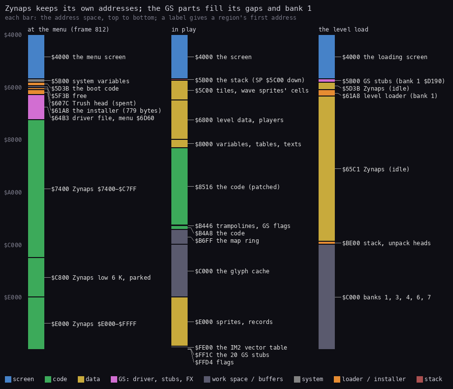
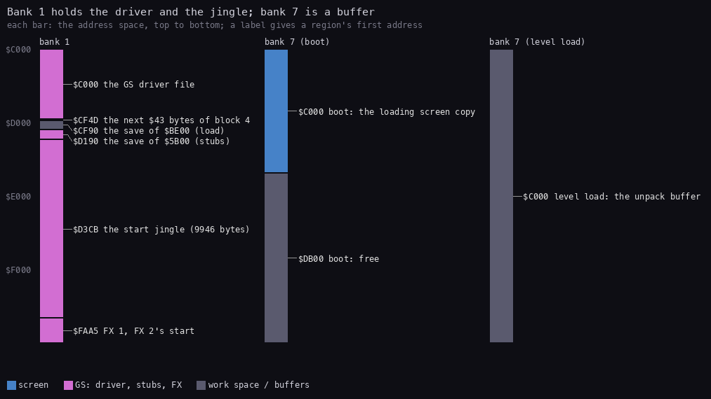
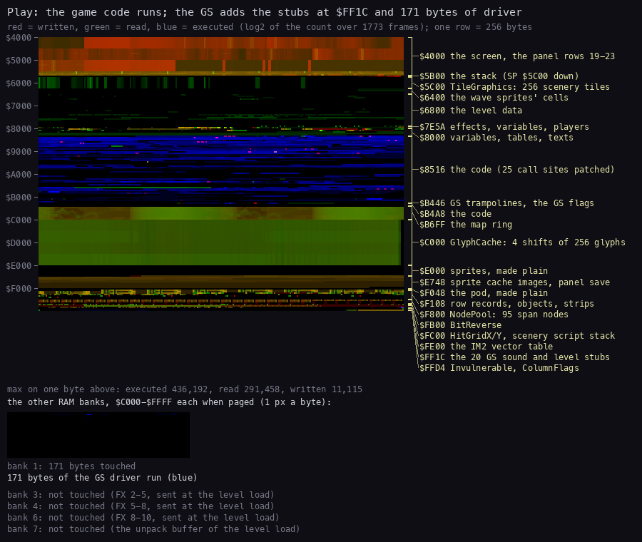
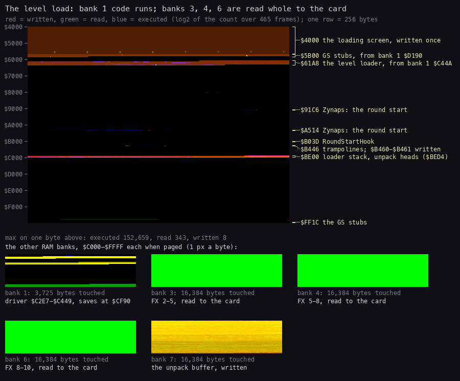
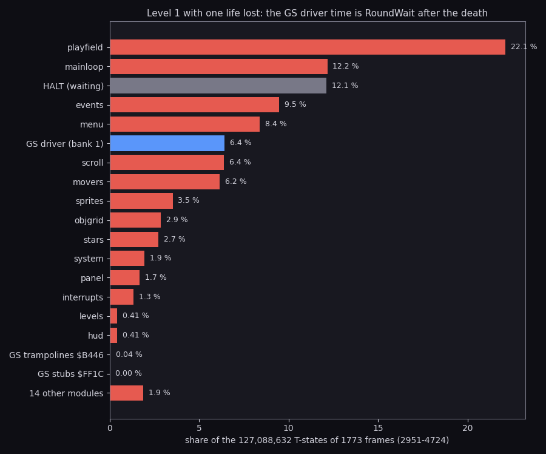
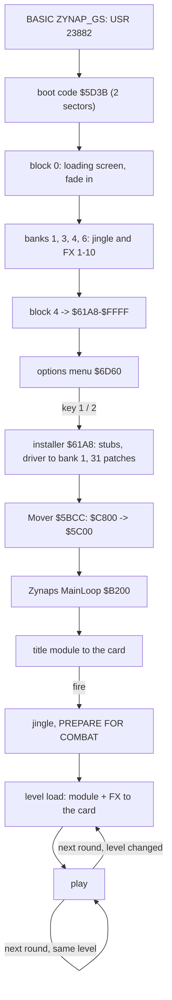

# 2. Architecture

What this covers: the machine, where everything lies in memory at each stage, which memory the code really uses,
where the CPU's time goes, and the card's memory.

- the machine and its paging (2.1);
- the memory map at the menu, in play and during a level load (2.2);
- the other RAM banks (2.3);
- what the code touches: heatmaps of play and of a level load (2.4);
- the CPU budget in play (2.5);
- the card's memory (2.6);
- the stages from the disk to play, and the source modules (2.7);
- what is known from the code only (2.8).

The recordings: `r1` (power-on to 1773 frames of level 1, music mode, [1](01-game-design.md)) and its L1 builds,
made on the instance `work/zgsA/r1`:

- `work/zgsA/r1-play`: frames 2951-4724, play (1076 interrupts, 12.7 M instructions);
- `work/zgsA/r1-level`: frames 2469-2934, the level load (465 frames, 1 interrupt);
- `work/zgsA/r1-boot`: frames 150-812, the boot.

```bash
python3 ../../kit/re_session.py build --work work/zgsA/r1 --from-frame 2951 --to-frame 4724 --into work/zgsA/r1-play
```

## 2.1 The machine

- **The machine**: a 128K Spectrum with TR-DOS and a General Sound card. It was run as a Pentagon 128 (71 680
  T-states a frame).
- **Paging** goes through `$7FFD` only. The game writes `$10`..`$17`: RAM bank 0..7 at `$C000`, ROM 1 (48 BASIC),
  the normal screen (bank 5). `r1` has 72 writes to `$7FFD` (`work/zgsA/r1-p7ffd.json`).
- **The 64 K view in play**: bank 5 at `$4000`, bank 2 at `$8000`, bank 0 at `$C000`. The game is a 48K program and
  never pages on its own.
- **The GS parts page bank 1** for each sound: a stub at `$FF1C-$FFD1` or a trampoline at `$B446-$B4A7` writes
  `$11`, calls the driver at bank 1 `$C000+` and writes `$10` back ([9](09-sound.md)).
- **The card** sits on ports `$BB` (command and status) and `$B3` (data). The CPU never runs code on it: it sends the
  ROM firmware's commands and the samples' and modules' bytes ([3.6](03-build-and-load.md#36-what-goes-to-the-card-and-when)).

## 2.2 The memory map



How to read the figure:

- **Each bar** is `$4000-$FFFF`, top to bottom, at one stage: the options menu (`r1` frame 812), play, and a level
  load.
- **A colour** is the kind of bytes (legend at the bottom). Magenta marks the GS parts: the driver file, the stubs,
  the trampolines.
- **A label** is the region's first address and what it holds.
- **The point**: Zynaps keeps its own addresses. At the menu, block 4 holds it with its first 6 K parked at `$C800`,
  because the installer, the driver file and the menu lie where those 6 K belong. In play the GS parts are only
  `$B446-$B4A7` and `$FF1C-$FFD1`. During a level load the loader and stubs are swapped into Zynaps's memory and
  swapped out again.

```bash
python3 tools/fig_memmap.py --stages 'menu=at the menu (frame 812),play=in play,load=the level load' \
    --title "Zynaps keeps its own addresses; the GS parts fill its gaps and bank 1" --png docs/img/arch/memory-map.png
```

`tools/memmap.txt` holds the rows. Their witnesses: `src/disk/install.asm` (the copies, the stubs, Mover),
`src/disk/block4.asm` (block 4's layout), `src/disk/loader.ann` and `driver.ann` (the swaps), the heatmaps of 2.4.

**At the menu** (block 4 unpacked, nothing installed yet):

| Range | What |
| --- | --- |
| `$4000-$5AFF` | the menu screen |
| `$5B00-$5D3A` | the system variables; TR-DOS's PROG at `$5D3B` |
| `$5D3B-$5F3A` | the boot code: blob sectors 1-2, read over the BASIC line ([3.1](03-build-and-load.md#31-the-medium)) |
| `$607C-$61A7` | block 4's Trush head, spent |
| `$61A8-$64B2` | the installer, 779 bytes (`build/disk/install.bin`) |
| `$64B3-$73FF` | the GS driver file: the driver, the level loader, the menu at `$6D60` |
| `$7400-$C7FF` | Zynaps `$7400-$C7FF`, at its own addresses |
| `$C800-$DFFF` | Zynaps `$5C00-$73FF`, parked |
| `$E000-$FFFF` | Zynaps `$E000-$FFFF` |

**In play** (after Mover `$5BCC` moved `$C800` to `$5C00` and cleared `$C800-$DFFF`):

| Range | Bank | What |
| --- | --- | --- |
| `$4000-$5AFF` | 5 | the screen |
| `$5B00-$5BFF` | 5 | the stack (SP from `$5C00` down) |
| `$5C00-$67FF` | 5, 2 | the scenery tiles (TileGraphics) and the wave sprites' cells |
| `$6800-$7FFF` | 2 | the level data, the effects, the variables, the player records (Player1 `$7F9C`) |
| `$8000-$8515` | 2 | variables, tables, texts; LevelOrder `$8003` |
| `$8516-$B6FE` | 2 | the code, with 31 places patched by the installer (3.5) |
| `$B446-$B4A7` | 2 | the GS trampolines (`$B466`, `$B482`) and the GS flags `$B45F-$B486` |
| `$B6FF-$BFFF` | 2 | the map ring |
| `$C000-$DFFF` | 0 | the glyph cache (4 shifts of 256 glyphs) |
| `$E000-$FDFF` | 0 | the sprites, the row and object records, the span node pool, the hit grid |
| `$FE00-$FF00` | 0 | the IM 2 vector table (handler `$FDFD` → `$A9ED`) |
| `$FF1C-$FFD1` | 0 | the 20 GS sound and level stubs (`$B6` bytes) |
| `$FFD4-$FFFF` | 0 | Invulnerable `$FFD7`, ColumnFlags |

The GS flags (`src/disk/install.asm`, `driver.ann`):

| Flag | Meaning |
| --- | --- |
| `$B45F` | the FX volume |
| `$B460` | the module volume of this level |
| `$B461` | the level whose sound is loaded; set when the level change begins |
| `$B462` | the next level (NextLevelHook `$B075`) |
| `$B463` | the load kind: 0 a level, 1 the game start, 2 the title |
| `$B464` | SaturnSound on (`$C095`) |
| `$B465` | the shot's two option bits (`$C1DF`) |
| `$B486` | 0 music mode, 1 effects only |

`$B461` is written at the start of the level change: in every `tour` run it held the new level while the loading
screen was still up (`tools/cap_tour.py` waits for the loading screen to go for that reason).

**During a level load** (LevelChange, bank 1 `$C385`; `r1` frames 2469-2950):

| Range | What |
| --- | --- |
| `$4000-$5AFF` | the loading screen, copied from bank 7 |
| `$5B00-$5D3A` | the GS stub code, swapped in from bank 1 `$D190` |
| `$61A8-$65C0` | the level loader, swapped in from bank 1 `$C44A` (`$419` bytes) |
| `$BE00-$BFFF` | the loader's stack (`$BED3`) and the Trush heads (`$BED4`); saved to bank 1 `$CF90` first |
| `$C000-$FFFF` | banks 1, 3, 4, 6 and 7 in turn |

## 2.3 The other banks



How to read the figure:

- **Each bar** is `$C000-$FFFF` of one bank, top to bottom.
- **Bank 1** holds the GS driver file (copied by the installer from `$64B3`), the two saves the level load uses, the
  start jingle and the first effects.
- **Bank 7** holds the loading screen after the boot; a level load uses the whole bank as the unpack buffer.
- **The point**: the GS version needs the 128K's banks for the driver and the effects; the game itself never sees
  them.

```bash
python3 tools/fig_memmap.py --stages 'bank1=bank 1,bank7=bank 7 (boot),bank7l=bank 7 (level load)' --lo C000 \
    --height 420 --title 'Bank 1 holds the driver and the jingle; bank 7 is a buffer' --png docs/img/arch/banks.png
```

| Bank | Range | What |
| --- | --- | --- |
| 1 | `$C000-$CF4C` | the GS driver file: the entries `$C010..$C21D`, the core `$C22A-$C2F1`, the card control `$C2F3-$C384`, the level change `$C385`, the loader's copy `$C44A`, the menu texts at `$CC00..` |
| 1 | `$CF90-$D18F` | the save of `$BE00-$BFFF` during a level load |
| 1 | `$D190-$D3CA` | the copy of `$5B00-$5D3A` (the stubs) |
| 1 | `$D3CB-$FAA4` | the start jingle, 9946 bytes (Trush block 1) |
| 1 | `$FAA5-$FFFF` | FX 1 and the start of FX 2 |
| 3 | `$C000-$FFFF` | the rest of FX 2, FX 3-4, the start of FX 5 (read raw) |
| 4 | `$C000-$FFFF` | the rest of FX 5, FX 6-7, the start of FX 8 (Trush block 2) |
| 6 | `$C000-$FFFF` | the rest of FX 8, FX 9-10 (Trush block 3) |
| 7 | `$C000-$DAFF` | the loading screen's copy, kept from the boot |
| 7 | `$C000-$FFFF` | in a level load: the buffer the level records are read and unpacked into |

FX 10's last 7 bytes are read past bank 6's end, from bank 7 `$C000`, which holds zeros at that time
([9](09-sound.md)).

## 2.4 What the code touches

### Play



How to read the figure:

- **The big grid** is the 64 K view of play, `$4000-$FFFF`, one row of 256 bytes a line, 2 px a byte. Bank 5, 2 and
  0 are drawn at `$4000`, `$8000`, `$C000`.
- **The colour** of a byte is log2 of its count over the window: red written, green read, blue executed. Mixed
  colours are bytes with more than one use.
- **The labels** on the right are the regions of `tools/heatmap-regions.txt` (the play bar of 2.2 in detail).
- **Below**: the other RAM banks as they were touched in the window.
- **What it shows**:
  - execution (blue) is `$8516-$B6FE`, the game's code, plus the stubs at `$FF1C` (54 bytes run in bank 0);
  - the screen (red) and the glyph cache `$C000-$DFFF` (green: read) are the busiest data;
  - bank 1: 171 bytes of the driver ran (`$C1D0-$C38E` and `$C86C-$C873`); nothing was read or written there;
  - banks 3, 4, 6 and 7 were not touched in play: the effects are on the card already.

```bash
python3 tools/fig_heatmap.py work/zgsA/r1-play/l1.json docs/img/arch/heatmap-play.png \
    --regions tools/heatmap-regions.txt \
    --title 'Play: the game code runs; the GS adds the stubs at $FF1C and 171 bytes of driver' \
    --bank-notes '1=171 bytes of the GS driver run (blue);3=FX 2-5, sent at the level load;4=FX 5-8, sent at the level load;6=FX 8-10, sent at the level load;7=the unpack buffer of the level load'
```

### The level load



How to read the figure:

- **The same layout** as above, over the 465 frames of `r1-level` (frames 2469-2934).
- **The labels** are `tools/heatmap-regions-level.txt`: what the load puts where.
- **What it shows**:
  - the loading screen is written once over `$4000-$5AFF`;
  - code runs at `$5B00` (the stubs swapped in) and `$61BF-$65C0` (the level loader swapped in), at `$BED4-$BFA1`
    (the Trush heads) and in bank 1 `$C2E7-$C449` (the card control and the level change);
  - bank 1 `$C44A-$C862` and `$CF90-$D3CA` are written: the swaps;
  - banks 3, 4 and 6 are read whole (green): the 10 in-game FX go from them to the card;
  - bank 7 is written whole: the level's module is read from the disk and unpacked there, record by record.

```bash
python3 tools/fig_heatmap.py work/zgsA/r1-level/l1.json docs/img/arch/heatmap-level.png \
    --regions tools/heatmap-regions-level.txt \
    --title 'The level load: bank 1 code runs; banks 3, 4, 6 are read whole to the card' \
    --bank-notes '1=driver $C2E7-$C449, saves at $CF90;3=FX 2-5, read to the card;4=FX 5-8, read to the card;6=FX 8-10, read to the card;7=the unpack buffer, written'
```

## 2.5 The CPU budget in play



How to read the figure:

- **A bar** is a module's share of the window's T-states: the instructions after an entry written under that
  `@module` of `src/game/game.ann`, up to the next entry.
- **Blue** bars are the GS parts: the driver in bank 1, the stubs, the trampolines. **Grey** is HALT, the CPU waiting
  for the interrupt.
- **The window** is `r1-play`: frames 2951-4724 of level 1, with one life lost at frame 3296.
- **What it shows**:
  - the playfield renderer takes 22 %, the main loop's job polling 12 %, HALT 12 %;
  - the GS driver's 6.4 % is almost all RoundWait (`$C34C`, its delay loop at `$C370-$C374`), run from frame 3343,
    after the ship was destroyed at frame 3296: it is the pause between rounds, not sound work;
  - the menu module's 8.4 % is MenuRasterInterrupt (`$A512`), the PREPARE FOR COMBAT banner after the death;
  - the stubs and trampolines together are under 0.05 %, but `r1-play` sent only 6 effects in its 1773 frames (its
    port journal). With the pod bot's 592 plays in 7300 frames, `e1`'s waits for the card took 2.09 % of the
    Spectrum's time in music mode ([9.5](09-sound.md#95-a-level-as-the-card-hears-it)).

```bash
python3 tools/fig_budget.py work/zgsA/r1-play/l1.json docs/img/arch/budget-play.png \
    --title 'Level 1 with one life lost: the GS driver time is RoundWait after the death'
```

The window's T-states are 127 088 632 for 1773 frames: 71 680 a frame, the whole frame. The game runs its play pass
from the interrupt and polls jobs in the main loop between interrupts. The CPU took 1076 interrupts in the 1773
frames; which frames ran without one was not resolved here.

## 2.6 The card's memory

The card's firmware loads samples and modules one after the other into its sample pages, from card RAM `$08000`
([9](09-sound.md) has the pages and the commands):

- **Music mode**: the level's module at `$08000`, then the 10 in-game FX. A level change resets the card (`#F3`) and
  loads both again.
- **Effects-only mode** on 512 KB: the title module at `$08000` stays; then the jingle at `$14900`, then the 21 FX.
  The title module is stopped (`#32`) at the game start.
- **128 KB**: the firmware's pages are 2, 3 and 4 (card RAM `$08000-$1FFFF`) and the lower half of page 1
  (`$00000-$03FFF`): 112 K in all. Every load fits.

## 2.7 From the disk to play



1. TR-DOS runs the BASIC line; its code reads the boot code over it ([3.1](03-build-and-load.md#31-the-medium)).
2. The boot reads and unpacks the loading screen, banks 1, 3, 4 and 6, then block 4
   ([3.3](03-build-and-load.md#33-the-boot)). Nothing has been sent to the card yet.
3. The boot runs the options menu in place inside block 4 (`$6D60`, [5.1](05-controls.md#51-the-options-menu)).
4. Key 1 or 2 writes the options and goes on to the installer ([3.5](03-build-and-load.md#35-the-patch-installer)).
5. Zynaps starts at `$B200`. The title loop's first call loads the title module.
6. Fire on the title starts the game: the jingle, then a level load at each round whose level changed
   ([4](04-game-loop.md)).

The source: `src/game/game.asm` (50 modules from `src/game/game.ann`), `src/disk/*/` (boot, screen, loader, menu,
driver), `src/disk/install.asm`, `basic.asm`, `block4.asm`, `trush.asm`. Every routine: [12](12-routine-reference.md).

## 2.8 Known from the code only

- **Banks 3, 4, 6 in effects-only mode**: no L1 build of `fx2` was made; the 11 disk FX are read from the disk at
  each level change ([3.2](03-build-and-load.md#32-the-disk-map)), not from these banks.
- **The 128 KB card's layout** is from `work/stage1/x2` (stage 1), not from a recording of this stage.
- **Two players** and **the high-score entry** use `$7FCC` and `$8261`; no window of `r1` covers them.
