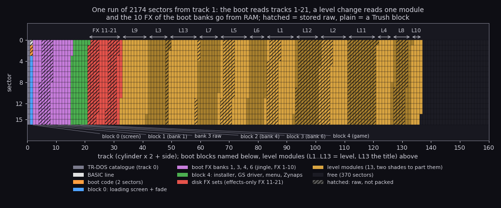
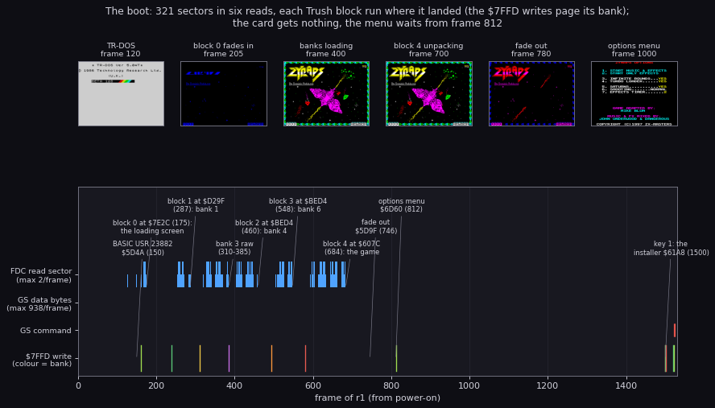
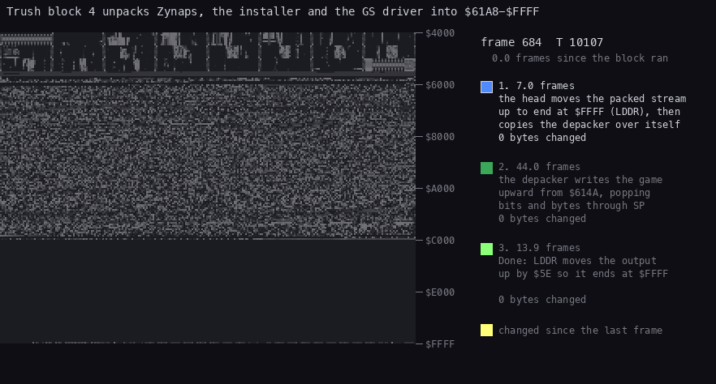
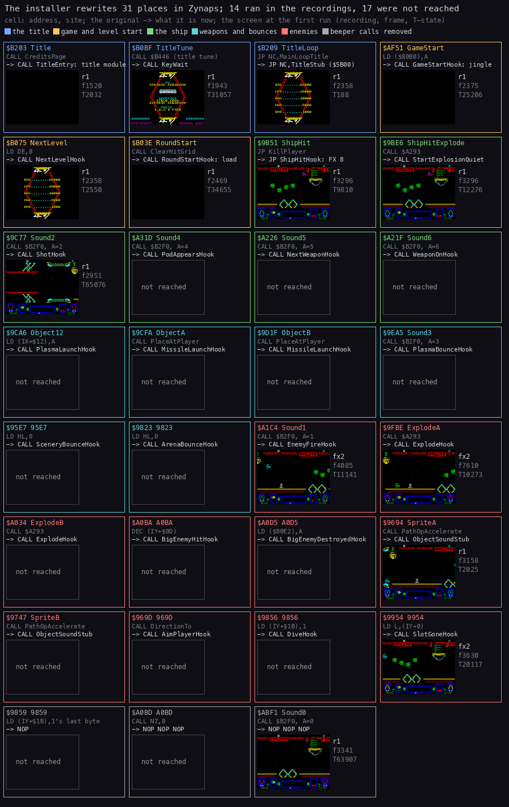
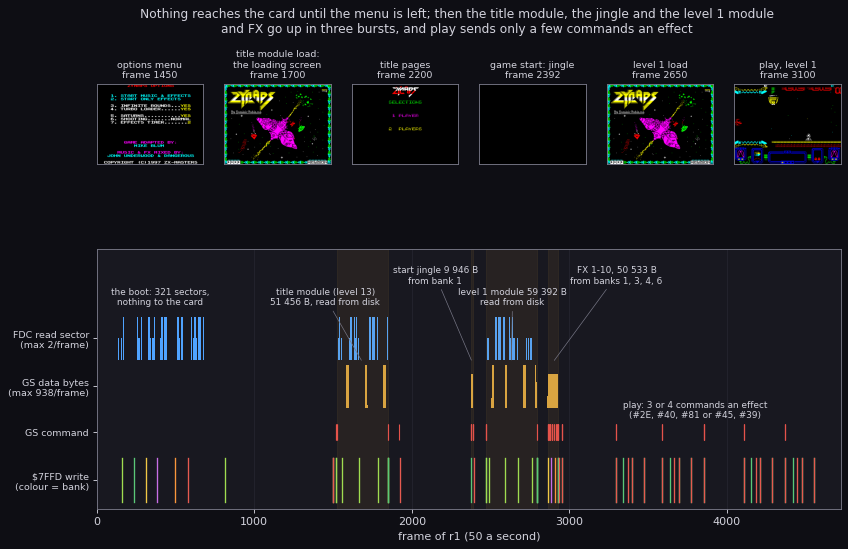
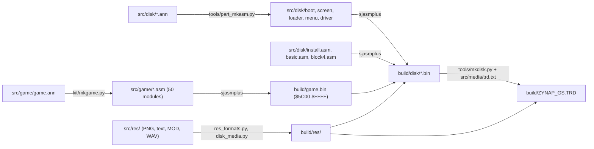

# 3. Build and load

What this covers: the disk, the boot, the Trush packer, the patch installer, what goes to the General Sound card
and when, and the build that makes the TRD from source.

- the medium and the BASIC line (3.1);
- the disk map (3.2);
- the boot, frame by frame (3.3);
- the Trush packer and an unpack as an animation (3.4);
- the patch installer and its 31 places in the game (3.5);
- what goes to the card, and when (3.6);
- the build (3.7);
- known from the code only (3.8).

The recording is `r1` (`work/stage2/r1/session.ttd`, power-on to level 1, [1](01-game-design.md)), opened as
`work/zgsA/r1`. Its port journal gives every write to the FDC, the card and `$7FFD`:

```bash
python3 tools/fig_gs_timeline.py export --work work/zgsA/r1   # -> work/zgsA/r1-{gscmd,gsdata,fdc-cmd,p7ffd}.json
```

## 3.1 The medium

`orig/ZYNAP_GS.ZIP` (md5 `187e99851aad93ecd03c032e65f753aa`, SHA-1 `73c7880e5a262cfb9fd0883bfb00ebed07fc568e`)
holds `ZYNAP_GS.TRD`:

- 655360 bytes;
- md5 `133a8fe861f814b2d6d67e6539c81b85`, SHA-1 `bc0661fc8f384d76b4d5c321c151d156b538c52e`;
- disk label `AMD4ever`, 9 files, 370 sectors free.

| # | Name | Type | Start / length | Sectors | First sector | What it is |
| --- | --- | --- | --- | --- | --- | --- |
| 0 | `ZYNAP_GS` | BASIC | 65 bytes | 255 | 1:0 | the loader line; the boot code is in its tail sectors |
| 1..7 | `zynapsGS` | `1`..`7` | start = length = n | 255 each | 16:15, 32:14, .. 112:9 | covers |
| 8 | `zynapsGS` | `8` | 8 / 8 | 134 | 128:8 | the last cover |

- The covers hold no data of their own. They claim the data sectors so that nothing else is written over them.
- Together the nine entries claim 2174 sectors from track 1 sector 0, in one run.
- The game reads the run with its own sector reader, by position. It never goes through the catalogue.
- Below, "blob sector n" means TRD sector n + 16: track 1 sector 0 is blob 0 (`work/images/disk/trd-from-track1.bin`).

`ZYNAP_GS` reads:

```
1 RANDOMIZE USR VAL "23882" : (code) : REM MIKE BLUM (C)1997
```

The BASIC lies at PROG `$5D3B`, where TR-DOS puts it. `USR 23882` enters `$5D4A`, machine code in the line itself
(`r1` frame 150 T 25971). That code:

1. `DI` and `SP = $8000`;
2. pushes `$5D3B` as the return address;
3. clears four bytes;
4. calls TR-DOS's `$3D13`, which reads 2 sectors from (`$5CF4`), the next position, to `$5D3B`.

So the first two tail sectors land over the BASIC line, and the code returns into them (`$5D3B`, frame 158).

## 3.2 The disk map



How to read the figure:

- **Across** are the 160 tracks (cylinder x 2 + side); **down** the 16 sectors of each.
- **A colour** is the owner of the sector (legend below). **Hatched** sectors are stored raw; plain ones are Trush
  blocks.
- **The labels** below name the boot's blocks (a leader to their first sector). The labels above span the level
  records: L1..L12 a level's module, L13 the title module, FX 11-21 the effects-only set.
- **The point**: the boot reads tracks 1-21; everything after is read at level changes, one level's module at a
  time. The last 370 sectors are free.

```bash
python3 tools/fig_disk.py --out docs/img/load/disk-map.png
```

The tables behind it: `work/stage1/disk-blocks.txt` (the sectors), `work/stage1/trush-blocks.txt` (the 38 packed
blocks) and `work/stage1/level-table.txt` (the sound records).

| Blob sectors | Read to | Becomes | Contents |
| --- | --- | --- | --- |
| 0 | `$5D3B` (TR-DOS) | | the BASIC line |
| 1..2 | `$5D3B` | | the boot code (3.3) |
| 3..15 (13) | `$7E2C`, page `$17` | Trush block 0 → `$7F58-$9AFF` | the loading screen and the code that shows it |
| 16..55 (40) | `$D29F`, page `$11` | Trush block 1 → bank 1 `$D3CB-$FFFF` | the start jingle (9946 bytes), FX 1 and the start of FX 2 |
| 56..119 (64) | `$C000`, page `$13` | bank 3, raw | FX 2 (rest) to 5 (start) |
| 120..177 (58) | `$BED4`, page `$14` | Trush block 2 → bank 4 `$C000-$FFFF` | FX 5 (rest) to 8 (start) |
| 178..226 (49) | `$BED4`, page `$16` | Trush block 3 → bank 6 `$C000-$FFFF` | FX 8 (rest) to 10 |
| 227..320 (94) | `$607C`, page `$10` | Trush block 4 → `$61A8-$FFFF` | the installer, the GS driver file, the level loader, the menu, Zynaps (3.5) |
| 321..2173 | the level loader, record by record | the card | the effects-only FX set (4 records) and 13 modules (45 records) |

## 3.3 The boot



How to read the figure:

- **Across** are `r1`'s frames from power-on to frame 1530.
- **The lanes**, top to bottom: FDC read-sector commands (port `$1F`), bytes to the card's data port `$B3`, card
  commands (port `$BB`), and `$7FFD` writes (colour = the bank paged).
- **The labels** mark the moment each block runs (frame from `time_travel find_event exec`).
- **The thumbnails** are the screen at the frame under each.
- **The point**: the boot reads 321 sectors in six reads, pages a bank before each, and sends nothing to the card.
  The card's first command comes after key 1, at frame 1522.

```bash
python3 tools/fig_gs_timeline.py boot --work work/zgsA/r1 --out docs/img/load/boot.png
```

The boot code at `$5D3B` runs these steps (`src/disk/boot.ann`, with `r1`'s frames):

1. Clears the screen.
2. Reads 13 sectors with page `$17` to `$7E2C` and runs them (frame 175). This Trush block unpacks the loading
   screen to `$7F58-$9AFF`, copies `$8000` → `$C000` (`$1B00` bytes, into bank 7) and calls ShowLoadingScreen
   `$7F58` (frame 188). MakeFades `$7F76` builds the fade steps: seven attribute copies shown 6 frames apart
   (frames 204-240, [6.1](06-rendering.md#61-the-loading-screen)).
3. Reads 40 sectors with page `$11` to `$D29F` and runs them (frame 287). They unpack to bank 1 `$D3CB-$FFFF`.
4. Reads 64 sectors with page `$13` to `$C000` (frames 310-385). Bank 3 is not packed.
5. Reads 58 sectors with page `$14` to `$BED4` and runs them (frame 460). They unpack to bank 4 `$C000-$FFFF`.
6. Reads 49 sectors with page `$16` to `$BED4` and runs them (frame 548). They unpack to bank 6.
7. Reads 94 sectors with page `$10` to `$607C` and runs them (frame 684). They unpack to `$61A8-$FFFF` (3.4).
8. Fades the screen out (`$5D9F`, frame 746), calls the menu `$6D60` (frame 812) and, when it returns, jumps to the
   installer `$61A8` (frame 1500 in `r1`).

The sector reader is at `$5DDF`. It takes:

- B: the number of sectors;
- C: the `$7FFD` value;
- (`$5CF4`): the position, TR-DOS's next sector.

The reader normally reads through a ROM gadget of TR-DOS. If ENTER is held at boot, it uses TR-DOS's `$3D13` entry
instead. The level loader has its own reader, ReadSectors `$652A`: the menu's TURBO LOADER writes TurboTest's
operand (`$6532`), which picks FastRead (its own reader on TR-DOS's FDC routines) or TR-DOS's function 5.

## 3.4 The Trush packer

Every packed block carries "COMPRESSOR BY ALEXANDER TRUSH ODESSA". The blocks unpack themselves:

- `+$00` moves the packed stream up so that it ends at the destination's end, with SP on its first byte. The code is
  `DI; LD B,16; EXX; PUSH HL; LD HL,src_end; LD DE,dest_end; LD BC,packed_len; PUSH DE; LDDR; ...`.
- `+$22` copies the depacker (`$CE` bytes from `+$4B`) over the head through the ROM's `LDIR; RET` at `$33C3`.
- The depacker reads the stream through SP. Bytes and 16-bit bit words are interleaved. The next word is read as
  soon as the last bit of the previous one is taken, not when the next bit is needed.
- Tokens: `0` is a literal byte. `1` is followed by a length code and an offset.
  - The length codes:
    - `00`: 3;
    - `010`: 2, with a 1-byte offset;
    - `011`: a length byte follows. `$FF` ends the stream, `$FE` means a 16-bit length follows, any other n means
      n + 10;
    - `100`: 4;
    - `101`: 5;
    - `11xx`: 6..9.
  - The offset is either one byte, or a high part of 2 to 6 bits followed by a byte.
- The depacker writes upwards from `+$CE`. Done (`LD SP,IX`) then moves the output so that it ends at `dest_end`,
  and returns.



How to read the animation:

- **The grid** is `$4000-$FFFF`, one row 256 bytes, `$4000` at the top. A byte's grey is its value.
- **A byte that changed** since the last picture is yellow, then fades through red. Once it settles it keeps the
  colour of the phase that wrote it last:
  - blue: the head moves the packed stream up to end at `$FFFF` (LDDR), from `r1` frame 684 T 10107;
  - green: the depacker writes the game upward from `$614A`, from 691:8835;
  - bright green: Done moves the output up by `$5E` so it ends at `$FFFF`, from 735:5717.
- **The bar on the right** is the phase; **the counters** are the bytes each phase changed: 23 090, 39 877 and
  33 689.
- **The point**: the block unpacks in place. The packed stream sits at the top of memory and the output grows up
  towards it from below; the output never overtakes the stream bytes it still needs. The final move is one LDDR of
  `$9E58` bytes, about 12 frames at 21 T a byte (Done at frame 735, the fade-out at 746).

```bash
python3 tools/fig_unpack.py --work work/zgsA/r1 --out docs/img/load/trush-unpack.gif
```

`tools/trush.py` unpacks all 38 blocks on the disk to their exact lengths (`work/media/unpacked/`) and packs them
again byte for byte (3.7). There is no other packer on the disk.

## 3.5 The patch installer

Block 4 runs at `$61A8` (`src/disk/install.asm`, 779 bytes; `r1` frame 1500). It carries Zynaps at Zynaps's own
addresses from `$7400` up, and Zynaps's `$5C00-$73FF` at `$C800`. The installer:

1. fills in the sector and track of the loader's records (FillRecords);
2. copies the stubs over parts of Zynaps the GS version does not use:
   - `$AA28` (GateStub, TitleEntry): the effects gate and the title's first call;
   - `$5B00`: TitleStub, which the title loop's `JP NC` at `$B209` reaches: the loading screen from bank 7 between
     the title pages, then the attract loop;
   - `$B2F0` and `$A6AE` (WaitStub → RoundWait);
   - `$FF1C` (`$B6` bytes): the 20 sound and level stubs;
   - `$B446` (`$62` bytes): the bank 1 trampolines `$B466` / `$B482` and the GS flags `$B45F..$B486`;
3. copies the GS driver file (`$64B3`, `$1000` bytes: its `$F4D` and `$B3` bytes after it) to bank 1 `$C000`, and
   the area `$5B00-$5D3A` to bank 1 `$D190`;
4. writes 31 places in Zynaps: 28 CALL / JP operands pointed at the stubs, 10 of them with the opcode also made
   `CALL`, and 3 runs of NOPs;
5. copies Mover to `$5BCC` and jumps to it. Mover moves `$C800` → `$5C00` (`$1800` bytes), clears `$C800-$DFFF` and
   jumps to MainLoop `$B200` (frame 1505).



How to read the figure:

- **A cell** is one place the installer writes (its `Site` name in `src/disk/install.asm`), coloured by what the
  place belongs to (legend at the top).
- **In the cell**: the address and name; the original instruction (grey); what it is after the installer (white);
  the screen at the first time the place ran, with the recording, the frame and the T-state.
- **"not reached"**: neither `r1` (4724 frames, music mode) nor `fx2` (62931 frames, effects only, level 1) ran it.
- **The point**: the hooks sit on the game's own events: the title, the game and round start, the ship hit, the
  shot, the explosions, the object movers. Fourteen ran; the plasma, the missiles, the bounces, the big enemies, the
  pods and the weapon changes did not come up in these runs.

```bash
python3 tools/fig_patches.py --out docs/img/load/patch-sites.png
```

The first runs come from `time_travel find_event` (find `exec`, first hit) over each recording, in
`work/zgsA/r1-sites.json` and `work/zgsA/fx2-sites.json`. A hit at T-state 0 without a code page is a frame-boundary
artefact of find_event and is not counted (`SiteSound6` `$A21F` at `fx2` frame 2795: asking for frames 2794-2796
alone gives no hit).

The places by job:

| Job | Places | What runs there now |
| --- | --- | --- |
| The title | `$B203`, `$B0BF`, `$B209` | TitleEntry (the title module once), KeyWait, TitleStub |
| Game and round start | `$AF51`, `$B075`, `$B03E` | GameStartHook (the jingle), NextLevelHook, RoundStartHook (the level change) |
| The ship | `$9B51`, `$9BE6`, `$9C77`, `$A31D`, `$A226`, `$A21F` | ShipHitHook (FX 8), StartExplosionQuiet, ShotHook, PodAppearsHook, NextWeaponHook, WeaponOnHook |
| Weapons and bounces | `$9CA6`, `$9CFA`, `$9D1F`, `$9EA5`, `$95E7`, `$9823` | PlasmaLaunchHook, MissileLaunchHook x2, PlasmaBounceHook, SceneryBounceHook, ArenaBounceHook |
| Enemies | `$A1C4`, `$9FBE`, `$A034`, `$A0BA`, `$A0D5`, `$9694`, `$9747`, `$969D`, `$9856`, `$9954` | EnemyFireHook, ExplodeHook x2, BigEnemyHitHook, BigEnemyDestroyedHook, ObjectSoundStub x2, AimPlayerHook, DiveHook, SlotGoneHook |
| Beeper calls removed | `$9859`, `$A0BD`, `$ABF1` | NOP (the rest of a 4-byte LD), 3 NOPs, 3 NOPs |

- Six places called the beeper request `$B2F0` with a sound number; they now call a hook. The seventh, at `$ABF1`,
  became three NOPs.
- The hooks at places that made no sound (the bounces, the dive, the big enemies) send a sound in effects-only mode
  only ([9](09-sound.md)).
- Which sound each hook sends, and the card commands: [9](09-sound.md).

## 3.6 What goes to the card, and when



How to read the figure:

- **Across** are `r1`'s frames, 0-4724.
- **The lanes**, top to bottom: FDC read-sector commands (at most 2 a frame), bytes to the card's data port `$B3`
  per frame (at most 938), card commands (port `$BB`), `$7FFD` writes (colour = the bank).
- **The shaded spans** are the uploads, labelled with what goes up and its size.
- **The thumbnails** are the screen at the frames above them.
- **The point**: the card gets nothing during the boot. After key 1 it gets the title module (frames 1522-1921),
  at the game start the jingle (2377-2391), at the round start the level's module from the disk (2473-2792) and the
  10 FX from the banks (2862-2931). In play only short commands go up.

```bash
python3 tools/fig_gs_timeline.py upload --work work/zgsA/r1 --out docs/img/load/gs-upload.png
```

`r1`'s port journal holds 659 FDC read-sector commands (324 in the boot, 167 for the title module, 168 in the level
load), 73 card commands and 171 352 data bytes.

| Moment (`r1` frames) | Commands | Bytes |
| --- | --- | --- |
| boot to the menu (0-1499) | none | 0 |
| menu key 1 (1522-1921) | `#23` (pages), `#F3` (warm reset), `#30` load module → handle 1, `#D1`, the data, `#D2`, `#2A $40`, `#31 1` | 51 456 (the title module, read from the disk) |
| game start, `$FF26` (2377-2391) | `#23`, `#F3`, `#38` load FX → 1, the data, `#2E 1`, `#40 $33`, `#81` | 9 946 (the jingle, from bank 1) |
| round start, `$FF1C`, the level changed (2469-2931) | music: `#23`, `#F3`, the level's module, the 10 in-game FX, `#2B $40`, `#2A` (the level's volume), `#31 1` | 59 392 (level 1's module, 163 sectors) + 50 533 (FX 1-10 from banks 1, 3, 4, 6) |
| | effects only: the 10 FX and the 11 disk FX, `#2B $40` | |
| play | `#2E` / `#40` / `#80+c`, or `#2E` / `#40` / `#45` / `#39` | |

- No program is uploaded to the card. The GS ROM's own player does all the work; only samples and modules go
  there, through the firmware's load commands.
- Every command waits for the card to take the previous one (`IN $BB` bit 0). Every data byte waits for the data
  latch (bit 7). Stage 1's traces had 0 unchecked writes over about 400 K data bytes
  (`work/stage1/x1/*-digest.txt`, `work/stage1/x2/*-digest.txt`).
- The command names are those of `tools/gs_digest.py` (NAMES).

## 3.7 The build

`tools/build.sh` writes the TRD from source and compares it with `orig/ZYNAP_GS.ZIP`'s `ZYNAP_GS.TRD`: identical,
all 655360 bytes. One build at a time: it holds `build/.lock` (a folder) while it runs.



1. `tools/res_formats.py build` and `tools/disk_media.py build`: the resources into `build/res/`
   ([src/res/README.md](../src/res/README.md)).
2. sjasmplus: the game (`src/game/game.asm` → `build/game.bin`, `$5C00-$FFFF`), then the BASIC, the boot sectors, the
   screen block, the loader, the menu, the driver file (which INCBINs the loader and the menu, its copies), the
   installer and block 4 into `build/disk/`. Block 4 is the installer, the driver file and three slices of the game
   image: `$7400-$C7FF`, `$5C00-$73FF` stored at `$C800`, and `$E000-$FFFF`.
3. `tools/mkdisk.py src/media/trd.txt build/ZYNAP_GS.TRD`: the data run from track 1 sector 0, the catalogue and
   sector 9.

**The game image.** Block 4 carries Zynaps as the memory after Zynaps's start-up ran:

- the tiles and the wave cells copied to `$5C00` / `$6400`;
- the sprites complemented;
- `$8000` is `JP $B200`: the start-up never runs again.

The image also holds the GS version's own edits: the credits message, `$9BE6` / `$A034` `CALL StartExplosionQuiet`,
`$A0BD` `CALL NZ,0` and 15 `NOP`s, the HALT loops that replace five calls of the wait routine, EndOfPlay's end code,
the title loop. `tools/game_image.py` unpacks the image from the original into `work/mkgame/original.bin`, the image
`kit/mkgame.py` checks the source against. `$C800-$DFFF` is not in the block: zero in the image. The source is
`src/game/game.ann` (546 entries, 50 modules), with a `GS:` note at every place the conversion or its installer
changes. The 31 installer patches are written at run time by `src/disk/install.asm`, so the game's source holds the
bytes the block holds.

**The disk parts.** `tools/part_mkasm.py` runs kit/mkgame.py's pipeline over the original's bytes of each part
(`work/stage2/*.bin`, Trush block 0 from `work/media/unpacked/`), with the code the recording `work/stage2/r1` ran,
and writes the part's `.asm` from its `.ann` (boot, screen, loader, menu, driver: one module each). Each is
assembled and compared before it is installed. `tools/regen.sh` writes every source again (the parts, then the game)
and builds.

**The Trush blocks** are made by `src/disk/trush.asm` (the self-unpacking head, the depacker and the stream) with
`tools/trush.py`'s packer, which gives the original's streams byte for byte. mkdisk assembles each block with its
base, end and length and unpacks it again to prove it.

**The packing rule.** The level records (`FxRecords`, `ModuleRecords` in the loader) say which records are Trush
blocks. The rule that gives the same choice for all 49:

- a record is packed when its in-place unpack is safe (`tools/trush.py margin` above 0: the stream, moved to end at
  the destination's end, is never overtaken by the output);
- and the block takes fewer sectors than the raw bytes.

A module is padded with zeros to a whole sector and cut into 16384-byte parts; a set of FX is its FX one after the
other. A raw FX set's last sector ends with what the sets before it left in the same buffer (set 3 ends with bytes
of set 2): mkdisk models that buffer.

**The boot banks** are the join of `fx-start` and FX 1-10, cut as the loader reads them: 11317 bytes Trush-packed to
`$D3CB` (bank 1), 16384 raw (bank 3), 16384 packed to `$C000` (bank 4), 16384 packed to `$C000` (bank 6). The join's
last 7 bytes are not on the disk: FX 10's tail is read from bank 7's zeros ([2.3](02-architecture.md#23-the-other-banks)).

**The catalogue** (sector 9): `ZYNAP_GS` (BASIC, 65 bytes, but 255 sectors: its entry covers the boot code and the
start of the data run) and 8 `zynapsGS` covers, types `1`-`8`, start = length = the digit, 255 sectors each and 134
for the last, so that the 9 entries hold the whole run of 2174 sectors; label `AMD4ever`, 9 files, 370 free sectors,
the first free one track 136 sector 14.

**The signatures** (`../../signatures/`, the `games/zynaps-gs` rows of its `sources.json`). `tools/sig_listings.sh`
(run after the build) writes the listings of the disk parts into `build/lst/`; `kit/sig_add.py sources` then adds:

- `packers/trush/seen-zynaps-gs/depacker`: the depacker as block 4 runs it (`$607C`, 206 bytes). It has only
  relative jumps; its one varying operand is the output length of Done's `LD BC` (`var16`), so the entry fits the
  depacker of all 38 blocks;
- `sound/gs/zx-masters-zynaps-driver/seen-zynaps-gs`: the driver in bank 1, `$C000` up to LoaderCopy `$C44A`
  (1098 bytes, 132 masked: the game's addresses it calls and writes);
- `programs/games/zynaps-gs/installer`: Install `$61A8` up to Mover (329 bytes);
- the game modules of `src/game/game.ann`: 39 of them are entries the base already had (38 byte for byte, `player`
  masked) and got this case in their `found_in`; `tilecopy`, `texts`, `enemies`, `menu`, `hiscore`, `mainloop`,
  `graphics` and `topcells` hold the conversion's edits (3.7) and are entries of their own. The title tune player at
  `$B446` is still in the block's image (the installer puts the trampolines over it), so it matched the beeper tune
  player's entry.

## 3.8 Known from the code only

- **The ENTER switch** of the boot's reader and **the TURBO LOADER off**: no recording booted with ENTER held or
  TURBO LOADER set to NOP; both paths are read from `src/disk/boot.ann` and `loader.ann`.
- **Effects-only uploads** (the 11 disk FX): `fx2` recorded them, but no figure here is drawn from its port journal.
- **17 patch places** never ran (3.5).
