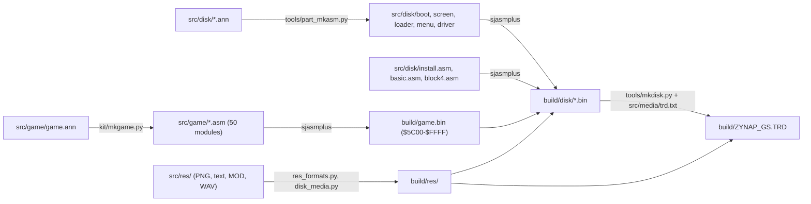

# 3. Build and load

What this covers: the disk block by block, the boot, the Trush packer, the patch installer that turns Hewson's
Zynaps into the GS version, and what is uploaded to the General Sound card and when. The runs it rests on are listed
in `work/stage1/NOTES.md`; the source build (3.7) in `work/stage2/`.

<!-- Figures this document needs (GUIDE.md 4.2), remove each line when it is in: -->
<!-- - an animation of every unpack (`kit/memanim.py`) -->
<!-- - the disk map (sectors by owner) -->

## 3.1 The medium

`orig/ZYNAP_GS.ZIP` (md5 `187e99851aad93ecd03c032e65f753aa`, SHA-1 `73c7880e5a262cfb9fd0883bfb00ebed07fc568e`)
holds `ZYNAP_GS.TRD`:

- 655360 bytes;
- md5 `133a8fe861f814b2d6d67e6539c81b85`, SHA-1 `bc0661fc8f384d76b4d5c321c151d156b538c52e`;
- disk label `AMD4ever`, 9 files, 370 sectors free.

| # | Name | Type | Start / length | Sectors | First sector | What it is |
| --- | --- | --- | --- | --- | --- | --- |
| 0 | `ZYNAP_GS` | BASIC | 65 bytes | 255 | 1:0 | the loader line; the boot code is in its tail sectors |
| 1..7 | `zynapsGS` | `1`..`7` | start = length = n | 255 each | 16:15, 32:14, .. 112:9 | covers |
| 8 | `zynapsGS` | `8` | 8 / 8 | 134 | 128:8 | the last cover |

The covers hold no data of their own. They claim the data sectors so that nothing else is written over them.

Together, the nine entries claim 2174 sectors from track 1 sector 0, in one contiguous run. The game reads the run
with its own sector reader, by position, and never goes through the catalogue. Below, "blob sector n" means TRD
sector n + 16, so track 1 sector 0 is blob 0 (`work/images/disk/trd-from-track1.bin`).

`ZYNAP_GS` reads:

```
1 RANDOMIZE USR VAL "23882" : (code) : REM MIKE BLUM (C)1997
```

The BASIC lies at PROG `$5D3B`, where TR-DOS puts it. `USR 23882` enters `$5D4A`, which is machine code in the line
itself. That code does the following:

1. `DI` and `SP = $8000`.
2. Pushes `$5D3B` as the return address.
3. Clears four bytes.
4. Calls TR-DOS's `$3D13`, which reads 2 sectors from (`$5CF4`) (the next position) to `$5D3B`.

So the first two tail sectors land over the BASIC line, and the code returns into them.

## 3.2 The disk map

The tables behind this section are in `work/stage1/`:

- `disk-blocks.txt` gives the sectors;
- `trush-blocks.txt` lists the 38 packed blocks;
- `level-table.txt` holds the sound records.

| Blob sectors | Read to | Becomes | Contents |
| --- | --- | --- | --- |
| 0 | `$5D3B` (TR-DOS) | | the BASIC line |
| 1..2 | `$5D3B` | | the boot code (3.3) |
| 3..15 (13) | `$7E2C`, page `$17` | Trush blk00 → `$7F58-$9AFF` | the loading screen and the code that shows it (" PROGRAM BY MIKE BLUM ") |
| 16..55 (40) | `$D29F`, page `$11` | Trush blk01 → bank 1 `$D3CB-$FFFF` | the start jingle (an FX of 9946 bytes), in-game FX 1 and the start of FX 2 |
| 56..119 (64) | `$C000`, page `$13` | bank 3, raw | in-game FX 2 (rest) to 5 (start) |
| 120..177 (58) | `$BED4`, page `$14` | Trush blk02 → bank 4 `$C000-$FFFF` | in-game FX 5 (rest) to 8 (start) |
| 178..226 (49) | `$BED4`, page `$16` | Trush blk03 → bank 6 `$C000-$FFFF` | in-game FX 8 (rest) to 10 |
| 227..320 (94) | `$607C`, page `$10` | Trush blk04 → `$61A8-$FFFF` | the patch installer, the GS driver file, the level loader, and Hewson's Zynaps (3.5) |
| 321..2173 | the level loader, record by record | the card | the effects-only FX set (4 records) and 13 modules (45 records), see [9.3](09-sound.md#93-the-media) |

## 3.3 The boot

The boot code at `$5D3B` comes from blob sectors 1-2. It runs these steps:

1. Clears the screen.
2. Reads 13 sectors with page `$17` to `$7E2C` and runs them. This is a Trush block that unpacks the loading screen
   to `$7F58-$9AFF`. The block copies `$8000` → `$C000` (`$1B00` bytes, into bank 7) and calls `$7F58`.
3. Reads 40 sectors with page `$11` to `$D29F` and runs them. They unpack to bank 1 `$D3CB-$FFFF`.
4. Reads 64 sectors with page `$13` to `$C000`. Bank 3 is not packed.
5. Reads 58 sectors with page `$14` to `$BED4` and runs them. They unpack to bank 4 `$C000-$FFFF`.
6. Reads 49 sectors with page `$16` to `$BED4` and runs them. They unpack to bank 6.
7. Reads 94 sectors with page `$10` to `$607C` and runs them. They unpack to `$61A8-$FFFF`.
8. Fades the screen (`$5D9F`), calls `$6D60` and jumps to `$61A8`.

The sector reader is at `$5DDF`. It takes:

- B: the number of sectors;
- C: the `$7FFD` value;
- (`$5CF4`): the position, which is TR-DOS's next sector.

The reader normally reads through a ROM gadget of TR-DOS. If ENTER is held at boot, it uses TR-DOS's `$3D13` entry
instead.

The menu's "TURBO LOADER" option is probably the same switch for the level loads. Stage 2 is to confirm this.

## 3.4 The Trush packer

Every packed block carries "COMPRESSOR BY ALEXANDER TRUSH ODESSA". The blocks unpack themselves:

- `+$00` moves the packed stream up so that it ends at the destination's end, with SP on its first byte. The code is
  `DI; LD B,16; EXX; PUSH HL; LD HL,src_end; LD DE,dest_end; LD BC,packed_len; PUSH DE; LDDR; ...`.
- `+$22` copies the depacker (`$CE` bytes from `+$4B`) over the head through the ROM's `LDIR; RET` at `$33C3`.
- The depacker reads the stream through SP. Bytes and 16-bit bit words are interleaved. The next word is read as
  soon as the last bit of the previous one is taken, not when the next bit is needed.
- Tokens: `0` is a literal byte. `1` is followed by a length code and an offset.
  - The length codes are:
    - `00`: 3.
    - `010`: 2, with a 1-byte offset.
    - `011`: a length byte follows. `$FF` ends the stream, `$FE` means a 16-bit length follows, and any other n means
      n + 10.
    - `100`: 4.
    - `101`: 5.
    - `11xx`: 6..9.
  - The offset is either one byte, or a high part of 2 to 6 bits followed by a byte.
- The depacker writes upwards from `+$CE`. It then moves the output so that it ends at `dest_end`, and returns.

`tools/trush.py` unpacks all 38 blocks on the disk to their exact lengths (`work/media/unpacked/`). There is no
other packer on the disk. The signature base has no Trush entry (`work/stage1/sig-summary.txt`).

## 3.5 The patch installer

blk04 runs at `$61A8`. It carries Hewson's Zynaps at Zynaps's own addresses from `$7400` up, and the first 6 K of
Zynaps at `$C800`. The installer does these things:

- It copies the stubs:
  - `$AA28`: the effects timer and the title entry;
  - `$5B00`: TitleStub, which the title loop's `JP NC` at `$B209` reaches: the title routine and the loading screen
    from bank 7 between the title pages ([img/compare/title-picture.png](img/compare/title-picture.png));
  - `$B2F0` and `$A6AE`;
  - `$FF1C` (`$B6` bytes): 20 sound and level stubs;
  - `$B446` (`$62` bytes): the bank 1 trampolines `$B466` / `$B482` and the flags `$B45F..$B486`.
- It copies the GS driver file (`$64B3`, `$1000` bytes) to bank 1 `$C000`, and saves the area at `$5B00` to bank 1
  `$D190`.
- It writes the call sites into Zynaps: 25 places, each one a `call` / `jp` to a stub. The list is in
  [9.4](09-sound.md#94-where-the-game-makes-a-sound).
- It moves `$C800` → `$5C00` (`$1800` bytes) and jumps to `$B200`, where Zynaps starts.

These are the changes the GS version makes to Zynaps:

- The sound requests. Six sites called the beeper request `$B2F0` and now call stubs, and the seventh, at `$ABF1`,
  is removed outright.
- 13 new sound hooks, at places that made no sound before.
- The level and round hooks.
- The wait between rounds.

The diff of the patched area against the original bytes (both are in blk04) is 285 disassembly lines over
`$9400-$B4FF` (`work/tmp/orig-9400.dasm`, `work/tmp/live-9400.dasm`).

## 3.6 What goes to the card, and when

The GS ROM's own player does all the work. No program is uploaded to the card; only samples and modules go there,
through the firmware's load commands. These are the live traces (`work/stage1/x1/*-digest.txt`,
`work/stage1/x2/*-digest.txt`):

| Moment | Commands |
| --- | --- |
| boot to the menu | nothing |
| menu key 1 or 2 (the title) | `#23` (pages), `#F3` (warm reset), `#30` load module → handle 1, `#D1`, 51456 bytes (the title module, level 13), `#D2`, `#2A $40`, `#31 1` |
| game start (`$FF26`, before "PREPARE FOR COMBAT") | `#23`, `#F3`, `#38` load FX → 1, 9946 bytes (the jingle), `#2E 1` `#40 $33` `#81` |
| the round start (`$FF1C`) when the level changed | music: `#23`, `#F3`, the level's module, the 10 in-game FX, `#2B $40`, `#2A` (the level's volume), `#31 1`; effects only: the 10 FX and the 11 disk FX, `#2B $40` |
| play | `#2E` / `#40` / `#80+c`, or `#2E` / `#40` / `#45` / `#39` ([9.4](09-sound.md#94-where-the-game-makes-a-sound)) |

Every command waits for the card to take the previous one (`IN $BB` bit 0). Every stream byte waits for the data
latch (bit 7). Every trace had 0 unchecked writes, over about 400 K stream bytes in all. Nothing is lost the way
Nether Earth GS's 2002 loader lost its module.

## 3.7 The build

`tools/build.sh` writes the TRD from source and compares it with `orig/ZYNAP_GS.ZIP`'s `ZYNAP_GS.TRD`: identical,
all 655360 bytes. One build at a time: it holds `build/.lock` (a folder) while it runs.



1. `tools/res_formats.py build` and `tools/disk_media.py build`: the resources into `build/res/`
   ([src/res/README.md](../src/res/README.md)).
2. sjasmplus: the game (`src/game/game.asm` → `build/game.bin`, `$5C00-$FFFF`), then the BASIC, the boot sectors, the
   screen block, the loader, the menu, the driver file (which INCBINs the loader and the menu, its copies), the
   installer and block 4 (the installer, the driver file and the three slices of the game image the block carries:
   `$7400-$C7FF`, `$5C00-$73FF` stored at `$C800`, and `$E000-$FFFF`) into `build/disk/`.
3. `tools/mkdisk.py src/media/trd.txt build/ZYNAP_GS.TRD`: the data run from track 1 sector 0, the catalogue and
   sector 9.

**The game image.** Block 4 carries Zynaps as the memory after the 48K start-up ran (the tiles and the wave cells
copied to `$5C00`/`$6400`, the sprites complemented, the start-up never runs again: `$8000` is `JP $B200`) with the
GS conversion's own edits in it (the credits message, `$9BE6`/`$A034` `CALL StartExplosionQuiet`, `$A0BD`
`CALL NZ,0` and 15 `NOP`s, the HALT loops that replace five calls of the wait routine, EndOfPlay's end code, the
title loop). `tools/game_image.py` unpacks it from the original into `work/mkgame/original.bin`, the image
`kit/mkgame.py` checks the source against. `$C800-$DFFF` is not in the block: zero in the image. The source is the
case's own `src/game/game.ann` (546 entries, 50 modules), seeded from the 48K case's annotations and carrying a
`GS:` note at every place the conversion or its installer changes; the 25 installer patches are written at run time
by `src/disk/install.asm`, so the game's source holds the bytes the block holds.

**The disk parts.** `tools/part_mkasm.py` runs kit/mkgame.py's pipeline over the original's bytes of each part
(`work/stage2/*.bin`, Trush block 0 from `work/media/unpacked/`), with the code the recording `work/stage2/r1` ran,
and writes the part's `.asm` from its `.ann` (boot 1, screen 1, loader 1, menu 1, driver 1 module). Each is
assembled and compared before it is installed. `tools/regen.sh` writes every source again (the parts, then the game)
and builds.

**The Trush blocks** are made by `src/disk/trush.asm` (the self-unpacking head, the depacker and the stream) with
`tools/trush.py`'s packer, which gives the original's streams byte for byte: mkdisk assembles each block with its
base, end and length and unpacks it again to prove it.

**The packing rule.** The level records (`FxRecords`, `ModuleRecords` in the loader) say which records are Trush
blocks. The rule that gives the same choice for all 49: a record is packed when its in-place unpack is safe
(`tools/trush.py margin` above 0: the stream, moved to end at the destination's end, is never overtaken by the
output) and the block takes fewer sectors than the raw bytes. A module is padded with zeros to a whole sector and
cut into 16384-byte parts; a set of FX is its FX one after the other. A raw FX set's last sector ends with what the
sets before it left in the same buffer (set 3 ends with bytes of set 2): mkdisk models that buffer.

**The boot banks** are the join of `fx-start` and FX 1-10, cut as the loader reads them: 11317 bytes Trush-packed to
`$D3CB` (bank 1), 16384 raw (bank 3), 16384 packed to `$C000` (bank 4), 16384 packed to `$C000` (bank 6). The join's
last 7 bytes are not on the disk: FX 10's tail is read from bank 7's zeros (9.3).

**The catalogue** (sector 9): `ZYNAP_GS` (BASIC, 65 bytes, but 255 sectors: its entry covers the boot code and the start of
the data run) and 8 `zynapsGS` covers, types `1`-`8`, start = length = the digit, 255 sectors each and 134 for the
last, so that the 9 entries hold the whole run of 2174 sectors; label `AMD4ever`, 9 files, 370
free sectors, the first free one track 136 sector 14.
