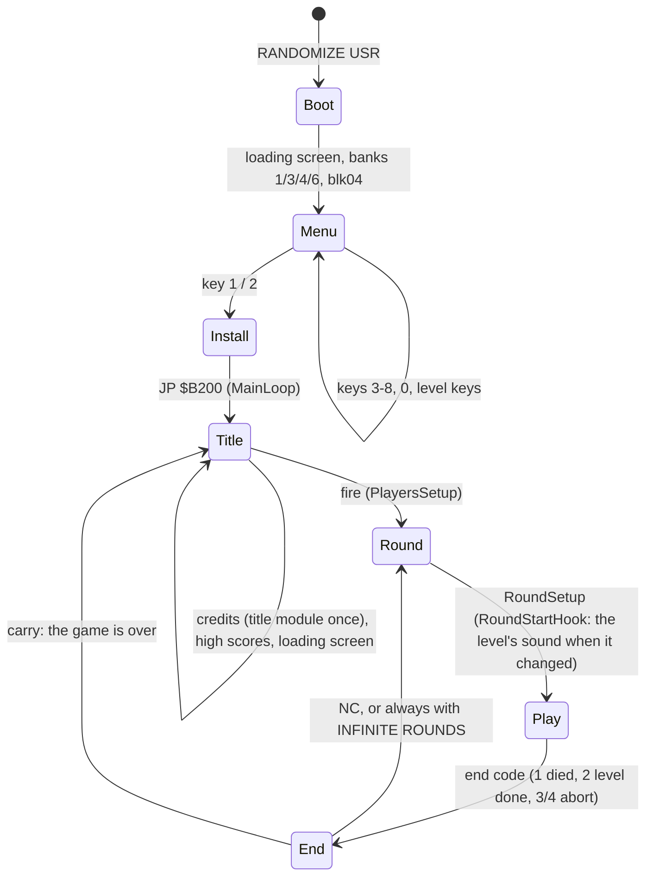

# 4. Game loop

What this covers: the state machine of the GS game, where the conversion hooks into it, and what the hooks cost in
time. The recordings it rests on: `work/stage2/r1` (a fresh boot to the menu, key 1, the title, a game start and
2400 frames of level 1 in music mode: the analysis L1 of the disk parts) and the 48K case's `c2` and `r1` (case.json
`read_builds`: the game's code is Zynaps's, so its runs give the game's routines; the GS run was not used for the
game because its boot code would read as the game's).

## 4.1 The state machine

MainLoop (`$B200`) is the 48K's: CreditsPage and HiScorePage in turn until fire, PlayersSetup, then RoundSetup,
PlayLoop and EndOfPlay for every life or level. The GS changes four places of it:

- **The title loop** (`$B203`, `$B209`). The first call is TitleEntry: the title module is loaded once (LoadKind 2)
  and played while the pages cycle; the loop's jump goes through TitleStub (`$5B00`), which shows the loading screen
  from bank 7 between the rounds of pages.
- **The round start** (`$B03E`, RoundStartHook → LevelChange). When the level changed (NextLevelHook at `$B075`
  keeps the next level), the driver switches to IM 1, swaps the loader in at `$61A8`, resets the card and uploads the
  level's module and FX with bank 7's loading screen shown, then swaps back and returns to IM 2. The game start
  (GameStartHook at `$AF51`, with the PREPARE FOR COMBAT banner) plays the start jingle the same way (LoadKind 1).
- **The end of a round** (EndOfPlay, `$B0FF`). The 48K waited 50 frames through WaitFrames (`$A6AE`). The GS keeps
  the end code in EndCodeLoad and calls WaitFrames with the code in A; the installer has turned WaitFrames into
  WaitStub → RoundWait, which fades the module out on code 2 (a level done) in music mode and otherwise waits a fixed
  time. The other callers of `$A6AE` (the key definition, the high-score entry) got HALT loops of their own
  (`$A5FC`, `$A617`, `$A86B`, `$A8A6`, `$A8B2`).
- **INFINITE ROUNDS** (on at the start) makes the `JR NC` at `$B218` a `JR`: EndOfPlay's carry no longer ends the
  game.

## 4.2 The frame

The frame is Zynaps's: the play interrupt (IM 2) does the scroll, the objects and the jobs, the main loop dispatches
events ([12](12-routine-reference.md), the 48K case's chapter 4). The GS adds work only where a sound is made: a stub
pages bank 1 (`$7FFD`), the driver sends 3 commands to the card, each waiting for the card to take the one before,
and pages bank 0 back. The per-frame hooks are the path movers' ObjectSoundStub (48467 calls in 60000 frames of
effects-only play, almost one a frame) and SlotGoneHook; in music mode they return at once (CallDriverFx).

The level loads stop the game: in music mode a level's module (26-59 K) and the 10 FX (49 K) go to the card byte by
byte with a wait on every byte, read from the disk record by record (stage 1, GS 128 KB: level 1's load ran from frame
3063, the `#23`, to 3296, the end of FX 10, in `work/stage1/x2/m-digest.txt`: 233 frames, about 4.7 s with the
disk reads).
