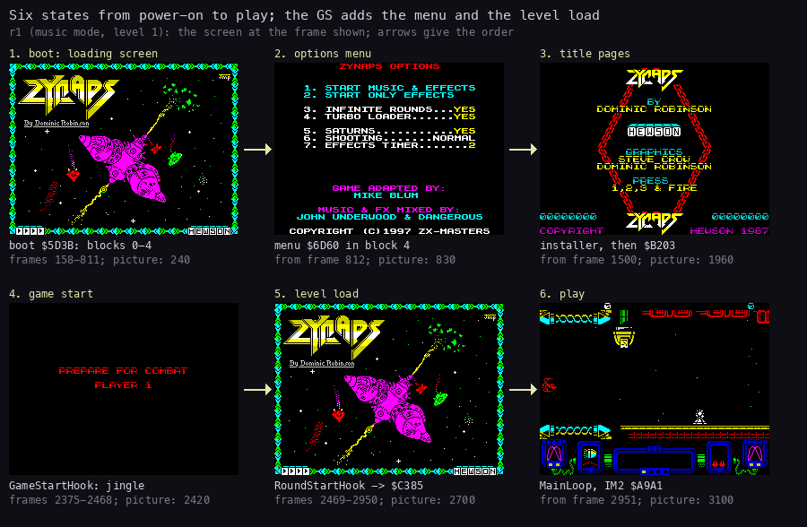
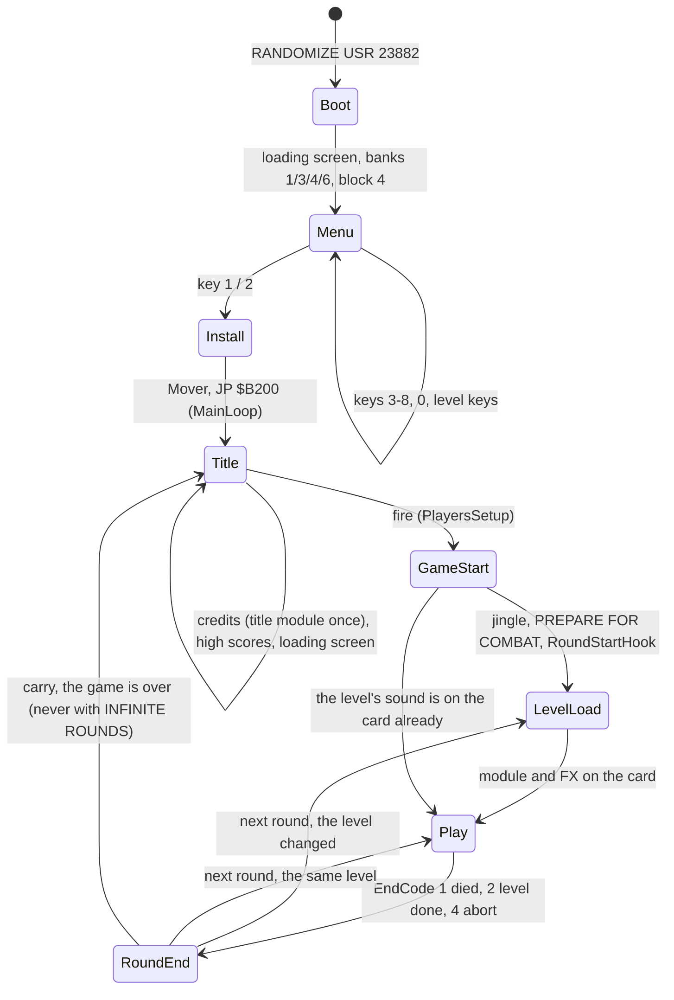
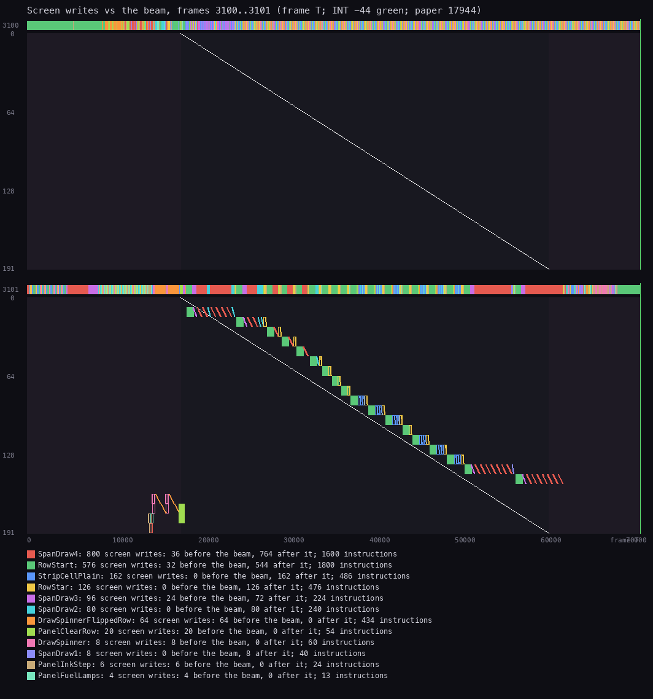
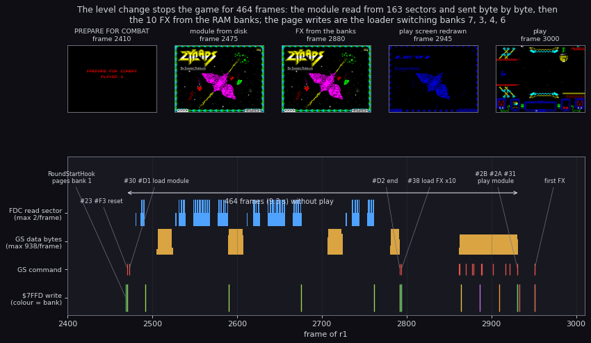

# 4. Game loop

What this covers: the states of the game from power-on to play, the frame in play, the level load that stops the
game, the end of a round, and what the sound costs in time.

- the states (4.1);
- the main loop and the frame in play (4.2);
- the level load (4.3);
- the end of a round (4.4);
- what the sound costs (4.5);
- known from the code only (4.6).

The recording is `r1` (power-on to 1773 frames of level 1, music mode, [1](01-game-design.md)) on the instance
`work/zgsA/r1`, with its L1 builds `work/zgsA/r1-play` (frames 2951-4724) and `work/zgsA/r1-level` (2469-2934).
The effects-only recording `fx2` (62931 frames) gives the hooks that `r1` did not reach.

## 4.1 The states



How to read the figure:

- **Six pictures** are `r1`'s screen in each state, at the frame given under it ("picture").
- **Under each**: the code that runs the state and the frames it covered in `r1`.
- **The arrows** give the order.
- **The point**: two states belong to the disk version alone: the options menu (2) and the level load (5). The
  others are the game's own, with the sound hooked in.

```bash
python3 tools/fig_states.py --work work/zgsA/r1 --out docs/img/loop/states.png
```



The states, with their code and `r1`'s frames:

| State | Code | `r1` frames | Witness |
| --- | --- | --- | --- |
| Boot | boot code `$5D3B` | 158-811 | `find_event exec` `$5D3B` at 158 |
| Menu | `$6D60` in block 4 | 812-1499 | `$6D60` at 812:4769 |
| Install | `$61A8`, Mover `$5BCC` | 1500-1504 | `$61A8` at 1500:1764 |
| Title | MainLoop `$B200`, MainLoopTitle `$B203` | 1505-2374 | `$B200` at 1505:16846; TitleEntry at 1520 |
| Game start | GameStartHook (from `$AF51`) | 2375-2468 | `SiteGameStart` at 2375:25206 |
| Level load | RoundStartHook (from `$B03E`) → LevelChange bank 1 `$C385` | 2469-2950 | `SiteRoundStart` at 2469:34655 |
| Play | PlayLoop, PlayInterrupt `$A9ED` | 2951- | the first FX at 2951 |

MainLoop (`$B200`) runs the title pages in turn until fire, then PlayersSetup, then for every life or level
RoundSetup, PlayLoop and EndOfPlay. The installer hooks four places of it:

- **The title loop** (`$B203`, `$B209`). The first call is TitleEntry: the title module is loaded once (LoadKind 2)
  and plays while the pages cycle. The loop's jump goes through TitleStub (`$5B00`), which shows the loading screen
  from bank 7 between the rounds of pages.
- **The game start** (`$AF51`). GameStartHook loads and plays the start jingle (LoadKind 1) with the PREPARE FOR
  COMBAT banner.
- **The round start** (`$B03E`, RoundStartHook → LevelChange). When the level changed (NextLevelHook at `$B075` keeps
  the next level in `$B462`), the driver loads the level's sound (4.3).
- **The end of a round** (EndOfPlay `$B0FF`, 4.4) and **INFINITE ROUNDS** (`$B218`).

## 4.2 The main loop and the frame in play

The play is split between the interrupt and the main loop:

- **PlayInterrupt** `$A9ED` (IM 2, vector table `$FE00`, jump at `$FDFD`) runs one phase of a game pass per
  interrupt: PassPhase `$7F65` counts 1-4 then 0. Phase 1 starts a pass (`$AA49`), phase 2 runs the level script
  (`$AAAD`). Once a frame it also runs PanelFrame, the object loop and the scroll control (ScrollControl `$A9A1`).
- **The play loop** (PlayLoopPass `$B1E6`) does nothing but call EventDispatch `$AC07` until EndCode `$7F7D` is set.
  The jobs it runs are posted as bits in EventRequests `$81C5`: the sprite builds, the pod icon, the score, the
  effects.
- **The sound** enters only where a hook was patched in (4.5).



How to read the figure:

- **Two panels**, one per frame: `r1` frames 3100 and 3101 of level 1.
- **Across** is the T-state in the frame (0-71 680); **down** the 192 paper lines. The diagonal is the beam: the line
  the ULA shows at that T-state.
- **A dot** is a write into the screen, at its time and line, in its routine's colour; a square outline is an
  attribute write.
- **The strip above** each panel shows which routine the CPU is in.
- **The legend** gives each routine's writes before and after the beam.
- **What it shows**:
  - frame 3100 writes nothing to the screen: the pass is spread over two frames;
  - in frame 3101 the playfield is drawn row by row, from T about 18 000, just behind the beam: RowStart and
    SpanDraw4 write most rows after the beam has passed them, so the new picture shows from the next frame on;
  - the panel's spinner and colour cycles (DrawSpinner, PanelClearRow) write before the beam reaches row 20.

```bash
python3 ../../kit/beam_timeline.py --work work/zgsA/r1 --window 3100:0-3102:0 --listing build/game.lst \
    --machine pentagon --frames 2 --out docs/img/loop/beam-play.png
```

1951 screen writes in the two frames: SpanDraw4 800, RowStart 576, StripCellPlain 162, RowStar 126, SpanDraw3 96,
SpanDraw2 80, DrawSpinnerFlippedRow 64, the rest under 25 each ([6](06-rendering.md)).

## 4.3 The level load



How to read the figure:

- **Across** are `r1`'s frames 2400-3010: from the PREPARE FOR COMBAT banner to the first frames of play.
- **The lanes**: FDC read-sector commands, card data bytes per frame, card commands, `$7FFD` writes (colour = the
  bank).
- **The labels** name the commands where they are sent (`tools/gs_digest.py` names).
- **The thumbnails** are the screen at the frames over them.
- **What it shows**, in order:
  1. RoundStartHook pages bank 1 (frame 2469), `#23` and `#F3` reset the card;
  2. `#30` / `#D1`: the level's module, read from the disk in 16 K records and sent byte by byte
     (frames 2473-2792, 59 392 bytes from 163 sectors), while the loading screen shows;
  3. `#D2` ends it; `#38` x10: FX 1-10 from banks 1, 3, 4 and 6 (frames 2862-2931, 50 533 bytes);
  4. `#2B` (FX volume), `#2A` (module volume), `#31` (play module);
  5. the play screen is drawn again and the first FX goes at frame 2951.
- **The point**: the game stops for 464 frames (9.3 s). The CPU took one interrupt in them: the loader runs with
  interrupts off.

```bash
python3 tools/fig_gs_timeline.py level --work work/zgsA/r1 --out docs/img/loop/level-load.png
```

LevelChange (bank 1 `$C385`, `src/disk/driver.ann`):

1. returns at once when `$B461` holds the level already (LoadSound `$C38F` is past that test);
2. writes `$B461`, switches to IM 1;
3. saves `$BE00-$BFFF` to bank 1 `$CF90` and swaps the loader (bank 1 `$C44A`, `$419` bytes) in at `$61A8` and the
   stubs (bank 1 `$D190`) in at `$5B00`;
4. shows the loading screen from bank 7, resets the card;
5. reads the level's records into bank 7 (Trush blocks unpacked at `$BED4`), and sends each to the card;
6. sends the 10 FX from banks 1, 3, 4, 6 (music mode) or the 10 FX and the 11 disk FX (effects only);
7. swaps everything back, returns to IM 2.

The level load of stage 1's 128 KB trace (`work/stage1/x2/m-digest.txt`) ran from the `#23` at frame 3063 to the end
of FX 10 at 3296: 233 frames. `r1`'s took 464. The difference (the card size, the disk reads, the emulator's disk
timing) was not resolved here.

## 4.4 The end of a round

- **The end**: CheckPauseAndEnd (called from the play interrupt) moves EndPending `$7F7C` to EndCode `$7F7D`
  (`$ABD5`): 1 a life lost, 2 the level done, 4 abort. The play loop sees it at `$B1E9` and returns.
- **EndOfPlay** `$B0FF` keeps the code in EndCodeLoad (`$B108`) and calls the wait routine `$A6AE` with the code in A.
  The installer made that routine WaitStub → RoundWait (bank 1 `$C34C`):
  - on code 2 (a level done) in music mode it fades the module out;
  - otherwise it waits a fixed time (the loop at `$C370-$C374`).
- **In `r1`**: the ship was hit at frame 3296 (`SiteShipHit` `$9B51`, ShipHitHook sends FX 8); RoundWait ran from
  frame 3343 with A = 1, then the PREPARE FOR COMBAT banner (MenuRasterInterrupt `$A512`) and the next round on the
  same level, with no level load.
- **The next round**: the carry from EndOfPlay ends the game at `$B218` (`JR NC`). INFINITE ROUNDS (on at the boot)
  makes it `JR`: the game never ends.
- **The other callers** of `$A6AE` (the key definition, the high-score entry) were given HALT loops of their own
  (`$A5FC`, `$A617`, `$A86B`, `$A8A6`, `$A8B2`), so RoundWait runs only between rounds.

## 4.5 What the sound costs

- **An effect** in music mode: a hook (a stub at `$FF1C+` or a trampoline at `$B446+`) pages bank 1, the driver
  sends 3 commands (`#2E` select FX, `#40` FX note, `#80+c` play in channel c), each waiting for the card to take the one
  before, and pages bank 0 back.
- **In `r1-play`** the stubs and trampolines took under 0.05 % of the T-states and the driver's sound code a few
  hundred T-states per effect ([2.5](02-architecture.md#25-the-cpu-budget-in-play)). The 6.4 % in bank 1 is
  RoundWait's delay.
- **The per-frame hooks**: the path movers' ObjectSoundStub (`$9694`, `$9747`) and SlotGoneHook (`$9954`) are
  called almost every frame. In music mode they return at once (CallDriverFx); in effects-only mode they send the
  object's sound when its kind has one.
- **The level load** is the real cost: 464 frames without play at each level change (4.3).

## 4.6 Known from the code only

- **A level done**: no recording here ended a level. RoundWait's fade on code 2, NextLevelHook's next level and the
  load of a second level are read from `driver.ann` and `install.asm`.
- **The abort** (code 4, key 4 then Q) and **the game over** were not recorded.
- **The title loop's TitleStub** showing the loading screen: seen in stage 1's captures
  (`img/compare/title-picture.png`), not in `r1`, which left the title at the first fire.
