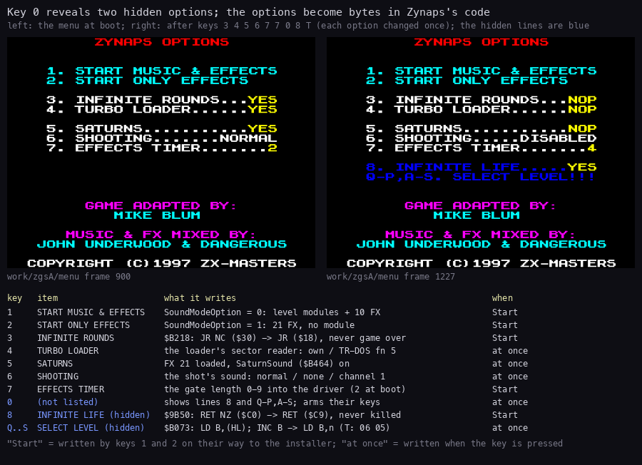
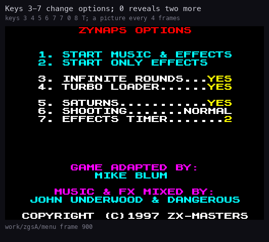

# 5. Controls

What this covers: every key and joystick input, from the options menu to play.

- the options menu, its visible and hidden keys (5.1);
- SELECT LEVEL and INFINITE LIFE (5.2);
- the title keys and the play controls (5.3);
- the high-score initials (5.4);
- the developer switch (5.5);
- known from the code only (5.6).

The runs it rests on:

- `menu`: `work/zgsA/menu`, a fresh boot of the original TRD, keys 3 4 5 6 7 7 0 8 T, a capture every 2 frames
  (`tools/cap_tour.py menu`, `steps.log` names each key and its frame);
- `tour`: `work/zgsA/tour/L01`..`L12`, keys 0, 8, the level key, 1, fire on the title, then play
  ([1](01-game-design.md));
- `r1`: the boot, key 1, fire on the title, level 1.

## 5.1 The options menu



How to read the figure:

- **Left**: the menu as it boots (`menu` frame 900). **Right**: after keys 3 4 5 6 7 7 0 8 T (frame 1227): each
  option changed once, the hidden lines shown (blue).
- **The table** gives each key, its line, what it writes and when: "Start" is written by key 1 or 2 on the way to
  the installer, "at once" when the key is pressed.
- **The point**: the options are bytes in the code that is not installed yet (block 4's image of Zynaps, the loader,
  the driver). The menu edits the game before it runs.

```bash
python3 tools/fig_menu.py --dir work/zgsA/menu --before 900 --after 1227 --out docs/img/controls/menu-options.png
```



How to read the animation:

- **The pictures** are the `menu` captures, one every 4 frames, from frame 902 to 1227.
- **The keys** come one at a time, 33-43 frames apart (`steps.log`): 3, 4, 5, 6, 7, 7, then 0, 8, T.
- **What it shows**: each option key redraws the whole menu with the new value (Redraw `$6DCA`). Key 0 adds the two
  blue lines; key 8 turns INFINITE LIFE to YES; key T shows nothing.

```bash
python3 tools/fig_anim.py --dir work/zgsA/menu --step 2 --delay 80 --scale 2 \
    --title 'Keys 3-7 change options; 0 reveals two more' --note 'keys 3 4 5 6 7 7 0 8 T; a picture every 4 frames' \
    --label work/zgsA/menu --out docs/img/controls/menu.gif
```

The menu (`src/disk/menu.ann`) runs in place inside Trush block 4 at `$6D60`, before the installer:

- Menu `$6D60` pages bank 7 (MakeFont builds a bold copy of the ROM font at `$FD00`) and runs MenuLoop `$6DC4`.
- KeyLoop `$6DD8` reads row `$F7FE` (keys 1-5) and row `$EFFE` (0, 8, 7, 6).
- After an option key it writes the values into the text (ShowValues `$6FB7`, YesNo `$6FF5`: "YES" or "NOP"),
  prints the menu again and waits 10 frames (`$6DD3`).
- Key 1 or 2 goes to Start `$6EB3`, which writes the rest and returns to the boot, which jumps to the installer.

| Key | Line | At the boot | What it changes |
| --- | --- | --- | --- |
| 1 | START MUSIC & EFFECTS | | SoundModeOption = 0: the level modules and the 10 in-game FX ([9](09-sound.md)) |
| 2 | START ONLY EFFECTS | | SoundModeOption = 1: no module in play, 21 FX |
| 3 | INFINITE ROUNDS | YES | InfiniteRounds `$7005`; Start writes `JR` (`$18`) over the `JR NC` (`$30`) at `$B218`: the game is never over |
| 4 | TURBO LOADER | YES | TurboTest's operand `$6532` in the loader: its own sector reader (FastRead) or TR-DOS's function 5 |
| 5 | SATURNS | YES | FX 21 loaded and SaturnSound (`$B464`) on, in effects-only mode |
| 6 | SHOOTING | NORMAL | the shot's sound: NORMAL (the firmware's channel choice), DISABLED, CHANNEL (channel 1 through the gate) |
| 7 | EFFECTS TIMER | 2 | the digit 0-9; Start writes it into the driver: a gated sound is dropped while the countdown since the last one runs |
| 0 | not listed | | Reveal `$6E0D`: shows the two hidden lines, turns on key 8 and the level keys |
| 8 | INFINITE LIFE (hidden) | NOP | InfiniteLife `$7006`; Start writes `RET` (`$C9`) over the `RET NZ` (`$C0`) at `$9B50` |
| Q W E R T, Y U I O P, A S | SELECT LEVEL!!! (hidden) | | SelectLevel `$6E6F` writes `LD B,n` (`$06 n`) over `LD B,(HL)` / `INC B` at `$B073`: levels 1-5, 6-10, 11, 12 |

Witnesses from the `menu` run (its log, read after key T, before the installer ran): `$B218` = `30 F5` (INFINITE
ROUNDS was turned to NOP, so Start would leave the `JR NC`), `$9B50` = `C0` (INFINITE LIFE is written by Start, not
by key 8), `$B073` = `06 05` (key T: level 5).

**Key 0.** Reveal writes `$16` (AT) over the zero that ends the menu's text (TextEnd `$7164`). PrintText `$6EE9`
then goes on into the two lines after it: row 13, column 4, "8. INFINITE LIFE....." and "Q-P,A-S. SELECT LEVEL!!!".
It also points key 8's jump (KeyEight `$6DFF`) at InfiniteLifeKey `$6E7B` and the no-key jump (NoKey `$6E0A`) at
LevelKeys `$6E21`. Without key 0, keys 8 and Q-S do nothing.

**The level keys** are on three rows: Q-T (row `$FBFE`) levels 1-5, P O I U Y (row `$DFFE`) levels 10-6, A S (row
`$FDFE`) levels 11 and 12.

## 5.2 SELECT LEVEL and INFINITE LIFE

**SELECT LEVEL.** The level key writes `LD B,n` into SetLevelStart (`$B073`), where the game reads the next level
from LevelOrder (`LD B,(HL)` / `INC B`):

- SetLevelStart runs at the game start and after every level done;
- so the game starts on level n, and every level after it is n again: a way to practise one level;
- the menu shows no value for it, and nothing undoes it but a new boot.

Witnesses:

- the `tour` runs: each started with one level key; `$B461` (the level whose sound the driver loaded) read 1..12 in
  the twelve runs, and each showed its own scenery ([1.7](01-game-design.md#17-the-twelve-levels));
- the player record's level counter (`$7FA2`, record `+6`) stayed 0 in the `tour` captures: SELECT LEVEL bypasses
  LevelOrder, it does not move the counter.

**INFINITE LIFE.** `RET` at `$9B50` returns before KillPlayer: the ship is hit, but never destroyed.

- `$9B4C` reads Invulnerable `$FFD7` (5.5), `$9B50` is its `RET NZ`, `$9B51` is the `JP` to the ship-hit code (the
  installer points it at ShipHitHook).
- With INFINITE LIFE on, `$9B51` never runs; the `tour` runs (INFINITE LIFE on) kept their 2 lives through 1500
  frames of play with the stick pattern.

## 5.3 The title keys and the play controls

The title pages run between the menu and the game ([4.1](04-game-loop.md#41-the-states)). On them (MenuKeys
`$A76F`, TitleFireCheck `$A748`):

| Key | What |
| --- | --- |
| 1 | one player (SelectOnePlayer `$A788`: the SELECTIONS screen, a colour bar sweeps the line) |
| 2 | two players (SelectTwoPlayers `$A78D`) |
| 3 | the key definition (RedefineKeys `$A5D1`): fire, up, down, left, right into KeyTable `$8188` |
| fire | starts the game: the Kempston's fire (`$1F` reads exactly `$10`) picks the Kempston for the game (`$8187` bit 0); otherwise the fire key or 0 |

The credits page shows "PRESS 1,2,3 & FIRE". In `r1` and the `tour` runs key 1 was held 20 frames, then Kempston
fire 30 frames: the title takes the keys only on some of its pages, so `tools/cap_tour.py` repeats them until
`$B461` shows the load began.

In play (ReadControls `$A6B6`, once a pass, into the control bits `$8186` and the fire counters `$8184`):

| Input | Keys |
| --- | --- |
| Five defined keys | fire P, up L, down Symbol Shift, left A, right S by default (KeyTable `$8188`) |
| Kempston | port `$1F`, when chosen on the title |
| Cursor | 5 left, 6 down, 7 up, 8 right, 0 fire (the default joystick when not Kempston) |
| Sinclair | 6-9 and 0: key 9 switches to it, key 5 back to cursor (`$A710`) |
| 4 | pause (CheckPauseAndEnd `$ABD5` → Pause `$B197`); in the pause fire resumes and Q quits (EndCode 4) |

- The fire counter (`$8184`) counts the passes fire has been held; 0 when released. Taking a pod's weapon needs fire
  held ([10](10-gameplay-logic.md)).
- The menu's keys 1-5 and 6-0 are not read as the defined keys (WaitKeyPress scans the six other half-rows of
  `$8192`).

## 5.4 The high-score initials

At the game over (PlayerDied), HighScoreEntry `$A7F7`:

- ranks the score against the five entries of ROLE OF HONOUR (`$8261`);
- below all of them: UNRANKED for 150 frames or until fire;
- ranked: ENTER YOUR INITIALS; three letters at row 13, column 13, each starting at A, stepped with left and right
  through A-Z, taken with fire or after 100 steps without input (`$A85C`);
- the waits here are HALT loops (`$A86B`, `$A8A6`, `$A8B2`): the installer turned the wait routine into RoundWait,
  so this code waits on its own.

## 5.5 The developer switch

Invulnerable (`$FFD7`) is tested at `$9B4C` before the ship is destroyed: when it is not 0 the ship is never hit.
It is 0 in the image. The GS stubs end at `$FFD1`, below it. The menu's INFINITE LIFE does not use it.

## 5.6 Known from the code only

- **Two players**, **the key definition**, **the pause** and **the high-score entry**: no recording here pressed 2,
  3, 4 or reached a game over (INFINITE ROUNDS was on).
- **TURBO LOADER off** and **SHOOTING CHANNEL**: no run started with them; their effect is read from the loader and
  driver code ([3.3](03-build-and-load.md#33-the-boot), [9](09-sound.md)).
- **Invulnerable** in the GS: `fx2` wrote `$FFD7` = 1 when play began, yet the ship was hit at frame 3644. The
  64 K view read at the frame's end showed other values at `$FFD7` later (frame 3000: 6, frame 3640: 0), so the
  byte was overwritten or another bank was paged; this was not resolved.
