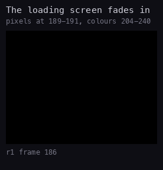
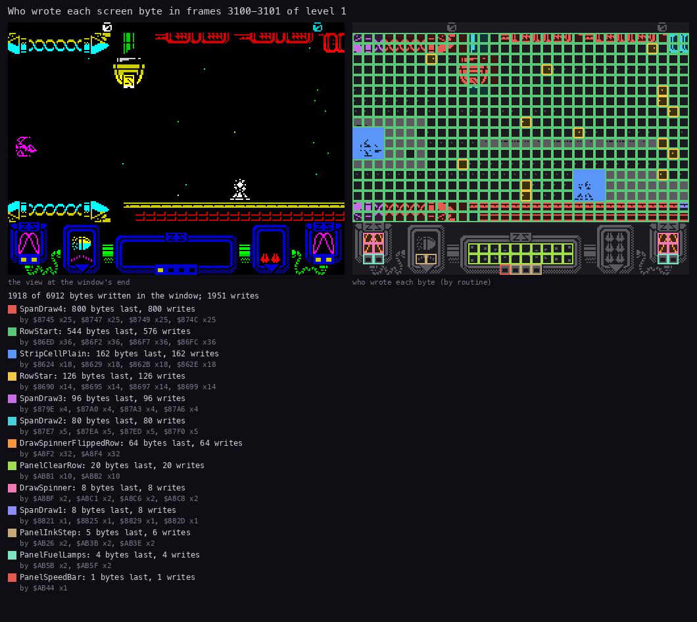
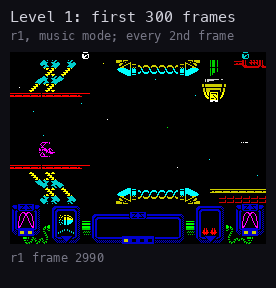
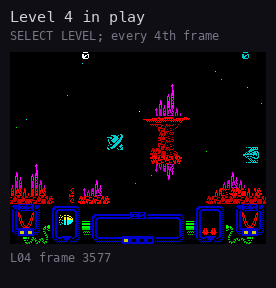
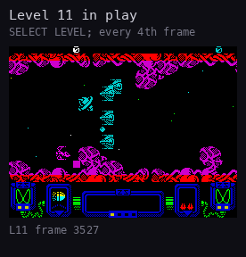

# 6. Rendering

What this covers: everything that draws on the screen, from the loading screen to play.

- the loading screen and its fades (6.1);
- the options menu's printer (6.2);
- the playfield: span chains, the glyph cache, row by row (6.3);
- who writes which screen byte in play (6.4);
- play in motion, three levels (6.5);
- the graphics in the image (6.6);
- known from the code only (6.7).

The recordings: `r1` (power-on to 1773 frames of level 1, [1](01-game-design.md)) on `work/zgsA/r1`, and the
`tour` captures of levels 4 and 11. The listing for the routine names is `build/game.lst`.

## 6.1 The loading screen



How to read the animation:

- **The pictures** are `r1` frames 186-244, one per frame.
- **What it shows**: the pixels are written in frames 189-191 under black attributes, so nothing shows yet. Then
  seven attribute steps, at frames 204, 210, .. 240, bring the colours up from black.
- **The point**: the fade is attribute-only, so it costs 768 bytes a step.

```bash
python3 tools/fig_anim.py --work work/zgsA/r1 --from 186 --to 244 --step 1 --info none --scale 1 --delay 80 \
    --title 'The loading screen fades in' --note 'pixels at 189-191, colours 204-240' --out docs/img/render/fade-in.gif
```

The loading screen is a 6912-byte picture (`src/res/screen/loading.png`). It is shown three times:

- **At the boot**: Trush block 0 unpacks it at `$7F58` with its own code (`src/disk/screen/`). ShowLoadingScreen
  `$7F58` (frame 188) keeps a copy in bank 7 (`$8000` → `$C000`, `$1B00` bytes). MakeFades `$7F76` builds the fade
  steps of the attributes: seven attribute copies, shown 6 frames apart (frames 204-240). The boot fades it out again
  at `$5D9F` (frame 746) before the menu.
- **At every level load**: the loader copies bank 7's picture to the screen before it reads the disk
  ([4.3](04-game-loop.md#43-the-level-load)). The records are read and unpacked in bank 7 (PackedAt `$BED4`,
  unpacked to `$C000`), over the picture's copy, so at the end ScreenToBank7 copies the screen back into bank 7. The
  round start then draws the play screen again.
- **Between the title pages**: TitleStub (`$5B00`, reached from the title loop's `JP NC` at `$B209`) shows it.

## 6.2 The options menu

The menu is drawn by its own printer (`src/disk/menu.ann`, the texts in [texts/menu.md](texts/menu.md)):

- ClearScreen `$6ED9`: a black border, the bitmap and the attributes zeroed.
- MakeFont `$6FA2`: a bold copy of the ROM font in bank 7 at `$FD00`: each row of a ROM glyph ORed with itself
  shifted right one pixel.
- PrintText `$6EE9`: one character cell a character. The codes: 32 and up a character, `$10` a an attribute, `$0D` a
  new line, `$16` r c a position, 0 the end.
- PrintChar `$6F42` writes the 8 lines (CopyGlyph `$6F99`) and the attribute of one cell.
- Every option key prints the whole text again (Redraw `$6DCA`), with the values written into it first
  ([5.1](05-controls.md#51-the-options-menu)).

## 6.3 The playfield

The playfield is 18 character rows of 32 columns (screen rows 1-18). Nothing is drawn pixel by pixel:

- **Span chains.** Every row is a chain of span nodes. A node names a run of 0-4 glyphs out of the glyph cache and
  the gap of empty columns before it. The nodes come from the pool at `$F800` (95 nodes of 8 bytes).
- **The glyph cache** (`$C000-$DFFF`) holds 256 glyphs in four copies, shifted by 0, 2, 4 and 6 pixels (pages
  `$C0`, `$C8`, `$D8`, `$D0`). Line k of glyph n is at page + k * 256 + n. ShiftPage (`$7F6A`) picks the copy for the
  scroll phase, so a span handler only copies bytes: LDI and LDD alternate across the run, one pixel line after
  another (SpanDraw4 `$873E`, SpanDraw3 `$8797`, SpanDraw2 `$87E0`, SpanDraw1 `$8819`).
- **The row records** (RowRecords `$F12C`, 32 bytes a row) hold the map ring pointer, the attribute and screen
  addresses, the head node, the counters, the sprite-strip list and the row's star. The renderer runs with SP at
  the record and POPs its fields.
- **Per row** (RowStart `$86CE`): one `OUT ($FE)` (the beeper toggle of the row), the 32 attributes pushed from the
  map ring onto the attribute row, the span nodes, the sprite strips (StripDraw), the star (RowStar `$867B`), then a
  delay that pads every row to the cost of at least four glyphs.
- **The beeper toggle** is silent in play: RowBeep `$7F7E` and its mask `$7F7F` read `00 00` at `r1` frames 3000,
  3100, 3500, 4000 and 4500. The mask is shifted out of SoundPattern1 at `$AA30`, which the installer's GateStub
  (`$AA28`) has replaced. The `OUT ($FE)` at `$86D7` ran 10 530 times in `r1-play`, each writing 0.
- **The scroll.** The playfield moves left two pixels a step. The map ring at `$B700-$BFFF` holds the tile codes
  and attributes, ScrollColumn (`$801C`) the leading column. When a new column enters on the right, the column
  builder reads each tile's 8 lines from the tile set (`$5C00`, line k of tile n at `$5C00` + k * 256 + n), mirrors it
  through BitReverse (`$FB00`) when asked, and writes the four shifted copies into the glyph cache (BuildGlyph
  `$89C9`).
- **The objects** (16 records of 44 bytes, `$F36C-$F5FF`) are not drawn on their own: BuildObjectStrips cuts every
  visible object into one strip per character row and links the strips into the row records. The renderer draws them
  with the scenery.
- **The stars**: one per playfield row, in its record (`+$18-+$1F`), moving only while the playfield scrolls.

## 6.4 Who writes the screen



How to read the figure:

- **Left**: the screen at the window's end, `r1` frame 3101.
- **Right**: each byte coloured by the routine that wrote it last in frames 3100-3101; set pixels in the colour,
  clear pixels in its dark shade. Dark grey: nobody wrote the byte in the window.
- **The legend** gives each writer's bytes, its writes and the instructions that did them.
- **What it shows**:
  - RowStart (green) writes every playfield attribute: the green grid covers rows 1-18;
  - SpanDraw4 (red) and SpanDraw3 / SpanDraw2 (magenta, cyan) write the scenery's glyph runs: the top and bottom
    walls;
  - StripCellPlain (blue) writes the objects' strips: the ship and the enemy on the left;
  - RowStar (yellow) writes the stars, one cell per row;
  - the panel (rows 19-23) is mostly untouched: only the spinners, the colour cycles and the fuel lamps change.
- **The point**: 1918 of the 6912 screen bytes change in a 2-frame pass, all of them from the scenery runs, the
  attributes and the object strips. Empty space costs nothing: no node, no write.

```bash
python3 ../../kit/writers_map.py --work work/zgsA/r1 --window 3100:0-3102:0 --listing build/game.lst \
    --title 'Who wrote each screen byte in frames 3100-3101 of level 1' --out docs/img/render/writers-play.png
```

The same two frames against the beam: [4.2](04-game-loop.md#42-the-main-loop-and-the-frame-in-play). The playfield
rows are drawn just behind the beam, so a frame's picture shows from the next frame on.

## 6.5 Play in motion

| Level 1 (`r1`) | Level 4 (`tour`) | Level 11 (`tour`) |
| --- | --- | --- |
|  |  |  |

How to read the animations:

- **Level 1** is `r1` frames 2990-3290, every 2nd frame: the first 300 frames of play in music mode, with the scroll
  starting and the first wave.
- **Levels 4 and 11** are the `tour` captures 400-700 frames after the loading screen went, every 4th frame: the
  stick pattern with fire held, INFINITE LIFE on.
- **What they show**: the scenery scrolls two pixels a step; the waves follow their paths; the panel's spinners and
  colour cycles run on every frame. Level 4's spires and level 11's organic walls are glyph runs of the same
  renderer.

```bash
python3 tools/fig_anim.py --work work/zgsA/r1 --from 2990 --to 3290 --step 2 --info none --scale 1 \
    --title 'Level 1: first 300 frames' --note 'r1, music mode; every 2nd frame' --out docs/img/render/play-level1.gif
s=$(grep gone work/zgsA/tour/L04/steps.log | awk '{print $1}')
python3 tools/fig_anim.py --dir work/zgsA/tour/L04 --from $((s+400)) --to $((s+700)) --step 2 --delay 80 --scale 1 \
    --title 'Level 4 in play' --note 'SELECT LEVEL; every 4th frame' --out docs/img/render/play-level4.gif
```

The twelve levels as stills: [1.7](01-game-design.md#17-the-twelve-levels).

## 6.6 The graphics in the image

Block 4 carries the game as the memory after its start-up ran ([src/res/gfx/README.md](../src/res/gfx/README.md)):

- the scenery tiles at `$5C00` and the wave cells at `$6400`, where the game reads them; a second copy at `$BC00`
  and `$C400` is overwritten in play by the map ring and the glyph cache;
- the sprites (`$E000-$E747`) and the pod (`$F048-$F107`) complemented;
- the icons of the pod selector and the game's own glyphs for the print codes `$80-$B5`.

The resources are PNG files; `tools/res_gfx.py` writes both tile copies and the complement.

## 6.7 Known from the code only

- **The guardians' big sprites** (BuildBigSprite `$8F0C`, a 7 x 9 cell image built at `$C000`): none was on the
  screen in these recordings.
- **The menu raster** (MenuRasterInterrupt `$A512`: a colour per scan line for the selections, the key definition
  and the high-score screens): it ran for the PREPARE FOR COMBAT banner in `r1`, but no figure here shows it.
- **The panel's save** (`$E748-$F047`) and its restore at the pause: not recorded.
