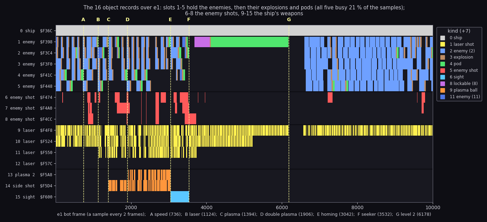
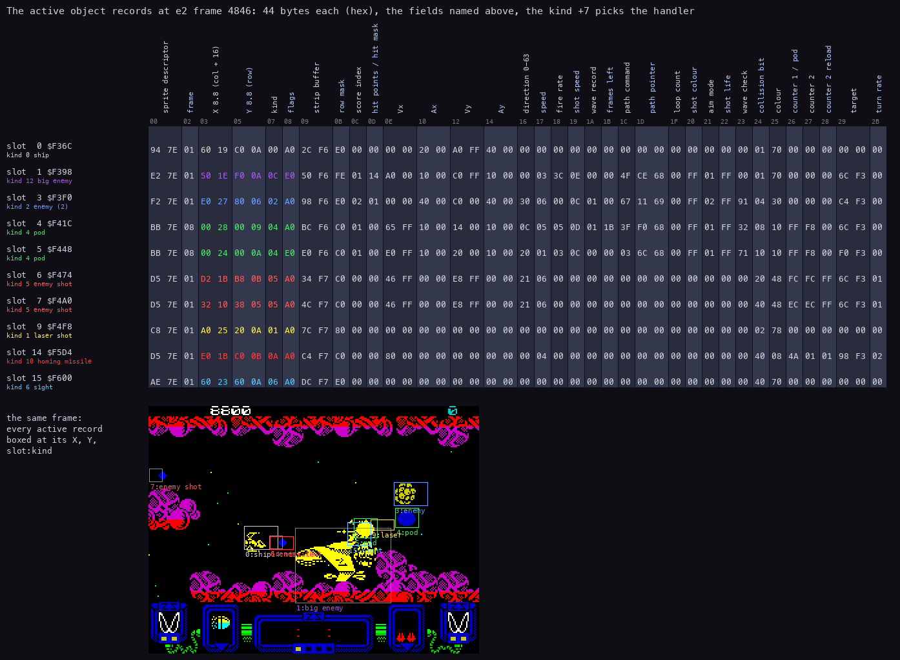
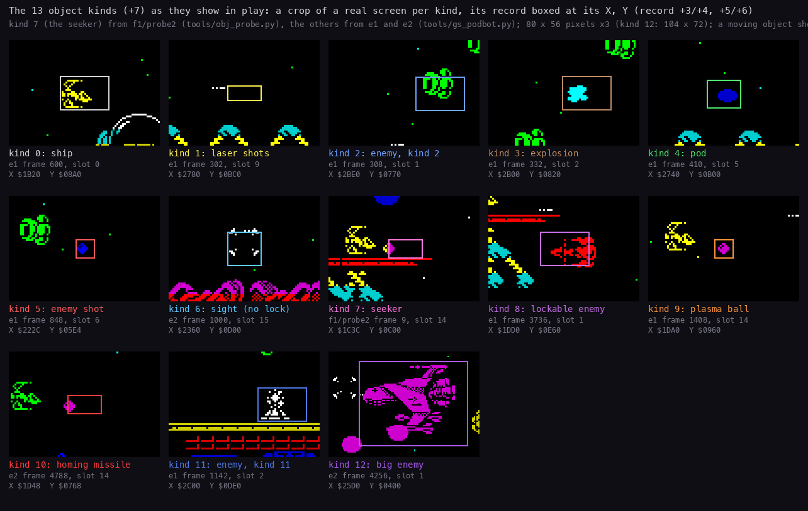
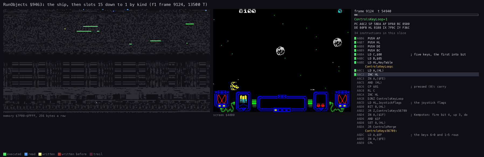
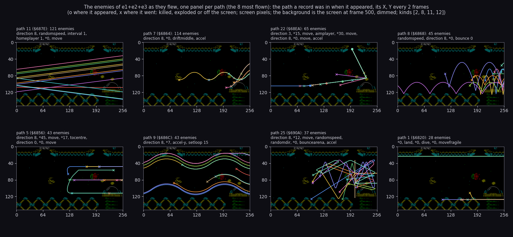
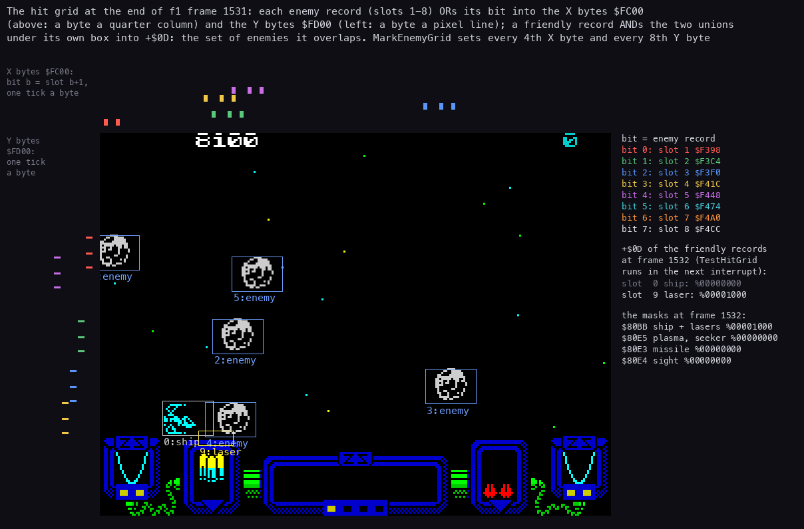
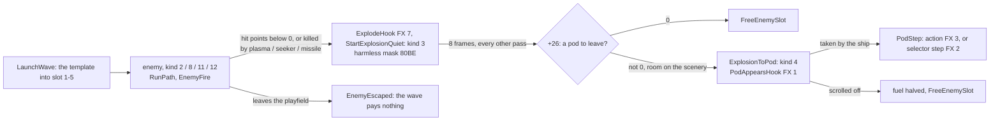
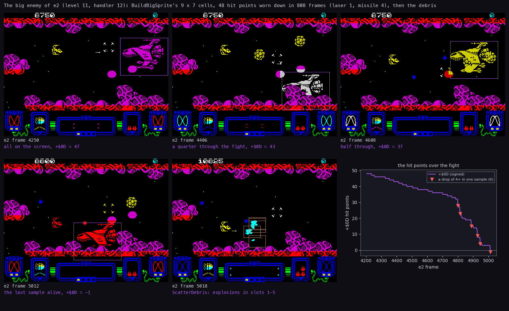

# 7. Objects

What this covers:

- the 16 object records and what each slot holds, and the 44-byte record;
- the kinds and their handlers, and the pass's object loop RunObjects;
- the path bytecode the enemies fly by, with the paths as the recordings flew them;
- the collision grid and the hit masks;
- the wave launcher and the sprite cache;
- the life of an enemy (explosion, pod) and the big enemy;
- the object events the conversion turns into sounds on the card.

[10](10-gameplay-logic.md) says what the weapons and the enemies do; this document says how the records carry them.
[9](09-sound.md) says what the card plays for each sound site of 7.10.

The recordings it rests on (all on a Pentagon 128 with TR-DOS and General Sound, booted from
`work/media/trd/ZYNAP_GS.TRD`, INFINITE LIFE switched on in the options menu):

| Recording | Made by | Frames | Used here for |
| --- | --- | ---: | --- |
| `work/zgsB/e1` | `tools/gs_podbot.py --plan 0,1,2,2,3,4`, music and effects, GS 512 KB | 10000 | the slots over two levels, the paths, the kinds, the counters |
| `work/zgsB/e2` | `tools/gs_podbot.py --plan 3`, effects only, GS 512 KB, SELECT LEVEL 11 | 12000 | the record sheet, the big enemy, the homing missile and the sight |
| `work/zgsB/e3` | `tools/gs_podbot.py --plan 0,1,2,2,3,4`, effects only, GS 128 KB | 8000 | the paths, the counters |
| `work/zgsB/f1` | `tools/gs_podbot.py --plan 4 --hold 8`, then `tools/obj_probe.py` (probe2, probe3), music and effects, GS 512 KB | about 3600 + 900 + 1600 | the seeker, the hit grid frame by frame, a TTD recording of one pass |

`gs_podbot.py` logs every second frame: the player record `$7F9C`, `$80E0-$80EF`, FireHeld `$8184`, `$7F62-$7F81`,
the 16 records `$F36C-$F62B` and the screen (`PREFIX.npz`, read by `tools/zgsbplot.py`, class Rec).
`obj_probe.py` logs every frame and adds the collision grid `$FC00-$FD8F` and the hit masks.
The frame numbers count from the first frame of play of each run.

## 7.1 Sixteen records, fixed roles

Every moving thing is one of 16 records of 44 bytes (`$2C`) from `$F36C` to `$F62B` (records.asm).
Each slot has a fixed role:

- the code finds a free enemy record only among slots 1-5 (TakeEnemySlot `$938D`);
- a free enemy shot only among slots 6-8 (EnemyFire `$A0EB`);
- a free laser shot only among slots 9-12 (FireLaser `$9C1D`, FireLaserFindSlot `$9C37`).

| Slot | Address | Label | Holds | Kinds seen (e1, e2, e3, f1) |
| ---: | --- | --- | --- | --- |
| 0 | `$F36C` | PlayerObject | the ship | 0 |
| 1-5 | `$F398`-`$F448` | EnemyObjects | enemies, then their explosions, then the pods | 2, 3, 4, 8, 11, 12 |
| 6-8 | `$F474`-`$F4CC` | EnemyShots | enemy shots (at most 3, EnemyShotsLeft `$8074`) | 5 |
| 9-12 | `$F4F8`-`$F57C` | LaserShots | the ship's laser shots | 1 |
| 13 | `$F5A8` | PlasmaBall2 | the second plasma ball of the double plasma | 9 |
| 14 | `$F5D4` | SideShot | the side weapon's shot: plasma ball, missile or seeker | 9, 10, 7 |
| 15 | `$F600` | SightObject | the homing sight | 6 |

Two record groups matter for the collisions (7.6):

- the 8 enemy records, slots 1-8, each with one bit `+$24` (slot n has bit n - 1);
- the 8 friendly records: the ship, the four lasers, the two side-weapon slots and the sight.



```sh
python3 tools/fig_objects.py slots --npz work/zgsB/e1/bot.npz
```

How to read it:

- One line a slot, one column a sample (every second frame).
- The colour is the kind `+7` while `+8` bit 7 (active) is set; dark is free.
- The dark lines between the rows split the groups: the ship, the enemies, the enemy shots, the lasers, the side
  weapon.
- The dashed lines A-F are the weapons the bot took and G the start of level 2 (`work/zgsB/e1/bot-events.txt`); the
  x label names them.

What it shows:

- Slots 1-5 cycle blue (enemy) → brown (explosion) → green (pod) or free: an enemy's record lives on as its
  explosion and its pod (7.8). All five were busy in 21 % of the samples.
- Slot 12 (the fourth laser) never fires: e1's laser level went no higher than 2.
- Slots 11 and 10 stop after 3756 and 5196: the two FuelOut calls (`$9C03`) each took a laser level
  ([10](10-gameplay-logic.md)).
- Slots 13 and 14 turn orange with the plasma (C, 1394) and the double plasma (D, 1906).
- Slot 15 is cyan with the homing sight from E (3042) to F (3532), when the seeker pod (PodSeeker `$9DDD`) takes it
  off.
- Slot 14 holds kind 7 from F on and is never active: the bot fires in bursts of 6 passes, and the seeker needs fire
  held for exactly 7 (7.3).
- From 3704 slot 1 is a lockable enemy (purple), then a pod parked to the level's end at 6178: the scroll is off and
  nothing takes it.
- Level 2 (G) starts with no side weapon: the level end (script op 5, `$AE40`) clears it ([10](10-gameplay-logic.md)).

## 7.2 The record

Every slot has the same layout. The fields, from records.asm, movers.asm, objects.asm and their uses:

| Offset | Field | Notes |
| --- | --- | --- |
| `+0`/`+1` | the sprite descriptor | a 13-byte record: the image, the shifted-copy size, rows, width, row mask (effectdata.asm) |
| `+2` | the animation frame | explosions 1-8 (ExplosionStep) |
| `+3`/`+4` | X, 8.8 | in columns of the playfield; the screen shows columns 16-47 (`+4` - 16 = the screen column) |
| `+5`/`+6` | Y, 8.8 | in rows 0-15 of the playfield (row 0 is the screen's row 1) |
| `+7` | the kind | the handler (7.3) |
| `+8` | flags | bit 7 active, bit 6 fired once (EnemyFire), bit 5 on the playfield (drawn) |
| `+9`/`+$0A` | the strip buffer | the object's 12-byte strip entries |
| `+$0B` | the row mask | `$E0`, `$C0`, `$80`: how many character rows the sprite covers (`$FE` for the big enemy) |
| `+$0C` | the score index | the award AddScore `$A489` pays when it dies |
| `+$0D` | hit points (enemies) or the overlap mask (friendlies) | TestHitGrid writes the friendlies' mask (7.6) |
| `+$0E`-`+$15` | Vx, Ax, Vy, Ay | 8.8 velocities and the kind's accelerations |
| `+$16` | the direction 0-63 | SetVelocity `$98F1` |
| `+$17` | the speed | the kind byte 2's high nibble |
| `+$18` | the fire rate | 0: never fires |
| `+$19` | the shot speed | bits 0-2 the steps, bits 3-7 the speed index |
| `+$1A` | the wave record | an index into WaveRecords `$8075` |
| `+$1B` | frames left of the path command | RunPath |
| `+$1C` | the path command | RunPath |
| `+$1D`/`+$1E` | the path pointer | RunPath; the path sounds look at it (7.10) |
| `+$1F` | the loop count | PathOpSetLoop, PathOpLoop |
| `+$20` | the shot colour | EnemyFire |
| `+$21` | the aim mode | the kind byte 1 AND `$E3` |
| `+$22` | the shot life | EnemyFire |
| `+$23` | the wave check | compared with the descriptor's `+$0F` (EnemyGone `$9954`) |
| `+$24` | the collision bit | one bit per enemy record and per friendly record |
| `+$25` | the colour | flashes (CycleColour), fades (ExplosionAdvance `$A1EC`) |
| `+$26`/`+$27` | counters | `+$26`: the pod to leave (explosions), the bounces (plasma), the life (missile) |
| `+$28` | counter 2's reload | PathOpSetInterval |
| `+$29`/`+$2A` | the target record | homing paths, the missile, the seeker |
| `+$2B` | the turn rate | PathOpHome |



```sh
python3 tools/fig_objects.py record 4846 --npz work/zgsB/e2/bot.npz
```

How to read it:

- One row a record, one column a byte; the field names stand rotated above the columns, the offsets under them.
- The coloured bytes are X, Y, the kind and the flags, in the kind's colour.
- The screen below has each active record boxed at its X, Y and labelled slot:kind. The screen is the picture the
  pass drew before its last move, so a moving object shows a move behind its box.

What the sheet shows (level 11, the big enemy fight, after the second homing missile hit at 4814):

- The ship's X `$1960` is column `$19` = 25, screen column 9; its Y `$0AC0` row 10.75.
- The big enemy (slot 1, kind `$0C`) has 20 hit points left (`+$0D` = `$14`) and the row mask `$FE`.
- The homing missile (slot 14, kind `$0A`) has its target `+$29`/`+$2A` = `$F398`, the big enemy's record, and
  74 frames of life left (`+$26` = `$4A`, from 75).
- The lock: `$80E0` = `$98` (the low byte of `$F398`) and `$80E2` = 1.
- The collision bits `+$24`: slot 1 `$01`, slot 3 `$04`, slot 4 `$08`, slot 5 `$10`, slot 6 `$20`, slot 7 `$40`;
  the ship `$01`, the laser `$02`, the missile `$40`, the sight `$40`. The two groups use the same bit numbers for
  different records.
- The two pods (slots 4 and 5, kind 4) have `+$26` = `$FF`: ExplosionToPod `$A2D6` took 2 off the pod count.

## 7.3 Kinds and handlers

The kind `+7` indexes KindHandlers `$80FA` (handlertables.asm):

| Kind | Handler | Address | What it is |
| ---: | --- | --- | --- |
| 0 | PlayerHandler | `$9A5B` | the ship: controls, fire, fuel |
| 1 | LaserHandler | `$9E32` | a laser shot |
| 2 | EnemyHandler | `$9F88` | a common enemy |
| 3 | ExplosionStep | `$A1C8` | an explosion |
| 4 | PodStep | `$A1FD` | a weapon pod |
| 5 | EnemyShotStep | `$A263` | an enemy shot |
| 6 | SightHandler | `$9E03` | the homing sight |
| 7 | SeekerHandler | `$9F13` | the seeker |
| 8 | LockableHandler | `$9FC8` | an enemy the sight can lock |
| 9 | PlasmaHandler | `$9E67` | a plasma ball |
| 10 | MissileHandler | `$9ED7` | the homing missile |
| 11 | EnemyHandler | `$9F88` | a common enemy the seeker ignores |
| 12 | BigEnemyHandler | `$A03E` | the big enemy |

An enemy's handler kind comes from the kinds table EnemyKinds `$6A65`, byte 5
([`src/res/levels/README.md`](../src/res/levels/README.md)), so the 22 enemy kinds of the level data share handlers
2, 8, 11 and 12.



```sh
python3 tools/fig_objects.py kinds
```

How to read it:

- One crop per kind, 80 × 56 pixels at 3× (the big enemy 104 × 72), cut round the first record of that kind that
  had been active for 4 samples and sat inside the playfield.
- The box is the record's X, Y and the sprite size; the caption gives the recording, the frame, the slot and the
  record's X and Y.
- Kind 7 comes from f1's probe2: e1, e2 and e3 never launched a seeker.

What it shows:

- The ship (kind 0), the enemies (2, 8, 11) and the big enemy (12) are cell sprites inside their boxes.
- The shots (1, 5), the plasma ball (9), the missile (10) and the seeker (7) show a move behind their box: they move
  a column or more a frame.
- The sight (6) is two pairs of brackets, the pod (4) a round ball, the explosion (3) one frame of the 8-frame ball.

The weapon launches in the counters (the memory profiler, `work/zgsB/eN/bot-counts.json`):

- HomingFrame's launch `$9CFA` ran 6 times in e2 and 2 times in e3; every launch passed MissileLaunchHook `$FF4D`.
- SeekerLaunch `$9D1F` ran 0 times in e1-e3 and 61 times in f1. The launch needs FireHeld `$8184` at exactly 7
  (SeekerFrame `$9CFE`), and FireHeld counts passes, one every second frame in level 1 (probe2's log: 0, 1, 1, 2, 2,
  ...). The e-runs' bot released fire after 6 passes; f1's bot after 8, its probe after 9.
- The plasma launch `$9CA6` ran 50 times in e1 and 49 in e3 (fire held exactly 3 passes).

## 7.4 RunObjects: the object half of a pass

RunObjects `$9463` (movers.asm) is called once a pass from PlayPass `$AA96`:

1. The ship, slot 0, through its handler.
2. Slots 15 down to 1 (B = 15, IY from `$F600`, step -44): an active one through KindHandlers by its kind.
3. After each slot: SlotBeep `$7F86` XOR `$18`, AND SlotBeepMask `$7F87`, `OUT ($FE)`: one speaker toggle per slot.
4. With fewer than 8 active slots (C idle slots, C ≥ 8): a pad of (C - 7) × 128 `DJNZ` turns, so the pass takes
   about the same time with few objects as with many.
5. The hit masks of the pass cleared: `$80BB`, `$80E3`, `$80E4`, `$80E5`, `$F379` (the ship's `+$0D`) and the `+$0D`
   of the 7 friendly records from `$F4F8`.



```sh
python3 tools/gs_session.py steps --work work/zgsB/f1 ttd:start run:4
python3 ../../kit/routine_anim.py --work work/zgsB/f1 --window 9124:54600-9124:68200 --listing build/game.lst --out docs/img/objects/RunObjects.gif --view screen --range 7F00-FFFF --pictures 40 --delay 150 --title "RunObjects \$9463: the ship, then slots 15 down to 1 by kind (f1 frame 9124, 13500 T)"
```

How to read it:

- Left: the memory `$7F00-$FFFF`, 256 bytes a row: green executed, blue read, yellow written in this picture, red
  written earlier.
- Middle: the screen. Right: the listing round the instruction last run, the registers, the routine's name.
- The window is f1 frame 9124 (the instance's frame count) from T 54600 to 68200, in a TTD recording started in level
  2: RunObjects runs from T 54636 to 68153, 13500 T, 1258 instructions.

What it shows:

- The record area `$F36C-$F62B` lights row by row from the top (the sight) down, as IY walks down.
- The variables at `$7F00-$81FF` are read by every handler (the hit masks, PassBit, the player record).
- Nothing on the screen changes: RunObjects only moves records; the drawing ([6](06-rendering.md)) puts them on
  screen later in the pass.
- The pad loop (`$94A7-$94AD`) runs from T 64486 to 67838, a quarter of the window: few slots were active.

## 7.5 The path bytecode

An enemy flies by a path, a byte program in the level data: PathStarts `$6800` (28 entries, the start = `$681C` +
2 × entry) and PathCode `$681C` ([`src/res/levels/README.md`](../src/res/levels/README.md)).
RunPath `$94CB` runs it, one command a frame:

- `+$1D`/`+$1E` point at the next byte; `+$1C` holds the command; `+$1B` counts the frames it still runs.
- A byte with bit 7 set is a repeat count (`b & $7F`, 0 = for ever) for the command after it; without it a command
  runs one frame.
- A command's bits 0-2 pick the routine (PathOps `$8114`), bits 3-6 are its parameter P.
- A routine that returns carry is a setting: the next command runs in the same frame. No carry ends the object's
  frame.

| Command | Routine | What it does |
| ---: | --- | --- |
| 0 | PathOpAccelerate `$9529` | add or subtract the kind's accelerations (P: the flags), then move |
| 1 | PathOpSetLoop `$9591` | the loop counter `+$1F` = P |
| 2 | PathOpSetInterval `$959C` | the homing interval `+$27` = `+$28` = P |
| 3 | PathOpBounce `$95AA` | move, bouncing off the scenery |
| 4 | PathOpHomePlayer `$95FC` | home on the player, turn rate P |
| 5 | PathOpSetDirection `$9613` | direction P × 4 of 64, then move |
| 6 | PathOpHomeTarget `$9625` | home on the target, the player once it is gone |
| 7 | PathOpExtended `$9509` | P picks one of 16 routines from PathExtOps `$8124` |

The 16 extended routines (movers.asm, `$9640`-`$9890`):

- 0 PathOpScroll `$9640` (move with the landscape), 1 PathOpStop, 2 PathOpRandomDirection;
- 3 PathOpLoop (back to a word target while `+$1F` counts down), 4 PathOpDriftMiddle, 5 PathOpAimPlayer `$9699`;
- 6 PathOpScrollAlways, 7 PathOpMove `$96A8`, 8 PathOpHome, 9 PathOpToCentre, 10 PathOpLand, 11 PathOpRandomSpeed;
- 12 PathOpBounceArena, 13 PathOpDive `$9837`, 14 PathOpMoveFragile, 15 PathOpWait.

The coordinates are 8.8: X in playfield columns (16-47 on the screen), Y in rows 0-15.
Each frame PathOpMove adds Vx and Vy. The pods use PathOpScroll: they move with the landscape (PodStep).
The paths as text, every byte decoded, are in
[`src/res/levels/levels.lev.txt`](../src/res/levels/levels.lev.txt) (`tools/res_levels.py`).



```sh
python3 tools/fig_objects.py paths --npz work/zgsB/e1/bot.npz,work/zgsB/e2/bot.npz,work/zgsB/e3/bot.npz
```

How to read it:

- One panel per path, the 8 paths most flown in e1, e2 and e3 together; the title names the path, its start and the
  number of enemies, and gives the start of its bytecode.
- An enemy is a record in slots 1-5 with kind 2, 8, 11 or 12 from the sample it appears to the sample it goes; its
  path is the one whose start is the last at or before its pointer `+$1D`/`+$1E` when it appeared.
- o marks where it appeared (often past the right edge, where LaunchWave places it), x where it went: killed,
  exploded or off the screen.
- The axes are screen pixels; the background is e1's screen at frame 500, dimmed.

What it shows:

- Path 11 (121 enemies, e1 and e3): `homeplayer 1` aims once at the ship, then `*0, move` flies a straight line for
  ever.
- Path 7 (114): `driftmiddle` weaves round the middle row; path 9 (43) is two `accel` sweeps in a loop: the waves
  that cross the screen as a sine.
- Path 22 (65, e2 level 11): `direction 3, *15, move, aimplayer, *30, move`: down-left, a turn at the ship, then
  straight on.
- Path 8 (45) bounces off the scenery (`bounce 0`); path 25 (37, e2) bounces off the arena's edges (`bouncearena`).
- Path 1 (28, e2) lands (`land`), dives (`dive`) and runs along the floor (`movefragile`).
- Path 5 (43): left, `tocentre` for 17 frames, then straight left at the new row.

The paths per recording: e1 flew paths 2, 5, 6, 7, 9, 11, 13, 16 and 19; e3 the same less 9 and 16; e2 paths 0, 1,
2, 4, 8, 9, 20, 22, 23 and 25.
What no recording reached: paths 3, 10, 12, 18, 21, 24 and 27, flown on the levels nobody played here (3-10 and 12).

## 7.6 The collision grid

Zynaps does not test pairs of objects. It keeps a bitmap grid (objgrid.asm):

1. ClearHitGrid `$91C6` zeroes `$FC00-$FD8F`.
2. MarkEnemyGrid `$90CB` ORs each active, drawn enemy record's bit `+$24` into the grid: every 4th X byte over the
   sprite's width plus the last (`$FC00`, one byte a quarter column: index / 4 - 16 = the screen column) and every
   8th Y byte over its height plus the last (`$FD00`, one byte a pixel line: line + 8 = the screen y), the rows outside
   the row mask `+$0B` left out.
3. TestHitGrid `$9150` ORs the X bytes and the Y bytes under each friendly record's box and ANDs the two unions into
   its `+$0D`: the set of enemies that overlap it.
4. The ship's and the active lasers' union goes into `$80BB`; each enemy handler tests its own bit there.

The grid does not stay set: in probe3 it held marks at the end of 1176 of 1600 frames and was clear at the others.
In f1 (from the bot's start to probe3's end) ClearHitGrid ran 2426 times, TestHitGrid 2424, MarkEnemyGrid 1617 and
RunObjects 3231.

The weapons have masks of their own, cleared by RunObjects every pass:

| Mask | Who writes it | What the enemy handler does with its bit |
| --- | --- | --- |
| `$80BB` | the ship and the lasers (TestHitGrid) | one hit point off (EnemyHandler, LockableHandler, BigEnemyHandler) |
| `$80E5` | the plasma balls and the seeker | killed at once |
| `$80E3` | the homing missile | killed, if it is the locked one; the big enemy loses 4 hit points |
| `$80E4` | the sight | the lockable enemy locks (`$80E0`, `$80E2`) |
| `$F379` | the ship's `+$0D` | the pod is taken (PodStep), the enemy shot hits |

HarmlessMaskA `$80BD` and HarmlessMaskB `$80BE` hold the enemy bits that do not stop a laser (LaserHandler `$9E32`):

- StartExplosion puts an explosion's bit into `$80BE`;
- ExplosionToPod `$A2D6` moves a pod's bit into `$80BD`;
- FreeEnemySlot `$992A` clears both.



```sh
python3 tools/obj_probe.py --work work/zgsB/f1 --frames 1600 --fire 18,6 --out work/zgsB/f1/probe3
python3 tools/fig_objects.py grid 1531 --npz work/zgsB/f1/probe3.npz
```

How to read it:

- The screen of probe3 frame 1531 (level 2) at 3× in the middle, each active record boxed as slot:kind.
- Above it, the X bytes `$FC00`: one tick per set bit, at the column the byte stands for, one tick row per bit, in the
  colour of the bit. Left of it, the Y bytes `$FD00`, one tick per set bit at its pixel line.
- The legend on the right names the bits (bit n = enemy slot n + 1) and lists the friendly records' `+$0D` and the
  four masks at frame 1532.

What it shows:

- Each enemy covers 3 X ticks a column apart and 3 Y ticks 8 lines apart: its 24 × 16 box as MarkEnemyGrid marks
  it.
- The grid holds the boxes, not the shapes: slot 1 (X `$0F68`, half off the left edge) still marks its bytes.
- The laser in slot 9 (X `$1640`, Y `$11C0`) shares X and Y bytes with slot 4: its `+$0D` at frame 1532 is
  `%00001000`, and so is `$80BB`; slot 4's handler takes it as a hit.
- At 316 of probe3's 1600 frames the Z80 view at `$C000-$FFFF` showed bank 1 (the driver paged in at the frame's
  end, mostly over the level 2 load); the figure's frames are taken from the others.

The grid routines walk the records and the grid with SP (POP is the fastest read). Each saves SP into its own final
`LD SP,$0000` and runs with interrupts on; an interrupt's pushes land in the grid, which is rebuilt the next time.

## 7.7 The wave launcher and the sprite cache

LaunchWave `$91EC` (waves.asm) starts wave A when the script asks ([10](10-gameplay-logic.md)):

1. Refused when no enemy slot is free (`$8072` = 0) or no wave record is allowed (`$8073` = 0).
2. A wave record (3 bytes at WaveRecords `$8075`, `$FF` free) is taken: the live count, the bonus byte.
3. WaveIndex `$6926`[A] gives the wave's data at `$6943`: the bonus byte (bits 6-7 the pod, bits 0-5 the bonus
   award), the kind, the object count, the path numbers (`$806A`).
4. The kind's 8 bytes (EnemyKinds `$6A65`) fill the 44-byte template at `$803E`: the fire rate, the colour set (with
   WeaponRatingLevel `$80E9`), the score, the speed, the accelerations, the handler kind, the colour, the hit points.
5. Each object of the wave is the template copied into a free enemy slot (TakeEnemySlot `$938D`), with its own
   path, X (`$C0` + x / 2, the right edge) and Y (the script's row offset + y), and a start delay that grows by the
   wave's gap from object to object.

Each enemy that dies or escapes counts its wave down (EnemyKilled `$994E`, EnemyEscaped `$994A`, EnemyGone `$9954`);
the last one pays the bonus and leaves the pod (7.8).

The sprite cache keeps the images of the kinds on screen:

- 6 records of 16 bytes at `$7EF2` (records 1-6); record 0 at `$7EE2` serves the kinds from `$14` up (the big
  enemies), uncached, its image at `$C008`.
- GetSpriteCache `$93A7` finds the record of a kind (`+$0E` = kind OR `$80`, `+$0D` the use count) or takes a free
  one (the mask `$8087`, the free-record table `$8088`).
- A new kind is queued in a ring at `$8025` (8 entries of 3 bytes) and event bit 7 is posted: SpriteBuildJob `$ACA6`
  builds the image and its pre-shifted copies in the play loop's spare time.
- EnemyGone counts the use down; at 0 the record's bit leaves `$8087`.

The sprite images (`$E000-$E747`, `$F048-$F107`, effectdata.asm) are stored the way they are drawn: a clear bit
shows the object's colour (`+$25` is a paper colour) and a set bit keeps the cell black. The game image is memory
taken after the start-up that turns them ([3](03-build-and-load.md)), and the GS game never runs that start-up.

## 7.8 An enemy's life: explosion and pod



- An enemy's death goes through ExplodeHook `$FF3B` (written at `$9FBE` and `$A034`): the hook asks the card for
  FX 7, then StartExplosionQuiet `$A2A5` turns the record into kind 3 in place: the explosion animation `$7EA1` from
  frame 1, colour `$70`.
- StartExplosion's own entry `$A293`, which would set the three beeper noise patterns, is never reached in play: the
  debris (`$9BE6`) calls the quiet entry too.
- ExplosionStep `$A1C8` runs in odd passes only: each of the 8 frames is held for `+$27` passes, drawn black (a
  flash) while held; ExplosionAdvance fades the colour one ink step a frame.
- The last enemy of a wave gets `+$26` = the bonus byte's bits 6-7 (EnemyGone): its explosion becomes a pod.
- ExplosionToPod `$A2D6` rounds Y to the cell and asks SceneryAt4 `$99BB` for room; none: the pod is lost.
- A pod taken goes through PodStep `$A1FD`: fire held 8 passes or more (`$A209`) runs the selected action (`$A21F`,
  WeaponOnHook, FX 3), without it the selector steps on (`$A226`, NextWeaponHook, FX 2).

The counts in e1 (10000 frames, levels 1 and 2): ExplodeHook 110, PodAppearsHook 31, NextWeaponHook 23,
WeaponOnHook 6, SlotGoneHook (each enemy record gone) 188.

## 7.9 The big enemy

The big enemies (kinds 20 and 21 of the level data, handler 12) are too big for the cell sprites.
BuildBigSprite `$8F0C` (sprites.asm) draws one from a one-bit cell map:

- A 7 × 9 cell image at `$C000` (72 × 56 pixels), column-major, like the cell sprites.
- A = 1: the glyphs from BigSpriteGlyphs `$66E0` with the cell map at `$8098`; otherwise the tile set TileGraphics
  `$5C00` with the map at `$80A1`.
- A clear bit of the map is a blank cell (eight `$FF` bytes, FillBlankCell `$8EFF`).

BigEnemyHandler `$A03E` keeps it between columns 7 and 55 and moves it by its path:

- its row mask `+$0B` = `$FE` shifted left once per row below row 11, so its lower rows leave the collision grid
  near the floor;
- it is lockable like kind 8: a missile hit (`$A097`) takes 4 hit points and the lock, a laser hit (`$A0B0`) one with
  a colour flash;
- each hit passes BigEnemyHitHook (written at `$A0BA`); below 0 hit points the destruction passes
  BigEnemyDestroyedHook (`$A0D5`), then EnemyKilled, ScatterDebris `$9BAB` (the five enemy slots as explosions) and
  the score.



```sh
python3 tools/fig_objects.py big --npz work/zgsB/e2/bot.npz
```

How to read it:

- Five screens of e2 (2× scale), each titled with its frame and the hit points `+$0D` (a byte; the figure reads
  `$FF` as -1). The purple box is the big enemy's record at its X, Y, 72 × 56 pixels.
- The plot: `+$0D` over the fight, every sample; a red triangle marks a drop of 4 or more within one sample.

What it shows:

- It appears at frame 4204 with 48 hit points; its last sample with the record active is 5012, at -1.
- 31 drops: 25 of one hit point (the laser) and 6 of four (the homing missiles, at frames 4800, 4814, 4888, 4928,
  4946 and 5012). 48 - 25 - 6 × 4 = -1.
- The counters agree: BigEnemyHitHook ran 25 times in level 11's first round, the launch `$9CFA` 6 times and
  BigEnemyDestroyedHook once.
- At 5018 the five enemy slots are explosions: ScatterDebris.
- e2 kept SELECT LEVEL 11, so level 11 came round again at 5186; the hit hook reached 72 in all, and the second big
  enemy was not destroyed by the end (frame 12000).

## 7.10 The object events that sound

The game keeps every object handler and calls the card's driver at the moment of an event.
Each sound is a call placed in an object handler or a path command; the installer (src/disk/install.asm) writes the
calls at start-up. What the card then plays, and how: [9](09-sound.md).

| Site | Hook | FX | Event | e1 | e2 | e3 |
| --- | --- | --- | --- | ---: | ---: | ---: |
| `$9FBE` in EnemyHandler, `$A034` in LockableHandler | ExplodeHook `$FF3B` | 7 | an enemy explodes | 110 | 212 | 90 |
| `$9B51` in PlayerHandler | ShipHitHook `$FF44` | 8 | the ship explodes | 0 | 0 | 0 |
| `$9C77` (the laser's sound) | ShotHook `$FF6F` | 9, 10 | the laser shot (the menu's SHOOTING) | 511 | 522 | 338 |
| `$9CA6` in PlasmaFrame | PlasmaLaunchHook `$FF56` | 4 | a plasma ball launched | 50 | 0 | 49 |
| `$9CFA` in HomingFrame, `$9D1F` SeekerLaunch | MissileLaunchHook `$FF4D` | 5 | a homing missile, a seeker launched | 0 | 6 | 2 |
| `$9EA5` in PlasmaHandler | PlasmaBounceHook `$FF69` | 6 | a plasma ball bounces | 114 | 0 | 122 |
| `$A31D` in ExplosionToPod | PodAppearsHook `$FF7B` | 1 | a weapon pod appears | 31 | 56 | 25 |
| `$A226` in PodStep | NextWeaponHook `$FF81` | 2 | the pod selects the next weapon | 23 | 36 | 17 |
| `$A21F` in PodStep | WeaponOnHook `$FF75` | 3 | the pod switches on a weapon | 6 | 1 | 6 |
| `$A1C4` in EnemyFire | EnemyFireHook `$FF60` | 4 | an enemy fires | 53 | 170 | 43 |
| `$A0BA` in BigEnemyHandler | BigEnemyHitHook `$FF99` | 12-14 | the big enemy hit | 0 | 72 | 0 |
| `$A0D5` in BigEnemyHandler | BigEnemyDestroyedHook `$FFA3` | 8, or four FX | the big enemy destroyed | 0 | 1 | 0 |
| `$95E7` in PathOpBounce | SceneryBounceHook `$FF8F` | 15 | an enemy bounces off the scenery moving down | 0 | 90 | 0 |
| `$9823` PathArenaFlipY | ArenaBounceHook `$FFAC` | 18 | an enemy bounces off the arena's top or bottom | 0 | 834 | 0 |
| `$9856` in PathOpDive | DiveHook `$FFB6` | 17 | a diving enemy starts its dive | 0 | 1 | 0 |
| `$969D` in PathOpAimPlayer | AimPlayerHook `$FFC3` | 19, 20 | PathSound by the path pointer | 0 | 75 | 0 |
| `$9694` PathDriftMove, `$9747` | ObjectSoundStub `$B2F0` | 16, 20, 21 | a moment of a path (the table below) | 1617 | 1464 | 1175 |
| `$9954` EnemyGone | SlotGoneHook `$B47F` | - | the object's SATURNS slot cleared | 188 | 254 | 135 |

The counts are the executions of the hook's first byte over each whole recording (the memory profiler,
`work/zgsB/eN/bot-counts.json`).

- ShipHitHook ran 0 times: INFINITE LIFE writes `RET` at `$9B50`, the byte before its site, so with it on the ship
  never explodes. With a mortal ship it does: `r1` (music mode) sent FX 8, note `$2D`, at frame 3296, and stage 2's
  mortal run ran ShipHitHook 8 times.
- The hooks of FX 11-21 call the card only in the effects-only mode (CallDriverFx); BigEnemyDestroyedHook plays FX 8
  in the music mode. The counts count the calls in both modes.
- e1 and e3 flew levels 1 and 2, whose paths have no `aimplayer`, `bouncearena` or `dive`: those hooks ran 0 times
  there (7.5).

Path sounds. ObjectSound and PathSound (the driver's, reached through ObjectSoundStub and AimPlayerHook) do not ask
what kind of object moves: they look at the object's path pointer (`IY+$1D`, the next command of its path bytecode)
and at the frames its path command has left (`IY+$1B`). A sound marks one moment of one path, so it belongs to the
formations that fly that path, on whatever level uses it:

| Path pointer | Path | Condition | Sound |
| --- | --- | --- | --- |
| `$682C` | path 2 + 6 | 10 frames left | FX 16, note `$3C` |
| `$685B` | path 5 + 5 | 17 frames left | FX 20, note `$28` |
| `$68F9` | path 23 + 5 | 18 frames left | FX 20, note `$28` |
| `$6850` (or E = `$EE`) | path 4 + 4 | at AimPlayer | FX 19, note `$28` |
| `$6846` | path 3 + 4 | at AimPlayer | FX 20, note `$24` |
| `$6820` | path 1's start | SATURNS on, the movement flags changed, then 8 calls quiet for that slot | FX 21, note `$32` |

SaturnSound keeps, per enemy slot (0-6, from `IY`), the last movement flags it played with and a countdown
(`SlotValues`, `SlotCounters`); SlotGoneHook clears a slot's value when its object goes.

## 7.11 What stays unexplained, and what only the code shows

Bytes no routine was seen to use:

- RecordsGap `$F108-$F12B`: 36 bytes before the row records that nothing reads or writes.
- The strip entries `$F704-$F733`: four spare 12-byte entries after the enemies' (records.asm), never linked.
- SpareCacheRecord `$7F52`: a seventh sprite-cache record of the same layout, outside the search (B = 6).
- The descriptors' bytes `+2`/`+3`, `+9`, `+$0A`: in every descriptor, read by no routine found.
- FindFreeObjectSlot `$90B5`: a free-record search over all 16 slots that nothing calls.
- UnusedRet `$A1EB`: a `RET` after ExplosionStep's `JP` that no jump reaches.

Known only from the code (no recording here reached it):

- the ship's own explosion (INFINITE LIFE was on in every run);
- a big enemy built from the tile set (A ≠ 1 in BuildBigSprite);
- PathOpHomeTarget's switch to the player once the target is gone;
- a pod lost for want of room (ExplosionToPod's carry);
- the paths of levels 3-10 and 12.
