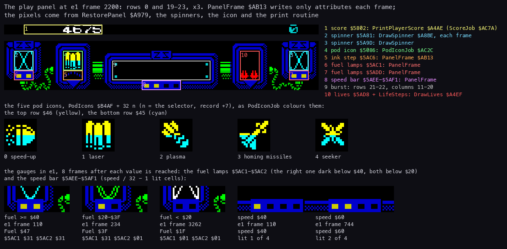
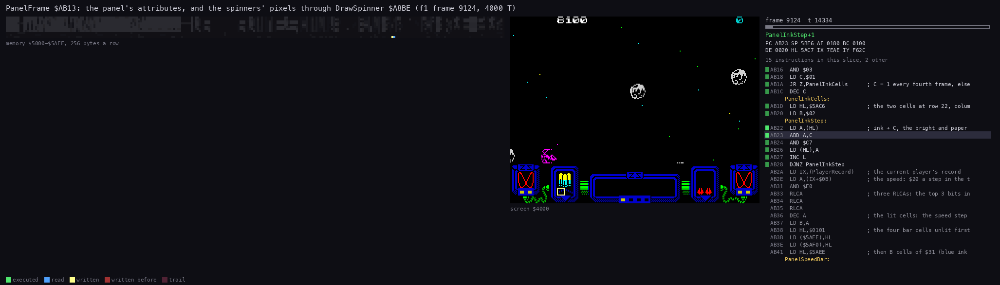
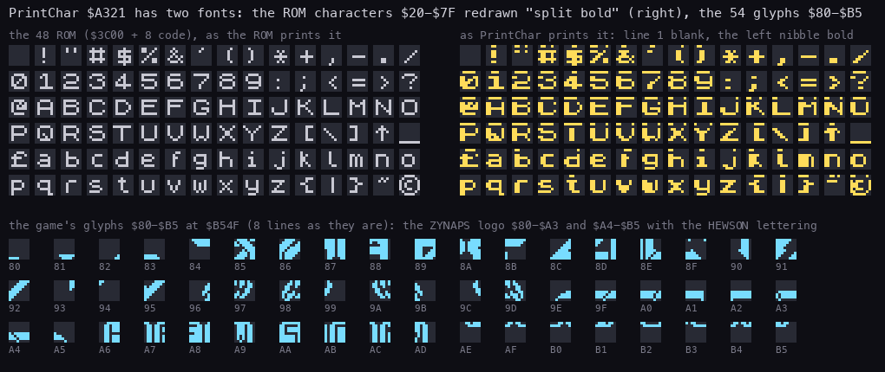
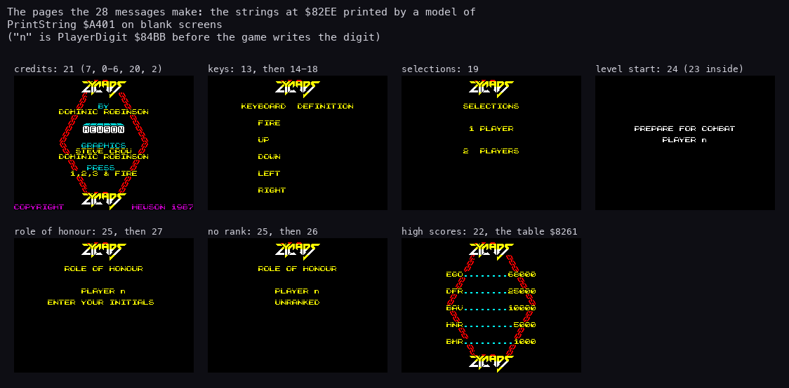
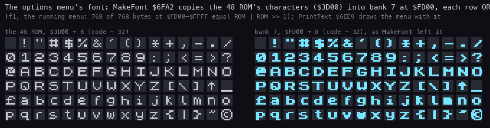
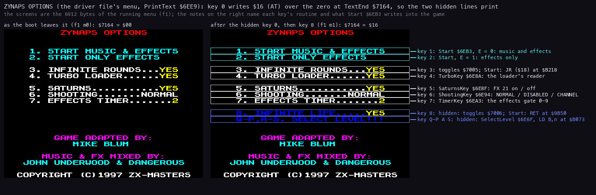

# 8. HUD and text

What this covers:

- the play panel: what each cell shows, which routine writes it and when;
- the gauges, the pod icon, the spinners, the score and the lives;
- the game's print routine, its codes and its two fonts;
- the messages and the pages they make;
- the options menu's own printer, its bold font and its hidden lines;
- where every string of the game lives as text.

The recordings it rests on (Pentagon 128, TR-DOS, General Sound, `work/media/trd/ZYNAP_GS.TRD`):

| Recording | Made by | Used here for |
| --- | --- | --- |
| `work/zgsB/e1` | `tools/gs_podbot.py --plan 0,1,2,2,3,4`, 10000 frames, INFINITE LIFE on | the panel, the gauges, the score, the extra life, the burst |
| `work/zgsB/e2` | `tools/gs_podbot.py --plan 3`, 12000 frames, SELECT LEVEL 11 | the second extra-life witness |
| `work/zgsB/f1` | `tools/gs_session.py` start, the menu keys 0 and 8, then play | the menu as the boot leaves it and with the hidden lines (`menu0-cpu.bin`, `menu1-cpu.bin`), the menu font, a TTD recording of frame 9124 |
| `work/stage1/screens` | the case's first screenshots | the title pages as the game prints them (`04-title-credits.png`, `07-selections-players.png`, `08-prepare-for-combat.png`) |

The pages figure is drawn by a model of the print routine (`tools/fig_hud.py`, class Printer); 8.8 says how far the
model agrees with the real screens.

## 8.1 The panel

The play screen keeps two strips for the HUD: the score line (character row 0) and the panel (rows 19-23).

The pixels of the panel are a picture:

- RestorePanel `$A979` copies 2048 bytes from `$E748` to the screen third `$5000-$57FF` and 160 attribute bytes from
  `$EF48` to `$5A60-$5AFF` (rows 19-23), at the player change (`$B04F`).
- SavePanel is its reverse (`$B1F9`).

On top of that picture, each part below is written by its own routine:

| Part | Cells | Writer | When |
| --- | --- | --- | --- |
| player 1's score | row 0, columns 2-9 (`$5802`) | PrintPlayerScore `$A4AE` | ScoreJob `$AC7A` after each award |
| player 2's score | row 0, columns 22-29 (`$5816`) | PrintPlayerScore | the player change |
| the left spinner | rows 20-21, columns 1-2 (`$5A81`) | DrawSpinner `$A8BE` | every frame, from PanelFrame |
| the right spinner | rows 20-21, columns 29-30 (`$5A9D`) | DrawSpinner | every frame, from PanelFrame |
| the pod icon | rows 20-21, columns 6-7 (`$5086`, `$50A6`) | PodIconJob `$AC2C` | a pod taken, the play loop's start |
| the ink step | row 22, columns 6-7 (`$5AC6`) | PanelFrame `$AB13` | ink + 1 every fourth frame |
| the fuel lamps | row 22, columns 1-2 (`$5AC1`) and 29-30 (`$5ADD`) | PanelFrame | every frame |
| the speed bar | row 23, columns 14-17 (`$5AEE-$5AF1`) | PanelFrame | every frame |
| the burst | rows 21-22, columns 11-20 | PanelFrame | every second frame |
| the lives | 6 cells from `$5AD8` (columns 24-25, rows 20-22) | DrawLives `$A4EF` | ScoreJob, the player change |



```sh
python3 tools/fig_hud.py panel --npz work/zgsB/e1/bot.npz --frame 2200
```

How to read it:

- Top: e1's screen at frame 2200, row 0 and rows 19-23 at 3×. Each box is one part of the table above, numbered;
  its label on the right, in the box's colour, gives the cells and the routine that writes them.
- Middle: the five pod icons PodIcons `$B4AF` + 32 n, drawn from the game image in PodIconJob's two colours.
- Bottom: crops of the fuel lamps and the speed bar from e1, each 8 frames after the value under it was first
  reached, with the frame and the attribute bytes the screen held.

What it shows:

- The score `4675` sits at columns 6-9 of row 0; the four columns before it print spaces.
- The pod icon box holds icon 1, the laser: the pod selector (the player record `+7`) was 1 at frame 2200.
- The lives box shows two red cells at the bottom (lives 2) and four black ones.
- The fuel lamps: Fuel `$80E6` = `$47` at frame 110 leaves both lamps `$31`; `$3F` at 234 darkens the right one to
  `$01`; `$1F` at 3262 darkens both.
- The speed bar: speed `$40` at frame 110 lights 1 cell of 4, speed `$60` at 744 lights 2.

## 8.2 PanelFrame: the panel's frame work

PanelFrame `$AB13` (hud.asm) is called once a frame from the play interrupt (`$AA87`).
Its own code writes attributes only; the pixels it changes come from DrawSpinner, which it calls.

1. The ink step: the ink of `$5AC6-$5AC7` goes up by one every fourth frame (PassCount `$7F62` AND 3 = 0).
2. The speed bar: `$5AEE-$5AF1` = `$01`, then (speed >> 5) - 1 cells of `$31` from `$5AEE` (speed = the player
   record's `+$0B`): one lit cell at `$40`, four at `$A0`.
3. The fuel lamps: `$31` at `$5AC1-$5AC2` and `$5ADD-$5ADE`. Fuel below `$40` darkens the second of each pair, below
   `$20` the first too.
4. The spinners: PanelPhase `$7F78` + (PassCount AND 1) picks a frame 0-15. PanelBounce `$7F79` steps by PanelStep
   `$7F7A` on odd frames and turns at 1 and 7. DrawSpinner draws both spinners with that frame and colour.
5. On even frames, the burst: rows 21-22, columns 11-20 are cleared. While PanelBurst `$7F77` is not 0 it counts
   down, and its new value n is written as the attribute at columns 15 + n and 16 - n of both rows.

The burst is the laser's mark on the panel:

- FireLaser `$9C1D` sets PanelBurst to 6 at `$9C80` when it is 0.
- In e1 it read 5, 5, 4, 4, 3, 3, 2, 2, 1, 1, 0 in the samples after a shot (one sample every second frame).
- It was non-zero in 3040 of e1's 5000 samples.



```sh
python3 ../../kit/routine_anim.py --work work/zgsB/f1 --window 9124:14200-9124:18200 --listing build/game.lst --out docs/img/hud/PanelFrame.gif --view screen --range 5000-5AFF --pc AB13-ABD4 --pictures 30 --delay 200 --title "PanelFrame \$AB13: the panel's attributes, and the spinners' pixels through DrawSpinner \$A8BE (f1 frame 9124, 4000 T)"
```

How to read it:

- Left: the memory `$5000-$5AFF`, 256 bytes a row (the panel's screen third and the attributes): yellow written in
  this picture, red written earlier.
- Middle: the screen. Right: the listing round the instruction last run, and the registers.
- The window is T 14200-18200 of f1 frame 9124 (level 2), 597 instructions; PanelFrame's own code runs from T 14228
  to 18130.

What it shows:

- The writes fall in two places: the attribute rows `$5A80-$5AFF` (the gauges, the ink step, the burst) and two short
  runs of pixel rows in `$5000-$57FF` (the spinners' 2 × 2 cells).
- Most of the window is DrawSpinner's row loop (`$A900-$A90F`: 392 of the 597 instructions).
- Nothing outside the panel changes.

## 8.3 The pod icon

PodIconJob `$AC2C` (events.asm, event bit 2) shows the pod selector's choice:

- it narrows the event mask to bit 7 while it runs;
- it sets the attributes `$46` (bright yellow) at `$5A86-$5A87` and `$45` (bright cyan) at `$5AA6-$5AA7`;
- it draws icon n (the player record `+7`, 0-4) from PodIcons `$B4AF` + 32 n as two rows of two cells at `$5086` and
  `$50A6`.

The job is posted at the play loop's start (`$B1C7`) and by every pod taken (PodCollected `$A243`, which also adds
100 points).
In e1, 29 pods were taken (NextWeaponHook 23 + WeaponOnHook 6, [7](07-objects.md)) of the 31 that appeared.
The five icons are in the panel figure: 0 speed-up, 1 laser, 2 plasma, 3 homing missiles, 4 seeker.

## 8.4 The spinners

DrawSpinner `$A8BE` (panel.asm) draws a 16 × 16 spinner at an attribute address HL with attribute A and frame C:

- SpinnerFrames `$A919` holds 16 offsets into SpinnerImages. An even offset is a shape read top down; an odd one is
  the last byte of a shape, read bottom up (the shape flipped).
- SpinnerImages holds 5 shapes of 16 rows, the left 8 pixels only: from a thin diagonal line to a full ring.
- Each row is drawn as the byte and its bit mirror from the table `$FB00`, side by side.

The panel figure shows both spinners at one frame; the animation of 8.2 shows them being drawn.

## 8.5 The score and the lives

The two scores are 4 BCD bytes at the start of the player records (`$7F9C` player 1, `$7FCC` player 2).

- AddScore `$A489` adds an award from the points table `$8231` (12 entries: 0, 25, 50, 75, 100, 150, 200, 250, 500,
  1000, 2000, 5000) and sets bit 1 of EventRequests `$81C5`.
- ScoreJob `$AC7A` (event bit 1) prints the current player's score and recomputes WeaponRating (`$9B75`).
- PrintPlayerScore `$A4AE` prints through PrintBcd `$A43E` with C = space: the leading zeros as spaces in the
  attribute `$01`, the digits in `$47` (bright white) for the player in play and `$05` (cyan) for the other.

The extra lives:

- When the score's second byte reaches ExtraLifeScores `$800F`[record `+$0C`] (`$01`, `$03`, `$05`, `$07`, `$09`,
  then `$FF`), ScoreJob steps `+$0C`, adds a life (`+4`) and calls DrawLives.
- That is an extra life at 10000, 30000, 50000, 70000 and 90000 points.

| Recording | Frame | Lives | Score | `+$0C` |
| --- | ---: | ---: | --- | ---: |
| e1 | 2 | 2 | `00000000` | 0 |
| e1 | 9404 | 3 | `00010050` | 1 |
| e2 | 2 | 2 | `00000100` | 0 |
| e2 | 5014 | 3 | `00010825` | 1 |

DrawLives `$A4EF` writes 6 attribute cells:

- the first (lives) of them `$42` (red), the rest black;
- the cells walk by LifeSteps `$81C0` (`$01`, `$E0`, `$E0`, `$1F`, `$E0`, added to the low byte): `$5AD8`, `$5AD9`,
  `$5AB9`, `$5A99`, `$5AB8`, `$5A98`;
- that is a 2 × 3 block at columns 24-25 of rows 20-22, filled from the bottom row.

No recording reached the 30000 extra life, a second player's score or a life lost (INFINITE LIFE was on).

## 8.6 The print routine and its codes

One routine prints every text of the game, in play and on the title pages (print.asm):

- PrintChar `$A321` takes one byte; PrintString `$A401` a string of them; PrintMessage `$A423` message n.
- The print position PrintPos `$80AA` is an attribute address (`$5800-$5AFF`): the cell and its colour at once.
- The attribute PrintAttr `$80AC` colours every character printed.
- A byte below `$20` is a code: PrintChar keeps it as pending (`$80AD`) and takes the next byte as its operand.

| Code | Routine | Operand |
| ---: | --- | --- |
| 0 | PrintSetAttr | the attribute |
| 1 | PrintSetInk | the ink 0-7 |
| 2 | PrintSetPaper | the paper 0-7 |
| 3 | PrintSetColumn | the column 0-31 |
| 4 | PrintSetRow | the row 0-23 (the column is kept) |
| 5 | PrintColumnRight | columns to add (`$FE` moves 2 left) |
| 6 | PrintRowDown | rows to add |
| 7-`$1F` | none | taken and ignored |

In a string:

- `$FF` ends it;
- `$1B n` prints message n there (strings nest);
- a code's operand is never taken as `$FF` or `$1B`.

PrintBcd `$A43E` prints 4 BCD bytes as 8 digits, with up to 7 leading zeros replaced by the character in C.
The messages as text, with these codes spelled out:
[`src/res/text/messages.msg.txt`](../src/res/text/messages.msg.txt) (`tools/res_text.py`).

## 8.7 The two fonts

PrintChar draws two kinds of characters:

- `$20-$7F`: the 48 ROM's character `$3C00` + 8 × code, redrawn "split bold". It prints the ROM row 1, a blank pixel
  line, then rows 2-7; each row is ORed with itself shifted left and masked `$F0`, so only the left nibble is bold.
- `$80-$FF`: the game's own 8 × 8 glyphs, code `$80` at Glyphs `$B54F`, printed as they are. 54 of them are used
  (`$80-$B5`): the ZYNAPS logo and the Hewson lettering.



```sh
python3 tools/fig_hud.py font
```

How to read it:

- Top left: the 96 ROM characters `$20-$7F` as the ROM stores them (grey).
- Top right: the same characters as PrintChar draws them (yellow): line 1 blank, the left nibble bold.
- Bottom: the glyphs `$80-$B5` from `$B54F` (blue), each with its code.

What it shows:

- The game's letters are the ROM's, made bold on the left only, with a gap under the first row.
- The logo is 36 glyphs (`$80-$A3`), the Hewson lettering 18 (`$A4-$B5`); messages 0 and 2 place them.

The witness: e1's score line at frame 2200 (`00004675`, printed as four spaces and `4675`) matches the split-bold
model byte for byte, 64 of 64 pixel bytes of row 0, columns 2-9.
The glyph sheets of the resources: [`src/res/fonts`](../src/res/fonts/README.md).

## 8.8 The messages and the pages

The messages are 28 `$FF`-ended strings from `$82EE` to `$8515`; message n starts after the n + 1-th `$FF` counted
from `$82ED`.
They build the title pages from pieces: messages 0-7 place the logo, the Hewson block and the chain border, and the
pages call them through `$1B n`.

| Message | Called from | Page |
| ---: | --- | --- |
| 13, then 14-18 and 9-12 | RedefineKeys (menu.asm) | KEYBOARD DEFINITION, the key names CS SS SP EN |
| 19 | SelectPlayers (options.asm) | SELECTIONS, 1 PLAYER, 2 PLAYERS |
| 21 | CreditsPage (rounds.asm) | BY DOMINIC ROBINSON, GRAPHICS STEVE CROW, PRESS 1,2,3 & FIRE, COPYRIGHT HEWSON 1987 |
| 22 | HiScorePage (rounds.asm) | the high-score frame, then the five entries of HiScoreTable `$8261` |
| 24 (23 inside) | LevelStart (rounds.asm) | PREPARE FOR COMBAT, PLAYER n |
| 25, then 26 or 27 | HighScoreEntry (hiscore.asm) | ROLE OF HONOUR, PLAYER n, UNRANKED or ENTER YOUR INITIALS |

The high-score table holds five entries of 14 bytes:

- a 10-byte print string: the position, message 8's dots, the initials;
- 4 BCD bytes, printed with `.` for the leading zeros;
- the entries: EGO 68000, DFR 25000, BAV 10000, HNR 5000, BMR 1000
  ([`src/res/text/hiscores.hsc.txt`](../src/res/text/hiscores.hsc.txt)).



```sh
python3 tools/fig_hud.py pages
```

How to read it:

- One screen per page, titled with the messages printed (and the ones they call).
- `n` is PlayerDigit `$84BB` as the image holds it; the game writes the player's digit there before it prints.
- The high-score page prints message 22, then each entry as HiScorePage does: PrintString, then PrintBcd with C =
  `.` and the digits in `$46`.

What it shows, against the real screens of `work/stage1/screens` (the 256 × 192 picture at offset 48, 48 of the
352 × 288 shot):

- SELECTIONS: 1126 lit pixels in both, all of them in the same places.
- PREPARE FOR COMBAT: 502 of the model's 513 lit pixels are lit on screen; the rest is `n`, which the game prints as
  `1`.
- The credits: all 4597 of the model's lit pixels are lit on screen. The screen has 448 more; CreditsPage also prints
  both scores (`$5AA0`, `$5AB8`), which the model leaves out.

The real credits page: [`img/compare/credits.png`](img/compare/credits.png).

## 8.9 The options menu's printer

The options menu is 1696 bytes of the driver file, run in place at `$6D60` (src/disk/menu/menu.asm,
[`src/disk/menu.ann`](../src/disk/menu.ann); the keys: [5](05-controls.md)).
It prints with its own routine and its own font.

MakeFont `$6FA2` builds the font:

- the 768 bytes of the ROM's characters from `$3D00` go to bank 7 at `$FD00`;
- each byte is ORed with itself rotated right (`RRCA`, `OR (HL)`): a bold font, one pixel wider to the right.



```sh
python3 tools/fig_hud.py menufont
```

How to read it:

- Left: the 96 ROM characters at `$3D00` (grey).
- Right: bank 7 `$FD00-$FFFF` as the running menu holds it (blue), read from f1's `menu1-cpu.bin`.
- The subtitle gives the check: how many bytes at `$FD00` equal ROM | ROM >> 1.

What it shows:

- All 768 of 768 bytes follow the rule. The ROM characters have bit 0 clear, so the rotate is a plain shift.
- The menu's letters are bold over the whole width, where the game's split-bold ones of 8.7 are bold on the left only.

PrintText `$6EE9` reads the text at HL:

| Byte | What it does |
| --- | --- |
| `$20` and up | a character, printed by PrintChar `$6F42` at the position and attribute kept in its own operands (CharPosition `$6F44`, CharAttr `$6F5C`) |
| `$10 a` | the attribute: the letter itself, `A` `$41` bright blue, `B` bright red, `C` bright magenta, `E` bright cyan, `F` bright yellow, `G` bright white |
| `$0D` | column 0, the next row (after row 22, row 0) |
| `$16 r c` | row r, column c; a row of 24 or more or a column of 32 or more becomes 0 |
| 0 | the end |
| any other below `$20` | skipped |

ShowValues `$6FB7` writes the option values into the text before each print:

- `YES` / `NOP` (YesNo `$6FF5`) at RoundsValue `$706B`, TurboValue `$708A`, SaturnsValue `$70A9` and LifeValue
  `$7180`;
- the SHOOTING word (`..NORMAL`, `DISABLED`, `.CHANNEL`) at ShootingValue `$70C1`.

TimerKey writes the digit at TimerDigit `$70E7`.

The hidden lines:

- The text Text `$7007` ends with a 0 at TextEnd `$7164`.
- After it come two more lines: item 8, INFINITE LIFE, and `Q-P,A-S. SELECT LEVEL!!!`.
- The hidden key 0 writes `$16` over that 0. With the two bytes after it, `$0D $04`, it becomes AT 13,4, and the
  hidden lines print.



```sh
python3 tools/fig_hud.py menu
```

How to read it:

- Left: the menu's screen from f1's `menu0-cpu.bin`, as the boot left it; `$7164` = `$00`.
- Right: f1's `menu1-cpu.bin` after the key 0, then the key 8; `$7164` = `$16`. Each line a key changes is boxed.
- The notes on the right name the key, its routine and what Start `$6EB3` writes into the game; the blue notes are
  the hidden lines.

What it shows:

- Lines 8 and 9 appear only on the right, in bright blue (`$10 A`); item 8 reads `YES` after the key 8.
- The values (`YES`, `NORMAL`, `2`) are bright yellow (`$10 F`), written by ShowValues into the text itself.
- What the keys do in the game (the RET at `$9B50`, the JR at `$B218`, the level at `$B073`): [5](05-controls.md).

## 8.10 Every string as text

| Where | What | Text file |
| --- | --- | --- |
| the game image `$82EE-$8515`, `$8261` | the 28 messages, the high-score table | [`texts/game.md`](texts/game.md) |
| the menu, Text `$7007-$71BE` | ZYNAPS OPTIONS, the credits of the conversion, the hidden lines, the value words | [`texts/menu.md`](texts/menu.md) |
| the disk | the catalogue names, the BASIC | [`texts/disk.md`](texts/disk.md) |
| the 13 card modules | their names and sample texts | [`texts/modules.md`](texts/modules.md) |

The keyboard reader's key table at `$8199` (`ZXCVASDFGQWERT1234509876POIUY`) is a table, not a printed text.
PrintKeyName `$A623` prints a key's name.

## 8.11 What stays unexplained, and what only the code shows

- PrintBcdSpaces `$A43C`: an entry that loads C = space before PrintBcd. No code calls it; every caller loads C itself.
- LifeSteps `$81C0` has 5 bytes, and DrawLives adds a sixth step after the last cell, read from EventRequests. The
  address it makes is never written.
- The print codes 7-`$1F`: taken with their operand and ignored; no message uses them.

Known only from the code (no recording here reached it):

- player 2's score at `$5816`, and the cyan score of the player not in play;
- the extra lives from 30000 on;
- the high-score entry pages (messages 25-27) in play: the figure shows them from the model only;
- the menu's `$0D` new line: the menu's text positions every line with `$16`.

No figure shows which routine wrote each panel cell across a level start: no trace was taken across a player
change, where RestorePanel puts the panel picture back.
