# 9. Sound

Every sound of Zynaps GS comes from a General Sound card (GS). The Spectrum's beeper code is still in the image, but
it is silent (9.10). The card holds two kinds of sound, both uploaded by the game itself from the disk and from
banks 1, 3, 4 and 6:

- **13 ProTracker modules.** One a level (levels 1-12) and one for the title (13). The card's own Z80 plays them; the
  game only loads, starts, sets the volume of and fades the module.
- **22 sampled effects.** A start jingle and FX 1-21. The game asks for one through 28 patched sites in its code. A
  driver in bank 1 turns each request into GS commands on ports `$B3` and `$BB`.

The menu offers two modes. "START MUSIC & EFFECTS" (key 1) plays a module and FX 1-10. "START ONLY EFFECTS" (key 2)
plays no module and all 21 FX. The flag is `EffectsOnly` (`$B486`): 0 music, 1 effects only.

Evidence:

- the code: the driver `src/disk/driver/driver.asm` (annotated in `src/disk/driver.ann`), the installer and the
  hook stubs `src/disk/install.asm`, the level loader `src/disk/loader.ann`, the game `src/game/game.ann`;
- the GS ROM's sources (unreal-ng `docs/inprogress/2026-09-19-general-sound/materials/gs/gs-firmware/firmware/src`:
  `COM_H.a80`, `INIT_L.a80`, `LOAD_L.a80`) for what each command does on the card;
- **`work/zgsB/e1`**: Pentagon 128 + TR-DOS + GS 512 KB, music mode, INFINITE LIFE chosen in the menu, booted from
  `work/media/trd/ZYNAP_GS.TRD`, played by `tools/gs_podbot.py` for 10000 frames (levels 1 and 2). The host side
  of the GS ports was recorded from frame 1270 to 13127 (`zxbus.1.ports` history, `ports.jsonl`, 63 MB), and the
  memory profiler counted every hook stub (`bot-counts.json`);
- **`work/zgsB/e2`**: the same machine in effects-only mode with INFINITE LIFE and SELECT LEVEL 11 (menu keys 0, 8,
  A, 2), the bot armed with homing missiles, 12000 frames: level 11 twice. Ports recorded, stubs counted, the
  card's memory read (`gsram-512.bin`);
- **`work/zgsB/e3`**: a GS 128 KB card, effects only, INFINITE LIFE, the bot taking every weapon, 8000 frames
  (levels 1 and 2). Ports recorded, stubs counted;
- stage 2's `h2` runs (`work/stage2/h2/`): effects only, 60000 frames with the ship invulnerable through levels 1-9
  and into 10, plus one 4000-frame run with the ship mortal;
- stage 1's runs `x1`-`x3` (`work/stage1/NOTES.md`) and the effect renders `work/audio/fx/` (the card alone at each
  effect's note, written to WAV files, never played aloud).

All runs use unreal-ng's low-level GS: the GS ROM on an emulated Z80 at 12 MHz. Real hardware was not run.

## 9.1 The sound at a glance

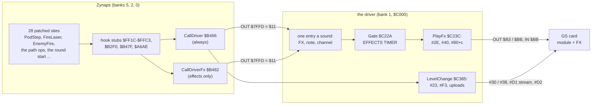

How to read it:

- **Left: the game.** Each patched site jumps to a small stub at the top of the image. The stub does the
  instruction the site lost, loads HL with a driver entry and calls one of the two bridges.
- **The two bridges.** `CallDriver` always pages bank 1 in, calls (HL) and pages bank 0 back. `CallDriverFx` does
  the same only when `EffectsOnly` is 1; in music mode it returns at once.
- **Right: the driver.** Most entries pick an FX number, a note and a channel, pass the gate and send three
  commands. The level change uploads the module and the effects.

What it shows:

- The game never talks to the card itself. Every port access is the driver's, in bank 1, behind a paging call.
- The effects-only sounds (FX 11-21) can only be asked for in effects-only mode: all their callers go through
  `CallDriverFx` (9.4).

## 9.2 The GS commands

The card runs only its ROM firmware: no code is uploaded to it. The driver uses these firmware commands
(`COM_H.a80`):

| Command | Firmware name | Use here |
| --- | --- | --- |
| `#23` | pages | the number of 32 KB RAM pages; it decides the load-once path (9.7) |
| `#F3` | warm reset | the card is emptied before every upload |
| `#30` / `#D1` / `#D2` | load module, open / close the stream | a level's module |
| `#38` / `#D1` / `#D2` | load FX | each effect |
| `#2A` / `#2B` | module / FX volume | per level (the loader's table `$64E5`), FX always `$40` |
| `#31` / `#32` | play / stop the module | |
| `#2E` / `#40` / `#80+c` | select FX, FX note, play in channel c | most sounds |
| `#45` / `#39` | FX default volume, play FX | `ShotSound` in music mode with SHOOTING NORMAL |
| `#41` | FX volume | `SaturnSound` |
| `#3A` | stop FX (mask) | in `StopAll`, which has no caller |
| `#48` / `#49` | FX loop points | in `SetLoopStart` / `SetLoopEnd`, which have no callers |

Two firmware rules matter below (`COM_H.a80`):

- `#2E` with a handle above the number of loaded effects (`CNTFX`) sets the current effect to 0.
- `#80+c` with a handle above `CNTFX` jumps to `COM39_9`: the card answers `$FF` and nothing plays.

## 9.3 The media

`tools/gs_media.py` cuts all the media from the disk and the banks the way the loader uploads them, into
`work/media/gs/` (`media.json` gives the size, the SHA-1 and the source of each). Every one of the 22 effects and the
modules of levels 1, 2 and 13 match the streams cut from the live port histories byte for byte
(`work/tmp/streams.py`, `work/media/streams/`). e1 streamed level 2's module again (42496 bytes, frames 9441-9550).

### The 13 modules

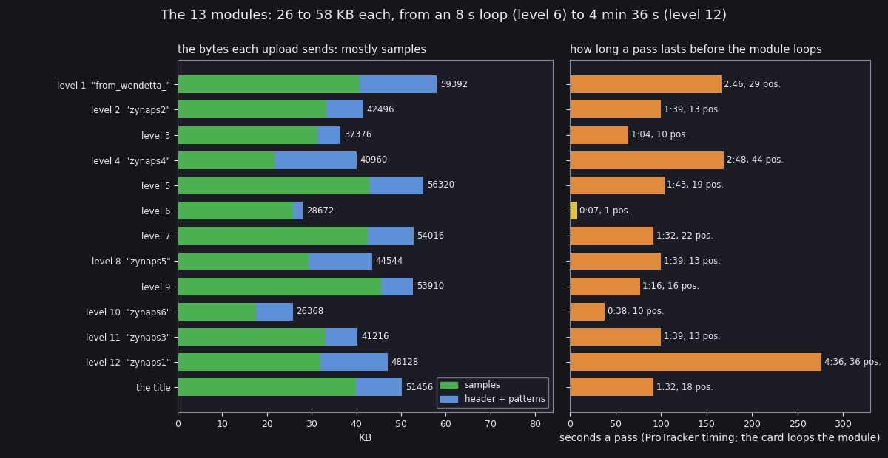

How to read it:

- **Left: the bytes each upload sends.** Green is the sample data, blue the header and the patterns. The number is
  the module's size, the stream the loader sends with `#30`.
- **Right: one pass.** The time from the first row to the loop, at ProTracker timing (the speed and tempo commands
  of the patterns followed), and the number of positions in the order list. The card loops the module at the end.
- The quoted name is the module's title in its header; an empty title shows the level only.

What it shows:

- The modules are ProTracker `M.K.` with 31 sample slots and 4 voices. Their sizes run from 26368 (level 10) to
  59392 bytes (level 1).
- Samples are 54-92 % of each module (level 4 the least, level 6 the most). The card's sample room (9.8) is set by the samples, not by the patterns.
- Level 6's module is one position of one pattern, 7 s, played in a loop for the whole level.
- Level 12, the last level, has the longest tune: 36 positions, 4 min 36 s a pass.

`python3 tools/fig_sound.py overview --out docs/img/sound/modules.png` (reads `src/res/music/levelNN.mod`).

Each module has a figure of its own, drawn like nether-earth-gs's `module.png`. Module 1:

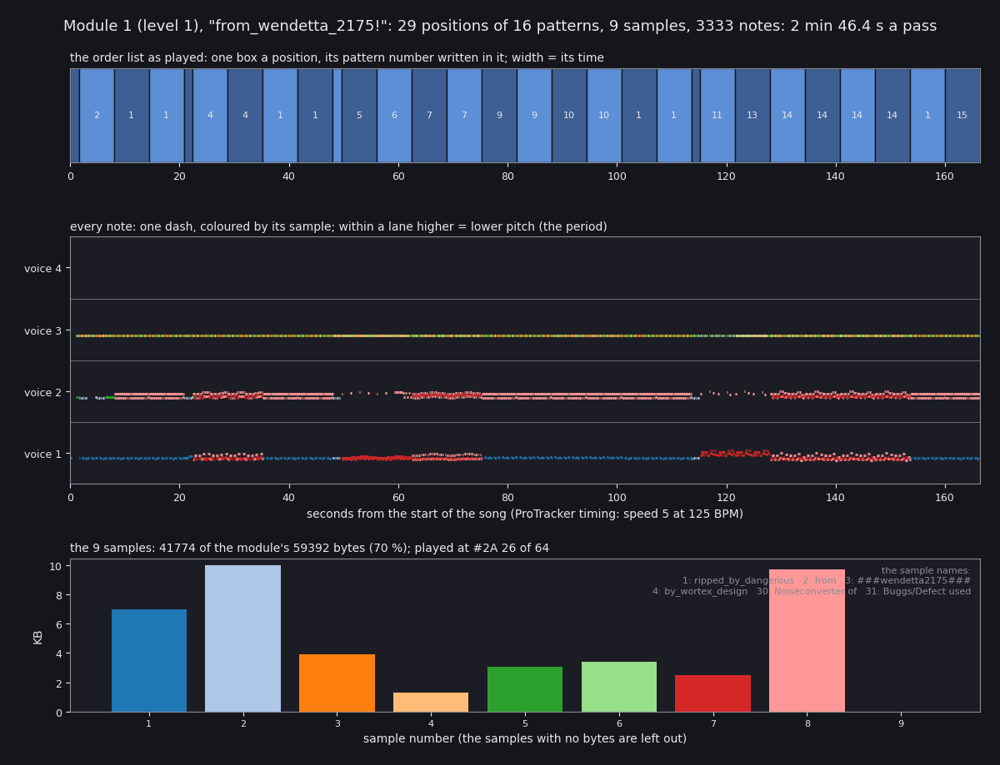

How to read it:

- **Top: the order list.** One box per position, with the number of the pattern it plays. The width is its time.
- **Middle: every note.** One dash per note, one lane per voice, coloured by its sample. Within a lane, higher is a
  lower pitch (the ProTracker period).
- **Bottom: the samples** by size, with the module's `#2A` volume in the title. The text at the right is the sample
  names: they carry the credits.

What it shows:

- Level 1's tune uses three voices: voice 4 is empty for the whole pass.
- Voice 3 plays one note after another from start to end, in changing sample colours: the rhythm line under the tune.
- The order list replays patterns 1, 4, 7, 9, 10 and 14 back to back: 16 patterns fill 29 positions.

`python3 tools/fig_sound.py modules --out docs/img/sound` writes `module-01.png` to `module-13.png`.

| Level | Figure | Bytes | Positions / patterns | Samples | Notes | A pass | `#2A` | Title and credits in the sample names |
| --- | --- | --- | --- | --- | --- | --- | --- | --- |
| 1 | [module-01](img/sound/module-01.png) | 59392 | 29 / 16 | 9 | 3333 | 2:46 | `$1A` | "from_wendetta_2175!", ripped_by_dangerous, by_wortex_design |
| 2 | [module-02](img/sound/module-02.png) | 42496 | 13 / 7 | 7 | 1431 | 1:39 | `$20` | "zynaps2" |
| 3 | [module-03](img/sound/module-03.png) | 37376 | 10 / 4 | 8 | 1083 | 1:04 | `$3C` | untitled |
| 4 | [module-04](img/sound/module-04.png) | 40960 | 44 / 17 | 11 | 2053 | 2:48 | `$28` | "zynaps4": kbx128 / tesko!, october 1994, for "galaga deluxe" |
| 5 | [module-05](img/sound/module-05.png) | 56320 | 19 / 11 | 7 | 1006 | 1:43 | `$40` | untitled |
| 6 | [module-06](img/sound/module-06.png) | 28672 | 1 / 1 | 5 | 12 | 0:07 | `$20` | untitled, sample 1 "John Underwood" |
| 7 | [module-07](img/sound/module-07.png) | 54016 | 22 / 9 | 5 | 1292 | 1:32 | `$40` | untitled |
| 8 | [module-08](img/sound/module-08.png) | 44544 | 13 / 13 | 7 | 990 | 1:39 | `$20` | "zynaps5" |
| 9 | [module-09](img/sound/module-09.png) | 53910 | 16 / 6 | 11 | 1149 | 1:16 | `$40` | untitled |
| 10 | [module-10](img/sound/module-10.png) | 26368 | 10 / 7 | 9 | 695 | 0:38 | `$20` | "zynaps6": nuke of lemon |
| 11 | [module-11](img/sound/module-11.png) | 41216 | 13 / 6 | 7 | 1504 | 1:39 | `$20` | "zynaps3": MagFields by dextrous, 1990 |
| 12 | [module-12](img/sound/module-12.png) | 48128 | 36 / 14 | 9 | 3393 | 4:36 | `$26` | "zynaps1": music by pyratronik |
| 13, the title | [module-13](img/sound/module-13.png) | 51456 | 18 / 9 | 8 | 875 | 1:32 | `$40` | untitled |

- Several modules carry "Noiseconverter of / Buggs/Defect used" in samples 30-31: Noiseconverter's signature.
- The sample names are in [texts/modules.md](texts/modules.md). The credit "MUSIC & FX MIXED BY: JOHN UNDERWOOD &
  DANGEROUS" is the menu's ([8. HUD and text](08-hud-and-text.md)).
- The full renders are `work/audio/mod/levelNN.flac` (openmpt123), files only.

### The 22 effects

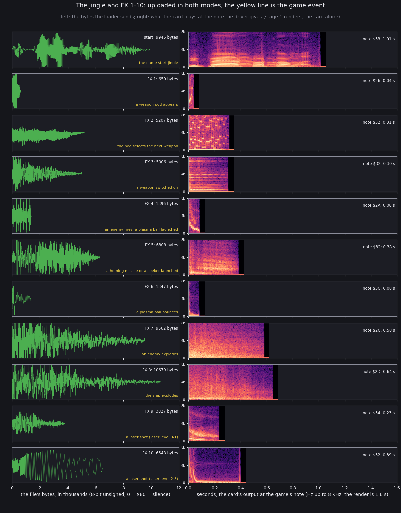

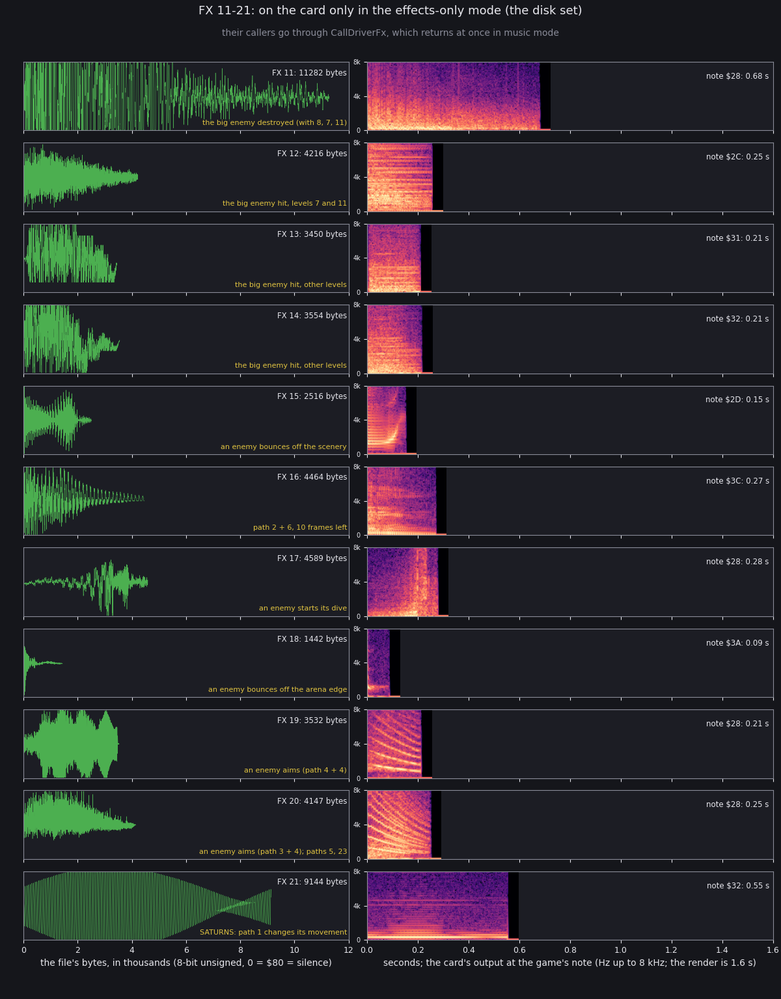

How to read them:

- **Left: the file.** Each effect's bytes, 8-bit unsigned (`$80` is silence), on a common scale of 12000 bytes.
- **Right: the card's output.** A spectrogram up to 8 kHz of what the card plays at the note the driver gives that
  effect (9.4), rendered by the card alone. The text gives the time the effect sounds.
- The yellow line under each file names the game event the driver plays it for.

What they show:

- The effects are short: FX 1 sounds for 0.04 s and the jingle for 1.01 s. Every other effect lasts 0.08-0.68 s.
- FX 4 serves two events with two notes: an enemy's shot at `$30` and a plasma launch at `$2A`.
- FX 9 and FX 10 are the laser shot. FX 9 (laser levels 0-1) is a noisy falling sweep, 0.23 s. FX 10 (levels 2-3) is a clean
  tone that drops at once and then holds, 0.39 s.
- FX 19 and FX 20 are near twins: falling harmonic sweeps of 0.21 s and 0.25 s, both for an enemy taking aim.
- FX 21 (SATURNS) is a steady tone that swells and fades: bytes 13318-22461 of sample 8 of level 7's module, sign
  flipped.

`python3 tools/fig_sound.py effects --renders work/audio/fx --out docs/img/sound` (reads `src/res/sfx/*.wav`).

| FX | Bytes | From | Driver entry (9.4) |
| --- | --- | --- | --- |
| start | 9946 | bank 1 `$D3CB` | the game start jingle, note `$33` |
| 1 | 650 | bank 1 `$FAA5` | `PodAppearsSound` |
| 2 | 5207 | bank 1 `$FD2F` | `NextWeaponSound` |
| 3 | 5006 | bank 3 `$D186` | `WeaponOnSound` |
| 4 | 1396 | bank 3 `$E514` | `EnemyFireSound`, `PlasmaLaunchSound` |
| 5 | 6308 | bank 3 `$EA88` | `MissileLaunchSound` |
| 6 | 1347 | bank 4 `$C32C` | `PlasmaBounceSound` |
| 7 | 9562 | bank 4 `$C86F` | `ExplosionSound`, `BigEnemyDestroyedSound` |
| 8 | 10679 | bank 4 `$EDC9` | `ShipExplodesSound`, `BigEnemyDestroyedSound` |
| 9 | 3827 | bank 6 `$D780` | `ShotSound` |
| 10 | 6548 | bank 6 `$E673` (its last 7 bytes from bank 7 `$C000`, zeros) | `ShotSound` |
| 11, 12 | 11282, 4216 | disk blob 321 (raw) | `BigEnemyDestroyedSound`; `BigEnemyHitSound` |
| 13-16 | 3450, 3554, 2516, 4464 | disk blob 382 (Trush block 5) | `BigEnemyHitSound` (13, 14); `SceneryBounceSound`; `Path682CSound` |
| 17-20 | 4589, 1442, 3532, 4147 | disk blob 429 (raw) | `DiveSound`; `ArenaBounceSound`; `Path6850Sound`; `PathSound`, `Path685BSound`, `Path68F9Sound` |
| 21 | 9144 | disk blob 483 (Trush block 6) | `SaturnSound` |

## 9.4 Where the game makes a sound

The installer (`src/disk/install.asm`, after the comment "the patches") writes the operands of 28 calls and jumps in
Zynaps. Each now goes to a hook stub. It also makes 10 of them `CALL`s over the instructions they replaced, NOPs the
beeper's sound-0 call at `$ABF1`, and writes three stubs over Zynaps's own code: `$B2F0` (the beeper request),
`$B47F` and `$A6AE`. The game event of each site is the routine it sits in (`src/game/game.ann`).

| Site (routine) | Game event | Stub → driver entry | Sound | Modes |
| --- | --- | --- | --- | --- |
| `$B209` (MainLoopTitle) | the title loop | `TitleStub` | the loading screen, then the attract loop | both |
| `$B0BF` | the title page | `KeyWait` | a key wait instead of the 48K's title tune | both |
| `$B203` (MainLoopTitle) | the title pages | `TitleEntry` | the title module, loaded once (LoadKind 2) | both |
| `$B075` (SetLevelStart) | the next level chosen | `NextLevelHook` | `NextLevel` = B; no sound | both |
| `$B03E` (RoundPlaySetup) | the round start | `RoundStartHook` → `LevelChange` | the level's module and FX, when the level changed | both |
| `$AF51` | PREPARE FOR COMBAT | `GameStartHook` → `LevelChange` (LoadKind 1) | the start jingle | both |
| `$9BE6` | the ship's explosion | `StartExplosionQuiet` | none: the explosion with its beeper noise left out | both |
| `$9B51` (PlayerHit) | the ship hit | `ShipHitHook` → `ShipExplodesSound` | FX 8, note `$2D`, not gated | both |
| `$9FBE`, `$A034` (EnemyDies, LockableDies) | an enemy explodes | `ExplodeHook` → `ExplosionSound` | FX 7, note `$2C`+r&3 | both |
| `$A1C4` (EnemyFire) | an enemy fires | `EnemyFireHook` → `EnemyFireSound` | FX 4, note `$30`+r&1 | both |
| `$9CA6` (PlasmaFrame) | a plasma ball launched | `PlasmaLaunchHook` → `PlasmaLaunchSound` | FX 4, note `$2A`+r&1 | both |
| `$9CFA` (HomingFrame) | a homing missile launched | `MissileLaunchHook` → `MissileLaunchSound` | FX 5, note `$32`+r&1 | both |
| `$9D1F` (SeekerFrame) | a seeker launched | `MissileLaunchHook` → `MissileLaunchSound` | FX 5, note `$32`+r&1 | both |
| `$9EA5` (PlasmaHandler) | a plasma ball bounces | `PlasmaBounceHook` → `PlasmaBounceSound` | FX 6, note `$3C`+r&1 | both |
| `$9C77` (FireLaser) | a laser shot | `ShotHook` → `ShotSound` | FX 9 note `$34` (laser 0-1) or FX 10 note `$32` (2-3), +r&1; none with SHOOTING DISABLED | both |
| `$A31D` (ExplosionToPod) | a weapon pod appears | `PodAppearsHook` → `PodAppearsSound` | FX 1, note `$26` | both |
| `$A226` (PodStep) | the pod moves the selector on | `NextWeaponHook` → `NextWeaponSound` | FX 2, note `$32`+r&3 | both |
| `$A21F` (PodStep) | a weapon switched on | `WeaponOnHook` → `WeaponOnSound` | FX 3, note `$32` | both |
| `$95E7` (PathOpBounce) | an enemy bounces off the scenery, moving down | `SceneryBounceHook` → `SceneryBounceSound` | FX 15, note `$2D`+r&1 | effects only |
| `$A0BA` (BigEnemyHandler) | the big enemy hit, not destroyed | `BigEnemyHitHook` → `BigEnemyHitSound` | levels 7 and 11: FX 12, note `$2C`+r&1; else FX 13 or 14, note `$31`+r&1 | effects only |
| `$A0D5` (BigEnemyHandler) | the big enemy destroyed | `BigEnemyDestroyedHook` → `BigEnemyDestroyedSound` | music: FX 8 as `ShipExplodesSound`; effects only: FX 11, 8, 7 and 11 in the four channels at once | both |
| `$9823` (PathOpBounceArena) | an enemy bounces off the arena's edge | `ArenaBounceHook` → `ArenaBounceSound` | FX 18, note `$3A` | effects only |
| `$9694`, `$9747` (the path movers) | an enemy moves on its path | `ObjectSoundStub` (`$B2F0`) → `ObjectSound`, then PathOpAccelerate | by the path pointer and the frames left: path 2 + 6 with 10 left FX 16; path 23 + 5 with 18 left or path 5 + 5 with 17 left FX 20; else `SaturnSound` (SATURNS on: path 1's objects, FX 21, `#41`, at most once in 8 calls a slot, only when the movement changed); else `PathSound` | effects only |
| `$9856` (PathOpDive) | an enemy starts a dive | `DiveHook` → `DiveSound` | FX 17, note `$3C` on level 4, else `$28` | effects only |
| `$969D` (PathOpAimPlayer) | an enemy aims at the ship | `AimPlayerHook` → `PathSound` | by the path pointer: `$6850` (path 4 + 4) or E = `$EE` FX 19; `$6846` (path 3 + 4) FX 20 | effects only |
| `$9954` | an object's slot freed | `SlotGoneHook` → `ClearSlot` | none: `SaturnSound`'s slot memory cleared | effects only |
| `$B102` (EndOfPlay) | the wait between rounds | `WaitStub` (`$A6AE`) → `RoundWait` | music: the module fades out when the level is done; else a fixed delay | both |
| `$ABF1` | the beeper's sound 0 | removed (`NOP`s) | none | |

The 28 rows above the last are the 28 sites (two rows hold two sites each, and `$9BE6` is the 28th, whose operand the
GS image already had). "r&1" and "r&3" are 0-1 or 0-3 semitones taken from the R register (`LD A,R`).

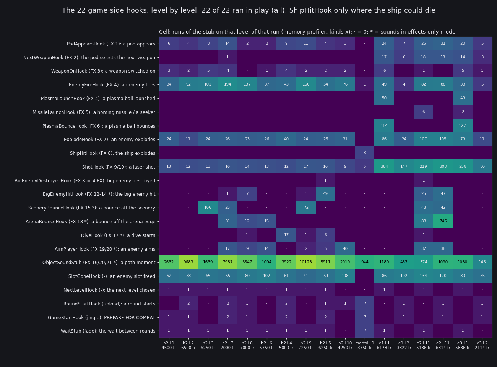

How to read it:

- **One row a stub**, named with the FX it leads to; a `*` marks the sounds of the effects-only mode.
- **One column a level of a run**, with its length in frames:
  - `h2 L1` to `h2 L10`: stage 2's effects-only game, ship invulnerable, levels in that game's order;
  - `mortal L1`: stage 2's run with the ship mortal (7 deaths and restarts in 3750 frames);
  - `e1 L1`, `e1 L2`: zgsB e1, music mode, the bot taking every weapon;
  - `e2 L11` twice: zgsB e2, effects only, SELECT LEVEL 11, homing missiles;
  - `e3 L1`, `e3 L2`: zgsB e3, GS 128 KB, effects only, every weapon.
- **The cell** is how often the stub ran on that level (the memory profiler, executions of the stub's first byte).
  The colour is the logarithm of the count.

What it shows:

- Every one of the 22 stubs ran in play. The rare ones: `BigEnemyDestroyedHook` twice (h2 L5, e2 L11),
  `ShipHitHook` only in the mortal run (INFINITE LIFE returns before its site: 10.6; `r1`, music mode, sent its FX 8
  at frame 3296), `MissileLaunchHook` only where
  the bot held a homing missile or a seeker (e2 L11, e3 L1).
- The effects-only stubs run in music mode as well (e1: `ObjectSoundStub` 1180 times on level 1). There
  `CallDriverFx` returns at once: no command reaches the card (e1's ports hold no FX above 10).
- `ObjectSoundStub` is the busiest by far: thousands of runs a level, one per path step of every enemy. Few of them
  make a sound (9.5).
- `BigEnemyHitHook` ran on the big-enemy levels only: 5, 7, 8, 9 (h2) and 11 (e2).
- `SceneryBounceHook` and `ArenaBounceHook` belong to particular levels: 3, 7, 9, 11 and 6, 7, 8, 11.

`python3 tools/fig_sound.py hooks --out docs/img/sound/hooks.png --run 'e1=L1,L2' work/zgsB/e1/bot-counts.json music
--run 'e2=L11,L11' work/zgsB/e2/bot-counts.json fx --run 'e3=L1,L2' work/zgsB/e3/bot-counts.json fx` (reads
`work/stage2/h2/fx-long.tsv` and `mortal.tsv` too).

The site counts the profiler took at the same time agree with the stubs: in e2's first level 11, `$9CFA`
(HomingFrame's launch) ran 6 times and `MissileLaunchHook` 6 times; `$A0BA` (the big enemy hit) 25 times and
`BigEnemyHitHook` 25 times.

## 9.5 A level as the card hears it

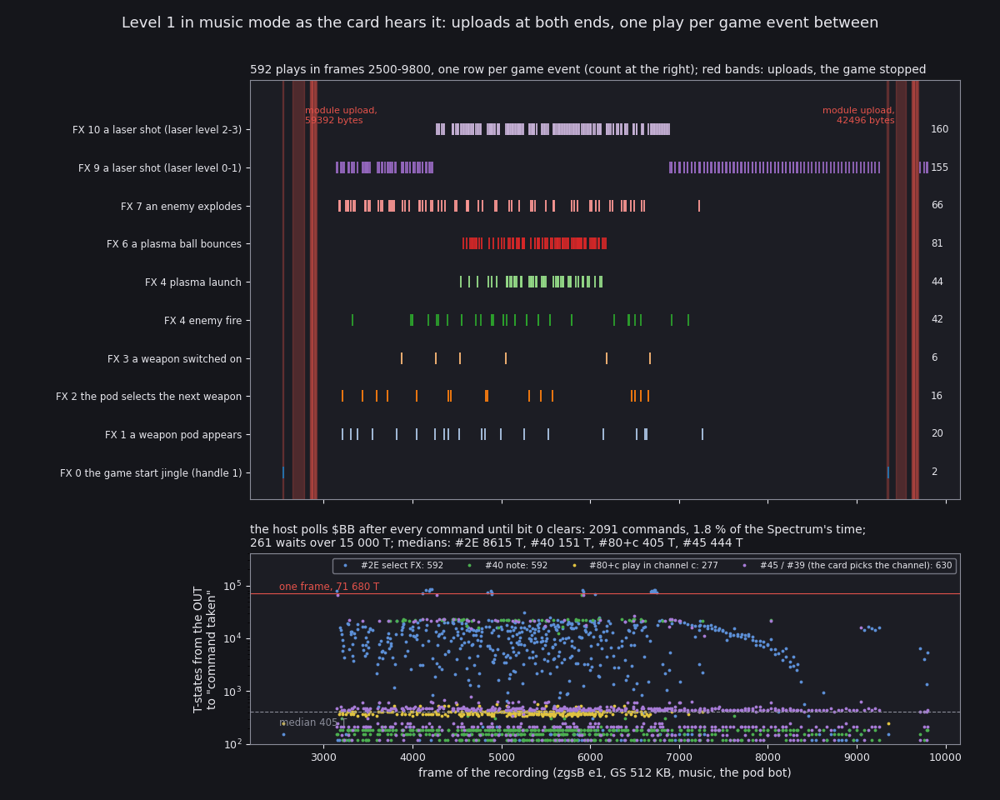

How to read it:

- **Top: the plays.** One row per game event, one tick per play: the `#2E` / `#40` / `#80+c` triple (or `#2E` /
  `#40` / `#45` / `#39`) found in the port history. The row's name is the FX the handle stands for and the event the
  driver plays it for (9.4); the number at the right counts the plays. Red bands are the uploads, while the game is
  stopped.
- **Bottom: the host's waits.** One dot per command: the T-states from the `OUT ($BB)` to the first status read with
  bit 0 clear, coloured by the command. The red line is one frame (71680 T on the Pentagon); the dashed line the
  median.

What it shows (e1, frames 2500-9800: the game start, level 1, the change to level 2):

- 592 plays in 7300 frames, all of FX 1-10. The laser is the loudest user: FX 9 155 times, FX 10 160 times (laser
  level 2 from frame 1124 of the bot, 10.2). Then FX 6, the plasma's bounce, 81 times; FX 7 explosions 66; FX 4 86
  (42 enemy shots, 44 plasma launches).
- The game start (frame 2533): `#23`, `#F3`, the jingle uploaded and played (FX 1, note `$33`, 1.01 s). Then, 94
  frames later, `#23`, `#F3` again, level 1's module (59392 bytes, frames 2648-2778), the 10 FX (frames 2848-2917),
  `#2B $40`, `#2A $1A` and `#31`.
- The level change (frames 9276-9720, figure below). The module fades out, the jingle plays, the card is reset and
  level 2's module and the 10 FX are uploaded again.
- The host waits for the card after every command. Over level 1's play (frames 2930-9270): 2069 commands, 2.09 % of
  the Spectrum's time. `#2E` waits longest: median 8743 T, about an eighth of a frame. `#40` waits 167 T, `#80+c` 405 T.
  261 waits are longer than 15000 T; the longest is 85783 T, more than a frame.
- The module makes the waits. The effects-only runs (9.7), with no module, wait a median 151 T for the same `#2E`.

`python3 tools/fig_sound.py timeline --ports work/zgsB/e1/ports.jsonl --from 2500 --to 9800 --title '...' --label
'zgsB e1, GS 512 KB, music, the pod bot' --json work/zgsB/e1/timeline.json --out docs/img/sound/timeline.png`
(`timeline.json`: every play with its frame, handle, note and wait).

### One play

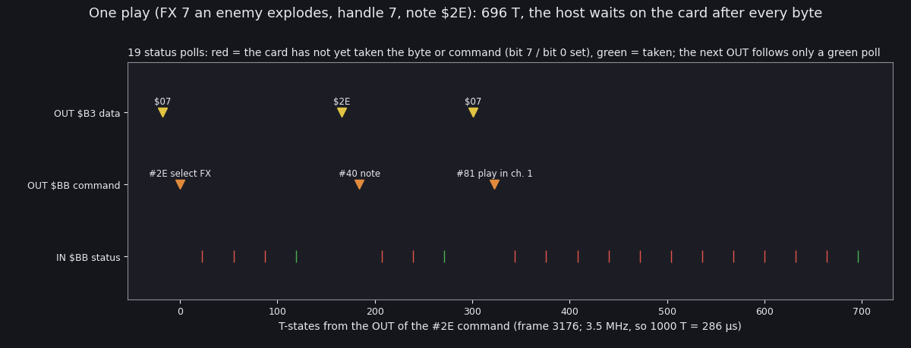

How to read it:

- **Three lanes:** the data written to `$B3`, the commands written to `$BB`, and every status read of `$BB`.
- **A status read** is red while the card has not taken the last byte or command (bit 7 or bit 0 set) and green
  once it has. The next `OUT` follows only a green read.
- **x:** T-states from the `OUT` of the `#2E` command, at frame 3176 of e1.

What it shows:

- A play is three data bytes and three commands: `$07` + `#2E` (select FX 7), `$2E` + `#40` (note `$2E`, `$2C` + r&3),
  `$07` + `#81` (play in channel 1).
- The driver writes the data byte first, then the command, then polls (`$C2E7` for bit 0, `$C2ED` for bit 7).
- This play took 696 T and 19 polls: one of the quick ones. The same three commands waited up to 85783 T in e1.

`python3 tools/fig_sound.py handshake --ports work/zgsB/e1/ports.jsonl --from 3000 --fx 7 --out
docs/img/sound/handshake.png`.

### The level change

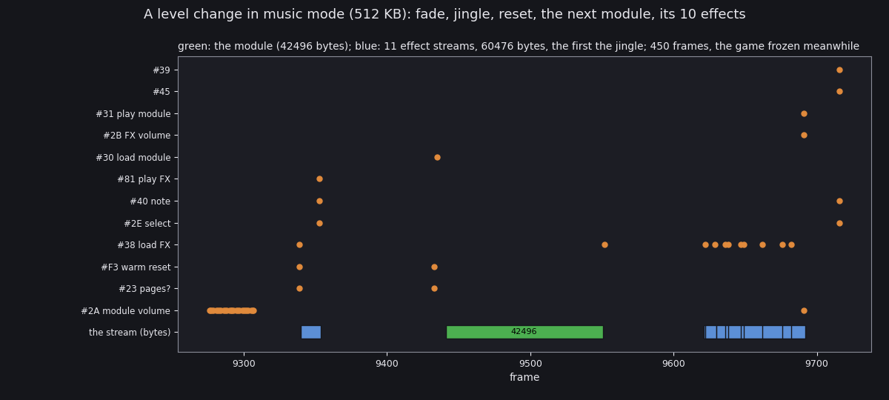

How to read it:

- **One row a command**, one dot each time it was sent; the bottom row is the data streams, as bars from the first
  to the last frame of the stream, with their byte counts.
- Green is the module, blue the effects; the first blue stream is the jingle.

What it shows (e1, frames 9270-9720, level 1 done):

- `RoundWait` fades the module first: 26 `#2A` from `$1A` down to `$01`, one every 1-2 frames (9276-9307). It fades
  only when the round ended with the level done (end code 2).
- `#23`, `#F3`, the jingle (9340-9353) and its play (9353).
- 80 frames later `#23`, `#F3` and `#30`: level 2's module, 42496 bytes in frames 9441-9550.
- The 10 FX after a pause (9621-9690), then `#2B $40`, `#2A $20` (level 2's volume) and `#31`.
- 450 frames, 9 seconds, in which the game is stopped and the screen shows the loading picture.

`python3 tools/fig_sound.py upload --ports work/zgsB/e1/ports.jsonl --from 9270 --to 9720 --title '...' --out
docs/img/sound/upload.png`.

## 9.6 The driver (bank 1 `$C000`)

The driver's source is `src/disk/driver/` (from `src/disk/driver.ann`, every entry named); the addresses below are
bank 1's. Its entries are listed in [12. Routine reference](12-routine-reference.md#the-driver-in-bank-1), the hook
stubs in [12](12-routine-reference.md#the-hook-stubs).

- `PlayFx` `$C23C` (`$C23B` with the gate skipped) plays FX L at note H in channel C:
  - data L, `#2E`;
  - data H, `#40`;
  - data L, `#80|C`.

  Each command waits at `$C2E7` (`IN $BB`, bit 0), each data byte at `$C2ED` (bit 7).
- `$C24F` plays through the FX's own channel choice: `#2E`, `#40`, then data B with `#45`, then data L with `#39`.
  e1 sent `#45` / `#39` for the laser shot in music mode with SHOOTING NORMAL.
- `Gate` `$C22A`. If `ZynapsState` (`$7F6A`) = `$C0`, the sound plays at once. Otherwise the sound is dropped while
  the countdown `GateCountdown` (`$AA29`) is not 0; a sound that plays sets the countdown to the immediate at `$C237`.
  That immediate is the menu's EFFECTS TIMER (2 at the start; key 7 steps it). The stub at `$AA28` counts it down.
  So the timer is the least number of steps between two gated sounds.
- `$C303` sends `#23`. With 7 pages or more and the effects-only mode it does the load-once patch (9.7) once.
- `$C328` sends `#2B` with `FxVolume` (`$B45F`). `$C333` sends `#2A` with `ModuleVolume` (`$B460`), then `#31 1`.
- `LevelChange` `$C385` does nothing if `Level` (`$B461`) = `NextLevel` (`$B462`). Otherwise:
  1. it switches to IM 1;
  2. saves `$BE00` (`$200` bytes) to `$CF90`;
  3. swaps the level loader in at `$61A8` (bank 1 `$C44A`, `$419` bytes) and the `$5B00` area with `$D190`;
  4. sends `#23` and `#F3`;
  5. branches on `LoadKind` (`$B463`): 0 a new level, 1 the game start (the jingle), 2 the title;
  6. swaps everything back and returns to IM 2.
- `RoundWait` `$C34C` replaces Zynaps's wait of N frames between rounds (`$A6AE`). In music mode, when N = 2 and
  `LevelSelectCode` (`$B073`) is not 6 (no SELECT LEVEL), `$C86C` fades the module out. Otherwise it waits.

The level loader (at `$61A8` while it runs) has three entries:

- `$61A8` uploads the jingle from bank 1 `$D3CB` and plays it: FX 1, note `$33`, channel 1.
- `$61BF` uploads the 10 in-game FX from bank 1 `$FAA5` on through the pages `$11` → `$13` → `$14` → `$16` (lengths
  at `$64F6`). In effects-only mode it then uploads the disk set (11 FX, records `$63B6`-`$63C8`) and sends
  `#2B $40`.
- `$6277` uploads the module of `Level` record by record. The table at `$64CB` holds each level's first record. A
  record is 6 bytes: the number of sectors; flags (bit 1 Trush-packed, unpacked by `call $BED4` in page `$17`; bit 7
  the last record; bit 0 delta-coded, never set); 2 bytes the start-up code at `$6332` fills with the track and
  sector; the negated length.

## 9.7 The effects-only mode

In effects-only mode the game start uploads the jingle and all 21 effects. What happens next depends on the card.

- **GS 512 KB.** At the first `#23` the driver sees 15 pages and patches itself (`$C303`, `LoadOncePatch2`
  `$C863`): `RET` at the `#F3` and at `$C303`, `INC L` at `PlayFxFrom` (`$C23B`) and `$C260`, and 22 as
  `SaturnSound`'s FX. The jingle and FX 1-21 are uploaded once, as handles 1-22. Each FX is sent as its number + 1.
  No later level change uploads anything.
- **GS 128 KB.** No patch. Every level change resets the card and uploads the jingle, then FX 1-21 again as handles
  1-21.

e2 shows the 512 KB path: 22 uploads at the game start (frames 1563-1712: the jingle, then 21 FX), then none at the
change from level 11 to level 11. e3 shows the 128 KB path:

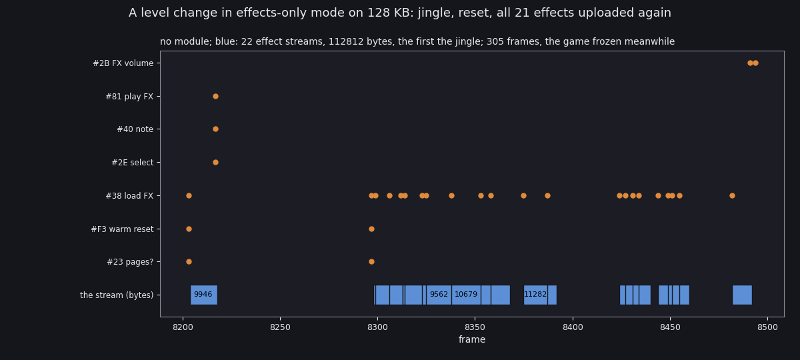

How to read it: as the music-mode upload above, without a module.

What it shows (e3, frames 8195-8500, level 1 done):

- The jingle (9946 bytes) with its own `#23` / `#F3`, played at 8217.
- `#23`, `#F3` and 21 `#38` streams: 102866 bytes in 190 frames (8297-8492), then `#2B $40`.
- So on 128 KB every level costs about 300 frames of loading even without music.

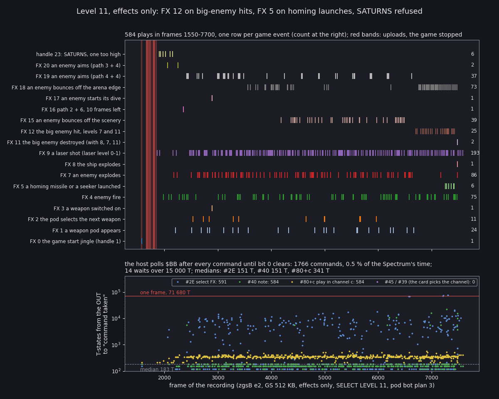

How to read it: as the music-mode timeline (9.5). The handles are shifted back by one (`--shift 1`): the row "FX 5" is
handle 6.

What it shows (e2, frames 1550-7700, level 11):

- 584 plays of 18 kinds. The effects-only sounds are there: the arena edge (FX 18) 73 times, the aims (FX 19) 37,
  the scenery bounce (FX 15) 39, the dive (FX 17) once, path 2 + 6 (FX 16) once.
- **FX 12** plays for the big enemy's hits, 25 times from frame 6709 (bot frame 4235). Level 11 is one of its two
  levels.
- **FX 5** plays 6 times in frames 7256-7424: the 6 homing missiles of bot frames 4782-4950 (10.4). The offset of the
  two clocks is 2474 frames.
- The big enemy's death (frame 7486) sends FX 11, 8, 7 and 11 in four channels at once: the one row "FX 8" tick and
  the two "FX 11" ticks.
- The waits are short without a module: median 151 T for `#2E`, 0.49 % of the Spectrum's time (e3 on 128 KB: 0.52 %).
- **SATURNS never sounds on 512 KB.** `SaturnSound` sends `#2E $16`, `#41 $10`, then plays with `PlayFxFrom`, whose
  `INC L` makes the 22 a 23: `#2E $17`, `#40`, `#83 $17`. The card holds 22 handles (`CNTFX` 22). `#83` with
  handle 23 goes to `COM39_9`: the card answers `$FF` and plays nothing. e2 sent handle 23 six times (port frames 1910-2153).

The SATURNS bug was checked on the card alone (e2's instance after its run, the stubs poked to `RET` so the game sent
nothing): handle 22 at note `$32` rendered with RMS 0.0206 (`work/zgsB/audio/handle22-note32.wav`), handle 23 with
RMS 0 (`handle23-note32.wav`). The patch writes 22 into `SaturnSound` and also makes `PlayFxFrom` add one: the FX is
shifted twice. On 128 KB the patch is not done and FX 21 is handle 21, as it should be. No 128 KB recording reached a
path-1 object with SATURNS on: the 128 KB SATURNS sound is read in the code, not seen.

`python3 tools/fig_sound.py upload --ports work/zgsB/e3/ports.jsonl --from 8195 --to 8500 --title '...' --out
docs/img/sound/upload-128.png`; `python3 tools/fig_sound.py timeline --ports work/zgsB/e2/ports.jsonl --from 1550 --to
7700 --shift 1 --title '...' --label 'zgsB e2, GS 512 KB, effects only, SELECT LEVEL 11, pod bot plan 3' --json
work/zgsB/e2/timeline.json --out docs/img/sound/timeline-fx.png`.

## 9.8 128 KB and 512 KB: the card's pages

The firmware lists its sample pages in `RAMPG` and their number in `NUMPG`. Read from the card:

- **GS 128 KB** (stage 2 `x3`, music, level 1): `RAMPG` = `02 03 04 01`, `NUMPG` = 3.
- **GS 512 KB** (e2, `gsram-512.bin`, card RAM `$4000`): `RAMPG` = `02 03 04 05 06 07 08 09 0A 0B 0C 0D 0E 0F 10 01`,
  `NUMPG` (`$4080`) = 15.

So page 1 is always listed last, and the count leaves it out. The firmware's RAM test (`INIT_L.a80`, `INITR01`-`INITR0E`)
writes each page's number at its `$FFFF` and reads it back. Page 1 is the page whose upper half is the fixed
`$4000-$7FFF` window, the firmware's own work memory. The loader (`LOAD_L.a80`) fills page 1 only up to `$BFFF` (card
RAM `$00000-$03FFF`) and from there reads the bytes and drops them.

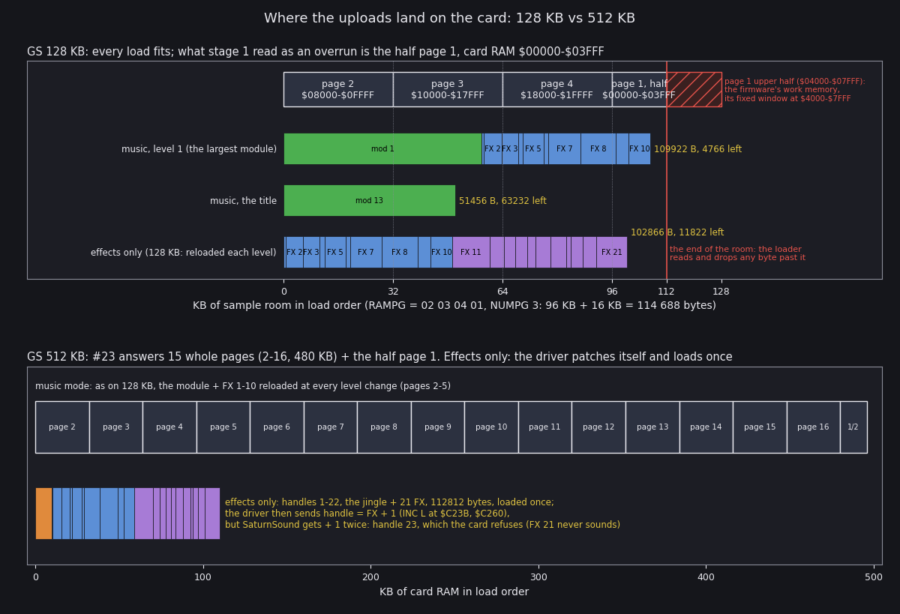

How to read it:

- **Top: GS 128 KB.** The sample room in load order: pages 2, 3 and 4 whole, then the half page 1 (hatched red: the
  upper half is the firmware's work memory). Each bar is one upload as the loader sends it, its effects named.
- **Bottom: GS 512 KB.** Pages 2-16 and the half page 1, 496 KB in all, with the effects-only upload that stays there.
- The yellow numbers are each load's bytes and the room left.

What it shows:

- On 128 KB every load fits. The largest, level 1 in music mode (the module + FX 1-10), is 109922 bytes of the
  114688; FX 8 is split across `$1FFFF` / `$00000`, FX 9 and 10 lie in the half page. The effects-only set is 102866
  bytes.
- Stage 1 read the step from `$1FFFF` to `$00000` as an overrun of the card. It is not: it is the firmware's own
  order of pages, and nothing is overwritten. The bytes in the half page match the effect files, and FX 7-10
  rendered from there play (`work/audio/gs128/fx07..fx10-*.wav`: RMS 0.070 / 0.062 / 0.021 / 0.067).
- On 512 KB the effects-only set takes 112812 bytes (with the jingle) of 507904: it could stay with every module
  beside it, but only the effects-only mode keeps anything.

`python3 tools/fig_sound.py cardmap --out docs/img/sound/card-pages.png` (reads `work/media/gs/media.json`).

The pages per load:

| Load | Bytes | On 128 KB (114688) | On 512 KB |
| --- | ---: | --- | --- |
| music, level 1 (the largest module + FX 1-10) | 109922 | fits, 4766 left; FX 8 split, FX 9-10 in the half page | pages 2-5, reloaded at every level |
| music, levels 5, 7, 9, 12 (56320, 54016, 53910, 48128 + FX) | 99058 or less | fits | pages 2-5 |
| the title (module 13 alone) | 51456 | fits | pages 2-3 |
| effects only: FX 1-21 | 102866 | fits, 11822 left; FX 21's last 4562 bytes at `$00000` | with the jingle 112812, pages 2-5, loaded once |

## 9.9 What the recordings did not reach

- The music-mode branch of `BigEnemyDestroyedSound` (FX 8 alone): the two big-enemy deaths seen (h2 level 5, e2 level
  11) were both in effects-only mode. Read in the code.
- SATURNS on 128 KB (9.7): no recording had a path-1 object on a 128 KB card. Read in the code.
- The modules of levels 3-12 were not streamed live (no recording reached those levels in music mode). Their bytes are
  the loader's records, cut by `tools/gs_media.py`.
- Which path sounds (FX 16, 19, 20) play for which formation: e2 counted the plays (FX 16 once, FX 19 37 times, FX
  20 twice) but did not name the enemies.

## 9.10 The beeper

Zynaps's beeper player `$B30C` is still there and still called every frame (`$AC76`), but no sound reaches it. The
only request routine, `$B2F0`, is now `ObjectSoundStub`, and the sound-0 call at `$ABF1` is NOPs. In stage 1's music
play, port `$FE` took 53334 writes from 14 call sites, all `$00`: no write had bit 4 set. The player's `OUT` at `$B35E`
ran 0 times. The other `OUT ($FE)` sites (`$86D7`, `$8FBD`, `$949C`, `$A535`-`$A573`, `$AA91`, `$AACA`, `$ABD7`) write a
black border and silence (`work/stage1/x1/hook1-counts.txt`).
