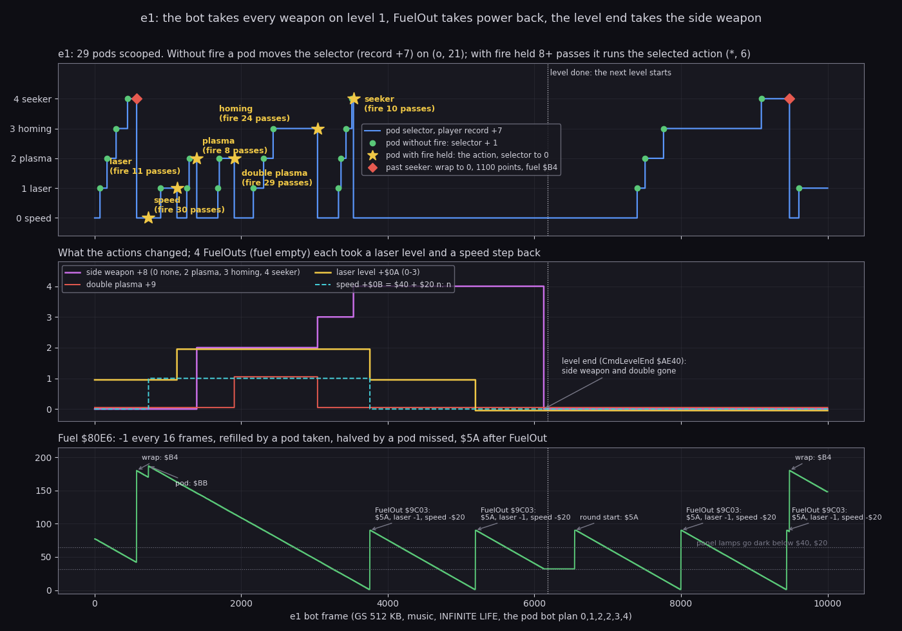
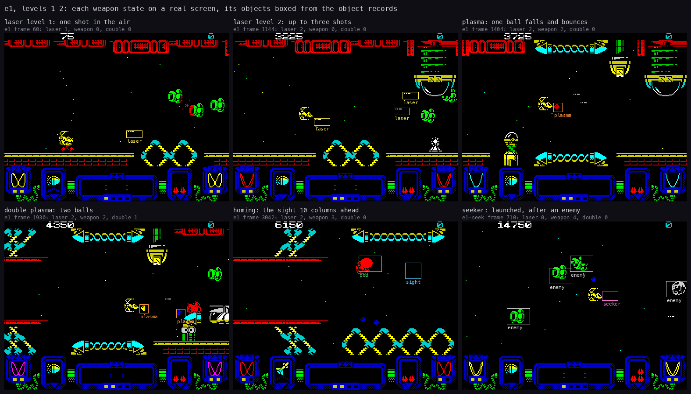
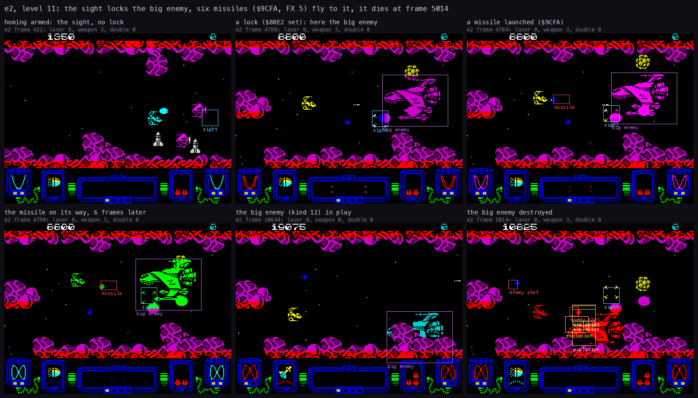
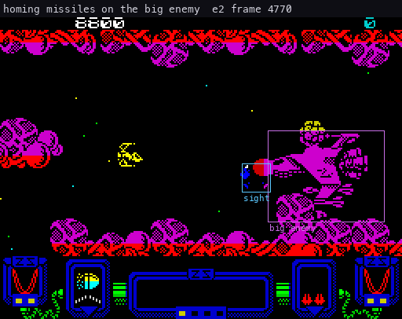
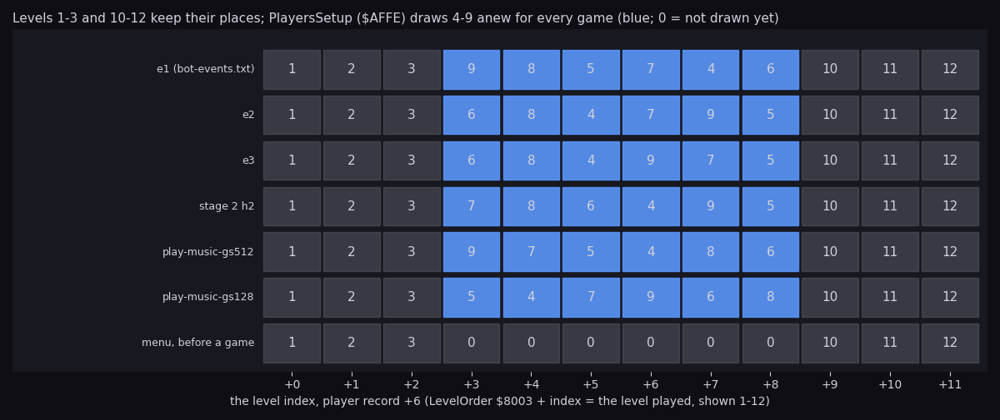
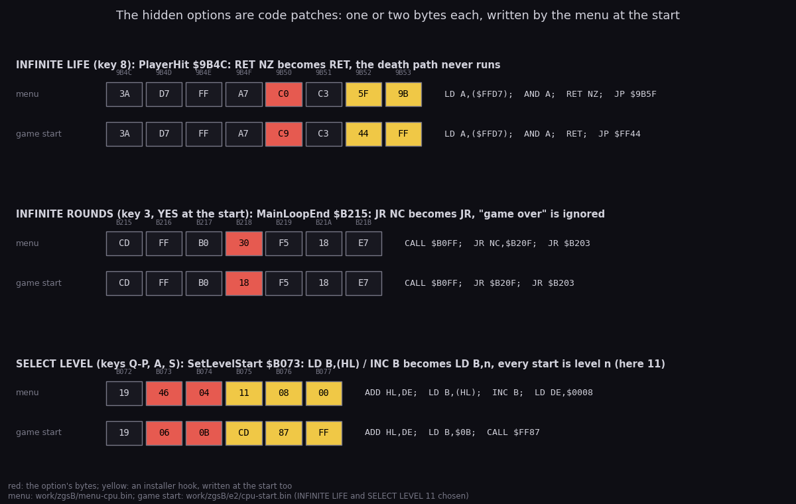

# 10. Gameplay logic

The rules of play are Zynaps's own. The GS conversion adds sound calls at 28 sites
([9.4](09-sound.md#94-where-the-game-makes-a-sound)). It changes nothing the player can do, except through three menu
options that patch the game's code (10.6). This chapter shows the rules that decide a game: the weapons and the pods,
the fuel, the homing missile against the big enemy, the order of the levels, and the options.

Evidence:

- the code: `src/game/game.ann` and the modules under `src/game/` (`player.asm`, `rounds.asm`, `mainloop.asm`);
- three pod-bot recordings by `tools/gs_podbot.py` on Pentagon 128 + TR-DOS + GS, booted from
  `work/media/trd/ZYNAP_GS.TRD`. The bot reads the player record, the weapon variables and the 16 object records
  every 2 frames and saves them with the screen (`bot.npz`, `bot.tsv`, `bot-events.txt`):
  - **e1** (`work/zgsB/e1`): GS 512 KB, music, INFINITE LIFE. The plan: speed, laser, plasma, double plasma, homing,
    seeker. 10000 frames, levels 1 and 2. A second run from e1's end, **e1-seek** (`seek.*`), held fire 12 passes to
    launch the seeker;
  - **e2** (`work/zgsB/e2`): GS 512 KB, effects only, INFINITE LIFE, SELECT LEVEL 11. The plan: homing. 12000
    frames, level 11 twice;
  - **e3** (`work/zgsB/e3`): GS 128 KB, effects only, INFINITE LIFE, the e1 plan. 8000 frames, levels 1 and 2;
- the memory images at the menu (`work/zgsB/menu-cpu.bin`) and at the game start (`work/zgsB/e2/cpu-start.bin`,
  `work/zgsB/e3/cpu-start.bin`);
- stage 2's `h2` runs (`work/stage2/h2/summary.txt`): ten levels with the ship invulnerable, and one run mortal.

The bot's frame counts start when it takes over, after the menu and PREPARE FOR COMBAT. They are not the frames of the
port histories in chapter 9 (in e2, port frame = bot frame + 2474).

## 10.1 The player record

Each player has a 48-byte record: player 1 at `$7F9C`, player 2 at `$7FCC`. `PlayerRecord` (`$7F99`) points at the
current one. `PlayersSetup` (`$AFB7`) zeroes both and fills them.

| Offset | Address (player 1) | What | At the start |
| --- | --- | --- | --- |
| +0-+3 | `$7F9C` | the score, 4 BCD bytes, high first (`AddScore` `$A489`) | 0 |
| +4 | `$7FA0` | the lives | 2 |
| +5 | `$7FA1` | the lives lost in this level | 0 |
| +6 | `$7FA2` | the level index into `LevelOrder` (10.5) | 0 |
| +7 | `$7FA3` | the pod selector 0-4 (10.2) | 0 |
| +8 | `$7FA4` | the side weapon: 0 none, 2 plasma, 3 homing missiles, 4 seeker | 0 |
| +9 | `$7FA5` | the double plasma flag | 0 |
| +`$0A` | `$7FA6` | the laser level 0-3 | 1 |
| +`$0B` | `$7FA7` | the speed `$40`-`$A0`, in steps of `$20` | `$40` |
| +`$0C` | `$7FA8` | the index into `ExtraLifeScores` | 0 |
| +`$0D`-+`$2F` | `$7FA9` | the level's checkpoint: a lost life restarts from it | `SetLevelStart` |

Beside the record, the side weapons use four variables:

- `Fuel` (`$80E6`), the power timer (10.3);
- `FireHeld` (`$8184`), the passes fire has been held, 0 when released (`ReadControls` `$A6B6`);
- `LockTarget` (`$80E0`), the enemy record the sight has locked;
- `LockMask` (`$80E2`), that enemy's collision bit, 0 with no lock.

## 10.2 Weapons, pods and the selector

A shot-down enemy can leave a weapon pod (object kind 4, `ExplosionToPod` `$A31D`, FX 1). `PodStep` (`$A1FD`) decides
what a scooped pod does:

- **Fire released, or held less than 8 passes:** the selector (+7) moves on by one (`$A226`, FX 2). Past the seeker it
  wraps to 0, gives 1000 points and sets `Fuel` to `$B4`.
- **Fire held 8 passes or more** (`$A209`): the action the selector points at runs, through the table at `$80F0`
  (`$A217`). The selector goes back to 0 (`$A210`, FX 3).
- Either way the pod gives 100 points and is removed.
- **A pod that scrolls off unscooped** halves `Fuel` (`$A25C`).

The five actions:

| Selector | Routine | Action |
| --- | --- | --- |
| 0 speed | `PodSpeedUp` `$9D4C` | speed + `$20` up to `$A0`; `Fuel` = `$BB` |
| 1 laser | `$9D5D` | laser level + 1, up to 3 |
| 2 plasma | `$9D68` | side weapon 2; taken again with plasma on, the double plasma (+9 = 1) |
| 3 homing | `$9DA5` (`PodHoming`) | side weapon 3, the double plasma off, the sight `$F600` on, no lock |
| 4 seeker | `$9DDD` (`PodSeeker`) | side weapon 4 |

A side weapon fires from its frame routine (table `$80EA`, called by `PlayerHandler` with +8 - 2), on the count in
`FireHeld`. So a tap fires only the laser:

- plasma launches at 3 passes (`PlasmaFrame`, the launch at `$9CA6`);
- a homing missile from 1 pass, when the sight has a lock (`HomingFrame` `$9CCA`, the launch at `$9CFA`);
- the seeker at 7 passes (`SeekerFrame`, the launch at `$9D1F`).

How to read it:

- **Top: the selector** (+7) over 10000 frames of e1. A green dot is a pod scooped without fire (the selector + 1).
  A star is a pod scooped with fire held 8 passes or more, labelled with its action and the passes held. A red
  diamond is the wrap past the seeker.
- **Middle: what the actions changed.** The side weapon +8, the double plasma +9, the laser level +`$0A`, and the
  speed +`$0B` drawn as (speed - `$40`) / `$20`.
- **Bottom: `Fuel`** (`$80E6`), with its refills and the FuelOuts marked. The dotted lines are the panel's lamp
  thresholds.
- The dotted vertical line is the end of level 1 (bot frame 6178).

What it shows:

- 29 pods in level 1 and the start of level 2: 21 moved the selector on, 6 ran an action, 2 wrapped.
- The six actions, in the plan's order (`work/zgsB/e1/bot-events.txt`):
  - speed at 736 (fire held 30 passes);
  - laser at 1124 (11 passes);
  - plasma at 1394 (8 passes, the least that works);
  - double plasma at 1906 (29 passes);
  - homing at 3042 (24 passes);
  - seeker at 3532 (10 passes).
- A second plasma pod does not add a weapon. It sets the double plasma flag (+9) and keeps +8 = 2.
- Taking homing missiles clears the double plasma.
- Each FuelOut (3756, 5196) takes one laser level and one speed step. By 5196 the laser is down to 0.
- The level end (6128) takes the side weapon: `CmdLevelEnd` (`$AE40`) zeroes +8 and +9, nothing else.

`python3 tools/fig_play.py course --npz work/zgsB/e1/bot.npz --tag e1 --out docs/img/play/weapons-course.png`.

How to read it:

- **Six screens** from the frame logs, one per weapon state. The title gives the run, the bot frame, and +`$0A`, +8
  and +9 read at that frame.
- **The boxes** are drawn from the object records (`$F36C`, 44 bytes a slot; +3/+4 X, +5/+6 Y, +7 the kind, +8 bit
  7 active), labelled by kind. They show which record is which sprite.

What it shows:

- Laser level 1 has one shot in the air; level 2 has up to three.
- The plasma ball falls from the ship and bounces. The double plasma adds a second ball.
- With homing armed, the sight (slot 15, `$F600`) flies 10 columns ahead of the ship.
- The seeker (e1-seek, frame 710) is the slot-14 object (`$F5D4`), heading for an enemy.
- e1's own run never launched a seeker: the bot held fire 6 passes, and the seeker needs 7. e1-seek held 12
  passes. There `$9D1F` ran 3 times, and the seeker object was active in bot frames 710-884, 892-1596 and 1620-2192
  (`work/zgsB/e1/seek-counts.json`, `seek.npz`).

`python3 tools/fig_play.py sheet --npz work/zgsB/e1/bot.npz --tag e1 --npz2 work/zgsB/e1/seek.npz --tag2 e1-seek
--out docs/img/play/weapons-sheet.png`.

A ship lost with a side weapon armed gets it back: `PlayerSetUp` (`$B21C`) zeroes +8 and runs that weapon's pod
action again. No run lost a ship with a side weapon armed (INFINITE LIFE): this is read in the code.

## 10.3 Fuel

`Fuel` (`$80E6`) is the power timer. Each step of the ship's handler with bit 0 of `PassCount` (`$7F63`) set takes 1
from it (`$9A6D`). In play that is one step every 16 frames.

- At 0, `FuelOut` (`$9C03`) sets it to `$5A` and takes one laser level and one speed step (`FuelOutSpeed` `$9C11`:
  not below `$40`).
- `RoundSetup` sets it to `$5A` at every round start (`$B042`).
- A speed pod sets it to `$BB`. The selector's wrap sets it to `$B4`.
- A missed pod halves it.
- The panel's two pairs of fuel lamps (`PanelFuelLamps` `$AB5B`) go dark below `$40` and below `$20`.

So `$5A` steps last 1440 frames, about 29 s. A ship that scoops no pods loses a laser level and a speed step every
29 s.

In e1 (the bottom panel of the course figure above):

- The fuel fell by 1 every 16 frames: from 187 at 736 to 45 at 3042, 142 steps in 2306 frames.
- The speed pod refilled it to `$BB` (736). The two wraps refilled it to `$B4` (574, 9480).
- It ran out four times: 3756, 5196, 8000 and 9442. Each time it was set back to `$5A`.
- During the change to level 2 it stood still at 32: the game was stopped for the upload (9.5). The round start set
  it to `$5A`.
- No halving: the bot scooped every pod it saw. The halving is read in the code (`$A25C`).

## 10.4 The homing missile and the big enemy (level 11)

The homing missile kills only the enemy it has locked, and kills it in one hit. The rule (`src/game/game.ann`, the
`weapons` module):

1. `PodHoming` arms it: side weapon 3, the missile slot `$F5D4` idle, the sight `$F600` on, `LockTarget` and
   `LockMask` 0.
2. The sight flies ahead of the ship. The first lockable enemy (kinds 8 and 12) under it becomes the lock: its
   record goes into `$80E0` and its bit into `$80E2`. It flashes.
3. With fire held, `$F5D4` free and a lock, `HomingFrame` launches (`$9CFA`). The missile's target +`$29` is the lock,
   its life +`$26` is `$4B` (75 frames). The hook at `$9CFA` plays FX 5.
4. The missile homes on the target (`PathOpHome`). Over the locked enemy it is gone, and the enemy's handler sees the
   hit in `$80E3`. With no lock left, it burns out.

Level 11's big enemy is kind 12, lockable. SELECT LEVEL 11 took e2 there at once (10.6).

How to read it: as the weapons sheet above. Each screen's title names the step.

What it shows:

- At 422 the bot has homing armed: the sight is out, with no lock.
- At 4780 the sight lies on the big enemy and `$80E2` is set: the lock.
- The launches came at bot frames 4782, 4806, 4846, 4894, 4942 and 4950. The profiler counted `$9CFA` 6 times and
  `MissileLaunchHook` 6 times (`work/zgsB/e2/bot-counts.json`). The card got FX 5 six times, at port frames 7256-7424
  (9.7).
- The big enemy died at 5014. `$A0D5` ran once, and the card got FX 11, 8, 7 and 11 in four channels at once (port
  frame 7486).
- Before the missiles, the lasers hit it 25 times (`$A0BA`, FX 12 each, from port frame 6709).

How to read it: the screen every 2 frames of e2's frame log, bot frames 4770-5030, 131 pictures. The sight (kind 6),
the lockable enemies (8), the missile (10) and the big enemy (12) are boxed.

What it shows: the missiles leave the ship, turn onto the big enemy and vanish on it, one after another, until it
explodes.

`python3 tools/fig_play.py homing --npz work/zgsB/e2/bot.npz --tag e2 --out docs/img/play/homing-sheet.png`;
`python3 tools/fig_play.py gif --npz work/zgsB/e2/bot.npz --tag e2 --from 4770 --to 5030 --only 6,8,10,12 --title
'...' --out docs/img/play/homing-missile.gif`.

e3 launched two homing missiles on level 1 of a 128 KB card (`$9CFA` 2, `work/zgsB/e3/bot-counts.json`). Level 1 has
no big enemy, so their targets were kind-8 enemies.

## 10.5 Levels and their order

`LevelOrder` (`$8003`, 12 bytes) lists the levels to play, 0-11 (level = value + 1). The record's +6 indexes it.

- The tape image holds `0 1 2 0 0 0 0 0 0 9 10 11`.
- `PlayersSetup` draws six different numbers 3-8 into `$8006`-`$800B` for every game (`ShuffleDraw` `$AFFE`, from
  `Random` `$8544`). A number already taken is drawn again.
- `SetLevelStart` (`$B062`) copies the level's 8-byte entry (`$6B2D` + 8 n) into the record's checkpoint. At `$B06F`
  it reads `LevelOrder`[+6]: `LD B,(HL)` / `INC B`, then the B-th entry from `LevelTable` - 8.
- `LevelDone` (`$B174`) moves +6 on by one; after 12 it wraps to 0.
- The installer's `NextLevelHook` at `$B075` keeps B for the driver (`NextLevel` `$B462`). The round start loads
  that level's module when it changed (9.5).

How to read it:

- **One row a game**, one cell an index of `LevelOrder`, with the level played there (1-12).
- Blue cells are the drawn ones. The last row is the menu's memory, before any game: the six are still 0.
- The rows come from the memory at the game start (e2, e3, h2, stage 1's `play-music` images) or from the bot's
  first event line (e1).

What it shows:

- Levels 1, 2 and 3 always open the game; 10, 11 and 12 always close it.
- The middle six differ in each of the six games.
- e1 and e3 played levels 1 and 2. h2 played 1, 2, 3, 7, 8, 6, 4, 9, 5 and went into 10.

`python3 tools/fig_play.py order --out docs/img/play/level-order.png --order 'e1 (bot-events.txt)'
list:0,1,2,8,7,4,6,3,5,9,10,11 --order e2 work/zgsB/e2/cpu-start.bin --order e3 work/zgsB/e3/cpu-start.bin --order
'stage 2 h2' work/stage2/h2/fx2-cpu.bin --order play-music-gs512 work/images/play-music-gs512/cpu-64k-rebuilt.bin
--order play-music-gs128 work/images/play-music-gs128/cpu-64k.bin --order 'menu, before a game'
work/zgsB/menu-cpu.bin`.

## 10.6 The hidden options

Three menu options patch the game's code instead of setting a flag: INFINITE LIFE (hidden, key 8), SELECT LEVEL
(hidden, keys Q-P, A, S) and INFINITE ROUNDS (key 3). The menu writes their bytes into the game at the start of a
game. The menu's text is in [8. HUD and text](08-hud-and-text.md) and [texts/menu.md](texts/menu.md).

How to read it:

- **Three groups**, one per option. Each shows the bytes at the site in the menu's memory (`work/zgsB/menu-cpu.bin`)
  and at the game start with the option chosen (`work/zgsB/e2/cpu-start.bin`: INFINITE LIFE and SELECT LEVEL 11).
- **Red** bytes are the option's. **Yellow** bytes are an installer hook: they differ too, but every game start
  writes them.
- At the right, the disassembly of each line.

What it shows:

- **INFINITE LIFE.** `PlayerHit` (`$9B4C`) reads the 48K game's test switch `$FFD7`: `LD A,($FFD7)`, `AND A`,
  `RET NZ`. The option writes `$C9` at `$9B50`: `RET NZ` becomes `RET`. The ship is hit, but the death path after the
  `RET` never runs.
- The `JP` after it (`$9B51`) goes to the installer's `ShipHitHook` (`$FF44`). The `RET` skips it too: no FX 8 with
  INFINITE LIFE (9.4).
- **INFINITE ROUNDS.** `MainLoopEnd` (`$B215`): `CALL EndOfPlay` (`$B0FF`), then `JR NC,MainLoopRound` (the next
  life or level) and `JR MainLoopTitle` (carry: the game is over). The option writes `$18` at `$B218`: `JR NC`
  becomes `JR`. Every round goes on, also after the last life: the game is never over. It is YES at the start.
- **SELECT LEVEL.** `SetLevelStart` at `$B072`: `ADD HL,DE`, then `LD B,(HL)` / `INC B` at `$B073`. The option writes
  `$06 n`: `LD B,n`. Every level start, the first and each after a level done, is level n. The record's +6 still
  counts 0, 1, 2 ...; only the level is fixed. e2 played level 11 twice in a row.
- The installer's hook right after it (`$B075`: `CALL $FF87`, `NextLevelHook`) keeps B for the driver. So in music
  mode the driver loads level n's module at every level start.

`python3 tools/fig_play.py options --out docs/img/play/hidden-options.png`.

The other menu options:

| Option | Default | What it writes | Effect in play |
| --- | --- | --- | --- |
| TURBO LOADER (key 4) | YES | the level loader's `TurboTest` operand | how the level loads ([3](03-build-and-load.md)) |
| SATURNS (key 5) | YES (`$B464` = 1 in e2 and e3) | `SaturnsOption` | FX 21 on path 1's enemies (9.4, 9.7) |
| SHOOTING (key 6) | NORMAL | `ShootingOption` | the laser's sound: normal, none, or through the FX's own channel |
| EFFECTS TIMER (key 7) | 2 | the gate's operand `$C237` | the least number of steps between two gated sounds (9.6) |

The play loop ends with a code ([4](04-game-loop.md)): 1 a life lost (`PlayerDied`, carry when no lives are left),
2 a level done (`LevelDone`), 3 and 4 an abort (`AbortGame`). Only the first two return to `MainLoopEnd`. `AbortGame`
(key Q in the pause) resets the stack and jumps to `MainLoopTitle`. So INFINITE ROUNDS does not stop an abort.

## 10.7 What the recordings did not reach

- A missed pod halving `Fuel`: the bot scooped every pod. Read in the code (`$A25C`).
- A ship lost with a side weapon armed (10.2): every zgsB run had INFINITE LIFE. Read in the code (`PlayerSetUp`).
- Levels 3-12 in a normal game in a zgsB run: e1 and e3 ended in level 2. Level 11 was reached through SELECT LEVEL
  (e2). h2 reached levels 1-9 and 10 with the ship invulnerable.
- The homing missile and the big enemy were both reached (10.4).
