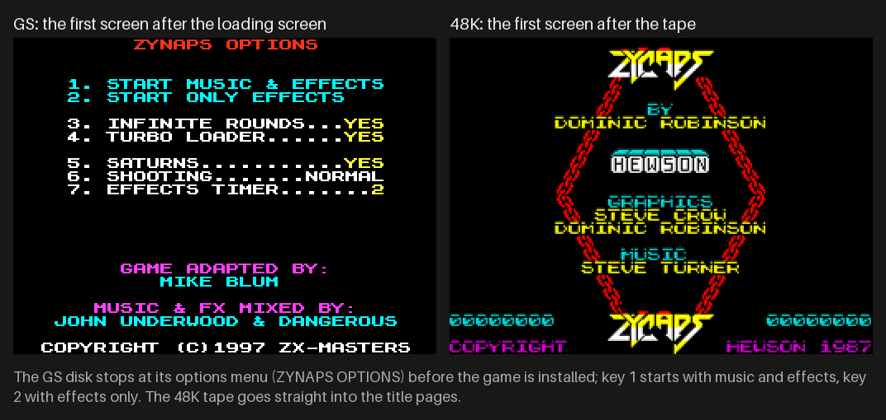
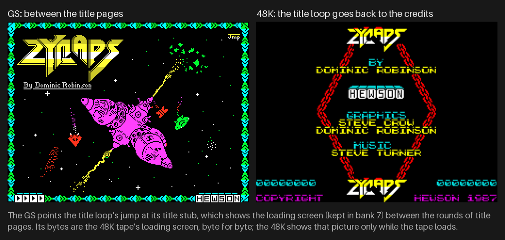
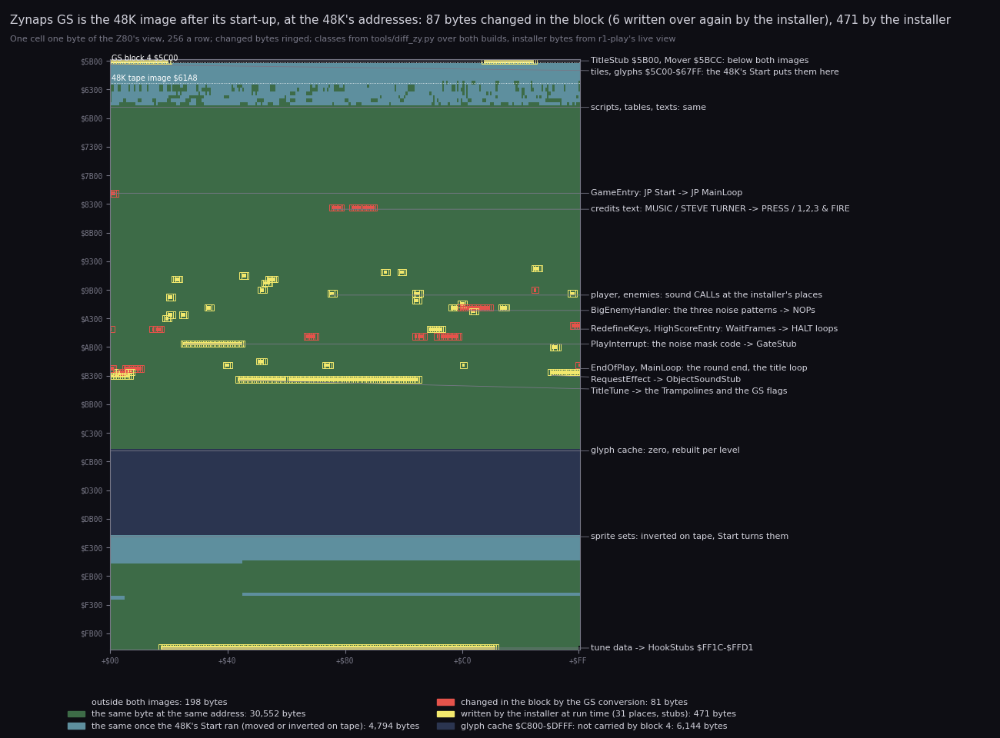
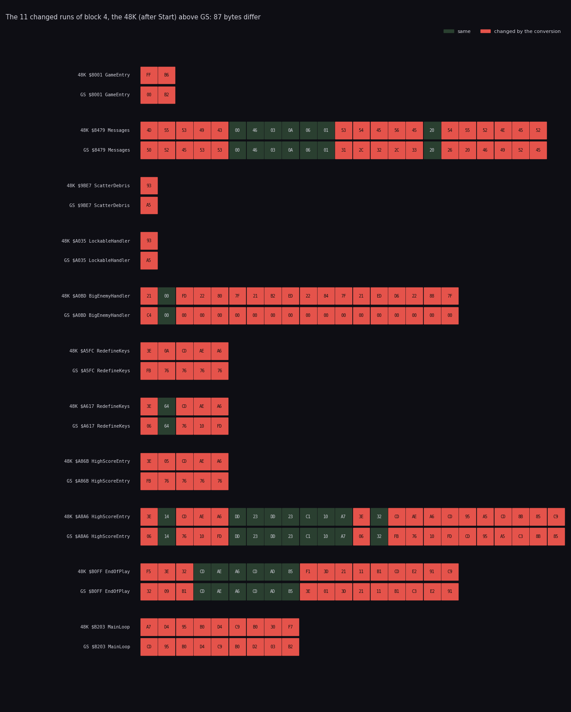
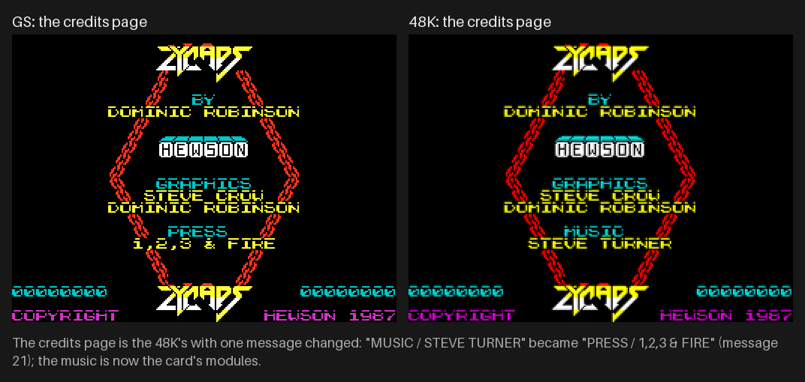
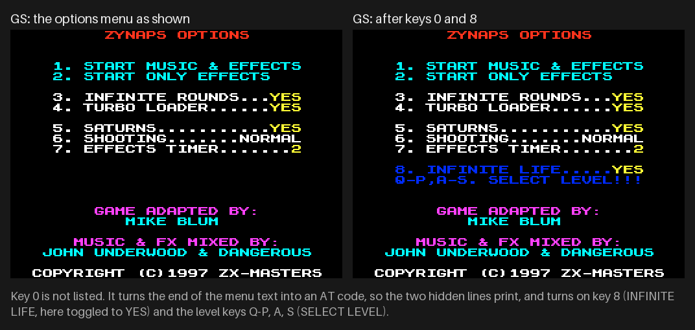
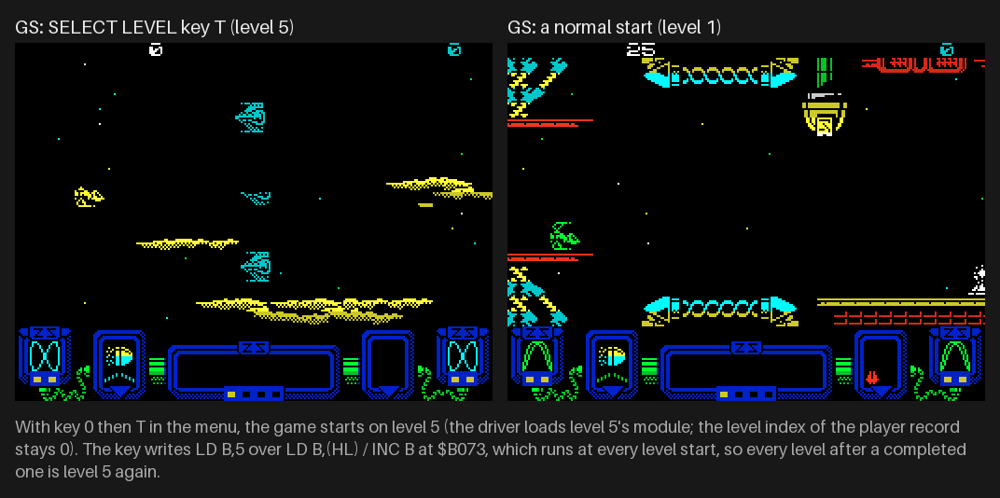
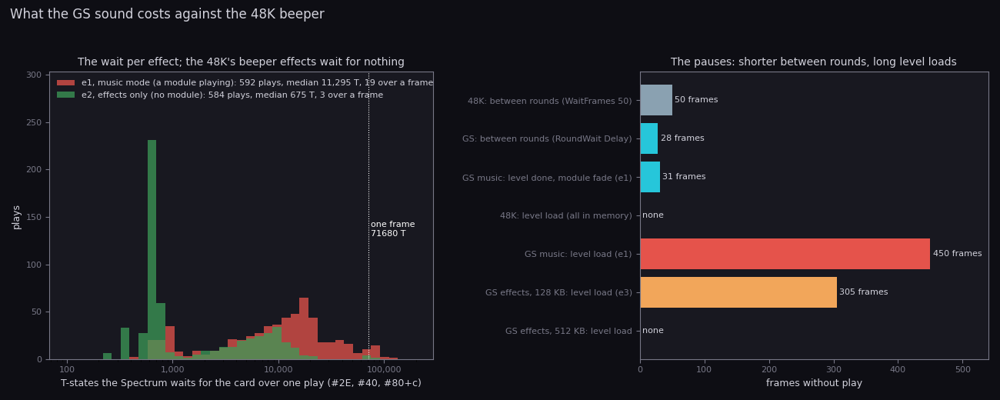
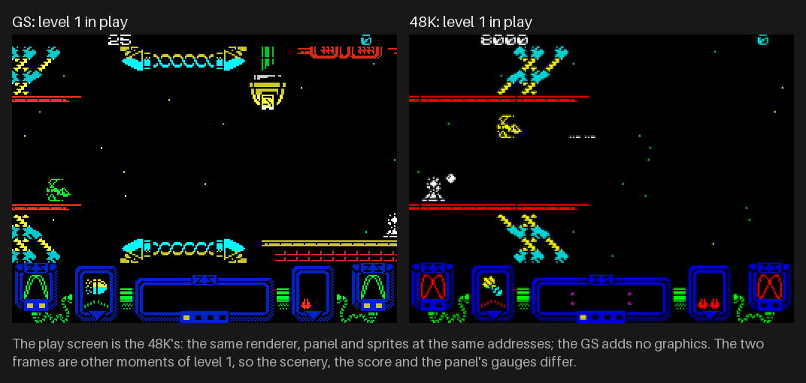
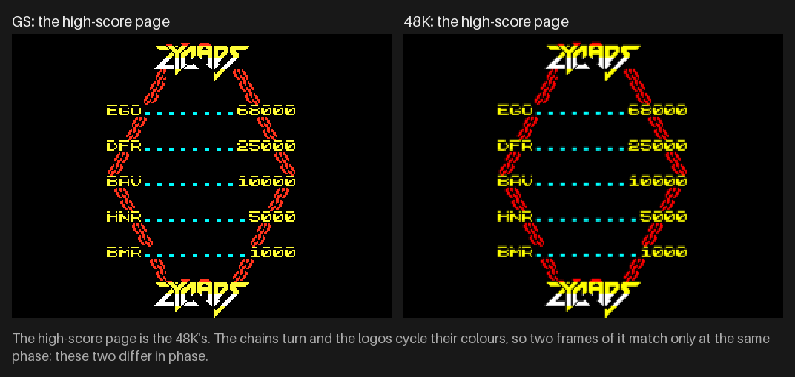

# 13. Differences from Zynaps (48K)

This document covers what the GS conversion changed in Zynaps, why, and what the player gets from it. Each point
comes with the bytes, the code and the recordings behind it.

## 13.0 The two games and the verdict

- **48K** is Zynaps (Hewson, 1987), the 48K tape game. Its case is [`../zynaps`](../../zynaps/README.md). A path
  after "48K" is in that case.
- **GS** is this case: the disk conversion for a 128K with a General Sound card (ZX-Masters, Mike Blum, 1997). Paths
  are relative to this case.

The short answer:

- **The game is the 48K's memory.** Trush block 4 carries Zynaps as the 48K's memory looks once its start-up has
  run, at the 48K's addresses.
  - Of the 35 839 bytes both images hold, 35 752 are the same: 99.76 %. The 48K's start-up (Start `$B6FF`) moves
    4 794 of them into place and turns the inverted sprite sets the right way round.
  - The 87 that differ are in 11 runs. 43 of the 48K's 50 modules have no differing byte (13.3).
- **The rest of the conversion is written at run time.** An installer writes 31 places in the game and 471 bytes of
  stubs over code the GS no longer needs: the title tune, its data, the beeper request, the wait routine and the
  explosion noise's shift code (13.3.1).
- **Every change is sound, or makes room for it.** The beeper is silent in play. 22 sampled effects and 13
  ProTracker modules replace the 48K's six effects, its explosion noise and its 46.5 s title tune. The card plays
  them; a driver in bank 1 sends the commands (13.4, 13.5).
- **The menu adds three cheats.** INFINITE LIFE writes the same `RET` the 48K's developer switch `POKE 65495,1`
  triggers. INFINITE ROUNDS is on by default, so a game never ends. SELECT LEVEL fixes the level of every level
  start (13.6).
- **The level order is the 48K's.** Both games draw levels 4-9 anew for every game with the same code. The GS did
  not add the shuffle (13.7).
- **The cost moves.** The 48K's effects take 22.5 % of the CPU, but only in the main loop's spare time. The GS's
  waits for the card take 0.5-2.1 % of the CPU, inside the play interrupt. Its real cost is the pauses: about 9 s at
  every level change in music mode, 6 s on a 128 KB card in effects-only mode (13.8).
- **Everything else is the 48K's code, with the 48K's quirks** (13.9). The conversion adds a few of its own: the
  SATURNS sound never plays on a 512 KB card, no sound stops at the pause, and waits of over a frame inside the
  play interrupt.

How it was compared:

- Both reverses are complete, and both cases rebuild their originals byte for byte from source. This case's
  `src/game/game.ann` was seeded from the 48K's annotations, so both use the same names where the code is the same.
- The game images were compared address by address (`tools/diff_zy.py`). The 48K's image was first put through its
  own Start, so that both are the same moment of the game. Nothing was paired by name or masked. Each changed run is
  named from both cases' `game.ann` and shown from both listings side by side (13.11).
- The installer's writes were read from a live CPU view after it ran (`work/zgsA/r1-play/start.bin`), compared with
  the block and the 48K.
- The sound was compared hook by hook: the 48K side from its doc 9 (the six effects measured and modelled), the GS
  side from the port journals of `r1`, `e1`, `e2` and `e3` (doc 9). No new emulator run was made for this document.

Witnesses:

- "48K line N" is a line of the 48K's `build/game.lst`; "GS line N" a line of this case's `build/game.lst`.
- Recordings ([Terms](README.md#terms)): `r1` and `r1-play` (`work/zgsA`), `e1`, `e2`, `e3` (`work/zgsB`), `h2`
  (`work/stage2/h2`). 48K: `c1`, `r1` and the effect captures, as in the 48K's docs.
- A 48K frame is 69 888 T (19.97 ms) and a GS frame 71 680 T (20.48 ms, Pentagon 128).
- The figures are in `docs/img/diff/` and `docs/img/compare/`. Every command is run from this case's root.

## The differences at a glance

| What | 48K | GS | Why | For the player | |
| --- | --- | --- | --- | --- | --- |
| medium | tape: BASIC, picture, code | TRD: one BASIC line and 8 covers over one run of 2 174 sectors, 38 Trush blocks | the card's modules and effects | | [13.1](#131-the-media-and-the-load) |
| to the title | 12 323 frames, about 4 min (`c1`) | the options menu at 16.6 s (`r1`); the title right after key 1 | a disk, packed blocks | 15 times faster | [13.1](#131-the-media-and-the-load) |
| machine | 48K | 128K, TR-DOS, General Sound (128 KB is enough) | the driver's bank, the effects' banks | no GS, no game | [13.2](#132-memory-and-banks) |
| game image | `$61A8-$FFFE` on tape, Start moves it | `$5C00-$FFFF`, the memory after Start | the converter saved a running 48K | nothing visible | [13.3](#133-the-game-image-87-bytes-in-eleven-runs) |
| game code | 50 modules | 99.76 % the same; 87 bytes in 11 runs; 43 modules unchanged; 31 places and 471 stub bytes at run time | sound only | the same game | [13.3](#133-the-game-image-87-bytes-in-eleven-runs) |
| effects | 6 beeper effects, one at a time by priority | 22 samples: 10 in music mode, 21 in effects-only mode, 4 channels | the card plays samples | richer sound, several at once | [13.4](#134-sound-hook-by-hook) |
| explosions | a noise from three beeper toggles, 16 passes | FX 7 (enemies), FX 8 (the ship); the toggles write 0 | the masks never open | a sample instead of a buzz | [13.4](#134-sound-hook-by-hook) |
| silent events | launches, bounces, dives, aims, the game start | FX 4, 5, the jingle; effects only: FX 11-21 | new hooks | more sounds | [13.4](#134-sound-hook-by-hook) |
| music | the title tune, 46.5 s, game stopped | 13 modules: the title and one per level, played in play | the card plays on its own | music in play (music mode) | [13.5](#135-the-music-one-beeper-tune-against-13-modules) |
| cheats | `POKE 65495,1` (Invulnerable `$FFD7`) | INFINITE LIFE, INFINITE ROUNDS (on), SELECT LEVEL | the converter's menu | an endless game by default | [13.6](#136-the-options-the-48ks-poke-against-the-menu) |
| level order | 1-3, a shuffle of 4-9, 10-12 | the same code, the same order rule | | the same | [13.7](#137-the-level-order) |
| sound CPU | 22.5 % in the main loop's spare time | waits 0.49-2.09 %, inside the play interrupt | the card's handshake | rarely a late pass | [13.8](#138-cost-and-timing) |
| pauses | 50 frames between rounds | 28 frames between rounds; 450-464 frames a level change (music), about 300 (128 KB, effects) | the uploads | a 9 s wait at every new level | [13.8](#138-cost-and-timing) |
| frame | 69 888 T | 71 680 T | Pentagon | play 2.6 % slower | [13.8](#138-cost-and-timing) |
| bugs | the 48K's quirks | all kept; 7 new | | SATURNS silent on 512 KB, sound on in the pause | [13.9](#139-bugs-added-and-kept) |
| screens | | the 48K's, plus the options menu and the loading screen between title pages | | the same play screen | [13.10](#1310-what-the-player-sees) |

## 13.1 The media and the load

| | 48K | GS |
| --- | --- | --- |
| medium | `Zynaps.tzx`: the BASIC, the loading picture, the code | `ZYNAP_GS.TRD`, 655 360 bytes: `ZYNAP_GS` (BASIC) and 8 covers over one run of 2 174 sectors |
| loader | the Hewson loader, the picture, then 40 535 bytes to `$61A8-$FFFE` | the boot code in the BASIC line's tail sectors; six reads of 321 sectors, five Trush blocks unpacked where they land |
| signal / reads | 264.4 s of tape signal | 321 sectors at the boot, then one level's records at each level change |
| picture | the loading screen while the tape loads | the same screen, byte for byte, faded in, kept in bank 7, shown again between the title pages |
| first screen | the title pages, at frame 12 323 (`c1`, about 4 min) | the options menu at frame 812 (`r1`, 16.6 s); after key 1 the installer (frame 1 500) and the title (1 505) |
| sound on the medium | the title tune (211 bytes) and the effect table (48 bytes) | 13 modules (584 854 bytes), the jingle (9 946), FX 1-21 (102 866) |

- **What.** The 48K loads one block from tape and starts. The GS boots from disk into an options menu of its own
  ([5.1](05-controls.md#51-the-options-menu)), installs the game and its hooks, and loads the sound to the card as
  it is needed: a level's module and effects at each level change, from the level records further on the disk
  ([3.2](03-build-and-load.md#32-the-disk-map), [3.6](03-build-and-load.md#36-what-goes-to-the-card-and-when)).
- **Why.** The card plays only what is uploaded into its RAM. The 13 modules alone are 571 KB: they cannot be in
  memory at once, so the disk holds them and the driver loads one at a time.
- **For the player.** The disk is in the menu 15 times faster than the tape reaches the title. The price comes in
  play: every level change stops the game for the next module (13.8).

The loading screen is the 48K tape's (`src/res/screen/loading.png` against the 48K case's `loading.scr`, byte for
byte). The GS adds the fade and shows it between the title pages:





How to read the two figures: left the GS, right the 48K, real emulator frames at 2x, the caption under each saying
what it shows (`python3 tools/fig_compare.py`, frames in `work/stage2/shots`).

## 13.2 Memory and banks

| | 48K | GS |
| --- | --- | --- |
| machine | 48K | 128K; the game in banks 5, 2 and 0, as a 48K sees them |
| `$5B00-$5BFF` | free (the loader's MoveStub ran there) | TitleStub `$5B00` and the Mover `$5BCC`; the area `$5B00-$5D3A` is saved in bank 1 for the level loads |
| `$5C00-$67FF` | the tiles and wave cells, moved down from `$BC00` by Start | the same bytes, already in place in block 4 (carried at `$C800`, moved down by the Mover) |
| `$C800-$DFFF` | the glyph cache, rebuilt per level | the same; block 4 uses the room to carry `$5C00-$73FF` |
| `$E000-$E747`, `$F048-$F107` | inverted on tape, turned by Start | already turned |
| `$FF1C-$FFD1` | the title tune's data | HookStubs: the hook stubs, 182 bytes |
| `$B446-$B4A7` | TitleTune, the tune player | the Trampolines: KeyWait, the GS flags `$B45F-$B465`, CallDriver, SlotGoneHook, CallDriverFx |
| bank 1 | | the GS driver (`$C000-$CF4C`), the saves for a level load, the jingle, FX 1 |
| banks 3, 4, 6 | | FX 2-10 for music mode |
| bank 7 | | the loading screen; a level load's unpack buffer |
| the card | | 128 KB: 112 K of sample room; 512 KB: the effects-only set loaded once |

- **What.** The game keeps every 48K address. The GS takes three more kinds of room: the 128K's banks for the
  driver and the effects, the card's RAM for the samples, and 471 bytes inside the game for the stubs.
- **Why.** The stubs must be reachable with bank 0 paged, so the converter put them over 48K code and data that the
  GS no longer runs: the title tune and its data, the beeper request `$B2F0`, the wait routine `$A6AE`, the shift of
  the explosion noise's patterns `$AA28`. All of it was the beeper's.
- **For the player.** Nothing visible, but the game needs a 128K and the card: there is no beeper fallback.

[2.2](02-architecture.md#22-the-memory-map) and [2.3](02-architecture.md#23-the-other-banks) have the full maps.

## 13.3 The game image: 87 bytes in eleven runs



How to read it:

- **One cell, one byte** of the Z80's view, `$5B00-$FFFF`, 256 a row. The labels at the right name the regions.
- **The classes**, from `tools/diff_zy.py`:
  - green: the same byte at the same address;
  - teal: the same only after the 48K's Start ran (the tape holds it at `$BC00` or inverted);
  - red: changed in block 4 by the conversion (ringed, so the few bytes show);
  - yellow: written by the installer at run time, read from `r1-play`'s live view after the installer ran;
  - dark blue: the glyph cache `$C800-$DFFF`, which block 4 does not carry; black: outside both images.
- **The claim**: 30 552 bytes are the same as on tape, 4 794 more after Start; 87 differ in the block (6 of them
  written over again by the installer); 471 are the installer's.
- Drawn by `python3 tools/fig_diff_memmap.py`.

Against the tape's bytes as loaded, without Start, 3 433 bytes differ. That is why the comparison runs Start on the
48K's image first: the GS image is the memory after it.



How to read it: one pair of rows per run, the 48K (after Start) above the GS, each with its address and the entry
it lies in; red bytes differ. The same script writes it.

| Run | 48K entry | GS | Bytes | Why |
| --- | --- | --- | ---: | --- |
| `$8001-$8002` | GameEntry: `JP Start` | `JP MainLoop` | 2 | the image is after Start, which must not run again: it would invert the sprites back |
| `$8479-$848F` | Messages, message 21 | "MUSIC / STEVE TURNER" → "PRESS / 1,2,3 & FIRE" | 16 | the tune is gone; the title keys pick the players |
| `$9BE7` | ScatterDebris: `CALL StartExplosion` | `CALL StartExplosionQuiet` (`$A2A5`) | 1 | the ship's explosion without the noise set-up |
| `$A035` | LockableHandler: the same | the same | 1 | |
| `$A0BD-$A0CE` | BigEnemyHandler: the three `LD (SoundPatternN),HL` | `CALL NZ,$0000` and 15 `NOP`s; the installer NOPs the `CALL` too | 17 | the big enemy's hit noise |
| `$A5FC-$A600` | RedefineKeys: `LD A,10; CALL WaitFrames` | `EI` and 4 `HALT`s | 5 | `$A6AE` became the GS's wait between rounds |
| `$A617-$A61B` | RedefineKeys: `LD A,100; CALL WaitFrames` | `LD B,$64; HALT; DJNZ` | 4 | the same |
| `$A86B-$A86F` | HighScoreEntry: 5 frames | `EI` and 4 `HALT`s | 5 | the same |
| `$A8A6-$A8BD` | HighScoreEntry: 20 and 50 frames | `HALT` / `DJNZ` loops, the tail `JP ClearScreen` | 15 | the same |
| `$B0FF-$B110` | EndOfPlay: `PUSH AF; LD A,$32; CALL WaitFrames` ... `POP AF` | the end code kept in the operand at `$B109`, passed to the wait in A | 12 | the wait learns how the round ended |
| `$B203-$B20B` | MainLoop: `AND A; CALL NC,CreditsPage` ... `JR NC` | `CALL CreditsPage` ... `JP NC` | 9 | room for the installer's title hooks |

By module: gameentry 2, texts 16, player 1, enemies 18, menu 9, hiscore 20 and mainloop 21 bytes. The other 43 of
the 48K's 50 modules are byte for byte the same: the renderer, the scroll, the objects, the paths, the weapons, the
HUD, the levels and their scripts.

The code side by side (`python3 tools/diff_zy.py --show EndOfPlay`):

```text
48K $B0FF  PUSH AF                  | GS $B0FF  LD ($B109),A        ; the end code into the operand below
    $B100  LD A,$32                 |    $B102  CALL WaitFrames     ; the installer's WaitStub: RoundWait in bank 1
    $B102  CALL WaitFrames          |    $B105  CALL FadeAttributes
    $B105  CALL FadeAttributes      |    $B108  LD A,code           ; EndCodeLoad
    $B108  POP AF                   |    $B10A  DEC A
    $B109  DEC A                    |    $B10B  LD HL,EndHandlers
    $B10A  LD HL,EndHandlers        |    $B10E  JP JumpTable
    $B10D  CALL JumpTable           |
    $B110  RET                      |
```

```text
48K $A0BD  LD HL,$FD00              | GS $A0BA  CALL BigEnemyHitHook ; installer: DEC (IY+$0D) moved into the stub
    $A0C0  LD ($7F80),HL            |    $A0BD  NOP                  ; installer: the block's CALL NZ,$0000
    $A0C3  LD HL,$EDB2              |    $A0BE  NOP x 17
    $A0C6  LD ($7F84),HL            |
    $A0C9  LD HL,$D6ED              |
    $A0CC  LD ($7F88),HL            |
```

### 13.3.1 The installer's 31 places

The block is not what runs. `src/disk/install.asm` writes 31 places before the game starts
([3.5](03-build-and-load.md#35-the-patch-installer)): 28 operands, 10 of them with a `CALL` opcode as well, and 3
`NOP` runs. `python3 tools/diff_zy.py --installer` prints each with the 48K's, the block's and the live bytes.

| Kind | Sites | 48K | Live (GS) |
| --- | --- | --- | --- |
| the six beeper requests | `$9C77`, `$9EA5`, `$A1C4`, `$A21F`, `$A226`, `$A31D` | `CALL $B2F0` with A = 1-6 | `CALL` a hook stub `$FF60-$FF81` |
| the stop request | `$ABF1` | `CALL $B2F0` with A = 0 | 3 `NOP`s |
| explosions | `$9FBE`, `$A034`, `$9BE6` | `CALL StartExplosion` | `CALL ExplodeHook`; `StartExplosionQuiet` at `$9BE6` |
| new sound events | `$9B51`, `$9CA6`, `$9CFA`, `$9D1F`, `$A0BA`, `$A0D5` | `JP KillPlayer`, `LD (IX+$12),A`, `CALL PlaceAtPlayer` x 2, `DEC (IY+$0D)`, `LD ($80E2),A` | a hook doing the replaced instruction and a sound |
| effects-only events | `$95E7`, `$9823`, `$9856` (+ `NOP` at `$9859`), `$969D`, `$9694`, `$9747`, `$9954` | the path ops' own instructions | hooks through CallDriverFx |
| levels and rounds | `$AF51`, `$B03E`, `$B075` | `LD ($80B0),A`, `CALL ClearHitGrid`, `LD DE,8` | GameStartHook, RoundStartHook, NextLevelHook |
| the title | `$B0BF`, `$B203`, `$B209` | `CALL TitleTune`, `CALL CreditsPage`, `JR NC` | KeyWait, TitleEntry, `JP NC,TitleStub` |
| the big enemy's leftover | `$A0BD` | `LD HL,$FD00` | `NOP` |

- In the 48K, WaitFrames `$A6AE` had 6 callers. In the GS only EndOfPlay's is left; it reaches RoundWait. The other
  five became `HALT` loops of their own (the runs above).

## 13.4 Sound, hook by hook

The 48K's sound is in 48K [9.4](../../zynaps/docs/09-sound.md#94-the-effects) and
[9.5](../../zynaps/docs/09-sound.md#95-who-drives-the-speaker-in-a-frame-of-play). The GS's is in
[9.4](09-sound.md#94-where-the-game-makes-a-sound). Here they are side by side.

How the 48K sounds:

- **Six effects** through RequestEffect `$B2F0`: A = the effect, which is also its priority. A higher number cuts a
  lower one, a lower one waits. EffectPlay `$B30C` plays the tone in the main loop's time between passes, 2 frames a
  tick.
- **The explosion noise**: three beeper toggles in the play pass (a playfield row, an object strip, an object slot)
  whose masks open for 16 passes when StartExplosion `$A293` or the big enemy's hit loads the three patterns.
- **Everything else is silent.**

How the GS sounds:

- Each site calls a stub; the stub pages bank 1 and calls a driver entry. The entry picks an FX, a note (some with a
  random semitone from R) and a channel, passes the EFFECTS TIMER gate, and sends `#2E`, `#40`, `#80+c` to the card.
- **The beeper is silent.** The six requests go to hooks, the stop request is `NOP`ped, the explosion noise's
  patterns are never loaded (StartExplosionQuiet, the `NOP`s at `$A0BD`) and their shift code is the GateStub. The
  toggles still run and write port `$FE`, always `$00` in play.

| Event | Site | 48K sound | GS music mode | GS effects only |
| --- | --- | --- | --- | --- |
| an enemy fires | `$A1C4` | effect 1, 18 frames | FX 4, note `$30`+r&1 | the same |
| a laser shot | `$9C77` | effect 2, 20 frames | FX 9 (laser 0-1) or FX 10 (2-3) | the same |
| a plasma ball bounces | `$9EA5` | effect 3, 12 frames | FX 6 | the same |
| a weapon pod appears | `$A31D` | effect 4, 32 frames | FX 1 | the same |
| the selector moves on | `$A226` | effect 5, 18 frames | FX 2 | the same |
| a weapon switched on | `$A21F` | effect 6, 36 frames | FX 3 | the same |
| the pause, the end of play | `$ABF1` | effect 0: the stop | nothing | nothing |
| an enemy explodes | `$9FBE`, `$A034` | the explosion noise, 16 passes | FX 7, note `$2C`+r&3 | the same |
| the ship hit | `$9B51`, `$9BE6` | the explosion noise (ScatterDebris) | FX 8 at the hit; the explosion silent | the same |
| the big enemy hit | `$A0BA` | the explosion noise | nothing | FX 12 (levels 7, 11), else FX 13 or 14 |
| the big enemy destroyed | `$A0D5` | the explosion noise (ScatterDebris) | FX 8 | FX 11, 8, 7 and 11 in four channels |
| a plasma ball launched | `$9CA6` | silent | FX 4, note `$2A`+r&1 | the same |
| a homing missile or a seeker launched | `$9CFA`, `$9D1F` | silent | FX 5 | the same |
| PREPARE FOR COMBAT, the game start | `$AF51` | silent | the jingle, 1.01 s | the same |
| a new level | `$B03E` | silent | the module and FX 1-10 uploaded, the module started | 128 KB: the jingle and FX 1-21 uploaded again; 512 KB: nothing |
| bounces, a dive, an aim, path sounds, SATURNS | `$95E7`, `$9823`, `$9856`, `$969D`, `$9694`, `$9747` | silent | silent: the hooks return at once | FX 15-21 |
| between rounds | `$B102` | silence, 50 frames | the module fades out (a level done) or a delay | a delay |
| the title pages | `$B0BF`, `$B203` | the title tune | the title module | the same |

"r&1" and "r&3" are 0-1 or 0-3 semitones taken from the R register. 9.4 has every entry and note.

- **What.** The six beeper effects map one to one onto FX 1-10. The explosion noise becomes FX 7 and FX 8, and in
  effects-only mode FX 11-14 for the big enemy. Events the 48K left silent get sounds: three in both modes (a plasma
  launch, a missile launch, the game start's jingle) and six in effects-only mode (bounces off the scenery and the
  arena's edge, dives, aims, path sounds, SATURNS).
- **Why.** The beeper request already marked the events, so its sites were the obvious places to hook. The explosion
  noise was a by-product of the drawing; it had to be switched off at its sources (the pattern loads), since its
  toggles are spread through the renderer. The effects-only mode spends the card's room left free by the missing
  module on more effects.
- **For the player.**
  - **Several sounds at once.** The 48K plays one effect at a time: a pod's sound (4) cuts a laser (2), a laser
    never cuts a weapon-on (6). The card plays several samples at once, each on the channel the driver picks. The
    EFFECTS TIMER (menu key 7) only thins out the gated sounds.
  - **Lengths.** The 48K's effects last 12-36 frames, 0.24-0.72 s. The GS's last 0.04-0.68 s; the jingle 1.01 s.
  - **Explosions** are samples, not a buzz whose pitch is the timing of the code. A big enemy's hits are silent in
    music mode, where the 48K buzzed.
  - **In music mode** the 48K's events sound, plus the launches and the jingle. **In effects-only mode** the enemies'
    movements are heard too: bounces off the scenery and the arena's edge, dives, aims, path sounds.

The beeper request side by side, at the laser (`FireLaser`, GS line numbers from `build/game.lst`, the live operand
from the installer):

```text
48K $9C75  LD A,$02                 | GS $9C75  LD A,$02
    $9C77  CALL RequestEffect       |    $9C77  CALL ShotHook ($FF6F)   ; PUSH HL; LD HL,ShotSound; JR HookCall
                                    |                                   ; CallDriver: bank 1, FX 9 or 10, #2E #40 #80+c
```

The explosion, side by side:

```text
48K $A293  StartExplosion:          | GS $9FBE  CALL ExplodeHook ($FF3B)
           LD HL,$FD00              |           LD HL,ExplosionSound
           LD ($7F80),HL            |           CALL CallDriver          ; FX 7
           ... ($7F84), ($7F88)     |           JP StartExplosionQuiet  ; $A2A5: kind 3, the animation
    $A2A5  LD A,$03                 |
```

## 13.5 The music: one beeper tune against 13 modules

| | 48K | GS |
| --- | --- | --- |
| what | TitleTune `$B446`: Steve Turner's tune, 211 bytes, 7 patterns, 226 notes, two voices on the beeper | 13 ProTracker `M.K.` modules, 26-58 KB each, 4 voices, by several sceners (credits in the sample names) |
| when | on the credits page only; interrupts off, the tune ends at fire or a key 1-5 | the title module on the title pages; in music mode one module per level, all through play |
| length | 46.5 s, then the page goes on | 7 s (level 6, one pattern in a loop) to 4 min 36 s (level 12) a pass, looped |
| cost | the whole CPU while it plays | none in play: the card plays on its own; a level change uploads the next module |

- **What.** The beeper tune and its player are gone; their bytes hold the Trampolines and the HookStubs. Message 21
  no longer credits the music. The title page's `CALL TitleTune` became KeyWait, which waits up to 500 frames for a
  key, as the tune's key test did.
- **Why.** The card is a sample player with a ProTracker engine. Its modules were taken from the scene (the
  credits name wendetta 2175, kbx128 / tesko!, dextrous, pyratronik, nuke of lemon; "zynaps4" was written for
  Galaga Deluxe in 1994), mixed by John Underwood and Dangerous ([9.3](09-sound.md#93-the-media)).
- **For the player.** The 48K has music only on the title page, and the game stands still while it plays. The GS
  plays music all through play in music mode, a different tune each level. Effects-only mode plays no music in play.



How to read it: left the GS, right the 48K, at 2x; the caption counts the differing pixels.

## 13.6 The options: the 48K's POKE against the menu

The 48K has no options beyond the title keys. It has one developer switch: Invulnerable `$FFD7`, 0 on the tape,
read by PlayerHit `$9B4C` (48K [2.2](../../zynaps/docs/02-architecture.md#22-the-memory-map)). `POKE 65495,1`
makes the ship immortal.

The GS adds an options menu before the game ([5.1](05-controls.md#51-the-options-menu)). Three of its options
patch the game's code at each game start ([10.6](10-gameplay-logic.md#106-the-hidden-options)):

| Option | Key | Default | Writes | The 48K's bytes | Effect |
| --- | --- | --- | --- | --- | --- |
| INFINITE LIFE | 8 (hidden, key 0) | NO | `$C9` at `$9B50` | `RET NZ` (`$C0`) | `RET`: the ship is never destroyed |
| INFINITE ROUNDS | 3 | YES | `$18` at `$B218` | `JR NC` (`$30`) | `JR`: the game never ends |
| SELECT LEVEL | Q-P, A, S (hidden, key 0) | off | `$06 n` at `$B073` | `LD B,(HL)` / `INC B` (`$46 $04`) | `LD B,n`: every level start is level n |

```text
48K/GS $9B4C  LD A,($FFD7)    ; Invulnerable, the 48K's switch
       $9B4F  AND A
       $9B50  RET NZ          ; INFINITE LIFE: RET
       $9B51  JP KillPlayer   ; GS: JP ShipHitHook (FX 8, then KillPlayer)
```

- **What.** INFINITE LIFE is the 48K's switch made permanent: the same `RET` that `$FFD7` = 1 takes, written over
  the test. The GS keeps `$FFD7`, so `POKE 65495,1` still works (`h2` played ten levels with it,
  [5.6](05-controls.md#56-known-from-the-code-only)). INFINITE ROUNDS and SELECT LEVEL have no 48K counterpart.
- **Why.** A converter's cheat menu, and a way to hear every level's module.
- **For the player.**
  - **INFINITE ROUNDS is on by default.** Unless key 3 turns it off, the game never ends. The high-score entry
    still comes at the death with no lives left (PlayerDied calls it before the game-over test), then play goes on
    with the lives counting down from 255 (`fx2`'s lives went 2, 1, 0, 255, 254).
  - **SELECT LEVEL** fixes the level, not the start: after a level done the same level comes again (`e2` played
    level 11 twice). The level counter `+6` still counts on.
  - **INFINITE LIFE** also skips ShipHitHook: no FX 8 at a hit.





## 13.7 The level order

- **What.** Both games play levels 1-3 first and 10-12 last, and draw levels 4-9 in a new order for every game.
  `LevelOrder` `$8003` holds `0 1 2 0 0 0 0 0 0 9 10 11` on the tape and on the disk; PlayersSetup `$AFB7` draws
  six different numbers 3-8 into `$8006-$800B` from Random `$8544` (ShuffleDraw `$AFFE`). These bytes are the same
  in both images (13.3): the shuffle is the 48K's, not the conversion's.
- **The witnesses.** The 48K's `r1` played 0 1 2 7 6 5 4 8 3 9 10 11
  (48K [10.5](../../zynaps/docs/10-gameplay-logic.md)); the GS's six recorded games each had another middle order
  ([10.5](10-gameplay-logic.md#105-levels-and-their-order)).
- **Kept with it.** After level 12 LevelDone wraps the index to 0 and the same order plays again: PlayersSetup is not
  called, so the shuffle is not redone. Both games do this.
- **For the player.** The same as on the 48K. The only change is SELECT LEVEL (13.6), and in music mode each level
  brings its own module, so the shuffle also shuffles the music.

## 13.8 Cost and timing



How to read it:

- **Left**: one histogram per run of the T-states the Spectrum waits for the card over one effect (`#2E`, `#40`,
  `#80+c`), from `e1` (music mode, a module playing, 592 plays) and `e2` (effects only, 584 plays). The dotted line
  is one frame.
- **Right**: the frames without play: between two rounds and at a level change, the 48K against the GS's modes.
- **The claim**: with a module playing the card answers slowly: a median 11 295 T an effect and 19 waits over a
  frame. Without one, 675 T. The pauses are the large cost.
- Drawn by `python3 tools/fig_diff_sound.py`.

| | 48K | GS |
| --- | --- | --- |
| sound in play | EffectPlay `$B30C`: 22.5 % of the CPU over `r1`, in the main loop's spare time | the waits for the card: `e1` 2.09 % (music), `e2` 0.49 %, `e3` 0.52 % (effects only); the stubs under 0.05 % |
| where | between passes; a job that comes ends the effect | inside the play pass (the objects' handlers), interrupts off |
| the longest | | `#2E` 85 783 T in `e1`, one effect 116 831 T: 1.6 frames |
| between rounds | WaitFrames 50: 50 frames, 1.0 s | RoundWait: a delay of 65 536 × 31 T = 2 031 616 T, 28.3 frames under `DI`; on a level done in music mode the module's fade, 31 frames (`e1`) |
| a level change | nothing to load | music: 464 frames (`r1`, the first) and 450 (`e1`); effects only on 128 KB: about 300 (`e3`); on 512 KB: none after the game start's 150 |
| a frame | 69 888 T, 19.97 ms | 71 680 T, 20.48 ms |

- **What.** The 48K's beeper effects look expensive, a fifth of the CPU, but they fill the time the main loop
  would spend waiting for the next pass, and they stop as soon as a job comes. The GS's effects are cheap but wait
  inside the pass, with interrupts off.
- **Why.** The card takes one command at a time and the driver waits for each. With a module playing, the card's
  CPU is busy mixing and answers late.
- **For the player.**
  - **In play** the cost is small. A pass that sends an effect at a bad moment runs late, by up to 1.6 frames in
    `e1`: a rare hitch.
  - **Between rounds** the GS is faster: 28 frames against 50.
  - **At a level change** the GS stops for the loading screen: 9 s in music mode, 6 s in effects-only mode on 128 KB.
    The 48K goes straight on.
  - **The pace**: if a pass takes two frames in both, the GS's play is 2.6 % slower in real time, the Pentagon's
    longer frame.

## 13.9 Bugs: added and kept

**Kept.** The game's code is the 48K's bytes, so its quirks are all still there:

- the shuffle of levels 4-9 is not redone after the wrap (13.7);
- the seeker's test is `CP $02` twice: kind 11 enemies are never hunted;
- DrawLives reads six bytes of the five-byte LifeSteps `$81C0`: the sixth is EventRequests, a harmless over-read;
- UnusedRet `$A1EB`, a `RET` no jump reaches;
- the Invulnerable switch `$FFD7` (now in the `$C000` window, where bank 1 is paged while the driver runs:
  [5.6](05-controls.md#56-known-from-the-code-only));
- the beeper player, EffectPlay `$B30C`, and the explosion noise's toggles: still in the code, never heard;
- Start `$B6FF` and its copy of the tiles at `$BC00`: leftovers in the block that never run.

**Added by the conversion:**

| Bug | Mode | Where | Effect for the player | |
| --- | --- | --- | --- | --- |
| SATURNS sends handle 23 | effects only, 512 KB | the load-once patch: 22 into SaturnSound, `INC L` in PlayFxFrom | the SATURNS sound never plays (`e2` sent it 6 times; the card answers `$FF`, RMS 0) | [9.7](09-sound.md#97-the-effects-only-mode) |
| no stop at the pause or the end of play | both | `$ABF1` `NOP`ped, nothing sent instead | the module plays on in the pause (code only, not recorded) | [9.4](09-sound.md#94-where-the-game-makes-a-sound) |
| waits over a frame inside the pass | music | PlayFx, the `#2E` wait | a late pass, now and then (19 of 592 plays in `e1`) | [9.5](09-sound.md#95-a-level-as-the-card-hears-it) |
| shorter key waits | both | RedefineKeys `$A5FC`, HighScoreEntry `$A86B` | 4 frames after a key, the 48K's 10 and 5 | 13.3 |
| every level change uploads again | effects only, 128 KB | LevelChange | about 6 s of loading per level without music | [9.7](09-sound.md#97-the-effects-only-mode) |
| the effects-only hooks run in music mode | music | CallDriverFx returns at once | none: 1 180 needless calls on `e1`'s level 1 | [9.4](09-sound.md#94-where-the-game-makes-a-sound) |
| `CALL NZ,$0000` left in the block | both | `$A0BD` | none: the installer `NOP`s it; without it a hit on a big enemy would reset the machine | 13.3 |

- The shorter key waits come from room: `EI` and four `HALT`s fit the 5 bytes of `LD A,n; CALL WaitFrames`. The
  20, 50 and 100 frame waits kept their lengths as `HALT` / `DJNZ` loops.
- FX 10's last 7 bytes are read past bank 6's end, from bank 7, which holds zeros at that time
  ([2.3](02-architecture.md#23-the-other-banks)): 7 zero samples at the effect's end instead of its own.

## 13.10 What the player sees

43 of the 48K's 50 modules are byte for byte the 48K's, and the 7 others differ only in sound, waits, the title loop,
the entry jump and one message. Every screen of play is the 48K's:





How to read them: left the GS, right the 48K, real emulator frames at 2x. The two frames are not the same moment,
so they differ in pixels; the captions say what is the same (`python3 tools/fig_compare.py`).

- **The same.** The play screen, the panel and its gauges, the fonts, the sprites, the scroll, the levels, the
  rules, the weapons and pods, the controls (keys, Kempston, cursor, Sinclair, the key definition) and the
  high-score table.
- **Not the same.** The options menu before the game, the loading screen between the title pages, message 21, the
  loading screen at each level change, and what the player hears.

## 13.11 Method and tools

### 13.11.1 The game code: `diff_zy.py`

`tools/diff_zy.py`, copied from nether-earth-gs's `diff_ne.py`, loads both builds:

- GS: `build/game.bin` at `$5C00`, `build/game.lst`, `src/game/game.ann`, and the Site list and stub areas of
  `src/disk/install.asm` and `build/lst/install.lst`;
- 48K: `games/zynaps/build/game.bin` at `$61A8`, `build/game.lst` and `src/game/game.ann`.

The 48K's image is put through Start first (the copy of `$BC00-$C7FF` to `$5C00` and the two inversions). Then:

- every byte of `$5C00-$FFFF` is same, start (the same only after Start), differ, cache (`$C800-$DFFF`) or gs-only;
- a run is a stretch of differing bytes with gaps of up to 8 (`--gap`), named from both `game.ann` files;
- `--show` prints both listings side by side with their line numbers;
- `--installer` lists the 31 places and the stub areas with the 48K's, the block's and live bytes.

```
python3 tools/diff_zy.py --summary                      # totals, runs, entries, modules
python3 tools/diff_zy.py --runs                         # every run, both listings side by side
python3 tools/diff_zy.py --show EndOfPlay BigEnemyHandler
python3 tools/diff_zy.py --installer --live work/zgsA/r1-play/start.bin work/zgsB/e2/cpu-start.bin
python3 tools/diff_zy.py --json work/diff/diff.json     # classes, runs and modules for the figures
```

### 13.11.2 The figures

| Figure | Section | Command |
| --- | --- | --- |
| `memmap-diff.png`, `runs-diff.png` | 13.3 | `python3 tools/fig_diff_memmap.py` |
| `sound-cost.png` | 13.8 | `python3 tools/fig_diff_sound.py` (reads `work/zgsB/e1`, `e2` `timeline.json`) |
| `../compare/*.png` | 13.1, 13.5, 13.6, 13.10 | `python3 tools/fig_compare.py` (frames in `work/stage2/shots`) |

All of them read the existing builds and recordings. None starts an emulator.

## 13.12 Notes for the other documents

- The task that asked for this document took the level shuffle for the GS's own. The 48K's code and its `r1` show
  the same shuffle (13.7); docs 01-12 never claimed otherwise.
- Stage 2's comments named the explosion noise "the engine hum" and "the beeper crackle"; both are the explosion
  noise of 48K 9.5 and are corrected in `src/game/game.ann` and `src/disk/install.asm`.
