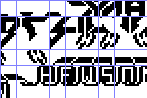

# Fonts

8 x 8 glyphs as indexed PNG, one cell a glyph, bit 7 at the left: palette index 0 a clear pixel, 1 a set one, 2 the
lines past the resource's end (not data). `tools/res_font.py` (Pillow) turns each `*.font.png` into the bytes the
source INCBINs and back; `tools/res_formats.py check` proves both ways, `python3 tools/res_font.py check FILE.bin`
does it for one file, `python3 tools/res_font.py preview FILE.bin OUT.png` draws the `*.preview.png` files (4x, a
grid line between glyphs).

| File | Address | Size | Format | Readers | Preview |
| --- | --- | --- | --- | --- | --- |
| `glyphs.font.png` | `$B54F-$B6FE` | 432 | 54 glyphs, 9 a row: the print codes `$80-$B5`, left to right | PrintChar `$A321` (HL = code x 8 + `$B14F`) |  |
| `romleftover.font.png` | `$FFD8-$FFFF` | 40 | the ROM's 'Q', 'R', 'S', 'T' and 'U' | as data: WorkGlyph `$FFD8`, ColumnFlags `$FFE0` |  |

`glyphs.font.png`: rows 1-4 (codes `$80-$A3`) are the pieces of the ZYNAPS logo, rows 5-6 (codes `$A4-$B5`) the rest of
the logo and the HEWSON name in its lettering (row 5). The codes below `$80` print with the ROM's character set.

`romleftover.font.png` is not a font the game prints with: the tape image ends with what was left in memory of a copy
of the ROM's character set (the 'P' tail at `$FFD4-$FFD7`, then 'Q'-'U' cut at `$FFFE`). The game only uses those
bytes as work space: WorkGlyph (`$FFD8`, 8 bytes, ScriptSetCell `$8EC5` copies a glyph there) and ColumnFlags
(`$FFE0-$FFFF`, cleared by LevelSetUp `$8C3B` at each level start). The 48K tape stops at `$FFFE`; the GS image
also holds `$FFFF`, `$3C`, the 'U''s last line (the block carries it), so here the resource is 40 bytes. The developer switch Invulnerable (`$FFD7`, the
last line of 'P', 0) is in the source as a byte, not here.
