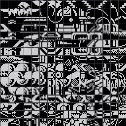
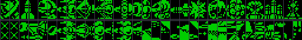
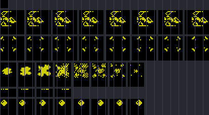
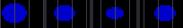

# Graphics

The game's tiles and sprites as indexed PNG, 1 bit a pixel: index 0 paper, 1 the drawn pixel, 2 the gap between
frames or rows (not data). `tools/res_gfx.py` turns each PNG into the bytes the source INCBINs and back
(`tools/res_formats.py check` proves both ways); `tools/res_preview.py` draws the `*.preview.png` files (2x, a grid
line between bytes, the sprites in their colours).

The pictures are the 48K tape's bytes, the same PNG files as the 48K case's. The GS game image is the memory after
the 48K start-up (`$B6FF`) ran, so its bytes differ in two ways, and `tools/res_gfx.py` undoes both on install and
redoes them on build:

- `$E000-$E747` and `$F048-$F107` are complemented (the start-up's work): in the GS image a sprite's set bit here is
  a clear bit. In play the object's paper colour (attribute +`$25`) shows through it, the rest of the cell stays
  black.
- The tiles and the wave cells are in the image twice: at `$5C00`/`$6400`, where the start-up copied them and the
  game reads them (TileGraphics, WaveCellGraphics), and still at `$BC00`/`$C400`. Both are built from one PNG
  (`tiles-tape.bin` and `wave-cells-tape.bin` are aliases in `tools/res_formats.py`, whose install checks that the
  two copies are equal). The wave cells are complemented when BuildCellSprite (`$8EDB`) copies them into the sprite
  cache.

| File | Address | Size | Format | Readers | Preview |
| --- | --- | --- | --- | --- | --- |
| `tiles.gfx.png` | `$5C00-$63FF` and `$BC00-$C3FF` | 2048 | 256 tiles of 8 x 8, 8 line pages: line y of tile t at y * 256 + t; the picture has 16 x 16 tiles, tile t at column t % 16, row t / 16 | BuildGlyph `$89C9` via TileSet `$7F6D` |  |
| `wave-cells.gfx.png` | `$6400-$67FF` and `$C400-$C7FF` | 1024 | 64 columns of 16 lines, column-major; kind A < 16 is 2 columns at A * 32, A >= 16 is 3 columns at `$220` + (A - 16) * 48; the picture has 2 rows of 32 columns | LoadCellSprite `$ACD9`, BuildCellSprite `$8EDB` |  |
| `sprites.gfx.png` | `$E000-$E747` | 1864 | six sets, a row each, frames side by side; a frame is columns of the set's height, one after another (table below) | BuildObjectStrips `$8FC2` (pointer), StripDraw `$8603` (POPs) |  |
| `pod.gfx.png` | `$F048-$F107` | 192 | 4 shifts (0, 2, 4, 6 pixels) of 3 columns x 16 lines | as above, descriptor `$7EBB` |  |

The sets of `sprites.gfx.png` (offsets from `$E000`, `SPRITE_SETS` in `tools/res_gfx.py`):

| Row | Address | Frames | Columns x lines | What | Descriptor |
| --- | --- | --- | --- | --- | --- |
| 1 | `$E000` | 1 | 1 x 8 | SpritePad: blank (zero on the tape, `$FF` in the GS image), read above the player's first column | |
| 2 | `$E008` | 8 shifts of 1 pixel | 3 x 24 | PlayerSprite, the ship | `$7E94` |
| 3 | `$E248` | 8 shifts of 1 pixel | 3 x 24 | SightSprite, the homing sight | `$7EAE` |
| 4 | `$E488` | 8 frames | 2 x 24 | ExplosionFrames (the descriptor's base `$E458`, frames 1-8) | `$7EA1` |
| 5 | `$E608` | 4 shifts of 2 pixels | 2 x 8 | LaserSprite, the laser shot | `$7EC8` |
| 6 | `$E648` | 8 shifts of 1 pixel | 2 x 16 | BallSprite, enemy shots and plasma balls | `$7ED5` |

Edit a sprite by editing all its shifts alike: the game does not shift at run time, it picks the copy.
